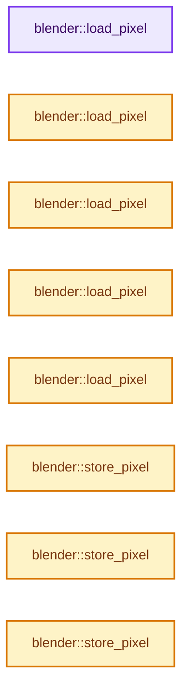
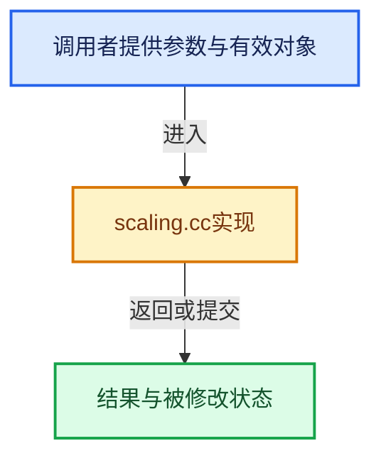

# 实现依赖专题：source/blender/imbuf/intern/scaling.cc

[方向导航](README.md) · [符号索引](../%E7%AC%A6%E5%8F%B7%E4%BE%9D%E8%B5%96%E4%B8%8E%E5%AE%9E%E7%8E%B0%E7%B4%A2%E5%BC%95.md)

本专题从正文实际调用进入，集中保存共享实现。函数有稳定锚点，可从调用处直接跳到对应完整函数；递归与互相调用通过回链组织。

## 本文件的实现关系






## 完整成员与函数实现

<a id="f-742072df848b3c6a"></a>

### `blender::load_pixel`

实现位置：[source/blender/imbuf/intern/scaling.cc](../../../../../source/blender/imbuf/intern/scaling.cc) · L26—L29。

接口参数：

- `const uchar4 *ptr`

**教学注释版**

<!-- annotated:436a654d711793 -->

```cpp
static inline float4 load_pixel(const uchar4 *ptr)
{
  return float4(ptr[0]);
}
```

<details>
<summary>核对原始源码：source/blender/imbuf/intern/scaling.cc · L26—L29</summary>

<!-- original:436a654d711793:source/blender/imbuf/intern/scaling.cc:26:29 -->

```cpp
static inline float4 load_pixel(const uchar4 *ptr)
{
  return float4(ptr[0]);
}
```

</details>

**结果出口**

- `return float4(ptr[0]);`

**继续追踪实现**

- `float4` → [float4 · L56](%E4%BE%9D%E8%B5%96-radial_tiling_shared-98abf9.md#m-f0908e385c5b)；[float4 · L60](../01-%E5%9F%BA%E7%A1%80%E5%AE%B9%E5%99%A8%E4%B8%8E%E7%8E%B0%E4%BB%A3CPP/%E4%BE%9D%E8%B5%96-radial_tiling_shared-7989a4.md#m-7962dcdc288b)；[float4 · L56](%E4%BE%9D%E8%B5%96-node_radial_tiling_shared-b14bc2.md#m-adb8e9e87775)；[float4 · L642](%E4%BE%9D%E8%B5%96-smaa-b67bc2.md#m-9362daaa821c)。宏定义由构建条件选择。

<a id="f-9606108cb5ee3761"></a>

### `blender::load_pixel`

实现位置：[source/blender/imbuf/intern/scaling.cc](../../../../../source/blender/imbuf/intern/scaling.cc) · L30—L33。

接口参数：

- `const float *ptr`

**教学注释版**

<!-- annotated:dd9f64641519fe -->

```cpp
static inline float4 load_pixel(const float *ptr)
{
  return float4(ptr[0]);
}
```

<details>
<summary>核对原始源码：source/blender/imbuf/intern/scaling.cc · L30—L33</summary>

<!-- original:dd9f64641519fe:source/blender/imbuf/intern/scaling.cc:30:33 -->

```cpp
static inline float4 load_pixel(const float *ptr)
{
  return float4(ptr[0]);
}
```

</details>

**结果出口**

- `return float4(ptr[0]);`

**继续追踪实现**

- `float4` → [float4 · L56](%E4%BE%9D%E8%B5%96-radial_tiling_shared-98abf9.md#m-f0908e385c5b)；[float4 · L60](../01-%E5%9F%BA%E7%A1%80%E5%AE%B9%E5%99%A8%E4%B8%8E%E7%8E%B0%E4%BB%A3CPP/%E4%BE%9D%E8%B5%96-radial_tiling_shared-7989a4.md#m-7962dcdc288b)；[float4 · L56](%E4%BE%9D%E8%B5%96-node_radial_tiling_shared-b14bc2.md#m-adb8e9e87775)；[float4 · L642](%E4%BE%9D%E8%B5%96-smaa-b67bc2.md#m-9362daaa821c)。宏定义由构建条件选择。

<a id="f-b5b741950adb841c"></a>

### `blender::load_pixel`

实现位置：[source/blender/imbuf/intern/scaling.cc](../../../../../source/blender/imbuf/intern/scaling.cc) · L34—L37。

接口参数：

- `const float2 *ptr`

**教学注释版**

<!-- annotated:8f8d7f388343ab -->

```cpp
static inline float4 load_pixel(const float2 *ptr)
{
  return float4(ptr[0], 0.0f, 1.0f);
}
```

<details>
<summary>核对原始源码：source/blender/imbuf/intern/scaling.cc · L34—L37</summary>

<!-- original:8f8d7f388343ab:source/blender/imbuf/intern/scaling.cc:34:37 -->

```cpp
static inline float4 load_pixel(const float2 *ptr)
{
  return float4(ptr[0], 0.0f, 1.0f);
}
```

</details>

**结果出口**

- `return float4(ptr[0], 0.0f, 1.0f);`

**继续追踪实现**

- `float4` → [float4 · L56](%E4%BE%9D%E8%B5%96-radial_tiling_shared-98abf9.md#m-f0908e385c5b)；[float4 · L60](../01-%E5%9F%BA%E7%A1%80%E5%AE%B9%E5%99%A8%E4%B8%8E%E7%8E%B0%E4%BB%A3CPP/%E4%BE%9D%E8%B5%96-radial_tiling_shared-7989a4.md#m-7962dcdc288b)；[float4 · L56](%E4%BE%9D%E8%B5%96-node_radial_tiling_shared-b14bc2.md#m-adb8e9e87775)；[float4 · L642](%E4%BE%9D%E8%B5%96-smaa-b67bc2.md#m-9362daaa821c)。宏定义由构建条件选择。

<a id="f-d834aa33dfc40127"></a>

### `blender::load_pixel`

实现位置：[source/blender/imbuf/intern/scaling.cc](../../../../../source/blender/imbuf/intern/scaling.cc) · L38—L41。

接口参数：

- `const float3 *ptr`

**教学注释版**

<!-- annotated:83272e35449e59 -->

```cpp
static inline float4 load_pixel(const float3 *ptr)
{
  return float4(ptr[0], 1.0f);
}
```

<details>
<summary>核对原始源码：source/blender/imbuf/intern/scaling.cc · L38—L41</summary>

<!-- original:83272e35449e59:source/blender/imbuf/intern/scaling.cc:38:41 -->

```cpp
static inline float4 load_pixel(const float3 *ptr)
{
  return float4(ptr[0], 1.0f);
}
```

</details>

**结果出口**

- `return float4(ptr[0], 1.0f);`

**继续追踪实现**

- `float4` → [float4 · L56](%E4%BE%9D%E8%B5%96-radial_tiling_shared-98abf9.md#m-f0908e385c5b)；[float4 · L60](../01-%E5%9F%BA%E7%A1%80%E5%AE%B9%E5%99%A8%E4%B8%8E%E7%8E%B0%E4%BB%A3CPP/%E4%BE%9D%E8%B5%96-radial_tiling_shared-7989a4.md#m-7962dcdc288b)；[float4 · L56](%E4%BE%9D%E8%B5%96-node_radial_tiling_shared-b14bc2.md#m-adb8e9e87775)；[float4 · L642](%E4%BE%9D%E8%B5%96-smaa-b67bc2.md#m-9362daaa821c)。宏定义由构建条件选择。

<a id="f-616c0e2e20027afc"></a>

### `blender::load_pixel`

实现位置：[source/blender/imbuf/intern/scaling.cc](../../../../../source/blender/imbuf/intern/scaling.cc) · L42—L45。

接口参数：

- `const float4 *ptr`

**教学注释版**

<!-- annotated:8519a3aae68f68 -->

```cpp
static inline float4 load_pixel(const float4 *ptr)
{
  return float4(ptr[0]);
}
```

<details>
<summary>核对原始源码：source/blender/imbuf/intern/scaling.cc · L42—L45</summary>

<!-- original:8519a3aae68f68:source/blender/imbuf/intern/scaling.cc:42:45 -->

```cpp
static inline float4 load_pixel(const float4 *ptr)
{
  return float4(ptr[0]);
}
```

</details>

**结果出口**

- `return float4(ptr[0]);`

**继续追踪实现**

- `float4` → [float4 · L56](%E4%BE%9D%E8%B5%96-radial_tiling_shared-98abf9.md#m-f0908e385c5b)；[float4 · L60](../01-%E5%9F%BA%E7%A1%80%E5%AE%B9%E5%99%A8%E4%B8%8E%E7%8E%B0%E4%BB%A3CPP/%E4%BE%9D%E8%B5%96-radial_tiling_shared-7989a4.md#m-7962dcdc288b)；[float4 · L56](%E4%BE%9D%E8%B5%96-node_radial_tiling_shared-b14bc2.md#m-adb8e9e87775)；[float4 · L642](%E4%BE%9D%E8%B5%96-smaa-b67bc2.md#m-9362daaa821c)。宏定义由构建条件选择。

<a id="f-e4629467bd032a4e"></a>

### `blender::store_pixel`

实现位置：[source/blender/imbuf/intern/scaling.cc](../../../../../source/blender/imbuf/intern/scaling.cc) · L46—L49。

接口参数：

- `float4 pix`
- `uchar4 *ptr`

**教学注释版**

<!-- annotated:01afa461f20f20 -->

```cpp
static inline void store_pixel(float4 pix, uchar4 *ptr)
{
  *ptr = uchar4(math::round(pix));
}
```

<details>
<summary>核对原始源码：source/blender/imbuf/intern/scaling.cc · L46—L49</summary>

<!-- original:01afa461f20f20:source/blender/imbuf/intern/scaling.cc:46:49 -->

```cpp
static inline void store_pixel(float4 pix, uchar4 *ptr)
{
  *ptr = uchar4(math::round(pix));
}
```

</details>

**继续追踪实现**

- `uchar4` → [uchar4](%E4%BE%9D%E8%B5%96-types_uchar4-f8b270.md#t-635bfd0715ec)。
- `math::round` → [blender::math::round · L363](../12-%E7%A9%BA%E9%97%B4%E6%95%B0%E6%8D%AE%E7%BB%93%E6%9E%84%E4%B8%8E%E5%87%A0%E4%BD%95%E7%AE%97%E6%B3%95/%E4%BE%9D%E8%B5%96-BLI_math_vector-906a87.md#f-1bcb65cf7579edc2)；[blender::math::round · L117](../12-%E7%A9%BA%E9%97%B4%E6%95%B0%E6%8D%AE%E7%BB%93%E6%9E%84%E4%B8%8E%E5%87%A0%E4%BD%95%E7%AE%97%E6%B3%95/%E4%BE%9D%E8%B5%96-BLI_math_base-0728eb.md#f-b17df878cb46bc94)。同名重载需按实参类型选择。

<a id="f-45bdad7f58220d44"></a>

### `blender::store_pixel`

实现位置：[source/blender/imbuf/intern/scaling.cc](../../../../../source/blender/imbuf/intern/scaling.cc) · L50—L53。

接口参数：

- `float4 pix`
- `float *ptr`

**教学注释版**

<!-- annotated:ed9ab1cf51b5c9 -->

```cpp
static inline void store_pixel(float4 pix, float *ptr)
{
  *ptr = pix.x;
}
```

<details>
<summary>核对原始源码：source/blender/imbuf/intern/scaling.cc · L50—L53</summary>

<!-- original:ed9ab1cf51b5c9:source/blender/imbuf/intern/scaling.cc:50:53 -->

```cpp
static inline void store_pixel(float4 pix, float *ptr)
{
  *ptr = pix.x;
}
```

</details>

**继续追踪实现**

本实现没有需要继续展开的显式调用；检查返回表达式、对象转换和调用者前置条件。

<a id="f-5ac46a38c70867ac"></a>

### `blender::store_pixel`

实现位置：[source/blender/imbuf/intern/scaling.cc](../../../../../source/blender/imbuf/intern/scaling.cc) · L54—L57。

接口参数：

- `float4 pix`
- `float2 *ptr`

**教学注释版**

<!-- annotated:eda582b0ee4671 -->

```cpp
static inline void store_pixel(float4 pix, float2 *ptr)
{
  // [讲解] memcpy：复制字节，源与目标不应重叠。类型生命周期、对齐和可复制表示须由调用者证明，不是任意对象的复制构造。
  memcpy(reinterpret_cast<void *>(ptr), &pix, sizeof(*ptr));
}
```

<details>
<summary>核对原始源码：source/blender/imbuf/intern/scaling.cc · L54—L57</summary>

<!-- original:eda582b0ee4671:source/blender/imbuf/intern/scaling.cc:54:57 -->

```cpp
static inline void store_pixel(float4 pix, float2 *ptr)
{
  memcpy(reinterpret_cast<void *>(ptr), &pix, sizeof(*ptr));
}
```

</details>

**继续追踪实现**

- `memcpy` → [外部契约](https://eel.is/c++draft/cstring.syn)：复制字节，源与目标不应重叠。类型生命周期、对齐和可复制表示须由调用者证明，不是任意对象的复制构造。

<a id="f-4c8170a193e575cb"></a>

### `blender::store_pixel`

实现位置：[source/blender/imbuf/intern/scaling.cc](../../../../../source/blender/imbuf/intern/scaling.cc) · L58—L61。

接口参数：

- `float4 pix`
- `float3 *ptr`

**教学注释版**

<!-- annotated:c2d468256c015a -->

```cpp
static inline void store_pixel(float4 pix, float3 *ptr)
{
  // [讲解] memcpy：复制字节，源与目标不应重叠。类型生命周期、对齐和可复制表示须由调用者证明，不是任意对象的复制构造。
  memcpy(reinterpret_cast<void *>(ptr), &pix, sizeof(*ptr));
}
```

<details>
<summary>核对原始源码：source/blender/imbuf/intern/scaling.cc · L58—L61</summary>

<!-- original:c2d468256c015a:source/blender/imbuf/intern/scaling.cc:58:61 -->

```cpp
static inline void store_pixel(float4 pix, float3 *ptr)
{
  memcpy(reinterpret_cast<void *>(ptr), &pix, sizeof(*ptr));
}
```

</details>

**继续追踪实现**

- `memcpy` → [外部契约](https://eel.is/c++draft/cstring.syn)：复制字节，源与目标不应重叠。类型生命周期、对齐和可复制表示须由调用者证明，不是任意对象的复制构造。

<a id="f-d59aa74c55cff34b"></a>

### `blender::store_pixel`

实现位置：[source/blender/imbuf/intern/scaling.cc](../../../../../source/blender/imbuf/intern/scaling.cc) · L62—L65。

接口参数：

- `float4 pix`
- `float4 *ptr`

**教学注释版**

<!-- annotated:02b8721ae14034 -->

```cpp
static inline void store_pixel(float4 pix, float4 *ptr)
{
  *ptr = pix;
}
```

<details>
<summary>核对原始源码：source/blender/imbuf/intern/scaling.cc · L62—L65</summary>

<!-- original:02b8721ae14034:source/blender/imbuf/intern/scaling.cc:62:65 -->

```cpp
static inline void store_pixel(float4 pix, float4 *ptr)
{
  *ptr = pix;
}
```

</details>

**继续追踪实现**

本实现没有需要继续展开的显式调用；检查返回表达式、对象转换和调用者前置条件。

<a id="f-79bcfb9f325cc49c"></a>

### `blender::to_static_pixel_type`

实现位置：[source/blender/imbuf/intern/scaling.cc](../../../../../source/blender/imbuf/intern/scaling.cc) · L67—L93。

接口参数：

- `const BufferT *src_buffer`
- `const int channels`
- `BufferT *dst_buffer`
- `const Fn &fn`

**教学注释版**

<!-- annotated:6b0a571e8e2384 -->

```cpp
template<typename BufferT, typename Fn>
static void to_static_pixel_type(const BufferT *src_buffer,
                                 const int channels,
                                 BufferT *dst_buffer,
                                 const Fn &fn)
{
  if constexpr (std::is_same_v<BufferT, uchar>) {
    fn(reinterpret_cast<const uchar4 *>(src_buffer), reinterpret_cast<uchar4 *>(dst_buffer));
  }
  else {
    if (channels == 1) {
      fn(src_buffer, dst_buffer);
    }
    else if (channels == 2) {
      const float2 *src = reinterpret_cast<const float2 *>(src_buffer);
      fn(src, reinterpret_cast<float2 *>(dst_buffer));
    }
    else if (channels == 3) {
      const float3 *src = reinterpret_cast<const float3 *>(src_buffer);
      fn(src, reinterpret_cast<float3 *>(dst_buffer));
    }
    else if (channels == 4) {
      const float4 *src = reinterpret_cast<const float4 *>(src_buffer);
      fn(src, reinterpret_cast<float4 *>(dst_buffer));
    }
  }
}
```

<details>
<summary>核对原始源码：source/blender/imbuf/intern/scaling.cc · L67—L93</summary>

<!-- original:6b0a571e8e2384:source/blender/imbuf/intern/scaling.cc:67:93 -->

```cpp
template<typename BufferT, typename Fn>
static void to_static_pixel_type(const BufferT *src_buffer,
                                 const int channels,
                                 BufferT *dst_buffer,
                                 const Fn &fn)
{
  if constexpr (std::is_same_v<BufferT, uchar>) {
    fn(reinterpret_cast<const uchar4 *>(src_buffer), reinterpret_cast<uchar4 *>(dst_buffer));
  }
  else {
    if (channels == 1) {
      fn(src_buffer, dst_buffer);
    }
    else if (channels == 2) {
      const float2 *src = reinterpret_cast<const float2 *>(src_buffer);
      fn(src, reinterpret_cast<float2 *>(dst_buffer));
    }
    else if (channels == 3) {
      const float3 *src = reinterpret_cast<const float3 *>(src_buffer);
      fn(src, reinterpret_cast<float3 *>(dst_buffer));
    }
    else if (channels == 4) {
      const float4 *src = reinterpret_cast<const float4 *>(src_buffer);
      fn(src, reinterpret_cast<float4 *>(dst_buffer));
    }
  }
}
```

</details>

**继续追踪实现**

- `fn` → [调用协议](../%E6%A8%A1%E6%9D%BF%E5%AE%8F%E4%B8%8E%E5%8A%A8%E6%80%81%E5%88%86%E6%B4%BE%E5%8D%8F%E8%AE%AE.md)：局部可调用对象，须结合其初始化与捕获环境。调用位置L74。

<a id="f-276a5fedb39011cd"></a>

### `blender::scale_down_x_func`

实现位置：[source/blender/imbuf/intern/scaling.cc](../../../../../source/blender/imbuf/intern/scaling.cc) · L95—L140。

接口参数：

- `const BufferT *src_buffer`
- `const int2 src_size`
- `const int src_stride`
- `const int channels`
- `BufferT *dst_buffer`
- `const int2 dst_size`
- `bool threaded`

**教学注释版**

<!-- annotated:699fc44c5b8ec9 -->

```cpp
template<typename BufferT>
static void scale_down_x_func(const BufferT *src_buffer,
                              const int2 src_size,
                              const int src_stride,
                              const int channels,
                              BufferT *dst_buffer,
                              const int2 dst_size,
                              bool threaded)
{
  const int newx = dst_size.x;
  const int ibufx = src_size.x;
  const int ibufy = src_size.y;
  to_static_pixel_type(src_buffer, channels, dst_buffer, [&]<typename T>(const T *src, T *dst) {
    const float add = (ibufx - 0.01f) / newx;
    const float inv_add = 1.0f / add;

    const int grain_size = threaded ? 32 : ibufy;
    threading::parallel_for(IndexRange(ibufy), grain_size, [&](IndexRange range) {
      for (const int y : range) {
        const T *src_ptr = src + (int64_t(y) * src_stride);
        T *dst_ptr = dst + (int64_t(y) * newx);
        float sample = 0.0f;
        float4 val(0.0f);

        for (int x = 0; x < newx; x++) {
          float4 nval = -val * sample;
          sample += add;
          while (sample >= 1.0f) {
            sample -= 1.0f;
            nval += load_pixel(src_ptr);
            src_ptr++;
          }

          val = load_pixel(src_ptr);
          src_ptr++;

          float4 pix = (nval + sample * val) * inv_add;
          store_pixel(pix, dst_ptr);
          dst_ptr++;

          sample -= 1.0f;
        }
      }
    });
  });
}
```

<details>
<summary>核对原始源码：source/blender/imbuf/intern/scaling.cc · L95—L140</summary>

<!-- original:699fc44c5b8ec9:source/blender/imbuf/intern/scaling.cc:95:140 -->

```cpp
template<typename BufferT>
static void scale_down_x_func(const BufferT *src_buffer,
                              const int2 src_size,
                              const int src_stride,
                              const int channels,
                              BufferT *dst_buffer,
                              const int2 dst_size,
                              bool threaded)
{
  const int newx = dst_size.x;
  const int ibufx = src_size.x;
  const int ibufy = src_size.y;
  to_static_pixel_type(src_buffer, channels, dst_buffer, [&]<typename T>(const T *src, T *dst) {
    const float add = (ibufx - 0.01f) / newx;
    const float inv_add = 1.0f / add;

    const int grain_size = threaded ? 32 : ibufy;
    threading::parallel_for(IndexRange(ibufy), grain_size, [&](IndexRange range) {
      for (const int y : range) {
        const T *src_ptr = src + (int64_t(y) * src_stride);
        T *dst_ptr = dst + (int64_t(y) * newx);
        float sample = 0.0f;
        float4 val(0.0f);

        for (int x = 0; x < newx; x++) {
          float4 nval = -val * sample;
          sample += add;
          while (sample >= 1.0f) {
            sample -= 1.0f;
            nval += load_pixel(src_ptr);
            src_ptr++;
          }

          val = load_pixel(src_ptr);
          src_ptr++;

          float4 pix = (nval + sample * val) * inv_add;
          store_pixel(pix, dst_ptr);
          dst_ptr++;

          sample -= 1.0f;
        }
      }
    });
  });
}
```

</details>

**沿实际写入检查状态**

- `sample += add;`
- `sample -= 1.0f;`
- `nval += load_pixel(src_ptr);`
- `val = load_pixel(src_ptr);`

**继续追踪实现**

- `to_static_pixel_type` → [blender::to_static_pixel_type · L67](%E4%BE%9D%E8%B5%96-scaling-da6dee.md#f-79bcfb9f325cc49c)。
- `threading::parallel_for` → [blender::threading::parallel_for · L68](../11-Depsgraph%E4%B8%8E%E5%B9%B6%E8%A1%8C%E4%BB%BB%E5%8A%A1%E7%B3%BB%E7%BB%9F/07-%E4%BB%BB%E5%8A%A1%E6%B1%A0%E4%B8%8ETBB%E6%8E%A5%E5%85%A5.md#f-838294754c24426c)。
- `IndexRange` → [blender::IndexRange](../01-%E5%9F%BA%E7%A1%80%E5%AE%B9%E5%99%A8%E4%B8%8E%E7%8E%B0%E4%BB%A3CPP/%E4%BE%9D%E8%B5%96-BLI_index_range-7d7cc5.md#t-caa3466d6776)；[blender::gpu::shader::parser::IndexRange](%E4%BE%9D%E8%B5%96-utils-06433d.md#t-82d2bd4ea71c)；[blender::IndexRange](%E4%BE%9D%E8%B5%96-DNA_node_types-6708b9.md#t-0448cc889d39)。
- `load_pixel` → [blender::load_pixel · L26](%E4%BE%9D%E8%B5%96-scaling-da6dee.md#f-742072df848b3c6a)；[blender::load_pixel · L30](%E4%BE%9D%E8%B5%96-scaling-da6dee.md#f-9606108cb5ee3761)；[blender::load_pixel · L34](%E4%BE%9D%E8%B5%96-scaling-da6dee.md#f-b5b741950adb841c)；[blender::load_pixel · L38](%E4%BE%9D%E8%B5%96-scaling-da6dee.md#f-d834aa33dfc40127)；[blender::load_pixel · L42](%E4%BE%9D%E8%B5%96-scaling-da6dee.md#f-616c0e2e20027afc)。同名重载需按实参类型选择。
- `store_pixel` → [blender::store_pixel · L46](%E4%BE%9D%E8%B5%96-scaling-da6dee.md#f-e4629467bd032a4e)；[blender::store_pixel · L50](%E4%BE%9D%E8%B5%96-scaling-da6dee.md#f-45bdad7f58220d44)；[blender::store_pixel · L54](%E4%BE%9D%E8%B5%96-scaling-da6dee.md#f-5ac46a38c70867ac)；[blender::store_pixel · L58](%E4%BE%9D%E8%B5%96-scaling-da6dee.md#f-4c8170a193e575cb)；[blender::store_pixel · L62](%E4%BE%9D%E8%B5%96-scaling-da6dee.md#f-d59aa74c55cff34b)。同名重载需按实参类型选择。

<a id="f-0ab093ec425cab5b"></a>

### `blender::scale_down_y_func`

实现位置：[source/blender/imbuf/intern/scaling.cc](../../../../../source/blender/imbuf/intern/scaling.cc) · L142—L186。

接口参数：

- `const BufferT *src_buffer`
- `const int2 src_size`
- `const int channels`
- `BufferT *dst_buffer`
- `const int2 dst_size`
- `bool threaded`

**教学注释版**

<!-- annotated:e31c83899dc74e -->

```cpp
template<typename BufferT>
static void scale_down_y_func(const BufferT *src_buffer,
                              const int2 src_size,
                              const int channels,
                              BufferT *dst_buffer,
                              const int2 dst_size,
                              bool threaded)
{
  const int newy = dst_size.y;
  const int ibufx = src_size.x;
  const int ibufy = src_size.y;
  to_static_pixel_type(src_buffer, channels, dst_buffer, [&]<typename T>(const T *src, T *dst) {
    const float add = (ibufy - 0.01f) / newy;
    const float inv_add = 1.0f / add;

    const int grain_size = threaded ? 32 : ibufx;
    threading::parallel_for(IndexRange(ibufx), grain_size, [&](IndexRange range) {
      for (const int x : range) {
        const T *src_ptr = src + x;
        T *dst_ptr = dst + x;
        float sample = 0.0f;
        float4 val(0.0f);

        for (int y = 0; y < newy; y++) {
          float4 nval = -val * sample;
          sample += add;
          while (sample >= 1.0f) {
            sample -= 1.0f;
            nval += load_pixel(src_ptr);
            src_ptr += ibufx;
          }

          val = load_pixel(src_ptr);
          src_ptr += ibufx;

          float4 pix = (nval + sample * val) * inv_add;
          store_pixel(pix, dst_ptr);
          dst_ptr += ibufx;

          sample -= 1.0f;
        }
      }
    });
  });
}
```

<details>
<summary>核对原始源码：source/blender/imbuf/intern/scaling.cc · L142—L186</summary>

<!-- original:e31c83899dc74e:source/blender/imbuf/intern/scaling.cc:142:186 -->

```cpp
template<typename BufferT>
static void scale_down_y_func(const BufferT *src_buffer,
                              const int2 src_size,
                              const int channels,
                              BufferT *dst_buffer,
                              const int2 dst_size,
                              bool threaded)
{
  const int newy = dst_size.y;
  const int ibufx = src_size.x;
  const int ibufy = src_size.y;
  to_static_pixel_type(src_buffer, channels, dst_buffer, [&]<typename T>(const T *src, T *dst) {
    const float add = (ibufy - 0.01f) / newy;
    const float inv_add = 1.0f / add;

    const int grain_size = threaded ? 32 : ibufx;
    threading::parallel_for(IndexRange(ibufx), grain_size, [&](IndexRange range) {
      for (const int x : range) {
        const T *src_ptr = src + x;
        T *dst_ptr = dst + x;
        float sample = 0.0f;
        float4 val(0.0f);

        for (int y = 0; y < newy; y++) {
          float4 nval = -val * sample;
          sample += add;
          while (sample >= 1.0f) {
            sample -= 1.0f;
            nval += load_pixel(src_ptr);
            src_ptr += ibufx;
          }

          val = load_pixel(src_ptr);
          src_ptr += ibufx;

          float4 pix = (nval + sample * val) * inv_add;
          store_pixel(pix, dst_ptr);
          dst_ptr += ibufx;

          sample -= 1.0f;
        }
      }
    });
  });
}
```

</details>

**沿实际写入检查状态**

- `sample += add;`
- `sample -= 1.0f;`
- `nval += load_pixel(src_ptr);`
- `src_ptr += ibufx;`
- `val = load_pixel(src_ptr);`
- `dst_ptr += ibufx;`

**继续追踪实现**

- `to_static_pixel_type` → [blender::to_static_pixel_type · L67](%E4%BE%9D%E8%B5%96-scaling-da6dee.md#f-79bcfb9f325cc49c)。
- `threading::parallel_for` → [blender::threading::parallel_for · L68](../11-Depsgraph%E4%B8%8E%E5%B9%B6%E8%A1%8C%E4%BB%BB%E5%8A%A1%E7%B3%BB%E7%BB%9F/07-%E4%BB%BB%E5%8A%A1%E6%B1%A0%E4%B8%8ETBB%E6%8E%A5%E5%85%A5.md#f-838294754c24426c)。
- `IndexRange` → [blender::IndexRange](../01-%E5%9F%BA%E7%A1%80%E5%AE%B9%E5%99%A8%E4%B8%8E%E7%8E%B0%E4%BB%A3CPP/%E4%BE%9D%E8%B5%96-BLI_index_range-7d7cc5.md#t-caa3466d6776)；[blender::gpu::shader::parser::IndexRange](%E4%BE%9D%E8%B5%96-utils-06433d.md#t-82d2bd4ea71c)；[blender::IndexRange](%E4%BE%9D%E8%B5%96-DNA_node_types-6708b9.md#t-0448cc889d39)。
- `load_pixel` → [blender::load_pixel · L26](%E4%BE%9D%E8%B5%96-scaling-da6dee.md#f-742072df848b3c6a)；[blender::load_pixel · L30](%E4%BE%9D%E8%B5%96-scaling-da6dee.md#f-9606108cb5ee3761)；[blender::load_pixel · L34](%E4%BE%9D%E8%B5%96-scaling-da6dee.md#f-b5b741950adb841c)；[blender::load_pixel · L38](%E4%BE%9D%E8%B5%96-scaling-da6dee.md#f-d834aa33dfc40127)；[blender::load_pixel · L42](%E4%BE%9D%E8%B5%96-scaling-da6dee.md#f-616c0e2e20027afc)。同名重载需按实参类型选择。
- `store_pixel` → [blender::store_pixel · L46](%E4%BE%9D%E8%B5%96-scaling-da6dee.md#f-e4629467bd032a4e)；[blender::store_pixel · L50](%E4%BE%9D%E8%B5%96-scaling-da6dee.md#f-45bdad7f58220d44)；[blender::store_pixel · L54](%E4%BE%9D%E8%B5%96-scaling-da6dee.md#f-5ac46a38c70867ac)；[blender::store_pixel · L58](%E4%BE%9D%E8%B5%96-scaling-da6dee.md#f-4c8170a193e575cb)；[blender::store_pixel · L62](%E4%BE%9D%E8%B5%96-scaling-da6dee.md#f-d59aa74c55cff34b)。同名重载需按实参类型选择。

<a id="f-b40e4034b3a1b36e"></a>

### `blender::scale_up_x_func`

实现位置：[source/blender/imbuf/intern/scaling.cc](../../../../../source/blender/imbuf/intern/scaling.cc) · L188—L247。

接口参数：

- `const BufferT *src_buffer`
- `const int2 src_size`
- `const int src_stride`
- `const int channels`
- `BufferT *dst_buffer`
- `const int2 dst_size`
- `bool threaded`

**教学注释版**

<!-- annotated:09e00904b3526e -->

```cpp
template<typename BufferT>
static void scale_up_x_func(const BufferT *src_buffer,
                            const int2 src_size,
                            const int src_stride,
                            const int channels,
                            BufferT *dst_buffer,
                            const int2 dst_size,
                            bool threaded)
{
  const int newx = dst_size.x;
  const int ibufx = src_size.x;
  const int ibufy = src_size.y;
  to_static_pixel_type(src_buffer, channels, dst_buffer, [&]<typename T>(const T *src, T *dst) {
    const float add = (ibufx - 0.001f) / newx;
    /* Special case: source is 1px wide (see #70356). */
    if (ibufx == 1) [[unlikely]] {
      for (int y = ibufy; y > 0; y--) {
        for (int x = newx; x > 0; x--) {
          *dst = *src;
          dst++;
        }
        src += src_stride;
      }
    }
    else {
      const int grain_size = threaded ? 32 : ibufy;
      threading::parallel_for(IndexRange(ibufy), grain_size, [&](IndexRange range) {
        for (const int y : range) {
          float sample = -0.5f + add * 0.5f;
          int counter = 0;
          const T *src_ptr = src + (int64_t(y) * src_stride);
          T *dst_ptr = dst + (int64_t(y) * newx);
          float4 val = load_pixel(src_ptr);
          float4 nval = load_pixel(src_ptr + 1);
          float4 diff = nval - val;
          if (ibufx > 2) {
            src_ptr += 2;
            counter += 2;
          }
          for (int x = 0; x < newx; x++) {
            if (sample >= 1.0f) {
              sample -= 1.0f;
              val = nval;
              nval = load_pixel(src_ptr);
              diff = nval - val;
              if (counter + 1 < ibufx) {
                src_ptr++;
                counter++;
              }
            }
            float4 pix = val + math::max(sample, 0.0f) * diff;
            store_pixel(pix, dst_ptr);
            dst_ptr++;
            sample += add;
          }
        }
      });
    }
  });
}
```

<details>
<summary>核对原始源码：source/blender/imbuf/intern/scaling.cc · L188—L247</summary>

<!-- original:09e00904b3526e:source/blender/imbuf/intern/scaling.cc:188:247 -->

```cpp
template<typename BufferT>
static void scale_up_x_func(const BufferT *src_buffer,
                            const int2 src_size,
                            const int src_stride,
                            const int channels,
                            BufferT *dst_buffer,
                            const int2 dst_size,
                            bool threaded)
{
  const int newx = dst_size.x;
  const int ibufx = src_size.x;
  const int ibufy = src_size.y;
  to_static_pixel_type(src_buffer, channels, dst_buffer, [&]<typename T>(const T *src, T *dst) {
    const float add = (ibufx - 0.001f) / newx;
    /* Special case: source is 1px wide (see #70356). */
    if (ibufx == 1) [[unlikely]] {
      for (int y = ibufy; y > 0; y--) {
        for (int x = newx; x > 0; x--) {
          *dst = *src;
          dst++;
        }
        src += src_stride;
      }
    }
    else {
      const int grain_size = threaded ? 32 : ibufy;
      threading::parallel_for(IndexRange(ibufy), grain_size, [&](IndexRange range) {
        for (const int y : range) {
          float sample = -0.5f + add * 0.5f;
          int counter = 0;
          const T *src_ptr = src + (int64_t(y) * src_stride);
          T *dst_ptr = dst + (int64_t(y) * newx);
          float4 val = load_pixel(src_ptr);
          float4 nval = load_pixel(src_ptr + 1);
          float4 diff = nval - val;
          if (ibufx > 2) {
            src_ptr += 2;
            counter += 2;
          }
          for (int x = 0; x < newx; x++) {
            if (sample >= 1.0f) {
              sample -= 1.0f;
              val = nval;
              nval = load_pixel(src_ptr);
              diff = nval - val;
              if (counter + 1 < ibufx) {
                src_ptr++;
                counter++;
              }
            }
            float4 pix = val + math::max(sample, 0.0f) * diff;
            store_pixel(pix, dst_ptr);
            dst_ptr++;
            sample += add;
          }
        }
      });
    }
  });
}
```

</details>

**沿实际写入检查状态**

- `src += src_stride;`
- `src_ptr += 2;`
- `counter += 2;`
- `sample -= 1.0f;`
- `val = nval;`
- `nval = load_pixel(src_ptr);`
- `diff = nval - val;`
- `sample += add;`

**继续追踪实现**

- `to_static_pixel_type` → [blender::to_static_pixel_type · L67](%E4%BE%9D%E8%B5%96-scaling-da6dee.md#f-79bcfb9f325cc49c)。
- `threading::parallel_for` → [blender::threading::parallel_for · L68](../11-Depsgraph%E4%B8%8E%E5%B9%B6%E8%A1%8C%E4%BB%BB%E5%8A%A1%E7%B3%BB%E7%BB%9F/07-%E4%BB%BB%E5%8A%A1%E6%B1%A0%E4%B8%8ETBB%E6%8E%A5%E5%85%A5.md#f-838294754c24426c)。
- `IndexRange` → [blender::IndexRange](../01-%E5%9F%BA%E7%A1%80%E5%AE%B9%E5%99%A8%E4%B8%8E%E7%8E%B0%E4%BB%A3CPP/%E4%BE%9D%E8%B5%96-BLI_index_range-7d7cc5.md#t-caa3466d6776)；[blender::gpu::shader::parser::IndexRange](%E4%BE%9D%E8%B5%96-utils-06433d.md#t-82d2bd4ea71c)；[blender::IndexRange](%E4%BE%9D%E8%B5%96-DNA_node_types-6708b9.md#t-0448cc889d39)。
- `load_pixel` → [blender::load_pixel · L26](%E4%BE%9D%E8%B5%96-scaling-da6dee.md#f-742072df848b3c6a)；[blender::load_pixel · L30](%E4%BE%9D%E8%B5%96-scaling-da6dee.md#f-9606108cb5ee3761)；[blender::load_pixel · L34](%E4%BE%9D%E8%B5%96-scaling-da6dee.md#f-b5b741950adb841c)；[blender::load_pixel · L38](%E4%BE%9D%E8%B5%96-scaling-da6dee.md#f-d834aa33dfc40127)；[blender::load_pixel · L42](%E4%BE%9D%E8%B5%96-scaling-da6dee.md#f-616c0e2e20027afc)。同名重载需按实参类型选择。
- `math::max` → [blender::math::max · L87](../12-%E7%A9%BA%E9%97%B4%E6%95%B0%E6%8D%AE%E7%BB%93%E6%9E%84%E4%B8%8E%E5%87%A0%E4%BD%95%E7%AE%97%E6%B3%95/%E4%BE%9D%E8%B5%96-BLI_math_vector-906a87.md#f-9be564a293777d6b)；[blender::math::max · L96](../12-%E7%A9%BA%E9%97%B4%E6%95%B0%E6%8D%AE%E7%BB%93%E6%9E%84%E4%B8%8E%E5%87%A0%E4%BD%95%E7%AE%97%E6%B3%95/%E4%BE%9D%E8%B5%96-BLI_math_vector-906a87.md#f-ce32dff37d0af3bc)；[blender::math::max · L112](../12-%E7%A9%BA%E9%97%B4%E6%95%B0%E6%8D%AE%E7%BB%93%E6%9E%84%E4%B8%8E%E5%87%A0%E4%BD%95%E7%AE%97%E6%B3%95/%E4%BE%9D%E8%B5%96-BLI_math_vector-906a87.md#f-668eb1fcf1fa8292)；[blender::math::max · L49](../12-%E7%A9%BA%E9%97%B4%E6%95%B0%E6%8D%AE%E7%BB%93%E6%9E%84%E4%B8%8E%E5%87%A0%E4%BD%95%E7%AE%97%E6%B3%95/%E4%BE%9D%E8%B5%96-BLI_math_base-0728eb.md#f-a6991ca3d12937e1)。同名重载需按实参类型选择。
- `store_pixel` → [blender::store_pixel · L46](%E4%BE%9D%E8%B5%96-scaling-da6dee.md#f-e4629467bd032a4e)；[blender::store_pixel · L50](%E4%BE%9D%E8%B5%96-scaling-da6dee.md#f-45bdad7f58220d44)；[blender::store_pixel · L54](%E4%BE%9D%E8%B5%96-scaling-da6dee.md#f-5ac46a38c70867ac)；[blender::store_pixel · L58](%E4%BE%9D%E8%B5%96-scaling-da6dee.md#f-4c8170a193e575cb)；[blender::store_pixel · L62](%E4%BE%9D%E8%B5%96-scaling-da6dee.md#f-d59aa74c55cff34b)。同名重载需按实参类型选择。

<a id="f-38cbac1fdb5c4c70"></a>

### `blender::scale_up_y_func`

实现位置：[source/blender/imbuf/intern/scaling.cc](../../../../../source/blender/imbuf/intern/scaling.cc) · L249—L306。

接口参数：

- `const BufferT *src_buffer`
- `const int2 src_size`
- `const int channels`
- `BufferT *dst_buffer`
- `const int2 dst_size`
- `bool threaded`

**教学注释版**

<!-- annotated:00d2e1313b468e -->

```cpp
template<typename BufferT>
static void scale_up_y_func(const BufferT *src_buffer,
                            const int2 src_size,
                            const int channels,
                            BufferT *dst_buffer,
                            const int2 dst_size,
                            bool threaded)
{
  const int newy = dst_size.y;
  const int ibufx = src_size.x;
  const int ibufy = src_size.y;
  to_static_pixel_type(src_buffer, channels, dst_buffer, [&]<typename T>(const T *src, T *dst) {
    const float add = (ibufy - 0.001f) / newy;
    /* Special case: source is 1px high (see #70356). */
    if (ibufy == 1) [[unlikely]] {
      for (int y = newy; y > 0; y--) {
        // [讲解] memcpy：复制字节，源与目标不应重叠。类型生命周期、对齐和可复制表示须由调用者证明，不是任意对象的复制构造。
        memcpy(reinterpret_cast<void *>(dst), src, sizeof(T) * ibufx);
        dst += ibufx;
      }
    }
    else {
      const int grain_size = threaded ? 32 : ibufx;
      threading::parallel_for(IndexRange(ibufx), grain_size, [&](IndexRange range) {
        for (const int x : range) {
          float sample = -0.5f + add * 0.5f;
          int counter = 0;
          const T *src_ptr = src + x;
          T *dst_ptr = dst + x;

          float4 val = load_pixel(src_ptr);
          float4 nval = load_pixel(src_ptr + ibufx);
          float4 diff = nval - val;
          if (ibufy > 2) {
            src_ptr += ibufx * 2;
            counter += 2;
          }

          for (int y = 0; y < newy; y++) {
            if (sample >= 1.0f) {
              sample -= 1.0f;
              val = nval;
              nval = load_pixel(src_ptr);
              diff = nval - val;
              if (counter + 1 < ibufy) {
                src_ptr += ibufx;
                ++counter;
              }
            }
            float4 pix = val + math::max(sample, 0.0f) * diff;
            store_pixel(pix, dst_ptr);
            dst_ptr += ibufx;
            sample += add;
          }
        }
      });
    }
  });
}
```

<details>
<summary>核对原始源码：source/blender/imbuf/intern/scaling.cc · L249—L306</summary>

<!-- original:00d2e1313b468e:source/blender/imbuf/intern/scaling.cc:249:306 -->

```cpp
template<typename BufferT>
static void scale_up_y_func(const BufferT *src_buffer,
                            const int2 src_size,
                            const int channels,
                            BufferT *dst_buffer,
                            const int2 dst_size,
                            bool threaded)
{
  const int newy = dst_size.y;
  const int ibufx = src_size.x;
  const int ibufy = src_size.y;
  to_static_pixel_type(src_buffer, channels, dst_buffer, [&]<typename T>(const T *src, T *dst) {
    const float add = (ibufy - 0.001f) / newy;
    /* Special case: source is 1px high (see #70356). */
    if (ibufy == 1) [[unlikely]] {
      for (int y = newy; y > 0; y--) {
        memcpy(reinterpret_cast<void *>(dst), src, sizeof(T) * ibufx);
        dst += ibufx;
      }
    }
    else {
      const int grain_size = threaded ? 32 : ibufx;
      threading::parallel_for(IndexRange(ibufx), grain_size, [&](IndexRange range) {
        for (const int x : range) {
          float sample = -0.5f + add * 0.5f;
          int counter = 0;
          const T *src_ptr = src + x;
          T *dst_ptr = dst + x;

          float4 val = load_pixel(src_ptr);
          float4 nval = load_pixel(src_ptr + ibufx);
          float4 diff = nval - val;
          if (ibufy > 2) {
            src_ptr += ibufx * 2;
            counter += 2;
          }

          for (int y = 0; y < newy; y++) {
            if (sample >= 1.0f) {
              sample -= 1.0f;
              val = nval;
              nval = load_pixel(src_ptr);
              diff = nval - val;
              if (counter + 1 < ibufy) {
                src_ptr += ibufx;
                ++counter;
              }
            }
            float4 pix = val + math::max(sample, 0.0f) * diff;
            store_pixel(pix, dst_ptr);
            dst_ptr += ibufx;
            sample += add;
          }
        }
      });
    }
  });
}
```

</details>

**沿实际写入检查状态**

- `dst += ibufx;`
- `src_ptr += ibufx * 2;`
- `counter += 2;`
- `sample -= 1.0f;`
- `val = nval;`
- `nval = load_pixel(src_ptr);`
- `diff = nval - val;`
- `src_ptr += ibufx;`
- `dst_ptr += ibufx;`
- `sample += add;`

**继续追踪实现**

- `to_static_pixel_type` → [blender::to_static_pixel_type · L67](%E4%BE%9D%E8%B5%96-scaling-da6dee.md#f-79bcfb9f325cc49c)。
- `memcpy` → [外部契约](https://eel.is/c++draft/cstring.syn)：复制字节，源与目标不应重叠。类型生命周期、对齐和可复制表示须由调用者证明，不是任意对象的复制构造。
- `threading::parallel_for` → [blender::threading::parallel_for · L68](../11-Depsgraph%E4%B8%8E%E5%B9%B6%E8%A1%8C%E4%BB%BB%E5%8A%A1%E7%B3%BB%E7%BB%9F/07-%E4%BB%BB%E5%8A%A1%E6%B1%A0%E4%B8%8ETBB%E6%8E%A5%E5%85%A5.md#f-838294754c24426c)。
- `IndexRange` → [blender::IndexRange](../01-%E5%9F%BA%E7%A1%80%E5%AE%B9%E5%99%A8%E4%B8%8E%E7%8E%B0%E4%BB%A3CPP/%E4%BE%9D%E8%B5%96-BLI_index_range-7d7cc5.md#t-caa3466d6776)；[blender::gpu::shader::parser::IndexRange](%E4%BE%9D%E8%B5%96-utils-06433d.md#t-82d2bd4ea71c)；[blender::IndexRange](%E4%BE%9D%E8%B5%96-DNA_node_types-6708b9.md#t-0448cc889d39)。
- `load_pixel` → [blender::load_pixel · L26](%E4%BE%9D%E8%B5%96-scaling-da6dee.md#f-742072df848b3c6a)；[blender::load_pixel · L30](%E4%BE%9D%E8%B5%96-scaling-da6dee.md#f-9606108cb5ee3761)；[blender::load_pixel · L34](%E4%BE%9D%E8%B5%96-scaling-da6dee.md#f-b5b741950adb841c)；[blender::load_pixel · L38](%E4%BE%9D%E8%B5%96-scaling-da6dee.md#f-d834aa33dfc40127)；[blender::load_pixel · L42](%E4%BE%9D%E8%B5%96-scaling-da6dee.md#f-616c0e2e20027afc)。同名重载需按实参类型选择。
- `math::max` → [blender::math::max · L87](../12-%E7%A9%BA%E9%97%B4%E6%95%B0%E6%8D%AE%E7%BB%93%E6%9E%84%E4%B8%8E%E5%87%A0%E4%BD%95%E7%AE%97%E6%B3%95/%E4%BE%9D%E8%B5%96-BLI_math_vector-906a87.md#f-9be564a293777d6b)；[blender::math::max · L96](../12-%E7%A9%BA%E9%97%B4%E6%95%B0%E6%8D%AE%E7%BB%93%E6%9E%84%E4%B8%8E%E5%87%A0%E4%BD%95%E7%AE%97%E6%B3%95/%E4%BE%9D%E8%B5%96-BLI_math_vector-906a87.md#f-ce32dff37d0af3bc)；[blender::math::max · L112](../12-%E7%A9%BA%E9%97%B4%E6%95%B0%E6%8D%AE%E7%BB%93%E6%9E%84%E4%B8%8E%E5%87%A0%E4%BD%95%E7%AE%97%E6%B3%95/%E4%BE%9D%E8%B5%96-BLI_math_vector-906a87.md#f-668eb1fcf1fa8292)；[blender::math::max · L49](../12-%E7%A9%BA%E9%97%B4%E6%95%B0%E6%8D%AE%E7%BB%93%E6%9E%84%E4%B8%8E%E5%87%A0%E4%BD%95%E7%AE%97%E6%B3%95/%E4%BE%9D%E8%B5%96-BLI_math_base-0728eb.md#f-a6991ca3d12937e1)。同名重载需按实参类型选择。
- `store_pixel` → [blender::store_pixel · L46](%E4%BE%9D%E8%B5%96-scaling-da6dee.md#f-e4629467bd032a4e)；[blender::store_pixel · L50](%E4%BE%9D%E8%B5%96-scaling-da6dee.md#f-45bdad7f58220d44)；[blender::store_pixel · L54](%E4%BE%9D%E8%B5%96-scaling-da6dee.md#f-5ac46a38c70867ac)；[blender::store_pixel · L58](%E4%BE%9D%E8%B5%96-scaling-da6dee.md#f-4c8170a193e575cb)；[blender::store_pixel · L62](%E4%BE%9D%E8%B5%96-scaling-da6dee.md#f-d59aa74c55cff34b)。同名重载需按实参类型选择。

<a id="f-36a6c71efbdf5213"></a>

### `blender::imb_scale_box`

实现位置：[source/blender/imbuf/intern/scaling.cc](../../../../../source/blender/imbuf/intern/scaling.cc) · L308—L349。

接口参数：

- `const BufferT *src_buffer`
- `const int2 src_size`
- `const int channels`
- `BufferT *dst_buffer`
- `const int2 dst_size`
- `const bool threaded`
- `const int src_stride = 0`

**教学注释版**

<!-- annotated:1782ab77eaf56c -->

```cpp
template<typename BufferT>
static void imb_scale_box(const BufferT *src_buffer,
                          const int2 src_size,
                          const int channels,
                          BufferT *dst_buffer,
                          const int2 dst_size,
                          const bool threaded,
                          const int src_stride = 0)
{
  const int stride = (src_stride != 0) ? src_stride : src_size.x;
  BufferT *tmp_buffer = MEM_new_array_uninitialized<BufferT>(
      int64_t(channels) * dst_size.x * src_size.y, __func__);
  if (dst_size.x < src_size.x) {
    scale_down_x_func(src_buffer,
                      src_size,
                      stride,
                      channels,
                      tmp_buffer,
                      int2(dst_size.x, src_size.y),
                      threaded);
  }
  else {
    scale_up_x_func(src_buffer,
                    src_size,
                    stride,
                    channels,
                    tmp_buffer,
                    int2(dst_size.x, src_size.y),
                    threaded);
  }

  if (dst_size.y < src_size.y) {
    scale_down_y_func(
        tmp_buffer, int2(dst_size.x, src_size.y), channels, dst_buffer, dst_size, threaded);
  }
  else {
    scale_up_y_func(
        tmp_buffer, int2(dst_size.x, src_size.y), channels, dst_buffer, dst_size, threaded);
  }

  MEM_delete(tmp_buffer);
}
```

<details>
<summary>核对原始源码：source/blender/imbuf/intern/scaling.cc · L308—L349</summary>

<!-- original:1782ab77eaf56c:source/blender/imbuf/intern/scaling.cc:308:349 -->

```cpp
template<typename BufferT>
static void imb_scale_box(const BufferT *src_buffer,
                          const int2 src_size,
                          const int channels,
                          BufferT *dst_buffer,
                          const int2 dst_size,
                          const bool threaded,
                          const int src_stride = 0)
{
  const int stride = (src_stride != 0) ? src_stride : src_size.x;
  BufferT *tmp_buffer = MEM_new_array_uninitialized<BufferT>(
      int64_t(channels) * dst_size.x * src_size.y, __func__);
  if (dst_size.x < src_size.x) {
    scale_down_x_func(src_buffer,
                      src_size,
                      stride,
                      channels,
                      tmp_buffer,
                      int2(dst_size.x, src_size.y),
                      threaded);
  }
  else {
    scale_up_x_func(src_buffer,
                    src_size,
                    stride,
                    channels,
                    tmp_buffer,
                    int2(dst_size.x, src_size.y),
                    threaded);
  }

  if (dst_size.y < src_size.y) {
    scale_down_y_func(
        tmp_buffer, int2(dst_size.x, src_size.y), channels, dst_buffer, dst_size, threaded);
  }
  else {
    scale_up_y_func(
        tmp_buffer, int2(dst_size.x, src_size.y), channels, dst_buffer, dst_size, threaded);
  }

  MEM_delete(tmp_buffer);
}
```

</details>

**继续追踪实现**

- `MEM_new_array_uninitialized<BufferT>` → [MEM_new_array_uninitialized · L608](../03-%E5%86%85%E5%AD%98%E5%88%86%E9%85%8D%E4%B8%8E%E8%BF%90%E8%A1%8C%E6%97%B6%E7%B1%BB%E5%9E%8B/%E4%BE%9D%E8%B5%96-MEM_guardedalloc-b54eca.md#f-b7103eae8eb57b05)；[MEM_new_array_uninitialized · L129](../03-%E5%86%85%E5%AD%98%E5%88%86%E9%85%8D%E4%B8%8E%E8%BF%90%E8%A1%8C%E6%97%B6%E7%B1%BB%E5%9E%8B/%E4%BE%9D%E8%B5%96-mallocn-afdcd4.md#f-bf6ef4ddcfb6e5df)。同名重载需按实参类型选择。
- `scale_down_x_func` → [blender::scale_down_x_func · L95](%E4%BE%9D%E8%B5%96-scaling-da6dee.md#f-276a5fedb39011cd)。
- `int2` → [int2 · L643](%E4%BE%9D%E8%B5%96-smaa-b67bc2.md#m-8960c8e6139d)。宏定义由构建条件选择。
- `scale_up_x_func` → [blender::scale_up_x_func · L188](%E4%BE%9D%E8%B5%96-scaling-da6dee.md#f-b40e4034b3a1b36e)。
- `scale_down_y_func` → [blender::scale_down_y_func · L142](%E4%BE%9D%E8%B5%96-scaling-da6dee.md#f-0ab093ec425cab5b)。
- `scale_up_y_func` → [blender::scale_up_y_func · L249](%E4%BE%9D%E8%B5%96-scaling-da6dee.md#f-38cbac1fdb5c4c70)。
- `MEM_delete` → [MEM_delete · L400](../03-%E5%86%85%E5%AD%98%E5%88%86%E9%85%8D%E4%B8%8E%E8%BF%90%E8%A1%8C%E6%97%B6%E7%B1%BB%E5%9E%8B/%E4%BE%9D%E8%B5%96-MEM_guardedalloc-b54eca.md#f-9049ffdd1682887c)。

<a id="f-7b5d37a123f61215"></a>

### `blender::IMB_scale_box`

实现位置：[source/blender/imbuf/intern/scaling.cc](../../../../../source/blender/imbuf/intern/scaling.cc) · L351—L360。

接口参数：

- `const float *src_buffer`
- `const int2 src_size`
- `const int channels`
- `float *dst_buffer`
- `const int2 dst_size`
- `const bool threaded`
- `const int src_stride`

**教学注释版**

<!-- annotated:764ff2ca7901fe -->

```cpp
void IMB_scale_box(const float *src_buffer,
                   const int2 src_size,
                   const int channels,
                   float *dst_buffer,
                   const int2 dst_size,
                   const bool threaded,
                   const int src_stride)
{
  imb_scale_box(src_buffer, src_size, channels, dst_buffer, dst_size, threaded, src_stride);
}
```

<details>
<summary>核对原始源码：source/blender/imbuf/intern/scaling.cc · L351—L360</summary>

<!-- original:764ff2ca7901fe:source/blender/imbuf/intern/scaling.cc:351:360 -->

```cpp
void IMB_scale_box(const float *src_buffer,
                   const int2 src_size,
                   const int channels,
                   float *dst_buffer,
                   const int2 dst_size,
                   const bool threaded,
                   const int src_stride)
{
  imb_scale_box(src_buffer, src_size, channels, dst_buffer, dst_size, threaded, src_stride);
}
```

</details>

**继续追踪实现**

- `imb_scale_box` → [blender::imb_scale_box · L308](%E4%BE%9D%E8%B5%96-scaling-da6dee.md#f-36a6c71efbdf5213)。

<a id="f-ddddaa997eef7d69"></a>

### `blender::IMB_scale_box`

实现位置：[source/blender/imbuf/intern/scaling.cc](../../../../../source/blender/imbuf/intern/scaling.cc) · L362—L371。

接口参数：

- `const uchar *src_buffer`
- `const int2 src_size`
- `const int channels`
- `uchar *dst_buffer`
- `const int2 dst_size`
- `const bool threaded`
- `const int src_stride`

**教学注释版**

<!-- annotated:45083bcdd85d6b -->

```cpp
void IMB_scale_box(const uchar *src_buffer,
                   const int2 src_size,
                   const int channels,
                   uchar *dst_buffer,
                   const int2 dst_size,
                   const bool threaded,
                   const int src_stride)
{
  imb_scale_box(src_buffer, src_size, channels, dst_buffer, dst_size, threaded, src_stride);
}
```

<details>
<summary>核对原始源码：source/blender/imbuf/intern/scaling.cc · L362—L371</summary>

<!-- original:45083bcdd85d6b:source/blender/imbuf/intern/scaling.cc:362:371 -->

```cpp
void IMB_scale_box(const uchar *src_buffer,
                   const int2 src_size,
                   const int channels,
                   uchar *dst_buffer,
                   const int2 dst_size,
                   const bool threaded,
                   const int src_stride)
{
  imb_scale_box(src_buffer, src_size, channels, dst_buffer, dst_size, threaded, src_stride);
}
```

</details>

**继续追踪实现**

- `imb_scale_box` → [blender::imb_scale_box · L308](%E4%BE%9D%E8%B5%96-scaling-da6dee.md#f-36a6c71efbdf5213)。

<a id="f-65d857b77db25697"></a>

### `blender::scale_nearest`

实现位置：[source/blender/imbuf/intern/scaling.cc](../../../../../source/blender/imbuf/intern/scaling.cc) · L373—L397。

接口参数：

- `const T *src`
- `T *dst`
- `const int2 src_size`
- `const int2 dst_size`
- `IndexRange y_range`

**教学注释版**

<!-- annotated:d0ba802fa9d46d -->

```cpp
template<typename T>
static void scale_nearest(
    const T *src, T *dst, const int2 src_size, const int2 dst_size, IndexRange y_range)
{
  const int ibufx = src_size.x;
  const int ibufy = src_size.y;
  const int newx = dst_size.x;
  const int newy = dst_size.y;
  /* Nearest sample scaling. Step through pixels in fixed point coordinates. */
  constexpr int FRAC_BITS = 16;
  int64_t stepx = ((int64_t(ibufx) << FRAC_BITS) + newx / 2) / newx;
  int64_t stepy = ((int64_t(ibufy) << FRAC_BITS) + newy / 2) / newy;
  // [讲解] y_range.first：读取范围两端的有效索引或值。
  int64_t posy = y_range.first() * stepy;
  dst += y_range.first() * newx;
  for (const int y : y_range) {
    UNUSED_VARS(y);
    const T *row = src + (posy >> FRAC_BITS) * ibufx;
    int64_t posx = 0;
    for (int x = 0; x < newx; x++, posx += stepx) {
      *dst = row[posx >> FRAC_BITS];
      dst++;
    }
    posy += stepy;
  }
}
```

<details>
<summary>核对原始源码：source/blender/imbuf/intern/scaling.cc · L373—L397</summary>

<!-- original:d0ba802fa9d46d:source/blender/imbuf/intern/scaling.cc:373:397 -->

```cpp
template<typename T>
static void scale_nearest(
    const T *src, T *dst, const int2 src_size, const int2 dst_size, IndexRange y_range)
{
  const int ibufx = src_size.x;
  const int ibufy = src_size.y;
  const int newx = dst_size.x;
  const int newy = dst_size.y;
  /* Nearest sample scaling. Step through pixels in fixed point coordinates. */
  constexpr int FRAC_BITS = 16;
  int64_t stepx = ((int64_t(ibufx) << FRAC_BITS) + newx / 2) / newx;
  int64_t stepy = ((int64_t(ibufy) << FRAC_BITS) + newy / 2) / newy;
  int64_t posy = y_range.first() * stepy;
  dst += y_range.first() * newx;
  for (const int y : y_range) {
    UNUSED_VARS(y);
    const T *row = src + (posy >> FRAC_BITS) * ibufx;
    int64_t posx = 0;
    for (int x = 0; x < newx; x++, posx += stepx) {
      *dst = row[posx >> FRAC_BITS];
      dst++;
    }
    posy += stepy;
  }
}
```

</details>

**沿实际写入检查状态**

- `dst += y_range.first() * newx;`
- `posy += stepy;`

**继续追踪实现**

- `y_range.first` → [blender::IndexRange::first · L204](../01-%E5%9F%BA%E7%A1%80%E5%AE%B9%E5%99%A8%E4%B8%8E%E7%8E%B0%E4%BB%A3CPP/04-IndexRange%E8%BF%9E%E7%BB%AD%E6%95%B4%E6%95%B0%E5%8C%BA%E9%97%B4.md#f-ab443c94e531befa)。
- `UNUSED_VARS` → [UNUSED_VARS · L522](../01-%E5%9F%BA%E7%A1%80%E5%AE%B9%E5%99%A8%E4%B8%8E%E7%8E%B0%E4%BB%A3CPP/%E4%BE%9D%E8%B5%96-BLI_utildefines-293a0a.md#m-013582537634)；[UNUSED_VARS · L41](%E4%BE%9D%E8%B5%96-GPU_shader_shared_utils-0adda3.md#m-05d9d7a33da0)；[UNUSED_VARS · L62](%E4%BE%9D%E8%B5%96-GPU_shader_shared_utils-0adda3.md#m-e12c683a4aca)。宏定义由构建条件选择。

<a id="f-6bbab1dd8d2ae487"></a>

### `blender::scale_nearest_func`

实现位置：[source/blender/imbuf/intern/scaling.cc](../../../../../source/blender/imbuf/intern/scaling.cc) · L399—L431。

接口参数：

- `const BufferT *src_buffer`
- `const int2 src_size`
- `const int channels`
- `BufferT *dst_buffer`
- `const int2 dst_size`
- `bool threaded`

**教学注释版**

<!-- annotated:92ffa1d3a97d7f -->

```cpp
template<typename BufferT>
static void scale_nearest_func(const BufferT *src_buffer,
                               const int2 src_size,
                               const int channels,
                               BufferT *dst_buffer,
                               const int2 dst_size,
                               bool threaded)
{
  const int grain_size = threaded ? 64 : dst_size.y;
  threading::parallel_for(IndexRange(dst_size.y), grain_size, [&](IndexRange y_range) {
    if constexpr (std::is_same_v<BufferT, uchar>) {
      const uchar4 *src = reinterpret_cast<const uchar4 *>(src_buffer);
      scale_nearest(src, reinterpret_cast<uchar4 *>(dst_buffer), src_size, dst_size, y_range);
    }
    else {
      if (channels == 1) {
        scale_nearest(src_buffer, dst_buffer, src_size, dst_size, y_range);
      }
      else if (channels == 2) {
        const float2 *src = reinterpret_cast<const float2 *>(src_buffer);
        scale_nearest(src, reinterpret_cast<float2 *>(dst_buffer), src_size, dst_size, y_range);
      }
      else if (channels == 3) {
        const float3 *src = reinterpret_cast<const float3 *>(src_buffer);
        scale_nearest(src, reinterpret_cast<float3 *>(dst_buffer), src_size, dst_size, y_range);
      }
      else if (channels == 4) {
        const float4 *src = reinterpret_cast<const float4 *>(src_buffer);
        scale_nearest(src, reinterpret_cast<float4 *>(dst_buffer), src_size, dst_size, y_range);
      }
    }
  });
}
```

<details>
<summary>核对原始源码：source/blender/imbuf/intern/scaling.cc · L399—L431</summary>

<!-- original:92ffa1d3a97d7f:source/blender/imbuf/intern/scaling.cc:399:431 -->

```cpp
template<typename BufferT>
static void scale_nearest_func(const BufferT *src_buffer,
                               const int2 src_size,
                               const int channels,
                               BufferT *dst_buffer,
                               const int2 dst_size,
                               bool threaded)
{
  const int grain_size = threaded ? 64 : dst_size.y;
  threading::parallel_for(IndexRange(dst_size.y), grain_size, [&](IndexRange y_range) {
    if constexpr (std::is_same_v<BufferT, uchar>) {
      const uchar4 *src = reinterpret_cast<const uchar4 *>(src_buffer);
      scale_nearest(src, reinterpret_cast<uchar4 *>(dst_buffer), src_size, dst_size, y_range);
    }
    else {
      if (channels == 1) {
        scale_nearest(src_buffer, dst_buffer, src_size, dst_size, y_range);
      }
      else if (channels == 2) {
        const float2 *src = reinterpret_cast<const float2 *>(src_buffer);
        scale_nearest(src, reinterpret_cast<float2 *>(dst_buffer), src_size, dst_size, y_range);
      }
      else if (channels == 3) {
        const float3 *src = reinterpret_cast<const float3 *>(src_buffer);
        scale_nearest(src, reinterpret_cast<float3 *>(dst_buffer), src_size, dst_size, y_range);
      }
      else if (channels == 4) {
        const float4 *src = reinterpret_cast<const float4 *>(src_buffer);
        scale_nearest(src, reinterpret_cast<float4 *>(dst_buffer), src_size, dst_size, y_range);
      }
    }
  });
}
```

</details>

**继续追踪实现**

- `threading::parallel_for` → [blender::threading::parallel_for · L68](../11-Depsgraph%E4%B8%8E%E5%B9%B6%E8%A1%8C%E4%BB%BB%E5%8A%A1%E7%B3%BB%E7%BB%9F/07-%E4%BB%BB%E5%8A%A1%E6%B1%A0%E4%B8%8ETBB%E6%8E%A5%E5%85%A5.md#f-838294754c24426c)。
- `IndexRange` → [blender::IndexRange](../01-%E5%9F%BA%E7%A1%80%E5%AE%B9%E5%99%A8%E4%B8%8E%E7%8E%B0%E4%BB%A3CPP/%E4%BE%9D%E8%B5%96-BLI_index_range-7d7cc5.md#t-caa3466d6776)；[blender::gpu::shader::parser::IndexRange](%E4%BE%9D%E8%B5%96-utils-06433d.md#t-82d2bd4ea71c)；[blender::IndexRange](%E4%BE%9D%E8%B5%96-DNA_node_types-6708b9.md#t-0448cc889d39)。
- `scale_nearest` → [blender::scale_nearest · L373](%E4%BE%9D%E8%B5%96-scaling-da6dee.md#f-65d857b77db25697)。

<a id="f-64beec39a077bda5"></a>

### `blender::scale_bilinear`

实现位置：[source/blender/imbuf/intern/scaling.cc](../../../../../source/blender/imbuf/intern/scaling.cc) · L433—L465。

接口参数：

- `const BufferT *src_buffer`
- `const int2 src_size`
- `const int channels`
- `BufferT *dst_buffer`
- `const int2 dst_size`
- `bool threaded`

**教学注释版**

<!-- annotated:00573ac3052893 -->

```cpp
template<typename BufferT>
static void scale_bilinear(const BufferT *src_buffer,
                           const int2 src_size,
                           const int channels,
                           BufferT *dst_buffer,
                           const int2 dst_size,
                           bool threaded)
{
  const int newx = dst_size.x;
  const int newy = dst_size.y;

  const int grain_size = threaded ? 32 : newy;
  threading::parallel_for(IndexRange(newy), grain_size, [&](IndexRange y_range) {
    float factor_x = float(src_size.x) / newx;
    float factor_y = float(src_size.y) / newy;

    for (const int y : y_range) {
      float v = (float(y) + 0.5f) * factor_y - 0.5f;
      for (int x = 0; x < newx; x++) {
        float u = (float(x) + 0.5f) * factor_x - 0.5f;
        int64_t offset = int64_t(y) * newx + x;
        if constexpr (std::is_same_v<BufferT, uchar>) {
          *reinterpret_cast<uchar4 *>(dst_buffer + offset * 4) = math::interpolate_bilinear_byte(
              src_buffer, src_size.x, src_size.y, u, v);
        }
        else {
          float *pixel = dst_buffer + channels * offset;
          math::interpolate_bilinear_fl(src_buffer, pixel, src_size.x, src_size.y, channels, u, v);
        }
      }
    }
  });
}
```

<details>
<summary>核对原始源码：source/blender/imbuf/intern/scaling.cc · L433—L465</summary>

<!-- original:00573ac3052893:source/blender/imbuf/intern/scaling.cc:433:465 -->

```cpp
template<typename BufferT>
static void scale_bilinear(const BufferT *src_buffer,
                           const int2 src_size,
                           const int channels,
                           BufferT *dst_buffer,
                           const int2 dst_size,
                           bool threaded)
{
  const int newx = dst_size.x;
  const int newy = dst_size.y;

  const int grain_size = threaded ? 32 : newy;
  threading::parallel_for(IndexRange(newy), grain_size, [&](IndexRange y_range) {
    float factor_x = float(src_size.x) / newx;
    float factor_y = float(src_size.y) / newy;

    for (const int y : y_range) {
      float v = (float(y) + 0.5f) * factor_y - 0.5f;
      for (int x = 0; x < newx; x++) {
        float u = (float(x) + 0.5f) * factor_x - 0.5f;
        int64_t offset = int64_t(y) * newx + x;
        if constexpr (std::is_same_v<BufferT, uchar>) {
          *reinterpret_cast<uchar4 *>(dst_buffer + offset * 4) = math::interpolate_bilinear_byte(
              src_buffer, src_size.x, src_size.y, u, v);
        }
        else {
          float *pixel = dst_buffer + channels * offset;
          math::interpolate_bilinear_fl(src_buffer, pixel, src_size.x, src_size.y, channels, u, v);
        }
      }
    }
  });
}
```

</details>

**继续追踪实现**

- `threading::parallel_for` → [blender::threading::parallel_for · L68](../11-Depsgraph%E4%B8%8E%E5%B9%B6%E8%A1%8C%E4%BB%BB%E5%8A%A1%E7%B3%BB%E7%BB%9F/07-%E4%BB%BB%E5%8A%A1%E6%B1%A0%E4%B8%8ETBB%E6%8E%A5%E5%85%A5.md#f-838294754c24426c)。
- `IndexRange` → [blender::IndexRange](../01-%E5%9F%BA%E7%A1%80%E5%AE%B9%E5%99%A8%E4%B8%8E%E7%8E%B0%E4%BB%A3CPP/%E4%BE%9D%E8%B5%96-BLI_index_range-7d7cc5.md#t-caa3466d6776)；[blender::gpu::shader::parser::IndexRange](%E4%BE%9D%E8%B5%96-utils-06433d.md#t-82d2bd4ea71c)；[blender::IndexRange](%E4%BE%9D%E8%B5%96-DNA_node_types-6708b9.md#t-0448cc889d39)。
- `math::interpolate_bilinear_byte` → [blender::math::interpolate_bilinear_byte · L374](../12-%E7%A9%BA%E9%97%B4%E6%95%B0%E6%8D%AE%E7%BB%93%E6%9E%84%E4%B8%8E%E5%87%A0%E4%BD%95%E7%AE%97%E6%B3%95/%E4%BE%9D%E8%B5%96-math_interp-40cde1.md#f-76f09b7a4b7f58a6)。
- `math::interpolate_bilinear_fl` → [blender::math::interpolate_bilinear_fl · L401](../12-%E7%A9%BA%E9%97%B4%E6%95%B0%E6%8D%AE%E7%BB%93%E6%9E%84%E4%B8%8E%E5%87%A0%E4%BD%95%E7%AE%97%E6%B3%95/%E4%BE%9D%E8%B5%96-math_interp-40cde1.md#f-6482cd72e78509a2)；[blender::math::interpolate_bilinear_fl · L409](../12-%E7%A9%BA%E9%97%B4%E6%95%B0%E6%8D%AE%E7%BB%93%E6%9E%84%E4%B8%8E%E5%87%A0%E4%BD%95%E7%AE%97%E6%B3%95/%E4%BE%9D%E8%B5%96-math_interp-40cde1.md#f-636dd9c663e927b2)。同名重载需按实参类型选择。

<a id="f-61fcfc7ba7a3284f"></a>

### `blender::IMB_scale`

实现位置：[source/blender/imbuf/intern/scaling.cc](../../../../../source/blender/imbuf/intern/scaling.cc) · L467—L529。

接口参数：

- `ImBuf *ibuf`
- `const int2 new_size`
- `IMBScaleFilter filter`
- `bool threaded`

**教学注释版**

<!-- annotated:2115f367d95e1a -->

```cpp
bool IMB_scale(ImBuf *ibuf, const int2 new_size, IMBScaleFilter filter, bool threaded)
{
  BLI_assert_msg(new_size.x > 0 && new_size.y > 0,
                 "Images must be at least 1 on both dimensions!");
  if (ibuf == nullptr) {
    return false;
  }
  const int2 src_size = int2(ibuf->x, ibuf->y);
  if (src_size == new_size) {
    return false;
  }

  switch (filter) {
    case IMBScaleFilter::Nearest: {
      if (const float *src = ibuf->float_data()) {
        float *dst = MEM_new_array_uninitialized<float>(
            size_t(ibuf->channels) * new_size.x * new_size.y, __func__);
        scale_nearest_func(src, src_size, ibuf->channels, dst, new_size, threaded);
        ibuf->assign_float_data(dst);
      }
      if (const uchar *src = ibuf->byte_data()) {
        uchar *dst = MEM_new_array_uninitialized<uchar>(size_t(new_size.x) * new_size.y * 4,
                                                        __func__);
        scale_nearest_func(src, src_size, 4, dst, new_size, threaded);
        ibuf->assign_byte_data(dst);
      }
      break;
    }
    case IMBScaleFilter::Bilinear: {
      if (const float *src = ibuf->float_data()) {
        float *dst = MEM_new_array_uninitialized<float>(
            size_t(ibuf->channels) * new_size.x * new_size.y, __func__);
        scale_bilinear(src, src_size, ibuf->channels, dst, new_size, threaded);
        ibuf->assign_float_data(dst);
      }
      if (const uchar *src = ibuf->byte_data()) {
        uchar *dst = MEM_new_array_uninitialized<uchar>(size_t(new_size.x) * new_size.y * 4,
                                                        __func__);
        scale_bilinear(src, src_size, 4, dst, new_size, threaded);
        ibuf->assign_byte_data(dst);
      }
      break;
    }
    case IMBScaleFilter::Box: {
      if (const float *src = ibuf->float_data()) {
        float *dst = MEM_new_array_uninitialized<float>(
            size_t(ibuf->channels) * new_size.x * new_size.y, __func__);
        imb_scale_box(src, src_size, ibuf->channels, dst, new_size, threaded);
        ibuf->assign_float_data(dst);
      }
      if (const uchar *src = ibuf->byte_data()) {
        uchar *dst = MEM_new_array_uninitialized<uchar>(size_t(new_size.x) * new_size.y * 4,
                                                        __func__);
        imb_scale_box(src, src_size, 4, dst, new_size, threaded);
        ibuf->assign_byte_data(dst);
      }
      break;
    }
  }
  ibuf->x = new_size.x;
  ibuf->y = new_size.y;
  return true;
}
```

<details>
<summary>核对原始源码：source/blender/imbuf/intern/scaling.cc · L467—L529</summary>

<!-- original:2115f367d95e1a:source/blender/imbuf/intern/scaling.cc:467:529 -->

```cpp
bool IMB_scale(ImBuf *ibuf, const int2 new_size, IMBScaleFilter filter, bool threaded)
{
  BLI_assert_msg(new_size.x > 0 && new_size.y > 0,
                 "Images must be at least 1 on both dimensions!");
  if (ibuf == nullptr) {
    return false;
  }
  const int2 src_size = int2(ibuf->x, ibuf->y);
  if (src_size == new_size) {
    return false;
  }

  switch (filter) {
    case IMBScaleFilter::Nearest: {
      if (const float *src = ibuf->float_data()) {
        float *dst = MEM_new_array_uninitialized<float>(
            size_t(ibuf->channels) * new_size.x * new_size.y, __func__);
        scale_nearest_func(src, src_size, ibuf->channels, dst, new_size, threaded);
        ibuf->assign_float_data(dst);
      }
      if (const uchar *src = ibuf->byte_data()) {
        uchar *dst = MEM_new_array_uninitialized<uchar>(size_t(new_size.x) * new_size.y * 4,
                                                        __func__);
        scale_nearest_func(src, src_size, 4, dst, new_size, threaded);
        ibuf->assign_byte_data(dst);
      }
      break;
    }
    case IMBScaleFilter::Bilinear: {
      if (const float *src = ibuf->float_data()) {
        float *dst = MEM_new_array_uninitialized<float>(
            size_t(ibuf->channels) * new_size.x * new_size.y, __func__);
        scale_bilinear(src, src_size, ibuf->channels, dst, new_size, threaded);
        ibuf->assign_float_data(dst);
      }
      if (const uchar *src = ibuf->byte_data()) {
        uchar *dst = MEM_new_array_uninitialized<uchar>(size_t(new_size.x) * new_size.y * 4,
                                                        __func__);
        scale_bilinear(src, src_size, 4, dst, new_size, threaded);
        ibuf->assign_byte_data(dst);
      }
      break;
    }
    case IMBScaleFilter::Box: {
      if (const float *src = ibuf->float_data()) {
        float *dst = MEM_new_array_uninitialized<float>(
            size_t(ibuf->channels) * new_size.x * new_size.y, __func__);
        imb_scale_box(src, src_size, ibuf->channels, dst, new_size, threaded);
        ibuf->assign_float_data(dst);
      }
      if (const uchar *src = ibuf->byte_data()) {
        uchar *dst = MEM_new_array_uninitialized<uchar>(size_t(new_size.x) * new_size.y * 4,
                                                        __func__);
        imb_scale_box(src, src_size, 4, dst, new_size, threaded);
        ibuf->assign_byte_data(dst);
      }
      break;
    }
  }
  ibuf->x = new_size.x;
  ibuf->y = new_size.y;
  return true;
}
```

</details>

**沿实际写入检查状态**

- `ibuf->x = new_size.x;`
- `ibuf->y = new_size.y;`

**结果出口**

- `return false;`
- `return true;`

**继续追踪实现**

- `BLI_assert_msg` → [BLI_assert_msg · L55](../01-%E5%9F%BA%E7%A1%80%E5%AE%B9%E5%99%A8%E4%B8%8E%E7%8E%B0%E4%BB%A3CPP/%E4%BE%9D%E8%B5%96-BLI_assert-cc98e8.md#m-695eed20dceb)；[BLI_assert_msg · L64](../01-%E5%9F%BA%E7%A1%80%E5%AE%B9%E5%99%A8%E4%B8%8E%E7%8E%B0%E4%BB%A3CPP/%E4%BE%9D%E8%B5%96-BLI_assert-cc98e8.md#m-7de5563de4db)。宏定义由构建条件选择。
- `int2` → [int2 · L643](%E4%BE%9D%E8%B5%96-smaa-b67bc2.md#m-8960c8e6139d)。宏定义由构建条件选择。
- `ibuf->float_data` → [blender::ImBuf::float_data · L358](%E4%BE%9D%E8%B5%96-IMB_imbuf_types-f69e60.md#f-2e52aa77544ffaee)。
- `MEM_new_array_uninitialized<float>` → [MEM_new_array_uninitialized · L608](../03-%E5%86%85%E5%AD%98%E5%88%86%E9%85%8D%E4%B8%8E%E8%BF%90%E8%A1%8C%E6%97%B6%E7%B1%BB%E5%9E%8B/%E4%BE%9D%E8%B5%96-MEM_guardedalloc-b54eca.md#f-b7103eae8eb57b05)；[MEM_new_array_uninitialized · L129](../03-%E5%86%85%E5%AD%98%E5%88%86%E9%85%8D%E4%B8%8E%E8%BF%90%E8%A1%8C%E6%97%B6%E7%B1%BB%E5%9E%8B/%E4%BE%9D%E8%B5%96-mallocn-afdcd4.md#f-bf6ef4ddcfb6e5df)。同名重载需按实参类型选择。
- `scale_nearest_func` → [blender::scale_nearest_func · L399](%E4%BE%9D%E8%B5%96-scaling-da6dee.md#f-6bbab1dd8d2ae487)。
- `ibuf->assign_float_data` → [blender::ImBuf::assign_float_data · L248](%E4%BE%9D%E8%B5%96-allocimbuf-bc68dd.md#f-ceea48e335e6f601)；[blender::ImBuf::assign_float_data · L274](%E4%BE%9D%E8%B5%96-allocimbuf-bc68dd.md#f-1a9f1617976a2140)。同名重载需按实参类型选择。
- `ibuf->byte_data` → [blender::ImBuf::byte_data · L353](%E4%BE%9D%E8%B5%96-IMB_imbuf_types-f69e60.md#f-2cdfc552156643fa)。
- `MEM_new_array_uninitialized<uchar>` → [MEM_new_array_uninitialized · L608](../03-%E5%86%85%E5%AD%98%E5%88%86%E9%85%8D%E4%B8%8E%E8%BF%90%E8%A1%8C%E6%97%B6%E7%B1%BB%E5%9E%8B/%E4%BE%9D%E8%B5%96-MEM_guardedalloc-b54eca.md#f-b7103eae8eb57b05)；[MEM_new_array_uninitialized · L129](../03-%E5%86%85%E5%AD%98%E5%88%86%E9%85%8D%E4%B8%8E%E8%BF%90%E8%A1%8C%E6%97%B6%E7%B1%BB%E5%9E%8B/%E4%BE%9D%E8%B5%96-mallocn-afdcd4.md#f-bf6ef4ddcfb6e5df)。同名重载需按实参类型选择。
- `ibuf->assign_byte_data` → [blender::ImBuf::assign_byte_data · L238](%E4%BE%9D%E8%B5%96-allocimbuf-bc68dd.md#f-a823c2f5cced8911)；[blender::ImBuf::assign_byte_data · L266](%E4%BE%9D%E8%B5%96-allocimbuf-bc68dd.md#f-9c4495abf72f01a5)。同名重载需按实参类型选择。
- `scale_bilinear` → [blender::scale_bilinear · L433](%E4%BE%9D%E8%B5%96-scaling-da6dee.md#f-64beec39a077bda5)。
- `imb_scale_box` → [blender::imb_scale_box · L308](%E4%BE%9D%E8%B5%96-scaling-da6dee.md#f-36a6c71efbdf5213)。

<a id="f-027709a5343de0d2"></a>

### `blender::IMB_scale_into_new`

实现位置：[source/blender/imbuf/intern/scaling.cc](../../../../../source/blender/imbuf/intern/scaling.cc) · L531—L600。

接口参数：

- `const ImBuf *ibuf`
- `const int2 new_size`
- `IMBScaleFilter filter`
- `bool threaded`

**教学注释版**

<!-- annotated:12a790fc2e309d -->

```cpp
ImBuf *IMB_scale_into_new(const ImBuf *ibuf,
                          const int2 new_size,
                          IMBScaleFilter filter,
                          bool threaded)
{
  BLI_assert_msg(new_size.x > 0 && new_size.y > 0,
                 "Images must be at least 1 on both dimensions!");
  if (ibuf == nullptr) {
    return nullptr;
  }
  /* Size same as source: just copy source image. */
  const int2 src_size = int2(ibuf->x, ibuf->y);
  if (src_size == new_size) {
    return IMB_dupImBuf(ibuf);
  }

  /* Allocate destination buffers. */
  ImBufFlags flags = ImBufFlags::UninitializedPixels;
  if (ibuf->byte_data()) {
    flags |= ImBufFlags::ByteData;
  }
  if (ibuf->float_data()) {
    flags |= ImBufFlags::FloatData;
  }
  ImBuf *dst = IMB_allocImBuf(new_size.x, new_size.y, flags);
  dst->color_mode = ibuf->color_mode;
  dst->channels = ibuf->channels;
  IMB_metadata_copy(dst, ibuf);
  uchar *dst_byte = dst->byte_data_for_write();
  float *dst_float = dst->float_data_for_write();
  if (dst_byte == nullptr && dst_float == nullptr) {
    IMB_freeImBuf(dst);
    return nullptr;
  }

  switch (filter) {
    case IMBScaleFilter::Nearest: {
      if (const float *src = ibuf->float_data()) {
        scale_nearest_func(src, src_size, ibuf->channels, dst_float, new_size, threaded);
      }
      if (const uchar *src = ibuf->byte_data()) {
        scale_nearest_func(src, src_size, 4, dst_byte, new_size, threaded);
      }
      break;
    }
    case IMBScaleFilter::Bilinear: {
      if (const float *src = ibuf->float_data()) {
        scale_bilinear(src, src_size, ibuf->channels, dst_float, new_size, threaded);
      }
      if (const uchar *src = ibuf->byte_data()) {
        scale_bilinear(src, src_size, 4, dst_byte, new_size, threaded);
      }
      break;
    }
    case IMBScaleFilter::Box: {
      if (const float *src = ibuf->float_data()) {
        imb_scale_box(src, src_size, ibuf->channels, dst_float, new_size, threaded);
      }
      if (const uchar *src = ibuf->byte_data()) {
        imb_scale_box(src, src_size, 4, dst_byte, new_size, threaded);
      }
      break;
    }
  }

  dst->byte_buffer.colorspace = ibuf->byte_buffer.colorspace;
  dst->float_buffer.colorspace = ibuf->float_buffer.colorspace;

  return dst;
}
```

<details>
<summary>核对原始源码：source/blender/imbuf/intern/scaling.cc · L531—L600</summary>

<!-- original:12a790fc2e309d:source/blender/imbuf/intern/scaling.cc:531:600 -->

```cpp
ImBuf *IMB_scale_into_new(const ImBuf *ibuf,
                          const int2 new_size,
                          IMBScaleFilter filter,
                          bool threaded)
{
  BLI_assert_msg(new_size.x > 0 && new_size.y > 0,
                 "Images must be at least 1 on both dimensions!");
  if (ibuf == nullptr) {
    return nullptr;
  }
  /* Size same as source: just copy source image. */
  const int2 src_size = int2(ibuf->x, ibuf->y);
  if (src_size == new_size) {
    return IMB_dupImBuf(ibuf);
  }

  /* Allocate destination buffers. */
  ImBufFlags flags = ImBufFlags::UninitializedPixels;
  if (ibuf->byte_data()) {
    flags |= ImBufFlags::ByteData;
  }
  if (ibuf->float_data()) {
    flags |= ImBufFlags::FloatData;
  }
  ImBuf *dst = IMB_allocImBuf(new_size.x, new_size.y, flags);
  dst->color_mode = ibuf->color_mode;
  dst->channels = ibuf->channels;
  IMB_metadata_copy(dst, ibuf);
  uchar *dst_byte = dst->byte_data_for_write();
  float *dst_float = dst->float_data_for_write();
  if (dst_byte == nullptr && dst_float == nullptr) {
    IMB_freeImBuf(dst);
    return nullptr;
  }

  switch (filter) {
    case IMBScaleFilter::Nearest: {
      if (const float *src = ibuf->float_data()) {
        scale_nearest_func(src, src_size, ibuf->channels, dst_float, new_size, threaded);
      }
      if (const uchar *src = ibuf->byte_data()) {
        scale_nearest_func(src, src_size, 4, dst_byte, new_size, threaded);
      }
      break;
    }
    case IMBScaleFilter::Bilinear: {
      if (const float *src = ibuf->float_data()) {
        scale_bilinear(src, src_size, ibuf->channels, dst_float, new_size, threaded);
      }
      if (const uchar *src = ibuf->byte_data()) {
        scale_bilinear(src, src_size, 4, dst_byte, new_size, threaded);
      }
      break;
    }
    case IMBScaleFilter::Box: {
      if (const float *src = ibuf->float_data()) {
        imb_scale_box(src, src_size, ibuf->channels, dst_float, new_size, threaded);
      }
      if (const uchar *src = ibuf->byte_data()) {
        imb_scale_box(src, src_size, 4, dst_byte, new_size, threaded);
      }
      break;
    }
  }

  dst->byte_buffer.colorspace = ibuf->byte_buffer.colorspace;
  dst->float_buffer.colorspace = ibuf->float_buffer.colorspace;

  return dst;
}
```

</details>

**沿实际写入检查状态**

- `flags |= ImBufFlags::ByteData;`
- `flags |= ImBufFlags::FloatData;`
- `dst->color_mode = ibuf->color_mode;`
- `dst->channels = ibuf->channels;`
- `dst->byte_buffer.colorspace = ibuf->byte_buffer.colorspace;`
- `dst->float_buffer.colorspace = ibuf->float_buffer.colorspace;`

**结果出口**

- `return nullptr;`
- `return IMB_dupImBuf(ibuf);`
- `return dst;`

**继续追踪实现**

- `BLI_assert_msg` → [BLI_assert_msg · L55](../01-%E5%9F%BA%E7%A1%80%E5%AE%B9%E5%99%A8%E4%B8%8E%E7%8E%B0%E4%BB%A3CPP/%E4%BE%9D%E8%B5%96-BLI_assert-cc98e8.md#m-695eed20dceb)；[BLI_assert_msg · L64](../01-%E5%9F%BA%E7%A1%80%E5%AE%B9%E5%99%A8%E4%B8%8E%E7%8E%B0%E4%BB%A3CPP/%E4%BE%9D%E8%B5%96-BLI_assert-cc98e8.md#m-7de5563de4db)。宏定义由构建条件选择。
- `int2` → [int2 · L643](%E4%BE%9D%E8%B5%96-smaa-b67bc2.md#m-8960c8e6139d)。宏定义由构建条件选择。
- `IMB_dupImBuf` → [blender::IMB_dupImBuf · L416](%E4%BE%9D%E8%B5%96-allocimbuf-bc68dd.md#f-b0336462c0f07a9e)。
- `ibuf->byte_data` → [blender::ImBuf::byte_data · L353](%E4%BE%9D%E8%B5%96-IMB_imbuf_types-f69e60.md#f-2cdfc552156643fa)。
- `ibuf->float_data` → [blender::ImBuf::float_data · L358](%E4%BE%9D%E8%B5%96-IMB_imbuf_types-f69e60.md#f-2e52aa77544ffaee)。
- `IMB_allocImBuf` → [blender::IMB_allocImBuf · L367](%E4%BE%9D%E8%B5%96-allocimbuf-bc68dd.md#f-971d0005c46aad53)。
- `IMB_metadata_copy` → [blender::IMB_metadata_copy · L116](%E4%BE%9D%E8%B5%96-metadata-bcdcfd.md#f-030c92a45e783af4)。
- `dst->byte_data_for_write` → [blender::ImBuf::byte_data_for_write · L60](%E4%BE%9D%E8%B5%96-allocimbuf-bc68dd.md#f-9ae201bd1c52aa87)。
- `dst->float_data_for_write` → [blender::ImBuf::float_data_for_write · L79](%E4%BE%9D%E8%B5%96-allocimbuf-bc68dd.md#f-1956ac4db88ed3eb)。
- `IMB_freeImBuf` → [blender::IMB_freeImBuf · L144](%E4%BE%9D%E8%B5%96-allocimbuf-bc68dd.md#f-c830f56ede6f345b)。
- `scale_nearest_func` → [blender::scale_nearest_func · L399](%E4%BE%9D%E8%B5%96-scaling-da6dee.md#f-6bbab1dd8d2ae487)。
- `scale_bilinear` → [blender::scale_bilinear · L433](%E4%BE%9D%E8%B5%96-scaling-da6dee.md#f-64beec39a077bda5)。
- `imb_scale_box` → [blender::imb_scale_box · L308](%E4%BE%9D%E8%B5%96-scaling-da6dee.md#f-36a6c71efbdf5213)。
