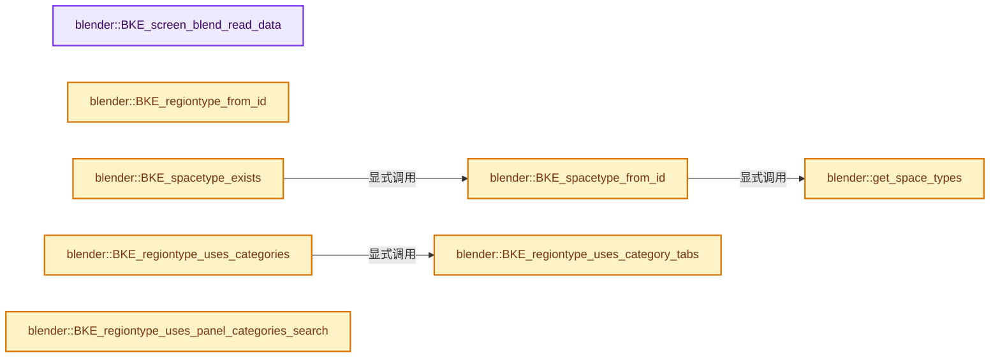
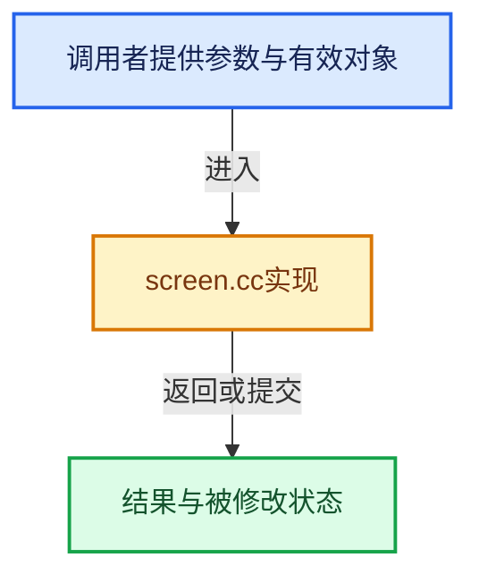

# 实现依赖专题：source/blender/blenkernel/intern/screen.cc

[方向导航](README.md) · [符号索引](../%E7%AC%A6%E5%8F%B7%E4%BE%9D%E8%B5%96%E4%B8%8E%E5%AE%9E%E7%8E%B0%E7%B4%A2%E5%BC%95.md)

本专题从正文实际调用进入，集中保存共享实现。函数有稳定锚点，可从调用处直接跳到对应完整函数；递归与互相调用通过回链组织。

## 本文件的实现关系






## 完整成员与函数实现

<a id="f-b134409c919cf92f"></a>

### `blender::BKE_screen_blend_read_data`

实现位置：[source/blender/blenkernel/intern/screen.cc](../../../../../source/blender/blenkernel/intern/screen.cc) · L238—L258。

接口参数：

- `BlendDataReader *reader`
- `bScreen *screen`

**教学注释版**

<!-- annotated:be6f5f98f615c5 -->

```cpp
bool BKE_screen_blend_read_data(BlendDataReader *reader, bScreen *screen)
{
  bool success = true;

  screen->regionbase.first_ = screen->regionbase.last_ = nullptr;
  screen->context = nullptr;
  screen->active_region = nullptr;
  screen->animtimer = nullptr; /* saved in rare cases */
  screen->tool_tip = nullptr;
  screen->scrubbing = false;

  BLO_read_struct(reader, PreviewImage, &screen->preview);
  BKE_previewimg_blend_read(reader, screen->preview);

  if (!BKE_screen_area_map_blend_read_data(reader, AREAMAP_FROM_SCREEN(screen))) {
    printf("Error reading Screen %s... removing it.\n", screen->id.name + 2);
    success = false;
  }

  return success;
}
```

<details>
<summary>核对原始源码：source/blender/blenkernel/intern/screen.cc · L238—L258</summary>

<!-- original:be6f5f98f615c5:source/blender/blenkernel/intern/screen.cc:238:258 -->

```cpp
bool BKE_screen_blend_read_data(BlendDataReader *reader, bScreen *screen)
{
  bool success = true;

  screen->regionbase.first_ = screen->regionbase.last_ = nullptr;
  screen->context = nullptr;
  screen->active_region = nullptr;
  screen->animtimer = nullptr; /* saved in rare cases */
  screen->tool_tip = nullptr;
  screen->scrubbing = false;

  BLO_read_struct(reader, PreviewImage, &screen->preview);
  BKE_previewimg_blend_read(reader, screen->preview);

  if (!BKE_screen_area_map_blend_read_data(reader, AREAMAP_FROM_SCREEN(screen))) {
    printf("Error reading Screen %s... removing it.\n", screen->id.name + 2);
    success = false;
  }

  return success;
}
```

</details>

**沿实际写入检查状态**

- `screen->regionbase.first_ = screen->regionbase.last_ = nullptr;`
- `screen->context = nullptr;`
- `screen->active_region = nullptr;`
- `screen->animtimer = nullptr; /* saved in rare cases */`
- `screen->tool_tip = nullptr;`
- `screen->scrubbing = false;`
- `success = false;`

**结果出口**

- `return success;`

**继续追踪实现**

- `BLO_read_struct` → [BLO_read_struct · L477](%E4%BE%9D%E8%B5%96-BLO_read_write-a54308.md#m-d307fd6f7c0e)。宏定义由构建条件选择。
- `BKE_previewimg_blend_read` → [blender::BKE_previewimg_blend_read · L608](%E4%BE%9D%E8%B5%96-preview_image-dce125.md#f-a81c208a9956b7d4)。
- `BKE_screen_area_map_blend_read_data` → [blender::BKE_screen_area_map_blend_read_data · L1744](%E4%BE%9D%E8%B5%96-screen-f062a7.md#f-81e0905f30a4b920)。
- `AREAMAP_FROM_SCREEN` → [AREAMAP_FROM_SCREEN · L93](%E4%BE%9D%E8%B5%96-DNA_screen_types-7eab90.md#m-b654cb10a80d)。宏定义由构建条件选择。
- `printf` → [外部契约](https://eel.is/c++draft/)：这个边界按实际表达式及所属类型核对参数、返回值、寿命与失败行为。这里提供接口入口，不声称已解释该第三方版本的内部实现。

<a id="f-f1175b52d5c57816"></a>

### `blender::get_space_types`

实现位置：[source/blender/blenkernel/intern/screen.cc](../../../../../source/blender/blenkernel/intern/screen.cc) · L313—L317。

**教学注释版**

<!-- annotated:df6a6c21414b12 -->

```cpp
static Vector<std::unique_ptr<SpaceType>> &get_space_types()
{
  static Vector<std::unique_ptr<SpaceType>> space_types;
  return space_types;
}
```

<details>
<summary>核对原始源码：source/blender/blenkernel/intern/screen.cc · L313—L317</summary>

<!-- original:df6a6c21414b12:source/blender/blenkernel/intern/screen.cc:313:317 -->

```cpp
static Vector<std::unique_ptr<SpaceType>> &get_space_types()
{
  static Vector<std::unique_ptr<SpaceType>> space_types;
  return space_types;
}
```

</details>

**结果出口**

- `return space_types;`

**继续追踪实现**

本实现没有需要继续展开的显式调用；检查返回表达式、对象转换和调用者前置条件。

<a id="f-cd8d9b708be9750c"></a>

### `blender::BKE_spacetype_from_id`

实现位置：[source/blender/blenkernel/intern/screen.cc](../../../../../source/blender/blenkernel/intern/screen.cc) · L354—L362。

接口参数：

- `int spaceid`

**教学注释版**

<!-- annotated:cb54c96dd8e0e0 -->

```cpp
SpaceType *BKE_spacetype_from_id(int spaceid)
{
  for (std::unique_ptr<SpaceType> &st : get_space_types()) {
    if (st->spaceid == spaceid) {
      return st.get();
    }
  }
  return nullptr;
}
```

<details>
<summary>核对原始源码：source/blender/blenkernel/intern/screen.cc · L354—L362</summary>

<!-- original:cb54c96dd8e0e0:source/blender/blenkernel/intern/screen.cc:354:362 -->

```cpp
SpaceType *BKE_spacetype_from_id(int spaceid)
{
  for (std::unique_ptr<SpaceType> &st : get_space_types()) {
    if (st->spaceid == spaceid) {
      return st.get();
    }
  }
  return nullptr;
}
```

</details>

**结果出口**

- `return st.get();`
- `return nullptr;`

**继续追踪实现**

- `get_space_types` → [blender::get_space_types · L313](%E4%BE%9D%E8%B5%96-screen-f062a7.md#f-f1175b52d5c57816)。
- `st.get` → [调用协议](../%E6%A8%A1%E6%9D%BF%E5%AE%8F%E4%B8%8E%E5%8A%A8%E6%80%81%E5%88%86%E6%B4%BE%E5%8D%8F%E8%AE%AE.md)：接收对象类型依赖auto、返回值或模板实例；不按同名猜测目标。调用位置L358。

<a id="f-d9b0736a33bf8d1b"></a>

### `blender::BKE_regiontype_from_id`

实现位置：[source/blender/blenkernel/intern/screen.cc](../../../../../source/blender/blenkernel/intern/screen.cc) · L364—L372。

接口参数：

- `const SpaceType *st`
- `int regionid`

**教学注释版**

<!-- annotated:788d7fbea00098 -->

```cpp
ARegionType *BKE_regiontype_from_id(const SpaceType *st, int regionid)
{
  for (ARegionType &art : st->regiontypes) {
    if (art.regionid == regionid) {
      return &art;
    }
  }
  return nullptr;
}
```

<details>
<summary>核对原始源码：source/blender/blenkernel/intern/screen.cc · L364—L372</summary>

<!-- original:788d7fbea00098:source/blender/blenkernel/intern/screen.cc:364:372 -->

```cpp
ARegionType *BKE_regiontype_from_id(const SpaceType *st, int regionid)
{
  for (ARegionType &art : st->regiontypes) {
    if (art.regionid == regionid) {
      return &art;
    }
  }
  return nullptr;
}
```

</details>

**结果出口**

- `return &art;`
- `return nullptr;`

**继续追踪实现**

本实现没有需要继续展开的显式调用；检查返回表达式、对象转换和调用者前置条件。

<a id="f-6e63daa2ada39e9b"></a>

### `blender::BKE_spacetype_exists`

实现位置：[source/blender/blenkernel/intern/screen.cc](../../../../../source/blender/blenkernel/intern/screen.cc) · L391—L394。

接口参数：

- `int spaceid`

**教学注释版**

<!-- annotated:1e80ab8e1f1e9a -->

```cpp
bool BKE_spacetype_exists(int spaceid)
{
  return BKE_spacetype_from_id(spaceid) != nullptr;
}
```

<details>
<summary>核对原始源码：source/blender/blenkernel/intern/screen.cc · L391—L394</summary>

<!-- original:1e80ab8e1f1e9a:source/blender/blenkernel/intern/screen.cc:391:394 -->

```cpp
bool BKE_spacetype_exists(int spaceid)
{
  return BKE_spacetype_from_id(spaceid) != nullptr;
}
```

</details>

**结果出口**

- `return BKE_spacetype_from_id(spaceid) != nullptr;`

**继续追踪实现**

- `BKE_spacetype_from_id` → [blender::BKE_spacetype_from_id · L354](%E4%BE%9D%E8%B5%96-screen-f062a7.md#f-cd8d9b708be9750c)。

<a id="f-9b972461a1320ea2"></a>

### `blender::BKE_regiontype_uses_categories`

实现位置：[source/blender/blenkernel/intern/screen.cc](../../../../../source/blender/blenkernel/intern/screen.cc) · L396—L403。

接口参数：

- `const ARegionType *region_type`

**教学注释版**

<!-- annotated:85257e274c7744 -->

```cpp
bool BKE_regiontype_uses_categories(const ARegionType *region_type)
{
  if (BKE_regiontype_uses_category_tabs(region_type)) {
    return true;
  }

  return bool(region_type->flag & ARegionTypeFlag::UsePanelCategories);
}
```

<details>
<summary>核对原始源码：source/blender/blenkernel/intern/screen.cc · L396—L403</summary>

<!-- original:85257e274c7744:source/blender/blenkernel/intern/screen.cc:396:403 -->

```cpp
bool BKE_regiontype_uses_categories(const ARegionType *region_type)
{
  if (BKE_regiontype_uses_category_tabs(region_type)) {
    return true;
  }

  return bool(region_type->flag & ARegionTypeFlag::UsePanelCategories);
}
```

</details>

**结果出口**

- `return true;`
- `return bool(region_type->flag & ARegionTypeFlag::UsePanelCategories);`

**继续追踪实现**

- `BKE_regiontype_uses_category_tabs` → [blender::BKE_regiontype_uses_category_tabs · L405](%E4%BE%9D%E8%B5%96-screen-f062a7.md#f-dfaac2d5866ca2b7)。

<a id="f-dfaac2d5866ca2b7"></a>

### `blender::BKE_regiontype_uses_category_tabs`

实现位置：[source/blender/blenkernel/intern/screen.cc](../../../../../source/blender/blenkernel/intern/screen.cc) · L405—L413。

接口参数：

- `const ARegionType *region_type`

**教学注释版**

<!-- annotated:4bb7fe84f4fbe1 -->

```cpp
bool BKE_regiontype_uses_category_tabs(const ARegionType *region_type)
{
  /* Some region types always support category tabs. */
  if (ELEM(region_type->regionid, RGN_TYPE_UI)) {
    return true;
  }

  return bool(region_type->flag & ARegionTypeFlag::UsePanelCategoryTabs);
}
```

<details>
<summary>核对原始源码：source/blender/blenkernel/intern/screen.cc · L405—L413</summary>

<!-- original:4bb7fe84f4fbe1:source/blender/blenkernel/intern/screen.cc:405:413 -->

```cpp
bool BKE_regiontype_uses_category_tabs(const ARegionType *region_type)
{
  /* Some region types always support category tabs. */
  if (ELEM(region_type->regionid, RGN_TYPE_UI)) {
    return true;
  }

  return bool(region_type->flag & ARegionTypeFlag::UsePanelCategoryTabs);
}
```

</details>

**结果出口**

- `return true;`
- `return bool(region_type->flag & ARegionTypeFlag::UsePanelCategoryTabs);`

**继续追踪实现**

- `ELEM` → [ELEM · L88](%E4%BE%9D%E8%B5%96-GHOST_utildefines-34b996.md#m-d28724a15928)；[ELEM · L135](../01-%E5%9F%BA%E7%A1%80%E5%AE%B9%E5%99%A8%E4%B8%8E%E7%8E%B0%E4%BB%A3CPP/%E4%BE%9D%E8%B5%96-BLI_utildefines-293a0a.md#m-d6572de7cae0)。宏定义由构建条件选择。

<a id="f-40fd2da0111c19c9"></a>

### `blender::BKE_regiontype_uses_panel_categories_search`

实现位置：[source/blender/blenkernel/intern/screen.cc](../../../../../source/blender/blenkernel/intern/screen.cc) · L415—L418。

接口参数：

- `const ARegionType *region_type`

**教学注释版**

<!-- annotated:79ab47a2a6eb83 -->

```cpp
bool BKE_regiontype_uses_panel_categories_search(const ARegionType *region_type)
{
  return bool(region_type->flag & ARegionTypeFlag::UsePanelCategoriesSearch);
}
```

<details>
<summary>核对原始源码：source/blender/blenkernel/intern/screen.cc · L415—L418</summary>

<!-- original:79ab47a2a6eb83:source/blender/blenkernel/intern/screen.cc:415:418 -->

```cpp
bool BKE_regiontype_uses_panel_categories_search(const ARegionType *region_type)
{
  return bool(region_type->flag & ARegionTypeFlag::UsePanelCategoriesSearch);
}
```

</details>

**结果出口**

- `return bool(region_type->flag & ARegionTypeFlag::UsePanelCategoriesSearch);`

**继续追踪实现**

本实现没有需要继续展开的显式调用；检查返回表达式、对象转换和调用者前置条件。

<a id="f-6f1bd350372bb999"></a>

### `blender::BKE_region_panel_categories_search_filter_visible`

实现位置：[source/blender/blenkernel/intern/screen.cc](../../../../../source/blender/blenkernel/intern/screen.cc) · L420—L424。

接口参数：

- `const ARegion *region`

**教学注释版**

<!-- annotated:f7f2ab7b9a0bb5 -->

```cpp
bool BKE_region_panel_categories_search_filter_visible(const ARegion *region)
{
  return BKE_regiontype_uses_panel_categories_search(region->runtime->type) &&
         region->flag & RGN_FLAG_SEARCH_FILTER_SHOW;
};
```

<details>
<summary>核对原始源码：source/blender/blenkernel/intern/screen.cc · L420—L424</summary>

<!-- original:f7f2ab7b9a0bb5:source/blender/blenkernel/intern/screen.cc:420:424 -->

```cpp
bool BKE_region_panel_categories_search_filter_visible(const ARegion *region)
{
  return BKE_regiontype_uses_panel_categories_search(region->runtime->type) &&
         region->flag & RGN_FLAG_SEARCH_FILTER_SHOW;
};
```

</details>

**结果出口**

- `return BKE_regiontype_uses_panel_categories_search(region->runtime->type) &&`

**继续追踪实现**

- `BKE_regiontype_uses_panel_categories_search` → [blender::BKE_regiontype_uses_panel_categories_search · L415](%E4%BE%9D%E8%B5%96-screen-f062a7.md#f-40fd2da0111c19c9)。

<a id="f-4a2ddf23a6de311c"></a>

### `blender::BKE_spacedata_freelist`

实现位置：[source/blender/blenkernel/intern/screen.cc](../../../../../source/blender/blenkernel/intern/screen.cc) · L432—L450。

接口参数：

- `ListBaseT<SpaceLink> *lb`

**教学注释版**

<!-- annotated:f68340635f0142 -->

```cpp
void BKE_spacedata_freelist(ListBaseT<SpaceLink> *lb)
{
  for (SpaceLink &sl : *lb) {
    SpaceType *st = BKE_spacetype_from_id(sl.spacetype);

    /* free regions for pushed spaces */
    for (ARegion &region : sl.regionbase) {
      BKE_area_region_free(st, &region);
    }

    sl.regionbase.free_no_destruct();

    if (st && st->free) {
      // [讲解] st->free：这个边界按实际表达式及所属类型核对参数、返回值、寿命与失败行为。这里提供接口入口，不声称已解释该第三方版本的内部实现。
      st->free(&sl);
    }
  }

  lb->free_no_destruct();
}
```

<details>
<summary>核对原始源码：source/blender/blenkernel/intern/screen.cc · L432—L450</summary>

<!-- original:f68340635f0142:source/blender/blenkernel/intern/screen.cc:432:450 -->

```cpp
void BKE_spacedata_freelist(ListBaseT<SpaceLink> *lb)
{
  for (SpaceLink &sl : *lb) {
    SpaceType *st = BKE_spacetype_from_id(sl.spacetype);

    /* free regions for pushed spaces */
    for (ARegion &region : sl.regionbase) {
      BKE_area_region_free(st, &region);
    }

    sl.regionbase.free_no_destruct();

    if (st && st->free) {
      st->free(&sl);
    }
  }

  lb->free_no_destruct();
}
```

</details>

**继续追踪实现**

- `BKE_spacetype_from_id` → [blender::BKE_spacetype_from_id · L354](%E4%BE%9D%E8%B5%96-screen-f062a7.md#f-cd8d9b708be9750c)。
- `BKE_area_region_free` → [blender::BKE_area_region_free · L734](%E4%BE%9D%E8%B5%96-screen-f062a7.md#f-d5d6a94225d341ef)。
- `sl.regionbase.free_no_destruct` → [调用协议](../%E6%A8%A1%E6%9D%BF%E5%AE%8F%E4%B8%8E%E5%8A%A8%E6%80%81%E5%88%86%E6%B4%BE%E5%8D%8F%E8%AE%AE.md)：接收对象类型依赖auto、返回值或模板实例；不按同名猜测目标。调用位置L442。
- `st->free` → [外部契约](https://eel.is/c++draft/)：这个边界按实际表达式及所属类型核对参数、返回值、寿命与失败行为。这里提供接口入口，不声称已解释该第三方版本的内部实现。
- `lb->free_no_destruct` → [blender::ListBaseT::free_no_destruct · L78](%E4%BE%9D%E8%B5%96-DNA_listBase-48dbc9.md#f-8656670edd0f6b7e)。

<a id="f-5745135a4860796f"></a>

### `blender::panel_list_copy`

实现位置：[source/blender/blenkernel/intern/screen.cc](../../../../../source/blender/blenkernel/intern/screen.cc) · L452—L475。

接口参数：

- `ListBaseT<Panel> *newlb`
- `const ListBaseT<Panel> *lb`

**教学注释版**

<!-- annotated:91a92b0846020d -->

```cpp
static void panel_list_copy(ListBaseT<Panel> *newlb, const ListBaseT<Panel> *lb)
{
  newlb->clear_no_delete();

  for (const Panel &old_panel : *lb) {
    Panel *new_panel = BKE_panel_new(old_panel.type);
    Panel_Runtime *new_runtime = new_panel->runtime;
    *new_panel = old_panel;
    new_panel->runtime = new_runtime;
    new_panel->activedata = nullptr;
    new_panel->drawname = nullptr;

    new_panel->layout_panel_states.clear_no_delete();
    new_panel->layout_panel_states_clock = old_panel.layout_panel_states_clock;
    for (LayoutPanelState &src_state : old_panel.layout_panel_states) {
      LayoutPanelState *new_state = MEM_new<LayoutPanelState>(__func__, src_state);
      new_state->idname = BLI_strdup(src_state.idname);
      BLI_addtail(&new_panel->layout_panel_states, new_state);
    }

    BLI_addtail(newlb, new_panel);
    panel_list_copy(&new_panel->children, &old_panel.children);
  }
}
```

<details>
<summary>核对原始源码：source/blender/blenkernel/intern/screen.cc · L452—L475</summary>

<!-- original:91a92b0846020d:source/blender/blenkernel/intern/screen.cc:452:475 -->

```cpp
static void panel_list_copy(ListBaseT<Panel> *newlb, const ListBaseT<Panel> *lb)
{
  newlb->clear_no_delete();

  for (const Panel &old_panel : *lb) {
    Panel *new_panel = BKE_panel_new(old_panel.type);
    Panel_Runtime *new_runtime = new_panel->runtime;
    *new_panel = old_panel;
    new_panel->runtime = new_runtime;
    new_panel->activedata = nullptr;
    new_panel->drawname = nullptr;

    new_panel->layout_panel_states.clear_no_delete();
    new_panel->layout_panel_states_clock = old_panel.layout_panel_states_clock;
    for (LayoutPanelState &src_state : old_panel.layout_panel_states) {
      LayoutPanelState *new_state = MEM_new<LayoutPanelState>(__func__, src_state);
      new_state->idname = BLI_strdup(src_state.idname);
      BLI_addtail(&new_panel->layout_panel_states, new_state);
    }

    BLI_addtail(newlb, new_panel);
    panel_list_copy(&new_panel->children, &old_panel.children);
  }
}
```

</details>

**沿实际写入检查状态**

- `new_panel->runtime = new_runtime;`
- `new_panel->activedata = nullptr;`
- `new_panel->drawname = nullptr;`
- `new_panel->layout_panel_states_clock = old_panel.layout_panel_states_clock;`
- `new_state->idname = BLI_strdup(src_state.idname);`

**继续追踪实现**

- `newlb->clear_no_delete` → [blender::ListBaseT::clear_no_delete · L68](%E4%BE%9D%E8%B5%96-DNA_listBase-48dbc9.md#f-431defdf189ae643)。
- `BKE_panel_new` → [blender::BKE_panel_new · L683](%E4%BE%9D%E8%B5%96-screen-f062a7.md#f-2b7ca8c09599a744)。
- `new_panel->layout_panel_states.clear_no_delete` → [调用协议](../%E6%A8%A1%E6%9D%BF%E5%AE%8F%E4%B8%8E%E5%8A%A8%E6%80%81%E5%88%86%E6%B4%BE%E5%8D%8F%E8%AE%AE.md)：接收对象类型依赖auto、返回值或模板实例；不按同名猜测目标。调用位置L464。
- `MEM_new<LayoutPanelState>` → [MEM_new · L351](../03-%E5%86%85%E5%AD%98%E5%88%86%E9%85%8D%E4%B8%8E%E8%BF%90%E8%A1%8C%E6%97%B6%E7%B1%BB%E5%9E%8B/%E4%BE%9D%E8%B5%96-MEM_guardedalloc-b54eca.md#f-115f9b6784f89912)。
- `BLI_strdup` → [blender::BLI_strdup · L43](../01-%E5%9F%BA%E7%A1%80%E5%AE%B9%E5%99%A8%E4%B8%8E%E7%8E%B0%E4%BB%A3CPP/%E4%BE%9D%E8%B5%96-string-1d986f.md#f-7e6d5c696c20c0e1)。
- `BLI_addtail` → [blender::BLI_addtail · L118](../01-%E5%9F%BA%E7%A1%80%E5%AE%B9%E5%99%A8%E4%B8%8E%E7%8E%B0%E4%BB%A3CPP/%E4%BE%9D%E8%B5%96-listbase-2816d9.md#f-4fb027713fa3115b)。
- `panel_list_copy` → [blender::panel_list_copy · L452](%E4%BE%9D%E8%B5%96-screen-f062a7.md#f-5745135a4860796f)。

<a id="f-65a14bbab19dba07"></a>

### `blender::BKE_area_region_copy`

实现位置：[source/blender/blenkernel/intern/screen.cc](../../../../../source/blender/blenkernel/intern/screen.cc) · L477—L518。

接口参数：

- `const SpaceType *st`
- `const ARegion *region`

**教学注释版**

<!-- annotated:b21073bd6d361e -->

```cpp
ARegion *BKE_area_region_copy(const SpaceType *st, const ARegion *region)
{
  ARegion *dst = MEM_dupalloc(region);

  dst->runtime = MEM_new<bke::ARegionRuntime>(__func__);
  dst->runtime->type = region->runtime->type;
  dst->runtime->do_draw = region->runtime->do_draw;

  dst->prev = dst->next = nullptr;
  dst->panels_category_active.clear_no_delete();
  dst->ui_lists.clear_no_delete();

  /* use optional regiondata callback */
  if (region->regiondata) {
    ARegionType *art = BKE_regiontype_from_id(st, region->regiontype);

    if (art && art->duplicate) {
      dst->regiondata = art->duplicate(region->regiondata);
    }
    else if (region->flag & RGN_FLAG_TEMP_REGIONDATA) {
      dst->regiondata = nullptr;
    }
    else {
      dst->regiondata = MEM_dupalloc_void(region->regiondata);
    }
  }

  panel_list_copy(&dst->panels, &region->panels);

  dst->ui_previews.clear_no_delete();
  BLI_duplicatelist(&dst->ui_previews, &region->ui_previews);
  dst->view_states.clear_no_delete();
  BLI_duplicatelist(&dst->view_states, &region->view_states);
  dst->textbox_states.clear_no_delete();
  for (const uiTextboxStateLink &textbox_state : region->textbox_states) {
    uiTextboxStateLink *copy = MEM_new<uiTextboxStateLink>("uiTextboxStateLink", textbox_state);
    copy->idname = BLI_strdup(textbox_state.idname);
    BLI_addtail(&dst->textbox_states, copy);
  }

  return dst;
}
```

<details>
<summary>核对原始源码：source/blender/blenkernel/intern/screen.cc · L477—L518</summary>

<!-- original:b21073bd6d361e:source/blender/blenkernel/intern/screen.cc:477:518 -->

```cpp
ARegion *BKE_area_region_copy(const SpaceType *st, const ARegion *region)
{
  ARegion *dst = MEM_dupalloc(region);

  dst->runtime = MEM_new<bke::ARegionRuntime>(__func__);
  dst->runtime->type = region->runtime->type;
  dst->runtime->do_draw = region->runtime->do_draw;

  dst->prev = dst->next = nullptr;
  dst->panels_category_active.clear_no_delete();
  dst->ui_lists.clear_no_delete();

  /* use optional regiondata callback */
  if (region->regiondata) {
    ARegionType *art = BKE_regiontype_from_id(st, region->regiontype);

    if (art && art->duplicate) {
      dst->regiondata = art->duplicate(region->regiondata);
    }
    else if (region->flag & RGN_FLAG_TEMP_REGIONDATA) {
      dst->regiondata = nullptr;
    }
    else {
      dst->regiondata = MEM_dupalloc_void(region->regiondata);
    }
  }

  panel_list_copy(&dst->panels, &region->panels);

  dst->ui_previews.clear_no_delete();
  BLI_duplicatelist(&dst->ui_previews, &region->ui_previews);
  dst->view_states.clear_no_delete();
  BLI_duplicatelist(&dst->view_states, &region->view_states);
  dst->textbox_states.clear_no_delete();
  for (const uiTextboxStateLink &textbox_state : region->textbox_states) {
    uiTextboxStateLink *copy = MEM_new<uiTextboxStateLink>("uiTextboxStateLink", textbox_state);
    copy->idname = BLI_strdup(textbox_state.idname);
    BLI_addtail(&dst->textbox_states, copy);
  }

  return dst;
}
```

</details>

**沿实际写入检查状态**

- `dst->runtime = MEM_new<bke::ARegionRuntime>(__func__);`
- `dst->runtime->type = region->runtime->type;`
- `dst->runtime->do_draw = region->runtime->do_draw;`
- `dst->prev = dst->next = nullptr;`
- `dst->regiondata = art->duplicate(region->regiondata);`
- `dst->regiondata = nullptr;`
- `dst->regiondata = MEM_dupalloc_void(region->regiondata);`
- `copy->idname = BLI_strdup(textbox_state.idname);`

**结果出口**

- `return dst;`

**继续追踪实现**

- `MEM_dupalloc` → [MEM_dupalloc · L627](../03-%E5%86%85%E5%AD%98%E5%88%86%E9%85%8D%E4%B8%8E%E8%BF%90%E8%A1%8C%E6%97%B6%E7%B1%BB%E5%9E%8B/%E4%BE%9D%E8%B5%96-MEM_guardedalloc-b54eca.md#f-78a72b71e3c57010)。
- `MEM_new<bke::ARegionRuntime>` → [MEM_new · L351](../03-%E5%86%85%E5%AD%98%E5%88%86%E9%85%8D%E4%B8%8E%E8%BF%90%E8%A1%8C%E6%97%B6%E7%B1%BB%E5%9E%8B/%E4%BE%9D%E8%B5%96-MEM_guardedalloc-b54eca.md#f-115f9b6784f89912)。
- `dst->panels_category_active.clear_no_delete` → [调用协议](../%E6%A8%A1%E6%9D%BF%E5%AE%8F%E4%B8%8E%E5%8A%A8%E6%80%81%E5%88%86%E6%B4%BE%E5%8D%8F%E8%AE%AE.md)：接收对象类型依赖auto、返回值或模板实例；不按同名猜测目标。调用位置L486。
- `dst->ui_lists.clear_no_delete` → [调用协议](../%E6%A8%A1%E6%9D%BF%E5%AE%8F%E4%B8%8E%E5%8A%A8%E6%80%81%E5%88%86%E6%B4%BE%E5%8D%8F%E8%AE%AE.md)：接收对象类型依赖auto、返回值或模板实例；不按同名猜测目标。调用位置L487。
- `BKE_regiontype_from_id` → [blender::BKE_regiontype_from_id · L364](%E4%BE%9D%E8%B5%96-screen-f062a7.md#f-d9b0736a33bf8d1b)。
- `art->duplicate` → [调用协议](../%E6%A8%A1%E6%9D%BF%E5%AE%8F%E4%B8%8E%E5%8A%A8%E6%80%81%E5%88%86%E6%B4%BE%E5%8D%8F%E8%AE%AE.md)：由接收对象具体类型或运行时策略提供实现。调用位置L494。
- `MEM_dupalloc_void` → [MEM_dupalloc_void · L139](../03-%E5%86%85%E5%AD%98%E5%88%86%E9%85%8D%E4%B8%8E%E8%BF%90%E8%A1%8C%E6%97%B6%E7%B1%BB%E5%9E%8B/%E4%BE%9D%E8%B5%96-mallocn-afdcd4.md#f-7a16d9233cb67bd0)。
- `panel_list_copy` → [blender::panel_list_copy · L452](%E4%BE%9D%E8%B5%96-screen-f062a7.md#f-5745135a4860796f)。
- `dst->ui_previews.clear_no_delete` → [调用协议](../%E6%A8%A1%E6%9D%BF%E5%AE%8F%E4%B8%8E%E5%8A%A8%E6%80%81%E5%88%86%E6%B4%BE%E5%8D%8F%E8%AE%AE.md)：接收对象类型依赖auto、返回值或模板实例；不按同名猜测目标。调用位置L506。
- `BLI_duplicatelist` → [blender::BLI_duplicatelist · L834](../01-%E5%9F%BA%E7%A1%80%E5%AE%B9%E5%99%A8%E4%B8%8E%E7%8E%B0%E4%BB%A3CPP/%E4%BE%9D%E8%B5%96-listbase-2816d9.md#f-d840cb64a1b265dc)。
- `dst->view_states.clear_no_delete` → [调用协议](../%E6%A8%A1%E6%9D%BF%E5%AE%8F%E4%B8%8E%E5%8A%A8%E6%80%81%E5%88%86%E6%B4%BE%E5%8D%8F%E8%AE%AE.md)：接收对象类型依赖auto、返回值或模板实例；不按同名猜测目标。调用位置L508。
- `dst->textbox_states.clear_no_delete` → [调用协议](../%E6%A8%A1%E6%9D%BF%E5%AE%8F%E4%B8%8E%E5%8A%A8%E6%80%81%E5%88%86%E6%B4%BE%E5%8D%8F%E8%AE%AE.md)：接收对象类型依赖auto、返回值或模板实例；不按同名猜测目标。调用位置L510。
- `MEM_new<uiTextboxStateLink>` → [MEM_new · L351](../03-%E5%86%85%E5%AD%98%E5%88%86%E9%85%8D%E4%B8%8E%E8%BF%90%E8%A1%8C%E6%97%B6%E7%B1%BB%E5%9E%8B/%E4%BE%9D%E8%B5%96-MEM_guardedalloc-b54eca.md#f-115f9b6784f89912)。
- `BLI_strdup` → [blender::BLI_strdup · L43](../01-%E5%9F%BA%E7%A1%80%E5%AE%B9%E5%99%A8%E4%B8%8E%E7%8E%B0%E4%BB%A3CPP/%E4%BE%9D%E8%B5%96-string-1d986f.md#f-7e6d5c696c20c0e1)。
- `BLI_addtail` → [blender::BLI_addtail · L118](../01-%E5%9F%BA%E7%A1%80%E5%AE%B9%E5%99%A8%E4%B8%8E%E7%8E%B0%E4%BB%A3CPP/%E4%BE%9D%E8%B5%96-listbase-2816d9.md#f-4fb027713fa3115b)。

<a id="f-65d2bf9c04020290"></a>

### `blender::BKE_area_region_new`

实现位置：[source/blender/blenkernel/intern/screen.cc](../../../../../source/blender/blenkernel/intern/screen.cc) · L520—L525。

**教学注释版**

<!-- annotated:37c8f02e04e132 -->

```cpp
ARegion *BKE_area_region_new()
{
  ARegion *region = MEM_new<ARegion>(__func__);
  region->runtime = MEM_new<bke::ARegionRuntime>(__func__);
  return region;
}
```

<details>
<summary>核对原始源码：source/blender/blenkernel/intern/screen.cc · L520—L525</summary>

<!-- original:37c8f02e04e132:source/blender/blenkernel/intern/screen.cc:520:525 -->

```cpp
ARegion *BKE_area_region_new()
{
  ARegion *region = MEM_new<ARegion>(__func__);
  region->runtime = MEM_new<bke::ARegionRuntime>(__func__);
  return region;
}
```

</details>

**沿实际写入检查状态**

- `region->runtime = MEM_new<bke::ARegionRuntime>(__func__);`

**结果出口**

- `return region;`

**继续追踪实现**

- `MEM_new<ARegion>` → [MEM_new · L351](../03-%E5%86%85%E5%AD%98%E5%88%86%E9%85%8D%E4%B8%8E%E8%BF%90%E8%A1%8C%E6%97%B6%E7%B1%BB%E5%9E%8B/%E4%BE%9D%E8%B5%96-MEM_guardedalloc-b54eca.md#f-115f9b6784f89912)。
- `MEM_new<bke::ARegionRuntime>` → [MEM_new · L351](../03-%E5%86%85%E5%AD%98%E5%88%86%E9%85%8D%E4%B8%8E%E8%BF%90%E8%A1%8C%E6%97%B6%E7%B1%BB%E5%9E%8B/%E4%BE%9D%E8%B5%96-MEM_guardedalloc-b54eca.md#f-115f9b6784f89912)。

<a id="f-c1c84630f0af24f4"></a>

### `blender::BKE_spacedata_find_region_type`

实现位置：[source/blender/blenkernel/intern/screen.cc](../../../../../source/blender/blenkernel/intern/screen.cc) · L570—L592。

接口参数：

- `const SpaceLink *slink`
- `const ScrArea *area`
- `int region_type`

**教学注释版**

<!-- annotated:ee287949c18cdf -->

```cpp
ARegion *BKE_spacedata_find_region_type(const SpaceLink *slink,
                                        const ScrArea *area,
                                        int region_type)
{
  const bool is_slink_active = slink == area->spacedata.first();
  const ListBaseT<ARegion> *regionbase = (is_slink_active) ? &area->regionbase :
                                                             &slink->regionbase;
  ARegion *region = nullptr;

  BLI_assert(BLI_findindex(&area->spacedata, slink) != -1);

  for (ARegion &region_iter : *regionbase) {
    if (region_iter.regiontype == region_type) {
      region = &region_iter;
      break;
    }
  }

  /* Should really unit test this instead. */
  BLI_assert(!is_slink_active || region == BKE_area_find_region_type(area, region_type));

  return region;
}
```

<details>
<summary>核对原始源码：source/blender/blenkernel/intern/screen.cc · L570—L592</summary>

<!-- original:ee287949c18cdf:source/blender/blenkernel/intern/screen.cc:570:592 -->

```cpp
ARegion *BKE_spacedata_find_region_type(const SpaceLink *slink,
                                        const ScrArea *area,
                                        int region_type)
{
  const bool is_slink_active = slink == area->spacedata.first();
  const ListBaseT<ARegion> *regionbase = (is_slink_active) ? &area->regionbase :
                                                             &slink->regionbase;
  ARegion *region = nullptr;

  BLI_assert(BLI_findindex(&area->spacedata, slink) != -1);

  for (ARegion &region_iter : *regionbase) {
    if (region_iter.regiontype == region_type) {
      region = &region_iter;
      break;
    }
  }

  /* Should really unit test this instead. */
  BLI_assert(!is_slink_active || region == BKE_area_find_region_type(area, region_type));

  return region;
}
```

</details>

**沿实际写入检查状态**

- `region = &region_iter;`

**结果出口**

- `return region;`

**继续追踪实现**

- `area->spacedata.first` → [调用协议](../%E6%A8%A1%E6%9D%BF%E5%AE%8F%E4%B8%8E%E5%8A%A8%E6%80%81%E5%88%86%E6%B4%BE%E5%8D%8F%E8%AE%AE.md)：接收对象类型依赖auto、返回值或模板实例；不按同名猜测目标。调用位置L574。
- `BLI_assert` → [BLI_assert · L48](../01-%E5%9F%BA%E7%A1%80%E5%AE%B9%E5%99%A8%E4%B8%8E%E7%8E%B0%E4%BB%A3CPP/%E4%BE%9D%E8%B5%96-BLI_assert-cc98e8.md#m-57a88495704d)；[BLI_assert · L63](../01-%E5%9F%BA%E7%A1%80%E5%AE%B9%E5%99%A8%E4%B8%8E%E7%8E%B0%E4%BB%A3CPP/%E4%BE%9D%E8%B5%96-BLI_assert-cc98e8.md#m-d07050020cb5)。宏定义由构建条件选择。
- `BLI_findindex` → [blender::BLI_findindex · L593](../01-%E5%9F%BA%E7%A1%80%E5%AE%B9%E5%99%A8%E4%B8%8E%E7%8E%B0%E4%BB%A3CPP/%E4%BE%9D%E8%B5%96-listbase-2816d9.md#f-cb9036f12bd486b7)。
- `BKE_area_find_region_type` → [blender::BKE_area_find_region_type · L1022](%E4%BE%9D%E8%B5%96-screen-f062a7.md#f-0196b501297e2f5c)。

<a id="f-6ab2eaa02b3f9d33"></a>

### `blender::BKE_panel_layout_panel_state_ensure`

实现位置：[source/blender/blenkernel/intern/screen.cc](../../../../../source/blender/blenkernel/intern/screen.cc) · L654—L681。

接口参数：

- `Panel *panel`
- `const StringRef idname`
- `const bool default_closed`

**教学注释版**

<!-- annotated:139a4bea71a687 -->

```cpp
LayoutPanelState *BKE_panel_layout_panel_state_ensure(Panel *panel,
                                                      const StringRef idname,
                                                      const bool default_closed)
{
  ListBaseT<LayoutPanelState> &layout_panel_states =
      panel->runtime->layout_panel_states_storage ? *panel->runtime->layout_panel_states_storage :
                                                    panel->layout_panel_states;
  const uint32_t logical_time = ++panel->layout_panel_states_clock;
  /* Overflow happened, reset all last used times. Not sure if this will ever happen in practice,
   * but better handle the overflow explicitly. */
  if (logical_time == 0) {
    for (LayoutPanelState &state : layout_panel_states) {
      state.last_used = 0;
    }
  }
  for (LayoutPanelState &state : layout_panel_states) {
    if (state.idname == idname) {
      state.last_used = logical_time;
      return &state;
    }
  }
  LayoutPanelState *state = MEM_new<LayoutPanelState>(__func__);
  state->idname = BLI_strdupn(idname.data(), idname.size());
  SET_FLAG_FROM_TEST(state->flag, !default_closed, LAYOUT_PANEL_STATE_FLAG_OPEN);
  state->last_used = logical_time;
  BLI_addtail(&layout_panel_states, state);
  return state;
}
```

<details>
<summary>核对原始源码：source/blender/blenkernel/intern/screen.cc · L654—L681</summary>

<!-- original:139a4bea71a687:source/blender/blenkernel/intern/screen.cc:654:681 -->

```cpp
LayoutPanelState *BKE_panel_layout_panel_state_ensure(Panel *panel,
                                                      const StringRef idname,
                                                      const bool default_closed)
{
  ListBaseT<LayoutPanelState> &layout_panel_states =
      panel->runtime->layout_panel_states_storage ? *panel->runtime->layout_panel_states_storage :
                                                    panel->layout_panel_states;
  const uint32_t logical_time = ++panel->layout_panel_states_clock;
  /* Overflow happened, reset all last used times. Not sure if this will ever happen in practice,
   * but better handle the overflow explicitly. */
  if (logical_time == 0) {
    for (LayoutPanelState &state : layout_panel_states) {
      state.last_used = 0;
    }
  }
  for (LayoutPanelState &state : layout_panel_states) {
    if (state.idname == idname) {
      state.last_used = logical_time;
      return &state;
    }
  }
  LayoutPanelState *state = MEM_new<LayoutPanelState>(__func__);
  state->idname = BLI_strdupn(idname.data(), idname.size());
  SET_FLAG_FROM_TEST(state->flag, !default_closed, LAYOUT_PANEL_STATE_FLAG_OPEN);
  state->last_used = logical_time;
  BLI_addtail(&layout_panel_states, state);
  return state;
}
```

</details>

**沿实际写入检查状态**

- `state.last_used = 0;`
- `state.last_used = logical_time;`
- `state->idname = BLI_strdupn(idname.data(), idname.size());`
- `state->last_used = logical_time;`

**结果出口**

- `return &state;`
- `return state;`

**继续追踪实现**

- `MEM_new<LayoutPanelState>` → [MEM_new · L351](../03-%E5%86%85%E5%AD%98%E5%88%86%E9%85%8D%E4%B8%8E%E8%BF%90%E8%A1%8C%E6%97%B6%E7%B1%BB%E5%9E%8B/%E4%BE%9D%E8%B5%96-MEM_guardedalloc-b54eca.md#f-115f9b6784f89912)。
- `BLI_strdupn` → [blender::BLI_strdupn · L32](../01-%E5%9F%BA%E7%A1%80%E5%AE%B9%E5%99%A8%E4%B8%8E%E7%8E%B0%E4%BB%A3CPP/%E4%BE%9D%E8%B5%96-string-1d986f.md#f-65dc033cf6e67cff)。
- `idname.data` → [blender::StringRefBase::data · L209](../01-%E5%9F%BA%E7%A1%80%E5%AE%B9%E5%99%A8%E4%B8%8E%E7%8E%B0%E4%BB%A3CPP/15-StringRef%E5%AD%97%E7%AC%A6%E4%B8%B2%E8%A7%86%E5%9B%BE.md#f-cced1a1ccd124155)。
- `idname.size` → [blender::MainAllIDsIterator::size · L1291](%E4%BE%9D%E8%B5%96-main-ffa8b3.md#f-520d1311c646452f)。
- `SET_FLAG_FROM_TEST` → [SET_FLAG_FROM_TEST · L557](../01-%E5%9F%BA%E7%A1%80%E5%AE%B9%E5%99%A8%E4%B8%8E%E7%8E%B0%E4%BB%A3CPP/%E4%BE%9D%E8%B5%96-BLI_utildefines-293a0a.md#m-8e0dc83e01a8)。宏定义由构建条件选择。
- `BLI_addtail` → [blender::BLI_addtail · L118](../01-%E5%9F%BA%E7%A1%80%E5%AE%B9%E5%99%A8%E4%B8%8E%E7%8E%B0%E4%BB%A3CPP/%E4%BE%9D%E8%B5%96-listbase-2816d9.md#f-4fb027713fa3115b)。

<a id="f-2b7ca8c09599a744"></a>

### `blender::BKE_panel_new`

实现位置：[source/blender/blenkernel/intern/screen.cc](../../../../../source/blender/blenkernel/intern/screen.cc) · L683—L692。

接口参数：

- `PanelType *panel_type`

**教学注释版**

<!-- annotated:dcd2a8154e9eea -->

```cpp
Panel *BKE_panel_new(PanelType *panel_type)
{
  Panel *panel = MEM_new<Panel>(__func__);
  panel->runtime = MEM_new<Panel_Runtime>(__func__);
  panel->type = panel_type;
  if (panel_type) {
    STRNCPY_UTF8(panel->panelname, panel_type->idname);
  }
  return panel;
}
```

<details>
<summary>核对原始源码：source/blender/blenkernel/intern/screen.cc · L683—L692</summary>

<!-- original:dcd2a8154e9eea:source/blender/blenkernel/intern/screen.cc:683:692 -->

```cpp
Panel *BKE_panel_new(PanelType *panel_type)
{
  Panel *panel = MEM_new<Panel>(__func__);
  panel->runtime = MEM_new<Panel_Runtime>(__func__);
  panel->type = panel_type;
  if (panel_type) {
    STRNCPY_UTF8(panel->panelname, panel_type->idname);
  }
  return panel;
}
```

</details>

**沿实际写入检查状态**

- `panel->runtime = MEM_new<Panel_Runtime>(__func__);`
- `panel->type = panel_type;`

**结果出口**

- `return panel;`

**继续追踪实现**

- `MEM_new<Panel>` → [MEM_new · L351](../03-%E5%86%85%E5%AD%98%E5%88%86%E9%85%8D%E4%B8%8E%E8%BF%90%E8%A1%8C%E6%97%B6%E7%B1%BB%E5%9E%8B/%E4%BE%9D%E8%B5%96-MEM_guardedalloc-b54eca.md#f-115f9b6784f89912)。
- `MEM_new<Panel_Runtime>` → [MEM_new · L351](../03-%E5%86%85%E5%AD%98%E5%88%86%E9%85%8D%E4%B8%8E%E8%BF%90%E8%A1%8C%E6%97%B6%E7%B1%BB%E5%9E%8B/%E4%BE%9D%E8%B5%96-MEM_guardedalloc-b54eca.md#f-115f9b6784f89912)。
- `STRNCPY_UTF8` → [STRNCPY_UTF8 · L335](../01-%E5%9F%BA%E7%A1%80%E5%AE%B9%E5%99%A8%E4%B8%8E%E7%8E%B0%E4%BB%A3CPP/%E4%BE%9D%E8%B5%96-BLI_string_utf8-bcc961.md#m-222967f0ab6a)。宏定义由构建条件选择。

<a id="f-0c68903216d0a851"></a>

### `blender::layout_panel_state_delete`

实现位置：[source/blender/blenkernel/intern/screen.cc](../../../../../source/blender/blenkernel/intern/screen.cc) · L694—L698。

接口参数：

- `LayoutPanelState *state`

**教学注释版**

<!-- annotated:01d03092686a51 -->

```cpp
static void layout_panel_state_delete(LayoutPanelState *state)
{
  MEM_delete(state->idname);
  MEM_delete(state);
}
```

<details>
<summary>核对原始源码：source/blender/blenkernel/intern/screen.cc · L694—L698</summary>

<!-- original:01d03092686a51:source/blender/blenkernel/intern/screen.cc:694:698 -->

```cpp
static void layout_panel_state_delete(LayoutPanelState *state)
{
  MEM_delete(state->idname);
  MEM_delete(state);
}
```

</details>

**继续追踪实现**

- `MEM_delete` → [MEM_delete · L400](../03-%E5%86%85%E5%AD%98%E5%88%86%E9%85%8D%E4%B8%8E%E8%BF%90%E8%A1%8C%E6%97%B6%E7%B1%BB%E5%9E%8B/%E4%BE%9D%E8%B5%96-MEM_guardedalloc-b54eca.md#f-9049ffdd1682887c)。

<a id="f-6d23d7ea88bed159"></a>

### `blender::BKE_panel_free`

实现位置：[source/blender/blenkernel/intern/screen.cc](../../../../../source/blender/blenkernel/intern/screen.cc) · L700—L712。

接口参数：

- `Panel *panel`

**教学注释版**

<!-- annotated:9654c753905b35 -->

```cpp
void BKE_panel_free(Panel *panel)
{
  MEM_SAFE_DELETE_VOID(panel->activedata);
  MEM_SAFE_DELETE(panel->drawname);

  for (LayoutPanelState &state : panel->layout_panel_states.items_mutable()) {
    BLI_remlink(&panel->layout_panel_states, &state);
    layout_panel_state_delete(&state);
  }

  MEM_delete(panel->runtime);
  MEM_delete(panel);
}
```

<details>
<summary>核对原始源码：source/blender/blenkernel/intern/screen.cc · L700—L712</summary>

<!-- original:9654c753905b35:source/blender/blenkernel/intern/screen.cc:700:712 -->

```cpp
void BKE_panel_free(Panel *panel)
{
  MEM_SAFE_DELETE_VOID(panel->activedata);
  MEM_SAFE_DELETE(panel->drawname);

  for (LayoutPanelState &state : panel->layout_panel_states.items_mutable()) {
    BLI_remlink(&panel->layout_panel_states, &state);
    layout_panel_state_delete(&state);
  }

  MEM_delete(panel->runtime);
  MEM_delete(panel);
}
```

</details>

**继续追踪实现**

- `MEM_SAFE_DELETE_VOID` → [MEM_SAFE_DELETE_VOID · L448](../03-%E5%86%85%E5%AD%98%E5%88%86%E9%85%8D%E4%B8%8E%E8%BF%90%E8%A1%8C%E6%97%B6%E7%B1%BB%E5%9E%8B/%E4%BE%9D%E8%B5%96-MEM_guardedalloc-b54eca.md#m-66e7eff3d7bc)。宏定义由构建条件选择。
- `MEM_SAFE_DELETE` → [MEM_SAFE_DELETE · L436](../03-%E5%86%85%E5%AD%98%E5%88%86%E9%85%8D%E4%B8%8E%E8%BF%90%E8%A1%8C%E6%97%B6%E7%B1%BB%E5%9E%8B/%E4%BE%9D%E8%B5%96-MEM_guardedalloc-b54eca.md#m-eadb3bc5b902)。宏定义由构建条件选择。
- `panel->layout_panel_states.items_mutable` → [调用协议](../%E6%A8%A1%E6%9D%BF%E5%AE%8F%E4%B8%8E%E5%8A%A8%E6%80%81%E5%88%86%E6%B4%BE%E5%8D%8F%E8%AE%AE.md)：接收对象类型依赖auto、返回值或模板实例；不按同名猜测目标。调用位置L705。
- `BLI_remlink` → [blender::BLI_remlink · L138](../01-%E5%9F%BA%E7%A1%80%E5%AE%B9%E5%99%A8%E4%B8%8E%E7%8E%B0%E4%BB%A3CPP/%E4%BE%9D%E8%B5%96-listbase-2816d9.md#f-120d80f281ca4cb7)。
- `layout_panel_state_delete` → [blender::layout_panel_state_delete · L694](%E4%BE%9D%E8%B5%96-screen-f062a7.md#f-0c68903216d0a851)。
- `MEM_delete` → [MEM_delete · L400](../03-%E5%86%85%E5%AD%98%E5%88%86%E9%85%8D%E4%B8%8E%E8%BF%90%E8%A1%8C%E6%97%B6%E7%B1%BB%E5%9E%8B/%E4%BE%9D%E8%B5%96-MEM_guardedalloc-b54eca.md#f-9049ffdd1682887c)。

<a id="f-06eed3aadc3d3517"></a>

### `blender::area_region_panels_free_recursive`

实现位置：[source/blender/blenkernel/intern/screen.cc](../../../../../source/blender/blenkernel/intern/screen.cc) · L714—L720。

接口参数：

- `Panel *panel`

**教学注释版**

<!-- annotated:f8fb17e0eaa221 -->

```cpp
static void area_region_panels_free_recursive(Panel *panel)
{
  for (Panel &child_panel : panel->children.items_mutable()) {
    area_region_panels_free_recursive(&child_panel);
  }
  BKE_panel_free(panel);
}
```

<details>
<summary>核对原始源码：source/blender/blenkernel/intern/screen.cc · L714—L720</summary>

<!-- original:f8fb17e0eaa221:source/blender/blenkernel/intern/screen.cc:714:720 -->

```cpp
static void area_region_panels_free_recursive(Panel *panel)
{
  for (Panel &child_panel : panel->children.items_mutable()) {
    area_region_panels_free_recursive(&child_panel);
  }
  BKE_panel_free(panel);
}
```

</details>

**继续追踪实现**

- `panel->children.items_mutable` → [调用协议](../%E6%A8%A1%E6%9D%BF%E5%AE%8F%E4%B8%8E%E5%8A%A8%E6%80%81%E5%88%86%E6%B4%BE%E5%8D%8F%E8%AE%AE.md)：接收对象类型依赖auto、返回值或模板实例；不按同名猜测目标。调用位置L716。
- `area_region_panels_free_recursive` → [blender::area_region_panels_free_recursive · L714](%E4%BE%9D%E8%B5%96-screen-f062a7.md#f-06eed3aadc3d3517)。
- `BKE_panel_free` → [blender::BKE_panel_free · L700](%E4%BE%9D%E8%B5%96-screen-f062a7.md#f-6d23d7ea88bed159)。

<a id="f-2984991bbb346d3d"></a>

### `blender::BKE_area_region_panels_free`

实现位置：[source/blender/blenkernel/intern/screen.cc](../../../../../source/blender/blenkernel/intern/screen.cc) · L722—L732。

接口参数：

- `ListBaseT<Panel> *panels`

**教学注释版**

<!-- annotated:0344065dda206f -->

```cpp
void BKE_area_region_panels_free(ListBaseT<Panel> *panels)
{
  for (Panel &panel : panels->items_mutable()) {
    /* Delete custom data just for parent panels to avoid a double deletion. */
    if (panel.runtime->custom_data_ptr) {
      MEM_delete(panel.runtime->custom_data_ptr);
    }
    area_region_panels_free_recursive(&panel);
  }
  panels->clear_no_delete();
}
```

<details>
<summary>核对原始源码：source/blender/blenkernel/intern/screen.cc · L722—L732</summary>

<!-- original:0344065dda206f:source/blender/blenkernel/intern/screen.cc:722:732 -->

```cpp
void BKE_area_region_panels_free(ListBaseT<Panel> *panels)
{
  for (Panel &panel : panels->items_mutable()) {
    /* Delete custom data just for parent panels to avoid a double deletion. */
    if (panel.runtime->custom_data_ptr) {
      MEM_delete(panel.runtime->custom_data_ptr);
    }
    area_region_panels_free_recursive(&panel);
  }
  panels->clear_no_delete();
}
```

</details>

**继续追踪实现**

- `panels->items_mutable` → [blender::ListBaseT::items_mutable · L163](%E4%BE%9D%E8%B5%96-DNA_listBase-48dbc9.md#f-cc603252f543d4ad)。
- `MEM_delete` → [MEM_delete · L400](../03-%E5%86%85%E5%AD%98%E5%88%86%E9%85%8D%E4%B8%8E%E8%BF%90%E8%A1%8C%E6%97%B6%E7%B1%BB%E5%9E%8B/%E4%BE%9D%E8%B5%96-MEM_guardedalloc-b54eca.md#f-9049ffdd1682887c)。
- `area_region_panels_free_recursive` → [blender::area_region_panels_free_recursive · L714](%E4%BE%9D%E8%B5%96-screen-f062a7.md#f-06eed3aadc3d3517)。
- `panels->clear_no_delete` → [blender::ListBaseT::clear_no_delete · L68](%E4%BE%9D%E8%B5%96-DNA_listBase-48dbc9.md#f-431defdf189ae643)。

<a id="f-d5d6a94225d341ef"></a>

### `blender::BKE_area_region_free`

实现位置：[source/blender/blenkernel/intern/screen.cc](../../../../../source/blender/blenkernel/intern/screen.cc) · L734—L779。

接口参数：

- `SpaceType *st`
- `ARegion *region`

**教学注释版**

<!-- annotated:17e86289ef4909 -->

```cpp
void BKE_area_region_free(SpaceType *st, ARegion *region)
{
  if (st) {
    ARegionType *art = BKE_regiontype_from_id(st, region->regiontype);

    if (art && art->free) {
      // [讲解] art->free：这个边界按实际表达式及所属类型核对参数、返回值、寿命与失败行为。这里提供接口入口，不声称已解释该第三方版本的内部实现。
      art->free(region);
    }

    if (region->regiondata && !(region->flag & RGN_FLAG_TEMP_REGIONDATA)) {
      printf("regiondata free error\n");
    }
  }
  else if (region->runtime->type && region->runtime->type->free) {
    region->runtime->type->free(region);
  }

  BKE_area_region_panels_free(&region->panels);

  for (uiList &uilst : region->ui_lists) {
    if (uilst.dyn_data && uilst.dyn_data->free_runtime_data_fn) {
      uilst.dyn_data->free_runtime_data_fn(&uilst);
    }
    if (uilst.properties) {
      IDP_FreeProperty(uilst.properties);
    }
    MEM_SAFE_DELETE(uilst.dyn_data);
  }

  if (region->runtime->gizmo_map != nullptr) {
    region_free_gizmomap_callback(region->runtime->gizmo_map);
  }

  region->ui_lists.free_no_destruct();
  region->ui_previews.free_no_destruct();
  region->runtime->panels_category.free_no_destruct();
  region->panels_category_active.free_no_destruct();
  region->view_states.free_no_destruct();
  for (uiTextboxStateLink &textbox_state : region->textbox_states.items_mutable()) {
    BLI_remlink(&region->textbox_states, &textbox_state);
    MEM_delete(textbox_state.idname);
    MEM_delete(&textbox_state);
  }

  MEM_delete(region->runtime);
}
```

<details>
<summary>核对原始源码：source/blender/blenkernel/intern/screen.cc · L734—L779</summary>

<!-- original:17e86289ef4909:source/blender/blenkernel/intern/screen.cc:734:779 -->

```cpp
void BKE_area_region_free(SpaceType *st, ARegion *region)
{
  if (st) {
    ARegionType *art = BKE_regiontype_from_id(st, region->regiontype);

    if (art && art->free) {
      art->free(region);
    }

    if (region->regiondata && !(region->flag & RGN_FLAG_TEMP_REGIONDATA)) {
      printf("regiondata free error\n");
    }
  }
  else if (region->runtime->type && region->runtime->type->free) {
    region->runtime->type->free(region);
  }

  BKE_area_region_panels_free(&region->panels);

  for (uiList &uilst : region->ui_lists) {
    if (uilst.dyn_data && uilst.dyn_data->free_runtime_data_fn) {
      uilst.dyn_data->free_runtime_data_fn(&uilst);
    }
    if (uilst.properties) {
      IDP_FreeProperty(uilst.properties);
    }
    MEM_SAFE_DELETE(uilst.dyn_data);
  }

  if (region->runtime->gizmo_map != nullptr) {
    region_free_gizmomap_callback(region->runtime->gizmo_map);
  }

  region->ui_lists.free_no_destruct();
  region->ui_previews.free_no_destruct();
  region->runtime->panels_category.free_no_destruct();
  region->panels_category_active.free_no_destruct();
  region->view_states.free_no_destruct();
  for (uiTextboxStateLink &textbox_state : region->textbox_states.items_mutable()) {
    BLI_remlink(&region->textbox_states, &textbox_state);
    MEM_delete(textbox_state.idname);
    MEM_delete(&textbox_state);
  }

  MEM_delete(region->runtime);
}
```

</details>

**继续追踪实现**

- `BKE_regiontype_from_id` → [blender::BKE_regiontype_from_id · L364](%E4%BE%9D%E8%B5%96-screen-f062a7.md#f-d9b0736a33bf8d1b)。
- `art->free` → [外部契约](https://eel.is/c++draft/)：这个边界按实际表达式及所属类型核对参数、返回值、寿命与失败行为。这里提供接口入口，不声称已解释该第三方版本的内部实现。
- `printf` → [外部契约](https://eel.is/c++draft/)：这个边界按实际表达式及所属类型核对参数、返回值、寿命与失败行为。这里提供接口入口，不声称已解释该第三方版本的内部实现。
- `region->runtime->type->free` → [外部契约](https://eel.is/c++draft/)：这个边界按实际表达式及所属类型核对参数、返回值、寿命与失败行为。这里提供接口入口，不声称已解释该第三方版本的内部实现。
- `BKE_area_region_panels_free` → [blender::BKE_area_region_panels_free · L722](%E4%BE%9D%E8%B5%96-screen-f062a7.md#f-2984991bbb346d3d)。
- `uilst.dyn_data->free_runtime_data_fn` → [调用协议](../%E6%A8%A1%E6%9D%BF%E5%AE%8F%E4%B8%8E%E5%8A%A8%E6%80%81%E5%88%86%E6%B4%BE%E5%8D%8F%E8%AE%AE.md)：接收对象类型依赖auto、返回值或模板实例；不按同名猜测目标。调用位置L755。
- `IDP_FreeProperty` → [blender::IDP_FreeProperty · L1403](%E4%BE%9D%E8%B5%96-idprop-006c65.md#f-389134a630df1bed)。
- `MEM_SAFE_DELETE` → [MEM_SAFE_DELETE · L436](../03-%E5%86%85%E5%AD%98%E5%88%86%E9%85%8D%E4%B8%8E%E8%BF%90%E8%A1%8C%E6%97%B6%E7%B1%BB%E5%9E%8B/%E4%BE%9D%E8%B5%96-MEM_guardedalloc-b54eca.md#m-eadb3bc5b902)。宏定义由构建条件选择。
- `region_free_gizmomap_callback` → [调用协议](../%E6%A8%A1%E6%9D%BF%E5%AE%8F%E4%B8%8E%E5%8A%A8%E6%80%81%E5%88%86%E6%B4%BE%E5%8D%8F%E8%AE%AE.md)：函数指针、局部可调用对象或未展开的宏；必须结合调用者环境。调用位置L764。
- `region->ui_lists.free_no_destruct` → [调用协议](../%E6%A8%A1%E6%9D%BF%E5%AE%8F%E4%B8%8E%E5%8A%A8%E6%80%81%E5%88%86%E6%B4%BE%E5%8D%8F%E8%AE%AE.md)：接收对象类型依赖auto、返回值或模板实例；不按同名猜测目标。调用位置L767。
- `region->ui_previews.free_no_destruct` → [调用协议](../%E6%A8%A1%E6%9D%BF%E5%AE%8F%E4%B8%8E%E5%8A%A8%E6%80%81%E5%88%86%E6%B4%BE%E5%8D%8F%E8%AE%AE.md)：接收对象类型依赖auto、返回值或模板实例；不按同名猜测目标。调用位置L768。
- `region->runtime->panels_category.free_no_destruct` → [调用协议](../%E6%A8%A1%E6%9D%BF%E5%AE%8F%E4%B8%8E%E5%8A%A8%E6%80%81%E5%88%86%E6%B4%BE%E5%8D%8F%E8%AE%AE.md)：接收对象类型依赖auto、返回值或模板实例；不按同名猜测目标。调用位置L769。
- `region->panels_category_active.free_no_destruct` → [调用协议](../%E6%A8%A1%E6%9D%BF%E5%AE%8F%E4%B8%8E%E5%8A%A8%E6%80%81%E5%88%86%E6%B4%BE%E5%8D%8F%E8%AE%AE.md)：接收对象类型依赖auto、返回值或模板实例；不按同名猜测目标。调用位置L770。
- `region->view_states.free_no_destruct` → [调用协议](../%E6%A8%A1%E6%9D%BF%E5%AE%8F%E4%B8%8E%E5%8A%A8%E6%80%81%E5%88%86%E6%B4%BE%E5%8D%8F%E8%AE%AE.md)：接收对象类型依赖auto、返回值或模板实例；不按同名猜测目标。调用位置L771。
- `region->textbox_states.items_mutable` → [调用协议](../%E6%A8%A1%E6%9D%BF%E5%AE%8F%E4%B8%8E%E5%8A%A8%E6%80%81%E5%88%86%E6%B4%BE%E5%8D%8F%E8%AE%AE.md)：接收对象类型依赖auto、返回值或模板实例；不按同名猜测目标。调用位置L772。
- `BLI_remlink` → [blender::BLI_remlink · L138](../01-%E5%9F%BA%E7%A1%80%E5%AE%B9%E5%99%A8%E4%B8%8E%E7%8E%B0%E4%BB%A3CPP/%E4%BE%9D%E8%B5%96-listbase-2816d9.md#f-120d80f281ca4cb7)。
- `MEM_delete` → [MEM_delete · L400](../03-%E5%86%85%E5%AD%98%E5%88%86%E9%85%8D%E4%B8%8E%E8%BF%90%E8%A1%8C%E6%97%B6%E7%B1%BB%E5%9E%8B/%E4%BE%9D%E8%B5%96-MEM_guardedalloc-b54eca.md#f-9049ffdd1682887c)。

<a id="f-09b5fd8c4f58213a"></a>

### `blender::BKE_screen_area_free`

实现位置：[source/blender/blenkernel/intern/screen.cc](../../../../../source/blender/blenkernel/intern/screen.cc) · L781—L795。

接口参数：

- `ScrArea *area`

**教学注释版**

<!-- annotated:976647ae9f9628 -->

```cpp
void BKE_screen_area_free(ScrArea *area)
{
  SpaceType *st = BKE_spacetype_from_id(area->spacetype);

  for (ARegion &region : area->regionbase) {
    BKE_area_region_free(st, &region);
  }

  MEM_SAFE_DELETE(area->global);
  area->regionbase.free_no_destruct();

  BKE_spacedata_freelist(&area->spacedata);

  area->actionzones.free_no_destruct();
}
```

<details>
<summary>核对原始源码：source/blender/blenkernel/intern/screen.cc · L781—L795</summary>

<!-- original:976647ae9f9628:source/blender/blenkernel/intern/screen.cc:781:795 -->

```cpp
void BKE_screen_area_free(ScrArea *area)
{
  SpaceType *st = BKE_spacetype_from_id(area->spacetype);

  for (ARegion &region : area->regionbase) {
    BKE_area_region_free(st, &region);
  }

  MEM_SAFE_DELETE(area->global);
  area->regionbase.free_no_destruct();

  BKE_spacedata_freelist(&area->spacedata);

  area->actionzones.free_no_destruct();
}
```

</details>

**继续追踪实现**

- `BKE_spacetype_from_id` → [blender::BKE_spacetype_from_id · L354](%E4%BE%9D%E8%B5%96-screen-f062a7.md#f-cd8d9b708be9750c)。
- `BKE_area_region_free` → [blender::BKE_area_region_free · L734](%E4%BE%9D%E8%B5%96-screen-f062a7.md#f-d5d6a94225d341ef)。
- `MEM_SAFE_DELETE` → [MEM_SAFE_DELETE · L436](../03-%E5%86%85%E5%AD%98%E5%88%86%E9%85%8D%E4%B8%8E%E8%BF%90%E8%A1%8C%E6%97%B6%E7%B1%BB%E5%9E%8B/%E4%BE%9D%E8%B5%96-MEM_guardedalloc-b54eca.md#m-eadb3bc5b902)。宏定义由构建条件选择。
- `area->regionbase.free_no_destruct` → [调用协议](../%E6%A8%A1%E6%9D%BF%E5%AE%8F%E4%B8%8E%E5%8A%A8%E6%80%81%E5%88%86%E6%B4%BE%E5%8D%8F%E8%AE%AE.md)：接收对象类型依赖auto、返回值或模板实例；不按同名猜测目标。调用位置L790。
- `BKE_spacedata_freelist` → [blender::BKE_spacedata_freelist · L432](%E4%BE%9D%E8%B5%96-screen-f062a7.md#f-4a2ddf23a6de311c)。
- `area->actionzones.free_no_destruct` → [调用协议](../%E6%A8%A1%E6%9D%BF%E5%AE%8F%E4%B8%8E%E5%8A%A8%E6%80%81%E5%88%86%E6%B4%BE%E5%8D%8F%E8%AE%AE.md)：接收对象类型依赖auto、返回值或模板实例；不按同名猜测目标。调用位置L794。

<a id="f-8784c3457b49ece7"></a>

### `blender::BKE_screen_scredge_equals`

实现位置：[source/blender/blenkernel/intern/screen.cc](../../../../../source/blender/blenkernel/intern/screen.cc) · L824—L836。

接口参数：

- `const ScrVert *a1`
- `const ScrVert *a2`
- `const ScrVert *b1`
- `const ScrVert *b2`

**教学注释版**

<!-- annotated:055ff3d399e10e -->

```cpp
bool BKE_screen_scredge_equals(const ScrVert *a1,
                               const ScrVert *a2,
                               const ScrVert *b1,
                               const ScrVert *b2)
{
  if (a1 == b1 && a2 == b2) {
    return true;
  }
  if (a1 == b2 && a2 == b1) {
    return true;
  }
  return false;
}
```

<details>
<summary>核对原始源码：source/blender/blenkernel/intern/screen.cc · L824—L836</summary>

<!-- original:055ff3d399e10e:source/blender/blenkernel/intern/screen.cc:824:836 -->

```cpp
bool BKE_screen_scredge_equals(const ScrVert *a1,
                               const ScrVert *a2,
                               const ScrVert *b1,
                               const ScrVert *b2)
{
  if (a1 == b1 && a2 == b2) {
    return true;
  }
  if (a1 == b2 && a2 == b1) {
    return true;
  }
  return false;
}
```

</details>

**结果出口**

- `return true;`
- `return false;`

**继续追踪实现**

本实现没有需要继续展开的显式调用；检查返回表达式、对象转换和调用者前置条件。

<a id="f-62fac52cfabd4256"></a>

### `blender::BKE_screen_find_edge`

实现位置：[source/blender/blenkernel/intern/screen.cc](../../../../../source/blender/blenkernel/intern/screen.cc) · L838—L847。

接口参数：

- `const bScreen *screen`
- `ScrVert *v1`
- `ScrVert *v2`

**教学注释版**

<!-- annotated:b92466c534551f -->

```cpp
ScrEdge *BKE_screen_find_edge(const bScreen *screen, ScrVert *v1, ScrVert *v2)
{
  for (ScrEdge &se : screen->edgebase) {
    if (BKE_screen_scredge_equals(se.v1, se.v2, v1, v2)) {
      return &se;
    }
  }

  return nullptr;
}
```

<details>
<summary>核对原始源码：source/blender/blenkernel/intern/screen.cc · L838—L847</summary>

<!-- original:b92466c534551f:source/blender/blenkernel/intern/screen.cc:838:847 -->

```cpp
ScrEdge *BKE_screen_find_edge(const bScreen *screen, ScrVert *v1, ScrVert *v2)
{
  for (ScrEdge &se : screen->edgebase) {
    if (BKE_screen_scredge_equals(se.v1, se.v2, v1, v2)) {
      return &se;
    }
  }

  return nullptr;
}
```

</details>

**结果出口**

- `return &se;`
- `return nullptr;`

**继续追踪实现**

- `BKE_screen_scredge_equals` → [blender::BKE_screen_scredge_equals · L824](%E4%BE%9D%E8%B5%96-screen-f062a7.md#f-8784c3457b49ece7)。

<a id="f-0eb7f19397497a97"></a>

### `blender::BKE_screen_remove_double_scredges`

实现位置：[source/blender/blenkernel/intern/screen.cc](../../../../../source/blender/blenkernel/intern/screen.cc) · L899—L913。

接口参数：

- `bScreen *screen`

**教学注释版**

<!-- annotated:4040c925591577 -->

```cpp
void BKE_screen_remove_double_scredges(bScreen *screen)
{
  /* compare */
  for (ScrEdge &verg : screen->edgebase) {
    ScrEdge *se = verg.next;
    while (se) {
      ScrEdge *sn = se->next;
      if (BKE_screen_scredge_equals(verg.v1, verg.v2, se->v1, se->v2)) {
        BLI_remlink(&screen->edgebase, se);
        MEM_delete(se);
      }
      se = sn;
    }
  }
}
```

<details>
<summary>核对原始源码：source/blender/blenkernel/intern/screen.cc · L899—L913</summary>

<!-- original:4040c925591577:source/blender/blenkernel/intern/screen.cc:899:913 -->

```cpp
void BKE_screen_remove_double_scredges(bScreen *screen)
{
  /* compare */
  for (ScrEdge &verg : screen->edgebase) {
    ScrEdge *se = verg.next;
    while (se) {
      ScrEdge *sn = se->next;
      if (BKE_screen_scredge_equals(verg.v1, verg.v2, se->v1, se->v2)) {
        BLI_remlink(&screen->edgebase, se);
        MEM_delete(se);
      }
      se = sn;
    }
  }
}
```

</details>

**沿实际写入检查状态**

- `se = sn;`

**继续追踪实现**

- `BKE_screen_scredge_equals` → [blender::BKE_screen_scredge_equals · L824](%E4%BE%9D%E8%B5%96-screen-f062a7.md#f-8784c3457b49ece7)。
- `BLI_remlink` → [blender::BLI_remlink · L138](../01-%E5%9F%BA%E7%A1%80%E5%AE%B9%E5%99%A8%E4%B8%8E%E7%8E%B0%E4%BB%A3CPP/%E4%BE%9D%E8%B5%96-listbase-2816d9.md#f-120d80f281ca4cb7)。
- `MEM_delete` → [MEM_delete · L400](../03-%E5%86%85%E5%AD%98%E5%88%86%E9%85%8D%E4%B8%8E%E8%BF%90%E8%A1%8C%E6%97%B6%E7%B1%BB%E5%9E%8B/%E4%BE%9D%E8%B5%96-MEM_guardedalloc-b54eca.md#f-9049ffdd1682887c)。

<a id="f-fb0d97f6959cca39"></a>

### `blender::BKE_screen_remove_unused_scredges`

实现位置：[source/blender/blenkernel/intern/screen.cc](../../../../../source/blender/blenkernel/intern/screen.cc) · L915—L958。

接口参数：

- `bScreen *screen`

**教学注释版**

<!-- annotated:aeeaa72fa7f322 -->

```cpp
void BKE_screen_remove_unused_scredges(bScreen *screen)
{
  /* sets flags when edge is used in area */

  for (const auto [a, area] : screen->areabase.enumerate()) {
    ScrEdge *se = BKE_screen_find_edge(screen, area.v1, area.v2);
    if (se == nullptr) {
      printf("error: area %d edge 1 doesn't exist\n", a);
    }
    else {
      se->flag = 1;
    }
    se = BKE_screen_find_edge(screen, area.v2, area.v3);
    if (se == nullptr) {
      printf("error: area %d edge 2 doesn't exist\n", a);
    }
    else {
      se->flag = 1;
    }
    se = BKE_screen_find_edge(screen, area.v3, area.v4);
    if (se == nullptr) {
      printf("error: area %d edge 3 doesn't exist\n", a);
    }
    else {
      se->flag = 1;
    }
    se = BKE_screen_find_edge(screen, area.v4, area.v1);
    if (se == nullptr) {
      printf("error: area %d edge 4 doesn't exist\n", a);
    }
    else {
      se->flag = 1;
    }
  }
  for (ScrEdge &se : screen->edgebase.items_mutable()) {
    if (se.flag == 0) {
      BLI_remlink(&screen->edgebase, &se);
      MEM_delete(&se);
    }
    else {
      se.flag = 0;
    }
  }
}
```

<details>
<summary>核对原始源码：source/blender/blenkernel/intern/screen.cc · L915—L958</summary>

<!-- original:aeeaa72fa7f322:source/blender/blenkernel/intern/screen.cc:915:958 -->

```cpp
void BKE_screen_remove_unused_scredges(bScreen *screen)
{
  /* sets flags when edge is used in area */

  for (const auto [a, area] : screen->areabase.enumerate()) {
    ScrEdge *se = BKE_screen_find_edge(screen, area.v1, area.v2);
    if (se == nullptr) {
      printf("error: area %d edge 1 doesn't exist\n", a);
    }
    else {
      se->flag = 1;
    }
    se = BKE_screen_find_edge(screen, area.v2, area.v3);
    if (se == nullptr) {
      printf("error: area %d edge 2 doesn't exist\n", a);
    }
    else {
      se->flag = 1;
    }
    se = BKE_screen_find_edge(screen, area.v3, area.v4);
    if (se == nullptr) {
      printf("error: area %d edge 3 doesn't exist\n", a);
    }
    else {
      se->flag = 1;
    }
    se = BKE_screen_find_edge(screen, area.v4, area.v1);
    if (se == nullptr) {
      printf("error: area %d edge 4 doesn't exist\n", a);
    }
    else {
      se->flag = 1;
    }
  }
  for (ScrEdge &se : screen->edgebase.items_mutable()) {
    if (se.flag == 0) {
      BLI_remlink(&screen->edgebase, &se);
      MEM_delete(&se);
    }
    else {
      se.flag = 0;
    }
  }
}
```

</details>

**沿实际写入检查状态**

- `se->flag = 1;`
- `se = BKE_screen_find_edge(screen, area.v2, area.v3);`
- `se = BKE_screen_find_edge(screen, area.v3, area.v4);`
- `se = BKE_screen_find_edge(screen, area.v4, area.v1);`
- `se.flag = 0;`

**继续追踪实现**

- `screen->areabase.enumerate` → [调用协议](../%E6%A8%A1%E6%9D%BF%E5%AE%8F%E4%B8%8E%E5%8A%A8%E6%80%81%E5%88%86%E6%B4%BE%E5%8D%8F%E8%AE%AE.md)：接收对象类型依赖auto、返回值或模板实例；不按同名猜测目标。调用位置L919。
- `BKE_screen_find_edge` → [blender::BKE_screen_find_edge · L838](%E4%BE%9D%E8%B5%96-screen-f062a7.md#f-62fac52cfabd4256)。
- `printf` → [外部契约](https://eel.is/c++draft/)：这个边界按实际表达式及所属类型核对参数、返回值、寿命与失败行为。这里提供接口入口，不声称已解释该第三方版本的内部实现。
- `screen->edgebase.items_mutable` → [调用协议](../%E6%A8%A1%E6%9D%BF%E5%AE%8F%E4%B8%8E%E5%8A%A8%E6%80%81%E5%88%86%E6%B4%BE%E5%8D%8F%E8%AE%AE.md)：接收对象类型依赖auto、返回值或模板实例；不按同名猜测目标。调用位置L949。
- `BLI_remlink` → [blender::BLI_remlink · L138](../01-%E5%9F%BA%E7%A1%80%E5%AE%B9%E5%99%A8%E4%B8%8E%E7%8E%B0%E4%BB%A3CPP/%E4%BE%9D%E8%B5%96-listbase-2816d9.md#f-120d80f281ca4cb7)。
- `MEM_delete` → [MEM_delete · L400](../03-%E5%86%85%E5%AD%98%E5%88%86%E9%85%8D%E4%B8%8E%E8%BF%90%E8%A1%8C%E6%97%B6%E7%B1%BB%E5%9E%8B/%E4%BE%9D%E8%B5%96-MEM_guardedalloc-b54eca.md#f-9049ffdd1682887c)。

<a id="f-3e742d45e0ee8f65"></a>

### `blender::BKE_screen_remove_unused_scrverts`

实现位置：[source/blender/blenkernel/intern/screen.cc](../../../../../source/blender/blenkernel/intern/screen.cc) · L960—L977。

接口参数：

- `bScreen *screen`

**教学注释版**

<!-- annotated:cbe88592992b37 -->

```cpp
void BKE_screen_remove_unused_scrverts(bScreen *screen)
{
  /* we assume edges are ok */
  for (ScrEdge &se : screen->edgebase) {
    se.v1->flag = 1;
    se.v2->flag = 1;
  }

  for (ScrVert &sv : screen->vertbase.items_mutable()) {
    if (sv.flag == 0) {
      BLI_remlink(&screen->vertbase, &sv);
      MEM_delete(&sv);
    }
    else {
      sv.flag = 0;
    }
  }
}
```

<details>
<summary>核对原始源码：source/blender/blenkernel/intern/screen.cc · L960—L977</summary>

<!-- original:cbe88592992b37:source/blender/blenkernel/intern/screen.cc:960:977 -->

```cpp
void BKE_screen_remove_unused_scrverts(bScreen *screen)
{
  /* we assume edges are ok */
  for (ScrEdge &se : screen->edgebase) {
    se.v1->flag = 1;
    se.v2->flag = 1;
  }

  for (ScrVert &sv : screen->vertbase.items_mutable()) {
    if (sv.flag == 0) {
      BLI_remlink(&screen->vertbase, &sv);
      MEM_delete(&sv);
    }
    else {
      sv.flag = 0;
    }
  }
}
```

</details>

**沿实际写入检查状态**

- `se.v1->flag = 1;`
- `se.v2->flag = 1;`
- `sv.flag = 0;`

**继续追踪实现**

- `screen->vertbase.items_mutable` → [调用协议](../%E6%A8%A1%E6%9D%BF%E5%AE%8F%E4%B8%8E%E5%8A%A8%E6%80%81%E5%88%86%E6%B4%BE%E5%8D%8F%E8%AE%AE.md)：接收对象类型依赖auto、返回值或模板实例；不按同名猜测目标。调用位置L968。
- `BLI_remlink` → [blender::BLI_remlink · L138](../01-%E5%9F%BA%E7%A1%80%E5%AE%B9%E5%99%A8%E4%B8%8E%E7%8E%B0%E4%BB%A3CPP/%E4%BE%9D%E8%B5%96-listbase-2816d9.md#f-120d80f281ca4cb7)。
- `MEM_delete` → [MEM_delete · L400](../03-%E5%86%85%E5%AD%98%E5%88%86%E9%85%8D%E4%B8%8E%E8%BF%90%E8%A1%8C%E6%97%B6%E7%B1%BB%E5%9E%8B/%E4%BE%9D%E8%B5%96-MEM_guardedalloc-b54eca.md#f-9049ffdd1682887c)。

<a id="f-e698d8ac9b7aafeb"></a>

### `blender::BKE_region_find_in_listbase_by_type`

实现位置：[source/blender/blenkernel/intern/screen.cc](../../../../../source/blender/blenkernel/intern/screen.cc) · L985—L995。

接口参数：

- `const ListBaseT<ARegion> *regionbase`
- `const int region_type`

**教学注释版**

<!-- annotated:d6cec5e3df3a05 -->

```cpp
ARegion *BKE_region_find_in_listbase_by_type(const ListBaseT<ARegion> *regionbase,
                                             const int region_type)
{
  for (ARegion &region : *regionbase) {
    if (region.regiontype == region_type) {
      return &region;
    }
  }

  return nullptr;
}
```

<details>
<summary>核对原始源码：source/blender/blenkernel/intern/screen.cc · L985—L995</summary>

<!-- original:d6cec5e3df3a05:source/blender/blenkernel/intern/screen.cc:985:995 -->

```cpp
ARegion *BKE_region_find_in_listbase_by_type(const ListBaseT<ARegion> *regionbase,
                                             const int region_type)
{
  for (ARegion &region : *regionbase) {
    if (region.regiontype == region_type) {
      return &region;
    }
  }

  return nullptr;
}
```

</details>

**结果出口**

- `return &region;`
- `return nullptr;`

**继续追踪实现**

本实现没有需要继续展开的显式调用；检查返回表达式、对象转换和调用者前置条件。

<a id="f-0196b501297e2f5c"></a>

### `blender::BKE_area_find_region_type`

实现位置：[source/blender/blenkernel/intern/screen.cc](../../../../../source/blender/blenkernel/intern/screen.cc) · L1022—L1033。

接口参数：

- `const ScrArea *area`
- `int region_type`

**教学注释版**

<!-- annotated:a9098e95157fa5 -->

```cpp
ARegion *BKE_area_find_region_type(const ScrArea *area, int region_type)
{
  if (area) {
    for (ARegion &region : area->regionbase) {
      if (region.regiontype == region_type) {
        return &region;
      }
    }
  }

  return nullptr;
}
```

<details>
<summary>核对原始源码：source/blender/blenkernel/intern/screen.cc · L1022—L1033</summary>

<!-- original:a9098e95157fa5:source/blender/blenkernel/intern/screen.cc:1022:1033 -->

```cpp
ARegion *BKE_area_find_region_type(const ScrArea *area, int region_type)
{
  if (area) {
    for (ARegion &region : area->regionbase) {
      if (region.regiontype == region_type) {
        return &region;
      }
    }
  }

  return nullptr;
}
```

</details>

**结果出口**

- `return &region;`
- `return nullptr;`

**继续追踪实现**

本实现没有需要继续展开的显式调用；检查返回表达式、对象转换和调用者前置条件。

<a id="f-07a1d68833cd1a0a"></a>

### `blender::BKE_area_find_region_active_win`

实现位置：[source/blender/blenkernel/intern/screen.cc](../../../../../source/blender/blenkernel/intern/screen.cc) · L1035—L1049。

接口参数：

- `const ScrArea *area`

**教学注释版**

<!-- annotated:10f690f1c959d1 -->

```cpp
ARegion *BKE_area_find_region_active_win(const ScrArea *area)
{
  if (area == nullptr) {
    return nullptr;
  }

  ARegion *region = static_cast<ARegion *>(
      BLI_findlink(&area->regionbase, area->region_active_win));
  if (region && (region->regiontype == RGN_TYPE_WINDOW)) {
    return region;
  }

  /* fall back to any */
  return BKE_area_find_region_type(area, RGN_TYPE_WINDOW);
}
```

<details>
<summary>核对原始源码：source/blender/blenkernel/intern/screen.cc · L1035—L1049</summary>

<!-- original:10f690f1c959d1:source/blender/blenkernel/intern/screen.cc:1035:1049 -->

```cpp
ARegion *BKE_area_find_region_active_win(const ScrArea *area)
{
  if (area == nullptr) {
    return nullptr;
  }

  ARegion *region = static_cast<ARegion *>(
      BLI_findlink(&area->regionbase, area->region_active_win));
  if (region && (region->regiontype == RGN_TYPE_WINDOW)) {
    return region;
  }

  /* fall back to any */
  return BKE_area_find_region_type(area, RGN_TYPE_WINDOW);
}
```

</details>

**结果出口**

- `return nullptr;`
- `return region;`
- `return BKE_area_find_region_type(area, RGN_TYPE_WINDOW);`

**继续追踪实现**

- `BLI_findlink` → [blender::BLI_findlink · L541](../01-%E5%9F%BA%E7%A1%80%E5%AE%B9%E5%99%A8%E4%B8%8E%E7%8E%B0%E4%BB%A3CPP/%E4%BE%9D%E8%B5%96-listbase-2816d9.md#f-6d3fd65974b4e808)。
- `BKE_area_find_region_type` → [blender::BKE_area_find_region_type · L1022](%E4%BE%9D%E8%B5%96-screen-f062a7.md#f-0196b501297e2f5c)。

<a id="f-7ce222b680710509"></a>

### `blender::BKE_area_find_region_xy`

实现位置：[source/blender/blenkernel/intern/screen.cc](../../../../../source/blender/blenkernel/intern/screen.cc) · L1051—L1065。

接口参数：

- `const ScrArea *area`
- `const int regiontype`
- `const int xy[2]`

**教学注释版**

<!-- annotated:12202743a38aab -->

```cpp
ARegion *BKE_area_find_region_xy(const ScrArea *area, const int regiontype, const int xy[2])
{
  if (area == nullptr) {
    return nullptr;
  }

  for (ARegion &region : area->regionbase) {
    if (ELEM(regiontype, RGN_TYPE_ANY, region.regiontype)) {
      if (BLI_rcti_isect_pt_v(&region.winrct, xy)) {
        return &region;
      }
    }
  }
  return nullptr;
}
```

<details>
<summary>核对原始源码：source/blender/blenkernel/intern/screen.cc · L1051—L1065</summary>

<!-- original:12202743a38aab:source/blender/blenkernel/intern/screen.cc:1051:1065 -->

```cpp
ARegion *BKE_area_find_region_xy(const ScrArea *area, const int regiontype, const int xy[2])
{
  if (area == nullptr) {
    return nullptr;
  }

  for (ARegion &region : area->regionbase) {
    if (ELEM(regiontype, RGN_TYPE_ANY, region.regiontype)) {
      if (BLI_rcti_isect_pt_v(&region.winrct, xy)) {
        return &region;
      }
    }
  }
  return nullptr;
}
```

</details>

**结果出口**

- `return nullptr;`
- `return &region;`

**继续追踪实现**

- `ELEM` → [ELEM · L88](%E4%BE%9D%E8%B5%96-GHOST_utildefines-34b996.md#m-d28724a15928)；[ELEM · L135](../01-%E5%9F%BA%E7%A1%80%E5%AE%B9%E5%99%A8%E4%B8%8E%E7%8E%B0%E4%BB%A3CPP/%E4%BE%9D%E8%B5%96-BLI_utildefines-293a0a.md#m-d6572de7cae0)。宏定义由构建条件选择。
- `BLI_rcti_isect_pt_v` → [blender::BLI_rcti_isect_pt_v · L78](../01-%E5%9F%BA%E7%A1%80%E5%AE%B9%E5%99%A8%E4%B8%8E%E7%8E%B0%E4%BB%A3CPP/%E4%BE%9D%E8%B5%96-rct-6e7349.md#f-fbeeea057dda9fad)。

<a id="f-26eba3a13bad2fe7"></a>

### `blender::BKE_screen_find_region_type`

实现位置：[source/blender/blenkernel/intern/screen.cc](../../../../../source/blender/blenkernel/intern/screen.cc) · L1067—L1075。

接口参数：

- `const bScreen *screen`
- `const int region_type`

**教学注释版**

<!-- annotated:78e319ad789072 -->

```cpp
ARegion *BKE_screen_find_region_type(const bScreen *screen, const int region_type)
{
  for (ARegion &region : screen->regionbase) {
    if (region_type == region.regiontype) {
      return &region;
    }
  }
  return nullptr;
}
```

<details>
<summary>核对原始源码：source/blender/blenkernel/intern/screen.cc · L1067—L1075</summary>

<!-- original:78e319ad789072:source/blender/blenkernel/intern/screen.cc:1067:1075 -->

```cpp
ARegion *BKE_screen_find_region_type(const bScreen *screen, const int region_type)
{
  for (ARegion &region : screen->regionbase) {
    if (region_type == region.regiontype) {
      return &region;
    }
  }
  return nullptr;
}
```

</details>

**结果出口**

- `return &region;`
- `return nullptr;`

**继续追踪实现**

本实现没有需要继续展开的显式调用；检查返回表达式、对象转换和调用者前置条件。

<a id="f-df1dd269a6bbf20e"></a>

### `blender::BKE_screen_view3d_shading_init`

实现位置：[source/blender/blenkernel/intern/screen.cc](../../../../../source/blender/blenkernel/intern/screen.cc) · L1260—L1263。

接口参数：

- `View3DShading *shading`

**教学注释版**

<!-- annotated:356e57b8b9b2b1 -->

```cpp
void BKE_screen_view3d_shading_init(View3DShading *shading)
{
  *shading = View3DShading();
}
```

<details>
<summary>核对原始源码：source/blender/blenkernel/intern/screen.cc · L1260—L1263</summary>

<!-- original:356e57b8b9b2b1:source/blender/blenkernel/intern/screen.cc:1260:1263 -->

```cpp
void BKE_screen_view3d_shading_init(View3DShading *shading)
{
  *shading = View3DShading();
}
```

</details>

**继续追踪实现**

- `View3DShading` → [blender::View3DShading](%E4%BE%9D%E8%B5%96-SEQ_offscreen-869086.md#t-17621e460e75)；[blender::View3DShading](%E4%BE%9D%E8%B5%96-BKE_screen-deaa4e.md#t-84ca6f1b01d1)；[blender::View3DShading](%E4%BE%9D%E8%B5%96-ED_view3d_offscreen-487603.md#t-dc8c250fac9b)；[blender::XrSessionSettings::View3DShading](%E4%BE%9D%E8%B5%96-DNA_xr_types-38f011.md#t-d479088b8950)；[blender::View3DShading](%E4%BE%9D%E8%B5%96-DNA_view3d_types-26da97.md#t-1f9877ec51c6)。

<a id="f-607d94e31dd1fbb7"></a>

### `blender::BKE_screen_view3d_zoom_to_fac`

实现位置：[source/blender/blenkernel/intern/screen.cc](../../../../../source/blender/blenkernel/intern/screen.cc) · L1281—L1284。

接口参数：

- `float camzoom`

**教学注释版**

<!-- annotated:65a2fbcd2d68ab -->

```cpp
float BKE_screen_view3d_zoom_to_fac(float camzoom)
{
  return powf((float(M_SQRT2) + camzoom / 50.0f), 2.0f) / 4.0f;
}
```

<details>
<summary>核对原始源码：source/blender/blenkernel/intern/screen.cc · L1281—L1284</summary>

<!-- original:65a2fbcd2d68ab:source/blender/blenkernel/intern/screen.cc:1281:1284 -->

```cpp
float BKE_screen_view3d_zoom_to_fac(float camzoom)
{
  return powf((float(M_SQRT2) + camzoom / 50.0f), 2.0f) / 4.0f;
}
```

</details>

**结果出口**

- `return powf((float(M_SQRT2) + camzoom / 50.0f), 2.0f) / 4.0f;`

**继续追踪实现**

- `powf` → [powf · L188](%E4%BE%9D%E8%B5%96-compat-56205c.md#m-d8a2a165b5d3)；[powf · L264](%E4%BE%9D%E8%B5%96-compat-efe0e9.md#m-3de6a9230b53)；[powf · L95](%E4%BE%9D%E8%B5%96-compat-9e0a25.md#m-22a964b66221)；[powf · L93](%E4%BE%9D%E8%B5%96-compat-e9eab7.md#m-64340c9f6eb3)。宏定义由构建条件选择。

<a id="f-7e9126cbc3bf72dd"></a>

### `blender::BKE_screen_view3d_zoom_from_fac`

实现位置：[source/blender/blenkernel/intern/screen.cc](../../../../../source/blender/blenkernel/intern/screen.cc) · L1286—L1289。

接口参数：

- `float zoomfac`

**教学注释版**

<!-- annotated:9c7b874fee73e8 -->

```cpp
float BKE_screen_view3d_zoom_from_fac(float zoomfac)
{
  return ((sqrtf(4.0f * zoomfac) - float(M_SQRT2)) * 50.0f);
}
```

<details>
<summary>核对原始源码：source/blender/blenkernel/intern/screen.cc · L1286—L1289</summary>

<!-- original:9c7b874fee73e8:source/blender/blenkernel/intern/screen.cc:1286:1289 -->

```cpp
float BKE_screen_view3d_zoom_from_fac(float zoomfac)
{
  return ((sqrtf(4.0f * zoomfac) - float(M_SQRT2)) * 50.0f);
}
```

</details>

**结果出口**

- `return ((sqrtf(4.0f * zoomfac) - float(M_SQRT2)) * 50.0f);`

**继续追踪实现**

- `sqrtf` → [外部契约](https://eel.is/c++draft/)：这个边界按实际表达式及所属类型核对参数、返回值、寿命与失败行为。这里提供接口入口，不声称已解释该第三方版本的内部实现。

<a id="f-11fe697e92c88b8a"></a>

### `blender::remove_least_recently_used_panel_states`

实现位置：[source/blender/blenkernel/intern/screen.cc](../../../../../source/blender/blenkernel/intern/screen.cc) · L1538—L1554。

接口参数：

- `Panel &panel`
- `const int64_t max_kept`

**教学注释版**

<!-- annotated:358ba170b5c457 -->

```cpp
static void remove_least_recently_used_panel_states(Panel &panel, const int64_t max_kept)
{
  Vector<LayoutPanelState *, 1024> all_states;
  for (LayoutPanelState &state : panel.layout_panel_states) {
    // [讲解] all_states.append：在尾部建立新元素，必要时先扩大存储。
    all_states.append(&state);
  }
  // [讲解] all_states.size：用end_减begin_得到活元素数量。
  if (all_states.size() <= max_kept) {
    return;
  }
  std::ranges::sort(all_states, [](const LayoutPanelState *a, const LayoutPanelState *b) {
    return a->last_used < b->last_used;
  });
  // [讲解] all_states.as_span：构造对当前有效元素区间的借用视图。
  for (LayoutPanelState *state : all_states.as_span().drop_back(max_kept)) {
    BLI_remlink(&panel.layout_panel_states, state);
    layout_panel_state_delete(state);
  }
}
```

<details>
<summary>核对原始源码：source/blender/blenkernel/intern/screen.cc · L1538—L1554</summary>

<!-- original:358ba170b5c457:source/blender/blenkernel/intern/screen.cc:1538:1554 -->

```cpp
static void remove_least_recently_used_panel_states(Panel &panel, const int64_t max_kept)
{
  Vector<LayoutPanelState *, 1024> all_states;
  for (LayoutPanelState &state : panel.layout_panel_states) {
    all_states.append(&state);
  }
  if (all_states.size() <= max_kept) {
    return;
  }
  std::ranges::sort(all_states, [](const LayoutPanelState *a, const LayoutPanelState *b) {
    return a->last_used < b->last_used;
  });
  for (LayoutPanelState *state : all_states.as_span().drop_back(max_kept)) {
    BLI_remlink(&panel.layout_panel_states, state);
    layout_panel_state_delete(state);
  }
}
```

</details>

**结果出口**

- `return a->last_used < b->last_used;`

**继续追踪实现**

- `all_states.append` → [blender::Vector::append · L498](../01-%E5%9F%BA%E7%A1%80%E5%AE%B9%E5%99%A8%E4%B8%8E%E7%8E%B0%E4%BB%A3CPP/11-Vector%E6%8F%92%E5%85%A5%E5%88%A0%E9%99%A4%E4%B8%8E%E9%87%8D%E6%8E%92.md#f-5bde268a69e443ec)；[blender::Vector::append · L502](../01-%E5%9F%BA%E7%A1%80%E5%AE%B9%E5%99%A8%E4%B8%8E%E7%8E%B0%E4%BB%A3CPP/11-Vector%E6%8F%92%E5%85%A5%E5%88%A0%E9%99%A4%E4%B8%8E%E9%87%8D%E6%8E%92.md#f-591e0b15e6308532)。同名重载需按实参类型选择。
- `all_states.size` → [blender::Vector::size · L780](../01-%E5%9F%BA%E7%A1%80%E5%AE%B9%E5%99%A8%E4%B8%8E%E7%8E%B0%E4%BB%A3CPP/11-Vector%E6%8F%92%E5%85%A5%E5%88%A0%E9%99%A4%E4%B8%8E%E9%87%8D%E6%8E%92.md#f-714773731767349c)。
- `std::ranges::sort` → [外部契约](https://eel.is/c++draft/)：这个边界按实际表达式及所属类型核对参数、返回值、寿命与失败行为。这里提供接口入口，不声称已解释该第三方版本的内部实现。
- `all_states.as_span().drop_back` → [调用协议](../%E6%A8%A1%E6%9D%BF%E5%AE%8F%E4%B8%8E%E5%8A%A8%E6%80%81%E5%88%86%E6%B4%BE%E5%8D%8F%E8%AE%AE.md)：接收对象类型依赖auto、返回值或模板实例；不按同名猜测目标。调用位置L1550。
- `all_states.as_span` → [blender::Vector::as_span · L390](../01-%E5%9F%BA%E7%A1%80%E5%AE%B9%E5%99%A8%E4%B8%8E%E7%8E%B0%E4%BB%A3CPP/10-Vector%E6%89%A9%E5%AE%B9%E4%B8%8E%E5%A2%9E%E9%95%BF.md#f-e2eed03cefcdd2ff)。
- `BLI_remlink` → [blender::BLI_remlink · L138](../01-%E5%9F%BA%E7%A1%80%E5%AE%B9%E5%99%A8%E4%B8%8E%E7%8E%B0%E4%BB%A3CPP/%E4%BE%9D%E8%B5%96-listbase-2816d9.md#f-120d80f281ca4cb7)。
- `layout_panel_state_delete` → [blender::layout_panel_state_delete · L694](%E4%BE%9D%E8%B5%96-screen-f062a7.md#f-0c68903216d0a851)。

<a id="f-dcd2c7a47abdce1b"></a>

### `blender::direct_link_panel_list`

实现位置：[source/blender/blenkernel/intern/screen.cc](../../../../../source/blender/blenkernel/intern/screen.cc) · L1556—L1577。

接口参数：

- `BlendDataReader *reader`
- `ListBaseT<Panel> *lb`

**教学注释版**

<!-- annotated:f3e597383964ce -->

```cpp
static void direct_link_panel_list(BlendDataReader *reader, ListBaseT<Panel> *lb)
{
  BLO_read_struct_list(reader, Panel, lb);

  for (Panel &panel : *lb) {
    panel.runtime = MEM_new<Panel_Runtime>(__func__);
    panel.runtime_flag = 0;
    panel.activedata = nullptr;
    panel.type = nullptr;
    panel.drawname = nullptr;
    BLO_read_struct_list(reader, LayoutPanelState, &panel.layout_panel_states);
    for (LayoutPanelState &state : panel.layout_panel_states) {
      BLO_read_string(reader, &state.idname);
    }
    /* Reduce the number of panel states to a reasonable number. This avoids the list getting
     * arbitrarily large over time. Ideally this could be done more eagerly and not only when
     * loading the file. However, it's hard to make sure that no other code is currently
     * referencing the panel states in other cases. */
    remove_least_recently_used_panel_states(panel, 200);
    direct_link_panel_list(reader, &panel.children);
  }
}
```

<details>
<summary>核对原始源码：source/blender/blenkernel/intern/screen.cc · L1556—L1577</summary>

<!-- original:f3e597383964ce:source/blender/blenkernel/intern/screen.cc:1556:1577 -->

```cpp
static void direct_link_panel_list(BlendDataReader *reader, ListBaseT<Panel> *lb)
{
  BLO_read_struct_list(reader, Panel, lb);

  for (Panel &panel : *lb) {
    panel.runtime = MEM_new<Panel_Runtime>(__func__);
    panel.runtime_flag = 0;
    panel.activedata = nullptr;
    panel.type = nullptr;
    panel.drawname = nullptr;
    BLO_read_struct_list(reader, LayoutPanelState, &panel.layout_panel_states);
    for (LayoutPanelState &state : panel.layout_panel_states) {
      BLO_read_string(reader, &state.idname);
    }
    /* Reduce the number of panel states to a reasonable number. This avoids the list getting
     * arbitrarily large over time. Ideally this could be done more eagerly and not only when
     * loading the file. However, it's hard to make sure that no other code is currently
     * referencing the panel states in other cases. */
    remove_least_recently_used_panel_states(panel, 200);
    direct_link_panel_list(reader, &panel.children);
  }
}
```

</details>

**沿实际写入检查状态**

- `panel.runtime = MEM_new<Panel_Runtime>(__func__);`
- `panel.runtime_flag = 0;`
- `panel.activedata = nullptr;`
- `panel.type = nullptr;`
- `panel.drawname = nullptr;`

**继续追踪实现**

- `BLO_read_struct_list` → [BLO_read_struct_list · L542](%E4%BE%9D%E8%B5%96-BLO_read_write-a54308.md#m-7f0b2171679f)。宏定义由构建条件选择。
- `MEM_new<Panel_Runtime>` → [MEM_new · L351](../03-%E5%86%85%E5%AD%98%E5%88%86%E9%85%8D%E4%B8%8E%E8%BF%90%E8%A1%8C%E6%97%B6%E7%B1%BB%E5%9E%8B/%E4%BE%9D%E8%B5%96-MEM_guardedalloc-b54eca.md#f-115f9b6784f89912)。
- `BLO_read_string` → [BLO_read_string · L6348](%E4%BE%9D%E8%B5%96-readfile-05cc37.md#f-b9cb42e390941235)；[BLO_read_string · L6370](%E4%BE%9D%E8%B5%96-readfile-05cc37.md#f-1bb75b8661d718d2)；[BLO_read_string · L6375](%E4%BE%9D%E8%B5%96-readfile-05cc37.md#f-5714da923b3ad83d)。同名重载需按实参类型选择。
- `remove_least_recently_used_panel_states` → [blender::remove_least_recently_used_panel_states · L1538](%E4%BE%9D%E8%B5%96-screen-f062a7.md#f-11fe697e92c88b8a)。
- `direct_link_panel_list` → [blender::direct_link_panel_list · L1556](%E4%BE%9D%E8%B5%96-screen-f062a7.md#f-dcd2c7a47abdce1b)。

<a id="f-8a81e05affea5a0e"></a>

### `blender::direct_link_region`

实现位置：[source/blender/blenkernel/intern/screen.cc](../../../../../source/blender/blenkernel/intern/screen.cc) · L1579—L1649。

接口参数：

- `BlendDataReader *reader`
- `ARegion *region`
- `int spacetype`

**教学注释版**

<!-- annotated:c4058da01c68ad -->

```cpp
static void direct_link_region(BlendDataReader *reader, ARegion *region, int spacetype)
{
  direct_link_panel_list(reader, &region->panels);

  BLO_read_struct_list(reader, PanelCategoryStack, &region->panels_category_active);

  BLO_read_struct_list(reader, uiList, &region->ui_lists);
  BLO_read_struct_list(reader, uiViewStateLink, &region->view_states);

  BLO_read_struct_list(reader, uiTextboxStateLink, &region->textbox_states);
  for (uiTextboxStateLink &textbox_state : region->textbox_states) {
    BLO_read_string(reader, &textbox_state.idname);
  }

  /* The area's search filter is runtime only, so we need to clear the active flag on read. */
  /* Clear runtime flags (e.g. search filter is runtime only). */
  region->flag &= ~(RGN_FLAG_SEARCH_FILTER_ACTIVE | RGN_FLAG_POLL_FAILED);

  for (uiList &ui_list : region->ui_lists) {
    ui_list.type = nullptr;
    ui_list.dyn_data = nullptr;
    BLO_read_struct(reader, IDProperty, &ui_list.properties);
    IDP_BlendDataRead(reader, &ui_list.properties);
  }

  BLO_read_struct_list(reader, uiPreview, &region->ui_previews);
  for (uiPreview &ui_preview : region->ui_previews) {
    ui_preview.id_session_uid = MAIN_ID_SESSION_UID_UNSET;
    ui_preview.tag = uiPreviewTag{};
  }

  if (spacetype == SPACE_EMPTY) {
    /* unknown space type, don't leak regiondata */
    region->regiondata = nullptr;
  }
  else if (region->flag & RGN_FLAG_TEMP_REGIONDATA) {
    /* Runtime data, don't use. */
    region->regiondata = nullptr;
  }
  else {
    if (spacetype == SPACE_VIEW3D) {
      if (region->regiontype == RGN_TYPE_WINDOW) {
        BLO_read_struct(reader, RegionView3D, &region->regiondata);

        if (region->regiondata == nullptr) {
          /* To avoid crashing on some old files. */
          region->regiondata = MEM_new<RegionView3D>("region view3d");
        }

        RegionView3D *rv3d = static_cast<RegionView3D *>(region->regiondata);

        BLO_read_struct(reader, RegionView3D, &rv3d->localvd);
        BLO_read_struct(reader, BoundBox, &rv3d->clipbb);

        rv3d->view_render = nullptr;
        rv3d->sms = nullptr;
        rv3d->smooth_timer = nullptr;

        rv3d->rflag &= ~(RV3D_NAVIGATING | RV3D_PAINTING);
        rv3d->runtime_viewlock = eRegionView3D_ViewLock{};
      }
    }
    if (region->regiontype == RGN_TYPE_ASSET_SHELF) {
      ed::asset::shelf::region_blend_read_data(reader, region);
    }
  }

  region->runtime = MEM_new<bke::ARegionRuntime>(__func__);
  region->v2d.sms = nullptr;
  region->v2d.alpha_hor = region->v2d.alpha_vert = 255; /* visible by default */
}
```

<details>
<summary>核对原始源码：source/blender/blenkernel/intern/screen.cc · L1579—L1649</summary>

<!-- original:c4058da01c68ad:source/blender/blenkernel/intern/screen.cc:1579:1649 -->

```cpp
static void direct_link_region(BlendDataReader *reader, ARegion *region, int spacetype)
{
  direct_link_panel_list(reader, &region->panels);

  BLO_read_struct_list(reader, PanelCategoryStack, &region->panels_category_active);

  BLO_read_struct_list(reader, uiList, &region->ui_lists);
  BLO_read_struct_list(reader, uiViewStateLink, &region->view_states);

  BLO_read_struct_list(reader, uiTextboxStateLink, &region->textbox_states);
  for (uiTextboxStateLink &textbox_state : region->textbox_states) {
    BLO_read_string(reader, &textbox_state.idname);
  }

  /* The area's search filter is runtime only, so we need to clear the active flag on read. */
  /* Clear runtime flags (e.g. search filter is runtime only). */
  region->flag &= ~(RGN_FLAG_SEARCH_FILTER_ACTIVE | RGN_FLAG_POLL_FAILED);

  for (uiList &ui_list : region->ui_lists) {
    ui_list.type = nullptr;
    ui_list.dyn_data = nullptr;
    BLO_read_struct(reader, IDProperty, &ui_list.properties);
    IDP_BlendDataRead(reader, &ui_list.properties);
  }

  BLO_read_struct_list(reader, uiPreview, &region->ui_previews);
  for (uiPreview &ui_preview : region->ui_previews) {
    ui_preview.id_session_uid = MAIN_ID_SESSION_UID_UNSET;
    ui_preview.tag = uiPreviewTag{};
  }

  if (spacetype == SPACE_EMPTY) {
    /* unknown space type, don't leak regiondata */
    region->regiondata = nullptr;
  }
  else if (region->flag & RGN_FLAG_TEMP_REGIONDATA) {
    /* Runtime data, don't use. */
    region->regiondata = nullptr;
  }
  else {
    if (spacetype == SPACE_VIEW3D) {
      if (region->regiontype == RGN_TYPE_WINDOW) {
        BLO_read_struct(reader, RegionView3D, &region->regiondata);

        if (region->regiondata == nullptr) {
          /* To avoid crashing on some old files. */
          region->regiondata = MEM_new<RegionView3D>("region view3d");
        }

        RegionView3D *rv3d = static_cast<RegionView3D *>(region->regiondata);

        BLO_read_struct(reader, RegionView3D, &rv3d->localvd);
        BLO_read_struct(reader, BoundBox, &rv3d->clipbb);

        rv3d->view_render = nullptr;
        rv3d->sms = nullptr;
        rv3d->smooth_timer = nullptr;

        rv3d->rflag &= ~(RV3D_NAVIGATING | RV3D_PAINTING);
        rv3d->runtime_viewlock = eRegionView3D_ViewLock{};
      }
    }
    if (region->regiontype == RGN_TYPE_ASSET_SHELF) {
      ed::asset::shelf::region_blend_read_data(reader, region);
    }
  }

  region->runtime = MEM_new<bke::ARegionRuntime>(__func__);
  region->v2d.sms = nullptr;
  region->v2d.alpha_hor = region->v2d.alpha_vert = 255; /* visible by default */
}
```

</details>

**沿实际写入检查状态**

- `region->flag &= ~(RGN_FLAG_SEARCH_FILTER_ACTIVE | RGN_FLAG_POLL_FAILED);`
- `ui_list.type = nullptr;`
- `ui_list.dyn_data = nullptr;`
- `ui_preview.id_session_uid = MAIN_ID_SESSION_UID_UNSET;`
- `ui_preview.tag = uiPreviewTag{};`
- `region->regiondata = nullptr;`
- `region->regiondata = MEM_new<RegionView3D>("region view3d");`
- `rv3d->view_render = nullptr;`
- `rv3d->sms = nullptr;`
- `rv3d->smooth_timer = nullptr;`
- `rv3d->rflag &= ~(RV3D_NAVIGATING | RV3D_PAINTING);`
- `rv3d->runtime_viewlock = eRegionView3D_ViewLock{};`
- `region->runtime = MEM_new<bke::ARegionRuntime>(__func__);`
- `region->v2d.sms = nullptr;`
- `region->v2d.alpha_hor = region->v2d.alpha_vert = 255; /* visible by default */`

**继续追踪实现**

- `direct_link_panel_list` → [blender::direct_link_panel_list · L1556](%E4%BE%9D%E8%B5%96-screen-f062a7.md#f-dcd2c7a47abdce1b)。
- `BLO_read_struct_list` → [BLO_read_struct_list · L542](%E4%BE%9D%E8%B5%96-BLO_read_write-a54308.md#m-7f0b2171679f)。宏定义由构建条件选择。
- `BLO_read_string` → [BLO_read_string · L6348](%E4%BE%9D%E8%B5%96-readfile-05cc37.md#f-b9cb42e390941235)；[BLO_read_string · L6370](%E4%BE%9D%E8%B5%96-readfile-05cc37.md#f-1bb75b8661d718d2)；[BLO_read_string · L6375](%E4%BE%9D%E8%B5%96-readfile-05cc37.md#f-5714da923b3ad83d)。同名重载需按实参类型选择。
- `BLO_read_struct` → [BLO_read_struct · L477](%E4%BE%9D%E8%B5%96-BLO_read_write-a54308.md#m-d307fd6f7c0e)。宏定义由构建条件选择。
- `IDP_BlendDataRead` → [IDP_BlendDataRead · L430](%E4%BE%9D%E8%B5%96-BKE_idprop-fe422c.md#m-8b058cdaeb74)。宏定义由构建条件选择。
- `MEM_new<RegionView3D>` → [MEM_new · L351](../03-%E5%86%85%E5%AD%98%E5%88%86%E9%85%8D%E4%B8%8E%E8%BF%90%E8%A1%8C%E6%97%B6%E7%B1%BB%E5%9E%8B/%E4%BE%9D%E8%B5%96-MEM_guardedalloc-b54eca.md#f-115f9b6784f89912)。
- `ed::asset::shelf::region_blend_read_data` → [blender::ed::asset::shelf::region_blend_read_data · L698](%E4%BE%9D%E8%B5%96-asset_shelf-fce9d5.md#f-080764f03dfb0338)。
- `MEM_new<bke::ARegionRuntime>` → [MEM_new · L351](../03-%E5%86%85%E5%AD%98%E5%88%86%E9%85%8D%E4%B8%8E%E8%BF%90%E8%A1%8C%E6%97%B6%E7%B1%BB%E5%9E%8B/%E4%BE%9D%E8%B5%96-MEM_guardedalloc-b54eca.md#f-115f9b6784f89912)。

<a id="f-47d84b92e7ab82f7"></a>

### `blender::BKE_screen_view3d_do_versions_250`

实现位置：[source/blender/blenkernel/intern/screen.cc](../../../../../source/blender/blenkernel/intern/screen.cc) · L1651—L1671。

接口参数：

- `View3D *v3d`
- `ListBaseT<ARegion> *regions`

**教学注释版**

<!-- annotated:e2ddd50b34a7b6 -->

```cpp
void BKE_screen_view3d_do_versions_250(View3D *v3d, ListBaseT<ARegion> *regions)
{
  for (ARegion &region : *regions) {
    if (region.regiontype == RGN_TYPE_WINDOW && region.regiondata == nullptr) {
      RegionView3D *rv3d;

      rv3d = MEM_new<RegionView3D>("region v3d patch");
      rv3d->persp = v3d->persp;
      rv3d->view = v3d->view;
      rv3d->dist = v3d->dist;
      copy_v3_v3(rv3d->ofs, v3d->ofs);
      copy_qt_qt(rv3d->viewquat, v3d->viewquat);
      region.regiondata = rv3d;
    }
  }

  /* this was not initialized correct always */
  if (v3d->gridsubdiv == 0) {
    v3d->gridsubdiv = 10;
  }
}
```

<details>
<summary>核对原始源码：source/blender/blenkernel/intern/screen.cc · L1651—L1671</summary>

<!-- original:e2ddd50b34a7b6:source/blender/blenkernel/intern/screen.cc:1651:1671 -->

```cpp
void BKE_screen_view3d_do_versions_250(View3D *v3d, ListBaseT<ARegion> *regions)
{
  for (ARegion &region : *regions) {
    if (region.regiontype == RGN_TYPE_WINDOW && region.regiondata == nullptr) {
      RegionView3D *rv3d;

      rv3d = MEM_new<RegionView3D>("region v3d patch");
      rv3d->persp = v3d->persp;
      rv3d->view = v3d->view;
      rv3d->dist = v3d->dist;
      copy_v3_v3(rv3d->ofs, v3d->ofs);
      copy_qt_qt(rv3d->viewquat, v3d->viewquat);
      region.regiondata = rv3d;
    }
  }

  /* this was not initialized correct always */
  if (v3d->gridsubdiv == 0) {
    v3d->gridsubdiv = 10;
  }
}
```

</details>

**沿实际写入检查状态**

- `rv3d = MEM_new<RegionView3D>("region v3d patch");`
- `rv3d->persp = v3d->persp;`
- `rv3d->view = v3d->view;`
- `rv3d->dist = v3d->dist;`
- `region.regiondata = rv3d;`
- `v3d->gridsubdiv = 10;`

**继续追踪实现**

- `MEM_new<RegionView3D>` → [MEM_new · L351](../03-%E5%86%85%E5%AD%98%E5%88%86%E9%85%8D%E4%B8%8E%E8%BF%90%E8%A1%8C%E6%97%B6%E7%B1%BB%E5%9E%8B/%E4%BE%9D%E8%B5%96-MEM_guardedalloc-b54eca.md#f-115f9b6784f89912)。
- `copy_v3_v3` → [blender::copy_v3_v3 · L47](../12-%E7%A9%BA%E9%97%B4%E6%95%B0%E6%8D%AE%E7%BB%93%E6%9E%84%E4%B8%8E%E5%87%A0%E4%BD%95%E7%AE%97%E6%B3%95/%E4%BE%9D%E8%B5%96-math_vector_inline-0c8541.md#f-037a0d5fa5060bd6)。
- `copy_qt_qt` → [blender::copy_qt_qt · L51](../12-%E7%A9%BA%E9%97%B4%E6%95%B0%E6%8D%AE%E7%BB%93%E6%9E%84%E4%B8%8E%E5%87%A0%E4%BD%95%E7%AE%97%E6%B3%95/%E4%BE%9D%E8%B5%96-math_rotation_c-8e57f4.md#f-503531a8e10b755b)。

<a id="f-73a61c90774ae575"></a>

### `blender::direct_link_area`

实现位置：[source/blender/blenkernel/intern/screen.cc](../../../../../source/blender/blenkernel/intern/screen.cc) · L1673—L1742。

接口参数：

- `BlendDataReader *reader`
- `ScrArea *area`

**教学注释版**

<!-- annotated:267265d75e75a1 -->

```cpp
static void direct_link_area(BlendDataReader *reader, ScrArea *area)
{
  BLO_read_struct_list(reader, SpaceLink, &(area->spacedata));
  BLO_read_struct_list(reader, ARegion, &(area->regionbase));

  area->handlers.clear_no_delete();
  area->type = nullptr; /* spacetype callbacks */

  area->runtime = ScrArea_Runtime{};

  /* Should always be unset so that rna_Area_type_get works correctly. */
  area->butspacetype = SPACE_EMPTY;

  area->region_active_win = -1;

  area->flag &= ~AREA_FLAG_ACTIVE_TOOL_UPDATE;

  BLO_read_struct(reader, ScrGlobalAreaData, &area->global);

  /* if we do not have the spacetype registered we cannot
   * free it, so don't allocate any new memory for such spacetypes. */
  if (!BKE_spacetype_exists(area->spacetype)) {
    /* Hint for versioning code to replace deprecated space types. */
    area->butspacetype = area->spacetype;

    area->spacetype = SPACE_EMPTY;
  }

  for (ARegion &region : area->regionbase) {
    direct_link_region(reader, &region, area->spacetype);
  }

  /* accident can happen when read/save new file with older version */
  /* 2.50: we now always add spacedata for info */
  if (area->spacedata.first() == nullptr) {
    SpaceInfo *sinfo = MEM_new<SpaceInfo>("spaceinfo");
    area->spacetype = sinfo->spacetype = SPACE_INFO;
    BLI_addtail(&area->spacedata, sinfo);
  }
  /* add local view3d too */
  else if (area->spacetype == SPACE_VIEW3D) {
    BKE_screen_view3d_do_versions_250(area->spacedata.first_as<View3D>(), &area->regionbase);
  }

  for (SpaceLink &sl : area->spacedata) {
    BLO_read_struct_list(reader, ARegion, &(sl.regionbase));

    /* if we do not have the spacetype registered we cannot
     * free it, so don't allocate any new memory for such spacetypes. */
    if (!BKE_spacetype_exists(sl.spacetype)) {
      sl.spacetype = SPACE_EMPTY;
    }

    for (ARegion &region : sl.regionbase) {
      direct_link_region(reader, &region, sl.spacetype);
    }

    SpaceType *space_type = BKE_spacetype_from_id(sl.spacetype);
    if (space_type && space_type->blend_read_data) {
      space_type->blend_read_data(reader, &sl);
    }
  }

  area->actionzones.clear_no_delete();

  BLO_read_struct(reader, ScrVert, &area->v1);
  BLO_read_struct(reader, ScrVert, &area->v2);
  BLO_read_struct(reader, ScrVert, &area->v3);
  BLO_read_struct(reader, ScrVert, &area->v4);
}
```

<details>
<summary>核对原始源码：source/blender/blenkernel/intern/screen.cc · L1673—L1742</summary>

<!-- original:267265d75e75a1:source/blender/blenkernel/intern/screen.cc:1673:1742 -->

```cpp
static void direct_link_area(BlendDataReader *reader, ScrArea *area)
{
  BLO_read_struct_list(reader, SpaceLink, &(area->spacedata));
  BLO_read_struct_list(reader, ARegion, &(area->regionbase));

  area->handlers.clear_no_delete();
  area->type = nullptr; /* spacetype callbacks */

  area->runtime = ScrArea_Runtime{};

  /* Should always be unset so that rna_Area_type_get works correctly. */
  area->butspacetype = SPACE_EMPTY;

  area->region_active_win = -1;

  area->flag &= ~AREA_FLAG_ACTIVE_TOOL_UPDATE;

  BLO_read_struct(reader, ScrGlobalAreaData, &area->global);

  /* if we do not have the spacetype registered we cannot
   * free it, so don't allocate any new memory for such spacetypes. */
  if (!BKE_spacetype_exists(area->spacetype)) {
    /* Hint for versioning code to replace deprecated space types. */
    area->butspacetype = area->spacetype;

    area->spacetype = SPACE_EMPTY;
  }

  for (ARegion &region : area->regionbase) {
    direct_link_region(reader, &region, area->spacetype);
  }

  /* accident can happen when read/save new file with older version */
  /* 2.50: we now always add spacedata for info */
  if (area->spacedata.first() == nullptr) {
    SpaceInfo *sinfo = MEM_new<SpaceInfo>("spaceinfo");
    area->spacetype = sinfo->spacetype = SPACE_INFO;
    BLI_addtail(&area->spacedata, sinfo);
  }
  /* add local view3d too */
  else if (area->spacetype == SPACE_VIEW3D) {
    BKE_screen_view3d_do_versions_250(area->spacedata.first_as<View3D>(), &area->regionbase);
  }

  for (SpaceLink &sl : area->spacedata) {
    BLO_read_struct_list(reader, ARegion, &(sl.regionbase));

    /* if we do not have the spacetype registered we cannot
     * free it, so don't allocate any new memory for such spacetypes. */
    if (!BKE_spacetype_exists(sl.spacetype)) {
      sl.spacetype = SPACE_EMPTY;
    }

    for (ARegion &region : sl.regionbase) {
      direct_link_region(reader, &region, sl.spacetype);
    }

    SpaceType *space_type = BKE_spacetype_from_id(sl.spacetype);
    if (space_type && space_type->blend_read_data) {
      space_type->blend_read_data(reader, &sl);
    }
  }

  area->actionzones.clear_no_delete();

  BLO_read_struct(reader, ScrVert, &area->v1);
  BLO_read_struct(reader, ScrVert, &area->v2);
  BLO_read_struct(reader, ScrVert, &area->v3);
  BLO_read_struct(reader, ScrVert, &area->v4);
}
```

</details>

**沿实际写入检查状态**

- `area->type = nullptr; /* spacetype callbacks */`
- `area->runtime = ScrArea_Runtime{};`
- `area->butspacetype = SPACE_EMPTY;`
- `area->region_active_win = -1;`
- `area->flag &= ~AREA_FLAG_ACTIVE_TOOL_UPDATE;`
- `area->butspacetype = area->spacetype;`
- `area->spacetype = SPACE_EMPTY;`
- `area->spacetype = sinfo->spacetype = SPACE_INFO;`
- `sl.spacetype = SPACE_EMPTY;`

**继续追踪实现**

- `BLO_read_struct_list` → [BLO_read_struct_list · L542](%E4%BE%9D%E8%B5%96-BLO_read_write-a54308.md#m-7f0b2171679f)。宏定义由构建条件选择。
- `area->handlers.clear_no_delete` → [调用协议](../%E6%A8%A1%E6%9D%BF%E5%AE%8F%E4%B8%8E%E5%8A%A8%E6%80%81%E5%88%86%E6%B4%BE%E5%8D%8F%E8%AE%AE.md)：接收对象类型依赖auto、返回值或模板实例；不按同名猜测目标。调用位置L1678。
- `BLO_read_struct` → [BLO_read_struct · L477](%E4%BE%9D%E8%B5%96-BLO_read_write-a54308.md#m-d307fd6f7c0e)。宏定义由构建条件选择。
- `BKE_spacetype_exists` → [blender::BKE_spacetype_exists · L391](%E4%BE%9D%E8%B5%96-screen-f062a7.md#f-6e63daa2ada39e9b)。
- `direct_link_region` → [blender::direct_link_region · L1579](%E4%BE%9D%E8%B5%96-screen-f062a7.md#f-8a81e05affea5a0e)。
- `area->spacedata.first` → [调用协议](../%E6%A8%A1%E6%9D%BF%E5%AE%8F%E4%B8%8E%E5%8A%A8%E6%80%81%E5%88%86%E6%B4%BE%E5%8D%8F%E8%AE%AE.md)：接收对象类型依赖auto、返回值或模板实例；不按同名猜测目标。调用位置L1707。
- `MEM_new<SpaceInfo>` → [MEM_new · L351](../03-%E5%86%85%E5%AD%98%E5%88%86%E9%85%8D%E4%B8%8E%E8%BF%90%E8%A1%8C%E6%97%B6%E7%B1%BB%E5%9E%8B/%E4%BE%9D%E8%B5%96-MEM_guardedalloc-b54eca.md#f-115f9b6784f89912)。
- `BLI_addtail` → [blender::BLI_addtail · L118](../01-%E5%9F%BA%E7%A1%80%E5%AE%B9%E5%99%A8%E4%B8%8E%E7%8E%B0%E4%BB%A3CPP/%E4%BE%9D%E8%B5%96-listbase-2816d9.md#f-4fb027713fa3115b)。
- `BKE_screen_view3d_do_versions_250` → [blender::BKE_screen_view3d_do_versions_250 · L1651](%E4%BE%9D%E8%B5%96-screen-f062a7.md#f-47d84b92e7ab82f7)。
- `area->spacedata.first_as<View3D>` → [调用协议](../%E6%A8%A1%E6%9D%BF%E5%AE%8F%E4%B8%8E%E5%8A%A8%E6%80%81%E5%88%86%E6%B4%BE%E5%8D%8F%E8%AE%AE.md)：接收对象类型依赖auto、返回值或模板实例；不按同名猜测目标。调用位置L1714。
- `BKE_spacetype_from_id` → [blender::BKE_spacetype_from_id · L354](%E4%BE%9D%E8%B5%96-screen-f062a7.md#f-cd8d9b708be9750c)。
- `space_type->blend_read_data` → [调用协议](../%E6%A8%A1%E6%9D%BF%E5%AE%8F%E4%B8%8E%E5%8A%A8%E6%80%81%E5%88%86%E6%B4%BE%E5%8D%8F%E8%AE%AE.md)：由接收对象具体类型或运行时策略提供实现。调用位置L1732。
- `area->actionzones.clear_no_delete` → [调用协议](../%E6%A8%A1%E6%9D%BF%E5%AE%8F%E4%B8%8E%E5%8A%A8%E6%80%81%E5%88%86%E6%B4%BE%E5%8D%8F%E8%AE%AE.md)：接收对象类型依赖auto、返回值或模板实例；不按同名猜测目标。调用位置L1736。

<a id="f-81e0905f30a4b920"></a>

### `blender::BKE_screen_area_map_blend_read_data`

实现位置：[source/blender/blenkernel/intern/screen.cc](../../../../../source/blender/blenkernel/intern/screen.cc) · L1744—L1766。

接口参数：

- `BlendDataReader *reader`
- `ScrAreaMap *area_map`

**教学注释版**

<!-- annotated:70ce5fb97cfd53 -->

```cpp
bool BKE_screen_area_map_blend_read_data(BlendDataReader *reader, ScrAreaMap *area_map)
{
  BLO_read_struct_list(reader, ScrVert, &area_map->vertbase);
  BLO_read_struct_list(reader, ScrEdge, &area_map->edgebase);
  BLO_read_struct_list(reader, ScrArea, &area_map->areabase);
  for (ScrArea &area : area_map->areabase) {
    direct_link_area(reader, &area);
  }

  /* edges */
  for (ScrEdge &se : area_map->edgebase) {
    BLO_read_struct(reader, ScrVert, &se.v1);
    BLO_read_struct(reader, ScrVert, &se.v2);

    if (se.v1 == nullptr) {
      BLI_remlink(&area_map->edgebase, &se);

      return false;
    }
  }

  return true;
}
```

<details>
<summary>核对原始源码：source/blender/blenkernel/intern/screen.cc · L1744—L1766</summary>

<!-- original:70ce5fb97cfd53:source/blender/blenkernel/intern/screen.cc:1744:1766 -->

```cpp
bool BKE_screen_area_map_blend_read_data(BlendDataReader *reader, ScrAreaMap *area_map)
{
  BLO_read_struct_list(reader, ScrVert, &area_map->vertbase);
  BLO_read_struct_list(reader, ScrEdge, &area_map->edgebase);
  BLO_read_struct_list(reader, ScrArea, &area_map->areabase);
  for (ScrArea &area : area_map->areabase) {
    direct_link_area(reader, &area);
  }

  /* edges */
  for (ScrEdge &se : area_map->edgebase) {
    BLO_read_struct(reader, ScrVert, &se.v1);
    BLO_read_struct(reader, ScrVert, &se.v2);

    if (se.v1 == nullptr) {
      BLI_remlink(&area_map->edgebase, &se);

      return false;
    }
  }

  return true;
}
```

</details>

**结果出口**

- `return false;`
- `return true;`

**继续追踪实现**

- `BLO_read_struct_list` → [BLO_read_struct_list · L542](%E4%BE%9D%E8%B5%96-BLO_read_write-a54308.md#m-7f0b2171679f)。宏定义由构建条件选择。
- `direct_link_area` → [blender::direct_link_area · L1673](%E4%BE%9D%E8%B5%96-screen-f062a7.md#f-73a61c90774ae575)。
- `BLO_read_struct` → [BLO_read_struct · L477](%E4%BE%9D%E8%B5%96-BLO_read_write-a54308.md#m-d307fd6f7c0e)。宏定义由构建条件选择。
- `BLI_remlink` → [blender::BLI_remlink · L138](../01-%E5%9F%BA%E7%A1%80%E5%AE%B9%E5%99%A8%E4%B8%8E%E7%8E%B0%E4%BB%A3CPP/%E4%BE%9D%E8%B5%96-listbase-2816d9.md#f-120d80f281ca4cb7)。
