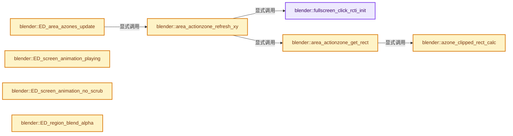
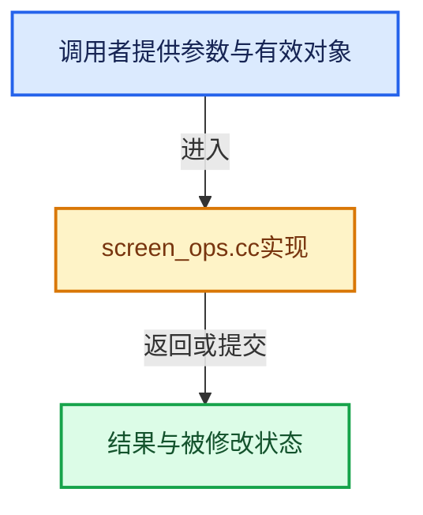

# 实现依赖专题：source/blender/editors/screen/screen_ops.cc

[方向导航](README.md) · [符号索引](../%E7%AC%A6%E5%8F%B7%E4%BE%9D%E8%B5%96%E4%B8%8E%E5%AE%9E%E7%8E%B0%E7%B4%A2%E5%BC%95.md)

本专题从正文实际调用进入，集中保存共享实现。函数有稳定锚点，可从调用处直接跳到对应完整函数；递归与互相调用通过回链组织。

## 本文件的实现关系






## 完整成员与函数实现

<a id="f-9d96c3ffafed1023"></a>

### `blender::fullscreen_click_rcti_init`

实现位置：[source/blender/editors/screen/screen_ops.cc](../../../../../source/blender/editors/screen/screen_ops.cc) · L994—L998。

接口参数：

- `rcti *rect`
- `const short`
- `const short`
- `const short x2`
- `const short y2`

**教学注释版**

<!-- annotated:1972565278a90d -->

```cpp
static void fullscreen_click_rcti_init(
    rcti *rect, const short /*x1*/, const short /*y1*/, const short x2, const short y2)
{
  BLI_rcti_init(rect, x2 - U.widget_unit, x2, y2 - U.widget_unit, y2);
}
```

<details>
<summary>核对原始源码：source/blender/editors/screen/screen_ops.cc · L994—L998</summary>

<!-- original:1972565278a90d:source/blender/editors/screen/screen_ops.cc:994:998 -->

```cpp
static void fullscreen_click_rcti_init(
    rcti *rect, const short /*x1*/, const short /*y1*/, const short x2, const short y2)
{
  BLI_rcti_init(rect, x2 - U.widget_unit, x2, y2 - U.widget_unit, y2);
}
```

</details>

**继续追踪实现**

- `BLI_rcti_init` → [blender::BLI_rcti_init · L428](../01-%E5%9F%BA%E7%A1%80%E5%AE%B9%E5%99%A8%E4%B8%8E%E7%8E%B0%E4%BB%A3CPP/%E4%BE%9D%E8%B5%96-rct-6e7349.md#f-c75659264970b4d1)。

<a id="f-ee0d270b1430e28d"></a>

### `blender::azone_clipped_rect_calc`

实现位置：[source/blender/editors/screen/screen_ops.cc](../../../../../source/blender/editors/screen/screen_ops.cc) · L1000—L1043。

接口参数：

- `const AZone *az`
- `rcti *r_rect_clip`

**教学注释版**

<!-- annotated:90338de2c79231 -->

```cpp
static bool azone_clipped_rect_calc(const AZone *az, rcti *r_rect_clip)
{
  const ARegion *region = az->region;
  *r_rect_clip = az->rect;
  if (az->type == AZONE_REGION) {
    if (region->overlap && (region->v2d.keeptot != V2D_KEEPTOT_STRICT) &&
        /* Only when this isn't hidden (where it's displayed as an button that expands). */
        region->runtime->visible)
    {
      /* A floating region to be resized, clip by the visible region. */
      switch (az->edge) {
        case AE_TOP_TO_BOTTOMRIGHT:
        case AE_BOTTOM_TO_TOPLEFT: {
          r_rect_clip->xmin = max_ii(
              r_rect_clip->xmin,
              (region->winrct.xmin +
               ui::view2d_view_to_region_x(&region->v2d, region->v2d.tot.xmin)) -
                  UI_REGION_OVERLAP_MARGIN);
          r_rect_clip->xmax = min_ii(
              r_rect_clip->xmax,
              (region->winrct.xmin +
               ui::view2d_view_to_region_x(&region->v2d, region->v2d.tot.xmax)) +
                  UI_REGION_OVERLAP_MARGIN);
          return true;
        }
        case AE_LEFT_TO_TOPRIGHT:
        case AE_RIGHT_TO_TOPLEFT: {
          r_rect_clip->ymin = max_ii(
              r_rect_clip->ymin,
              (region->winrct.ymin +
               ui::view2d_view_to_region_y(&region->v2d, region->v2d.tot.ymin)) -
                  UI_REGION_OVERLAP_MARGIN);
          r_rect_clip->ymax = min_ii(
              r_rect_clip->ymax,
              (region->winrct.ymin +
               ui::view2d_view_to_region_y(&region->v2d, region->v2d.tot.ymax)) +
                  UI_REGION_OVERLAP_MARGIN);
          return true;
        }
      }
    }
  }
  return false;
}
```

<details>
<summary>核对原始源码：source/blender/editors/screen/screen_ops.cc · L1000—L1043</summary>

<!-- original:90338de2c79231:source/blender/editors/screen/screen_ops.cc:1000:1043 -->

```cpp
static bool azone_clipped_rect_calc(const AZone *az, rcti *r_rect_clip)
{
  const ARegion *region = az->region;
  *r_rect_clip = az->rect;
  if (az->type == AZONE_REGION) {
    if (region->overlap && (region->v2d.keeptot != V2D_KEEPTOT_STRICT) &&
        /* Only when this isn't hidden (where it's displayed as an button that expands). */
        region->runtime->visible)
    {
      /* A floating region to be resized, clip by the visible region. */
      switch (az->edge) {
        case AE_TOP_TO_BOTTOMRIGHT:
        case AE_BOTTOM_TO_TOPLEFT: {
          r_rect_clip->xmin = max_ii(
              r_rect_clip->xmin,
              (region->winrct.xmin +
               ui::view2d_view_to_region_x(&region->v2d, region->v2d.tot.xmin)) -
                  UI_REGION_OVERLAP_MARGIN);
          r_rect_clip->xmax = min_ii(
              r_rect_clip->xmax,
              (region->winrct.xmin +
               ui::view2d_view_to_region_x(&region->v2d, region->v2d.tot.xmax)) +
                  UI_REGION_OVERLAP_MARGIN);
          return true;
        }
        case AE_LEFT_TO_TOPRIGHT:
        case AE_RIGHT_TO_TOPLEFT: {
          r_rect_clip->ymin = max_ii(
              r_rect_clip->ymin,
              (region->winrct.ymin +
               ui::view2d_view_to_region_y(&region->v2d, region->v2d.tot.ymin)) -
                  UI_REGION_OVERLAP_MARGIN);
          r_rect_clip->ymax = min_ii(
              r_rect_clip->ymax,
              (region->winrct.ymin +
               ui::view2d_view_to_region_y(&region->v2d, region->v2d.tot.ymax)) +
                  UI_REGION_OVERLAP_MARGIN);
          return true;
        }
      }
    }
  }
  return false;
}
```

</details>

**沿实际写入检查状态**

- `r_rect_clip->xmin = max_ii(`
- `r_rect_clip->xmax = min_ii(`
- `r_rect_clip->ymin = max_ii(`
- `r_rect_clip->ymax = min_ii(`

**结果出口**

- `return true;`
- `return false;`

**继续追踪实现**

- `max_ii` → [blender::max_ii · L368](../12-%E7%A9%BA%E9%97%B4%E6%95%B0%E6%8D%AE%E7%BB%93%E6%9E%84%E4%B8%8E%E5%87%A0%E4%BD%95%E7%AE%97%E6%B3%95/%E4%BE%9D%E8%B5%96-math_base_inline-546b00.md#f-c45aa7b373adb94c)。
- `ui::view2d_view_to_region_x` → [blender::ui::view2d_view_to_region_x · L1673](%E4%BE%9D%E8%B5%96-view2d-9b49e8.md#f-ffd3766499dfd0e0)。
- `min_ii` → [blender::min_ii · L364](../12-%E7%A9%BA%E9%97%B4%E6%95%B0%E6%8D%AE%E7%BB%93%E6%9E%84%E4%B8%8E%E5%87%A0%E4%BD%95%E7%AE%97%E6%B3%95/%E4%BE%9D%E8%B5%96-math_base_inline-546b00.md#f-30336db35b2810b8)。
- `ui::view2d_view_to_region_y` → [blender::ui::view2d_view_to_region_y · L1678](%E4%BE%9D%E8%B5%96-view2d-9b49e8.md#f-00a401d6b3dd62e6)。

<a id="f-4ee57e72c8a6f72d"></a>

### `blender::area_actionzone_get_rect`

实现位置：[source/blender/editors/screen/screen_ops.cc](../../../../../source/blender/editors/screen/screen_ops.cc) · L1046—L1069。

接口参数：

- `AZone *az`
- `rcti *r_rect`

**教学注释版**

<!-- annotated:79621de3030996 -->

```cpp
static void area_actionzone_get_rect(AZone *az, rcti *r_rect)
{
  if (az->type == AZONE_REGION_SCROLL) {
    const bool is_horizontal = az->direction == AZ_SCROLL_HOR;
    const bool is_vertical = az->direction == AZ_SCROLL_VERT;
    const bool is_right = is_vertical && bool(az->region->v2d.scroll & V2D_SCROLL_RIGHT);
    const bool is_left = is_vertical && bool(az->region->v2d.scroll & V2D_SCROLL_LEFT);
    const bool is_top = is_horizontal && bool(az->region->v2d.scroll & V2D_SCROLL_TOP);
    const bool is_bottom = is_horizontal && bool(az->region->v2d.scroll & V2D_SCROLL_BOTTOM);
    /* For scroll azones use the area around the region's scroll-bar location. */
    rcti scroller_vert = is_horizontal ? az->region->v2d.hor : az->region->v2d.vert;
    BLI_rcti_translate(&scroller_vert, az->region->winrct.xmin, az->region->winrct.ymin);

    /* Pull the zone in from edge and match the visible hit zone. */
    const int edge_padding = int(-3.0f * UI_SCALE_FAC);
    r_rect->xmin = scroller_vert.xmin - (is_right ? V2D_SCROLL_HIDE_HEIGHT : edge_padding);
    r_rect->ymin = scroller_vert.ymin - (is_top ? V2D_SCROLL_HIDE_WIDTH : edge_padding);
    r_rect->xmax = scroller_vert.xmax + (is_left ? V2D_SCROLL_HIDE_HEIGHT : edge_padding);
    r_rect->ymax = scroller_vert.ymax + (is_bottom ? V2D_SCROLL_HIDE_WIDTH : edge_padding);
  }
  else {
    azone_clipped_rect_calc(az, r_rect);
  }
}
```

<details>
<summary>核对原始源码：source/blender/editors/screen/screen_ops.cc · L1046—L1069</summary>

<!-- original:79621de3030996:source/blender/editors/screen/screen_ops.cc:1046:1069 -->

```cpp
static void area_actionzone_get_rect(AZone *az, rcti *r_rect)
{
  if (az->type == AZONE_REGION_SCROLL) {
    const bool is_horizontal = az->direction == AZ_SCROLL_HOR;
    const bool is_vertical = az->direction == AZ_SCROLL_VERT;
    const bool is_right = is_vertical && bool(az->region->v2d.scroll & V2D_SCROLL_RIGHT);
    const bool is_left = is_vertical && bool(az->region->v2d.scroll & V2D_SCROLL_LEFT);
    const bool is_top = is_horizontal && bool(az->region->v2d.scroll & V2D_SCROLL_TOP);
    const bool is_bottom = is_horizontal && bool(az->region->v2d.scroll & V2D_SCROLL_BOTTOM);
    /* For scroll azones use the area around the region's scroll-bar location. */
    rcti scroller_vert = is_horizontal ? az->region->v2d.hor : az->region->v2d.vert;
    BLI_rcti_translate(&scroller_vert, az->region->winrct.xmin, az->region->winrct.ymin);

    /* Pull the zone in from edge and match the visible hit zone. */
    const int edge_padding = int(-3.0f * UI_SCALE_FAC);
    r_rect->xmin = scroller_vert.xmin - (is_right ? V2D_SCROLL_HIDE_HEIGHT : edge_padding);
    r_rect->ymin = scroller_vert.ymin - (is_top ? V2D_SCROLL_HIDE_WIDTH : edge_padding);
    r_rect->xmax = scroller_vert.xmax + (is_left ? V2D_SCROLL_HIDE_HEIGHT : edge_padding);
    r_rect->ymax = scroller_vert.ymax + (is_bottom ? V2D_SCROLL_HIDE_WIDTH : edge_padding);
  }
  else {
    azone_clipped_rect_calc(az, r_rect);
  }
}
```

</details>

**沿实际写入检查状态**

- `r_rect->xmin = scroller_vert.xmin - (is_right ? V2D_SCROLL_HIDE_HEIGHT : edge_padding);`
- `r_rect->ymin = scroller_vert.ymin - (is_top ? V2D_SCROLL_HIDE_WIDTH : edge_padding);`
- `r_rect->xmax = scroller_vert.xmax + (is_left ? V2D_SCROLL_HIDE_HEIGHT : edge_padding);`
- `r_rect->ymax = scroller_vert.ymax + (is_bottom ? V2D_SCROLL_HIDE_WIDTH : edge_padding);`

**继续追踪实现**

- `BLI_rcti_translate` → [blender::BLI_rcti_translate · L580](../01-%E5%9F%BA%E7%A1%80%E5%AE%B9%E5%99%A8%E4%B8%8E%E7%8E%B0%E4%BB%A3CPP/%E4%BE%9D%E8%B5%96-rct-6e7349.md#f-31c762127669dc4c)。
- `azone_clipped_rect_calc` → [blender::azone_clipped_rect_calc · L1000](%E4%BE%9D%E8%B5%96-screen_ops-22be7b.md#f-ee0d270b1430e28d)。

<a id="f-770c93e3982fee21"></a>

### `blender::area_actionzone_refresh_xy`

实现位置：[source/blender/editors/screen/screen_ops.cc](../../../../../source/blender/editors/screen/screen_ops.cc) · L1071—L1235。

接口参数：

- `ScrArea *area`
- `const int xy[2]`
- `const bool test_only`

**教学注释版**

<!-- annotated:2a4f0fa74ee018 -->

```cpp
static AZone *area_actionzone_refresh_xy(ScrArea *area, const int xy[2], const bool test_only)
{
  AZone *az = nullptr;

  for (az = area->actionzones.first(); az; az = az->next) {
    rcti az_rect;
    area_actionzone_get_rect(az, &az_rect);
    if (BLI_rcti_isect_pt_v(&az_rect, xy)) {

      if (az->type == AZONE_AREA) {
        break;
      }
      if (az->type == AZONE_REGION_QUAD) {
        break;
      }
      if (az->type == AZONE_REGION) {
        const ARegion *region = az->region;
        const int local_xy[2] = {xy[0] - region->winrct.xmin, xy[1] - region->winrct.ymin};

        /* Respect button sections: Clusters of buttons (separated using separator-spacers) are
         * drawn with a background, in-between them the region is fully transparent (if "Region
         * Overlap" is enabled). Only allow dragging visible edges, so at the button sections. */
        if (region->runtime->visible && region->overlap &&
            (region->flag & RGN_FLAG_RESIZE_RESPECT_BUTTON_SECTIONS) &&
            !ui::region_button_sections_is_inside_x(az->region, local_xy[0]))
        {
          az = nullptr;
          break;
        }

        break;
      }
      if (az->type == AZONE_FULLSCREEN) {
        rcti click_rect;
        fullscreen_click_rcti_init(&click_rect, az->x1, az->y1, az->x2, az->y2);
        const bool click_isect = BLI_rcti_isect_pt_v(&click_rect, xy);

        if (test_only) {
          if (click_isect) {
            break;
          }
        }
        else {
          if (click_isect) {
            az->alpha = 1.0f;
          }
          else {
            const int mouse_sq = square_i(xy[0] - az->x2) + square_i(xy[1] - az->y2);
            const int spot_sq = square_i(UI_AZONESPOTW_RIGHT);
            const int fadein_sq = square_i(AZONEFADEIN);
            const int fadeout_sq = square_i(AZONEFADEOUT);

            if (mouse_sq < spot_sq) {
              az->alpha = 1.0f;
            }
            else if (mouse_sq < fadein_sq) {
              az->alpha = 1.0f;
            }
            else if (mouse_sq < fadeout_sq) {
              az->alpha = 1.0f - float(mouse_sq - fadein_sq) / float(fadeout_sq - fadein_sq);
            }
            else {
              az->alpha = 0.0f;
            }

            /* fade in/out but no click */
            az = nullptr;
          }

          /* XXX force redraw to show/hide the action zone */
          ED_area_tag_redraw(area);
          break;
        }
      }
      else if (az->type == AZONE_REGION_SCROLL && az->region->runtime->visible) {
        /* If the region is not visible we can ignore this scroll-bar zone. */
        ARegion *region = az->region;
        View2D *v2d = &region->v2d;
        int scroll_flag = 0;
        const int isect_value = ui::view2d_mouse_in_scrollers_ex(region, v2d, xy, &scroll_flag);

        /* Check if we even have scroll bars. */
        if (((az->direction == AZ_SCROLL_HOR) && !(scroll_flag & V2D_SCROLL_HORIZONTAL)) ||
            ((az->direction == AZ_SCROLL_VERT) && !(scroll_flag & V2D_SCROLL_VERTICAL)))
        {
          /* No scroll-bars, do nothing. */
        }
        else if (test_only) {
          if (isect_value != 0) {
            break;
          }
        }
        else {
          bool redraw = false;

          if (isect_value == 'h') {
            if (az->direction == AZ_SCROLL_HOR) {
              az->alpha = 1.0f;
              v2d->alpha_hor = 255;
              redraw = true;
            }
          }
          else if (isect_value == 'v') {
            if (az->direction == AZ_SCROLL_VERT) {
              az->alpha = 1.0f;
              v2d->alpha_vert = 255;
              redraw = true;
            }
          }
          else {
            const int local_xy[2] = {xy[0] - region->winrct.xmin, xy[1] - region->winrct.ymin};
            float dist_fac = 0.0f, alpha = 0.0f;

            if (az->direction == AZ_SCROLL_HOR) {
              dist_fac = BLI_rcti_length_y(&v2d->hor, local_xy[1]) / V2D_SCROLL_HIDE_WIDTH;
              CLAMP(dist_fac, 0.0f, 1.0f);
              alpha = 1.0f - dist_fac;

              v2d->alpha_hor = alpha * 255;
            }
            else if (az->direction == AZ_SCROLL_VERT) {
              dist_fac = BLI_rcti_length_x(&v2d->vert, local_xy[0]) / V2D_SCROLL_HIDE_HEIGHT;
              CLAMP(dist_fac, 0.0f, 1.0f);
              alpha = 1.0f - dist_fac;

              v2d->alpha_vert = alpha * 255;
            }
            az->alpha = alpha;
            redraw = true;
          }

          if (redraw) {
            ED_region_tag_redraw_no_rebuild(region);
          }
          /* Don't return! */
        }
      }
    }
    else if (!test_only && !IS_EQF(az->alpha, 0.0f)) {
      if (az->type == AZONE_FULLSCREEN) {
        az->alpha = 0.0f;
        area->flag &= ~AREA_FLAG_ACTIONZONES_UPDATE;
        ED_area_tag_redraw_no_rebuild(area);
      }
      else if (az->type == AZONE_REGION_SCROLL && az->region->runtime->visible) {
        /* If the region is not visible we can ignore this scroll-bar zone. */
        if (az->direction == AZ_SCROLL_VERT) {
          az->alpha = az->region->v2d.alpha_vert = 0;
          area->flag &= ~AREA_FLAG_ACTIONZONES_UPDATE;
          ED_region_tag_redraw_no_rebuild(az->region);
        }
        else if (az->direction == AZ_SCROLL_HOR) {
          az->alpha = az->region->v2d.alpha_hor = 0;
          area->flag &= ~AREA_FLAG_ACTIONZONES_UPDATE;
          ED_region_tag_redraw_no_rebuild(az->region);
        }
        else {
          BLI_assert(false);
        }
      }
    }
  }

  return az;
}
```

<details>
<summary>核对原始源码：source/blender/editors/screen/screen_ops.cc · L1071—L1235</summary>

<!-- original:2a4f0fa74ee018:source/blender/editors/screen/screen_ops.cc:1071:1235 -->

```cpp
static AZone *area_actionzone_refresh_xy(ScrArea *area, const int xy[2], const bool test_only)
{
  AZone *az = nullptr;

  for (az = area->actionzones.first(); az; az = az->next) {
    rcti az_rect;
    area_actionzone_get_rect(az, &az_rect);
    if (BLI_rcti_isect_pt_v(&az_rect, xy)) {

      if (az->type == AZONE_AREA) {
        break;
      }
      if (az->type == AZONE_REGION_QUAD) {
        break;
      }
      if (az->type == AZONE_REGION) {
        const ARegion *region = az->region;
        const int local_xy[2] = {xy[0] - region->winrct.xmin, xy[1] - region->winrct.ymin};

        /* Respect button sections: Clusters of buttons (separated using separator-spacers) are
         * drawn with a background, in-between them the region is fully transparent (if "Region
         * Overlap" is enabled). Only allow dragging visible edges, so at the button sections. */
        if (region->runtime->visible && region->overlap &&
            (region->flag & RGN_FLAG_RESIZE_RESPECT_BUTTON_SECTIONS) &&
            !ui::region_button_sections_is_inside_x(az->region, local_xy[0]))
        {
          az = nullptr;
          break;
        }

        break;
      }
      if (az->type == AZONE_FULLSCREEN) {
        rcti click_rect;
        fullscreen_click_rcti_init(&click_rect, az->x1, az->y1, az->x2, az->y2);
        const bool click_isect = BLI_rcti_isect_pt_v(&click_rect, xy);

        if (test_only) {
          if (click_isect) {
            break;
          }
        }
        else {
          if (click_isect) {
            az->alpha = 1.0f;
          }
          else {
            const int mouse_sq = square_i(xy[0] - az->x2) + square_i(xy[1] - az->y2);
            const int spot_sq = square_i(UI_AZONESPOTW_RIGHT);
            const int fadein_sq = square_i(AZONEFADEIN);
            const int fadeout_sq = square_i(AZONEFADEOUT);

            if (mouse_sq < spot_sq) {
              az->alpha = 1.0f;
            }
            else if (mouse_sq < fadein_sq) {
              az->alpha = 1.0f;
            }
            else if (mouse_sq < fadeout_sq) {
              az->alpha = 1.0f - float(mouse_sq - fadein_sq) / float(fadeout_sq - fadein_sq);
            }
            else {
              az->alpha = 0.0f;
            }

            /* fade in/out but no click */
            az = nullptr;
          }

          /* XXX force redraw to show/hide the action zone */
          ED_area_tag_redraw(area);
          break;
        }
      }
      else if (az->type == AZONE_REGION_SCROLL && az->region->runtime->visible) {
        /* If the region is not visible we can ignore this scroll-bar zone. */
        ARegion *region = az->region;
        View2D *v2d = &region->v2d;
        int scroll_flag = 0;
        const int isect_value = ui::view2d_mouse_in_scrollers_ex(region, v2d, xy, &scroll_flag);

        /* Check if we even have scroll bars. */
        if (((az->direction == AZ_SCROLL_HOR) && !(scroll_flag & V2D_SCROLL_HORIZONTAL)) ||
            ((az->direction == AZ_SCROLL_VERT) && !(scroll_flag & V2D_SCROLL_VERTICAL)))
        {
          /* No scroll-bars, do nothing. */
        }
        else if (test_only) {
          if (isect_value != 0) {
            break;
          }
        }
        else {
          bool redraw = false;

          if (isect_value == 'h') {
            if (az->direction == AZ_SCROLL_HOR) {
              az->alpha = 1.0f;
              v2d->alpha_hor = 255;
              redraw = true;
            }
          }
          else if (isect_value == 'v') {
            if (az->direction == AZ_SCROLL_VERT) {
              az->alpha = 1.0f;
              v2d->alpha_vert = 255;
              redraw = true;
            }
          }
          else {
            const int local_xy[2] = {xy[0] - region->winrct.xmin, xy[1] - region->winrct.ymin};
            float dist_fac = 0.0f, alpha = 0.0f;

            if (az->direction == AZ_SCROLL_HOR) {
              dist_fac = BLI_rcti_length_y(&v2d->hor, local_xy[1]) / V2D_SCROLL_HIDE_WIDTH;
              CLAMP(dist_fac, 0.0f, 1.0f);
              alpha = 1.0f - dist_fac;

              v2d->alpha_hor = alpha * 255;
            }
            else if (az->direction == AZ_SCROLL_VERT) {
              dist_fac = BLI_rcti_length_x(&v2d->vert, local_xy[0]) / V2D_SCROLL_HIDE_HEIGHT;
              CLAMP(dist_fac, 0.0f, 1.0f);
              alpha = 1.0f - dist_fac;

              v2d->alpha_vert = alpha * 255;
            }
            az->alpha = alpha;
            redraw = true;
          }

          if (redraw) {
            ED_region_tag_redraw_no_rebuild(region);
          }
          /* Don't return! */
        }
      }
    }
    else if (!test_only && !IS_EQF(az->alpha, 0.0f)) {
      if (az->type == AZONE_FULLSCREEN) {
        az->alpha = 0.0f;
        area->flag &= ~AREA_FLAG_ACTIONZONES_UPDATE;
        ED_area_tag_redraw_no_rebuild(area);
      }
      else if (az->type == AZONE_REGION_SCROLL && az->region->runtime->visible) {
        /* If the region is not visible we can ignore this scroll-bar zone. */
        if (az->direction == AZ_SCROLL_VERT) {
          az->alpha = az->region->v2d.alpha_vert = 0;
          area->flag &= ~AREA_FLAG_ACTIONZONES_UPDATE;
          ED_region_tag_redraw_no_rebuild(az->region);
        }
        else if (az->direction == AZ_SCROLL_HOR) {
          az->alpha = az->region->v2d.alpha_hor = 0;
          area->flag &= ~AREA_FLAG_ACTIONZONES_UPDATE;
          ED_region_tag_redraw_no_rebuild(az->region);
        }
        else {
          BLI_assert(false);
        }
      }
    }
  }

  return az;
}
```

</details>

**沿实际写入检查状态**

- `az = nullptr;`
- `az->alpha = 1.0f;`
- `az->alpha = 1.0f - float(mouse_sq - fadein_sq) / float(fadeout_sq - fadein_sq);`
- `az->alpha = 0.0f;`
- `v2d->alpha_hor = 255;`
- `redraw = true;`
- `v2d->alpha_vert = 255;`
- `dist_fac = BLI_rcti_length_y(&v2d->hor, local_xy[1]) / V2D_SCROLL_HIDE_WIDTH;`
- `alpha = 1.0f - dist_fac;`
- `v2d->alpha_hor = alpha * 255;`
- `dist_fac = BLI_rcti_length_x(&v2d->vert, local_xy[0]) / V2D_SCROLL_HIDE_HEIGHT;`
- `v2d->alpha_vert = alpha * 255;`
- `az->alpha = alpha;`
- `area->flag &= ~AREA_FLAG_ACTIONZONES_UPDATE;`
- `az->alpha = az->region->v2d.alpha_vert = 0;`
- `az->alpha = az->region->v2d.alpha_hor = 0;`

**结果出口**

- `return az;`

**继续追踪实现**

- `area->actionzones.first` → [调用协议](../%E6%A8%A1%E6%9D%BF%E5%AE%8F%E4%B8%8E%E5%8A%A8%E6%80%81%E5%88%86%E6%B4%BE%E5%8D%8F%E8%AE%AE.md)：接收对象类型依赖auto、返回值或模板实例；不按同名猜测目标。调用位置L1075。
- `area_actionzone_get_rect` → [blender::area_actionzone_get_rect · L1046](%E4%BE%9D%E8%B5%96-screen_ops-22be7b.md#f-4ee57e72c8a6f72d)。
- `BLI_rcti_isect_pt_v` → [blender::BLI_rcti_isect_pt_v · L78](../01-%E5%9F%BA%E7%A1%80%E5%AE%B9%E5%99%A8%E4%B8%8E%E7%8E%B0%E4%BB%A3CPP/%E4%BE%9D%E8%B5%96-rct-6e7349.md#f-fbeeea057dda9fad)。
- `ui::region_button_sections_is_inside_x` → [blender::ui::region_button_sections_is_inside_x · L243](%E4%BE%9D%E8%B5%96-interface_button_sections-dc706f.md#f-720ad8e64f5d573b)。
- `fullscreen_click_rcti_init` → [blender::fullscreen_click_rcti_init · L994](%E4%BE%9D%E8%B5%96-screen_ops-22be7b.md#f-9d96c3ffafed1023)。
- `square_i` → [blender::square_i · L292](../12-%E7%A9%BA%E9%97%B4%E6%95%B0%E6%8D%AE%E7%BB%93%E6%9E%84%E4%B8%8E%E5%87%A0%E4%BD%95%E7%AE%97%E6%B3%95/%E4%BE%9D%E8%B5%96-math_base_inline-546b00.md#f-ef9d2eb2b611097e)。
- `ED_area_tag_redraw` → [blender::ED_area_tag_redraw · L784](%E4%BE%9D%E8%B5%96-area-87d68a.md#f-bad077185992988f)。
- `ui::view2d_mouse_in_scrollers_ex` → [blender::ui::view2d_mouse_in_scrollers_ex · L1988](%E4%BE%9D%E8%B5%96-view2d-9b49e8.md#f-1897704c9c351245)。
- `BLI_rcti_length_y` → [blender::BLI_rcti_length_y · L162](../01-%E5%9F%BA%E7%A1%80%E5%AE%B9%E5%99%A8%E4%B8%8E%E7%8E%B0%E4%BB%A3CPP/%E4%BE%9D%E8%B5%96-rct-6e7349.md#f-37fac252d9d6ac15)。
- `CLAMP` → [CLAMP · L200](../01-%E5%9F%BA%E7%A1%80%E5%AE%B9%E5%99%A8%E4%B8%8E%E7%8E%B0%E4%BB%A3CPP/%E4%BE%9D%E8%B5%96-BLI_utildefines-293a0a.md#m-69703e497120)。宏定义由构建条件选择。
- `BLI_rcti_length_x` → [blender::BLI_rcti_length_x · L151](../01-%E5%9F%BA%E7%A1%80%E5%AE%B9%E5%99%A8%E4%B8%8E%E7%8E%B0%E4%BB%A3CPP/%E4%BE%9D%E8%B5%96-rct-6e7349.md#f-45be445adf152df9)。
- `ED_region_tag_redraw_no_rebuild` → [blender::ED_region_tag_redraw_no_rebuild · L727](%E4%BE%9D%E8%B5%96-area-87d68a.md#f-6b4eceb5338d6969)。
- `IS_EQF` → [IS_EQF · L150](../01-%E5%9F%BA%E7%A1%80%E5%AE%B9%E5%99%A8%E4%B8%8E%E7%8E%B0%E4%BB%A3CPP/%E4%BE%9D%E8%B5%96-BLI_utildefines-293a0a.md#m-cbb89356c077)。宏定义由构建条件选择。
- `ED_area_tag_redraw_no_rebuild` → [blender::ED_area_tag_redraw_no_rebuild · L793](%E4%BE%9D%E8%B5%96-area-87d68a.md#f-b3d68fb6c581bbc2)。
- `BLI_assert` → [BLI_assert · L48](../01-%E5%9F%BA%E7%A1%80%E5%AE%B9%E5%99%A8%E4%B8%8E%E7%8E%B0%E4%BB%A3CPP/%E4%BE%9D%E8%B5%96-BLI_assert-cc98e8.md#m-57a88495704d)；[BLI_assert · L63](../01-%E5%9F%BA%E7%A1%80%E5%AE%B9%E5%99%A8%E4%B8%8E%E7%8E%B0%E4%BB%A3CPP/%E4%BE%9D%E8%B5%96-BLI_assert-cc98e8.md#m-d07050020cb5)。宏定义由构建条件选择。

<a id="f-ced2b0a35916f395"></a>

### `blender::ED_area_azones_update`

实现位置：[source/blender/editors/screen/screen_ops.cc](../../../../../source/blender/editors/screen/screen_ops.cc) · L1267—L1270。

接口参数：

- `ScrArea *area`
- `const int xy[2]`

**教学注释版**

<!-- annotated:515f6b2213e23d -->

```cpp
AZone *ED_area_azones_update(ScrArea *area, const int xy[2])
{
  return area_actionzone_refresh_xy(area, xy, false);
}
```

<details>
<summary>核对原始源码：source/blender/editors/screen/screen_ops.cc · L1267—L1270</summary>

<!-- original:515f6b2213e23d:source/blender/editors/screen/screen_ops.cc:1267:1270 -->

```cpp
AZone *ED_area_azones_update(ScrArea *area, const int xy[2])
{
  return area_actionzone_refresh_xy(area, xy, false);
}
```

</details>

**结果出口**

- `return area_actionzone_refresh_xy(area, xy, false);`

**继续追踪实现**

- `area_actionzone_refresh_xy` → [blender::area_actionzone_refresh_xy · L1071](%E4%BE%9D%E8%B5%96-screen_ops-22be7b.md#f-770c93e3982fee21)。

<a id="f-a214adf804d8afe6"></a>

### `blender::ED_screen_animation_playing`

实现位置：[source/blender/editors/screen/screen_ops.cc](../../../../../source/blender/editors/screen/screen_ops.cc) · L6860—L6871。

接口参数：

- `const wmWindowManager *wm`

**教学注释版**

<!-- annotated:09fe85c21f1b48 -->

```cpp
bScreen *ED_screen_animation_playing(const wmWindowManager *wm)
{
  for (wmWindow &win : wm->windows) {
    bScreen *screen = WM_window_get_active_screen(&win);

    if (screen->animtimer || screen->scrubbing) {
      return screen;
    }
  }

  return nullptr;
}
```

<details>
<summary>核对原始源码：source/blender/editors/screen/screen_ops.cc · L6860—L6871</summary>

<!-- original:09fe85c21f1b48:source/blender/editors/screen/screen_ops.cc:6860:6871 -->

```cpp
bScreen *ED_screen_animation_playing(const wmWindowManager *wm)
{
  for (wmWindow &win : wm->windows) {
    bScreen *screen = WM_window_get_active_screen(&win);

    if (screen->animtimer || screen->scrubbing) {
      return screen;
    }
  }

  return nullptr;
}
```

</details>

**结果出口**

- `return screen;`
- `return nullptr;`

**继续追踪实现**

- `WM_window_get_active_screen` → [blender::WM_window_get_active_screen · L3442](%E4%BE%9D%E8%B5%96-wm_window-b2a158.md#f-54952b6e38dc8344)。

<a id="f-8192c73af8289999"></a>

### `blender::ED_screen_animation_no_scrub`

实现位置：[source/blender/editors/screen/screen_ops.cc](../../../../../source/blender/editors/screen/screen_ops.cc) · L6889—L6900。

接口参数：

- `const wmWindowManager *wm`

**教学注释版**

<!-- annotated:0bf897265ec84d -->

```cpp
bScreen *ED_screen_animation_no_scrub(const wmWindowManager *wm)
{
  for (wmWindow &win : wm->windows) {
    bScreen *screen = WM_window_get_active_screen(&win);

    if (screen->animtimer) {
      return screen;
    }
  }

  return nullptr;
}
```

<details>
<summary>核对原始源码：source/blender/editors/screen/screen_ops.cc · L6889—L6900</summary>

<!-- original:0bf897265ec84d:source/blender/editors/screen/screen_ops.cc:6889:6900 -->

```cpp
bScreen *ED_screen_animation_no_scrub(const wmWindowManager *wm)
{
  for (wmWindow &win : wm->windows) {
    bScreen *screen = WM_window_get_active_screen(&win);

    if (screen->animtimer) {
      return screen;
    }
  }

  return nullptr;
}
```

</details>

**结果出口**

- `return screen;`
- `return nullptr;`

**继续追踪实现**

- `WM_window_get_active_screen` → [blender::WM_window_get_active_screen · L3442](%E4%BE%9D%E8%B5%96-wm_window-b2a158.md#f-54952b6e38dc8344)。

<a id="f-899e30196e6b29ad"></a>

### `blender::ED_region_blend_alpha`

实现位置：[source/blender/editors/screen/screen_ops.cc](../../../../../source/blender/editors/screen/screen_ops.cc) · L7631—L7657。

接口参数：

- `ARegion *region`

**教学注释版**

<!-- annotated:227271b51c778e -->

```cpp
float ED_region_blend_alpha(ARegion *region)
{
  /* check parent too */
  if (region->runtime->regiontimer == nullptr &&
      (region->alignment & (RGN_SPLIT_PREV | RGN_ALIGN_HIDE_WITH_PREV)) && region->prev)
  {
    region = region->prev;
  }

  if (region->runtime->regiontimer) {
    RegionAlphaInfo *rgi = static_cast<RegionAlphaInfo *>(
        region->runtime->regiontimer->customdata);
    float alpha;

    alpha = float(region->runtime->regiontimer->time_duration) / TIMEOUT;
    /* makes sure the blend out works 100% - without area redraws */
    if (rgi->hidden) {
      alpha = 0.9f - TIMESTEP - alpha;
    }

    CLAMP(alpha, 0.0f, 1.0f);
    /* Quadratic ease-out: 1 - (1 - alpha)^2 == alpha * (2 - alpha). */
    const float alpha_easing = alpha * (2.0f - alpha);
    return alpha_easing;
  }
  return 1.0f;
}
```

<details>
<summary>核对原始源码：source/blender/editors/screen/screen_ops.cc · L7631—L7657</summary>

<!-- original:227271b51c778e:source/blender/editors/screen/screen_ops.cc:7631:7657 -->

```cpp
float ED_region_blend_alpha(ARegion *region)
{
  /* check parent too */
  if (region->runtime->regiontimer == nullptr &&
      (region->alignment & (RGN_SPLIT_PREV | RGN_ALIGN_HIDE_WITH_PREV)) && region->prev)
  {
    region = region->prev;
  }

  if (region->runtime->regiontimer) {
    RegionAlphaInfo *rgi = static_cast<RegionAlphaInfo *>(
        region->runtime->regiontimer->customdata);
    float alpha;

    alpha = float(region->runtime->regiontimer->time_duration) / TIMEOUT;
    /* makes sure the blend out works 100% - without area redraws */
    if (rgi->hidden) {
      alpha = 0.9f - TIMESTEP - alpha;
    }

    CLAMP(alpha, 0.0f, 1.0f);
    /* Quadratic ease-out: 1 - (1 - alpha)^2 == alpha * (2 - alpha). */
    const float alpha_easing = alpha * (2.0f - alpha);
    return alpha_easing;
  }
  return 1.0f;
}
```

</details>

**沿实际写入检查状态**

- `region = region->prev;`
- `alpha = float(region->runtime->regiontimer->time_duration) / TIMEOUT;`
- `alpha = 0.9f - TIMESTEP - alpha;`

**结果出口**

- `return alpha_easing;`
- `return 1.0f;`

**继续追踪实现**

- `CLAMP` → [CLAMP · L200](../01-%E5%9F%BA%E7%A1%80%E5%AE%B9%E5%99%A8%E4%B8%8E%E7%8E%B0%E4%BB%A3CPP/%E4%BE%9D%E8%B5%96-BLI_utildefines-293a0a.md#m-69703e497120)。宏定义由构建条件选择。

<a id="f-83b36d7c5078240d"></a>

### `blender::ED_region_blend_rect`

实现位置：[source/blender/editors/screen/screen_ops.cc](../../../../../source/blender/editors/screen/screen_ops.cc) · L7659—L7684。

接口参数：

- `ARegion *region`
- `rcti *r_rect`

**教学注释版**

<!-- annotated:fb5d8d44b5496c -->

```cpp
void ED_region_blend_rect(ARegion *region, rcti *r_rect)
{
  *r_rect = region->winrct;
  const float alpha = ED_region_blend_alpha(region);
  if (alpha >= 1.0f) {
    return;
  }
  const float ofs_x = BLI_rcti_size_x(r_rect) * (1.0f - alpha);
  const float ofs_y = BLI_rcti_size_y(r_rect) * (1.0f - alpha);
  switch (RGN_ALIGN_ENUM_FROM_MASK(region->alignment)) {
    case RGN_ALIGN_RIGHT:
      r_rect->xmin += ofs_x;
      break;
    case RGN_ALIGN_LEFT:
      r_rect->xmax -= ofs_x;
      break;
    case RGN_ALIGN_TOP:
      r_rect->ymin += ofs_y;
      break;
    case RGN_ALIGN_BOTTOM:
      r_rect->ymax -= ofs_y;
      break;
    default:
      break;
  }
}
```

<details>
<summary>核对原始源码：source/blender/editors/screen/screen_ops.cc · L7659—L7684</summary>

<!-- original:fb5d8d44b5496c:source/blender/editors/screen/screen_ops.cc:7659:7684 -->

```cpp
void ED_region_blend_rect(ARegion *region, rcti *r_rect)
{
  *r_rect = region->winrct;
  const float alpha = ED_region_blend_alpha(region);
  if (alpha >= 1.0f) {
    return;
  }
  const float ofs_x = BLI_rcti_size_x(r_rect) * (1.0f - alpha);
  const float ofs_y = BLI_rcti_size_y(r_rect) * (1.0f - alpha);
  switch (RGN_ALIGN_ENUM_FROM_MASK(region->alignment)) {
    case RGN_ALIGN_RIGHT:
      r_rect->xmin += ofs_x;
      break;
    case RGN_ALIGN_LEFT:
      r_rect->xmax -= ofs_x;
      break;
    case RGN_ALIGN_TOP:
      r_rect->ymin += ofs_y;
      break;
    case RGN_ALIGN_BOTTOM:
      r_rect->ymax -= ofs_y;
      break;
    default:
      break;
  }
}
```

</details>

**沿实际写入检查状态**

- `r_rect->xmin += ofs_x;`
- `r_rect->xmax -= ofs_x;`
- `r_rect->ymin += ofs_y;`
- `r_rect->ymax -= ofs_y;`

**继续追踪实现**

- `ED_region_blend_alpha` → [blender::ED_region_blend_alpha · L7631](%E4%BE%9D%E8%B5%96-screen_ops-22be7b.md#f-899e30196e6b29ad)。
- `BLI_rcti_size_x` → [blender::BLI_rcti_size_x · L203](../01-%E5%9F%BA%E7%A1%80%E5%AE%B9%E5%99%A8%E4%B8%8E%E7%8E%B0%E4%BB%A3CPP/%E4%BE%9D%E8%B5%96-BLI_rect-2996c6.md#f-7a8fb2c54a829be6)。
- `BLI_rcti_size_y` → [blender::BLI_rcti_size_y · L207](../01-%E5%9F%BA%E7%A1%80%E5%AE%B9%E5%99%A8%E4%B8%8E%E7%8E%B0%E4%BB%A3CPP/%E4%BE%9D%E8%B5%96-BLI_rect-2996c6.md#f-ac87d6c708d502ad)。
- `RGN_ALIGN_ENUM_FROM_MASK` → [RGN_ALIGN_ENUM_FROM_MASK · L747](%E4%BE%9D%E8%B5%96-DNA_screen_types-7eab90.md#m-7267b0776dc7)。宏定义由构建条件选择。
