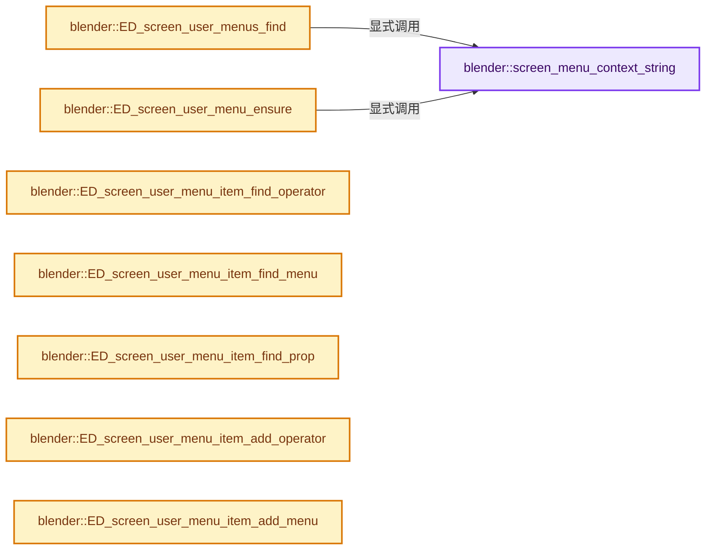

# 实现依赖专题：source/blender/editors/screen/screen_user_menu.cc

[方向导航](README.md) · [符号索引](../%E7%AC%A6%E5%8F%B7%E4%BE%9D%E8%B5%96%E4%B8%8E%E5%AE%9E%E7%8E%B0%E7%B4%A2%E5%BC%95.md)

本专题从正文实际调用进入，集中保存共享实现。函数有稳定锚点，可从调用处直接跳到对应完整函数；递归与互相调用通过回链组织。

## 本文件的实现关系




## 完整成员与函数实现

<a id="f-138c2b26cfec07b9"></a>

### `blender::screen_menu_context_string`

实现位置：[source/blender/editors/screen/screen_user_menu.cc](../../../../../source/blender/editors/screen/screen_user_menu.cc) · L47—L54。

接口参数：

- `const bContext *C`
- `const SpaceLink *sl`

**教学注释版**

<!-- annotated:db66dff2f2a803 -->

```cpp
static const char *screen_menu_context_string(const bContext *C, const SpaceLink *sl)
{
  if (sl->spacetype == SPACE_NODE) {
    const SpaceNode *snode = reinterpret_cast<const SpaceNode *>(sl);
    return snode->tree_idname;
  }
  return CTX_data_mode_string(C);
}
```

<details>
<summary>核对原始源码：source/blender/editors/screen/screen_user_menu.cc · L47—L54</summary>

<!-- original:db66dff2f2a803:source/blender/editors/screen/screen_user_menu.cc:47:54 -->

```cpp
static const char *screen_menu_context_string(const bContext *C, const SpaceLink *sl)
{
  if (sl->spacetype == SPACE_NODE) {
    const SpaceNode *snode = reinterpret_cast<const SpaceNode *>(sl);
    return snode->tree_idname;
  }
  return CTX_data_mode_string(C);
}
```

</details>

**结果出口**

- `return snode->tree_idname;`
- `return CTX_data_mode_string(C);`

**继续追踪实现**

- `CTX_data_mode_string` → [blender::CTX_data_mode_string · L1539](%E4%BE%9D%E8%B5%96-context-a929d9.md#f-68dabb93b6b028b1)。

<a id="f-a3b6409c3ff5af59"></a>

### `blender::ED_screen_user_menus_find`

实现位置：[source/blender/editors/screen/screen_user_menu.cc](../../../../../source/blender/editors/screen/screen_user_menu.cc) · L62—L85。

接口参数：

- `const bContext *C`
- `uint *r_len`

**教学注释版**

<!-- annotated:4e451012b9f7e7 -->

```cpp
bUserMenu **ED_screen_user_menus_find(const bContext *C, uint *r_len)
{
  SpaceLink *sl = CTX_wm_space_data(C);

  if (sl == nullptr) {
    *r_len = 0;
    return nullptr;
  }

  const char *context_mode = CTX_data_mode_string(C);
  const char *context = screen_menu_context_string(C, sl);
  uint array_len = 3;
  bUserMenu **um_array = MEM_new_array_zeroed<bUserMenu *>(array_len, __func__);
  um_array[0] = BKE_blender_user_menu_find(&U.user_menus, sl->spacetype, context);
  um_array[1] = (sl->spacetype != SPACE_TOPBAR) ?
                    BKE_blender_user_menu_find(&U.user_menus, SPACE_TOPBAR, context_mode) :
                    nullptr;
  um_array[2] = (sl->spacetype == SPACE_VIEW3D) ?
                    BKE_blender_user_menu_find(&U.user_menus, SPACE_PROPERTIES, context_mode) :
                    nullptr;

  *r_len = array_len;
  return um_array;
}
```

<details>
<summary>核对原始源码：source/blender/editors/screen/screen_user_menu.cc · L62—L85</summary>

<!-- original:4e451012b9f7e7:source/blender/editors/screen/screen_user_menu.cc:62:85 -->

```cpp
bUserMenu **ED_screen_user_menus_find(const bContext *C, uint *r_len)
{
  SpaceLink *sl = CTX_wm_space_data(C);

  if (sl == nullptr) {
    *r_len = 0;
    return nullptr;
  }

  const char *context_mode = CTX_data_mode_string(C);
  const char *context = screen_menu_context_string(C, sl);
  uint array_len = 3;
  bUserMenu **um_array = MEM_new_array_zeroed<bUserMenu *>(array_len, __func__);
  um_array[0] = BKE_blender_user_menu_find(&U.user_menus, sl->spacetype, context);
  um_array[1] = (sl->spacetype != SPACE_TOPBAR) ?
                    BKE_blender_user_menu_find(&U.user_menus, SPACE_TOPBAR, context_mode) :
                    nullptr;
  um_array[2] = (sl->spacetype == SPACE_VIEW3D) ?
                    BKE_blender_user_menu_find(&U.user_menus, SPACE_PROPERTIES, context_mode) :
                    nullptr;

  *r_len = array_len;
  return um_array;
}
```

</details>

**沿实际写入检查状态**

- `um_array[0] = BKE_blender_user_menu_find(&U.user_menus, sl->spacetype, context);`
- `um_array[1] = (sl->spacetype != SPACE_TOPBAR) ?`
- `um_array[2] = (sl->spacetype == SPACE_VIEW3D) ?`

**结果出口**

- `return nullptr;`
- `return um_array;`

**继续追踪实现**

- `CTX_wm_space_data` → [blender::CTX_wm_space_data · L959](%E4%BE%9D%E8%B5%96-context-a929d9.md#f-ddd6af522f1f553c)。
- `CTX_data_mode_string` → [blender::CTX_data_mode_string · L1539](%E4%BE%9D%E8%B5%96-context-a929d9.md#f-68dabb93b6b028b1)。
- `screen_menu_context_string` → [blender::screen_menu_context_string · L47](%E4%BE%9D%E8%B5%96-screen_user_menu-8e2a4b.md#f-138c2b26cfec07b9)。
- `MEM_new_array_zeroed<bUserMenu *>` → [MEM_new_array_zeroed · L566](../03-%E5%86%85%E5%AD%98%E5%88%86%E9%85%8D%E4%B8%8E%E8%BF%90%E8%A1%8C%E6%97%B6%E7%B1%BB%E5%9E%8B/%E4%BE%9D%E8%B5%96-MEM_guardedalloc-b54eca.md#f-3a0cf63fb5216500)；[MEM_new_array_zeroed · L119](../03-%E5%86%85%E5%AD%98%E5%88%86%E9%85%8D%E4%B8%8E%E8%BF%90%E8%A1%8C%E6%97%B6%E7%B1%BB%E5%9E%8B/%E4%BE%9D%E8%B5%96-mallocn-afdcd4.md#f-6825557da566fdbe)。同名重载需按实参类型选择。
- `BKE_blender_user_menu_find` → [blender::BKE_blender_user_menu_find · L29](%E4%BE%9D%E8%B5%96-blender_user_menu-51a71e.md#f-f171528b1ea94f0e)。

<a id="f-f18ae81eb6b9c151"></a>

### `blender::ED_screen_user_menu_ensure`

实现位置：[source/blender/editors/screen/screen_user_menu.cc](../../../../../source/blender/editors/screen/screen_user_menu.cc) · L87—L92。

接口参数：

- `bContext *C`

**教学注释版**

<!-- annotated:74f6720f1e566b -->

```cpp
bUserMenu *ED_screen_user_menu_ensure(bContext *C)
{
  SpaceLink *sl = CTX_wm_space_data(C);
  const char *context = screen_menu_context_string(C, sl);
  return BKE_blender_user_menu_ensure(&U.user_menus, sl->spacetype, context);
}
```

<details>
<summary>核对原始源码：source/blender/editors/screen/screen_user_menu.cc · L87—L92</summary>

<!-- original:74f6720f1e566b:source/blender/editors/screen/screen_user_menu.cc:87:92 -->

```cpp
bUserMenu *ED_screen_user_menu_ensure(bContext *C)
{
  SpaceLink *sl = CTX_wm_space_data(C);
  const char *context = screen_menu_context_string(C, sl);
  return BKE_blender_user_menu_ensure(&U.user_menus, sl->spacetype, context);
}
```

</details>

**结果出口**

- `return BKE_blender_user_menu_ensure(&U.user_menus, sl->spacetype, context);`

**继续追踪实现**

- `CTX_wm_space_data` → [blender::CTX_wm_space_data · L959](%E4%BE%9D%E8%B5%96-context-a929d9.md#f-ddd6af522f1f553c)。
- `screen_menu_context_string` → [blender::screen_menu_context_string · L47](%E4%BE%9D%E8%B5%96-screen_user_menu-8e2a4b.md#f-138c2b26cfec07b9)。
- `BKE_blender_user_menu_ensure` → [blender::BKE_blender_user_menu_ensure · L41](%E4%BE%9D%E8%B5%96-blender_user_menu-51a71e.md#f-7a070c7cc5971cf4)。

<a id="f-2466866edacd15b1"></a>

### `blender::ED_screen_user_menu_item_find_operator`

实现位置：[source/blender/editors/screen/screen_user_menu.cc](../../../../../source/blender/editors/screen/screen_user_menu.cc) · L100—L122。

接口参数：

- `ListBaseT<bUserMenuItem> *lb`
- `const wmOperatorType *ot`
- `IDProperty *prop`
- `const char *op_prop_enum`
- `wm::OpCallContext opcontext`

**教学注释版**

<!-- annotated:dac628dc81345c -->

```cpp
bUserMenuItem_Op *ED_screen_user_menu_item_find_operator(ListBaseT<bUserMenuItem> *lb,
                                                         const wmOperatorType *ot,
                                                         IDProperty *prop,
                                                         const char *op_prop_enum,
                                                         wm::OpCallContext opcontext)
{
  for (bUserMenuItem &umi : *lb) {
    if (umi.type == USER_MENU_TYPE_OPERATOR) {
      bUserMenuItem_Op *umi_op = reinterpret_cast<bUserMenuItem_Op *>(&umi);
      const bool is_strict = prop && umi_op->prop;
      const bool ok_idprop = IDP_EqualsProperties_ex(prop, umi_op->prop, is_strict);
      const bool ok_prop_enum = (umi_op->op_prop_enum[0] != '\0') ?
                                    STREQ(umi_op->op_prop_enum, op_prop_enum) :
                                    true;
      if (STREQ(ot->idname, umi_op->op_idname) &&
          (opcontext == wm::OpCallContext(umi_op->opcontext)) && ok_idprop && ok_prop_enum)
      {
        return umi_op;
      }
    }
  }
  return nullptr;
}
```

<details>
<summary>核对原始源码：source/blender/editors/screen/screen_user_menu.cc · L100—L122</summary>

<!-- original:dac628dc81345c:source/blender/editors/screen/screen_user_menu.cc:100:122 -->

```cpp
bUserMenuItem_Op *ED_screen_user_menu_item_find_operator(ListBaseT<bUserMenuItem> *lb,
                                                         const wmOperatorType *ot,
                                                         IDProperty *prop,
                                                         const char *op_prop_enum,
                                                         wm::OpCallContext opcontext)
{
  for (bUserMenuItem &umi : *lb) {
    if (umi.type == USER_MENU_TYPE_OPERATOR) {
      bUserMenuItem_Op *umi_op = reinterpret_cast<bUserMenuItem_Op *>(&umi);
      const bool is_strict = prop && umi_op->prop;
      const bool ok_idprop = IDP_EqualsProperties_ex(prop, umi_op->prop, is_strict);
      const bool ok_prop_enum = (umi_op->op_prop_enum[0] != '\0') ?
                                    STREQ(umi_op->op_prop_enum, op_prop_enum) :
                                    true;
      if (STREQ(ot->idname, umi_op->op_idname) &&
          (opcontext == wm::OpCallContext(umi_op->opcontext)) && ok_idprop && ok_prop_enum)
      {
        return umi_op;
      }
    }
  }
  return nullptr;
}
```

</details>

**结果出口**

- `return umi_op;`
- `return nullptr;`

**继续追踪实现**

- `IDP_EqualsProperties_ex` → [blender::IDP_EqualsProperties_ex · L1036](%E4%BE%9D%E8%B5%96-idprop-006c65.md#f-0f5c195e92cf3213)。
- `STREQ` → [STREQ · L112](%E4%BE%9D%E8%B5%96-GHOST_utildefines-34b996.md#m-9549fb6aafd2)；[STREQ · L451](../01-%E5%9F%BA%E7%A1%80%E5%AE%B9%E5%99%A8%E4%B8%8E%E7%8E%B0%E4%BB%A3CPP/%E4%BE%9D%E8%B5%96-BLI_utildefines-293a0a.md#m-c7b745bcfad2)；[STREQ · L55](%E4%BE%9D%E8%B5%96-clog-a0bec8.md#m-96e78f386894)。宏定义由构建条件选择。
- `wm::OpCallContext` → [blender::wm::OpCallContext](%E4%BE%9D%E8%B5%96-WM_types-f7314c.md#t-f5ff138e2144)；[blender::wm::OpCallContext](%E4%BE%9D%E8%B5%96-wm_event_system-d79291.md#t-dc2dbe24233c)；[blender::wm::OpCallContext](%E4%BE%9D%E8%B5%96-UI_interface_layout-955c31.md#t-504aef6f2569)。

<a id="f-d7fc67a3af6b6ddb"></a>

### `blender::ED_screen_user_menu_item_find_menu`

实现位置：[source/blender/editors/screen/screen_user_menu.cc](../../../../../source/blender/editors/screen/screen_user_menu.cc) · L124—L136。

接口参数：

- `ListBaseT<bUserMenuItem> *lb`
- `const MenuType *mt`

**教学注释版**

<!-- annotated:0c4626d5662a3e -->

```cpp
bUserMenuItem_Menu *ED_screen_user_menu_item_find_menu(ListBaseT<bUserMenuItem> *lb,
                                                       const MenuType *mt)
{
  for (bUserMenuItem &umi : *lb) {
    if (umi.type == USER_MENU_TYPE_MENU) {
      bUserMenuItem_Menu *umi_mt = reinterpret_cast<bUserMenuItem_Menu *>(&umi);
      if (STREQ(mt->idname, umi_mt->mt_idname)) {
        return umi_mt;
      }
    }
  }
  return nullptr;
}
```

<details>
<summary>核对原始源码：source/blender/editors/screen/screen_user_menu.cc · L124—L136</summary>

<!-- original:0c4626d5662a3e:source/blender/editors/screen/screen_user_menu.cc:124:136 -->

```cpp
bUserMenuItem_Menu *ED_screen_user_menu_item_find_menu(ListBaseT<bUserMenuItem> *lb,
                                                       const MenuType *mt)
{
  for (bUserMenuItem &umi : *lb) {
    if (umi.type == USER_MENU_TYPE_MENU) {
      bUserMenuItem_Menu *umi_mt = reinterpret_cast<bUserMenuItem_Menu *>(&umi);
      if (STREQ(mt->idname, umi_mt->mt_idname)) {
        return umi_mt;
      }
    }
  }
  return nullptr;
}
```

</details>

**结果出口**

- `return umi_mt;`
- `return nullptr;`

**继续追踪实现**

- `STREQ` → [STREQ · L112](%E4%BE%9D%E8%B5%96-GHOST_utildefines-34b996.md#m-9549fb6aafd2)；[STREQ · L451](../01-%E5%9F%BA%E7%A1%80%E5%AE%B9%E5%99%A8%E4%B8%8E%E7%8E%B0%E4%BB%A3CPP/%E4%BE%9D%E8%B5%96-BLI_utildefines-293a0a.md#m-c7b745bcfad2)；[STREQ · L55](%E4%BE%9D%E8%B5%96-clog-a0bec8.md#m-96e78f386894)。宏定义由构建条件选择。

<a id="f-07af0311a2d2f7cc"></a>

### `blender::ED_screen_user_menu_item_find_prop`

实现位置：[source/blender/editors/screen/screen_user_menu.cc](../../../../../source/blender/editors/screen/screen_user_menu.cc) · L138—L154。

接口参数：

- `ListBaseT<bUserMenuItem> *lb`
- `const char *context_data_path`
- `const char *prop_id`
- `int prop_index`

**教学注释版**

<!-- annotated:375712d7cff957 -->

```cpp
bUserMenuItem_Prop *ED_screen_user_menu_item_find_prop(ListBaseT<bUserMenuItem> *lb,
                                                       const char *context_data_path,
                                                       const char *prop_id,
                                                       int prop_index)
{
  for (bUserMenuItem &umi : *lb) {
    if (umi.type == USER_MENU_TYPE_PROP) {
      bUserMenuItem_Prop *umi_pr = reinterpret_cast<bUserMenuItem_Prop *>(&umi);
      if (STREQ(context_data_path, umi_pr->context_data_path) && STREQ(prop_id, umi_pr->prop_id) &&
          (prop_index == umi_pr->prop_index))
      {
        return umi_pr;
      }
    }
  }
  return nullptr;
}
```

<details>
<summary>核对原始源码：source/blender/editors/screen/screen_user_menu.cc · L138—L154</summary>

<!-- original:375712d7cff957:source/blender/editors/screen/screen_user_menu.cc:138:154 -->

```cpp
bUserMenuItem_Prop *ED_screen_user_menu_item_find_prop(ListBaseT<bUserMenuItem> *lb,
                                                       const char *context_data_path,
                                                       const char *prop_id,
                                                       int prop_index)
{
  for (bUserMenuItem &umi : *lb) {
    if (umi.type == USER_MENU_TYPE_PROP) {
      bUserMenuItem_Prop *umi_pr = reinterpret_cast<bUserMenuItem_Prop *>(&umi);
      if (STREQ(context_data_path, umi_pr->context_data_path) && STREQ(prop_id, umi_pr->prop_id) &&
          (prop_index == umi_pr->prop_index))
      {
        return umi_pr;
      }
    }
  }
  return nullptr;
}
```

</details>

**结果出口**

- `return umi_pr;`
- `return nullptr;`

**继续追踪实现**

- `STREQ` → [STREQ · L112](%E4%BE%9D%E8%B5%96-GHOST_utildefines-34b996.md#m-9549fb6aafd2)；[STREQ · L451](../01-%E5%9F%BA%E7%A1%80%E5%AE%B9%E5%99%A8%E4%B8%8E%E7%8E%B0%E4%BB%A3CPP/%E4%BE%9D%E8%B5%96-BLI_utildefines-293a0a.md#m-c7b745bcfad2)；[STREQ · L55](%E4%BE%9D%E8%B5%96-clog-a0bec8.md#m-96e78f386894)。宏定义由构建条件选择。

<a id="f-25bdf001fb0e83d4"></a>

### `blender::ED_screen_user_menu_item_add_operator`

实现位置：[source/blender/editors/screen/screen_user_menu.cc](../../../../../source/blender/editors/screen/screen_user_menu.cc) · L156—L172。

接口参数：

- `ListBaseT<bUserMenuItem> *lb`
- `const char *ui_name`
- `const wmOperatorType *ot`
- `const IDProperty *prop`
- `const char *op_prop_enum`
- `wm::OpCallContext opcontext`

**教学注释版**

<!-- annotated:6ee9b699763835 -->

```cpp
void ED_screen_user_menu_item_add_operator(ListBaseT<bUserMenuItem> *lb,
                                           const char *ui_name,
                                           const wmOperatorType *ot,
                                           const IDProperty *prop,
                                           const char *op_prop_enum,
                                           wm::OpCallContext opcontext)
{
  bUserMenuItem_Op *umi_op = reinterpret_cast<bUserMenuItem_Op *>(
      BKE_blender_user_menu_item_add(lb, USER_MENU_TYPE_OPERATOR));
  umi_op->opcontext = int8_t(opcontext);
  if (!STREQ(ui_name, ot->name)) {
    STRNCPY_UTF8(umi_op->item.ui_name, ui_name);
  }
  STRNCPY_UTF8(umi_op->op_idname, ot->idname);
  STRNCPY_UTF8(umi_op->op_prop_enum, op_prop_enum);
  umi_op->prop = prop ? IDP_CopyProperty(prop) : nullptr;
}
```

<details>
<summary>核对原始源码：source/blender/editors/screen/screen_user_menu.cc · L156—L172</summary>

<!-- original:6ee9b699763835:source/blender/editors/screen/screen_user_menu.cc:156:172 -->

```cpp
void ED_screen_user_menu_item_add_operator(ListBaseT<bUserMenuItem> *lb,
                                           const char *ui_name,
                                           const wmOperatorType *ot,
                                           const IDProperty *prop,
                                           const char *op_prop_enum,
                                           wm::OpCallContext opcontext)
{
  bUserMenuItem_Op *umi_op = reinterpret_cast<bUserMenuItem_Op *>(
      BKE_blender_user_menu_item_add(lb, USER_MENU_TYPE_OPERATOR));
  umi_op->opcontext = int8_t(opcontext);
  if (!STREQ(ui_name, ot->name)) {
    STRNCPY_UTF8(umi_op->item.ui_name, ui_name);
  }
  STRNCPY_UTF8(umi_op->op_idname, ot->idname);
  STRNCPY_UTF8(umi_op->op_prop_enum, op_prop_enum);
  umi_op->prop = prop ? IDP_CopyProperty(prop) : nullptr;
}
```

</details>

**沿实际写入检查状态**

- `umi_op->opcontext = int8_t(opcontext);`
- `umi_op->prop = prop ? IDP_CopyProperty(prop) : nullptr;`

**继续追踪实现**

- `BKE_blender_user_menu_item_add` → [blender::BKE_blender_user_menu_item_add · L61](%E4%BE%9D%E8%B5%96-blender_user_menu-51a71e.md#f-1ac7bc59f9edc1ac)。
- `STREQ` → [STREQ · L112](%E4%BE%9D%E8%B5%96-GHOST_utildefines-34b996.md#m-9549fb6aafd2)；[STREQ · L451](../01-%E5%9F%BA%E7%A1%80%E5%AE%B9%E5%99%A8%E4%B8%8E%E7%8E%B0%E4%BB%A3CPP/%E4%BE%9D%E8%B5%96-BLI_utildefines-293a0a.md#m-c7b745bcfad2)；[STREQ · L55](%E4%BE%9D%E8%B5%96-clog-a0bec8.md#m-96e78f386894)。宏定义由构建条件选择。
- `STRNCPY_UTF8` → [STRNCPY_UTF8 · L335](../01-%E5%9F%BA%E7%A1%80%E5%AE%B9%E5%99%A8%E4%B8%8E%E7%8E%B0%E4%BB%A3CPP/%E4%BE%9D%E8%B5%96-BLI_string_utf8-bcc961.md#m-222967f0ab6a)。宏定义由构建条件选择。
- `IDP_CopyProperty` → [blender::IDP_CopyProperty · L986](%E4%BE%9D%E8%B5%96-idprop-006c65.md#f-e78bbf56cd2a07bd)。

<a id="f-85eac5da8304920c"></a>

### `blender::ED_screen_user_menu_item_add_menu`

实现位置：[source/blender/editors/screen/screen_user_menu.cc](../../../../../source/blender/editors/screen/screen_user_menu.cc) · L174—L184。

接口参数：

- `ListBaseT<bUserMenuItem> *lb`
- `const char *ui_name`
- `const MenuType *mt`

**教学注释版**

<!-- annotated:aa6a85f46be9c3 -->

```cpp
void ED_screen_user_menu_item_add_menu(ListBaseT<bUserMenuItem> *lb,
                                       const char *ui_name,
                                       const MenuType *mt)
{
  bUserMenuItem_Menu *umi_mt = reinterpret_cast<bUserMenuItem_Menu *>(
      BKE_blender_user_menu_item_add(lb, USER_MENU_TYPE_MENU));
  if (!STREQ(ui_name, mt->label)) {
    STRNCPY_UTF8(umi_mt->item.ui_name, ui_name);
  }
  STRNCPY_UTF8(umi_mt->mt_idname, mt->idname);
}
```

<details>
<summary>核对原始源码：source/blender/editors/screen/screen_user_menu.cc · L174—L184</summary>

<!-- original:aa6a85f46be9c3:source/blender/editors/screen/screen_user_menu.cc:174:184 -->

```cpp
void ED_screen_user_menu_item_add_menu(ListBaseT<bUserMenuItem> *lb,
                                       const char *ui_name,
                                       const MenuType *mt)
{
  bUserMenuItem_Menu *umi_mt = reinterpret_cast<bUserMenuItem_Menu *>(
      BKE_blender_user_menu_item_add(lb, USER_MENU_TYPE_MENU));
  if (!STREQ(ui_name, mt->label)) {
    STRNCPY_UTF8(umi_mt->item.ui_name, ui_name);
  }
  STRNCPY_UTF8(umi_mt->mt_idname, mt->idname);
}
```

</details>

**继续追踪实现**

- `BKE_blender_user_menu_item_add` → [blender::BKE_blender_user_menu_item_add · L61](%E4%BE%9D%E8%B5%96-blender_user_menu-51a71e.md#f-1ac7bc59f9edc1ac)。
- `STREQ` → [STREQ · L112](%E4%BE%9D%E8%B5%96-GHOST_utildefines-34b996.md#m-9549fb6aafd2)；[STREQ · L451](../01-%E5%9F%BA%E7%A1%80%E5%AE%B9%E5%99%A8%E4%B8%8E%E7%8E%B0%E4%BB%A3CPP/%E4%BE%9D%E8%B5%96-BLI_utildefines-293a0a.md#m-c7b745bcfad2)；[STREQ · L55](%E4%BE%9D%E8%B5%96-clog-a0bec8.md#m-96e78f386894)。宏定义由构建条件选择。
- `STRNCPY_UTF8` → [STRNCPY_UTF8 · L335](../01-%E5%9F%BA%E7%A1%80%E5%AE%B9%E5%99%A8%E4%B8%8E%E7%8E%B0%E4%BB%A3CPP/%E4%BE%9D%E8%B5%96-BLI_string_utf8-bcc961.md#m-222967f0ab6a)。宏定义由构建条件选择。

<a id="f-37200467ada429a3"></a>

### `blender::ED_screen_user_menu_item_add_prop`

实现位置：[source/blender/editors/screen/screen_user_menu.cc](../../../../../source/blender/editors/screen/screen_user_menu.cc) · L186—L198。

接口参数：

- `ListBaseT<bUserMenuItem> *lb`
- `const char *ui_name`
- `const char *context_data_path`
- `const char *prop_id`
- `int prop_index`

**教学注释版**

<!-- annotated:bdee5f07df334f -->

```cpp
void ED_screen_user_menu_item_add_prop(ListBaseT<bUserMenuItem> *lb,
                                       const char *ui_name,
                                       const char *context_data_path,
                                       const char *prop_id,
                                       int prop_index)
{
  bUserMenuItem_Prop *umi_pr = reinterpret_cast<bUserMenuItem_Prop *>(
      BKE_blender_user_menu_item_add(lb, USER_MENU_TYPE_PROP));
  STRNCPY_UTF8(umi_pr->item.ui_name, ui_name);
  STRNCPY_UTF8(umi_pr->context_data_path, context_data_path);
  STRNCPY_UTF8(umi_pr->prop_id, prop_id);
  umi_pr->prop_index = prop_index;
}
```

<details>
<summary>核对原始源码：source/blender/editors/screen/screen_user_menu.cc · L186—L198</summary>

<!-- original:bdee5f07df334f:source/blender/editors/screen/screen_user_menu.cc:186:198 -->

```cpp
void ED_screen_user_menu_item_add_prop(ListBaseT<bUserMenuItem> *lb,
                                       const char *ui_name,
                                       const char *context_data_path,
                                       const char *prop_id,
                                       int prop_index)
{
  bUserMenuItem_Prop *umi_pr = reinterpret_cast<bUserMenuItem_Prop *>(
      BKE_blender_user_menu_item_add(lb, USER_MENU_TYPE_PROP));
  STRNCPY_UTF8(umi_pr->item.ui_name, ui_name);
  STRNCPY_UTF8(umi_pr->context_data_path, context_data_path);
  STRNCPY_UTF8(umi_pr->prop_id, prop_id);
  umi_pr->prop_index = prop_index;
}
```

</details>

**沿实际写入检查状态**

- `umi_pr->prop_index = prop_index;`

**继续追踪实现**

- `BKE_blender_user_menu_item_add` → [blender::BKE_blender_user_menu_item_add · L61](%E4%BE%9D%E8%B5%96-blender_user_menu-51a71e.md#f-1ac7bc59f9edc1ac)。
- `STRNCPY_UTF8` → [STRNCPY_UTF8 · L335](../01-%E5%9F%BA%E7%A1%80%E5%AE%B9%E5%99%A8%E4%B8%8E%E7%8E%B0%E4%BB%A3CPP/%E4%BE%9D%E8%B5%96-BLI_string_utf8-bcc961.md#m-222967f0ab6a)。宏定义由构建条件选择。

<a id="f-8274cc8786f98e65"></a>

### `blender::ED_screen_user_menu_item_remove`

实现位置：[source/blender/editors/screen/screen_user_menu.cc](../../../../../source/blender/editors/screen/screen_user_menu.cc) · L200—L204。

接口参数：

- `ListBaseT<bUserMenuItem> *lb`
- `bUserMenuItem *umi`

**教学注释版**

<!-- annotated:ef77599d32a895 -->

```cpp
void ED_screen_user_menu_item_remove(ListBaseT<bUserMenuItem> *lb, bUserMenuItem *umi)
{
  BLI_remlink(lb, umi);
  BKE_blender_user_menu_item_free(umi);
}
```

<details>
<summary>核对原始源码：source/blender/editors/screen/screen_user_menu.cc · L200—L204</summary>

<!-- original:ef77599d32a895:source/blender/editors/screen/screen_user_menu.cc:200:204 -->

```cpp
void ED_screen_user_menu_item_remove(ListBaseT<bUserMenuItem> *lb, bUserMenuItem *umi)
{
  BLI_remlink(lb, umi);
  BKE_blender_user_menu_item_free(umi);
}
```

</details>

**继续追踪实现**

- `BLI_remlink` → [blender::BLI_remlink · L138](../01-%E5%9F%BA%E7%A1%80%E5%AE%B9%E5%99%A8%E4%B8%8E%E7%8E%B0%E4%BB%A3CPP/%E4%BE%9D%E8%B5%96-listbase-2816d9.md#f-120d80f281ca4cb7)。
- `BKE_blender_user_menu_item_free` → [blender::BKE_blender_user_menu_item_free · L87](%E4%BE%9D%E8%B5%96-blender_user_menu-51a71e.md#f-31a0329012ed9401)。
