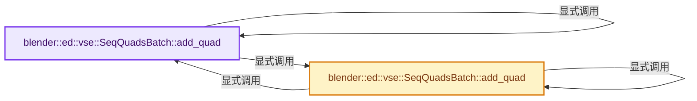
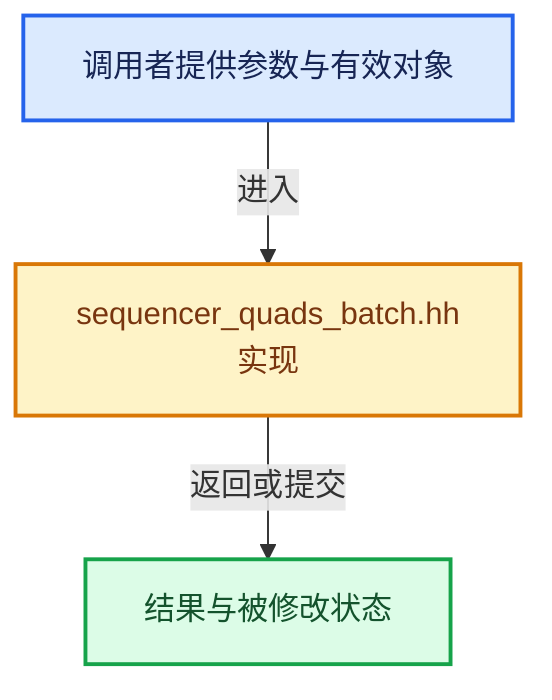

# 实现依赖专题：source/blender/editors/space_sequencer/sequencer_quads_batch.hh

[方向导航](README.md) · [符号索引](../%E7%AC%A6%E5%8F%B7%E4%BE%9D%E8%B5%96%E4%B8%8E%E5%AE%9E%E7%8E%B0%E7%B4%A2%E5%BC%95.md)

本专题从正文实际调用进入，集中保存共享实现。函数有稳定锚点，可从调用处直接跳到对应完整函数；递归与互相调用通过回链组织。

## 本文件的实现关系






## 完整成员与函数实现

<a id="f-2e8ac61d5a32adfb"></a>

### `blender::ed::vse::SeqQuadsBatch::add_quad`

实现位置：[source/blender/editors/space_sequencer/sequencer_quads_batch.hh](../../../../../source/blender/editors/space_sequencer/sequencer_quads_batch.hh) · L41—L44。

接口参数：

- `float x1`
- `float y1`
- `float x2`
- `float y2`
- `const uchar color[4]`

**教学注释版**

<!-- annotated:8a0fa3d72ea0f3 -->

```cpp
  void add_quad(float x1, float y1, float x2, float y2, const uchar color[4])
  {
    add_quad(x1, y1, x1, y2, x2, y1, x2, y2, color, color, color, color);
  }
```

<details>
<summary>核对原始源码：source/blender/editors/space_sequencer/sequencer_quads_batch.hh · L41—L44</summary>

<!-- original:8a0fa3d72ea0f3:source/blender/editors/space_sequencer/sequencer_quads_batch.hh:41:44 -->

```cpp
  void add_quad(float x1, float y1, float x2, float y2, const uchar color[4])
  {
    add_quad(x1, y1, x1, y2, x2, y1, x2, y2, color, color, color, color);
  }
```

</details>

**继续追踪实现**

- `add_quad` → [blender::ed::vse::SeqQuadsBatch::add_quad · L41](%E4%BE%9D%E8%B5%96-sequencer_quads_batch-030789.md#f-2e8ac61d5a32adfb)；[blender::ed::vse::SeqQuadsBatch::add_quad · L46](%E4%BE%9D%E8%B5%96-sequencer_quads_batch-030789.md#f-514c59e2224fe61c)。同名重载需按实参类型选择。

<a id="f-514c59e2224fe61c"></a>

### `blender::ed::vse::SeqQuadsBatch::add_quad`

实现位置：[source/blender/editors/space_sequencer/sequencer_quads_batch.hh](../../../../../source/blender/editors/space_sequencer/sequencer_quads_batch.hh) · L46—L57。

接口参数：

- `float x1`
- `float y1`
- `float x2`
- `float y2`
- `float x3`
- `float y3`
- `float x4`
- `float y4`
- `const uchar color[4]`

**教学注释版**

<!-- annotated:e756f406eeaa17 -->

```cpp
  void add_quad(float x1,
                float y1,
                float x2,
                float y2,
                float x3,
                float y3,
                float x4,
                float y4,
                const uchar color[4])
  {
    add_quad(x1, y1, x2, y2, x3, y3, x4, y4, color, color, color, color);
  }
```

<details>
<summary>核对原始源码：source/blender/editors/space_sequencer/sequencer_quads_batch.hh · L46—L57</summary>

<!-- original:e756f406eeaa17:source/blender/editors/space_sequencer/sequencer_quads_batch.hh:46:57 -->

```cpp
  void add_quad(float x1,
                float y1,
                float x2,
                float y2,
                float x3,
                float y3,
                float x4,
                float y4,
                const uchar color[4])
  {
    add_quad(x1, y1, x2, y2, x3, y3, x4, y4, color, color, color, color);
  }
```

</details>

**继续追踪实现**

- `add_quad` → [blender::ed::vse::SeqQuadsBatch::add_quad · L41](%E4%BE%9D%E8%B5%96-sequencer_quads_batch-030789.md#f-2e8ac61d5a32adfb)；[blender::ed::vse::SeqQuadsBatch::add_quad · L46](%E4%BE%9D%E8%B5%96-sequencer_quads_batch-030789.md#f-514c59e2224fe61c)。同名重载需按实参类型选择。
