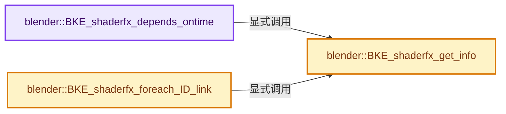
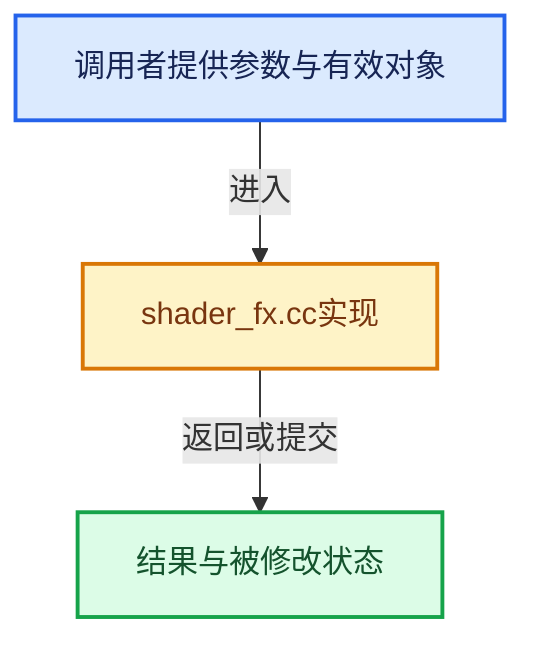

# 实现依赖专题：source/blender/blenkernel/intern/shader_fx.cc

[方向导航](README.md) · [符号索引](../%E7%AC%A6%E5%8F%B7%E4%BE%9D%E8%B5%96%E4%B8%8E%E5%AE%9E%E7%8E%B0%E7%B4%A2%E5%BC%95.md)

本专题从正文实际调用进入，集中保存共享实现。函数有稳定锚点，可从调用处直接跳到对应完整函数；递归与互相调用通过回链组织。

## 本文件的实现关系






## 完整成员与函数实现

<a id="f-3219b7a51f50dcd3"></a>

### `blender::BKE_shaderfx_depends_ontime`

实现位置：[source/blender/blenkernel/intern/shader_fx.cc](../../../../../source/blender/blenkernel/intern/shader_fx.cc) · L127—L132。

接口参数：

- `ShaderFxData *fx`

**教学注释版**

<!-- annotated:18528c68c8f3b7 -->

```cpp
bool BKE_shaderfx_depends_ontime(ShaderFxData *fx)
{
  const ShaderFxTypeInfo *fxi = BKE_shaderfx_get_info(ShaderFxType(fx->type));

  return fxi->depends_on_time && fxi->depends_on_time(fx);
}
```

<details>
<summary>核对原始源码：source/blender/blenkernel/intern/shader_fx.cc · L127—L132</summary>

<!-- original:18528c68c8f3b7:source/blender/blenkernel/intern/shader_fx.cc:127:132 -->

```cpp
bool BKE_shaderfx_depends_ontime(ShaderFxData *fx)
{
  const ShaderFxTypeInfo *fxi = BKE_shaderfx_get_info(ShaderFxType(fx->type));

  return fxi->depends_on_time && fxi->depends_on_time(fx);
}
```

</details>

**结果出口**

- `return fxi->depends_on_time && fxi->depends_on_time(fx);`

**继续追踪实现**

- `BKE_shaderfx_get_info` → [blender::BKE_shaderfx_get_info · L134](%E4%BE%9D%E8%B5%96-shader_fx-c6b033.md#f-09b14e788d683a6b)。
- `ShaderFxType` → [blender::ShaderFxType](%E4%BE%9D%E8%B5%96-DNA_shader_fx_types-2b7ffc.md#t-ac85e8b68fec)。
- `fxi->depends_on_time` → [blender::depends_on_time · L303](%E4%BE%9D%E8%B5%96-MOD_weightvgproximity-9e7c30.md#f-b8637851155e55f0)；[blender::depends_on_time · L143](%E4%BE%9D%E8%B5%96-MOD_weightvgmix-25acab.md#f-88d8fbb65e6fcc75)；[blender::depends_on_time · L97](%E4%BE%9D%E8%B5%96-MOD_weightvgedit-9945f1.md#f-901243a5209b91f9)；[blender::depends_on_time · L75](%E4%BE%9D%E8%B5%96-MOD_grease_pencil_noise-eae4f5.md#f-ea608cbb79fc8845)；[blender::depends_on_time · L51](%E4%BE%9D%E8%B5%96-MOD_wave-b6885d.md#f-f0a406faa15df7ae)；[blender::depends_on_time · L96](%E4%BE%9D%E8%B5%96-MOD_warp-e1832f.md#f-c5e0bd536d5480c7)；[blender::depends_on_time · L87](%E4%BE%9D%E8%B5%96-MOD_volume_displace-d9d5ed.md#f-a3cb1432d858b58b)；[blender::depends_on_time · L138](%E4%BE%9D%E8%B5%96-MOD_fluid-b54017.md#f-5fb0bd41f1dd7229)；[blender::depends_on_time · L82](%E4%BE%9D%E8%B5%96-MOD_explode-ca1cc3.md#f-bfc63e8f13a644dd)；[blender::depends_on_time · L73](%E4%BE%9D%E8%B5%96-MOD_surface-807b53.md#f-0ee31349451cba32)；[blender::depends_on_time · L137](%E4%BE%9D%E8%B5%96-MOD_dynamicpaint-261347.md#f-b0918e45ab9bdeaf)；[blender::depends_on_time · L72](%E4%BE%9D%E8%B5%96-MOD_displace-57c869.md#f-aace5c916ee7ae31)；[blender::depends_on_time · L70](%E4%BE%9D%E8%B5%96-MOD_collision-49ad1c.md#f-65a0ea2aa8dfffe3)；[blender::depends_on_time · L193](%E4%BE%9D%E8%B5%96-MOD_cloth-232a0e.md#f-c6403bc2d5884a87)；[blender::depends_on_time · L46](%E4%BE%9D%E8%B5%96-MOD_build-bbceaf.md#f-bbcacfbc405bb2e1)；[blender::depends_on_time · L45](%E4%BE%9D%E8%B5%96-MOD_softbody-51bfa6.md#f-2e044e08636ab602)；[blender::depends_on_time · L242](%E4%BE%9D%E8%B5%96-MOD_nodes-3d10f5.md#f-bc6514f62da0dede)；[blender::depends_on_time · L296](%E4%BE%9D%E8%B5%96-MOD_meshsequencecache-651784.md#f-e2da1a2d5646fa01)；[blender::depends_on_time · L54](%E4%BE%9D%E8%B5%96-MOD_meshcache-95a09c.md#f-386e66c10ebefa17)。同名重载需按实参类型选择。

<a id="f-09b14e788d683a6b"></a>

### `blender::BKE_shaderfx_get_info`

实现位置：[source/blender/blenkernel/intern/shader_fx.cc](../../../../../source/blender/blenkernel/intern/shader_fx.cc) · L134—L142。

接口参数：

- `ShaderFxType type`

**教学注释版**

<!-- annotated:0a5f9946d3bca8 -->

```cpp
const ShaderFxTypeInfo *BKE_shaderfx_get_info(ShaderFxType type)
{
  /* type unsigned, no need to check < 0 */
  if (type < NUM_SHADER_FX_TYPES && type > 0 && shader_fx_types[type]->name[0] != '\0') {
    return shader_fx_types[type];
  }

  return nullptr;
}
```

<details>
<summary>核对原始源码：source/blender/blenkernel/intern/shader_fx.cc · L134—L142</summary>

<!-- original:0a5f9946d3bca8:source/blender/blenkernel/intern/shader_fx.cc:134:142 -->

```cpp
const ShaderFxTypeInfo *BKE_shaderfx_get_info(ShaderFxType type)
{
  /* type unsigned, no need to check < 0 */
  if (type < NUM_SHADER_FX_TYPES && type > 0 && shader_fx_types[type]->name[0] != '\0') {
    return shader_fx_types[type];
  }

  return nullptr;
}
```

</details>

**结果出口**

- `return shader_fx_types[type];`
- `return nullptr;`

**继续追踪实现**

本实现没有需要继续展开的显式调用；检查返回表达式、对象转换和调用者前置条件。

<a id="f-639177886584935b"></a>

### `blender::BKE_shaderfx_foreach_ID_link`

实现位置：[source/blender/blenkernel/intern/shader_fx.cc](../../../../../source/blender/blenkernel/intern/shader_fx.cc) · L239—L250。

接口参数：

- `Object *ob`
- `ShaderFxIDWalkFunc walk`
- `void *user_data`

**教学注释版**

<!-- annotated:d465fd53ba29de -->

```cpp
void BKE_shaderfx_foreach_ID_link(Object *ob, ShaderFxIDWalkFunc walk, void *user_data)
{
  ShaderFxData *fx = ob->shader_fx.first();

  for (; fx; fx = fx->next) {
    const ShaderFxTypeInfo *fxi = BKE_shaderfx_get_info(ShaderFxType(fx->type));

    if (fxi->foreach_ID_link) {
      fxi->foreach_ID_link(fx, ob, walk, user_data);
    }
  }
}
```

<details>
<summary>核对原始源码：source/blender/blenkernel/intern/shader_fx.cc · L239—L250</summary>

<!-- original:d465fd53ba29de:source/blender/blenkernel/intern/shader_fx.cc:239:250 -->

```cpp
void BKE_shaderfx_foreach_ID_link(Object *ob, ShaderFxIDWalkFunc walk, void *user_data)
{
  ShaderFxData *fx = ob->shader_fx.first();

  for (; fx; fx = fx->next) {
    const ShaderFxTypeInfo *fxi = BKE_shaderfx_get_info(ShaderFxType(fx->type));

    if (fxi->foreach_ID_link) {
      fxi->foreach_ID_link(fx, ob, walk, user_data);
    }
  }
}
```

</details>

**继续追踪实现**

- `ob->shader_fx.first` → [调用协议](../%E6%A8%A1%E6%9D%BF%E5%AE%8F%E4%B8%8E%E5%8A%A8%E6%80%81%E5%88%86%E6%B4%BE%E5%8D%8F%E8%AE%AE.md)：接收对象类型依赖auto、返回值或模板实例；不按同名猜测目标。调用位置L241。
- `BKE_shaderfx_get_info` → [blender::BKE_shaderfx_get_info · L134](%E4%BE%9D%E8%B5%96-shader_fx-c6b033.md#f-09b14e788d683a6b)。
- `ShaderFxType` → [blender::ShaderFxType](%E4%BE%9D%E8%B5%96-DNA_shader_fx_types-2b7ffc.md#t-ac85e8b68fec)。
- `fxi->foreach_ID_link` → [blender::foreach_ID_link · L61](%E4%BE%9D%E8%B5%96-FX_shader_swirl-a11837.md#f-624ffd8ef1929253)；[blender::foreach_ID_link · L74](%E4%BE%9D%E8%B5%96-FX_shader_shadow-af05bc.md#f-ba0bc12adf2b9e28)；[blender::foreach_ID_link · L313](%E4%BE%9D%E8%B5%96-MOD_weightvgproximity-9e7c30.md#f-3349f71bda299934)；[blender::foreach_ID_link · L153](%E4%BE%9D%E8%B5%96-MOD_weightvgmix-25acab.md#f-86bd96bafcdaf1be)；[blender::foreach_ID_link · L107](%E4%BE%9D%E8%B5%96-MOD_weightvgedit-9945f1.md#f-588fea49738fdf80)；[blender::foreach_ID_link · L272](%E4%BE%9D%E8%B5%96-MOD_grease_pencil_noise-eae4f5.md#f-24aff8a16d0b3487)；[blender::foreach_ID_link · L69](%E4%BE%9D%E8%B5%96-MOD_grease_pencil_multiply-2e50d7.md#f-784727fdac316c73)；[blender::foreach_ID_link · L56](%E4%BE%9D%E8%B5%96-MOD_wave-b6885d.md#f-d03ad3f698b40ad1)；[blender::foreach_ID_link · L62](%E4%BE%9D%E8%B5%96-MOD_grease_pencil_mirror-70efb7.md#f-ce011295654a0642)；[blender::foreach_ID_link · L120](%E4%BE%9D%E8%B5%96-MOD_warp-e1832f.md#f-664b8d929a3b4a55)；[blender::foreach_ID_link · L68](%E4%BE%9D%E8%B5%96-MOD_volume_to_mesh-299535.md#f-43444339e908a376)；[blender::foreach_ID_link · L73](%E4%BE%9D%E8%B5%96-MOD_volume_displace-d9d5ed.md#f-e657d49db24766eb)；[blender::foreach_ID_link · L65](%E4%BE%9D%E8%B5%96-MOD_grease_pencil_length-522992.md#f-3ed0cfe08486d0de)；[blender::foreach_ID_link · L224](%E4%BE%9D%E8%B5%96-MOD_uvwarp-2ac084.md#f-9ea823fd71b6fb78)；[blender::foreach_ID_link · L59](%E4%BE%9D%E8%B5%96-MOD_uvproject-0da7db.md#f-7a84f03a144c35f8)；[blender::foreach_ID_link · L62](%E4%BE%9D%E8%B5%96-MOD_grease_pencil_lattice-8f886f.md#f-91bc010628f6b5a4)；[blender::foreach_ID_link · L84](%E4%BE%9D%E8%B5%96-MOD_grease_pencil_hook-a8b10b.md#f-8ace23ea2fc1ce9a)；[blender::foreach_ID_link · L64](%E4%BE%9D%E8%B5%96-MOD_grease_pencil_envelope-fe9b70.md#f-4e59b89eafdc3d8a)；[blender::foreach_ID_link · L80](%E4%BE%9D%E8%B5%96-MOD_grease_pencil_dash-8edc8e.md#f-d1486862b6f104e6)；[blender::foreach_ID_link · L69](%E4%BE%9D%E8%B5%96-MOD_grease_pencil_color-247c5a.md#f-405e731e4b9631e3)；[blender::foreach_ID_link · L69](%E4%BE%9D%E8%B5%96-MOD_grease_pencil_build-c03219.md#f-9efcf4d9f0ea9e7a)；[blender::foreach_ID_link · L69](%E4%BE%9D%E8%B5%96-MOD_grease_pencil_array-6250c2.md#f-0179cdf8612697d5)；[blender::foreach_ID_link · L254](%E4%BE%9D%E8%B5%96-MOD_surfacedeform-984aaa.md#f-0028eb0143a39536)；[blender::foreach_ID_link · L69](%E4%BE%9D%E8%B5%96-MOD_grease_pencil_armature-b733ac.md#f-6d967cb3cfbfe21e)；[blender::foreach_ID_link · L188](%E4%BE%9D%E8%B5%96-MOD_fluid-b54017.md#f-98368271a676fdad)；[blender::foreach_ID_link · L142](%E4%BE%9D%E8%B5%96-MOD_dynamicpaint-261347.md#f-88fbf106ff0570fe)；[blender::foreach_ID_link · L83](%E4%BE%9D%E8%B5%96-MOD_displace-57c869.md#f-6a655dcb551a066b)；[blender::foreach_ID_link · L84](%E4%BE%9D%E8%B5%96-MOD_datatransfer-82a2d8.md#f-166e1359e1a66ac1)；[blender::foreach_ID_link · L67](%E4%BE%9D%E8%B5%96-MOD_curve-81222f.md#f-fcfe4735b430f223)；[blender::foreach_ID_link · L237](%E4%BE%9D%E8%B5%96-MOD_cloth-232a0e.md#f-a5fd681b7408cce9)；[blender::foreach_ID_link · L65](%E4%BE%9D%E8%B5%96-MOD_cast-c4f475.md#f-9726c811e9837b83)；[blender::foreach_ID_link · L82](%E4%BE%9D%E8%B5%96-MOD_boolean-e93e01.md#f-b57958a0b00ef930)；[blender::foreach_ID_link · L64](%E4%BE%9D%E8%B5%96-MOD_array-c062b5.md#f-58bee7f1040012ed)；[blender::foreach_ID_link · L76](%E4%BE%9D%E8%B5%96-MOD_armature-a4abb0.md#f-af1634a00f579e50)；[blender::foreach_ID_link · L407](%E4%BE%9D%E8%B5%96-MOD_simpledeform-ac2cad.md#f-0f0f551e5cbcafb6)；[blender::foreach_ID_link · L69](%E4%BE%9D%E8%B5%96-MOD_shrinkwrap-b862d4.md#f-2783308b7e5ae798)；[blender::foreach_ID_link · L1037](%E4%BE%9D%E8%B5%96-MOD_screw-6d60f6.md#f-19aa555f4f1c8700)；[blender::foreach_ID_link · L119](%E4%BE%9D%E8%B5%96-MOD_particleinstance-7571a9.md#f-baaa847e0b48e812)；[blender::foreach_ID_link · L573](%E4%BE%9D%E8%B5%96-MOD_normal_edit-e6de24.md#f-8552fdcc0a59008b)；[blender::foreach_ID_link · L261](%E4%BE%9D%E8%B5%96-MOD_nodes-3d10f5.md#f-f2ded6cff5dae987)；[blender::foreach_ID_link · L43](%E4%BE%9D%E8%B5%96-MOD_mirror-c39588.md#f-0f60683acb48c332)；[blender::foreach_ID_link · L62](%E4%BE%9D%E8%B5%96-MOD_mesh_to_volume-98590f.md#f-441e947bc69d54bb)；[blender::foreach_ID_link · L307](%E4%BE%9D%E8%B5%96-MOD_meshsequencecache-651784.md#f-5bc9d968f42fdad3)；[blender::foreach_ID_link · L126](%E4%BE%9D%E8%B5%96-MOD_meshdeform-fc8efd.md#f-0ce00988ea7ecb9e)；[blender::foreach_ID_link · L58](%E4%BE%9D%E8%B5%96-MOD_mask-a069c0.md#f-6e3eab0cee511ce7)；[blender::foreach_ID_link · L250](%E4%BE%9D%E8%B5%96-MOD_lineart-b0a62c.md#f-918d7b92a8dd5870)；[blender::foreach_ID_link · L66](%E4%BE%9D%E8%B5%96-MOD_lattice-0787ab.md#f-5aa450ccff6f6c2d)；[blender::foreach_ID_link · L100](%E4%BE%9D%E8%B5%96-MOD_hook-b76f1b.md#f-2a29f3a371afb5df)；[blender::foreach_ID_link · L71](%E4%BE%9D%E8%B5%96-MOD_grease_pencil_weight_proximity-e5bd3c.md#f-adcd54430d75cb0d)；[blender::foreach_ID_link · L74](%E4%BE%9D%E8%B5%96-MOD_grease_pencil_weight_angle-591cee.md#f-a03a99c4ca900f84)；[blender::foreach_ID_link · L97](%E4%BE%9D%E8%B5%96-MOD_grease_pencil_tint-130b42.md#f-b61bd09b4b386e0b)；[blender::foreach_ID_link · L81](%E4%BE%9D%E8%B5%96-MOD_grease_pencil_time-b2b2fa.md#f-52431ba120508393)；[blender::foreach_ID_link · L60](%E4%BE%9D%E8%B5%96-MOD_grease_pencil_thickness-bd8572.md#f-6202e6a7f448cec1)；[blender::foreach_ID_link · L68](%E4%BE%9D%E8%B5%96-MOD_grease_pencil_texture-53cfff.md#f-12cb91d85cd45a19)；[blender::foreach_ID_link · L154](%E4%BE%9D%E8%B5%96-MOD_grease_pencil_subdiv-1b017f.md#f-132f19d5fe7d4063)；[blender::foreach_ID_link · L62](%E4%BE%9D%E8%B5%96-MOD_grease_pencil_smooth-84378f.md#f-a52ea3a2a870d0e3)；[blender::foreach_ID_link · L185](%E4%BE%9D%E8%B5%96-MOD_grease_pencil_simplify-084e93.md#f-a5395502b7274b0c)；[blender::foreach_ID_link · L77](%E4%BE%9D%E8%B5%96-MOD_grease_pencil_shrinkwrap-67e646.md#f-c27b5c4b02a06aaf)；[blender::foreach_ID_link · L78](%E4%BE%9D%E8%B5%96-MOD_grease_pencil_outline-52807d.md#f-6ac666b46d601dd4)；[blender::foreach_ID_link · L62](%E4%BE%9D%E8%B5%96-MOD_grease_pencil_opacity-33f86c.md#f-ab0f828d6a5455f2)；[blender::foreach_ID_link · L64](%E4%BE%9D%E8%B5%96-MOD_grease_pencil_offset-ea9491.md#f-1d0bd0307c8ff199)。同名重载需按实参类型选择。
