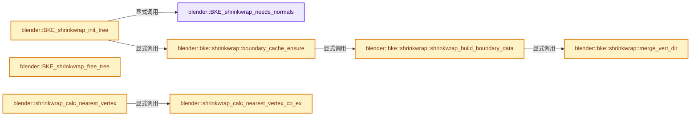
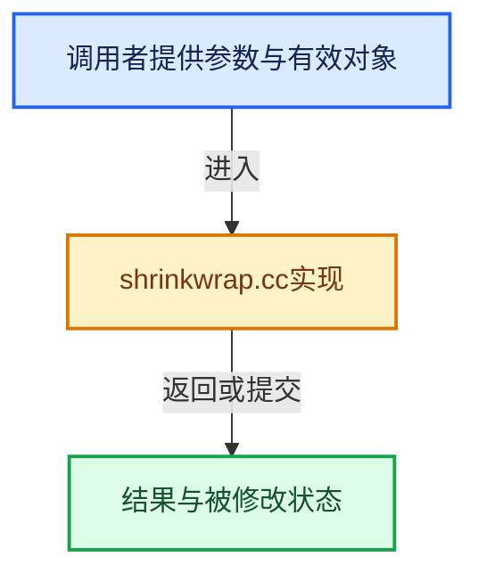

# 实现依赖专题：source/blender/blenkernel/intern/shrinkwrap.cc

[方向导航](README.md) · [符号索引](../%E7%AC%A6%E5%8F%B7%E4%BE%9D%E8%B5%96%E4%B8%8E%E5%AE%9E%E7%8E%B0%E7%B4%A2%E5%BC%95.md)

本专题从正文实际调用进入，集中保存共享实现。函数有稳定锚点，可从调用处直接跳到对应完整函数；递归与互相调用通过回链组织。

## 本文件的实现关系






<a id="m-7cabb8f96935"></a>

## 宏 `TIMEIT_BENCH`

<!-- annotated:2238b26f47dd48 -->

```cpp
#  define TIMEIT_BENCH(expr, id) (expr)
#endif
```

<details>
<summary>核对原始源码：source/blender/blenkernel/intern/shrinkwrap.cc · L50—L51</summary>

<!-- original:2238b26f47dd48:source/blender/blenkernel/intern/shrinkwrap.cc:50:51 -->

```cpp
#  define TIMEIT_BENCH(expr, id) (expr)
#endif
```

</details>

宏在预处理阶段展开，参数替换、重复求值和条件编译应直接从该定义检查。与普通函数不同，宏不会自动提供参数类型检查；构建配置选择哪个定义需结合外围条件。

## 完整成员与函数实现

<a id="f-62f6f8a5e3a2c267"></a>

### `blender::BKE_shrinkwrap_needs_normals`

实现位置：[source/blender/blenkernel/intern/shrinkwrap.cc](../../../../../source/blender/blenkernel/intern/shrinkwrap.cc) · L80—L85。

接口参数：

- `int shrinkType`
- `int shrinkMode`

**教学注释版**

<!-- annotated:1dd42b00eb5fdd -->

```cpp
bool BKE_shrinkwrap_needs_normals(int shrinkType, int shrinkMode)
{
  return (shrinkType == MOD_SHRINKWRAP_TARGET_PROJECT) ||
         (shrinkType != MOD_SHRINKWRAP_NEAREST_VERTEX &&
          shrinkMode == MOD_SHRINKWRAP_ABOVE_SURFACE);
}
```

<details>
<summary>核对原始源码：source/blender/blenkernel/intern/shrinkwrap.cc · L80—L85</summary>

<!-- original:1dd42b00eb5fdd:source/blender/blenkernel/intern/shrinkwrap.cc:80:85 -->

```cpp
bool BKE_shrinkwrap_needs_normals(int shrinkType, int shrinkMode)
{
  return (shrinkType == MOD_SHRINKWRAP_TARGET_PROJECT) ||
         (shrinkType != MOD_SHRINKWRAP_NEAREST_VERTEX &&
          shrinkMode == MOD_SHRINKWRAP_ABOVE_SURFACE);
}
```

</details>

**结果出口**

- `return (shrinkType == MOD_SHRINKWRAP_TARGET_PROJECT) ||`

**继续追踪实现**

本实现没有需要继续展开的显式调用；检查返回表达式、对象转换和调用者前置条件。

<a id="f-d6641b6a47bc4e77"></a>

### `blender::BKE_shrinkwrap_init_tree`

实现位置：[source/blender/blenkernel/intern/shrinkwrap.cc](../../../../../source/blender/blenkernel/intern/shrinkwrap.cc) · L87—L142。

接口参数：

- `ShrinkwrapTreeData *data`
- `Mesh *mesh`
- `int shrinkType`
- `int shrinkMode`
- `bool force_normals`

**教学注释版**

<!-- annotated:3e4e8a77c0cd54 -->

```cpp
bool BKE_shrinkwrap_init_tree(
    ShrinkwrapTreeData *data, Mesh *mesh, int shrinkType, int shrinkMode, bool force_normals)
{
  using namespace blender::bke;
  *data = {};

  if (mesh == nullptr) {
    return false;
  }

  /* We could create a BVH tree from the edit mesh,
   * however accessing normals from the face/loop normals gets more involved.
   * Convert mesh data since this isn't typically used in edit-mode. */
  BKE_mesh_wrapper_ensure_mdata(mesh);

  if (mesh->verts_num <= 0) {
    return false;
  }

  data->mesh = mesh;
  data->edges = mesh->edges();
  data->faces = mesh->faces();
  data->corner_edges = mesh->corner_edges();
  data->vert_normals = mesh->vert_normals();
  const AttributeAccessor attributes = mesh->attributes();
  data->sharp_faces = *attributes.lookup<bool>("sharp_face", AttrDomain::Face);

  if (shrinkType == MOD_SHRINKWRAP_NEAREST_VERTEX) {
    data->vert_tree = &mesh->bvh_verts();
    return true;
  }

  if (mesh->faces_num <= 0) {
    return false;
  }

  data->treeData = mesh->bvh_corner_tris();
  data->bvh = data->treeData.tree;

  if (data->bvh == nullptr) {
    return false;
  }

  if (force_normals || BKE_shrinkwrap_needs_normals(shrinkType, shrinkMode)) {
    data->face_normals = mesh->face_normals();
    if (mesh->normals_domain() == bke::MeshNormalDomain::Corner) {
      data->corner_normals = mesh->corner_normals();
    }
  }

  if (shrinkType == MOD_SHRINKWRAP_TARGET_PROJECT) {
    data->boundary = &bke::shrinkwrap::boundary_cache_ensure(*mesh);
  }

  return true;
}
```

<details>
<summary>核对原始源码：source/blender/blenkernel/intern/shrinkwrap.cc · L87—L142</summary>

<!-- original:3e4e8a77c0cd54:source/blender/blenkernel/intern/shrinkwrap.cc:87:142 -->

```cpp
bool BKE_shrinkwrap_init_tree(
    ShrinkwrapTreeData *data, Mesh *mesh, int shrinkType, int shrinkMode, bool force_normals)
{
  using namespace blender::bke;
  *data = {};

  if (mesh == nullptr) {
    return false;
  }

  /* We could create a BVH tree from the edit mesh,
   * however accessing normals from the face/loop normals gets more involved.
   * Convert mesh data since this isn't typically used in edit-mode. */
  BKE_mesh_wrapper_ensure_mdata(mesh);

  if (mesh->verts_num <= 0) {
    return false;
  }

  data->mesh = mesh;
  data->edges = mesh->edges();
  data->faces = mesh->faces();
  data->corner_edges = mesh->corner_edges();
  data->vert_normals = mesh->vert_normals();
  const AttributeAccessor attributes = mesh->attributes();
  data->sharp_faces = *attributes.lookup<bool>("sharp_face", AttrDomain::Face);

  if (shrinkType == MOD_SHRINKWRAP_NEAREST_VERTEX) {
    data->vert_tree = &mesh->bvh_verts();
    return true;
  }

  if (mesh->faces_num <= 0) {
    return false;
  }

  data->treeData = mesh->bvh_corner_tris();
  data->bvh = data->treeData.tree;

  if (data->bvh == nullptr) {
    return false;
  }

  if (force_normals || BKE_shrinkwrap_needs_normals(shrinkType, shrinkMode)) {
    data->face_normals = mesh->face_normals();
    if (mesh->normals_domain() == bke::MeshNormalDomain::Corner) {
      data->corner_normals = mesh->corner_normals();
    }
  }

  if (shrinkType == MOD_SHRINKWRAP_TARGET_PROJECT) {
    data->boundary = &bke::shrinkwrap::boundary_cache_ensure(*mesh);
  }

  return true;
}
```

</details>

**沿实际写入检查状态**

- `data->mesh = mesh;`
- `data->edges = mesh->edges();`
- `data->faces = mesh->faces();`
- `data->corner_edges = mesh->corner_edges();`
- `data->vert_normals = mesh->vert_normals();`
- `data->sharp_faces = *attributes.lookup<bool>("sharp_face", AttrDomain::Face);`
- `data->vert_tree = &mesh->bvh_verts();`
- `data->treeData = mesh->bvh_corner_tris();`
- `data->bvh = data->treeData.tree;`
- `data->face_normals = mesh->face_normals();`
- `data->corner_normals = mesh->corner_normals();`
- `data->boundary = &bke::shrinkwrap::boundary_cache_ensure(*mesh);`

**结果出口**

- `return false;`
- `return true;`

**继续追踪实现**

- `BKE_mesh_wrapper_ensure_mdata` → [blender::BKE_mesh_wrapper_ensure_mdata · L79](%E4%BE%9D%E8%B5%96-mesh_wrapper-33fdae.md#f-391cdba59bba6a12)。
- `mesh->edges` → [Mesh::edges · L1205](03-MPoly%E8%BF%81%E7%A7%BB%E4%B8%8E%E5%85%BC%E5%AE%B9.md#f-7232f6756b674d12)。
- `mesh->faces` → [Mesh::faces · L1217](03-MPoly%E8%BF%81%E7%A7%BB%E4%B8%8E%E5%85%BC%E5%AE%B9.md#f-ea444760154e17b2)。
- `mesh->corner_edges` → [Mesh::corner_edges · L1252](03-MPoly%E8%BF%81%E7%A7%BB%E4%B8%8E%E5%85%BC%E5%AE%B9.md#f-687b790868e7f257)。
- `mesh->vert_normals` → [blender::Mesh::vert_normals · L349](../06-%E9%9A%90%E5%BC%8F%E5%85%B1%E4%BA%AB%E4%B8%8E%E7%BC%93%E5%AD%98%E7%B3%BB%E7%BB%9F/08-%E6%B3%95%E7%BA%BF%E7%BC%93%E5%AD%98%E7%9A%84%E7%9C%9F%E5%AE%9E%E4%BE%9D%E8%B5%96.md#f-e9a9d50dc8e15fba)。
- `mesh->attributes` → [Mesh::attributes · L1298](03-MPoly%E8%BF%81%E7%A7%BB%E4%B8%8E%E5%85%BC%E5%AE%B9.md#f-607bbfe3e57cfc7f)。
- `attributes.lookup<bool>` → [blender::bke::AttributeAccessor::lookup · L401](%E4%BE%9D%E8%B5%96-attribute_access-bceef3.md#f-4673351b7bb3b651)。
- `mesh->bvh_verts` → [blender::Mesh::bvh_verts · L674](../06-%E9%9A%90%E5%BC%8F%E5%85%B1%E4%BA%AB%E4%B8%8E%E7%BC%93%E5%AD%98%E7%B3%BB%E7%BB%9F/09-BVH%E5%85%B1%E4%BA%AB%E4%B8%8E%E8%BF%90%E8%A1%8C%E6%97%B6%E6%95%B0%E6%8D%AE.md#f-31dc9b32b0d4da34)。
- `mesh->bvh_corner_tris` → [blender::Mesh::bvh_corner_tris · L773](../06-%E9%9A%90%E5%BC%8F%E5%85%B1%E4%BA%AB%E4%B8%8E%E7%BC%93%E5%AD%98%E7%B3%BB%E7%BB%9F/09-BVH%E5%85%B1%E4%BA%AB%E4%B8%8E%E8%BF%90%E8%A1%8C%E6%97%B6%E6%95%B0%E6%8D%AE.md#f-9c8110cd438d92e1)。
- `BKE_shrinkwrap_needs_normals` → [blender::BKE_shrinkwrap_needs_normals · L80](%E4%BE%9D%E8%B5%96-shrinkwrap-e3f168.md#f-62f6f8a5e3a2c267)。
- `mesh->face_normals` → [blender::Mesh::face_normals · L415](../06-%E9%9A%90%E5%BC%8F%E5%85%B1%E4%BA%AB%E4%B8%8E%E7%BC%93%E5%AD%98%E7%B3%BB%E7%BB%9F/08-%E6%B3%95%E7%BA%BF%E7%BC%93%E5%AD%98%E7%9A%84%E7%9C%9F%E5%AE%9E%E4%BE%9D%E8%B5%96.md#f-65ff7730b863cee0)。
- `mesh->normals_domain` → [blender::Mesh::normals_domain · L301](../06-%E9%9A%90%E5%BC%8F%E5%85%B1%E4%BA%AB%E4%B8%8E%E7%BC%93%E5%AD%98%E7%B3%BB%E7%BB%9F/08-%E6%B3%95%E7%BA%BF%E7%BC%93%E5%AD%98%E7%9A%84%E7%9C%9F%E5%AE%9E%E4%BE%9D%E8%B5%96.md#f-303a2beb01515e4a)。
- `mesh->corner_normals` → [blender::Mesh::corner_normals · L468](../06-%E9%9A%90%E5%BC%8F%E5%85%B1%E4%BA%AB%E4%B8%8E%E7%BC%93%E5%AD%98%E7%B3%BB%E7%BB%9F/08-%E6%B3%95%E7%BA%BF%E7%BC%93%E5%AD%98%E7%9A%84%E7%9C%9F%E5%AE%9E%E4%BE%9D%E8%B5%96.md#f-91d46c2a581e44bc)。
- `bke::shrinkwrap::boundary_cache_ensure` → [blender::bke::shrinkwrap::boundary_cache_ensure · L282](%E4%BE%9D%E8%B5%96-shrinkwrap-e3f168.md#f-ab524c0e569b5394)。

<a id="f-803c1caa34293b9d"></a>

### `blender::BKE_shrinkwrap_free_tree`

实现位置：[source/blender/blenkernel/intern/shrinkwrap.cc](../../../../../source/blender/blenkernel/intern/shrinkwrap.cc) · L144—L144。

接口参数：

- `ShrinkwrapTreeData *`

**教学注释版**

<!-- annotated:138adabce53e73 -->

```cpp
void BKE_shrinkwrap_free_tree(ShrinkwrapTreeData * /*data*/) {}
```

<details>
<summary>核对原始源码：source/blender/blenkernel/intern/shrinkwrap.cc · L144—L144</summary>

<!-- original:138adabce53e73:source/blender/blenkernel/intern/shrinkwrap.cc:144:144 -->

```cpp
void BKE_shrinkwrap_free_tree(ShrinkwrapTreeData * /*data*/) {}
```

</details>

**继续追踪实现**

本实现没有需要继续展开的显式调用；检查返回表达式、对象转换和调用者前置条件。

<a id="f-dfeb6da5c057ac17"></a>

### `blender::bke::shrinkwrap::merge_vert_dir`

实现位置：[source/blender/blenkernel/intern/shrinkwrap.cc](../../../../../source/blender/blenkernel/intern/shrinkwrap.cc) · L149—L170。

接口参数：

- `ShrinkwrapBoundaryVertData *vdata`
- `MutableSpan<int8_t> status`
- `int index`
- `const float edge_dir[3]`
- `signed char side`

**教学注释版**

<!-- annotated:3d20686bf55001 -->

```cpp
static void merge_vert_dir(ShrinkwrapBoundaryVertData *vdata,
                           MutableSpan<int8_t> status,
                           int index,
                           const float edge_dir[3],
                           signed char side)
{
  BLI_assert(index >= 0);
  float *direction = vdata[index].direction;

  /* Invert the direction vector if either:
   * - This is the second edge and both edges have the vertex as start or end.
   * - For third and above, if it points in the wrong direction.
   */
  if (status[index] >= 0 ? status[index] == side : dot_v3v3(direction, edge_dir) < 0) {
    sub_v3_v3(direction, edge_dir);
  }
  else {
    add_v3_v3(direction, edge_dir);
  }

  status[index] = (status[index] == 0) ? side : -1;
}
```

<details>
<summary>核对原始源码：source/blender/blenkernel/intern/shrinkwrap.cc · L149—L170</summary>

<!-- original:3d20686bf55001:source/blender/blenkernel/intern/shrinkwrap.cc:149:170 -->

```cpp
static void merge_vert_dir(ShrinkwrapBoundaryVertData *vdata,
                           MutableSpan<int8_t> status,
                           int index,
                           const float edge_dir[3],
                           signed char side)
{
  BLI_assert(index >= 0);
  float *direction = vdata[index].direction;

  /* Invert the direction vector if either:
   * - This is the second edge and both edges have the vertex as start or end.
   * - For third and above, if it points in the wrong direction.
   */
  if (status[index] >= 0 ? status[index] == side : dot_v3v3(direction, edge_dir) < 0) {
    sub_v3_v3(direction, edge_dir);
  }
  else {
    add_v3_v3(direction, edge_dir);
  }

  status[index] = (status[index] == 0) ? side : -1;
}
```

</details>

**沿实际写入检查状态**

- `status[index] = (status[index] == 0) ? side : -1;`

**继续追踪实现**

- `BLI_assert` → [BLI_assert · L48](../01-%E5%9F%BA%E7%A1%80%E5%AE%B9%E5%99%A8%E4%B8%8E%E7%8E%B0%E4%BB%A3CPP/%E4%BE%9D%E8%B5%96-BLI_assert-cc98e8.md#m-57a88495704d)；[BLI_assert · L63](../01-%E5%9F%BA%E7%A1%80%E5%AE%B9%E5%99%A8%E4%B8%8E%E7%8E%B0%E4%BB%A3CPP/%E4%BE%9D%E8%B5%96-BLI_assert-cc98e8.md#m-d07050020cb5)。宏定义由构建条件选择。
- `dot_v3v3` → [blender::dot_v3v3 · L646](../12-%E7%A9%BA%E9%97%B4%E6%95%B0%E6%8D%AE%E7%BB%93%E6%9E%84%E4%B8%8E%E5%87%A0%E4%BD%95%E7%AE%97%E6%B3%95/%E4%BE%9D%E8%B5%96-math_vector_inline-0c8541.md#f-c88befa67d07591a)。
- `sub_v3_v3` → [blender::sub_v3_v3 · L353](../12-%E7%A9%BA%E9%97%B4%E6%95%B0%E6%8D%AE%E7%BB%93%E6%9E%84%E4%B8%8E%E5%87%A0%E4%BD%95%E7%AE%97%E6%B3%95/%E4%BE%9D%E8%B5%96-math_vector_inline-0c8541.md#f-da39d7342c417f4b)。
- `add_v3_v3` → [blender::add_v3_v3 · L286](../12-%E7%A9%BA%E9%97%B4%E6%95%B0%E6%8D%AE%E7%BB%93%E6%9E%84%E4%B8%8E%E5%87%A0%E4%BD%95%E7%AE%97%E6%B3%95/%E4%BE%9D%E8%B5%96-math_vector_inline-0c8541.md#f-e7930c6fdefe462c)。

<a id="f-55e318f093f838e0"></a>

### `blender::bke::shrinkwrap::shrinkwrap_build_boundary_data`

实现位置：[source/blender/blenkernel/intern/shrinkwrap.cc](../../../../../source/blender/blenkernel/intern/shrinkwrap.cc) · L172—L280。

接口参数：

- `const Mesh &mesh`

**教学注释版**

<!-- annotated:6705faf047b188 -->

```cpp
static ShrinkwrapBoundaryData shrinkwrap_build_boundary_data(const Mesh &mesh)
{
  const Span<float3> positions = mesh.vert_positions();
  const Span<int2> edges = mesh.edges();
  const Span<int> corner_verts = mesh.corner_verts();
  const Span<int> corner_edges = mesh.corner_edges();

  /* Count faces per edge (up to 2). */
  // [讲解] edges.size：查询视图长度或生成对应有效索引区间。
  Array<int8_t> edge_mode(edges.size(), 0);

  for (const int edge : corner_edges) {
    if (edge_mode[edge] < 2) {
      edge_mode[edge]++;
    }
  }

  /* Build the boundary edge bitmask. */
  BitVector<> edge_is_boundary(mesh.edges_num, false);

  int num_boundary_edges = 0;
  // [讲解] edges.index_range：查询视图长度或生成对应有效索引区间。
  for (const int64_t i : edges.index_range()) {
    if (edge_mode[i] == 1) {
      edge_is_boundary[i].set();
      num_boundary_edges++;
    }
  }

  /* If no boundary, return nullptr. */
  if (num_boundary_edges == 0) {
    return {};
  }

  /* Allocate the data object. */
  ShrinkwrapBoundaryData data;

  /* Build the boundary corner_tris bit-mask. */
  const Span<int3> corner_tris = mesh.corner_tris();

  BitVector<> tri_has_boundary(corner_tris.size(), false);

  for (const int64_t i : corner_tris.index_range()) {
    const int3 real_edges = bke::mesh::corner_tri_get_real_edges(
        edges, corner_verts, corner_edges, corner_tris[i]);

    for (int j = 0; j < 3; j++) {
      if (real_edges[j] >= 0 && edge_is_boundary[real_edges[j]]) {
        tri_has_boundary[i].set();
        break;
      }
    }
  }

  /* Find boundary vertices and build a mapping table for compact storage of data. */
  Array<int> vert_boundary_id(mesh.verts_num, 0);

  for (const int64_t i : edges.index_range()) {
    if (edge_is_boundary[i]) {
      const int2 &edge = edges[i];
      vert_boundary_id[edge[0]] = 1;
      vert_boundary_id[edge[1]] = 1;
    }
  }

  int boundary_verts_num = 0;
  for (const int64_t i : positions.index_range()) {
    vert_boundary_id[i] = (vert_boundary_id[i] != 0) ? boundary_verts_num++ : -1;
  }

  /* Compute average directions. */
  Array<ShrinkwrapBoundaryVertData> boundary_verts(boundary_verts_num);

  Array<int8_t> vert_status(boundary_verts_num);
  for (const int64_t i : edges.index_range()) {
    if (edge_is_boundary[i]) {
      const int2 &edge = edges[i];

      float dir[3];
      sub_v3_v3v3(dir, positions[edge[1]], positions[edge[0]]);
      normalize_v3(dir);

      // [讲解] boundary_verts.data：提供数组的借用访问入口。
      merge_vert_dir(boundary_verts.data(), vert_status, vert_boundary_id[edge[0]], dir, 1);
      merge_vert_dir(boundary_verts.data(), vert_status, vert_boundary_id[edge[1]], dir, 2);
    }
  }

  /* Finalize average direction and compute normal. */
  const Span<float3> vert_normals = mesh.vert_normals();
  for (const int64_t i : positions.index_range()) {
    int bidx = vert_boundary_id[i];

    if (bidx >= 0) {
      ShrinkwrapBoundaryVertData *vdata = &boundary_verts[bidx];
      float tmp[3];

      normalize_v3(vdata->direction);

      cross_v3_v3v3(tmp, vert_normals[i], vdata->direction);
      cross_v3_v3v3(vdata->normal_plane, tmp, vert_normals[i]);
      normalize_v3(vdata->normal_plane);
    }
  }

  // [讲解] std::move：把表达式转换成可供移动重载选择的值类别；不保证真的移动，不结束源对象寿命，对const值可能选择复制。
  data.edge_is_boundary = std::move(edge_is_boundary);
  data.tri_has_boundary = std::move(tri_has_boundary);
  data.vert_boundary_id = std::move(vert_boundary_id);
  data.boundary_verts = std::move(boundary_verts);

  return data;
}
```

<details>
<summary>核对原始源码：source/blender/blenkernel/intern/shrinkwrap.cc · L172—L280</summary>

<!-- original:6705faf047b188:source/blender/blenkernel/intern/shrinkwrap.cc:172:280 -->

```cpp
static ShrinkwrapBoundaryData shrinkwrap_build_boundary_data(const Mesh &mesh)
{
  const Span<float3> positions = mesh.vert_positions();
  const Span<int2> edges = mesh.edges();
  const Span<int> corner_verts = mesh.corner_verts();
  const Span<int> corner_edges = mesh.corner_edges();

  /* Count faces per edge (up to 2). */
  Array<int8_t> edge_mode(edges.size(), 0);

  for (const int edge : corner_edges) {
    if (edge_mode[edge] < 2) {
      edge_mode[edge]++;
    }
  }

  /* Build the boundary edge bitmask. */
  BitVector<> edge_is_boundary(mesh.edges_num, false);

  int num_boundary_edges = 0;
  for (const int64_t i : edges.index_range()) {
    if (edge_mode[i] == 1) {
      edge_is_boundary[i].set();
      num_boundary_edges++;
    }
  }

  /* If no boundary, return nullptr. */
  if (num_boundary_edges == 0) {
    return {};
  }

  /* Allocate the data object. */
  ShrinkwrapBoundaryData data;

  /* Build the boundary corner_tris bit-mask. */
  const Span<int3> corner_tris = mesh.corner_tris();

  BitVector<> tri_has_boundary(corner_tris.size(), false);

  for (const int64_t i : corner_tris.index_range()) {
    const int3 real_edges = bke::mesh::corner_tri_get_real_edges(
        edges, corner_verts, corner_edges, corner_tris[i]);

    for (int j = 0; j < 3; j++) {
      if (real_edges[j] >= 0 && edge_is_boundary[real_edges[j]]) {
        tri_has_boundary[i].set();
        break;
      }
    }
  }

  /* Find boundary vertices and build a mapping table for compact storage of data. */
  Array<int> vert_boundary_id(mesh.verts_num, 0);

  for (const int64_t i : edges.index_range()) {
    if (edge_is_boundary[i]) {
      const int2 &edge = edges[i];
      vert_boundary_id[edge[0]] = 1;
      vert_boundary_id[edge[1]] = 1;
    }
  }

  int boundary_verts_num = 0;
  for (const int64_t i : positions.index_range()) {
    vert_boundary_id[i] = (vert_boundary_id[i] != 0) ? boundary_verts_num++ : -1;
  }

  /* Compute average directions. */
  Array<ShrinkwrapBoundaryVertData> boundary_verts(boundary_verts_num);

  Array<int8_t> vert_status(boundary_verts_num);
  for (const int64_t i : edges.index_range()) {
    if (edge_is_boundary[i]) {
      const int2 &edge = edges[i];

      float dir[3];
      sub_v3_v3v3(dir, positions[edge[1]], positions[edge[0]]);
      normalize_v3(dir);

      merge_vert_dir(boundary_verts.data(), vert_status, vert_boundary_id[edge[0]], dir, 1);
      merge_vert_dir(boundary_verts.data(), vert_status, vert_boundary_id[edge[1]], dir, 2);
    }
  }

  /* Finalize average direction and compute normal. */
  const Span<float3> vert_normals = mesh.vert_normals();
  for (const int64_t i : positions.index_range()) {
    int bidx = vert_boundary_id[i];

    if (bidx >= 0) {
      ShrinkwrapBoundaryVertData *vdata = &boundary_verts[bidx];
      float tmp[3];

      normalize_v3(vdata->direction);

      cross_v3_v3v3(tmp, vert_normals[i], vdata->direction);
      cross_v3_v3v3(vdata->normal_plane, tmp, vert_normals[i]);
      normalize_v3(vdata->normal_plane);
    }
  }

  data.edge_is_boundary = std::move(edge_is_boundary);
  data.tri_has_boundary = std::move(tri_has_boundary);
  data.vert_boundary_id = std::move(vert_boundary_id);
  data.boundary_verts = std::move(boundary_verts);

  return data;
}
```

</details>

**沿实际写入检查状态**

- `vert_boundary_id[edge[0]] = 1;`
- `vert_boundary_id[edge[1]] = 1;`
- `vert_boundary_id[i] = (vert_boundary_id[i] != 0) ? boundary_verts_num++ : -1;`
- `data.edge_is_boundary = std::move(edge_is_boundary);`
- `data.tri_has_boundary = std::move(tri_has_boundary);`
- `data.vert_boundary_id = std::move(vert_boundary_id);`
- `data.boundary_verts = std::move(boundary_verts);`

**结果出口**

- `return {};`
- `return data;`

**继续追踪实现**

- `mesh.vert_positions` → [Mesh::vert_positions · L1193](03-MPoly%E8%BF%81%E7%A7%BB%E4%B8%8E%E5%85%BC%E5%AE%B9.md#f-ae4177e5c5f2b371)。
- `mesh.edges` → [Mesh::edges · L1205](03-MPoly%E8%BF%81%E7%A7%BB%E4%B8%8E%E5%85%BC%E5%AE%B9.md#f-7232f6756b674d12)。
- `mesh.corner_verts` → [Mesh::corner_verts · L1238](03-MPoly%E8%BF%81%E7%A7%BB%E4%B8%8E%E5%85%BC%E5%AE%B9.md#f-a59c61f583b64bc4)。
- `mesh.corner_edges` → [Mesh::corner_edges · L1252](03-MPoly%E8%BF%81%E7%A7%BB%E4%B8%8E%E5%85%BC%E5%AE%B9.md#f-687b790868e7f257)。
- `edges.size` → [blender::Span::size · L256](../01-%E5%9F%BA%E7%A1%80%E5%AE%B9%E5%99%A8%E4%B8%8E%E7%8E%B0%E4%BB%A3CPP/05-Span%E5%8F%AA%E8%AF%BB%E8%BF%9E%E7%BB%AD%E8%A7%86%E5%9B%BE.md#f-5f80fa006089c998)。
- `edges.index_range` → [blender::Span::index_range · L405](../01-%E5%9F%BA%E7%A1%80%E5%AE%B9%E5%99%A8%E4%B8%8E%E7%8E%B0%E4%BB%A3CPP/05-Span%E5%8F%AA%E8%AF%BB%E8%BF%9E%E7%BB%AD%E8%A7%86%E5%9B%BE.md#f-caaa9b06e13e53e0)。
- `edge_is_boundary[i].set` → [调用协议](../%E6%A8%A1%E6%9D%BF%E5%AE%8F%E4%B8%8E%E5%8A%A8%E6%80%81%E5%88%86%E6%B4%BE%E5%8D%8F%E8%AE%AE.md)：接收对象类型依赖auto、返回值或模板实例；不按同名猜测目标。调用位置L194。
- `mesh.corner_tris` → [blender::Mesh::corner_tris · L264](../06-%E9%9A%90%E5%BC%8F%E5%85%B1%E4%BA%AB%E4%B8%8E%E7%BC%93%E5%AD%98%E7%B3%BB%E7%BB%9F/10-%E5%B1%80%E9%83%A8%E6%9B%B4%E6%96%B0%E4%B8%8E%E5%A4%B1%E6%95%88%E4%BF%AE%E5%A4%8D.md#f-9bb421790000fc20)。
- `corner_tris.size` → [blender::Span::size · L256](../01-%E5%9F%BA%E7%A1%80%E5%AE%B9%E5%99%A8%E4%B8%8E%E7%8E%B0%E4%BB%A3CPP/05-Span%E5%8F%AA%E8%AF%BB%E8%BF%9E%E7%BB%AD%E8%A7%86%E5%9B%BE.md#f-5f80fa006089c998)。
- `corner_tris.index_range` → [blender::Span::index_range · L405](../01-%E5%9F%BA%E7%A1%80%E5%AE%B9%E5%99%A8%E4%B8%8E%E7%8E%B0%E4%BB%A3CPP/05-Span%E5%8F%AA%E8%AF%BB%E8%BF%9E%E7%BB%AD%E8%A7%86%E5%9B%BE.md#f-caaa9b06e13e53e0)。
- `bke::mesh::corner_tri_get_real_edges` → [blender::bke::mesh::corner_tri_get_real_edges · L245](%E4%BE%9D%E8%B5%96-mesh_tessellate-a0d323.md#f-38dcd8f4169fd324)。
- `tri_has_boundary[i].set` → [调用协议](../%E6%A8%A1%E6%9D%BF%E5%AE%8F%E4%B8%8E%E5%8A%A8%E6%80%81%E5%88%86%E6%B4%BE%E5%8D%8F%E8%AE%AE.md)：接收对象类型依赖auto、返回值或模板实例；不按同名猜测目标。调用位置L218。
- `positions.index_range` → [blender::Span::index_range · L405](../01-%E5%9F%BA%E7%A1%80%E5%AE%B9%E5%99%A8%E4%B8%8E%E7%8E%B0%E4%BB%A3CPP/05-Span%E5%8F%AA%E8%AF%BB%E8%BF%9E%E7%BB%AD%E8%A7%86%E5%9B%BE.md#f-caaa9b06e13e53e0)。
- `sub_v3_v3v3` → [blender::sub_v3_v3v3 · L360](../12-%E7%A9%BA%E9%97%B4%E6%95%B0%E6%8D%AE%E7%BB%93%E6%9E%84%E4%B8%8E%E5%87%A0%E4%BD%95%E7%AE%97%E6%B3%95/%E4%BE%9D%E8%B5%96-math_vector_inline-0c8541.md#f-23781c252db8b30c)。
- `normalize_v3` → [blender::normalize_v3 · L933](../12-%E7%A9%BA%E9%97%B4%E6%95%B0%E6%8D%AE%E7%BB%93%E6%9E%84%E4%B8%8E%E5%87%A0%E4%BD%95%E7%AE%97%E6%B3%95/%E4%BE%9D%E8%B5%96-math_vector_inline-0c8541.md#f-5f3257e657ef732c)。
- `merge_vert_dir` → [blender::bke::shrinkwrap::merge_vert_dir · L149](%E4%BE%9D%E8%B5%96-shrinkwrap-e3f168.md#f-dfeb6da5c057ac17)。
- `boundary_verts.data` → [blender::Array::data · L323](../01-%E5%9F%BA%E7%A1%80%E5%AE%B9%E5%99%A8%E4%B8%8E%E7%8E%B0%E4%BB%A3CPP/08-Array%E5%A4%8D%E5%88%B6%E7%A7%BB%E5%8A%A8%E4%B8%8E%E9%94%80%E6%AF%81.md#f-95648c799002f4ba)；[blender::Array::data · L327](../01-%E5%9F%BA%E7%A1%80%E5%AE%B9%E5%99%A8%E4%B8%8E%E7%8E%B0%E4%BB%A3CPP/08-Array%E5%A4%8D%E5%88%B6%E7%A7%BB%E5%8A%A8%E4%B8%8E%E9%94%80%E6%AF%81.md#f-50c18301f8c40f9e)。同名重载需按实参类型选择。
- `mesh.vert_normals` → [blender::Mesh::vert_normals · L349](../06-%E9%9A%90%E5%BC%8F%E5%85%B1%E4%BA%AB%E4%B8%8E%E7%BC%93%E5%AD%98%E7%B3%BB%E7%BB%9F/08-%E6%B3%95%E7%BA%BF%E7%BC%93%E5%AD%98%E7%9A%84%E7%9C%9F%E5%AE%9E%E4%BE%9D%E8%B5%96.md#f-e9a9d50dc8e15fba)。
- `cross_v3_v3v3` → [blender::cross_v3_v3v3 · L690](../12-%E7%A9%BA%E9%97%B4%E6%95%B0%E6%8D%AE%E7%BB%93%E6%9E%84%E4%B8%8E%E5%87%A0%E4%BD%95%E7%AE%97%E6%B3%95/%E4%BE%9D%E8%B5%96-math_vector_inline-0c8541.md#f-ac8d04405fb5dad4)。
- `std::move` → [外部契约](https://eel.is/c++draft/utility.forward)：把表达式转换成可供移动重载选择的值类别；不保证真的移动，不结束源对象寿命，对const值可能选择复制。

<a id="f-ab524c0e569b5394"></a>

### `blender::bke::shrinkwrap::boundary_cache_ensure`

实现位置：[source/blender/blenkernel/intern/shrinkwrap.cc](../../../../../source/blender/blenkernel/intern/shrinkwrap.cc) · L282—L287。

接口参数：

- `const Mesh &mesh`

**教学注释版**

<!-- annotated:0ba019f31842a5 -->

```cpp
const ShrinkwrapBoundaryData &boundary_cache_ensure(const Mesh &mesh)
{
  mesh.runtime->shrinkwrap_boundary_cache.ensure(
      [&](ShrinkwrapBoundaryData &r_data) { r_data = shrinkwrap_build_boundary_data(mesh); });
  return mesh.runtime->shrinkwrap_boundary_cache.data();
}
```

<details>
<summary>核对原始源码：source/blender/blenkernel/intern/shrinkwrap.cc · L282—L287</summary>

<!-- original:0ba019f31842a5:source/blender/blenkernel/intern/shrinkwrap.cc:282:287 -->

```cpp
const ShrinkwrapBoundaryData &boundary_cache_ensure(const Mesh &mesh)
{
  mesh.runtime->shrinkwrap_boundary_cache.ensure(
      [&](ShrinkwrapBoundaryData &r_data) { r_data = shrinkwrap_build_boundary_data(mesh); });
  return mesh.runtime->shrinkwrap_boundary_cache.data();
}
```

</details>

**结果出口**

- `return mesh.runtime->shrinkwrap_boundary_cache.data();`

**继续追踪实现**

- `mesh.runtime->shrinkwrap_boundary_cache.ensure` → [调用协议](../%E6%A8%A1%E6%9D%BF%E5%AE%8F%E4%B8%8E%E5%8A%A8%E6%80%81%E5%88%86%E6%B4%BE%E5%8D%8F%E8%AE%AE.md)：接收对象类型依赖auto、返回值或模板实例；不按同名猜测目标。调用位置L284。
- `shrinkwrap_build_boundary_data` → [blender::bke::shrinkwrap::shrinkwrap_build_boundary_data · L172](%E4%BE%9D%E8%B5%96-shrinkwrap-e3f168.md#f-55e318f093f838e0)。
- `mesh.runtime->shrinkwrap_boundary_cache.data` → [调用协议](../%E6%A8%A1%E6%9D%BF%E5%AE%8F%E4%B8%8E%E5%8A%A8%E6%80%81%E5%88%86%E6%B4%BE%E5%8D%8F%E8%AE%AE.md)：接收对象类型依赖auto、返回值或模板实例；不按同名猜测目标。调用位置L286。

<a id="f-e71c9f29ec6cbc4e"></a>

### `blender::shrinkwrap_calc_nearest_vertex_cb_ex`

实现位置：[source/blender/blenkernel/intern/shrinkwrap.cc](../../../../../source/blender/blenkernel/intern/shrinkwrap.cc) · L297—L337。

接口参数：

- `ShrinkwrapCalcData *calc`
- `const bke::bvh::Tree &tree`
- `const int i`

**教学注释版**

<!-- annotated:effe432b7eaeee -->

```cpp
static void shrinkwrap_calc_nearest_vertex_cb_ex(ShrinkwrapCalcData *calc,
                                                 const bke::bvh::Tree &tree,
                                                 const int i)
{
  float *co = calc->vertexCos[i];
  float3 tmp_co;
  float weight = BKE_defvert_array_find_weight_safe(
      calc->dvert, i, calc->vgroup, calc->invert_vgroup);

  if (weight == 0.0f) {
    return;
  }

  /* Convert the vertex to tree coordinates */
  if (calc->vert_positions) {
    tmp_co = calc->vert_positions[i];
  }
  else {
    tmp_co = float3(co);
  }
  BLI_space_transform_apply(&calc->local2target, tmp_co);

  const std::optional<bke::bvh::ClosestPointResult> nearest = tree.closest_point(tmp_co);

  /* Found the nearest vertex */
  if (nearest) {
    /* Adjusting the vertex weight,
     * so that after interpolating it keeps a certain distance from the nearest position */
    const float dist_sq = math::distance_squared(tmp_co, nearest->position);
    if (dist_sq > FLT_EPSILON) {
      const float dist = sqrtf(dist_sq);
      weight *= (dist - calc->keepDist) / dist;
    }

    /* Convert the coordinates back to mesh coordinates */
    tmp_co = nearest->position;
    BLI_space_transform_invert(&calc->local2target, tmp_co);

    interp_v3_v3v3(co, co, tmp_co, weight); /* linear interpolation */
  }
}
```

<details>
<summary>核对原始源码：source/blender/blenkernel/intern/shrinkwrap.cc · L297—L337</summary>

<!-- original:effe432b7eaeee:source/blender/blenkernel/intern/shrinkwrap.cc:297:337 -->

```cpp
static void shrinkwrap_calc_nearest_vertex_cb_ex(ShrinkwrapCalcData *calc,
                                                 const bke::bvh::Tree &tree,
                                                 const int i)
{
  float *co = calc->vertexCos[i];
  float3 tmp_co;
  float weight = BKE_defvert_array_find_weight_safe(
      calc->dvert, i, calc->vgroup, calc->invert_vgroup);

  if (weight == 0.0f) {
    return;
  }

  /* Convert the vertex to tree coordinates */
  if (calc->vert_positions) {
    tmp_co = calc->vert_positions[i];
  }
  else {
    tmp_co = float3(co);
  }
  BLI_space_transform_apply(&calc->local2target, tmp_co);

  const std::optional<bke::bvh::ClosestPointResult> nearest = tree.closest_point(tmp_co);

  /* Found the nearest vertex */
  if (nearest) {
    /* Adjusting the vertex weight,
     * so that after interpolating it keeps a certain distance from the nearest position */
    const float dist_sq = math::distance_squared(tmp_co, nearest->position);
    if (dist_sq > FLT_EPSILON) {
      const float dist = sqrtf(dist_sq);
      weight *= (dist - calc->keepDist) / dist;
    }

    /* Convert the coordinates back to mesh coordinates */
    tmp_co = nearest->position;
    BLI_space_transform_invert(&calc->local2target, tmp_co);

    interp_v3_v3v3(co, co, tmp_co, weight); /* linear interpolation */
  }
}
```

</details>

**沿实际写入检查状态**

- `tmp_co = calc->vert_positions[i];`
- `tmp_co = float3(co);`
- `weight *= (dist - calc->keepDist) / dist;`
- `tmp_co = nearest->position;`

**继续追踪实现**

- `BKE_defvert_array_find_weight_safe` → [blender::BKE_defvert_array_find_weight_safe · L785](%E4%BE%9D%E8%B5%96-deform-6949f4.md#f-bcfeaa449f8510e6)。
- `float3` → [float3 · L641](%E4%BE%9D%E8%B5%96-smaa-b67bc2.md#m-0ea8254cfdb4)。宏定义由构建条件选择。
- `BLI_space_transform_apply` → [blender::BLI_space_transform_apply · L2991](../12-%E7%A9%BA%E9%97%B4%E6%95%B0%E6%8D%AE%E7%BB%93%E6%9E%84%E4%B8%8E%E5%87%A0%E4%BD%95%E7%AE%97%E6%B3%95/%E4%BE%9D%E8%B5%96-math_matrix_c-004123.md#f-1fc98857c1302945)。
- `tree.closest_point` → [blender::bke::bvh::Tree::closest_point · L709](%E4%BE%9D%E8%B5%96-bvh-718c1e.md#f-b93306af3017419b)。
- `math::distance_squared` → [blender::math::distance_squared · L479](../12-%E7%A9%BA%E9%97%B4%E6%95%B0%E6%8D%AE%E7%BB%93%E6%9E%84%E4%B8%8E%E5%87%A0%E4%BD%95%E7%AE%97%E6%B3%95/%E4%BE%9D%E8%B5%96-BLI_math_vector-906a87.md#f-b39a28ba63f85e71)。
- `sqrtf` → [外部契约](https://eel.is/c++draft/)：这个边界按实际表达式及所属类型核对参数、返回值、寿命与失败行为。这里提供接口入口，不声称已解释该第三方版本的内部实现。
- `BLI_space_transform_invert` → [blender::BLI_space_transform_invert · L2996](../12-%E7%A9%BA%E9%97%B4%E6%95%B0%E6%8D%AE%E7%BB%93%E6%9E%84%E4%B8%8E%E5%87%A0%E4%BD%95%E7%AE%97%E6%B3%95/%E4%BE%9D%E8%B5%96-math_matrix_c-004123.md#f-0d9c3621049f667e)。
- `interp_v3_v3v3` → [blender::interp_v3_v3v3 · L41](../12-%E7%A9%BA%E9%97%B4%E6%95%B0%E6%8D%AE%E7%BB%93%E6%9E%84%E4%B8%8E%E5%87%A0%E4%BD%95%E7%AE%97%E6%B3%95/%E4%BE%9D%E8%B5%96-math_vector-5f35fa.md#f-18251c70c00824d7)。

<a id="f-f38e301b5ceaaa5b"></a>

### `blender::shrinkwrap_calc_nearest_vertex`

实现位置：[source/blender/blenkernel/intern/shrinkwrap.cc](../../../../../source/blender/blenkernel/intern/shrinkwrap.cc) · L339—L347。

接口参数：

- `ShrinkwrapCalcData *calc`

**教学注释版**

<!-- annotated:423c159a28e1b7 -->

```cpp
static void shrinkwrap_calc_nearest_vertex(ShrinkwrapCalcData *calc)
{
  const bke::bvh::Tree &tree = *calc->tree->vert_tree;
  threading::parallel_for(IndexRange(calc->numVerts), 512, [&](const IndexRange range) {
    for (const int64_t i : range) {
      shrinkwrap_calc_nearest_vertex_cb_ex(calc, tree, int(i));
    }
  });
}
```

<details>
<summary>核对原始源码：source/blender/blenkernel/intern/shrinkwrap.cc · L339—L347</summary>

<!-- original:423c159a28e1b7:source/blender/blenkernel/intern/shrinkwrap.cc:339:347 -->

```cpp
static void shrinkwrap_calc_nearest_vertex(ShrinkwrapCalcData *calc)
{
  const bke::bvh::Tree &tree = *calc->tree->vert_tree;
  threading::parallel_for(IndexRange(calc->numVerts), 512, [&](const IndexRange range) {
    for (const int64_t i : range) {
      shrinkwrap_calc_nearest_vertex_cb_ex(calc, tree, int(i));
    }
  });
}
```

</details>

**继续追踪实现**

- `threading::parallel_for` → [blender::threading::parallel_for · L68](../11-Depsgraph%E4%B8%8E%E5%B9%B6%E8%A1%8C%E4%BB%BB%E5%8A%A1%E7%B3%BB%E7%BB%9F/07-%E4%BB%BB%E5%8A%A1%E6%B1%A0%E4%B8%8ETBB%E6%8E%A5%E5%85%A5.md#f-838294754c24426c)。
- `IndexRange` → [blender::IndexRange](../01-%E5%9F%BA%E7%A1%80%E5%AE%B9%E5%99%A8%E4%B8%8E%E7%8E%B0%E4%BB%A3CPP/%E4%BE%9D%E8%B5%96-BLI_index_range-7d7cc5.md#t-caa3466d6776)；[blender::gpu::shader::parser::IndexRange](%E4%BE%9D%E8%B5%96-utils-06433d.md#t-82d2bd4ea71c)；[blender::IndexRange](%E4%BE%9D%E8%B5%96-DNA_node_types-6708b9.md#t-0448cc889d39)。
- `shrinkwrap_calc_nearest_vertex_cb_ex` → [blender::shrinkwrap_calc_nearest_vertex_cb_ex · L297](%E4%BE%9D%E8%B5%96-shrinkwrap-e3f168.md#f-e71c9f29ec6cbc4e)。

<a id="f-8c78ff23a2530e7e"></a>

### `blender::BKE_shrinkwrap_project_normal`

实现位置：[source/blender/blenkernel/intern/shrinkwrap.cc](../../../../../source/blender/blenkernel/intern/shrinkwrap.cc) · L349—L422。

接口参数：

- `char options`
- `const float vert[3]`
- `const float dir[3]`
- `const SpaceTransform *transf`
- `ShrinkwrapTreeData *tree`
- `BVHTreeRayHit *hit`

**教学注释版**

<!-- annotated:a79c474f875a57 -->

```cpp
bool BKE_shrinkwrap_project_normal(char options,
                                   const float vert[3],
                                   const float dir[3],
                                   const SpaceTransform *transf,
                                   ShrinkwrapTreeData *tree,
                                   BVHTreeRayHit *hit)
{
  /* don't use this because this dist value could be incompatible
   * this value used by the callback for comparing previous/new dist values.
   * also, at the moment there is no need to have a corrected 'dist' value */
  // #define USE_DIST_CORRECT

  float tmp_co[3], tmp_no[3];
  const float *co, *no;
  BVHTreeRayHit hit_tmp;

  /* Copy from hit (we need to convert hit rays from one space coordinates to the other) */
  // [讲解] memcpy：复制字节，源与目标不应重叠。类型生命周期、对齐和可复制表示须由调用者证明，不是任意对象的复制构造。
  memcpy(&hit_tmp, hit, sizeof(hit_tmp));

  /* Apply space transform (TODO readjust dist) */
  if (transf) {
    copy_v3_v3(tmp_co, vert);
    BLI_space_transform_apply(transf, tmp_co);
    co = tmp_co;

    copy_v3_v3(tmp_no, dir);
    BLI_space_transform_apply_normal(transf, tmp_no);
    no = tmp_no;

#ifdef USE_DIST_CORRECT
    hit_tmp.dist *= mat4_to_scale(((SpaceTransform *)transf)->local2target);
#endif
  }
  else {
    co = vert;
    no = dir;
  }

  hit_tmp.index = -1;

  BLI_bvhtree_ray_cast(
      tree->bvh, co, no, 0.0f, &hit_tmp, tree->treeData.raycast_callback, &tree->treeData);

  if (hit_tmp.index != -1) {
    /* invert the normal first so face culling works on rotated objects */
    if (transf) {
      BLI_space_transform_invert_normal(transf, hit_tmp.no);
    }

    if (options & MOD_SHRINKWRAP_CULL_TARGET_MASK) {
      /* Apply back-face. */
      const float dot = dot_v3v3(dir, hit_tmp.no);
      if (((options & MOD_SHRINKWRAP_CULL_TARGET_FRONTFACE) && dot <= 0.0f) ||
          ((options & MOD_SHRINKWRAP_CULL_TARGET_BACKFACE) && dot >= 0.0f))
      {
        return false; /* Ignore hit */
      }
    }

    if (transf) {
      /* Inverting space transform (TODO: make coherent with the initial dist readjust). */
      BLI_space_transform_invert(transf, hit_tmp.co);
#ifdef USE_DIST_CORRECT
      hit_tmp.dist = len_v3v3(vert, hit_tmp.co);
#endif
    }

    BLI_assert(hit_tmp.dist <= hit->dist);

    memcpy(hit, &hit_tmp, sizeof(hit_tmp));
    return true;
  }
  return false;
}
```

<details>
<summary>核对原始源码：source/blender/blenkernel/intern/shrinkwrap.cc · L349—L422</summary>

<!-- original:a79c474f875a57:source/blender/blenkernel/intern/shrinkwrap.cc:349:422 -->

```cpp
bool BKE_shrinkwrap_project_normal(char options,
                                   const float vert[3],
                                   const float dir[3],
                                   const SpaceTransform *transf,
                                   ShrinkwrapTreeData *tree,
                                   BVHTreeRayHit *hit)
{
  /* don't use this because this dist value could be incompatible
   * this value used by the callback for comparing previous/new dist values.
   * also, at the moment there is no need to have a corrected 'dist' value */
  // #define USE_DIST_CORRECT

  float tmp_co[3], tmp_no[3];
  const float *co, *no;
  BVHTreeRayHit hit_tmp;

  /* Copy from hit (we need to convert hit rays from one space coordinates to the other) */
  memcpy(&hit_tmp, hit, sizeof(hit_tmp));

  /* Apply space transform (TODO readjust dist) */
  if (transf) {
    copy_v3_v3(tmp_co, vert);
    BLI_space_transform_apply(transf, tmp_co);
    co = tmp_co;

    copy_v3_v3(tmp_no, dir);
    BLI_space_transform_apply_normal(transf, tmp_no);
    no = tmp_no;

#ifdef USE_DIST_CORRECT
    hit_tmp.dist *= mat4_to_scale(((SpaceTransform *)transf)->local2target);
#endif
  }
  else {
    co = vert;
    no = dir;
  }

  hit_tmp.index = -1;

  BLI_bvhtree_ray_cast(
      tree->bvh, co, no, 0.0f, &hit_tmp, tree->treeData.raycast_callback, &tree->treeData);

  if (hit_tmp.index != -1) {
    /* invert the normal first so face culling works on rotated objects */
    if (transf) {
      BLI_space_transform_invert_normal(transf, hit_tmp.no);
    }

    if (options & MOD_SHRINKWRAP_CULL_TARGET_MASK) {
      /* Apply back-face. */
      const float dot = dot_v3v3(dir, hit_tmp.no);
      if (((options & MOD_SHRINKWRAP_CULL_TARGET_FRONTFACE) && dot <= 0.0f) ||
          ((options & MOD_SHRINKWRAP_CULL_TARGET_BACKFACE) && dot >= 0.0f))
      {
        return false; /* Ignore hit */
      }
    }

    if (transf) {
      /* Inverting space transform (TODO: make coherent with the initial dist readjust). */
      BLI_space_transform_invert(transf, hit_tmp.co);
#ifdef USE_DIST_CORRECT
      hit_tmp.dist = len_v3v3(vert, hit_tmp.co);
#endif
    }

    BLI_assert(hit_tmp.dist <= hit->dist);

    memcpy(hit, &hit_tmp, sizeof(hit_tmp));
    return true;
  }
  return false;
}
```

</details>

**沿实际写入检查状态**

- `co = tmp_co;`
- `no = tmp_no;`
- `hit_tmp.dist *= mat4_to_scale(((SpaceTransform *)transf)->local2target);`
- `co = vert;`
- `no = dir;`
- `hit_tmp.index = -1;`
- `hit_tmp.dist = len_v3v3(vert, hit_tmp.co);`

**结果出口**

- `return false; /* Ignore hit */`
- `return true;`
- `return false;`

**继续追踪实现**

- `memcpy` → [外部契约](https://eel.is/c++draft/cstring.syn)：复制字节，源与目标不应重叠。类型生命周期、对齐和可复制表示须由调用者证明，不是任意对象的复制构造。
- `copy_v3_v3` → [blender::copy_v3_v3 · L47](../12-%E7%A9%BA%E9%97%B4%E6%95%B0%E6%8D%AE%E7%BB%93%E6%9E%84%E4%B8%8E%E5%87%A0%E4%BD%95%E7%AE%97%E6%B3%95/%E4%BE%9D%E8%B5%96-math_vector_inline-0c8541.md#f-037a0d5fa5060bd6)。
- `BLI_space_transform_apply` → [blender::BLI_space_transform_apply · L2991](../12-%E7%A9%BA%E9%97%B4%E6%95%B0%E6%8D%AE%E7%BB%93%E6%9E%84%E4%B8%8E%E5%87%A0%E4%BD%95%E7%AE%97%E6%B3%95/%E4%BE%9D%E8%B5%96-math_matrix_c-004123.md#f-1fc98857c1302945)。
- `BLI_space_transform_apply_normal` → [blender::BLI_space_transform_apply_normal · L3001](../12-%E7%A9%BA%E9%97%B4%E6%95%B0%E6%8D%AE%E7%BB%93%E6%9E%84%E4%B8%8E%E5%87%A0%E4%BD%95%E7%AE%97%E6%B3%95/%E4%BE%9D%E8%B5%96-math_matrix_c-004123.md#f-c751636d12aa32cd)。
- `mat4_to_scale` → [blender::mat4_to_scale · L2010](../12-%E7%A9%BA%E9%97%B4%E6%95%B0%E6%8D%AE%E7%BB%93%E6%9E%84%E4%B8%8E%E5%87%A0%E4%BD%95%E7%AE%97%E6%B3%95/%E4%BE%9D%E8%B5%96-math_matrix_c-004123.md#f-f3b0ab6283aee20c)。
- `BLI_bvhtree_ray_cast` → [blender::BLI_bvhtree_ray_cast · L2024](../12-%E7%A9%BA%E9%97%B4%E6%95%B0%E6%8D%AE%E7%BB%93%E6%9E%84%E4%B8%8E%E5%87%A0%E4%BD%95%E7%AE%97%E6%B3%95/%E4%BE%9D%E8%B5%96-BLI_kdopbvh-9f4bb8.md#f-08a730292e373fbd)。
- `BLI_space_transform_invert_normal` → [blender::BLI_space_transform_invert_normal · L3007](../12-%E7%A9%BA%E9%97%B4%E6%95%B0%E6%8D%AE%E7%BB%93%E6%9E%84%E4%B8%8E%E5%87%A0%E4%BD%95%E7%AE%97%E6%B3%95/%E4%BE%9D%E8%B5%96-math_matrix_c-004123.md#f-4708b4149014d277)。
- `dot_v3v3` → [blender::dot_v3v3 · L646](../12-%E7%A9%BA%E9%97%B4%E6%95%B0%E6%8D%AE%E7%BB%93%E6%9E%84%E4%B8%8E%E5%87%A0%E4%BD%95%E7%AE%97%E6%B3%95/%E4%BE%9D%E8%B5%96-math_vector_inline-0c8541.md#f-c88befa67d07591a)。
- `BLI_space_transform_invert` → [blender::BLI_space_transform_invert · L2996](../12-%E7%A9%BA%E9%97%B4%E6%95%B0%E6%8D%AE%E7%BB%93%E6%9E%84%E4%B8%8E%E5%87%A0%E4%BD%95%E7%AE%97%E6%B3%95/%E4%BE%9D%E8%B5%96-math_matrix_c-004123.md#f-0d9c3621049f667e)。
- `len_v3v3` → [blender::len_v3v3 · L826](../12-%E7%A9%BA%E9%97%B4%E6%95%B0%E6%8D%AE%E7%BB%93%E6%9E%84%E4%B8%8E%E5%87%A0%E4%BD%95%E7%AE%97%E6%B3%95/%E4%BE%9D%E8%B5%96-math_vector_inline-0c8541.md#f-c873370566848169)。
- `BLI_assert` → [BLI_assert · L48](../01-%E5%9F%BA%E7%A1%80%E5%AE%B9%E5%99%A8%E4%B8%8E%E7%8E%B0%E4%BB%A3CPP/%E4%BE%9D%E8%B5%96-BLI_assert-cc98e8.md#m-57a88495704d)；[BLI_assert · L63](../01-%E5%9F%BA%E7%A1%80%E5%AE%B9%E5%99%A8%E4%B8%8E%E7%8E%B0%E4%BB%A3CPP/%E4%BE%9D%E8%B5%96-BLI_assert-cc98e8.md#m-d07050020cb5)。宏定义由构建条件选择。

<a id="f-c8af897ab17cb8c4"></a>

### `blender::shrinkwrap_calc_normal_projection_cb_ex`

实现位置：[source/blender/blenkernel/intern/shrinkwrap.cc](../../../../../source/blender/blenkernel/intern/shrinkwrap.cc) · L424—L537。

接口参数：

- `ShrinkwrapCalcData *calc`
- `ShrinkwrapTreeData *aux_tree`
- `const float *proj_axis`
- `SpaceTransform *local2aux`
- `const int i`
- `BVHTreeRayHit *hit`

**教学注释版**

<!-- annotated:dac3b5e88add5a -->

```cpp
static void shrinkwrap_calc_normal_projection_cb_ex(ShrinkwrapCalcData *calc,
                                                    ShrinkwrapTreeData *aux_tree,
                                                    const float *proj_axis,
                                                    SpaceTransform *local2aux,
                                                    const int i,
                                                    BVHTreeRayHit *hit)
{
  ShrinkwrapTreeData *tree = calc->tree;

  const float proj_limit_squared = calc->smd->projLimit * calc->smd->projLimit;
  float *co = calc->vertexCos[i];
  const float *tmp_co, *tmp_no;
  float weight = BKE_defvert_array_find_weight_safe(
      calc->dvert, i, calc->vgroup, calc->invert_vgroup);

  if (weight == 0.0f) {
    return;
  }

  if (calc->vert_positions != nullptr && calc->smd->projAxis == MOD_SHRINKWRAP_PROJECT_OVER_NORMAL)
  {
    /* calc->vert_positions contains verts from evaluated mesh. */
    /* These coordinates are deformed by vertexCos only for normal projection
     * (to get correct normals) for other cases calc->verts contains undeformed coordinates and
     * vertexCos should be used */
    tmp_co = calc->vert_positions[i];
    tmp_no = calc->vert_normals[i];
  }
  else {
    tmp_co = co;
    tmp_no = proj_axis;
  }

  hit->index = -1;

  /* TODO: we should use FLT_MAX here, but sweep-sphere code isn't prepared for that. */
  hit->dist = BVH_RAYCAST_DIST_MAX;

  bool is_aux = false;

  /* Project over positive direction of axis. */
  if (calc->smd->shrinkOpts & MOD_SHRINKWRAP_PROJECT_ALLOW_POS_DIR) {
    if (aux_tree) {
      if (BKE_shrinkwrap_project_normal(0, tmp_co, tmp_no, local2aux, aux_tree, hit)) {
        is_aux = true;
      }
    }

    if (BKE_shrinkwrap_project_normal(
            calc->smd->shrinkOpts, tmp_co, tmp_no, &calc->local2target, tree, hit))
    {
      is_aux = false;
    }
  }

  /* Project over negative direction of axis */
  if (calc->smd->shrinkOpts & MOD_SHRINKWRAP_PROJECT_ALLOW_NEG_DIR) {
    float inv_no[3];
    negate_v3_v3(inv_no, tmp_no);

    char options = calc->smd->shrinkOpts;

    if ((options & MOD_SHRINKWRAP_INVERT_CULL_TARGET) &&
        (options & MOD_SHRINKWRAP_CULL_TARGET_MASK))
    {
      options ^= MOD_SHRINKWRAP_CULL_TARGET_MASK;
    }

    if (aux_tree) {
      if (BKE_shrinkwrap_project_normal(0, tmp_co, inv_no, local2aux, aux_tree, hit)) {
        is_aux = true;
      }
    }

    if (BKE_shrinkwrap_project_normal(options, tmp_co, inv_no, &calc->local2target, tree, hit)) {
      is_aux = false;
    }
  }

  /* don't set the initial dist (which is more efficient),
   * because its calculated in the targets space, we want the dist in our own space */
  if (proj_limit_squared != 0.0f) {
    if (hit->index != -1 && len_squared_v3v3(hit->co, co) > proj_limit_squared) {
      hit->index = -1;
    }
  }

  if (hit->index != -1) {
    if (is_aux) {
      BKE_shrinkwrap_snap_point_to_surface(aux_tree,
                                           local2aux,
                                           calc->smd->shrinkMode,
                                           hit->index,
                                           hit->co,
                                           hit->no,
                                           calc->keepDist,
                                           tmp_co,
                                           hit->co);
    }
    else {
      BKE_shrinkwrap_snap_point_to_surface(tree,
                                           &calc->local2target,
                                           calc->smd->shrinkMode,
                                           hit->index,
                                           hit->co,
                                           hit->no,
                                           calc->keepDist,
                                           tmp_co,
                                           hit->co);
    }

    interp_v3_v3v3(co, co, hit->co, weight);
  }
}
```

<details>
<summary>核对原始源码：source/blender/blenkernel/intern/shrinkwrap.cc · L424—L537</summary>

<!-- original:dac3b5e88add5a:source/blender/blenkernel/intern/shrinkwrap.cc:424:537 -->

```cpp
static void shrinkwrap_calc_normal_projection_cb_ex(ShrinkwrapCalcData *calc,
                                                    ShrinkwrapTreeData *aux_tree,
                                                    const float *proj_axis,
                                                    SpaceTransform *local2aux,
                                                    const int i,
                                                    BVHTreeRayHit *hit)
{
  ShrinkwrapTreeData *tree = calc->tree;

  const float proj_limit_squared = calc->smd->projLimit * calc->smd->projLimit;
  float *co = calc->vertexCos[i];
  const float *tmp_co, *tmp_no;
  float weight = BKE_defvert_array_find_weight_safe(
      calc->dvert, i, calc->vgroup, calc->invert_vgroup);

  if (weight == 0.0f) {
    return;
  }

  if (calc->vert_positions != nullptr && calc->smd->projAxis == MOD_SHRINKWRAP_PROJECT_OVER_NORMAL)
  {
    /* calc->vert_positions contains verts from evaluated mesh. */
    /* These coordinates are deformed by vertexCos only for normal projection
     * (to get correct normals) for other cases calc->verts contains undeformed coordinates and
     * vertexCos should be used */
    tmp_co = calc->vert_positions[i];
    tmp_no = calc->vert_normals[i];
  }
  else {
    tmp_co = co;
    tmp_no = proj_axis;
  }

  hit->index = -1;

  /* TODO: we should use FLT_MAX here, but sweep-sphere code isn't prepared for that. */
  hit->dist = BVH_RAYCAST_DIST_MAX;

  bool is_aux = false;

  /* Project over positive direction of axis. */
  if (calc->smd->shrinkOpts & MOD_SHRINKWRAP_PROJECT_ALLOW_POS_DIR) {
    if (aux_tree) {
      if (BKE_shrinkwrap_project_normal(0, tmp_co, tmp_no, local2aux, aux_tree, hit)) {
        is_aux = true;
      }
    }

    if (BKE_shrinkwrap_project_normal(
            calc->smd->shrinkOpts, tmp_co, tmp_no, &calc->local2target, tree, hit))
    {
      is_aux = false;
    }
  }

  /* Project over negative direction of axis */
  if (calc->smd->shrinkOpts & MOD_SHRINKWRAP_PROJECT_ALLOW_NEG_DIR) {
    float inv_no[3];
    negate_v3_v3(inv_no, tmp_no);

    char options = calc->smd->shrinkOpts;

    if ((options & MOD_SHRINKWRAP_INVERT_CULL_TARGET) &&
        (options & MOD_SHRINKWRAP_CULL_TARGET_MASK))
    {
      options ^= MOD_SHRINKWRAP_CULL_TARGET_MASK;
    }

    if (aux_tree) {
      if (BKE_shrinkwrap_project_normal(0, tmp_co, inv_no, local2aux, aux_tree, hit)) {
        is_aux = true;
      }
    }

    if (BKE_shrinkwrap_project_normal(options, tmp_co, inv_no, &calc->local2target, tree, hit)) {
      is_aux = false;
    }
  }

  /* don't set the initial dist (which is more efficient),
   * because its calculated in the targets space, we want the dist in our own space */
  if (proj_limit_squared != 0.0f) {
    if (hit->index != -1 && len_squared_v3v3(hit->co, co) > proj_limit_squared) {
      hit->index = -1;
    }
  }

  if (hit->index != -1) {
    if (is_aux) {
      BKE_shrinkwrap_snap_point_to_surface(aux_tree,
                                           local2aux,
                                           calc->smd->shrinkMode,
                                           hit->index,
                                           hit->co,
                                           hit->no,
                                           calc->keepDist,
                                           tmp_co,
                                           hit->co);
    }
    else {
      BKE_shrinkwrap_snap_point_to_surface(tree,
                                           &calc->local2target,
                                           calc->smd->shrinkMode,
                                           hit->index,
                                           hit->co,
                                           hit->no,
                                           calc->keepDist,
                                           tmp_co,
                                           hit->co);
    }

    interp_v3_v3v3(co, co, hit->co, weight);
  }
}
```

</details>

**沿实际写入检查状态**

- `tmp_co = calc->vert_positions[i];`
- `tmp_no = calc->vert_normals[i];`
- `tmp_co = co;`
- `tmp_no = proj_axis;`
- `hit->index = -1;`
- `hit->dist = BVH_RAYCAST_DIST_MAX;`
- `is_aux = true;`
- `is_aux = false;`

**继续追踪实现**

- `BKE_defvert_array_find_weight_safe` → [blender::BKE_defvert_array_find_weight_safe · L785](%E4%BE%9D%E8%B5%96-deform-6949f4.md#f-bcfeaa449f8510e6)。
- `BKE_shrinkwrap_project_normal` → [blender::BKE_shrinkwrap_project_normal · L349](%E4%BE%9D%E8%B5%96-shrinkwrap-e3f168.md#f-8c78ff23a2530e7e)。
- `negate_v3_v3` → [blender::negate_v3_v3 · L578](../12-%E7%A9%BA%E9%97%B4%E6%95%B0%E6%8D%AE%E7%BB%93%E6%9E%84%E4%B8%8E%E5%87%A0%E4%BD%95%E7%AE%97%E6%B3%95/%E4%BE%9D%E8%B5%96-math_vector_inline-0c8541.md#f-b680e10c32373391)。
- `len_squared_v3v3` → [blender::len_squared_v3v3 · L794](../12-%E7%A9%BA%E9%97%B4%E6%95%B0%E6%8D%AE%E7%BB%93%E6%9E%84%E4%B8%8E%E5%87%A0%E4%BD%95%E7%AE%97%E6%B3%95/%E4%BE%9D%E8%B5%96-math_vector_inline-0c8541.md#f-ae487ac3ef64aa87)。
- `BKE_shrinkwrap_snap_point_to_surface` → [blender::BKE_shrinkwrap_snap_point_to_surface · L1217](%E4%BE%9D%E8%B5%96-shrinkwrap-e3f168.md#f-ca4668d3fdf30521)。
- `interp_v3_v3v3` → [blender::interp_v3_v3v3 · L41](../12-%E7%A9%BA%E9%97%B4%E6%95%B0%E6%8D%AE%E7%BB%93%E6%9E%84%E4%B8%8E%E5%87%A0%E4%BD%95%E7%AE%97%E6%B3%95/%E4%BE%9D%E8%B5%96-math_vector-5f35fa.md#f-18251c70c00824d7)。

<a id="f-e07c2a3ba250e255"></a>

### `blender::shrinkwrap_calc_normal_projection`

实现位置：[source/blender/blenkernel/intern/shrinkwrap.cc](../../../../../source/blender/blenkernel/intern/shrinkwrap.cc) · L539—L618。

接口参数：

- `ShrinkwrapCalcData *calc`

**教学注释版**

<!-- annotated:df659174103185 -->

```cpp
static void shrinkwrap_calc_normal_projection(ShrinkwrapCalcData *calc)
{
  /* Options about projection direction */
  float proj_axis[3] = {0.0f, 0.0f, 0.0f};

  /* Ray-cast and tree stuff. */

  /* auxiliary target */
  Mesh *auxMesh = nullptr;
  ShrinkwrapTreeData *aux_tree = nullptr;
  ShrinkwrapTreeData aux_tree_stack;
  SpaceTransform local2aux;

  /* If the user doesn't allows to project in any direction of projection axis
   * then there's nothing todo. */
  if ((calc->smd->shrinkOpts &
       (MOD_SHRINKWRAP_PROJECT_ALLOW_POS_DIR | MOD_SHRINKWRAP_PROJECT_ALLOW_NEG_DIR)) == 0)
  {
    return;
  }

  /* Prepare data to retrieve the direction in which we should project each vertex */
  if (calc->smd->projAxis == MOD_SHRINKWRAP_PROJECT_OVER_NORMAL) {
    if (calc->vert_positions == nullptr) {
      return;
    }
  }
  else {
    /* The code supports any axis that is a combination of X,Y,Z
     * although currently UI only allows to set the 3 different axis */
    if (calc->smd->projAxis & MOD_SHRINKWRAP_PROJECT_OVER_X_AXIS) {
      proj_axis[0] = 1.0f;
    }
    if (calc->smd->projAxis & MOD_SHRINKWRAP_PROJECT_OVER_Y_AXIS) {
      proj_axis[1] = 1.0f;
    }
    if (calc->smd->projAxis & MOD_SHRINKWRAP_PROJECT_OVER_Z_AXIS) {
      proj_axis[2] = 1.0f;
    }

    normalize_v3(proj_axis);

    /* Invalid projection direction */
    if (len_squared_v3(proj_axis) < FLT_EPSILON) {
      return;
    }
  }

  if (calc->aux_target) {
    auxMesh = BKE_modifier_get_evaluated_mesh_from_evaluated_object(calc->aux_target);
    if (!auxMesh) {
      return;
    }
    BLI_SPACE_TRANSFORM_SETUP(&local2aux, calc->ob, calc->aux_target);
  }

  if (BKE_shrinkwrap_init_tree(
          &aux_tree_stack, auxMesh, calc->smd->shrinkType, calc->smd->shrinkMode, false))
  {
    aux_tree = &aux_tree_stack;
  }

  /* After successfully build the trees, start projection vertices. */
  threading::parallel_for(IndexRange(calc->numVerts), 512, [&](const IndexRange range) {
    /**
     * \note 'hit.dist' is kept in the targets space, this is only used
     * for finding the best hit, to get the real dist,
     * measure the len_v3v3() from the input coord to hit.co
     */
    BVHTreeRayHit hit{};
    for (const int64_t i : range) {
      shrinkwrap_calc_normal_projection_cb_ex(calc, aux_tree, proj_axis, &local2aux, int(i), &hit);
    }
  });

  /* free data structures */
  if (aux_tree) {
    BKE_shrinkwrap_free_tree(aux_tree);
  }
}
```

<details>
<summary>核对原始源码：source/blender/blenkernel/intern/shrinkwrap.cc · L539—L618</summary>

<!-- original:df659174103185:source/blender/blenkernel/intern/shrinkwrap.cc:539:618 -->

```cpp
static void shrinkwrap_calc_normal_projection(ShrinkwrapCalcData *calc)
{
  /* Options about projection direction */
  float proj_axis[3] = {0.0f, 0.0f, 0.0f};

  /* Ray-cast and tree stuff. */

  /* auxiliary target */
  Mesh *auxMesh = nullptr;
  ShrinkwrapTreeData *aux_tree = nullptr;
  ShrinkwrapTreeData aux_tree_stack;
  SpaceTransform local2aux;

  /* If the user doesn't allows to project in any direction of projection axis
   * then there's nothing todo. */
  if ((calc->smd->shrinkOpts &
       (MOD_SHRINKWRAP_PROJECT_ALLOW_POS_DIR | MOD_SHRINKWRAP_PROJECT_ALLOW_NEG_DIR)) == 0)
  {
    return;
  }

  /* Prepare data to retrieve the direction in which we should project each vertex */
  if (calc->smd->projAxis == MOD_SHRINKWRAP_PROJECT_OVER_NORMAL) {
    if (calc->vert_positions == nullptr) {
      return;
    }
  }
  else {
    /* The code supports any axis that is a combination of X,Y,Z
     * although currently UI only allows to set the 3 different axis */
    if (calc->smd->projAxis & MOD_SHRINKWRAP_PROJECT_OVER_X_AXIS) {
      proj_axis[0] = 1.0f;
    }
    if (calc->smd->projAxis & MOD_SHRINKWRAP_PROJECT_OVER_Y_AXIS) {
      proj_axis[1] = 1.0f;
    }
    if (calc->smd->projAxis & MOD_SHRINKWRAP_PROJECT_OVER_Z_AXIS) {
      proj_axis[2] = 1.0f;
    }

    normalize_v3(proj_axis);

    /* Invalid projection direction */
    if (len_squared_v3(proj_axis) < FLT_EPSILON) {
      return;
    }
  }

  if (calc->aux_target) {
    auxMesh = BKE_modifier_get_evaluated_mesh_from_evaluated_object(calc->aux_target);
    if (!auxMesh) {
      return;
    }
    BLI_SPACE_TRANSFORM_SETUP(&local2aux, calc->ob, calc->aux_target);
  }

  if (BKE_shrinkwrap_init_tree(
          &aux_tree_stack, auxMesh, calc->smd->shrinkType, calc->smd->shrinkMode, false))
  {
    aux_tree = &aux_tree_stack;
  }

  /* After successfully build the trees, start projection vertices. */
  threading::parallel_for(IndexRange(calc->numVerts), 512, [&](const IndexRange range) {
    /**
     * \note 'hit.dist' is kept in the targets space, this is only used
     * for finding the best hit, to get the real dist,
     * measure the len_v3v3() from the input coord to hit.co
     */
    BVHTreeRayHit hit{};
    for (const int64_t i : range) {
      shrinkwrap_calc_normal_projection_cb_ex(calc, aux_tree, proj_axis, &local2aux, int(i), &hit);
    }
  });

  /* free data structures */
  if (aux_tree) {
    BKE_shrinkwrap_free_tree(aux_tree);
  }
}
```

</details>

**沿实际写入检查状态**

- `proj_axis[0] = 1.0f;`
- `proj_axis[1] = 1.0f;`
- `proj_axis[2] = 1.0f;`
- `auxMesh = BKE_modifier_get_evaluated_mesh_from_evaluated_object(calc->aux_target);`
- `aux_tree = &aux_tree_stack;`

**继续追踪实现**

- `normalize_v3` → [blender::normalize_v3 · L933](../12-%E7%A9%BA%E9%97%B4%E6%95%B0%E6%8D%AE%E7%BB%93%E6%9E%84%E4%B8%8E%E5%87%A0%E4%BD%95%E7%AE%97%E6%B3%95/%E4%BE%9D%E8%B5%96-math_vector_inline-0c8541.md#f-5f3257e657ef732c)。
- `len_squared_v3` → [blender::len_squared_v3 · L724](../12-%E7%A9%BA%E9%97%B4%E6%95%B0%E6%8D%AE%E7%BB%93%E6%9E%84%E4%B8%8E%E5%87%A0%E4%BD%95%E7%AE%97%E6%B3%95/%E4%BE%9D%E8%B5%96-math_vector_inline-0c8541.md#f-089409f6f09f82ef)。
- `BKE_modifier_get_evaluated_mesh_from_evaluated_object` → [blender::BKE_modifier_get_evaluated_mesh_from_evaluated_object · L1041](%E4%BE%9D%E8%B5%96-modifier-ab0273.md#f-75729c35b147b115)。
- `BLI_SPACE_TRANSFORM_SETUP` → [BLI_SPACE_TRANSFORM_SETUP · L571](../12-%E7%A9%BA%E9%97%B4%E6%95%B0%E6%8D%AE%E7%BB%93%E6%9E%84%E4%B8%8E%E5%87%A0%E4%BD%95%E7%AE%97%E6%B3%95/%E4%BE%9D%E8%B5%96-BLI_math_matrix_c-8ca9e4.md#m-19c543923357)。宏定义由构建条件选择。
- `BKE_shrinkwrap_init_tree` → [blender::BKE_shrinkwrap_init_tree · L87](%E4%BE%9D%E8%B5%96-shrinkwrap-e3f168.md#f-d6641b6a47bc4e77)。
- `threading::parallel_for` → [blender::threading::parallel_for · L68](../11-Depsgraph%E4%B8%8E%E5%B9%B6%E8%A1%8C%E4%BB%BB%E5%8A%A1%E7%B3%BB%E7%BB%9F/07-%E4%BB%BB%E5%8A%A1%E6%B1%A0%E4%B8%8ETBB%E6%8E%A5%E5%85%A5.md#f-838294754c24426c)。
- `IndexRange` → [blender::IndexRange](../01-%E5%9F%BA%E7%A1%80%E5%AE%B9%E5%99%A8%E4%B8%8E%E7%8E%B0%E4%BB%A3CPP/%E4%BE%9D%E8%B5%96-BLI_index_range-7d7cc5.md#t-caa3466d6776)；[blender::gpu::shader::parser::IndexRange](%E4%BE%9D%E8%B5%96-utils-06433d.md#t-82d2bd4ea71c)；[blender::IndexRange](%E4%BE%9D%E8%B5%96-DNA_node_types-6708b9.md#t-0448cc889d39)。
- `shrinkwrap_calc_normal_projection_cb_ex` → [blender::shrinkwrap_calc_normal_projection_cb_ex · L424](%E4%BE%9D%E8%B5%96-shrinkwrap-e3f168.md#f-c8af897ab17cb8c4)。
- `BKE_shrinkwrap_free_tree` → [blender::BKE_shrinkwrap_free_tree · L144](%E4%BE%9D%E8%B5%96-shrinkwrap-e3f168.md#f-803c1caa34293b9d)。

<a id="f-057965bcb5565f49"></a>

### `blender::BKE_shrinkwrap_find_nearest_surface`

实现位置：[source/blender/blenkernel/intern/shrinkwrap.cc](../../../../../source/blender/blenkernel/intern/shrinkwrap.cc) · L989—L1027。

接口参数：

- `ShrinkwrapTreeData *tree`
- `BVHTreeNearest *nearest`
- `float co[3]`
- `int type`

**教学注释版**

<!-- annotated:7e0410a68dc976 -->

```cpp
void BKE_shrinkwrap_find_nearest_surface(ShrinkwrapTreeData *tree,
                                         BVHTreeNearest *nearest,
                                         float co[3],
                                         int type)
{
  bke::BVHTreeFromMesh *treeData = &tree->treeData;

  if (type == MOD_SHRINKWRAP_NEAREST_VERTEX) {
    const std::optional<bke::bvh::ClosestPointResult> result = tree->vert_tree->closest_point(
        co, sqrtf(nearest->dist_sq));
    if (result) {
      nearest->index = int(result->index);
      nearest->dist_sq = math::distance_squared(float3(co), result->position);
      copy_v3_v3(nearest->co, result->position);
    }
    return;
  }

  if (type == MOD_SHRINKWRAP_TARGET_PROJECT) {
#ifdef TRACE_TARGET_PROJECT
    printf("\n====== TARGET PROJECT START ======\n");
#endif

    BLI_bvhtree_find_nearest_ex(
        tree->bvh, co, nearest, mesh_corner_tris_target_project, tree, BVH_NEAREST_OPTIMAL_ORDER);

#ifdef TRACE_TARGET_PROJECT
    printf("====== TARGET PROJECT END: %d %g ======\n\n", nearest->index, nearest->dist_sq);
#endif

    if (nearest->index < 0) {
      /* fall back to simple nearest */
      BLI_bvhtree_find_nearest(tree->bvh, co, nearest, treeData->nearest_callback, treeData);
    }
  }
  else {
    BLI_bvhtree_find_nearest(tree->bvh, co, nearest, treeData->nearest_callback, treeData);
  }
}
```

<details>
<summary>核对原始源码：source/blender/blenkernel/intern/shrinkwrap.cc · L989—L1027</summary>

<!-- original:7e0410a68dc976:source/blender/blenkernel/intern/shrinkwrap.cc:989:1027 -->

```cpp
void BKE_shrinkwrap_find_nearest_surface(ShrinkwrapTreeData *tree,
                                         BVHTreeNearest *nearest,
                                         float co[3],
                                         int type)
{
  bke::BVHTreeFromMesh *treeData = &tree->treeData;

  if (type == MOD_SHRINKWRAP_NEAREST_VERTEX) {
    const std::optional<bke::bvh::ClosestPointResult> result = tree->vert_tree->closest_point(
        co, sqrtf(nearest->dist_sq));
    if (result) {
      nearest->index = int(result->index);
      nearest->dist_sq = math::distance_squared(float3(co), result->position);
      copy_v3_v3(nearest->co, result->position);
    }
    return;
  }

  if (type == MOD_SHRINKWRAP_TARGET_PROJECT) {
#ifdef TRACE_TARGET_PROJECT
    printf("\n====== TARGET PROJECT START ======\n");
#endif

    BLI_bvhtree_find_nearest_ex(
        tree->bvh, co, nearest, mesh_corner_tris_target_project, tree, BVH_NEAREST_OPTIMAL_ORDER);

#ifdef TRACE_TARGET_PROJECT
    printf("====== TARGET PROJECT END: %d %g ======\n\n", nearest->index, nearest->dist_sq);
#endif

    if (nearest->index < 0) {
      /* fall back to simple nearest */
      BLI_bvhtree_find_nearest(tree->bvh, co, nearest, treeData->nearest_callback, treeData);
    }
  }
  else {
    BLI_bvhtree_find_nearest(tree->bvh, co, nearest, treeData->nearest_callback, treeData);
  }
}
```

</details>

**沿实际写入检查状态**

- `nearest->index = int(result->index);`
- `nearest->dist_sq = math::distance_squared(float3(co), result->position);`

**继续追踪实现**

- `tree->vert_tree->closest_point` → [调用协议](../%E6%A8%A1%E6%9D%BF%E5%AE%8F%E4%B8%8E%E5%8A%A8%E6%80%81%E5%88%86%E6%B4%BE%E5%8D%8F%E8%AE%AE.md)：接收对象类型依赖auto、返回值或模板实例；不按同名猜测目标。调用位置L997。
- `sqrtf` → [外部契约](https://eel.is/c++draft/)：这个边界按实际表达式及所属类型核对参数、返回值、寿命与失败行为。这里提供接口入口，不声称已解释该第三方版本的内部实现。
- `math::distance_squared` → [blender::math::distance_squared · L479](../12-%E7%A9%BA%E9%97%B4%E6%95%B0%E6%8D%AE%E7%BB%93%E6%9E%84%E4%B8%8E%E5%87%A0%E4%BD%95%E7%AE%97%E6%B3%95/%E4%BE%9D%E8%B5%96-BLI_math_vector-906a87.md#f-b39a28ba63f85e71)。
- `float3` → [float3 · L641](%E4%BE%9D%E8%B5%96-smaa-b67bc2.md#m-0ea8254cfdb4)。宏定义由构建条件选择。
- `copy_v3_v3` → [blender::copy_v3_v3 · L47](../12-%E7%A9%BA%E9%97%B4%E6%95%B0%E6%8D%AE%E7%BB%93%E6%9E%84%E4%B8%8E%E5%87%A0%E4%BD%95%E7%AE%97%E6%B3%95/%E4%BE%9D%E8%B5%96-math_vector_inline-0c8541.md#f-037a0d5fa5060bd6)。
- `printf` → [外部契约](https://eel.is/c++draft/)：这个边界按实际表达式及所属类型核对参数、返回值、寿命与失败行为。这里提供接口入口，不声称已解释该第三方版本的内部实现。
- `BLI_bvhtree_find_nearest_ex` → [blender::BLI_bvhtree_find_nearest_ex · L1653](../12-%E7%A9%BA%E9%97%B4%E6%95%B0%E6%8D%AE%E7%BB%93%E6%9E%84%E4%B8%8E%E5%87%A0%E4%BD%95%E7%AE%97%E6%B3%95/%E4%BE%9D%E8%B5%96-BLI_kdopbvh-9f4bb8.md#f-4ac7d37d8a02ad4d)。
- `BLI_bvhtree_find_nearest` → [blender::BLI_bvhtree_find_nearest · L1702](../12-%E7%A9%BA%E9%97%B4%E6%95%B0%E6%8D%AE%E7%BB%93%E6%9E%84%E4%B8%8E%E5%87%A0%E4%BD%95%E7%AE%97%E6%B3%95/%E4%BE%9D%E8%B5%96-BLI_kdopbvh-9f4bb8.md#f-2f91a6b71b29b922)。

<a id="f-7fe164e5a120f385"></a>

### `blender::shrinkwrap_calc_nearest_surface_point_cb_ex`

实现位置：[source/blender/blenkernel/intern/shrinkwrap.cc](../../../../../source/blender/blenkernel/intern/shrinkwrap.cc) · L1035—L1094。

接口参数：

- `ShrinkwrapCalcData *calc`
- `const int i`
- `BVHTreeNearest *nearest`

**教学注释版**

<!-- annotated:178be8032971c6 -->

```cpp
static void shrinkwrap_calc_nearest_surface_point_cb_ex(ShrinkwrapCalcData *calc,
                                                        const int i,
                                                        BVHTreeNearest *nearest)
{
  float *co = calc->vertexCos[i];
  float tmp_co[3];
  float weight = BKE_defvert_array_find_weight_safe(
      calc->dvert, i, calc->vgroup, calc->invert_vgroup);

  if (weight == 0.0f) {
    return;
  }

  /* Convert the vertex to tree coordinates */
  if (calc->vert_positions) {
    copy_v3_v3(tmp_co, calc->vert_positions[i]);
  }
  else {
    copy_v3_v3(tmp_co, co);
  }
  BLI_space_transform_apply(&calc->local2target, tmp_co);

  /* Use local proximity heuristics (to reduce the nearest search)
   *
   * If we already had an hit before.. we assume this vertex is going to have a close hit to that
   * other vertex so we can initiate the "nearest.dist" with the expected value to that last hit.
   * This will lead in pruning of the search tree. */
  if (nearest->index != -1) {
    if (calc->smd->shrinkType == MOD_SHRINKWRAP_TARGET_PROJECT) {
      /* Heuristic doesn't work because of additional restrictions. */
      nearest->index = -1;
      nearest->dist_sq = FLT_MAX;
    }
    else {
      nearest->dist_sq = len_squared_v3v3(tmp_co, nearest->co);
    }
  }
  else {
    nearest->dist_sq = FLT_MAX;
  }

  BKE_shrinkwrap_find_nearest_surface(calc->tree, nearest, tmp_co, calc->smd->shrinkType);

  /* Found the nearest vertex */
  if (nearest->index != -1) {
    BKE_shrinkwrap_snap_point_to_surface(calc->tree,
                                         nullptr,
                                         calc->smd->shrinkMode,
                                         nearest->index,
                                         nearest->co,
                                         nearest->no,
                                         calc->keepDist,
                                         tmp_co,
                                         tmp_co);

    /* Convert the coordinates back to mesh coordinates */
    BLI_space_transform_invert(&calc->local2target, tmp_co);
    interp_v3_v3v3(co, co, tmp_co, weight); /* linear interpolation */
  }
}
```

<details>
<summary>核对原始源码：source/blender/blenkernel/intern/shrinkwrap.cc · L1035—L1094</summary>

<!-- original:178be8032971c6:source/blender/blenkernel/intern/shrinkwrap.cc:1035:1094 -->

```cpp
static void shrinkwrap_calc_nearest_surface_point_cb_ex(ShrinkwrapCalcData *calc,
                                                        const int i,
                                                        BVHTreeNearest *nearest)
{
  float *co = calc->vertexCos[i];
  float tmp_co[3];
  float weight = BKE_defvert_array_find_weight_safe(
      calc->dvert, i, calc->vgroup, calc->invert_vgroup);

  if (weight == 0.0f) {
    return;
  }

  /* Convert the vertex to tree coordinates */
  if (calc->vert_positions) {
    copy_v3_v3(tmp_co, calc->vert_positions[i]);
  }
  else {
    copy_v3_v3(tmp_co, co);
  }
  BLI_space_transform_apply(&calc->local2target, tmp_co);

  /* Use local proximity heuristics (to reduce the nearest search)
   *
   * If we already had an hit before.. we assume this vertex is going to have a close hit to that
   * other vertex so we can initiate the "nearest.dist" with the expected value to that last hit.
   * This will lead in pruning of the search tree. */
  if (nearest->index != -1) {
    if (calc->smd->shrinkType == MOD_SHRINKWRAP_TARGET_PROJECT) {
      /* Heuristic doesn't work because of additional restrictions. */
      nearest->index = -1;
      nearest->dist_sq = FLT_MAX;
    }
    else {
      nearest->dist_sq = len_squared_v3v3(tmp_co, nearest->co);
    }
  }
  else {
    nearest->dist_sq = FLT_MAX;
  }

  BKE_shrinkwrap_find_nearest_surface(calc->tree, nearest, tmp_co, calc->smd->shrinkType);

  /* Found the nearest vertex */
  if (nearest->index != -1) {
    BKE_shrinkwrap_snap_point_to_surface(calc->tree,
                                         nullptr,
                                         calc->smd->shrinkMode,
                                         nearest->index,
                                         nearest->co,
                                         nearest->no,
                                         calc->keepDist,
                                         tmp_co,
                                         tmp_co);

    /* Convert the coordinates back to mesh coordinates */
    BLI_space_transform_invert(&calc->local2target, tmp_co);
    interp_v3_v3v3(co, co, tmp_co, weight); /* linear interpolation */
  }
}
```

</details>

**沿实际写入检查状态**

- `nearest->index = -1;`
- `nearest->dist_sq = FLT_MAX;`
- `nearest->dist_sq = len_squared_v3v3(tmp_co, nearest->co);`

**继续追踪实现**

- `BKE_defvert_array_find_weight_safe` → [blender::BKE_defvert_array_find_weight_safe · L785](%E4%BE%9D%E8%B5%96-deform-6949f4.md#f-bcfeaa449f8510e6)。
- `copy_v3_v3` → [blender::copy_v3_v3 · L47](../12-%E7%A9%BA%E9%97%B4%E6%95%B0%E6%8D%AE%E7%BB%93%E6%9E%84%E4%B8%8E%E5%87%A0%E4%BD%95%E7%AE%97%E6%B3%95/%E4%BE%9D%E8%B5%96-math_vector_inline-0c8541.md#f-037a0d5fa5060bd6)。
- `BLI_space_transform_apply` → [blender::BLI_space_transform_apply · L2991](../12-%E7%A9%BA%E9%97%B4%E6%95%B0%E6%8D%AE%E7%BB%93%E6%9E%84%E4%B8%8E%E5%87%A0%E4%BD%95%E7%AE%97%E6%B3%95/%E4%BE%9D%E8%B5%96-math_matrix_c-004123.md#f-1fc98857c1302945)。
- `len_squared_v3v3` → [blender::len_squared_v3v3 · L794](../12-%E7%A9%BA%E9%97%B4%E6%95%B0%E6%8D%AE%E7%BB%93%E6%9E%84%E4%B8%8E%E5%87%A0%E4%BD%95%E7%AE%97%E6%B3%95/%E4%BE%9D%E8%B5%96-math_vector_inline-0c8541.md#f-ae487ac3ef64aa87)。
- `BKE_shrinkwrap_find_nearest_surface` → [blender::BKE_shrinkwrap_find_nearest_surface · L989](%E4%BE%9D%E8%B5%96-shrinkwrap-e3f168.md#f-057965bcb5565f49)。
- `BKE_shrinkwrap_snap_point_to_surface` → [blender::BKE_shrinkwrap_snap_point_to_surface · L1217](%E4%BE%9D%E8%B5%96-shrinkwrap-e3f168.md#f-ca4668d3fdf30521)。
- `BLI_space_transform_invert` → [blender::BLI_space_transform_invert · L2996](../12-%E7%A9%BA%E9%97%B4%E6%95%B0%E6%8D%AE%E7%BB%93%E6%9E%84%E4%B8%8E%E5%87%A0%E4%BD%95%E7%AE%97%E6%B3%95/%E4%BE%9D%E8%B5%96-math_matrix_c-004123.md#f-0d9c3621049f667e)。
- `interp_v3_v3v3` → [blender::interp_v3_v3v3 · L41](../12-%E7%A9%BA%E9%97%B4%E6%95%B0%E6%8D%AE%E7%BB%93%E6%9E%84%E4%B8%8E%E5%87%A0%E4%BD%95%E7%AE%97%E6%B3%95/%E4%BE%9D%E8%B5%96-math_vector-5f35fa.md#f-18251c70c00824d7)。

<a id="f-6f46d9decc61ba68"></a>

### `blender::BKE_shrinkwrap_compute_smooth_normal`

实现位置：[source/blender/blenkernel/intern/shrinkwrap.cc](../../../../../source/blender/blenkernel/intern/shrinkwrap.cc) · L1096—L1161。

接口参数：

- `const ShrinkwrapTreeData *tree`
- `const SpaceTransform *transform`
- `int corner_tri_idx`
- `const float hit_co[3]`
- `const float hit_no[3]`
- `float r_no[3]`

**教学注释版**

<!-- annotated:573dc8b86c4224 -->

```cpp
void BKE_shrinkwrap_compute_smooth_normal(const ShrinkwrapTreeData *tree,
                                          const SpaceTransform *transform,
                                          int corner_tri_idx,
                                          const float hit_co[3],
                                          const float hit_no[3],
                                          float r_no[3])
{
  const bke::BVHTreeFromMesh *treeData = &tree->treeData;
  const int3 &tri = treeData->corner_tris[corner_tri_idx];
  const int face_i = tree->mesh->corner_tri_faces()[corner_tri_idx];

  /* Interpolate smooth normals if enabled. */
  if (tree->sharp_faces.is_empty() || tree->sharp_faces[face_i]) {
    const int vert_indices[3] = {treeData->corner_verts[tri[0]],
                                 treeData->corner_verts[tri[1]],
                                 treeData->corner_verts[tri[2]]};
    float w[3], no[3][3], tmp_co[3];

    /* Custom normals. */
    if (!tree->corner_normals.is_empty()) {
      copy_v3_v3(no[0], tree->corner_normals[tri[0]]);
      copy_v3_v3(no[1], tree->corner_normals[tri[1]]);
      copy_v3_v3(no[2], tree->corner_normals[tri[2]]);
    }
    /* Ordinary vertex normals. */
    else {
      copy_v3_v3(no[0], tree->vert_normals[vert_indices[0]]);
      copy_v3_v3(no[1], tree->vert_normals[vert_indices[1]]);
      copy_v3_v3(no[2], tree->vert_normals[vert_indices[2]]);
    }

    /* Barycentric weights from hit point. */
    copy_v3_v3(tmp_co, hit_co);

    if (transform) {
      BLI_space_transform_apply(transform, tmp_co);
    }

    interp_weights_tri_v3(w,
                          treeData->vert_positions[vert_indices[0]],
                          treeData->vert_positions[vert_indices[1]],
                          treeData->vert_positions[vert_indices[2]],
                          tmp_co);

    /* Interpolate using weights. */
    interp_v3_v3v3v3(r_no, no[0], no[1], no[2], w);

    if (transform) {
      BLI_space_transform_invert_normal(transform, r_no);
    }
    else {
      normalize_v3(r_no);
    }
  }
  /* Use the face normal if flat. */
  else if (!tree->face_normals.is_empty()) {
    copy_v3_v3(r_no, tree->face_normals[face_i]);
    if (transform) {
      BLI_space_transform_invert_normal(transform, r_no);
    }
  }
  /* Finally fall back to the corner_tris normal. */
  else {
    copy_v3_v3(r_no, hit_no);
  }
}
```

<details>
<summary>核对原始源码：source/blender/blenkernel/intern/shrinkwrap.cc · L1096—L1161</summary>

<!-- original:573dc8b86c4224:source/blender/blenkernel/intern/shrinkwrap.cc:1096:1161 -->

```cpp
void BKE_shrinkwrap_compute_smooth_normal(const ShrinkwrapTreeData *tree,
                                          const SpaceTransform *transform,
                                          int corner_tri_idx,
                                          const float hit_co[3],
                                          const float hit_no[3],
                                          float r_no[3])
{
  const bke::BVHTreeFromMesh *treeData = &tree->treeData;
  const int3 &tri = treeData->corner_tris[corner_tri_idx];
  const int face_i = tree->mesh->corner_tri_faces()[corner_tri_idx];

  /* Interpolate smooth normals if enabled. */
  if (tree->sharp_faces.is_empty() || tree->sharp_faces[face_i]) {
    const int vert_indices[3] = {treeData->corner_verts[tri[0]],
                                 treeData->corner_verts[tri[1]],
                                 treeData->corner_verts[tri[2]]};
    float w[3], no[3][3], tmp_co[3];

    /* Custom normals. */
    if (!tree->corner_normals.is_empty()) {
      copy_v3_v3(no[0], tree->corner_normals[tri[0]]);
      copy_v3_v3(no[1], tree->corner_normals[tri[1]]);
      copy_v3_v3(no[2], tree->corner_normals[tri[2]]);
    }
    /* Ordinary vertex normals. */
    else {
      copy_v3_v3(no[0], tree->vert_normals[vert_indices[0]]);
      copy_v3_v3(no[1], tree->vert_normals[vert_indices[1]]);
      copy_v3_v3(no[2], tree->vert_normals[vert_indices[2]]);
    }

    /* Barycentric weights from hit point. */
    copy_v3_v3(tmp_co, hit_co);

    if (transform) {
      BLI_space_transform_apply(transform, tmp_co);
    }

    interp_weights_tri_v3(w,
                          treeData->vert_positions[vert_indices[0]],
                          treeData->vert_positions[vert_indices[1]],
                          treeData->vert_positions[vert_indices[2]],
                          tmp_co);

    /* Interpolate using weights. */
    interp_v3_v3v3v3(r_no, no[0], no[1], no[2], w);

    if (transform) {
      BLI_space_transform_invert_normal(transform, r_no);
    }
    else {
      normalize_v3(r_no);
    }
  }
  /* Use the face normal if flat. */
  else if (!tree->face_normals.is_empty()) {
    copy_v3_v3(r_no, tree->face_normals[face_i]);
    if (transform) {
      BLI_space_transform_invert_normal(transform, r_no);
    }
  }
  /* Finally fall back to the corner_tris normal. */
  else {
    copy_v3_v3(r_no, hit_no);
  }
}
```

</details>

**继续追踪实现**

- `tree->mesh->corner_tri_faces` → [调用协议](../%E6%A8%A1%E6%9D%BF%E5%AE%8F%E4%B8%8E%E5%8A%A8%E6%80%81%E5%88%86%E6%B4%BE%E5%8D%8F%E8%AE%AE.md)：接收对象类型依赖auto、返回值或模板实例；不按同名猜测目标。调用位置L1105。
- `tree->sharp_faces.is_empty` → [调用协议](../%E6%A8%A1%E6%9D%BF%E5%AE%8F%E4%B8%8E%E5%8A%A8%E6%80%81%E5%88%86%E6%B4%BE%E5%8D%8F%E8%AE%AE.md)：接收对象类型依赖auto、返回值或模板实例；不按同名猜测目标。调用位置L1108。
- `tree->corner_normals.is_empty` → [调用协议](../%E6%A8%A1%E6%9D%BF%E5%AE%8F%E4%B8%8E%E5%8A%A8%E6%80%81%E5%88%86%E6%B4%BE%E5%8D%8F%E8%AE%AE.md)：接收对象类型依赖auto、返回值或模板实例；不按同名猜测目标。调用位置L1115。
- `copy_v3_v3` → [blender::copy_v3_v3 · L47](../12-%E7%A9%BA%E9%97%B4%E6%95%B0%E6%8D%AE%E7%BB%93%E6%9E%84%E4%B8%8E%E5%87%A0%E4%BD%95%E7%AE%97%E6%B3%95/%E4%BE%9D%E8%B5%96-math_vector_inline-0c8541.md#f-037a0d5fa5060bd6)。
- `BLI_space_transform_apply` → [blender::BLI_space_transform_apply · L2991](../12-%E7%A9%BA%E9%97%B4%E6%95%B0%E6%8D%AE%E7%BB%93%E6%9E%84%E4%B8%8E%E5%87%A0%E4%BD%95%E7%AE%97%E6%B3%95/%E4%BE%9D%E8%B5%96-math_matrix_c-004123.md#f-1fc98857c1302945)。
- `interp_weights_tri_v3` → [blender::interp_weights_tri_v3 · L3782](../12-%E7%A9%BA%E9%97%B4%E6%95%B0%E6%8D%AE%E7%BB%93%E6%9E%84%E4%B8%8E%E5%87%A0%E4%BD%95%E7%AE%97%E6%B3%95/%E4%BE%9D%E8%B5%96-math_geom-8d91a3.md#f-f1812aa46b84ce2c)。
- `interp_v3_v3v3v3` → [blender::interp_v3_v3v3v3 · L124](../12-%E7%A9%BA%E9%97%B4%E6%95%B0%E6%8D%AE%E7%BB%93%E6%9E%84%E4%B8%8E%E5%87%A0%E4%BD%95%E7%AE%97%E6%B3%95/%E4%BE%9D%E8%B5%96-math_vector-5f35fa.md#f-0fb20179582c2218)。
- `BLI_space_transform_invert_normal` → [blender::BLI_space_transform_invert_normal · L3007](../12-%E7%A9%BA%E9%97%B4%E6%95%B0%E6%8D%AE%E7%BB%93%E6%9E%84%E4%B8%8E%E5%87%A0%E4%BD%95%E7%AE%97%E6%B3%95/%E4%BE%9D%E8%B5%96-math_matrix_c-004123.md#f-4708b4149014d277)。
- `normalize_v3` → [blender::normalize_v3 · L933](../12-%E7%A9%BA%E9%97%B4%E6%95%B0%E6%8D%AE%E7%BB%93%E6%9E%84%E4%B8%8E%E5%87%A0%E4%BD%95%E7%AE%97%E6%B3%95/%E4%BE%9D%E8%B5%96-math_vector_inline-0c8541.md#f-5f3257e657ef732c)。
- `tree->face_normals.is_empty` → [调用协议](../%E6%A8%A1%E6%9D%BF%E5%AE%8F%E4%B8%8E%E5%8A%A8%E6%80%81%E5%88%86%E6%B4%BE%E5%8D%8F%E8%AE%AE.md)：接收对象类型依赖auto、返回值或模板实例；不按同名猜测目标。调用位置L1151。

<a id="f-37b47f36c0a0e3c9"></a>

### `blender::shrinkwrap_snap_with_side`

实现位置：[source/blender/blenkernel/intern/shrinkwrap.cc](../../../../../source/blender/blenkernel/intern/shrinkwrap.cc) · L1164—L1215。

接口参数：

- `float r_point_co[3]`
- `const float point_co[3]`
- `const float hit_co[3]`
- `const float hit_no[3]`
- `float goal_dist`
- `float forcesign`
- `bool forcesnap`

**教学注释版**

<!-- annotated:a2c6ec70096fe7 -->

```cpp
static void shrinkwrap_snap_with_side(float r_point_co[3],
                                      const float point_co[3],
                                      const float hit_co[3],
                                      const float hit_no[3],
                                      float goal_dist,
                                      float forcesign,
                                      bool forcesnap)
{
  float delta[3];
  sub_v3_v3v3(delta, point_co, hit_co);

  float dist = len_v3(delta);

  /* If exactly on the surface, push out along normal */
  if (dist < FLT_EPSILON) {
    if (forcesnap || goal_dist > 0) {
      madd_v3_v3v3fl(r_point_co, hit_co, hit_no, goal_dist * forcesign);
    }
    else {
      copy_v3_v3(r_point_co, hit_co);
    }
  }
  /* Move to the correct side if needed */
  else {
    float dsign = signf(dot_v3v3(delta, hit_no));

    if (forcesign == 0.0f) {
      forcesign = dsign;
    }

    /* If on the wrong side or too close, move to correct */
    if (forcesnap || dsign * dist * forcesign < goal_dist) {
      mul_v3_fl(delta, dsign / dist);

      /* At very small distance, blend in the hit normal to stabilize math. */
      float dist_epsilon = (fabsf(goal_dist) + len_manhattan_v3(hit_co)) * 1e-4f;

      if (dist < dist_epsilon) {
#ifdef TRACE_TARGET_PROJECT
        printf("zero_factor %g = %g / %g\n", dist / dist_epsilon, dist, dist_epsilon);
#endif

        interp_v3_v3v3(delta, hit_no, delta, dist / dist_epsilon);
      }

      madd_v3_v3v3fl(r_point_co, hit_co, delta, goal_dist * forcesign);
    }
    else {
      copy_v3_v3(r_point_co, point_co);
    }
  }
}
```

<details>
<summary>核对原始源码：source/blender/blenkernel/intern/shrinkwrap.cc · L1164—L1215</summary>

<!-- original:a2c6ec70096fe7:source/blender/blenkernel/intern/shrinkwrap.cc:1164:1215 -->

```cpp
static void shrinkwrap_snap_with_side(float r_point_co[3],
                                      const float point_co[3],
                                      const float hit_co[3],
                                      const float hit_no[3],
                                      float goal_dist,
                                      float forcesign,
                                      bool forcesnap)
{
  float delta[3];
  sub_v3_v3v3(delta, point_co, hit_co);

  float dist = len_v3(delta);

  /* If exactly on the surface, push out along normal */
  if (dist < FLT_EPSILON) {
    if (forcesnap || goal_dist > 0) {
      madd_v3_v3v3fl(r_point_co, hit_co, hit_no, goal_dist * forcesign);
    }
    else {
      copy_v3_v3(r_point_co, hit_co);
    }
  }
  /* Move to the correct side if needed */
  else {
    float dsign = signf(dot_v3v3(delta, hit_no));

    if (forcesign == 0.0f) {
      forcesign = dsign;
    }

    /* If on the wrong side or too close, move to correct */
    if (forcesnap || dsign * dist * forcesign < goal_dist) {
      mul_v3_fl(delta, dsign / dist);

      /* At very small distance, blend in the hit normal to stabilize math. */
      float dist_epsilon = (fabsf(goal_dist) + len_manhattan_v3(hit_co)) * 1e-4f;

      if (dist < dist_epsilon) {
#ifdef TRACE_TARGET_PROJECT
        printf("zero_factor %g = %g / %g\n", dist / dist_epsilon, dist, dist_epsilon);
#endif

        interp_v3_v3v3(delta, hit_no, delta, dist / dist_epsilon);
      }

      madd_v3_v3v3fl(r_point_co, hit_co, delta, goal_dist * forcesign);
    }
    else {
      copy_v3_v3(r_point_co, point_co);
    }
  }
}
```

</details>

**沿实际写入检查状态**

- `forcesign = dsign;`

**继续追踪实现**

- `sub_v3_v3v3` → [blender::sub_v3_v3v3 · L360](../12-%E7%A9%BA%E9%97%B4%E6%95%B0%E6%8D%AE%E7%BB%93%E6%9E%84%E4%B8%8E%E5%87%A0%E4%BD%95%E7%AE%97%E6%B3%95/%E4%BE%9D%E8%B5%96-math_vector_inline-0c8541.md#f-23781c252db8b30c)。
- `len_v3` → [blender::len_v3 · L781](../12-%E7%A9%BA%E9%97%B4%E6%95%B0%E6%8D%AE%E7%BB%93%E6%9E%84%E4%B8%8E%E5%87%A0%E4%BD%95%E7%AE%97%E6%B3%95/%E4%BE%9D%E8%B5%96-math_vector_inline-0c8541.md#f-4ad88eb0aa8d70ab)。
- `madd_v3_v3v3fl` → [blender::madd_v3_v3v3fl · L514](../12-%E7%A9%BA%E9%97%B4%E6%95%B0%E6%8D%AE%E7%BB%93%E6%9E%84%E4%B8%8E%E5%87%A0%E4%BD%95%E7%AE%97%E6%B3%95/%E4%BE%9D%E8%B5%96-math_vector_inline-0c8541.md#f-862faf7c108f3bb8)。
- `copy_v3_v3` → [blender::copy_v3_v3 · L47](../12-%E7%A9%BA%E9%97%B4%E6%95%B0%E6%8D%AE%E7%BB%93%E6%9E%84%E4%B8%8E%E5%87%A0%E4%BD%95%E7%AE%97%E6%B3%95/%E4%BE%9D%E8%B5%96-math_vector_inline-0c8541.md#f-037a0d5fa5060bd6)。
- `signf` → [blender::signf · L525](../12-%E7%A9%BA%E9%97%B4%E6%95%B0%E6%8D%AE%E7%BB%93%E6%9E%84%E4%B8%8E%E5%87%A0%E4%BD%95%E7%AE%97%E6%B3%95/%E4%BE%9D%E8%B5%96-math_base_inline-546b00.md#f-c5d816cdde6544ea)。
- `dot_v3v3` → [blender::dot_v3v3 · L646](../12-%E7%A9%BA%E9%97%B4%E6%95%B0%E6%8D%AE%E7%BB%93%E6%9E%84%E4%B8%8E%E5%87%A0%E4%BD%95%E7%AE%97%E6%B3%95/%E4%BE%9D%E8%B5%96-math_vector_inline-0c8541.md#f-c88befa67d07591a)。
- `mul_v3_fl` → [blender::mul_v3_fl · L414](../12-%E7%A9%BA%E9%97%B4%E6%95%B0%E6%8D%AE%E7%BB%93%E6%9E%84%E4%B8%8E%E5%87%A0%E4%BD%95%E7%AE%97%E6%B3%95/%E4%BE%9D%E8%B5%96-math_vector_inline-0c8541.md#f-00165156a06d1224)。
- `fabsf` → [fabsf · L21](%E4%BE%9D%E8%B5%96-radial_tiling_shared-98abf9.md#m-02cc4c69cfb3)；[fabsf · L43](%E4%BE%9D%E8%B5%96-radial_tiling_shared-98abf9.md#m-04effe61803b)；[fabsf · L74](%E4%BE%9D%E8%B5%96-radial_tiling_shared-98abf9.md#m-927dd4eba7dc)；[fabsf · L25](../01-%E5%9F%BA%E7%A1%80%E5%AE%B9%E5%99%A8%E4%B8%8E%E7%8E%B0%E4%BB%A3CPP/%E4%BE%9D%E8%B5%96-radial_tiling_shared-7989a4.md#m-8348d6b3d08f)；[fabsf · L47](../01-%E5%9F%BA%E7%A1%80%E5%AE%B9%E5%99%A8%E4%B8%8E%E7%8E%B0%E4%BB%A3CPP/%E4%BE%9D%E8%B5%96-radial_tiling_shared-7989a4.md#m-13b7e0b6d84f)；[fabsf · L78](../01-%E5%9F%BA%E7%A1%80%E5%AE%B9%E5%99%A8%E4%B8%8E%E7%8E%B0%E4%BB%A3CPP/%E4%BE%9D%E8%B5%96-radial_tiling_shared-7989a4.md#m-326c83464a0d)；[fabsf · L21](%E4%BE%9D%E8%B5%96-node_radial_tiling_shared-b14bc2.md#m-7c3ee12fc119)；[fabsf · L43](%E4%BE%9D%E8%B5%96-node_radial_tiling_shared-b14bc2.md#m-9112db0e2dd1)；[fabsf · L74](%E4%BE%9D%E8%B5%96-node_radial_tiling_shared-b14bc2.md#m-ee4e61908a6f)；[fabsf · L167](%E4%BE%9D%E8%B5%96-compat-56205c.md#m-b039ee6c1601)；[fabsf · L265](%E4%BE%9D%E8%B5%96-compat-efe0e9.md#m-6b21869e9f3f)。宏定义由构建条件选择。
- `len_manhattan_v3` → [blender::len_manhattan_v3 · L739](../12-%E7%A9%BA%E9%97%B4%E6%95%B0%E6%8D%AE%E7%BB%93%E6%9E%84%E4%B8%8E%E5%87%A0%E4%BD%95%E7%AE%97%E6%B3%95/%E4%BE%9D%E8%B5%96-math_vector_inline-0c8541.md#f-0fbc4e8d4d840b5e)。
- `printf` → [外部契约](https://eel.is/c++draft/)：这个边界按实际表达式及所属类型核对参数、返回值、寿命与失败行为。这里提供接口入口，不声称已解释该第三方版本的内部实现。
- `interp_v3_v3v3` → [blender::interp_v3_v3v3 · L41](../12-%E7%A9%BA%E9%97%B4%E6%95%B0%E6%8D%AE%E7%BB%93%E6%9E%84%E4%B8%8E%E5%87%A0%E4%BD%95%E7%AE%97%E6%B3%95/%E4%BE%9D%E8%B5%96-math_vector-5f35fa.md#f-18251c70c00824d7)。

<a id="f-ca4668d3fdf30521"></a>

### `blender::BKE_shrinkwrap_snap_point_to_surface`

实现位置：[source/blender/blenkernel/intern/shrinkwrap.cc](../../../../../source/blender/blenkernel/intern/shrinkwrap.cc) · L1217—L1272。

接口参数：

- `const ShrinkwrapTreeData *tree`
- `const SpaceTransform *transform`
- `int mode`
- `int hit_idx`
- `const float hit_co[3]`
- `const float hit_no[3]`
- `float goal_dist`
- `const float point_co[3]`
- `float r_point_co[3]`

**教学注释版**

<!-- annotated:e6339f23d1ef76 -->

```cpp
void BKE_shrinkwrap_snap_point_to_surface(const ShrinkwrapTreeData *tree,
                                          const SpaceTransform *transform,
                                          int mode,
                                          int hit_idx,
                                          const float hit_co[3],
                                          const float hit_no[3],
                                          float goal_dist,
                                          const float point_co[3],
                                          float r_point_co[3])
{
  float tmp[3];

  switch (mode) {
    /* Offsets along the line between point_co and hit_co. */
    case MOD_SHRINKWRAP_ON_SURFACE:
      if (goal_dist != 0) {
        shrinkwrap_snap_with_side(r_point_co, point_co, hit_co, hit_no, goal_dist, 0, true);
      }
      else {
        copy_v3_v3(r_point_co, hit_co);
      }
      break;

    case MOD_SHRINKWRAP_INSIDE:
      shrinkwrap_snap_with_side(r_point_co, point_co, hit_co, hit_no, goal_dist, -1, false);
      break;

    case MOD_SHRINKWRAP_OUTSIDE:
      shrinkwrap_snap_with_side(r_point_co, point_co, hit_co, hit_no, goal_dist, +1, false);
      break;

    case MOD_SHRINKWRAP_OUTSIDE_SURFACE:
      if (goal_dist != 0) {
        shrinkwrap_snap_with_side(r_point_co, point_co, hit_co, hit_no, goal_dist, +1, true);
      }
      else {
        copy_v3_v3(r_point_co, hit_co);
      }
      break;

    /* Offsets along the normal */
    case MOD_SHRINKWRAP_ABOVE_SURFACE:
      if (goal_dist != 0) {
        BKE_shrinkwrap_compute_smooth_normal(tree, transform, hit_idx, hit_co, hit_no, tmp);
        madd_v3_v3v3fl(r_point_co, hit_co, tmp, goal_dist);
      }
      else {
        copy_v3_v3(r_point_co, hit_co);
      }
      break;

    default:
      printf("Unknown Shrinkwrap surface snap mode: %d\n", mode);
      copy_v3_v3(r_point_co, hit_co);
  }
}
```

<details>
<summary>核对原始源码：source/blender/blenkernel/intern/shrinkwrap.cc · L1217—L1272</summary>

<!-- original:e6339f23d1ef76:source/blender/blenkernel/intern/shrinkwrap.cc:1217:1272 -->

```cpp
void BKE_shrinkwrap_snap_point_to_surface(const ShrinkwrapTreeData *tree,
                                          const SpaceTransform *transform,
                                          int mode,
                                          int hit_idx,
                                          const float hit_co[3],
                                          const float hit_no[3],
                                          float goal_dist,
                                          const float point_co[3],
                                          float r_point_co[3])
{
  float tmp[3];

  switch (mode) {
    /* Offsets along the line between point_co and hit_co. */
    case MOD_SHRINKWRAP_ON_SURFACE:
      if (goal_dist != 0) {
        shrinkwrap_snap_with_side(r_point_co, point_co, hit_co, hit_no, goal_dist, 0, true);
      }
      else {
        copy_v3_v3(r_point_co, hit_co);
      }
      break;

    case MOD_SHRINKWRAP_INSIDE:
      shrinkwrap_snap_with_side(r_point_co, point_co, hit_co, hit_no, goal_dist, -1, false);
      break;

    case MOD_SHRINKWRAP_OUTSIDE:
      shrinkwrap_snap_with_side(r_point_co, point_co, hit_co, hit_no, goal_dist, +1, false);
      break;

    case MOD_SHRINKWRAP_OUTSIDE_SURFACE:
      if (goal_dist != 0) {
        shrinkwrap_snap_with_side(r_point_co, point_co, hit_co, hit_no, goal_dist, +1, true);
      }
      else {
        copy_v3_v3(r_point_co, hit_co);
      }
      break;

    /* Offsets along the normal */
    case MOD_SHRINKWRAP_ABOVE_SURFACE:
      if (goal_dist != 0) {
        BKE_shrinkwrap_compute_smooth_normal(tree, transform, hit_idx, hit_co, hit_no, tmp);
        madd_v3_v3v3fl(r_point_co, hit_co, tmp, goal_dist);
      }
      else {
        copy_v3_v3(r_point_co, hit_co);
      }
      break;

    default:
      printf("Unknown Shrinkwrap surface snap mode: %d\n", mode);
      copy_v3_v3(r_point_co, hit_co);
  }
}
```

</details>

**继续追踪实现**

- `shrinkwrap_snap_with_side` → [blender::shrinkwrap_snap_with_side · L1164](%E4%BE%9D%E8%B5%96-shrinkwrap-e3f168.md#f-37b47f36c0a0e3c9)。
- `copy_v3_v3` → [blender::copy_v3_v3 · L47](../12-%E7%A9%BA%E9%97%B4%E6%95%B0%E6%8D%AE%E7%BB%93%E6%9E%84%E4%B8%8E%E5%87%A0%E4%BD%95%E7%AE%97%E6%B3%95/%E4%BE%9D%E8%B5%96-math_vector_inline-0c8541.md#f-037a0d5fa5060bd6)。
- `BKE_shrinkwrap_compute_smooth_normal` → [blender::BKE_shrinkwrap_compute_smooth_normal · L1096](%E4%BE%9D%E8%B5%96-shrinkwrap-e3f168.md#f-6f46d9decc61ba68)。
- `madd_v3_v3v3fl` → [blender::madd_v3_v3v3fl · L514](../12-%E7%A9%BA%E9%97%B4%E6%95%B0%E6%8D%AE%E7%BB%93%E6%9E%84%E4%B8%8E%E5%87%A0%E4%BD%95%E7%AE%97%E6%B3%95/%E4%BE%9D%E8%B5%96-math_vector_inline-0c8541.md#f-862faf7c108f3bb8)。
- `printf` → [外部契约](https://eel.is/c++draft/)：这个边界按实际表达式及所属类型核对参数、返回值、寿命与失败行为。这里提供接口入口，不声称已解释该第三方版本的内部实现。

<a id="f-57146470b25690ad"></a>

### `blender::shrinkwrap_calc_nearest_surface_point`

实现位置：[source/blender/blenkernel/intern/shrinkwrap.cc](../../../../../source/blender/blenkernel/intern/shrinkwrap.cc) · L1274—L1285。

接口参数：

- `ShrinkwrapCalcData *calc`

**教学注释版**

<!-- annotated:62414b1075c317 -->

```cpp
static void shrinkwrap_calc_nearest_surface_point(ShrinkwrapCalcData *calc)
{
  /* Find the nearest vertex */
  threading::parallel_for(IndexRange(calc->numVerts), 512, [&](const IndexRange range) {
    BVHTreeNearest nearest{};
    nearest.index = -1;
    nearest.dist_sq = FLT_MAX;
    for (const int64_t i : range) {
      shrinkwrap_calc_nearest_surface_point_cb_ex(calc, int(i), &nearest);
    }
  });
}
```

<details>
<summary>核对原始源码：source/blender/blenkernel/intern/shrinkwrap.cc · L1274—L1285</summary>

<!-- original:62414b1075c317:source/blender/blenkernel/intern/shrinkwrap.cc:1274:1285 -->

```cpp
static void shrinkwrap_calc_nearest_surface_point(ShrinkwrapCalcData *calc)
{
  /* Find the nearest vertex */
  threading::parallel_for(IndexRange(calc->numVerts), 512, [&](const IndexRange range) {
    BVHTreeNearest nearest{};
    nearest.index = -1;
    nearest.dist_sq = FLT_MAX;
    for (const int64_t i : range) {
      shrinkwrap_calc_nearest_surface_point_cb_ex(calc, int(i), &nearest);
    }
  });
}
```

</details>

**沿实际写入检查状态**

- `nearest.index = -1;`
- `nearest.dist_sq = FLT_MAX;`

**继续追踪实现**

- `threading::parallel_for` → [blender::threading::parallel_for · L68](../11-Depsgraph%E4%B8%8E%E5%B9%B6%E8%A1%8C%E4%BB%BB%E5%8A%A1%E7%B3%BB%E7%BB%9F/07-%E4%BB%BB%E5%8A%A1%E6%B1%A0%E4%B8%8ETBB%E6%8E%A5%E5%85%A5.md#f-838294754c24426c)。
- `IndexRange` → [blender::IndexRange](../01-%E5%9F%BA%E7%A1%80%E5%AE%B9%E5%99%A8%E4%B8%8E%E7%8E%B0%E4%BB%A3CPP/%E4%BE%9D%E8%B5%96-BLI_index_range-7d7cc5.md#t-caa3466d6776)；[blender::gpu::shader::parser::IndexRange](%E4%BE%9D%E8%B5%96-utils-06433d.md#t-82d2bd4ea71c)；[blender::IndexRange](%E4%BE%9D%E8%B5%96-DNA_node_types-6708b9.md#t-0448cc889d39)。
- `shrinkwrap_calc_nearest_surface_point_cb_ex` → [blender::shrinkwrap_calc_nearest_surface_point_cb_ex · L1035](%E4%BE%9D%E8%B5%96-shrinkwrap-e3f168.md#f-7fe164e5a120f385)。

<a id="f-2d4725d3c0dbf044"></a>

### `blender::shrinkwrap_calc_subdivided_positions`

实现位置：[source/blender/blenkernel/intern/shrinkwrap.cc](../../../../../source/blender/blenkernel/intern/shrinkwrap.cc) · L1287—L1313。

接口参数：

- `Mesh *mesh`
- `const int subdivision_level`

**教学注释版**

<!-- annotated:cf54fe1dda169c -->

```cpp
static Array<float3> shrinkwrap_calc_subdivided_positions(Mesh *mesh, const int subdivision_level)
{
  using namespace blender::bke;

  Array<float3> positions = mesh->vert_positions();

  subdiv::Settings settings{};
  settings.is_simple = false;
  settings.is_adaptive = false;
  settings.level = subdivision_level;
  settings.use_creases = true;

  /* Default subdivision surface modifier settings:
   * - UV Smooth:Keep Corners.
   * - BoundarySmooth: All. */
  settings.vtx_boundary_interpolation = subdiv::SUBDIV_VTX_BOUNDARY_EDGE_ONLY;
  settings.fvar_linear_interpolation =
      subdiv::SUBDIV_FVAR_LINEAR_INTERPOLATION_CORNERS_AND_JUNCTIONS;

  subdiv::Subdiv *subdiv = subdiv::update_from_mesh(nullptr, &settings, mesh);
  if (subdiv) {
    subdiv::deform_coarse_vertices(subdiv, mesh, positions);
    // [讲解] subdiv::free：归还相匹配的C分配存储，不自动执行C++析构；不可用于Windows的_aligned_malloc结果。
    subdiv::free(subdiv);
  }

  return positions;
}
```

<details>
<summary>核对原始源码：source/blender/blenkernel/intern/shrinkwrap.cc · L1287—L1313</summary>

<!-- original:cf54fe1dda169c:source/blender/blenkernel/intern/shrinkwrap.cc:1287:1313 -->

```cpp
static Array<float3> shrinkwrap_calc_subdivided_positions(Mesh *mesh, const int subdivision_level)
{
  using namespace blender::bke;

  Array<float3> positions = mesh->vert_positions();

  subdiv::Settings settings{};
  settings.is_simple = false;
  settings.is_adaptive = false;
  settings.level = subdivision_level;
  settings.use_creases = true;

  /* Default subdivision surface modifier settings:
   * - UV Smooth:Keep Corners.
   * - BoundarySmooth: All. */
  settings.vtx_boundary_interpolation = subdiv::SUBDIV_VTX_BOUNDARY_EDGE_ONLY;
  settings.fvar_linear_interpolation =
      subdiv::SUBDIV_FVAR_LINEAR_INTERPOLATION_CORNERS_AND_JUNCTIONS;

  subdiv::Subdiv *subdiv = subdiv::update_from_mesh(nullptr, &settings, mesh);
  if (subdiv) {
    subdiv::deform_coarse_vertices(subdiv, mesh, positions);
    subdiv::free(subdiv);
  }

  return positions;
}
```

</details>

**沿实际写入检查状态**

- `settings.is_simple = false;`
- `settings.is_adaptive = false;`
- `settings.level = subdivision_level;`
- `settings.use_creases = true;`
- `settings.vtx_boundary_interpolation = subdiv::SUBDIV_VTX_BOUNDARY_EDGE_ONLY;`
- `settings.fvar_linear_interpolation =`

**结果出口**

- `return positions;`

**继续追踪实现**

- `mesh->vert_positions` → [Mesh::vert_positions · L1193](03-MPoly%E8%BF%81%E7%A7%BB%E4%B8%8E%E5%85%BC%E5%AE%B9.md#f-ae4177e5c5f2b371)。
- `subdiv::update_from_mesh` → [blender::bke::subdiv::update_from_mesh · L181](%E4%BE%9D%E8%B5%96-subdiv-6aa500.md#f-a1de41130c6ac9c9)。
- `subdiv::deform_coarse_vertices` → [blender::bke::subdiv::deform_coarse_vertices · L182](%E4%BE%9D%E8%B5%96-subdiv_deform-ec6b49.md#f-5bab0e29c9adc4d5)。
- `subdiv::free` → [外部契约](https://eel.is/c++draft/c.malloc)：归还相匹配的C分配存储，不自动执行C++析构；不可用于Windows的_aligned_malloc结果。

<a id="f-b885162ebdd551df"></a>

### `blender::shrinkwrapModifier_deform`

实现位置：[source/blender/blenkernel/intern/shrinkwrap.cc](../../../../../source/blender/blenkernel/intern/shrinkwrap.cc) · L1315—L1394。

接口参数：

- `ShrinkwrapModifierData *smd`
- `const ModifierEvalContext *ctx`
- `Scene *`
- `Object *ob`
- `Mesh *mesh`
- `const MDeformVert *dvert`
- `const int defgrp_index`
- `float (*vertexCos)[3]`
- `int numVerts`

**教学注释版**

<!-- annotated:79e7843d1ce053 -->

```cpp
void shrinkwrapModifier_deform(ShrinkwrapModifierData *smd,
                               const ModifierEvalContext *ctx,
                               Scene * /*scene*/,
                               Object *ob,
                               Mesh *mesh,
                               const MDeformVert *dvert,
                               const int defgrp_index,
                               float (*vertexCos)[3],
                               int numVerts)
{
  ShrinkwrapCalcData calc = NULL_ShrinkwrapCalcData;
  Array<float3> subdivided_positions;

  /* remove loop dependencies on derived meshes (TODO should this be done elsewhere?) */
  if (smd->target == ob) {
    smd->target = nullptr;
  }
  if (smd->auxTarget == ob) {
    smd->auxTarget = nullptr;
  }

  /* Configure Shrinkwrap calc data */
  calc.smd = smd;
  calc.ob = ob;
  calc.numVerts = numVerts;
  calc.vertexCos = vertexCos;
  calc.dvert = dvert;
  calc.vgroup = defgrp_index;
  calc.invert_vgroup = (smd->shrinkOpts & MOD_SHRINKWRAP_INVERT_VGROUP) != 0;

  if (smd->target != nullptr) {
    Object *ob_target = DEG_get_evaluated(ctx->depsgraph, smd->target);
    calc.target = BKE_modifier_get_evaluated_mesh_from_evaluated_object(ob_target);

    /* TODO: there might be several "bugs" with non-uniform scales matrices
     * because it will no longer be nearest surface, not sphere projection
     * because space has been deformed */
    BLI_SPACE_TRANSFORM_SETUP(&calc.local2target, ob, ob_target);

    /* TODO: smd->keepDist is in global units.. must change to local */
    calc.keepDist = smd->keepDist;
  }
  calc.aux_target = DEG_get_evaluated(ctx->depsgraph, smd->auxTarget);

  if (mesh != nullptr && smd->shrinkType == MOD_SHRINKWRAP_PROJECT) {
    /* Setup arrays to get vertex positions, normals and deform weights */
    calc.vert_positions = reinterpret_cast<float (*)[3]>(mesh->vert_positions_for_write().data());
    calc.vert_normals = mesh->vert_normals();

    /* Using vertices positions/normals as if a subsurface was applied */
    if (smd->subsurfLevels) {
      subdivided_positions = shrinkwrap_calc_subdivided_positions(mesh, smd->subsurfLevels);
      // [讲解] subdivided_positions.data：提供数组的借用访问入口。
      calc.vert_positions = reinterpret_cast<float (*)[3]>(subdivided_positions.data());
    }
  }

  /* Projecting target defined - lets work! */
  ShrinkwrapTreeData tree;

  if (BKE_shrinkwrap_init_tree(&tree, calc.target, smd->shrinkType, smd->shrinkMode, false)) {
    calc.tree = &tree;

    switch (smd->shrinkType) {
      case MOD_SHRINKWRAP_NEAREST_SURFACE:
      case MOD_SHRINKWRAP_TARGET_PROJECT:
        TIMEIT_BENCH(shrinkwrap_calc_nearest_surface_point(&calc), deform_surface);
        break;

      case MOD_SHRINKWRAP_PROJECT:
        TIMEIT_BENCH(shrinkwrap_calc_normal_projection(&calc), deform_project);
        break;

      case MOD_SHRINKWRAP_NEAREST_VERTEX:
        TIMEIT_BENCH(shrinkwrap_calc_nearest_vertex(&calc), deform_vertex);
        break;
    }

    BKE_shrinkwrap_free_tree(&tree);
  }
}
```

<details>
<summary>核对原始源码：source/blender/blenkernel/intern/shrinkwrap.cc · L1315—L1394</summary>

<!-- original:79e7843d1ce053:source/blender/blenkernel/intern/shrinkwrap.cc:1315:1394 -->

```cpp
void shrinkwrapModifier_deform(ShrinkwrapModifierData *smd,
                               const ModifierEvalContext *ctx,
                               Scene * /*scene*/,
                               Object *ob,
                               Mesh *mesh,
                               const MDeformVert *dvert,
                               const int defgrp_index,
                               float (*vertexCos)[3],
                               int numVerts)
{
  ShrinkwrapCalcData calc = NULL_ShrinkwrapCalcData;
  Array<float3> subdivided_positions;

  /* remove loop dependencies on derived meshes (TODO should this be done elsewhere?) */
  if (smd->target == ob) {
    smd->target = nullptr;
  }
  if (smd->auxTarget == ob) {
    smd->auxTarget = nullptr;
  }

  /* Configure Shrinkwrap calc data */
  calc.smd = smd;
  calc.ob = ob;
  calc.numVerts = numVerts;
  calc.vertexCos = vertexCos;
  calc.dvert = dvert;
  calc.vgroup = defgrp_index;
  calc.invert_vgroup = (smd->shrinkOpts & MOD_SHRINKWRAP_INVERT_VGROUP) != 0;

  if (smd->target != nullptr) {
    Object *ob_target = DEG_get_evaluated(ctx->depsgraph, smd->target);
    calc.target = BKE_modifier_get_evaluated_mesh_from_evaluated_object(ob_target);

    /* TODO: there might be several "bugs" with non-uniform scales matrices
     * because it will no longer be nearest surface, not sphere projection
     * because space has been deformed */
    BLI_SPACE_TRANSFORM_SETUP(&calc.local2target, ob, ob_target);

    /* TODO: smd->keepDist is in global units.. must change to local */
    calc.keepDist = smd->keepDist;
  }
  calc.aux_target = DEG_get_evaluated(ctx->depsgraph, smd->auxTarget);

  if (mesh != nullptr && smd->shrinkType == MOD_SHRINKWRAP_PROJECT) {
    /* Setup arrays to get vertex positions, normals and deform weights */
    calc.vert_positions = reinterpret_cast<float (*)[3]>(mesh->vert_positions_for_write().data());
    calc.vert_normals = mesh->vert_normals();

    /* Using vertices positions/normals as if a subsurface was applied */
    if (smd->subsurfLevels) {
      subdivided_positions = shrinkwrap_calc_subdivided_positions(mesh, smd->subsurfLevels);
      calc.vert_positions = reinterpret_cast<float (*)[3]>(subdivided_positions.data());
    }
  }

  /* Projecting target defined - lets work! */
  ShrinkwrapTreeData tree;

  if (BKE_shrinkwrap_init_tree(&tree, calc.target, smd->shrinkType, smd->shrinkMode, false)) {
    calc.tree = &tree;

    switch (smd->shrinkType) {
      case MOD_SHRINKWRAP_NEAREST_SURFACE:
      case MOD_SHRINKWRAP_TARGET_PROJECT:
        TIMEIT_BENCH(shrinkwrap_calc_nearest_surface_point(&calc), deform_surface);
        break;

      case MOD_SHRINKWRAP_PROJECT:
        TIMEIT_BENCH(shrinkwrap_calc_normal_projection(&calc), deform_project);
        break;

      case MOD_SHRINKWRAP_NEAREST_VERTEX:
        TIMEIT_BENCH(shrinkwrap_calc_nearest_vertex(&calc), deform_vertex);
        break;
    }

    BKE_shrinkwrap_free_tree(&tree);
  }
}
```

</details>

**沿实际写入检查状态**

- `smd->target = nullptr;`
- `smd->auxTarget = nullptr;`
- `calc.smd = smd;`
- `calc.ob = ob;`
- `calc.numVerts = numVerts;`
- `calc.vertexCos = vertexCos;`
- `calc.dvert = dvert;`
- `calc.vgroup = defgrp_index;`
- `calc.invert_vgroup = (smd->shrinkOpts & MOD_SHRINKWRAP_INVERT_VGROUP) != 0;`
- `calc.target = BKE_modifier_get_evaluated_mesh_from_evaluated_object(ob_target);`
- `calc.keepDist = smd->keepDist;`
- `calc.aux_target = DEG_get_evaluated(ctx->depsgraph, smd->auxTarget);`
- `calc.vert_positions = reinterpret_cast<float (*)[3]>(mesh->vert_positions_for_write().data());`
- `calc.vert_normals = mesh->vert_normals();`
- `subdivided_positions = shrinkwrap_calc_subdivided_positions(mesh, smd->subsurfLevels);`
- `calc.vert_positions = reinterpret_cast<float (*)[3]>(subdivided_positions.data());`
- `calc.tree = &tree;`

**继续追踪实现**

- `DEG_get_evaluated` → [blender::DEG_get_evaluated · L106](../11-Depsgraph%E4%B8%8E%E5%B9%B6%E8%A1%8C%E4%BB%BB%E5%8A%A1%E7%B3%BB%E7%BB%9F/%E4%BE%9D%E8%B5%96-DEG_depsgraph_query-db0d31.md#f-e70143fa875363bf)；[blender::DEG_get_evaluated · L112](../11-Depsgraph%E4%B8%8E%E5%B9%B6%E8%A1%8C%E4%BB%BB%E5%8A%A1%E7%B3%BB%E7%BB%9F/%E4%BE%9D%E8%B5%96-DEG_depsgraph_query-db0d31.md#f-129df72cfb5a1bad)。同名重载需按实参类型选择。
- `BKE_modifier_get_evaluated_mesh_from_evaluated_object` → [blender::BKE_modifier_get_evaluated_mesh_from_evaluated_object · L1041](%E4%BE%9D%E8%B5%96-modifier-ab0273.md#f-75729c35b147b115)。
- `BLI_SPACE_TRANSFORM_SETUP` → [BLI_SPACE_TRANSFORM_SETUP · L571](../12-%E7%A9%BA%E9%97%B4%E6%95%B0%E6%8D%AE%E7%BB%93%E6%9E%84%E4%B8%8E%E5%87%A0%E4%BD%95%E7%AE%97%E6%B3%95/%E4%BE%9D%E8%B5%96-BLI_math_matrix_c-8ca9e4.md#m-19c543923357)。宏定义由构建条件选择。
- `mesh->vert_positions_for_write().data` → [调用协议](../%E6%A8%A1%E6%9D%BF%E5%AE%8F%E4%B8%8E%E5%8A%A8%E6%80%81%E5%88%86%E6%B4%BE%E5%8D%8F%E8%AE%AE.md)：接收对象类型依赖auto、返回值或模板实例；不按同名猜测目标。调用位置L1361。
- `mesh->vert_positions_for_write` → [Mesh::vert_positions_for_write · L1199](03-MPoly%E8%BF%81%E7%A7%BB%E4%B8%8E%E5%85%BC%E5%AE%B9.md#f-ae8d77205112d843)。
- `mesh->vert_normals` → [blender::Mesh::vert_normals · L349](../06-%E9%9A%90%E5%BC%8F%E5%85%B1%E4%BA%AB%E4%B8%8E%E7%BC%93%E5%AD%98%E7%B3%BB%E7%BB%9F/08-%E6%B3%95%E7%BA%BF%E7%BC%93%E5%AD%98%E7%9A%84%E7%9C%9F%E5%AE%9E%E4%BE%9D%E8%B5%96.md#f-e9a9d50dc8e15fba)。
- `shrinkwrap_calc_subdivided_positions` → [blender::shrinkwrap_calc_subdivided_positions · L1287](%E4%BE%9D%E8%B5%96-shrinkwrap-e3f168.md#f-2d4725d3c0dbf044)。
- `subdivided_positions.data` → [blender::Array::data · L323](../01-%E5%9F%BA%E7%A1%80%E5%AE%B9%E5%99%A8%E4%B8%8E%E7%8E%B0%E4%BB%A3CPP/08-Array%E5%A4%8D%E5%88%B6%E7%A7%BB%E5%8A%A8%E4%B8%8E%E9%94%80%E6%AF%81.md#f-95648c799002f4ba)；[blender::Array::data · L327](../01-%E5%9F%BA%E7%A1%80%E5%AE%B9%E5%99%A8%E4%B8%8E%E7%8E%B0%E4%BB%A3CPP/08-Array%E5%A4%8D%E5%88%B6%E7%A7%BB%E5%8A%A8%E4%B8%8E%E9%94%80%E6%AF%81.md#f-50c18301f8c40f9e)。同名重载需按实参类型选择。
- `BKE_shrinkwrap_init_tree` → [blender::BKE_shrinkwrap_init_tree · L87](%E4%BE%9D%E8%B5%96-shrinkwrap-e3f168.md#f-d6641b6a47bc4e77)。
- `TIMEIT_BENCH` → [TIMEIT_BENCH · L50](%E4%BE%9D%E8%B5%96-shrinkwrap-e3f168.md#m-7cabb8f96935)。宏定义由构建条件选择。
- `shrinkwrap_calc_nearest_surface_point` → [blender::shrinkwrap_calc_nearest_surface_point · L1274](%E4%BE%9D%E8%B5%96-shrinkwrap-e3f168.md#f-57146470b25690ad)。
- `shrinkwrap_calc_normal_projection` → [blender::shrinkwrap_calc_normal_projection · L539](%E4%BE%9D%E8%B5%96-shrinkwrap-e3f168.md#f-e07c2a3ba250e255)。
- `shrinkwrap_calc_nearest_vertex` → [blender::shrinkwrap_calc_nearest_vertex · L339](%E4%BE%9D%E8%B5%96-shrinkwrap-e3f168.md#f-f38e301b5ceaaa5b)。
- `BKE_shrinkwrap_free_tree` → [blender::BKE_shrinkwrap_free_tree · L144](%E4%BE%9D%E8%B5%96-shrinkwrap-e3f168.md#f-803c1caa34293b9d)。

<a id="f-54495e488d1c3c4c"></a>

### `blender::shrinkwrapParams_deform`

实现位置：[source/blender/blenkernel/intern/shrinkwrap.cc](../../../../../source/blender/blenkernel/intern/shrinkwrap.cc) · L1396—L1444。

接口参数：

- `const ShrinkwrapParams &params`
- `Object &object`
- `ShrinkwrapTreeData &tree`
- `const Span<MDeformVert> dvert`
- `const int defgrp_index`
- `const MutableSpan<float3> positions`

**教学注释版**

<!-- annotated:7cef63e0d16156 -->

```cpp
void shrinkwrapParams_deform(const ShrinkwrapParams &params,
                             Object &object,
                             ShrinkwrapTreeData &tree,
                             const Span<MDeformVert> dvert,
                             const int defgrp_index,
                             const MutableSpan<float3> positions)
{
  using namespace blender::bke;

  ShrinkwrapCalcData calc = NULL_ShrinkwrapCalcData;
  /* Convert params struct to use the same struct and function used with meshes. */
  ShrinkwrapModifierData smd;
  smd.target = params.target;
  smd.auxTarget = params.aux_target;
  smd.keepDist = params.keep_distance;
  smd.shrinkType = params.shrink_type;
  smd.shrinkOpts = params.shrink_options;
  smd.shrinkMode = params.shrink_mode;
  smd.projLimit = params.projection_limit;
  smd.projAxis = params.projection_axis;

  /* Configure Shrinkwrap calc data. */
  calc.smd = &smd;
  calc.ob = &object;
  // [讲解] positions.size：查询视图长度或生成对应有效索引区间。
  calc.numVerts = int(positions.size());
  // [讲解] positions.data：返回借用范围的地址。
  calc.vertexCos = reinterpret_cast<float (*)[3]>(positions.data());
  // [讲解] dvert.is_empty：查询视图长度或生成对应有效索引区间。
  calc.dvert = dvert.is_empty() ? nullptr : dvert.data();
  calc.vgroup = defgrp_index;
  calc.invert_vgroup = params.invert_vertex_weights;

  BLI_SPACE_TRANSFORM_SETUP(&calc.local2target, &object, params.target);
  calc.keepDist = params.keep_distance;
  calc.tree = &tree;

  switch (params.shrink_type) {
    case MOD_SHRINKWRAP_NEAREST_SURFACE:
    case MOD_SHRINKWRAP_TARGET_PROJECT:
      TIMEIT_BENCH(shrinkwrap_calc_nearest_surface_point(&calc), gpdeform_surface);
      break;

    case MOD_SHRINKWRAP_PROJECT:
      TIMEIT_BENCH(shrinkwrap_calc_normal_projection(&calc), gpdeform_project);
      break;

    case MOD_SHRINKWRAP_NEAREST_VERTEX:
      TIMEIT_BENCH(shrinkwrap_calc_nearest_vertex(&calc), gpdeform_vertex);
      break;
  }
}
```

<details>
<summary>核对原始源码：source/blender/blenkernel/intern/shrinkwrap.cc · L1396—L1444</summary>

<!-- original:7cef63e0d16156:source/blender/blenkernel/intern/shrinkwrap.cc:1396:1444 -->

```cpp
void shrinkwrapParams_deform(const ShrinkwrapParams &params,
                             Object &object,
                             ShrinkwrapTreeData &tree,
                             const Span<MDeformVert> dvert,
                             const int defgrp_index,
                             const MutableSpan<float3> positions)
{
  using namespace blender::bke;

  ShrinkwrapCalcData calc = NULL_ShrinkwrapCalcData;
  /* Convert params struct to use the same struct and function used with meshes. */
  ShrinkwrapModifierData smd;
  smd.target = params.target;
  smd.auxTarget = params.aux_target;
  smd.keepDist = params.keep_distance;
  smd.shrinkType = params.shrink_type;
  smd.shrinkOpts = params.shrink_options;
  smd.shrinkMode = params.shrink_mode;
  smd.projLimit = params.projection_limit;
  smd.projAxis = params.projection_axis;

  /* Configure Shrinkwrap calc data. */
  calc.smd = &smd;
  calc.ob = &object;
  calc.numVerts = int(positions.size());
  calc.vertexCos = reinterpret_cast<float (*)[3]>(positions.data());
  calc.dvert = dvert.is_empty() ? nullptr : dvert.data();
  calc.vgroup = defgrp_index;
  calc.invert_vgroup = params.invert_vertex_weights;

  BLI_SPACE_TRANSFORM_SETUP(&calc.local2target, &object, params.target);
  calc.keepDist = params.keep_distance;
  calc.tree = &tree;

  switch (params.shrink_type) {
    case MOD_SHRINKWRAP_NEAREST_SURFACE:
    case MOD_SHRINKWRAP_TARGET_PROJECT:
      TIMEIT_BENCH(shrinkwrap_calc_nearest_surface_point(&calc), gpdeform_surface);
      break;

    case MOD_SHRINKWRAP_PROJECT:
      TIMEIT_BENCH(shrinkwrap_calc_normal_projection(&calc), gpdeform_project);
      break;

    case MOD_SHRINKWRAP_NEAREST_VERTEX:
      TIMEIT_BENCH(shrinkwrap_calc_nearest_vertex(&calc), gpdeform_vertex);
      break;
  }
}
```

</details>

**沿实际写入检查状态**

- `smd.target = params.target;`
- `smd.auxTarget = params.aux_target;`
- `smd.keepDist = params.keep_distance;`
- `smd.shrinkType = params.shrink_type;`
- `smd.shrinkOpts = params.shrink_options;`
- `smd.shrinkMode = params.shrink_mode;`
- `smd.projLimit = params.projection_limit;`
- `smd.projAxis = params.projection_axis;`
- `calc.smd = &smd;`
- `calc.ob = &object;`
- `calc.numVerts = int(positions.size());`
- `calc.vertexCos = reinterpret_cast<float (*)[3]>(positions.data());`
- `calc.dvert = dvert.is_empty() ? nullptr : dvert.data();`
- `calc.vgroup = defgrp_index;`
- `calc.invert_vgroup = params.invert_vertex_weights;`
- `calc.keepDist = params.keep_distance;`
- `calc.tree = &tree;`

**继续追踪实现**

- `positions.size` → [blender::MutableSpan::size · L499](../01-%E5%9F%BA%E7%A1%80%E5%AE%B9%E5%99%A8%E4%B8%8E%E7%8E%B0%E4%BB%A3CPP/06-MutableSpan%E5%8F%AF%E5%86%99%E8%A7%86%E5%9B%BE.md#f-1de6a66839c304a8)；[blender::gpu::shader::parser::MutableSpan::size · L87](%E4%BE%9D%E8%B5%96-utils-06433d.md#f-5e684af6ee7990e9)。同名重载需按实参类型选择。
- `positions.data` → [blender::MutableSpan::data · L545](../01-%E5%9F%BA%E7%A1%80%E5%AE%B9%E5%99%A8%E4%B8%8E%E7%8E%B0%E4%BB%A3CPP/06-MutableSpan%E5%8F%AF%E5%86%99%E8%A7%86%E5%9B%BE.md#f-eb45a6e4d8211efd)；[blender::gpu::shader::parser::MutableSpan::data · L82](%E4%BE%9D%E8%B5%96-utils-06433d.md#f-ad0a09cec9741c65)。同名重载需按实参类型选择。
- `dvert.is_empty` → [blender::Span::is_empty · L264](../01-%E5%9F%BA%E7%A1%80%E5%AE%B9%E5%99%A8%E4%B8%8E%E7%8E%B0%E4%BB%A3CPP/05-Span%E5%8F%AA%E8%AF%BB%E8%BF%9E%E7%BB%AD%E8%A7%86%E5%9B%BE.md#f-8cc1d7ba8feb50e6)。
- `dvert.data` → [blender::Span::data · L219](../01-%E5%9F%BA%E7%A1%80%E5%AE%B9%E5%99%A8%E4%B8%8E%E7%8E%B0%E4%BB%A3CPP/05-Span%E5%8F%AA%E8%AF%BB%E8%BF%9E%E7%BB%AD%E8%A7%86%E5%9B%BE.md#f-10c5889198935800)。
- `BLI_SPACE_TRANSFORM_SETUP` → [BLI_SPACE_TRANSFORM_SETUP · L571](../12-%E7%A9%BA%E9%97%B4%E6%95%B0%E6%8D%AE%E7%BB%93%E6%9E%84%E4%B8%8E%E5%87%A0%E4%BD%95%E7%AE%97%E6%B3%95/%E4%BE%9D%E8%B5%96-BLI_math_matrix_c-8ca9e4.md#m-19c543923357)。宏定义由构建条件选择。
- `TIMEIT_BENCH` → [TIMEIT_BENCH · L50](%E4%BE%9D%E8%B5%96-shrinkwrap-e3f168.md#m-7cabb8f96935)。宏定义由构建条件选择。
- `shrinkwrap_calc_nearest_surface_point` → [blender::shrinkwrap_calc_nearest_surface_point · L1274](%E4%BE%9D%E8%B5%96-shrinkwrap-e3f168.md#f-57146470b25690ad)。
- `shrinkwrap_calc_normal_projection` → [blender::shrinkwrap_calc_normal_projection · L539](%E4%BE%9D%E8%B5%96-shrinkwrap-e3f168.md#f-e07c2a3ba250e255)。
- `shrinkwrap_calc_nearest_vertex` → [blender::shrinkwrap_calc_nearest_vertex · L339](%E4%BE%9D%E8%B5%96-shrinkwrap-e3f168.md#f-f38e301b5ceaaa5b)。
