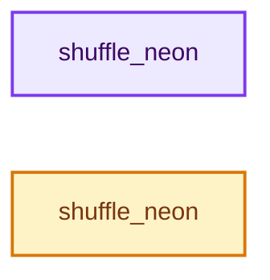
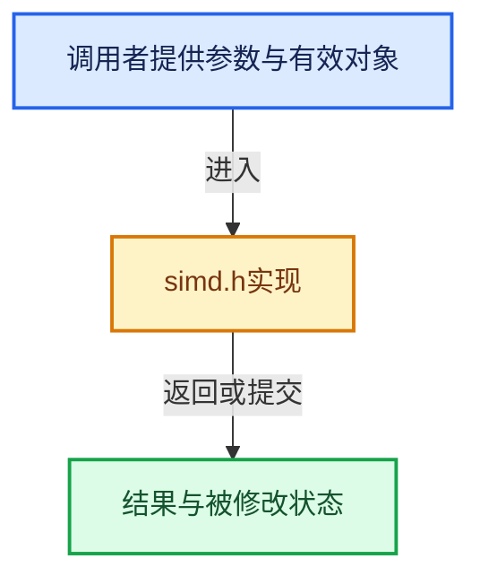

# 实现依赖专题：intern/cycles/util/simd.h

[方向导航](README.md) · [符号索引](../%E7%AC%A6%E5%8F%B7%E4%BE%9D%E8%B5%96%E4%B8%8E%E5%AE%9E%E7%8E%B0%E7%B4%A2%E5%BC%95.md)

本专题从正文实际调用进入，集中保存共享实现。函数有稳定锚点，可从调用处直接跳到对应完整函数；递归与互相调用通过回链组织。

## 本文件的实现关系






## 完整成员与函数实现

<a id="f-314108216374b68b"></a>

### `shuffle_neon`

实现位置：[intern/cycles/util/simd.h](../../../../../intern/cycles/util/simd.h) · L176—L200。

接口参数：

- `const type &a`

**教学注释版**

<!-- annotated:d04a8df33b6d12 -->

```cpp
template<class type, const int i0, const int i1, const int i2, const int i3>
type shuffle_neon(const type &a)
{
  if (i0 == i1 && i0 == i2 && i0 == i3) {
    return type(vdupq_laneq_s32(int32x4_t(a), i0));
  }
  static const uint8_t tbl[16] = {(i0 * 4) + 0,
                                  (i0 * 4) + 1,
                                  (i0 * 4) + 2,
                                  (i0 * 4) + 3,
                                  (i1 * 4) + 0,
                                  (i1 * 4) + 1,
                                  (i1 * 4) + 2,
                                  (i1 * 4) + 3,
                                  (i2 * 4) + 0,
                                  (i2 * 4) + 1,
                                  (i2 * 4) + 2,
                                  (i2 * 4) + 3,
                                  (i3 * 4) + 0,
                                  (i3 * 4) + 1,
                                  (i3 * 4) + 2,
                                  (i3 * 4) + 3};

  return type(vqtbl1q_s8(int8x16_t(a), *(uint8x16_t *)tbl));
}
```

<details>
<summary>核对原始源码：intern/cycles/util/simd.h · L176—L200</summary>

<!-- original:d04a8df33b6d12:intern/cycles/util/simd.h:176:200 -->

```cpp
template<class type, const int i0, const int i1, const int i2, const int i3>
type shuffle_neon(const type &a)
{
  if (i0 == i1 && i0 == i2 && i0 == i3) {
    return type(vdupq_laneq_s32(int32x4_t(a), i0));
  }
  static const uint8_t tbl[16] = {(i0 * 4) + 0,
                                  (i0 * 4) + 1,
                                  (i0 * 4) + 2,
                                  (i0 * 4) + 3,
                                  (i1 * 4) + 0,
                                  (i1 * 4) + 1,
                                  (i1 * 4) + 2,
                                  (i1 * 4) + 3,
                                  (i2 * 4) + 0,
                                  (i2 * 4) + 1,
                                  (i2 * 4) + 2,
                                  (i2 * 4) + 3,
                                  (i3 * 4) + 0,
                                  (i3 * 4) + 1,
                                  (i3 * 4) + 2,
                                  (i3 * 4) + 3};

  return type(vqtbl1q_s8(int8x16_t(a), *(uint8x16_t *)tbl));
}
```

</details>

**结果出口**

- `return type(vdupq_laneq_s32(int32x4_t(a), i0));`
- `return type(vqtbl1q_s8(int8x16_t(a), *(uint8x16_t *)tbl));`

**继续追踪实现**

- `type` → [调用协议](../%E6%A8%A1%E6%9D%BF%E5%AE%8F%E4%B8%8E%E5%8A%A8%E6%80%81%E5%88%86%E6%B4%BE%E5%8D%8F%E8%AE%AE.md)：函数指针、局部可调用对象或未展开的宏；必须结合调用者环境。调用位置L180。
- `vdupq_laneq_s32` → [调用协议](../%E6%A8%A1%E6%9D%BF%E5%AE%8F%E4%B8%8E%E5%8A%A8%E6%80%81%E5%88%86%E6%B4%BE%E5%8D%8F%E8%AE%AE.md)：函数指针、局部可调用对象或未展开的宏；必须结合调用者环境。调用位置L180。
- `int32x4_t` → [调用协议](../%E6%A8%A1%E6%9D%BF%E5%AE%8F%E4%B8%8E%E5%8A%A8%E6%80%81%E5%88%86%E6%B4%BE%E5%8D%8F%E8%AE%AE.md)：函数指针、局部可调用对象或未展开的宏；必须结合调用者环境。调用位置L180。
- `vqtbl1q_s8` → [调用协议](../%E6%A8%A1%E6%9D%BF%E5%AE%8F%E4%B8%8E%E5%8A%A8%E6%80%81%E5%88%86%E6%B4%BE%E5%8D%8F%E8%AE%AE.md)：函数指针、局部可调用对象或未展开的宏；必须结合调用者环境。调用位置L199。
- `int8x16_t` → [调用协议](../%E6%A8%A1%E6%9D%BF%E5%AE%8F%E4%B8%8E%E5%8A%A8%E6%80%81%E5%88%86%E6%B4%BE%E5%8D%8F%E8%AE%AE.md)：函数指针、局部可调用对象或未展开的宏；必须结合调用者环境。调用位置L199。

<a id="f-e81bcc281996bf36"></a>

### `shuffle_neon`

实现位置：[intern/cycles/util/simd.h](../../../../../intern/cycles/util/simd.h) · L202—L250。

接口参数：

- `const type &a`
- `const type &b`

**教学注释版**

<!-- annotated:c6d0ac50692b65 -->

```cpp
template<class type, const int i0, const int i1, const int i2, const int i3>
type shuffle_neon(const type &a, const type &b)
{
  if (&a == &b) {
    static const uint8_t tbl[16] = {(i0 * 4) + 0,
                                    (i0 * 4) + 1,
                                    (i0 * 4) + 2,
                                    (i0 * 4) + 3,
                                    (i1 * 4) + 0,
                                    (i1 * 4) + 1,
                                    (i1 * 4) + 2,
                                    (i1 * 4) + 3,
                                    (i2 * 4) + 0,
                                    (i2 * 4) + 1,
                                    (i2 * 4) + 2,
                                    (i2 * 4) + 3,
                                    (i3 * 4) + 0,
                                    (i3 * 4) + 1,
                                    (i3 * 4) + 2,
                                    (i3 * 4) + 3};

    return type(vqtbl1q_s8(int8x16_t(b), *(uint8x16_t *)tbl));
  }
  else {

    static const uint8_t tbl[16] = {(i0 * 4) + 0,
                                    (i0 * 4) + 1,
                                    (i0 * 4) + 2,
                                    (i0 * 4) + 3,
                                    (i1 * 4) + 0,
                                    (i1 * 4) + 1,
                                    (i1 * 4) + 2,
                                    (i1 * 4) + 3,
                                    (i2 * 4) + 0 + 16,
                                    (i2 * 4) + 1 + 16,
                                    (i2 * 4) + 2 + 16,
                                    (i2 * 4) + 3 + 16,
                                    (i3 * 4) + 0 + 16,
                                    (i3 * 4) + 1 + 16,
                                    (i3 * 4) + 2 + 16,
                                    (i3 * 4) + 3 + 16};

    /* NOTE: This cannot all be put in a single line due to how MSVC ARM64
     * implements the function calls as several layers of macros. */
    int8x16x2_t t = {int8x16_t(a), int8x16_t(b)};
    uint8x16_t idx = *(uint8x16_t *)tbl;
    return type(vqtbl2q_s8(t, idx));
  }
}
```

<details>
<summary>核对原始源码：intern/cycles/util/simd.h · L202—L250</summary>

<!-- original:c6d0ac50692b65:intern/cycles/util/simd.h:202:250 -->

```cpp
template<class type, const int i0, const int i1, const int i2, const int i3>
type shuffle_neon(const type &a, const type &b)
{
  if (&a == &b) {
    static const uint8_t tbl[16] = {(i0 * 4) + 0,
                                    (i0 * 4) + 1,
                                    (i0 * 4) + 2,
                                    (i0 * 4) + 3,
                                    (i1 * 4) + 0,
                                    (i1 * 4) + 1,
                                    (i1 * 4) + 2,
                                    (i1 * 4) + 3,
                                    (i2 * 4) + 0,
                                    (i2 * 4) + 1,
                                    (i2 * 4) + 2,
                                    (i2 * 4) + 3,
                                    (i3 * 4) + 0,
                                    (i3 * 4) + 1,
                                    (i3 * 4) + 2,
                                    (i3 * 4) + 3};

    return type(vqtbl1q_s8(int8x16_t(b), *(uint8x16_t *)tbl));
  }
  else {

    static const uint8_t tbl[16] = {(i0 * 4) + 0,
                                    (i0 * 4) + 1,
                                    (i0 * 4) + 2,
                                    (i0 * 4) + 3,
                                    (i1 * 4) + 0,
                                    (i1 * 4) + 1,
                                    (i1 * 4) + 2,
                                    (i1 * 4) + 3,
                                    (i2 * 4) + 0 + 16,
                                    (i2 * 4) + 1 + 16,
                                    (i2 * 4) + 2 + 16,
                                    (i2 * 4) + 3 + 16,
                                    (i3 * 4) + 0 + 16,
                                    (i3 * 4) + 1 + 16,
                                    (i3 * 4) + 2 + 16,
                                    (i3 * 4) + 3 + 16};

    /* NOTE: This cannot all be put in a single line due to how MSVC ARM64
     * implements the function calls as several layers of macros. */
    int8x16x2_t t = {int8x16_t(a), int8x16_t(b)};
    uint8x16_t idx = *(uint8x16_t *)tbl;
    return type(vqtbl2q_s8(t, idx));
  }
}
```

</details>

**结果出口**

- `return type(vqtbl1q_s8(int8x16_t(b), *(uint8x16_t *)tbl));`
- `return type(vqtbl2q_s8(t, idx));`

**继续追踪实现**

- `type` → [调用协议](../%E6%A8%A1%E6%9D%BF%E5%AE%8F%E4%B8%8E%E5%8A%A8%E6%80%81%E5%88%86%E6%B4%BE%E5%8D%8F%E8%AE%AE.md)：函数指针、局部可调用对象或未展开的宏；必须结合调用者环境。调用位置L223。
- `vqtbl1q_s8` → [调用协议](../%E6%A8%A1%E6%9D%BF%E5%AE%8F%E4%B8%8E%E5%8A%A8%E6%80%81%E5%88%86%E6%B4%BE%E5%8D%8F%E8%AE%AE.md)：函数指针、局部可调用对象或未展开的宏；必须结合调用者环境。调用位置L223。
- `int8x16_t` → [调用协议](../%E6%A8%A1%E6%9D%BF%E5%AE%8F%E4%B8%8E%E5%8A%A8%E6%80%81%E5%88%86%E6%B4%BE%E5%8D%8F%E8%AE%AE.md)：函数指针、局部可调用对象或未展开的宏；必须结合调用者环境。调用位置L223。
- `vqtbl2q_s8` → [调用协议](../%E6%A8%A1%E6%9D%BF%E5%AE%8F%E4%B8%8E%E5%8A%A8%E6%80%81%E5%88%86%E6%B4%BE%E5%8D%8F%E8%AE%AE.md)：函数指针、局部可调用对象或未展开的宏；必须结合调用者环境。调用位置L248。
