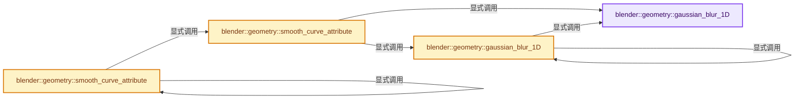

# 实现依赖专题：source/blender/geometry/intern/smooth_curves.cc

[方向导航](README.md) · [符号索引](../%E7%AC%A6%E5%8F%B7%E4%BE%9D%E8%B5%96%E4%B8%8E%E5%AE%9E%E7%8E%B0%E7%B4%A2%E5%BC%95.md)

本专题从正文实际调用进入，集中保存共享实现。函数有稳定锚点，可从调用处直接跳到对应完整函数；递归与互相调用通过回链组织。

## 本文件的实现关系




## 完整成员与函数实现

<a id="f-7e3f1bb47a09fed9"></a>

### `blender::geometry::gaussian_blur_1D`

实现位置：[source/blender/geometry/intern/smooth_curves.cc](../../../../../source/blender/geometry/intern/smooth_curves.cc) · L24—L152。

接口参数：

- `const Span<T> src`
- `const int iterations`
- `const VArray<float> &influence_by_point`
- `const bool smooth_ends`
- `const bool keep_shape`
- `const bool is_cyclic`
- `MutableSpan<T> dst`

**教学注释版**

<!-- annotated:5654c2fec1ea88 -->

```cpp
template<typename T>
static void gaussian_blur_1D(const Span<T> src,
                             const int iterations,
                             const VArray<float> &influence_by_point,
                             const bool smooth_ends,
                             const bool keep_shape,
                             const bool is_cyclic,
                             MutableSpan<T> dst)
{
  /**
   * 1D Gaussian-like smoothing function.
   *
   * NOTE: This is the algorithm used by #BKE_gpencil_stroke_smooth_point (legacy),
   *       but generalized and written in C++.
   *
   * This function uses a binomial kernel, which is the discrete version of gaussian blur.
   * The weight for a value at the relative index is:
   * `w = nCr(n, j + n/2) / 2^n = (n/1 * (n-1)/2 * ... * (n-j-n/2)/(j+n/2)) / 2^n`.
   * All weights together sum up to 1.
   * This is equivalent to doing multiple iterations of averaging neighbors,
   * where: `n = iterations * 2 and -n/2 <= j <= n/2`.
   *
   * Now the problem is that `nCr(n, j + n/2)` is very hard to compute for `n > 500`, since even
   * double precision isn't sufficient. A very good robust approximation for `n > 20` is:
   * `nCr(n, j + n/2) / 2^n = sqrt(2/(pi*n)) * exp(-2*j*j/n)`.
   *
   * `keep_shape` is a new option to stop the points from severely deforming.
   * It uses different partially negative weights.
   * `w = 2 * (nCr(n, j + n/2) / 2^n) - (nCr(3*n, j + n) / 2^(3*n))`
   * `  ~ 2 * sqrt(2/(pi*n)) * exp(-2*j*j/n) - sqrt(2/(pi*3*n)) * exp(-2*j*j/(3*n))`
   * All weights still sum up to 1.
   * Note that these weights only work because the averaging is done in relative coordinates.
   */

  // [讲解] src.is_empty：查询视图长度或生成对应有效索引区间。
  BLI_assert(!src.is_empty());
  // [讲解] src.size：查询视图长度或生成对应有效索引区间。
  BLI_assert(src.size() == dst.size());

  /* Avoid computation if there is just one point. */
  if (src.size() == 1) {
    return;
  }

  /* Weight Initialization. */
  const int n_half = keep_shape ? (iterations * iterations) / 8 + iterations :
                                  (iterations * iterations) / 4 + 2 * iterations + 12;
  double w = keep_shape ? 2.0 : 1.0;
  double w2 = keep_shape ?
                  (1.0 / M_SQRT3) * exp((2 * iterations * iterations) / double(n_half * 3)) :
                  0.0;
  Array<double> total_weight(src.size(), 0.0);

  const int64_t total_points = src.size();
  const int64_t last_pt = total_points - 1;

  auto is_end_and_fixed = [smooth_ends, is_cyclic, last_pt](int index) {
    return !smooth_ends && !is_cyclic && ELEM(index, 0, last_pt);
  };

  /* Initialize at zero. */
  // [讲解] dst.index_range：查询视图长度或生成对应有效索引区间。
  threading::parallel_for(dst.index_range(), 1024, [&](const IndexRange range) {
    for (const int64_t index : range) {
      if (!is_end_and_fixed(index)) {
        dst[index] = T(0);
      }
    }
  });

  /* Compute weights. */
  for (const int64_t step : IndexRange(iterations)) {
    const int64_t offset = iterations - step;
    threading::parallel_for(dst.index_range(), 1024, [&](const IndexRange range) {
      for (const int64_t index : range) {
        /* Filter out endpoints. */
        if (is_end_and_fixed(index)) {
          continue;
        }

        double w_before = w - w2;
        double w_after = w - w2;

        /* Compute the neighboring points. */
        int64_t before = index - offset;
        int64_t after = index + offset;
        if (is_cyclic) {
          before = (before % total_points + total_points) % total_points;
          after = after % total_points;
        }
        else {
          if (!smooth_ends && (before < 0)) {
            w_before *= -before / float(index);
          }
          before = math::max(before, int64_t(0));

          if (!smooth_ends && (after > last_pt)) {
            w_after *= (after - (total_points - 1)) / float(total_points - 1 - index);
          }
          after = math::min(after, last_pt);
        }

        /* Add the neighboring values. */
        const T bval = src[before];
        const T aval = src[after];
        const T cval = src[index];

        dst[index] += (bval - cval) * w_before;
        dst[index] += (aval - cval) * w_after;

        /* Update the weight values. */
        total_weight[index] += w_before;
        total_weight[index] += w_after;
      }
    });

    w *= (n_half + offset) / double(n_half + 1 - offset);
    w2 *= (n_half * 3 + offset) / double(n_half * 3 + 1 - offset);
  }

  /* Normalize the weights. */
  devirtualize_varray(influence_by_point, [&](const auto influence_by_point) {
    threading::parallel_for(dst.index_range(), 1024, [&](const IndexRange range) {
      for (const int64_t index : range) {
        if (!is_end_and_fixed(index)) {
          total_weight[index] += w - w2;
          dst[index] = src[index] + influence_by_point[index] * dst[index] / total_weight[index];
        }
      }
    });
  });
}
```

<details>
<summary>核对原始源码：source/blender/geometry/intern/smooth_curves.cc · L24—L152</summary>

<!-- original:5654c2fec1ea88:source/blender/geometry/intern/smooth_curves.cc:24:152 -->

```cpp
template<typename T>
static void gaussian_blur_1D(const Span<T> src,
                             const int iterations,
                             const VArray<float> &influence_by_point,
                             const bool smooth_ends,
                             const bool keep_shape,
                             const bool is_cyclic,
                             MutableSpan<T> dst)
{
  /**
   * 1D Gaussian-like smoothing function.
   *
   * NOTE: This is the algorithm used by #BKE_gpencil_stroke_smooth_point (legacy),
   *       but generalized and written in C++.
   *
   * This function uses a binomial kernel, which is the discrete version of gaussian blur.
   * The weight for a value at the relative index is:
   * `w = nCr(n, j + n/2) / 2^n = (n/1 * (n-1)/2 * ... * (n-j-n/2)/(j+n/2)) / 2^n`.
   * All weights together sum up to 1.
   * This is equivalent to doing multiple iterations of averaging neighbors,
   * where: `n = iterations * 2 and -n/2 <= j <= n/2`.
   *
   * Now the problem is that `nCr(n, j + n/2)` is very hard to compute for `n > 500`, since even
   * double precision isn't sufficient. A very good robust approximation for `n > 20` is:
   * `nCr(n, j + n/2) / 2^n = sqrt(2/(pi*n)) * exp(-2*j*j/n)`.
   *
   * `keep_shape` is a new option to stop the points from severely deforming.
   * It uses different partially negative weights.
   * `w = 2 * (nCr(n, j + n/2) / 2^n) - (nCr(3*n, j + n) / 2^(3*n))`
   * `  ~ 2 * sqrt(2/(pi*n)) * exp(-2*j*j/n) - sqrt(2/(pi*3*n)) * exp(-2*j*j/(3*n))`
   * All weights still sum up to 1.
   * Note that these weights only work because the averaging is done in relative coordinates.
   */

  BLI_assert(!src.is_empty());
  BLI_assert(src.size() == dst.size());

  /* Avoid computation if there is just one point. */
  if (src.size() == 1) {
    return;
  }

  /* Weight Initialization. */
  const int n_half = keep_shape ? (iterations * iterations) / 8 + iterations :
                                  (iterations * iterations) / 4 + 2 * iterations + 12;
  double w = keep_shape ? 2.0 : 1.0;
  double w2 = keep_shape ?
                  (1.0 / M_SQRT3) * exp((2 * iterations * iterations) / double(n_half * 3)) :
                  0.0;
  Array<double> total_weight(src.size(), 0.0);

  const int64_t total_points = src.size();
  const int64_t last_pt = total_points - 1;

  auto is_end_and_fixed = [smooth_ends, is_cyclic, last_pt](int index) {
    return !smooth_ends && !is_cyclic && ELEM(index, 0, last_pt);
  };

  /* Initialize at zero. */
  threading::parallel_for(dst.index_range(), 1024, [&](const IndexRange range) {
    for (const int64_t index : range) {
      if (!is_end_and_fixed(index)) {
        dst[index] = T(0);
      }
    }
  });

  /* Compute weights. */
  for (const int64_t step : IndexRange(iterations)) {
    const int64_t offset = iterations - step;
    threading::parallel_for(dst.index_range(), 1024, [&](const IndexRange range) {
      for (const int64_t index : range) {
        /* Filter out endpoints. */
        if (is_end_and_fixed(index)) {
          continue;
        }

        double w_before = w - w2;
        double w_after = w - w2;

        /* Compute the neighboring points. */
        int64_t before = index - offset;
        int64_t after = index + offset;
        if (is_cyclic) {
          before = (before % total_points + total_points) % total_points;
          after = after % total_points;
        }
        else {
          if (!smooth_ends && (before < 0)) {
            w_before *= -before / float(index);
          }
          before = math::max(before, int64_t(0));

          if (!smooth_ends && (after > last_pt)) {
            w_after *= (after - (total_points - 1)) / float(total_points - 1 - index);
          }
          after = math::min(after, last_pt);
        }

        /* Add the neighboring values. */
        const T bval = src[before];
        const T aval = src[after];
        const T cval = src[index];

        dst[index] += (bval - cval) * w_before;
        dst[index] += (aval - cval) * w_after;

        /* Update the weight values. */
        total_weight[index] += w_before;
        total_weight[index] += w_after;
      }
    });

    w *= (n_half + offset) / double(n_half + 1 - offset);
    w2 *= (n_half * 3 + offset) / double(n_half * 3 + 1 - offset);
  }

  /* Normalize the weights. */
  devirtualize_varray(influence_by_point, [&](const auto influence_by_point) {
    threading::parallel_for(dst.index_range(), 1024, [&](const IndexRange range) {
      for (const int64_t index : range) {
        if (!is_end_and_fixed(index)) {
          total_weight[index] += w - w2;
          dst[index] = src[index] + influence_by_point[index] * dst[index] / total_weight[index];
        }
      }
    });
  });
}
```

</details>

**沿实际写入检查状态**

- `dst[index] = T(0);`
- `before = (before % total_points + total_points) % total_points;`
- `after = after % total_points;`
- `w_before *= -before / float(index);`
- `before = math::max(before, int64_t(0));`
- `w_after *= (after - (total_points - 1)) / float(total_points - 1 - index);`
- `after = math::min(after, last_pt);`
- `dst[index] += (bval - cval) * w_before;`
- `dst[index] += (aval - cval) * w_after;`
- `total_weight[index] += w_before;`
- `total_weight[index] += w_after;`
- `w *= (n_half + offset) / double(n_half + 1 - offset);`
- `w2 *= (n_half * 3 + offset) / double(n_half * 3 + 1 - offset);`
- `total_weight[index] += w - w2;`
- `dst[index] = src[index] + influence_by_point[index] * dst[index] / total_weight[index];`

**结果出口**

- `return !smooth_ends && !is_cyclic && ELEM(index, 0, last_pt);`

**继续追踪实现**

- `BLI_assert` → [BLI_assert · L48](../01-%E5%9F%BA%E7%A1%80%E5%AE%B9%E5%99%A8%E4%B8%8E%E7%8E%B0%E4%BB%A3CPP/%E4%BE%9D%E8%B5%96-BLI_assert-cc98e8.md#m-57a88495704d)；[BLI_assert · L63](../01-%E5%9F%BA%E7%A1%80%E5%AE%B9%E5%99%A8%E4%B8%8E%E7%8E%B0%E4%BB%A3CPP/%E4%BE%9D%E8%B5%96-BLI_assert-cc98e8.md#m-d07050020cb5)。宏定义由构建条件选择。
- `src.is_empty` → [blender::Span::is_empty · L264](../01-%E5%9F%BA%E7%A1%80%E5%AE%B9%E5%99%A8%E4%B8%8E%E7%8E%B0%E4%BB%A3CPP/05-Span%E5%8F%AA%E8%AF%BB%E8%BF%9E%E7%BB%AD%E8%A7%86%E5%9B%BE.md#f-8cc1d7ba8feb50e6)。
- `src.size` → [blender::Span::size · L256](../01-%E5%9F%BA%E7%A1%80%E5%AE%B9%E5%99%A8%E4%B8%8E%E7%8E%B0%E4%BB%A3CPP/05-Span%E5%8F%AA%E8%AF%BB%E8%BF%9E%E7%BB%AD%E8%A7%86%E5%9B%BE.md#f-5f80fa006089c998)。
- `dst.size` → [blender::MutableSpan::size · L499](../01-%E5%9F%BA%E7%A1%80%E5%AE%B9%E5%99%A8%E4%B8%8E%E7%8E%B0%E4%BB%A3CPP/06-MutableSpan%E5%8F%AF%E5%86%99%E8%A7%86%E5%9B%BE.md#f-1de6a66839c304a8)；[blender::gpu::shader::parser::MutableSpan::size · L87](%E4%BE%9D%E8%B5%96-utils-06433d.md#f-5e684af6ee7990e9)。同名重载需按实参类型选择。
- `exp` → [exp · L106](%E4%BE%9D%E8%B5%96-gpu_shader_cxx_builtin-8ae191.md#m-dd7e1d600c32)。宏定义由构建条件选择。
- `ELEM` → [ELEM · L88](%E4%BE%9D%E8%B5%96-GHOST_utildefines-34b996.md#m-d28724a15928)；[ELEM · L135](../01-%E5%9F%BA%E7%A1%80%E5%AE%B9%E5%99%A8%E4%B8%8E%E7%8E%B0%E4%BB%A3CPP/%E4%BE%9D%E8%B5%96-BLI_utildefines-293a0a.md#m-d6572de7cae0)。宏定义由构建条件选择。
- `threading::parallel_for` → [blender::threading::parallel_for · L68](../11-Depsgraph%E4%B8%8E%E5%B9%B6%E8%A1%8C%E4%BB%BB%E5%8A%A1%E7%B3%BB%E7%BB%9F/07-%E4%BB%BB%E5%8A%A1%E6%B1%A0%E4%B8%8ETBB%E6%8E%A5%E5%85%A5.md#f-838294754c24426c)。
- `dst.index_range` → [blender::MutableSpan::index_range · L676](../01-%E5%9F%BA%E7%A1%80%E5%AE%B9%E5%99%A8%E4%B8%8E%E7%8E%B0%E4%BB%A3CPP/06-MutableSpan%E5%8F%AF%E5%86%99%E8%A7%86%E5%9B%BE.md#f-f9a9d59a69ca64b5)。
- `is_end_and_fixed` → [调用协议](../%E6%A8%A1%E6%9D%BF%E5%AE%8F%E4%B8%8E%E5%8A%A8%E6%80%81%E5%88%86%E6%B4%BE%E5%8D%8F%E8%AE%AE.md)：局部可调用对象，须结合其初始化与捕获环境。调用位置L85。
- `T` → [DiagSplit::T · L96](%E4%BE%9D%E8%B5%96-split-5f5804.md#f-d5d0885c790cc4e4)。
- `IndexRange` → [blender::IndexRange](../01-%E5%9F%BA%E7%A1%80%E5%AE%B9%E5%99%A8%E4%B8%8E%E7%8E%B0%E4%BB%A3CPP/%E4%BE%9D%E8%B5%96-BLI_index_range-7d7cc5.md#t-caa3466d6776)；[blender::gpu::shader::parser::IndexRange](%E4%BE%9D%E8%B5%96-utils-06433d.md#t-82d2bd4ea71c)；[blender::IndexRange](%E4%BE%9D%E8%B5%96-DNA_node_types-6708b9.md#t-0448cc889d39)。
- `math::max` → [blender::math::max · L87](../12-%E7%A9%BA%E9%97%B4%E6%95%B0%E6%8D%AE%E7%BB%93%E6%9E%84%E4%B8%8E%E5%87%A0%E4%BD%95%E7%AE%97%E6%B3%95/%E4%BE%9D%E8%B5%96-BLI_math_vector-906a87.md#f-9be564a293777d6b)；[blender::math::max · L96](../12-%E7%A9%BA%E9%97%B4%E6%95%B0%E6%8D%AE%E7%BB%93%E6%9E%84%E4%B8%8E%E5%87%A0%E4%BD%95%E7%AE%97%E6%B3%95/%E4%BE%9D%E8%B5%96-BLI_math_vector-906a87.md#f-ce32dff37d0af3bc)；[blender::math::max · L112](../12-%E7%A9%BA%E9%97%B4%E6%95%B0%E6%8D%AE%E7%BB%93%E6%9E%84%E4%B8%8E%E5%87%A0%E4%BD%95%E7%AE%97%E6%B3%95/%E4%BE%9D%E8%B5%96-BLI_math_vector-906a87.md#f-668eb1fcf1fa8292)；[blender::math::max · L49](../12-%E7%A9%BA%E9%97%B4%E6%95%B0%E6%8D%AE%E7%BB%93%E6%9E%84%E4%B8%8E%E5%87%A0%E4%BD%95%E7%AE%97%E6%B3%95/%E4%BE%9D%E8%B5%96-BLI_math_base-0728eb.md#f-a6991ca3d12937e1)。同名重载需按实参类型选择。
- `math::min` → [blender::math::min · L56](../12-%E7%A9%BA%E9%97%B4%E6%95%B0%E6%8D%AE%E7%BB%93%E6%9E%84%E4%B8%8E%E5%87%A0%E4%BD%95%E7%AE%97%E6%B3%95/%E4%BE%9D%E8%B5%96-BLI_math_vector-906a87.md#f-ee6ead51e4bb3364)；[blender::math::min · L65](../12-%E7%A9%BA%E9%97%B4%E6%95%B0%E6%8D%AE%E7%BB%93%E6%9E%84%E4%B8%8E%E5%87%A0%E4%BD%95%E7%AE%97%E6%B3%95/%E4%BE%9D%E8%B5%96-BLI_math_vector-906a87.md#f-f65ce48b3051cce3)；[blender::math::min · L81](../12-%E7%A9%BA%E9%97%B4%E6%95%B0%E6%8D%AE%E7%BB%93%E6%9E%84%E4%B8%8E%E5%87%A0%E4%BD%95%E7%AE%97%E6%B3%95/%E4%BE%9D%E8%B5%96-BLI_math_vector-906a87.md#f-9c602d29fab41795)；[blender::math::min · L43](../12-%E7%A9%BA%E9%97%B4%E6%95%B0%E6%8D%AE%E7%BB%93%E6%9E%84%E4%B8%8E%E5%87%A0%E4%BD%95%E7%AE%97%E6%B3%95/%E4%BE%9D%E8%B5%96-BLI_math_base-0728eb.md#f-72ff0c229e6c09b0)。同名重载需按实参类型选择。
- `devirtualize_varray` → [blender::devirtualize_varray · L1183](../04-%E8%99%9A%E6%8B%9F%E6%95%B0%E7%BB%84%E4%B8%8E%E7%B4%A2%E5%BC%95%E9%80%89%E6%8B%A9/04-%E6%89%80%E6%9C%89%E6%9D%83%E4%B8%8E%E5%B0%8F%E5%AF%B9%E8%B1%A1%E4%BC%98%E5%8C%96.md#f-e8985eebdbe1038a)。

<a id="f-40ea19fbbc8a9189"></a>

### `blender::geometry::gaussian_blur_1D`

实现位置：[source/blender/geometry/intern/smooth_curves.cc](../../../../../source/blender/geometry/intern/smooth_curves.cc) · L154—L175。

接口参数：

- `const GSpan src`
- `const int iterations`
- `const VArray<float> &influence_by_point`
- `const bool smooth_ends`
- `const bool keep_shape`
- `const bool is_cyclic`
- `GMutableSpan dst`

**教学注释版**

<!-- annotated:515573cb8ba208 -->

```cpp
void gaussian_blur_1D(const GSpan src,
                      const int iterations,
                      const VArray<float> &influence_by_point,
                      const bool smooth_ends,
                      const bool keep_shape,
                      const bool is_cyclic,
                      GMutableSpan dst)
{
  bke::attribute_math::to_static_type(src.type(), [&]<typename T>() {
    /* Only allow smoothing of float, float2, or float3. */
    /* Reduces unnecessary code generation. */
    if constexpr (is_same_any_v<T, float, float2, float3>) {
      gaussian_blur_1D(src.typed<T>(),
                       iterations,
                       influence_by_point,
                       smooth_ends,
                       keep_shape,
                       is_cyclic,
                       dst.typed<T>());
    }
  });
}
```

<details>
<summary>核对原始源码：source/blender/geometry/intern/smooth_curves.cc · L154—L175</summary>

<!-- original:515573cb8ba208:source/blender/geometry/intern/smooth_curves.cc:154:175 -->

```cpp
void gaussian_blur_1D(const GSpan src,
                      const int iterations,
                      const VArray<float> &influence_by_point,
                      const bool smooth_ends,
                      const bool keep_shape,
                      const bool is_cyclic,
                      GMutableSpan dst)
{
  bke::attribute_math::to_static_type(src.type(), [&]<typename T>() {
    /* Only allow smoothing of float, float2, or float3. */
    /* Reduces unnecessary code generation. */
    if constexpr (is_same_any_v<T, float, float2, float3>) {
      gaussian_blur_1D(src.typed<T>(),
                       iterations,
                       influence_by_point,
                       smooth_ends,
                       keep_shape,
                       is_cyclic,
                       dst.typed<T>());
    }
  });
}
```

</details>

**继续追踪实现**

- `bke::attribute_math::to_static_type` → [blender::bke::attribute_math::to_static_type · L35](%E4%BE%9D%E8%B5%96-BKE_attribute_math-ac7998.md#f-fdfaf0b86a24f278)；[blender::bke::attribute_math::to_static_type · L52](%E4%BE%9D%E8%B5%96-BKE_attribute_math-ac7998.md#f-5346ade4e816ebd6)。同名重载需按实参类型选择。
- `src.type` → [blender::GSpan::type · L55](../03-%E5%86%85%E5%AD%98%E5%88%86%E9%85%8D%E4%B8%8E%E8%BF%90%E8%A1%8C%E6%97%B6%E7%B1%BB%E5%9E%8B/11-GSpan%E4%B8%8EGArray.md#f-4c44cc0364dcf191)。
- `gaussian_blur_1D` → [blender::geometry::gaussian_blur_1D · L24](%E4%BE%9D%E8%B5%96-smooth_curves-b27f29.md#f-7e3f1bb47a09fed9)；[blender::geometry::gaussian_blur_1D · L154](%E4%BE%9D%E8%B5%96-smooth_curves-b27f29.md#f-40ea19fbbc8a9189)。同名重载需按实参类型选择。
- `src.typed<T>` → [blender::GSpan::typed · L92](../03-%E5%86%85%E5%AD%98%E5%88%86%E9%85%8D%E4%B8%8E%E8%BF%90%E8%A1%8C%E6%97%B6%E7%B1%BB%E5%9E%8B/11-GSpan%E4%B8%8EGArray.md#f-aa54cf0d7a8dae2b)。
- `dst.typed<T>` → [blender::GMutableSpan::typed · L220](../03-%E5%86%85%E5%AD%98%E5%88%86%E9%85%8D%E4%B8%8E%E8%BF%90%E8%A1%8C%E6%97%B6%E7%B1%BB%E5%9E%8B/11-GSpan%E4%B8%8EGArray.md#f-d66e288b393f6545)。

<a id="f-501455310c3a0583"></a>

### `blender::geometry::smooth_curve_attribute`

实现位置：[source/blender/geometry/intern/smooth_curves.cc](../../../../../source/blender/geometry/intern/smooth_curves.cc) · L177—L228。

接口参数：

- `const IndexMask &curves_to_smooth`
- `const OffsetIndices<int> points_by_curve`
- `const VArray<bool> &point_selection`
- `const VArray<bool> &cyclic`
- `const int iterations`
- `const VArray<float> &influence_by_point`
- `const bool smooth_ends`
- `const bool keep_shape`
- `GMutableSpan attribute_data`

**教学注释版**

<!-- annotated:fcf893b134b553 -->

```cpp
void smooth_curve_attribute(const IndexMask &curves_to_smooth,
                            const OffsetIndices<int> points_by_curve,
                            const VArray<bool> &point_selection,
                            const VArray<bool> &cyclic,
                            const int iterations,
                            const VArray<float> &influence_by_point,
                            const bool smooth_ends,
                            const bool keep_shape,
                            GMutableSpan attribute_data)
{
  VArraySpan<float> influences(influence_by_point);

  auto smooth_points_range =
      [&](const IndexRange range, const bool cyclic, Vector<std::byte> &orig_data) {
        GMutableSpan dst_data = attribute_data.slice(range);
        // [讲解] orig_data.resize：把有效元素数调整为new_size。增长路径构造新元素，缩小路径销毁尾部对象，最后才提交新的end_。
        orig_data.resize(dst_data.size_in_bytes());
        // [讲解] orig_data.data：提供当前存储或有效范围的地址。
        dst_data.type().copy_assign_n(dst_data.data(), orig_data.data(), range.size());
        // [讲解] range.size：读取连续区间或分组的边界信息。
        const GSpan src_data(dst_data.type(), orig_data.data(), range.size());

        gaussian_blur_1D(src_data,
                         iterations,
                         VArray<float>::from_span(influences.slice(range)),
                         smooth_ends,
                         keep_shape,
                         cyclic,
                         dst_data);
      };

  curves_to_smooth.foreach_index(
      [&](const int curve_i) {
        Vector<std::byte> orig_data;
        const IndexRange points = points_by_curve[curve_i];

        IndexMaskMemory memory;
        const IndexMask selection_mask = IndexMask::from_bools(points, point_selection, memory);
        if (selection_mask.is_empty()) {
          return;
        }

        const std::optional<IndexRange> selection_range = selection_mask.to_range();
        if (selection_range && *selection_range == points) {
          smooth_points_range(points, cyclic[curve_i], orig_data);
        }
        else {
          selection_mask.foreach_range([&](const IndexRange range) {
            /* Individual ranges should be treated as non-cyclic. */
            smooth_points_range(range, false, orig_data);
          });
        }
      },
      exec_mode::grain_size(512));
}
```

<details>
<summary>核对原始源码：source/blender/geometry/intern/smooth_curves.cc · L177—L228</summary>

<!-- original:fcf893b134b553:source/blender/geometry/intern/smooth_curves.cc:177:228 -->

```cpp
void smooth_curve_attribute(const IndexMask &curves_to_smooth,
                            const OffsetIndices<int> points_by_curve,
                            const VArray<bool> &point_selection,
                            const VArray<bool> &cyclic,
                            const int iterations,
                            const VArray<float> &influence_by_point,
                            const bool smooth_ends,
                            const bool keep_shape,
                            GMutableSpan attribute_data)
{
  VArraySpan<float> influences(influence_by_point);

  auto smooth_points_range =
      [&](const IndexRange range, const bool cyclic, Vector<std::byte> &orig_data) {
        GMutableSpan dst_data = attribute_data.slice(range);
        orig_data.resize(dst_data.size_in_bytes());
        dst_data.type().copy_assign_n(dst_data.data(), orig_data.data(), range.size());
        const GSpan src_data(dst_data.type(), orig_data.data(), range.size());

        gaussian_blur_1D(src_data,
                         iterations,
                         VArray<float>::from_span(influences.slice(range)),
                         smooth_ends,
                         keep_shape,
                         cyclic,
                         dst_data);
      };

  curves_to_smooth.foreach_index(
      [&](const int curve_i) {
        Vector<std::byte> orig_data;
        const IndexRange points = points_by_curve[curve_i];

        IndexMaskMemory memory;
        const IndexMask selection_mask = IndexMask::from_bools(points, point_selection, memory);
        if (selection_mask.is_empty()) {
          return;
        }

        const std::optional<IndexRange> selection_range = selection_mask.to_range();
        if (selection_range && *selection_range == points) {
          smooth_points_range(points, cyclic[curve_i], orig_data);
        }
        else {
          selection_mask.foreach_range([&](const IndexRange range) {
            /* Individual ranges should be treated as non-cyclic. */
            smooth_points_range(range, false, orig_data);
          });
        }
      },
      exec_mode::grain_size(512));
}
```

</details>

**继续追踪实现**

- `attribute_data.slice` → [blender::GMutableSpan::slice · L227](../03-%E5%86%85%E5%AD%98%E5%88%86%E9%85%8D%E4%B8%8E%E8%BF%90%E8%A1%8C%E6%97%B6%E7%B1%BB%E5%9E%8B/11-GSpan%E4%B8%8EGArray.md#f-d7f8e350bc3a5156)；[blender::GMutableSpan::slice · L235](../03-%E5%86%85%E5%AD%98%E5%88%86%E9%85%8D%E4%B8%8E%E8%BF%90%E8%A1%8C%E6%97%B6%E7%B1%BB%E5%9E%8B/11-GSpan%E4%B8%8EGArray.md#f-b1101d4d9009fa75)。同名重载需按实参类型选择。
- `orig_data.resize` → [blender::Vector::resize · L418](../01-%E5%9F%BA%E7%A1%80%E5%AE%B9%E5%99%A8%E4%B8%8E%E7%8E%B0%E4%BB%A3CPP/10-Vector%E6%89%A9%E5%AE%B9%E4%B8%8E%E5%A2%9E%E9%95%BF.md#f-059312cabb8abe3a)；[blender::Vector::resize · L439](../01-%E5%9F%BA%E7%A1%80%E5%AE%B9%E5%99%A8%E4%B8%8E%E7%8E%B0%E4%BB%A3CPP/10-Vector%E6%89%A9%E5%AE%B9%E4%B8%8E%E5%A2%9E%E9%95%BF.md#f-ab8f94924ebe2d12)。同名重载需按实参类型选择。
- `dst_data.size_in_bytes` → [blender::GMutableSpan::size_in_bytes · L203](../03-%E5%86%85%E5%AD%98%E5%88%86%E9%85%8D%E4%B8%8E%E8%BF%90%E8%A1%8C%E6%97%B6%E7%B1%BB%E5%9E%8B/11-GSpan%E4%B8%8EGArray.md#f-78ac72dc14caccbc)。
- `dst_data.type().copy_assign_n` → [调用协议](../%E6%A8%A1%E6%9D%BF%E5%AE%8F%E4%B8%8E%E5%8A%A8%E6%80%81%E5%88%86%E6%B4%BE%E5%8D%8F%E8%AE%AE.md)：接收对象类型依赖auto、返回值或模板实例；不按同名猜测目标。调用位置L193。
- `dst_data.type` → [blender::GMutableSpan::type · L182](../03-%E5%86%85%E5%AD%98%E5%88%86%E9%85%8D%E4%B8%8E%E8%BF%90%E8%A1%8C%E6%97%B6%E7%B1%BB%E5%9E%8B/11-GSpan%E4%B8%8EGArray.md#f-74385040046c86d5)。
- `dst_data.data` → [blender::GMutableSpan::data · L208](../03-%E5%86%85%E5%AD%98%E5%88%86%E9%85%8D%E4%B8%8E%E8%BF%90%E8%A1%8C%E6%97%B6%E7%B1%BB%E5%9E%8B/11-GSpan%E4%B8%8EGArray.md#f-f951536a0bdbb159)。
- `orig_data.data` → [blender::Vector::data · L954](../01-%E5%9F%BA%E7%A1%80%E5%AE%B9%E5%99%A8%E4%B8%8E%E7%8E%B0%E4%BB%A3CPP/12-Vector%E5%BC%82%E5%B8%B8%E5%AE%89%E5%85%A8%E4%B8%8E%E8%BE%B9%E7%95%8C.md#f-6e441591404715bc)；[blender::Vector::data · L962](../01-%E5%9F%BA%E7%A1%80%E5%AE%B9%E5%99%A8%E4%B8%8E%E7%8E%B0%E4%BB%A3CPP/12-Vector%E5%BC%82%E5%B8%B8%E5%AE%89%E5%85%A8%E4%B8%8E%E8%BE%B9%E7%95%8C.md#f-4bc78d4954c1021a)。同名重载需按实参类型选择。
- `range.size` → [blender::IndexRange::size · L156](../01-%E5%9F%BA%E7%A1%80%E5%AE%B9%E5%99%A8%E4%B8%8E%E7%8E%B0%E4%BB%A3CPP/04-IndexRange%E8%BF%9E%E7%BB%AD%E6%95%B4%E6%95%B0%E5%8C%BA%E9%97%B4.md#f-05f66c3ebb2fdfec)。
- `gaussian_blur_1D` → [blender::geometry::gaussian_blur_1D · L24](%E4%BE%9D%E8%B5%96-smooth_curves-b27f29.md#f-7e3f1bb47a09fed9)；[blender::geometry::gaussian_blur_1D · L154](%E4%BE%9D%E8%B5%96-smooth_curves-b27f29.md#f-40ea19fbbc8a9189)。同名重载需按实参类型选择。
- `VArray<float>::from_span` → [blender::GVArray::from_span · L895](../04-%E8%99%9A%E6%8B%9F%E6%95%B0%E7%BB%84%E4%B8%8E%E7%B4%A2%E5%BC%95%E9%80%89%E6%8B%A9/05-GVArray%E8%BF%90%E8%A1%8C%E6%97%B6%E7%B1%BB%E5%9E%8B.md#f-e8b978ca15febb67)；[blender::VArray::from_span · L768](../04-%E8%99%9A%E6%8B%9F%E6%95%B0%E7%BB%84%E4%B8%8E%E7%B4%A2%E5%BC%95%E9%80%89%E6%8B%A9/03-%E5%8D%95%E5%80%BC%E4%B8%8ESpan%E8%A1%A8%E7%A4%BA.md#f-d9cf90c7ec1493b6)。同名重载需按实参类型选择。
- `influences.slice` → [调用协议](../%E6%A8%A1%E6%9D%BF%E5%AE%8F%E4%B8%8E%E5%8A%A8%E6%80%81%E5%88%86%E6%B4%BE%E5%8D%8F%E8%AE%AE.md)：由接收对象具体类型或运行时策略提供实现。调用位置L198。
- `curves_to_smooth.foreach_index` → [blender::index_mask::IndexMask::foreach_index · L855](../04-%E8%99%9A%E6%8B%9F%E6%95%B0%E7%BB%84%E4%B8%8E%E7%B4%A2%E5%BC%95%E9%80%89%E6%8B%A9/09-%E5%88%86%E6%AE%B5%E5%AD%98%E5%82%A8%E4%B8%8E%E9%81%8D%E5%8E%86.md#f-cd6cd317e2e2812c)。
- `IndexMask::from_bools` → [blender::index_mask::IndexMask::from_bools · L593](../04-%E8%99%9A%E6%8B%9F%E6%95%B0%E7%BB%84%E4%B8%8E%E7%B4%A2%E5%BC%95%E9%80%89%E6%8B%A9/10-IndexMask%E6%9E%84%E5%BB%BA%E4%B8%8E%E5%B9%B6%E8%A1%8C.md#f-1eccbfd39b11c6bc)；[blender::index_mask::IndexMask::from_bools · L598](../04-%E8%99%9A%E6%8B%9F%E6%95%B0%E7%BB%84%E4%B8%8E%E7%B4%A2%E5%BC%95%E9%80%89%E6%8B%A9/10-IndexMask%E6%9E%84%E5%BB%BA%E4%B8%8E%E5%B9%B6%E8%A1%8C.md#f-3962fd5fd5aee616)；[blender::index_mask::IndexMask::from_bools · L613](../04-%E8%99%9A%E6%8B%9F%E6%95%B0%E7%BB%84%E4%B8%8E%E7%B4%A2%E5%BC%95%E9%80%89%E6%8B%A9/10-IndexMask%E6%9E%84%E5%BB%BA%E4%B8%8E%E5%B9%B6%E8%A1%8C.md#f-5f32581e6bbdca9e)；[blender::index_mask::IndexMask::from_bools · L649](../04-%E8%99%9A%E6%8B%9F%E6%95%B0%E7%BB%84%E4%B8%8E%E7%B4%A2%E5%BC%95%E9%80%89%E6%8B%A9/10-IndexMask%E6%9E%84%E5%BB%BA%E4%B8%8E%E5%B9%B6%E8%A1%8C.md#f-89ee3d007144c267)。同名重载需按实参类型选择。
- `selection_mask.is_empty` → [blender::index_mask::IndexMask::is_empty · L748](../04-%E8%99%9A%E6%8B%9F%E6%95%B0%E7%BB%84%E4%B8%8E%E7%B4%A2%E5%BC%95%E9%80%89%E6%8B%A9/09-%E5%88%86%E6%AE%B5%E5%AD%98%E5%82%A8%E4%B8%8E%E9%81%8D%E5%8E%86.md#f-190ac996386064f4)。
- `selection_mask.to_range` → [blender::index_mask::IndexMask::to_range · L1136](../04-%E8%99%9A%E6%8B%9F%E6%95%B0%E7%BB%84%E4%B8%8E%E7%B4%A2%E5%BC%95%E9%80%89%E6%8B%A9/12-%E9%87%8D%E6%9E%84%E5%8E%86%E5%8F%B2%E4%B8%8E%E5%9F%BA%E5%87%86%E7%BB%83%E4%B9%A0.md#f-bcc016bae424bbaf)。
- `smooth_points_range` → [调用协议](../%E6%A8%A1%E6%9D%BF%E5%AE%8F%E4%B8%8E%E5%8A%A8%E6%80%81%E5%88%86%E6%B4%BE%E5%8D%8F%E8%AE%AE.md)：局部可调用对象，须结合其初始化与捕获环境。调用位置L218。
- `selection_mask.foreach_range` → [blender::index_mask::IndexMask::foreach_range · L1046](../04-%E8%99%9A%E6%8B%9F%E6%95%B0%E7%BB%84%E4%B8%8E%E7%B4%A2%E5%BC%95%E9%80%89%E6%8B%A9/12-%E9%87%8D%E6%9E%84%E5%8E%86%E5%8F%B2%E4%B8%8E%E5%9F%BA%E5%87%86%E7%BB%83%E4%B9%A0.md#f-dab36a132dcb5bac)。
- `exec_mode::grain_size` → [blender::exec_mode::grain_size · L79](../01-%E5%9F%BA%E7%A1%80%E5%AE%B9%E5%99%A8%E4%B8%8E%E7%8E%B0%E4%BB%A3CPP/%E4%BE%9D%E8%B5%96-BLI_execution_mode-1528fb.md#f-0b4fc2f9fa6e66e7)。

<a id="f-12e5671d56fad9b7"></a>

### `blender::geometry::smooth_curve_attribute`

实现位置：[source/blender/geometry/intern/smooth_curves.cc](../../../../../source/blender/geometry/intern/smooth_curves.cc) · L230—L249。

接口参数：

- `const IndexMask &curves_to_smooth`
- `const OffsetIndices<int> points_by_curve`
- `const VArray<bool> &point_selection`
- `const VArray<bool> &cyclic`
- `const int iterations`
- `const float influence`
- `const bool smooth_ends`
- `const bool keep_shape`
- `GMutableSpan attribute_data`

**教学注释版**

<!-- annotated:4f20b3aac808ec -->

```cpp
void smooth_curve_attribute(const IndexMask &curves_to_smooth,
                            const OffsetIndices<int> points_by_curve,
                            const VArray<bool> &point_selection,
                            const VArray<bool> &cyclic,
                            const int iterations,
                            const float influence,
                            const bool smooth_ends,
                            const bool keep_shape,
                            GMutableSpan attribute_data)
{
  smooth_curve_attribute(curves_to_smooth,
                         points_by_curve,
                         point_selection,
                         cyclic,
                         iterations,
                         VArray<float>::from_single(influence, points_by_curve.total_size()),
                         smooth_ends,
                         keep_shape,
                         attribute_data);
}
```

<details>
<summary>核对原始源码：source/blender/geometry/intern/smooth_curves.cc · L230—L249</summary>

<!-- original:4f20b3aac808ec:source/blender/geometry/intern/smooth_curves.cc:230:249 -->

```cpp
void smooth_curve_attribute(const IndexMask &curves_to_smooth,
                            const OffsetIndices<int> points_by_curve,
                            const VArray<bool> &point_selection,
                            const VArray<bool> &cyclic,
                            const int iterations,
                            const float influence,
                            const bool smooth_ends,
                            const bool keep_shape,
                            GMutableSpan attribute_data)
{
  smooth_curve_attribute(curves_to_smooth,
                         points_by_curve,
                         point_selection,
                         cyclic,
                         iterations,
                         VArray<float>::from_single(influence, points_by_curve.total_size()),
                         smooth_ends,
                         keep_shape,
                         attribute_data);
}
```

</details>

**继续追踪实现**

- `smooth_curve_attribute` → [blender::geometry::smooth_curve_attribute · L177](%E4%BE%9D%E8%B5%96-smooth_curves-b27f29.md#f-501455310c3a0583)；[blender::geometry::smooth_curve_attribute · L230](%E4%BE%9D%E8%B5%96-smooth_curves-b27f29.md#f-12e5671d56fad9b7)。同名重载需按实参类型选择。
- `VArray<float>::from_single` → [blender::GVArray::from_single · L880](../04-%E8%99%9A%E6%8B%9F%E6%95%B0%E7%BB%84%E4%B8%8E%E7%B4%A2%E5%BC%95%E9%80%89%E6%8B%A9/05-GVArray%E8%BF%90%E8%A1%8C%E6%97%B6%E7%B1%BB%E5%9E%8B.md#f-1c85e09520e47c5a)；[blender::VArray::from_single · L759](../04-%E8%99%9A%E6%8B%9F%E6%95%B0%E7%BB%84%E4%B8%8E%E7%B4%A2%E5%BC%95%E9%80%89%E6%8B%A9/03-%E5%8D%95%E5%80%BC%E4%B8%8ESpan%E8%A1%A8%E7%A4%BA.md#f-ea0b7b864c7f4785)。同名重载需按实参类型选择。
- `points_by_curve.total_size` → [blender::offset_indices::OffsetIndices::total_size · L58](02-OffsetIndices%E5%AE%8C%E6%95%B4%E6%8E%A5%E5%8F%A3.md#f-c111ffdac7a19248)。
