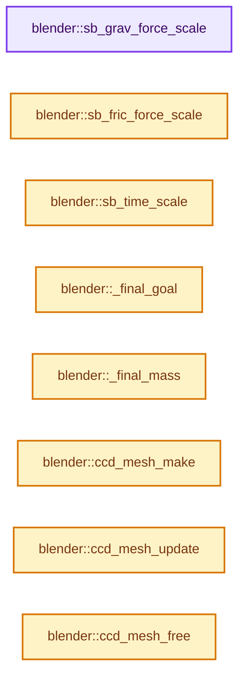
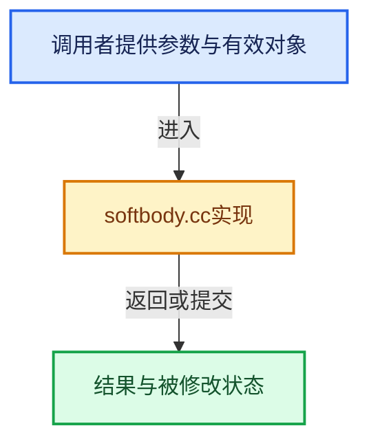

# 实现依赖专题：source/blender/blenkernel/intern/softbody.cc

[方向导航](README.md) · [符号索引](../%E7%AC%A6%E5%8F%B7%E4%BE%9D%E8%B5%96%E4%B8%8E%E5%AE%9E%E7%8E%B0%E7%B4%A2%E5%BC%95.md)

本专题从正文实际调用进入，集中保存共享实现。函数有稳定锚点，可从调用处直接跳到对应完整函数；递归与互相调用通过回链组织。

## 本文件的实现关系






## 完整成员与函数实现

<a id="f-2f7d2cb682276209"></a>

### `blender::sb_grav_force_scale`

实现位置：[source/blender/blenkernel/intern/softbody.cc](../../../../../source/blender/blenkernel/intern/softbody.cc) · L164—L167。

接口参数：

- `Object *`

**教学注释版**

<!-- annotated:dde3ea5710cc43 -->

```cpp
static float sb_grav_force_scale(Object * /*ob*/)
{
  return (0.001f);
}
```

<details>
<summary>核对原始源码：source/blender/blenkernel/intern/softbody.cc · L164—L167</summary>

<!-- original:dde3ea5710cc43:source/blender/blenkernel/intern/softbody.cc:164:167 -->

```cpp
static float sb_grav_force_scale(Object * /*ob*/)
{
  return (0.001f);
}
```

</details>

**结果出口**

- `return (0.001f);`

**继续追踪实现**

本实现没有需要继续展开的显式调用；检查返回表达式、对象转换和调用者前置条件。

<a id="f-8518ebc8e53ba84d"></a>

### `blender::sb_fric_force_scale`

实现位置：[source/blender/blenkernel/intern/softbody.cc](../../../../../source/blender/blenkernel/intern/softbody.cc) · L173—L176。

接口参数：

- `Object *`

**教学注释版**

<!-- annotated:966b9e18394a87 -->

```cpp
static float sb_fric_force_scale(Object * /*ob*/)
{
  return (0.01f);
}
```

<details>
<summary>核对原始源码：source/blender/blenkernel/intern/softbody.cc · L173—L176</summary>

<!-- original:966b9e18394a87:source/blender/blenkernel/intern/softbody.cc:173:176 -->

```cpp
static float sb_fric_force_scale(Object * /*ob*/)
{
  return (0.01f);
}
```

</details>

**结果出口**

- `return (0.01f);`

**继续追踪实现**

本实现没有需要继续展开的显式调用；检查返回表达式、对象转换和调用者前置条件。

<a id="f-a9c73d693f9ea99e"></a>

### `blender::sb_time_scale`

实现位置：[source/blender/blenkernel/intern/softbody.cc](../../../../../source/blender/blenkernel/intern/softbody.cc) · L181—L198。

接口参数：

- `Object *ob`

**教学注释版**

<!-- annotated:7d7005b5785a09 -->

```cpp
static float sb_time_scale(Object *ob)
{
  SoftBody *sb = ob->soft; /* is supposed to be there */
  if (sb) {
    return (sb->physics_speed);
    /* Hum .. this could be IPO as well :)
     * estimated range [0.001 sluggish slug - 100.0 very fast (i hope ODE solver can handle that)]
     * 1 approx = a unit 1 pendulum at g = 9.8 [earth conditions]  has period 65 frames
     * theory would give a 50 frames period .. so there must be something inaccurate ..
     * looking for that (BM). */
  }
  return (1.0f);
  /*
   * this would be frames/sec independent timing assuming 25 fps is default
   * but does not work very well with NLA
   * return (25.0f/scene->r.frs_sec)
   */
}
```

<details>
<summary>核对原始源码：source/blender/blenkernel/intern/softbody.cc · L181—L198</summary>

<!-- original:7d7005b5785a09:source/blender/blenkernel/intern/softbody.cc:181:198 -->

```cpp
static float sb_time_scale(Object *ob)
{
  SoftBody *sb = ob->soft; /* is supposed to be there */
  if (sb) {
    return (sb->physics_speed);
    /* Hum .. this could be IPO as well :)
     * estimated range [0.001 sluggish slug - 100.0 very fast (i hope ODE solver can handle that)]
     * 1 approx = a unit 1 pendulum at g = 9.8 [earth conditions]  has period 65 frames
     * theory would give a 50 frames period .. so there must be something inaccurate ..
     * looking for that (BM). */
  }
  return (1.0f);
  /*
   * this would be frames/sec independent timing assuming 25 fps is default
   * but does not work very well with NLA
   * return (25.0f/scene->r.frs_sec)
   */
}
```

</details>

**结果出口**

- `return (sb->physics_speed);`
- `return (1.0f);`

**继续追踪实现**

本实现没有需要继续展开的显式调用；检查返回表达式、对象转换和调用者前置条件。

<a id="f-c8ae33027137076c"></a>

### `blender::_final_goal`

实现位置：[source/blender/blenkernel/intern/softbody.cc](../../../../../source/blender/blenkernel/intern/softbody.cc) · L211—L230。

接口参数：

- `Object *ob`
- `BodyPoint *bp`

**教学注释版**

<!-- annotated:f78a48e7a63c27 -->

```cpp
static float _final_goal(Object *ob, BodyPoint *bp) /* jow_go_for2_5 */
{
  float f = -1999.99f;
  if (ob) {
    SoftBody *sb = ob->soft; /* is supposed to be there */
    if (!(ob->softflag & OB_SB_GOAL)) {
      return (0.0f);
    }
    if (sb && bp) {
      if (bp->goal < 0.0f) {
        return (0.0f);
      }
      f = sb->mingoal + bp->goal * fabsf(sb->maxgoal - sb->mingoal);
      f = pow(f, 4.0f);
      return f;
    }
  }
  CLOG_ERROR(&LOG, "sb or bp == NULL");
  return f; /* Using crude but spot able values some times helps debugging. */
}
```

<details>
<summary>核对原始源码：source/blender/blenkernel/intern/softbody.cc · L211—L230</summary>

<!-- original:f78a48e7a63c27:source/blender/blenkernel/intern/softbody.cc:211:230 -->

```cpp
static float _final_goal(Object *ob, BodyPoint *bp) /* jow_go_for2_5 */
{
  float f = -1999.99f;
  if (ob) {
    SoftBody *sb = ob->soft; /* is supposed to be there */
    if (!(ob->softflag & OB_SB_GOAL)) {
      return (0.0f);
    }
    if (sb && bp) {
      if (bp->goal < 0.0f) {
        return (0.0f);
      }
      f = sb->mingoal + bp->goal * fabsf(sb->maxgoal - sb->mingoal);
      f = pow(f, 4.0f);
      return f;
    }
  }
  CLOG_ERROR(&LOG, "sb or bp == NULL");
  return f; /* Using crude but spot able values some times helps debugging. */
}
```

</details>

**沿实际写入检查状态**

- `f = sb->mingoal + bp->goal * fabsf(sb->maxgoal - sb->mingoal);`
- `f = pow(f, 4.0f);`

**结果出口**

- `return (0.0f);`
- `return f;`
- `return f; /* Using crude but spot able values some times helps debugging. */`

**继续追踪实现**

- `fabsf` → [fabsf · L21](%E4%BE%9D%E8%B5%96-radial_tiling_shared-98abf9.md#m-02cc4c69cfb3)；[fabsf · L43](%E4%BE%9D%E8%B5%96-radial_tiling_shared-98abf9.md#m-04effe61803b)；[fabsf · L74](%E4%BE%9D%E8%B5%96-radial_tiling_shared-98abf9.md#m-927dd4eba7dc)；[fabsf · L25](../01-%E5%9F%BA%E7%A1%80%E5%AE%B9%E5%99%A8%E4%B8%8E%E7%8E%B0%E4%BB%A3CPP/%E4%BE%9D%E8%B5%96-radial_tiling_shared-7989a4.md#m-8348d6b3d08f)；[fabsf · L47](../01-%E5%9F%BA%E7%A1%80%E5%AE%B9%E5%99%A8%E4%B8%8E%E7%8E%B0%E4%BB%A3CPP/%E4%BE%9D%E8%B5%96-radial_tiling_shared-7989a4.md#m-13b7e0b6d84f)；[fabsf · L78](../01-%E5%9F%BA%E7%A1%80%E5%AE%B9%E5%99%A8%E4%B8%8E%E7%8E%B0%E4%BB%A3CPP/%E4%BE%9D%E8%B5%96-radial_tiling_shared-7989a4.md#m-326c83464a0d)；[fabsf · L21](%E4%BE%9D%E8%B5%96-node_radial_tiling_shared-b14bc2.md#m-7c3ee12fc119)；[fabsf · L43](%E4%BE%9D%E8%B5%96-node_radial_tiling_shared-b14bc2.md#m-9112db0e2dd1)；[fabsf · L74](%E4%BE%9D%E8%B5%96-node_radial_tiling_shared-b14bc2.md#m-ee4e61908a6f)；[fabsf · L167](%E4%BE%9D%E8%B5%96-compat-56205c.md#m-b039ee6c1601)；[fabsf · L265](%E4%BE%9D%E8%B5%96-compat-efe0e9.md#m-6b21869e9f3f)。宏定义由构建条件选择。
- `pow` → [外部契约](https://eel.is/c++draft/)：这个边界按实际表达式及所属类型核对参数、返回值、寿命与失败行为。这里提供接口入口，不声称已解释该第三方版本的内部实现。
- `CLOG_ERROR` → [CLOG_ERROR · L188](%E4%BE%9D%E8%B5%96-CLG_log-e9051b.md#m-081575cdc8d0)。宏定义由构建条件选择。

<a id="f-5852f05a2d3814de"></a>

### `blender::_final_mass`

实现位置：[source/blender/blenkernel/intern/softbody.cc](../../../../../source/blender/blenkernel/intern/softbody.cc) · L232—L242。

接口参数：

- `Object *ob`
- `BodyPoint *bp`

**教学注释版**

<!-- annotated:f72109a943a311 -->

```cpp
static float _final_mass(Object *ob, BodyPoint *bp)
{
  if (ob) {
    SoftBody *sb = ob->soft; /* is supposed to be there */
    if (sb && bp) {
      return (bp->mass * sb->nodemass);
    }
  }
  CLOG_ERROR(&LOG, "sb or bp == NULL");
  return 1.0f;
}
```

<details>
<summary>核对原始源码：source/blender/blenkernel/intern/softbody.cc · L232—L242</summary>

<!-- original:f72109a943a311:source/blender/blenkernel/intern/softbody.cc:232:242 -->

```cpp
static float _final_mass(Object *ob, BodyPoint *bp)
{
  if (ob) {
    SoftBody *sb = ob->soft; /* is supposed to be there */
    if (sb && bp) {
      return (bp->mass * sb->nodemass);
    }
  }
  CLOG_ERROR(&LOG, "sb or bp == NULL");
  return 1.0f;
}
```

</details>

**结果出口**

- `return (bp->mass * sb->nodemass);`
- `return 1.0f;`

**继续追踪实现**

- `CLOG_ERROR` → [CLOG_ERROR · L188](%E4%BE%9D%E8%B5%96-CLG_log-e9051b.md#m-081575cdc8d0)。宏定义由构建条件选择。

<a id="f-8886264629a0091d"></a>

### `blender::ccd_mesh_make`

实现位置：[source/blender/blenkernel/intern/softbody.cc](../../../../../source/blender/blenkernel/intern/softbody.cc) · L275—L362。

接口参数：

- `Object *ob`

**教学注释版**

<!-- annotated:8517256ee3692c -->

```cpp
static ccd_Mesh *ccd_mesh_make(Object *ob)
{
  CollisionModifierData *cmd;
  ccd_Mesh *pccd_M = nullptr;
  CCDF_MinMax *mima;
  float hull;
  int i;

  cmd = reinterpret_cast<CollisionModifierData *>(
      BKE_modifiers_findby_type(ob, eModifierType_Collision));

  /* first some paranoia checks */
  if (!cmd) {
    return nullptr;
  }
  if (!cmd->mvert_num || !cmd->tri_num) {
    return nullptr;
  }

  pccd_M = MEM_new_uninitialized<ccd_Mesh>("ccd_Mesh");
  pccd_M->mvert_num = cmd->mvert_num;
  pccd_M->tri_num = cmd->tri_num;
  pccd_M->safety = CCD_SAFETY;
  pccd_M->bbmin[0] = pccd_M->bbmin[1] = pccd_M->bbmin[2] = 1e30f;
  pccd_M->bbmax[0] = pccd_M->bbmax[1] = pccd_M->bbmax[2] = -1e30f;
  pccd_M->vert_positions_prev = nullptr;

  /* Blow it up with force-field ranges. */
  hull = max_ff(ob->pd->pdef_sbift, ob->pd->pdef_sboft);

  /* Allocate and copy verts. */
  pccd_M->vert_positions = MEM_dupalloc(cmd->xnew);
  /* note that xnew coords are already in global space, */
  /* determine the ortho BB */
  for (i = 0; i < pccd_M->mvert_num; i++) {
    const float *v;

    /* evaluate limits */
    v = pccd_M->vert_positions[i];
    pccd_M->bbmin[0] = min_ff(pccd_M->bbmin[0], v[0] - hull);
    pccd_M->bbmin[1] = min_ff(pccd_M->bbmin[1], v[1] - hull);
    pccd_M->bbmin[2] = min_ff(pccd_M->bbmin[2], v[2] - hull);

    pccd_M->bbmax[0] = max_ff(pccd_M->bbmax[0], v[0] + hull);
    pccd_M->bbmax[1] = max_ff(pccd_M->bbmax[1], v[1] + hull);
    pccd_M->bbmax[2] = max_ff(pccd_M->bbmax[2], v[2] + hull);
  }
  /* Allocate and copy faces. */
  pccd_M->vert_tris = reinterpret_cast<const int3 *>(MEM_dupalloc(cmd->vert_tris));

  /* OBBs for idea1 */
  pccd_M->mima = MEM_new_array_uninitialized<CCDF_MinMax>(size_t(pccd_M->tri_num),
                                                          "ccd_Mesh_Faces_mima");

  /* Anyhow we need to walk the list of faces and find OBB they live in. */
  for (i = 0, mima = pccd_M->mima; i < pccd_M->tri_num; i++, mima++) {
    const float *v;

    mima->minx = mima->miny = mima->minz = 1e30f;
    mima->maxx = mima->maxy = mima->maxz = -1e30f;

    v = pccd_M->vert_positions[pccd_M->vert_tris[i][0]];
    mima->minx = min_ff(mima->minx, v[0] - hull);
    mima->miny = min_ff(mima->miny, v[1] - hull);
    mima->minz = min_ff(mima->minz, v[2] - hull);
    mima->maxx = max_ff(mima->maxx, v[0] + hull);
    mima->maxy = max_ff(mima->maxy, v[1] + hull);
    mima->maxz = max_ff(mima->maxz, v[2] + hull);

    v = pccd_M->vert_positions[pccd_M->vert_tris[i][1]];
    mima->minx = min_ff(mima->minx, v[0] - hull);
    mima->miny = min_ff(mima->miny, v[1] - hull);
    mima->minz = min_ff(mima->minz, v[2] - hull);
    mima->maxx = max_ff(mima->maxx, v[0] + hull);
    mima->maxy = max_ff(mima->maxy, v[1] + hull);
    mima->maxz = max_ff(mima->maxz, v[2] + hull);

    v = pccd_M->vert_positions[pccd_M->vert_tris[i][2]];
    mima->minx = min_ff(mima->minx, v[0] - hull);
    mima->miny = min_ff(mima->miny, v[1] - hull);
    mima->minz = min_ff(mima->minz, v[2] - hull);
    mima->maxx = max_ff(mima->maxx, v[0] + hull);
    mima->maxy = max_ff(mima->maxy, v[1] + hull);
    mima->maxz = max_ff(mima->maxz, v[2] + hull);
  }

  return pccd_M;
}
```

<details>
<summary>核对原始源码：source/blender/blenkernel/intern/softbody.cc · L275—L362</summary>

<!-- original:8517256ee3692c:source/blender/blenkernel/intern/softbody.cc:275:362 -->

```cpp
static ccd_Mesh *ccd_mesh_make(Object *ob)
{
  CollisionModifierData *cmd;
  ccd_Mesh *pccd_M = nullptr;
  CCDF_MinMax *mima;
  float hull;
  int i;

  cmd = reinterpret_cast<CollisionModifierData *>(
      BKE_modifiers_findby_type(ob, eModifierType_Collision));

  /* first some paranoia checks */
  if (!cmd) {
    return nullptr;
  }
  if (!cmd->mvert_num || !cmd->tri_num) {
    return nullptr;
  }

  pccd_M = MEM_new_uninitialized<ccd_Mesh>("ccd_Mesh");
  pccd_M->mvert_num = cmd->mvert_num;
  pccd_M->tri_num = cmd->tri_num;
  pccd_M->safety = CCD_SAFETY;
  pccd_M->bbmin[0] = pccd_M->bbmin[1] = pccd_M->bbmin[2] = 1e30f;
  pccd_M->bbmax[0] = pccd_M->bbmax[1] = pccd_M->bbmax[2] = -1e30f;
  pccd_M->vert_positions_prev = nullptr;

  /* Blow it up with force-field ranges. */
  hull = max_ff(ob->pd->pdef_sbift, ob->pd->pdef_sboft);

  /* Allocate and copy verts. */
  pccd_M->vert_positions = MEM_dupalloc(cmd->xnew);
  /* note that xnew coords are already in global space, */
  /* determine the ortho BB */
  for (i = 0; i < pccd_M->mvert_num; i++) {
    const float *v;

    /* evaluate limits */
    v = pccd_M->vert_positions[i];
    pccd_M->bbmin[0] = min_ff(pccd_M->bbmin[0], v[0] - hull);
    pccd_M->bbmin[1] = min_ff(pccd_M->bbmin[1], v[1] - hull);
    pccd_M->bbmin[2] = min_ff(pccd_M->bbmin[2], v[2] - hull);

    pccd_M->bbmax[0] = max_ff(pccd_M->bbmax[0], v[0] + hull);
    pccd_M->bbmax[1] = max_ff(pccd_M->bbmax[1], v[1] + hull);
    pccd_M->bbmax[2] = max_ff(pccd_M->bbmax[2], v[2] + hull);
  }
  /* Allocate and copy faces. */
  pccd_M->vert_tris = reinterpret_cast<const int3 *>(MEM_dupalloc(cmd->vert_tris));

  /* OBBs for idea1 */
  pccd_M->mima = MEM_new_array_uninitialized<CCDF_MinMax>(size_t(pccd_M->tri_num),
                                                          "ccd_Mesh_Faces_mima");

  /* Anyhow we need to walk the list of faces and find OBB they live in. */
  for (i = 0, mima = pccd_M->mima; i < pccd_M->tri_num; i++, mima++) {
    const float *v;

    mima->minx = mima->miny = mima->minz = 1e30f;
    mima->maxx = mima->maxy = mima->maxz = -1e30f;

    v = pccd_M->vert_positions[pccd_M->vert_tris[i][0]];
    mima->minx = min_ff(mima->minx, v[0] - hull);
    mima->miny = min_ff(mima->miny, v[1] - hull);
    mima->minz = min_ff(mima->minz, v[2] - hull);
    mima->maxx = max_ff(mima->maxx, v[0] + hull);
    mima->maxy = max_ff(mima->maxy, v[1] + hull);
    mima->maxz = max_ff(mima->maxz, v[2] + hull);

    v = pccd_M->vert_positions[pccd_M->vert_tris[i][1]];
    mima->minx = min_ff(mima->minx, v[0] - hull);
    mima->miny = min_ff(mima->miny, v[1] - hull);
    mima->minz = min_ff(mima->minz, v[2] - hull);
    mima->maxx = max_ff(mima->maxx, v[0] + hull);
    mima->maxy = max_ff(mima->maxy, v[1] + hull);
    mima->maxz = max_ff(mima->maxz, v[2] + hull);

    v = pccd_M->vert_positions[pccd_M->vert_tris[i][2]];
    mima->minx = min_ff(mima->minx, v[0] - hull);
    mima->miny = min_ff(mima->miny, v[1] - hull);
    mima->minz = min_ff(mima->minz, v[2] - hull);
    mima->maxx = max_ff(mima->maxx, v[0] + hull);
    mima->maxy = max_ff(mima->maxy, v[1] + hull);
    mima->maxz = max_ff(mima->maxz, v[2] + hull);
  }

  return pccd_M;
}
```

</details>

**沿实际写入检查状态**

- `cmd = reinterpret_cast<CollisionModifierData *>(`
- `pccd_M = MEM_new_uninitialized<ccd_Mesh>("ccd_Mesh");`
- `pccd_M->mvert_num = cmd->mvert_num;`
- `pccd_M->tri_num = cmd->tri_num;`
- `pccd_M->safety = CCD_SAFETY;`
- `pccd_M->bbmin[0] = pccd_M->bbmin[1] = pccd_M->bbmin[2] = 1e30f;`
- `pccd_M->bbmax[0] = pccd_M->bbmax[1] = pccd_M->bbmax[2] = -1e30f;`
- `pccd_M->vert_positions_prev = nullptr;`
- `hull = max_ff(ob->pd->pdef_sbift, ob->pd->pdef_sboft);`
- `pccd_M->vert_positions = MEM_dupalloc(cmd->xnew);`
- `v = pccd_M->vert_positions[i];`
- `pccd_M->bbmin[0] = min_ff(pccd_M->bbmin[0], v[0] - hull);`
- `pccd_M->bbmin[1] = min_ff(pccd_M->bbmin[1], v[1] - hull);`
- `pccd_M->bbmin[2] = min_ff(pccd_M->bbmin[2], v[2] - hull);`
- `pccd_M->bbmax[0] = max_ff(pccd_M->bbmax[0], v[0] + hull);`
- `pccd_M->bbmax[1] = max_ff(pccd_M->bbmax[1], v[1] + hull);`
- `pccd_M->bbmax[2] = max_ff(pccd_M->bbmax[2], v[2] + hull);`
- `pccd_M->vert_tris = reinterpret_cast<const int3 *>(MEM_dupalloc(cmd->vert_tris));`
- `pccd_M->mima = MEM_new_array_uninitialized<CCDF_MinMax>(size_t(pccd_M->tri_num),`
- `mima->minx = mima->miny = mima->minz = 1e30f;`
- `mima->maxx = mima->maxy = mima->maxz = -1e30f;`
- `v = pccd_M->vert_positions[pccd_M->vert_tris[i][0]];`
- `mima->minx = min_ff(mima->minx, v[0] - hull);`
- `mima->miny = min_ff(mima->miny, v[1] - hull);`
- `mima->minz = min_ff(mima->minz, v[2] - hull);`
- `mima->maxx = max_ff(mima->maxx, v[0] + hull);`
- `mima->maxy = max_ff(mima->maxy, v[1] + hull);`
- `mima->maxz = max_ff(mima->maxz, v[2] + hull);`
- `v = pccd_M->vert_positions[pccd_M->vert_tris[i][1]];`
- `v = pccd_M->vert_positions[pccd_M->vert_tris[i][2]];`

**结果出口**

- `return nullptr;`
- `return pccd_M;`

**继续追踪实现**

- `BKE_modifiers_findby_type` → [blender::BKE_modifiers_findby_type · L256](%E4%BE%9D%E8%B5%96-modifier-ab0273.md#f-9f6b6b9b4343d30f)。
- `MEM_new_uninitialized<ccd_Mesh>` → [MEM_new_uninitialized · L590](../03-%E5%86%85%E5%AD%98%E5%88%86%E9%85%8D%E4%B8%8E%E8%BF%90%E8%A1%8C%E6%97%B6%E7%B1%BB%E5%9E%8B/%E4%BE%9D%E8%B5%96-MEM_guardedalloc-b54eca.md#f-c773b2e5b8fe70e4)；[MEM_new_uninitialized · L124](../03-%E5%86%85%E5%AD%98%E5%88%86%E9%85%8D%E4%B8%8E%E8%BF%90%E8%A1%8C%E6%97%B6%E7%B1%BB%E5%9E%8B/%E4%BE%9D%E8%B5%96-mallocn-afdcd4.md#f-28a7e00a1e67f699)。同名重载需按实参类型选择。
- `max_ff` → [blender::max_ff · L325](../12-%E7%A9%BA%E9%97%B4%E6%95%B0%E6%8D%AE%E7%BB%93%E6%9E%84%E4%B8%8E%E5%87%A0%E4%BD%95%E7%AE%97%E6%B3%95/%E4%BE%9D%E8%B5%96-math_base_inline-546b00.md#f-05a351a3afd7dc2a)。
- `MEM_dupalloc` → [MEM_dupalloc · L627](../03-%E5%86%85%E5%AD%98%E5%88%86%E9%85%8D%E4%B8%8E%E8%BF%90%E8%A1%8C%E6%97%B6%E7%B1%BB%E5%9E%8B/%E4%BE%9D%E8%B5%96-MEM_guardedalloc-b54eca.md#f-78a72b71e3c57010)。
- `min_ff` → [blender::min_ff · L321](../12-%E7%A9%BA%E9%97%B4%E6%95%B0%E6%8D%AE%E7%BB%93%E6%9E%84%E4%B8%8E%E5%87%A0%E4%BD%95%E7%AE%97%E6%B3%95/%E4%BE%9D%E8%B5%96-math_base_inline-546b00.md#f-5b8d83d6f191be1a)。
- `MEM_new_array_uninitialized<CCDF_MinMax>` → [MEM_new_array_uninitialized · L608](../03-%E5%86%85%E5%AD%98%E5%88%86%E9%85%8D%E4%B8%8E%E8%BF%90%E8%A1%8C%E6%97%B6%E7%B1%BB%E5%9E%8B/%E4%BE%9D%E8%B5%96-MEM_guardedalloc-b54eca.md#f-b7103eae8eb57b05)；[MEM_new_array_uninitialized · L129](../03-%E5%86%85%E5%AD%98%E5%88%86%E9%85%8D%E4%B8%8E%E8%BF%90%E8%A1%8C%E6%97%B6%E7%B1%BB%E5%9E%8B/%E4%BE%9D%E8%B5%96-mallocn-afdcd4.md#f-bf6ef4ddcfb6e5df)。同名重载需按实参类型选择。

<a id="f-d35c1df12d97868b"></a>

### `blender::ccd_mesh_update`

实现位置：[source/blender/blenkernel/intern/softbody.cc](../../../../../source/blender/blenkernel/intern/softbody.cc) · L363—L481。

接口参数：

- `Object *ob`
- `ccd_Mesh *pccd_M`

**教学注释版**

<!-- annotated:e5e3c458c09ee0 -->

```cpp
static void ccd_mesh_update(Object *ob, ccd_Mesh *pccd_M)
{
  CollisionModifierData *cmd;
  CCDF_MinMax *mima;
  float hull;
  int i;

  cmd = reinterpret_cast<CollisionModifierData *>(
      BKE_modifiers_findby_type(ob, eModifierType_Collision));

  /* first some paranoia checks */
  if (!cmd) {
    return;
  }
  if (!cmd->mvert_num || !cmd->tri_num) {
    return;
  }

  if ((pccd_M->mvert_num != cmd->mvert_num) || (pccd_M->tri_num != cmd->tri_num)) {
    return;
  }

  pccd_M->bbmin[0] = pccd_M->bbmin[1] = pccd_M->bbmin[2] = 1e30f;
  pccd_M->bbmax[0] = pccd_M->bbmax[1] = pccd_M->bbmax[2] = -1e30f;

  /* Blow it up with force-field ranges. */
  hull = max_ff(ob->pd->pdef_sbift, ob->pd->pdef_sboft);

  /* rotate current to previous */
  if (pccd_M->vert_positions_prev) {
    MEM_delete(pccd_M->vert_positions_prev);
  }
  pccd_M->vert_positions_prev = pccd_M->vert_positions;
  /* Allocate and copy verts. */
  pccd_M->vert_positions = MEM_dupalloc(cmd->xnew);
  /* note that xnew coords are already in global space, */
  /* determine the ortho BB */
  for (i = 0; i < pccd_M->mvert_num; i++) {
    const float *v;

    /* evaluate limits */
    v = pccd_M->vert_positions[i];
    pccd_M->bbmin[0] = min_ff(pccd_M->bbmin[0], v[0] - hull);
    pccd_M->bbmin[1] = min_ff(pccd_M->bbmin[1], v[1] - hull);
    pccd_M->bbmin[2] = min_ff(pccd_M->bbmin[2], v[2] - hull);

    pccd_M->bbmax[0] = max_ff(pccd_M->bbmax[0], v[0] + hull);
    pccd_M->bbmax[1] = max_ff(pccd_M->bbmax[1], v[1] + hull);
    pccd_M->bbmax[2] = max_ff(pccd_M->bbmax[2], v[2] + hull);

    /* evaluate limits */
    v = pccd_M->vert_positions_prev[i];
    pccd_M->bbmin[0] = min_ff(pccd_M->bbmin[0], v[0] - hull);
    pccd_M->bbmin[1] = min_ff(pccd_M->bbmin[1], v[1] - hull);
    pccd_M->bbmin[2] = min_ff(pccd_M->bbmin[2], v[2] - hull);

    pccd_M->bbmax[0] = max_ff(pccd_M->bbmax[0], v[0] + hull);
    pccd_M->bbmax[1] = max_ff(pccd_M->bbmax[1], v[1] + hull);
    pccd_M->bbmax[2] = max_ff(pccd_M->bbmax[2], v[2] + hull);
  }

  /* Anyhow we need to walk the list of faces and find OBB they live in. */
  for (i = 0, mima = pccd_M->mima; i < pccd_M->tri_num; i++, mima++) {
    const float *v;

    mima->minx = mima->miny = mima->minz = 1e30f;
    mima->maxx = mima->maxy = mima->maxz = -1e30f;

    /* vert_positions */
    v = pccd_M->vert_positions[pccd_M->vert_tris[i][0]];
    mima->minx = min_ff(mima->minx, v[0] - hull);
    mima->miny = min_ff(mima->miny, v[1] - hull);
    mima->minz = min_ff(mima->minz, v[2] - hull);
    mima->maxx = max_ff(mima->maxx, v[0] + hull);
    mima->maxy = max_ff(mima->maxy, v[1] + hull);
    mima->maxz = max_ff(mima->maxz, v[2] + hull);

    v = pccd_M->vert_positions[pccd_M->vert_tris[i][1]];
    mima->minx = min_ff(mima->minx, v[0] - hull);
    mima->miny = min_ff(mima->miny, v[1] - hull);
    mima->minz = min_ff(mima->minz, v[2] - hull);
    mima->maxx = max_ff(mima->maxx, v[0] + hull);
    mima->maxy = max_ff(mima->maxy, v[1] + hull);
    mima->maxz = max_ff(mima->maxz, v[2] + hull);

    v = pccd_M->vert_positions[pccd_M->vert_tris[i][2]];
    mima->minx = min_ff(mima->minx, v[0] - hull);
    mima->miny = min_ff(mima->miny, v[1] - hull);
    mima->minz = min_ff(mima->minz, v[2] - hull);
    mima->maxx = max_ff(mima->maxx, v[0] + hull);
    mima->maxy = max_ff(mima->maxy, v[1] + hull);
    mima->maxz = max_ff(mima->maxz, v[2] + hull);

    /* vert_positions_prev */
    v = pccd_M->vert_positions_prev[pccd_M->vert_tris[i][0]];
    mima->minx = min_ff(mima->minx, v[0] - hull);
    mima->miny = min_ff(mima->miny, v[1] - hull);
    mima->minz = min_ff(mima->minz, v[2] - hull);
    mima->maxx = max_ff(mima->maxx, v[0] + hull);
    mima->maxy = max_ff(mima->maxy, v[1] + hull);
    mima->maxz = max_ff(mima->maxz, v[2] + hull);

    v = pccd_M->vert_positions_prev[pccd_M->vert_tris[i][1]];
    mima->minx = min_ff(mima->minx, v[0] - hull);
    mima->miny = min_ff(mima->miny, v[1] - hull);
    mima->minz = min_ff(mima->minz, v[2] - hull);
    mima->maxx = max_ff(mima->maxx, v[0] + hull);
    mima->maxy = max_ff(mima->maxy, v[1] + hull);
    mima->maxz = max_ff(mima->maxz, v[2] + hull);

    v = pccd_M->vert_positions_prev[pccd_M->vert_tris[i][2]];
    mima->minx = min_ff(mima->minx, v[0] - hull);
    mima->miny = min_ff(mima->miny, v[1] - hull);
    mima->minz = min_ff(mima->minz, v[2] - hull);
    mima->maxx = max_ff(mima->maxx, v[0] + hull);
    mima->maxy = max_ff(mima->maxy, v[1] + hull);
    mima->maxz = max_ff(mima->maxz, v[2] + hull);
  }
}
```

<details>
<summary>核对原始源码：source/blender/blenkernel/intern/softbody.cc · L363—L481</summary>

<!-- original:e5e3c458c09ee0:source/blender/blenkernel/intern/softbody.cc:363:481 -->

```cpp
static void ccd_mesh_update(Object *ob, ccd_Mesh *pccd_M)
{
  CollisionModifierData *cmd;
  CCDF_MinMax *mima;
  float hull;
  int i;

  cmd = reinterpret_cast<CollisionModifierData *>(
      BKE_modifiers_findby_type(ob, eModifierType_Collision));

  /* first some paranoia checks */
  if (!cmd) {
    return;
  }
  if (!cmd->mvert_num || !cmd->tri_num) {
    return;
  }

  if ((pccd_M->mvert_num != cmd->mvert_num) || (pccd_M->tri_num != cmd->tri_num)) {
    return;
  }

  pccd_M->bbmin[0] = pccd_M->bbmin[1] = pccd_M->bbmin[2] = 1e30f;
  pccd_M->bbmax[0] = pccd_M->bbmax[1] = pccd_M->bbmax[2] = -1e30f;

  /* Blow it up with force-field ranges. */
  hull = max_ff(ob->pd->pdef_sbift, ob->pd->pdef_sboft);

  /* rotate current to previous */
  if (pccd_M->vert_positions_prev) {
    MEM_delete(pccd_M->vert_positions_prev);
  }
  pccd_M->vert_positions_prev = pccd_M->vert_positions;
  /* Allocate and copy verts. */
  pccd_M->vert_positions = MEM_dupalloc(cmd->xnew);
  /* note that xnew coords are already in global space, */
  /* determine the ortho BB */
  for (i = 0; i < pccd_M->mvert_num; i++) {
    const float *v;

    /* evaluate limits */
    v = pccd_M->vert_positions[i];
    pccd_M->bbmin[0] = min_ff(pccd_M->bbmin[0], v[0] - hull);
    pccd_M->bbmin[1] = min_ff(pccd_M->bbmin[1], v[1] - hull);
    pccd_M->bbmin[2] = min_ff(pccd_M->bbmin[2], v[2] - hull);

    pccd_M->bbmax[0] = max_ff(pccd_M->bbmax[0], v[0] + hull);
    pccd_M->bbmax[1] = max_ff(pccd_M->bbmax[1], v[1] + hull);
    pccd_M->bbmax[2] = max_ff(pccd_M->bbmax[2], v[2] + hull);

    /* evaluate limits */
    v = pccd_M->vert_positions_prev[i];
    pccd_M->bbmin[0] = min_ff(pccd_M->bbmin[0], v[0] - hull);
    pccd_M->bbmin[1] = min_ff(pccd_M->bbmin[1], v[1] - hull);
    pccd_M->bbmin[2] = min_ff(pccd_M->bbmin[2], v[2] - hull);

    pccd_M->bbmax[0] = max_ff(pccd_M->bbmax[0], v[0] + hull);
    pccd_M->bbmax[1] = max_ff(pccd_M->bbmax[1], v[1] + hull);
    pccd_M->bbmax[2] = max_ff(pccd_M->bbmax[2], v[2] + hull);
  }

  /* Anyhow we need to walk the list of faces and find OBB they live in. */
  for (i = 0, mima = pccd_M->mima; i < pccd_M->tri_num; i++, mima++) {
    const float *v;

    mima->minx = mima->miny = mima->minz = 1e30f;
    mima->maxx = mima->maxy = mima->maxz = -1e30f;

    /* vert_positions */
    v = pccd_M->vert_positions[pccd_M->vert_tris[i][0]];
    mima->minx = min_ff(mima->minx, v[0] - hull);
    mima->miny = min_ff(mima->miny, v[1] - hull);
    mima->minz = min_ff(mima->minz, v[2] - hull);
    mima->maxx = max_ff(mima->maxx, v[0] + hull);
    mima->maxy = max_ff(mima->maxy, v[1] + hull);
    mima->maxz = max_ff(mima->maxz, v[2] + hull);

    v = pccd_M->vert_positions[pccd_M->vert_tris[i][1]];
    mima->minx = min_ff(mima->minx, v[0] - hull);
    mima->miny = min_ff(mima->miny, v[1] - hull);
    mima->minz = min_ff(mima->minz, v[2] - hull);
    mima->maxx = max_ff(mima->maxx, v[0] + hull);
    mima->maxy = max_ff(mima->maxy, v[1] + hull);
    mima->maxz = max_ff(mima->maxz, v[2] + hull);

    v = pccd_M->vert_positions[pccd_M->vert_tris[i][2]];
    mima->minx = min_ff(mima->minx, v[0] - hull);
    mima->miny = min_ff(mima->miny, v[1] - hull);
    mima->minz = min_ff(mima->minz, v[2] - hull);
    mima->maxx = max_ff(mima->maxx, v[0] + hull);
    mima->maxy = max_ff(mima->maxy, v[1] + hull);
    mima->maxz = max_ff(mima->maxz, v[2] + hull);

    /* vert_positions_prev */
    v = pccd_M->vert_positions_prev[pccd_M->vert_tris[i][0]];
    mima->minx = min_ff(mima->minx, v[0] - hull);
    mima->miny = min_ff(mima->miny, v[1] - hull);
    mima->minz = min_ff(mima->minz, v[2] - hull);
    mima->maxx = max_ff(mima->maxx, v[0] + hull);
    mima->maxy = max_ff(mima->maxy, v[1] + hull);
    mima->maxz = max_ff(mima->maxz, v[2] + hull);

    v = pccd_M->vert_positions_prev[pccd_M->vert_tris[i][1]];
    mima->minx = min_ff(mima->minx, v[0] - hull);
    mima->miny = min_ff(mima->miny, v[1] - hull);
    mima->minz = min_ff(mima->minz, v[2] - hull);
    mima->maxx = max_ff(mima->maxx, v[0] + hull);
    mima->maxy = max_ff(mima->maxy, v[1] + hull);
    mima->maxz = max_ff(mima->maxz, v[2] + hull);

    v = pccd_M->vert_positions_prev[pccd_M->vert_tris[i][2]];
    mima->minx = min_ff(mima->minx, v[0] - hull);
    mima->miny = min_ff(mima->miny, v[1] - hull);
    mima->minz = min_ff(mima->minz, v[2] - hull);
    mima->maxx = max_ff(mima->maxx, v[0] + hull);
    mima->maxy = max_ff(mima->maxy, v[1] + hull);
    mima->maxz = max_ff(mima->maxz, v[2] + hull);
  }
}
```

</details>

**沿实际写入检查状态**

- `cmd = reinterpret_cast<CollisionModifierData *>(`
- `pccd_M->bbmin[0] = pccd_M->bbmin[1] = pccd_M->bbmin[2] = 1e30f;`
- `pccd_M->bbmax[0] = pccd_M->bbmax[1] = pccd_M->bbmax[2] = -1e30f;`
- `hull = max_ff(ob->pd->pdef_sbift, ob->pd->pdef_sboft);`
- `pccd_M->vert_positions_prev = pccd_M->vert_positions;`
- `pccd_M->vert_positions = MEM_dupalloc(cmd->xnew);`
- `v = pccd_M->vert_positions[i];`
- `pccd_M->bbmin[0] = min_ff(pccd_M->bbmin[0], v[0] - hull);`
- `pccd_M->bbmin[1] = min_ff(pccd_M->bbmin[1], v[1] - hull);`
- `pccd_M->bbmin[2] = min_ff(pccd_M->bbmin[2], v[2] - hull);`
- `pccd_M->bbmax[0] = max_ff(pccd_M->bbmax[0], v[0] + hull);`
- `pccd_M->bbmax[1] = max_ff(pccd_M->bbmax[1], v[1] + hull);`
- `pccd_M->bbmax[2] = max_ff(pccd_M->bbmax[2], v[2] + hull);`
- `v = pccd_M->vert_positions_prev[i];`
- `mima->minx = mima->miny = mima->minz = 1e30f;`
- `mima->maxx = mima->maxy = mima->maxz = -1e30f;`
- `v = pccd_M->vert_positions[pccd_M->vert_tris[i][0]];`
- `mima->minx = min_ff(mima->minx, v[0] - hull);`
- `mima->miny = min_ff(mima->miny, v[1] - hull);`
- `mima->minz = min_ff(mima->minz, v[2] - hull);`
- `mima->maxx = max_ff(mima->maxx, v[0] + hull);`
- `mima->maxy = max_ff(mima->maxy, v[1] + hull);`
- `mima->maxz = max_ff(mima->maxz, v[2] + hull);`
- `v = pccd_M->vert_positions[pccd_M->vert_tris[i][1]];`
- `v = pccd_M->vert_positions[pccd_M->vert_tris[i][2]];`
- `v = pccd_M->vert_positions_prev[pccd_M->vert_tris[i][0]];`
- `v = pccd_M->vert_positions_prev[pccd_M->vert_tris[i][1]];`
- `v = pccd_M->vert_positions_prev[pccd_M->vert_tris[i][2]];`

**继续追踪实现**

- `BKE_modifiers_findby_type` → [blender::BKE_modifiers_findby_type · L256](%E4%BE%9D%E8%B5%96-modifier-ab0273.md#f-9f6b6b9b4343d30f)。
- `max_ff` → [blender::max_ff · L325](../12-%E7%A9%BA%E9%97%B4%E6%95%B0%E6%8D%AE%E7%BB%93%E6%9E%84%E4%B8%8E%E5%87%A0%E4%BD%95%E7%AE%97%E6%B3%95/%E4%BE%9D%E8%B5%96-math_base_inline-546b00.md#f-05a351a3afd7dc2a)。
- `MEM_delete` → [MEM_delete · L400](../03-%E5%86%85%E5%AD%98%E5%88%86%E9%85%8D%E4%B8%8E%E8%BF%90%E8%A1%8C%E6%97%B6%E7%B1%BB%E5%9E%8B/%E4%BE%9D%E8%B5%96-MEM_guardedalloc-b54eca.md#f-9049ffdd1682887c)。
- `MEM_dupalloc` → [MEM_dupalloc · L627](../03-%E5%86%85%E5%AD%98%E5%88%86%E9%85%8D%E4%B8%8E%E8%BF%90%E8%A1%8C%E6%97%B6%E7%B1%BB%E5%9E%8B/%E4%BE%9D%E8%B5%96-MEM_guardedalloc-b54eca.md#f-78a72b71e3c57010)。
- `min_ff` → [blender::min_ff · L321](../12-%E7%A9%BA%E9%97%B4%E6%95%B0%E6%8D%AE%E7%BB%93%E6%9E%84%E4%B8%8E%E5%87%A0%E4%BD%95%E7%AE%97%E6%B3%95/%E4%BE%9D%E8%B5%96-math_base_inline-546b00.md#f-5b8d83d6f191be1a)。

<a id="f-8e4704d4f760ba74"></a>

### `blender::ccd_mesh_free`

实现位置：[source/blender/blenkernel/intern/softbody.cc](../../../../../source/blender/blenkernel/intern/softbody.cc) · L483—L495。

接口参数：

- `ccd_Mesh *ccdm`

**教学注释版**

<!-- annotated:b31493929994cc -->

```cpp
static void ccd_mesh_free(ccd_Mesh *ccdm)
{
  /* Make sure we're not nuking objects we don't know. */
  if (ccdm && (ccdm->safety == CCD_SAFETY)) {
    MEM_delete(ccdm->vert_positions);
    MEM_delete(ccdm->vert_tris);
    if (ccdm->vert_positions_prev) {
      MEM_delete(ccdm->vert_positions_prev);
    }
    MEM_delete(ccdm->mima);
    MEM_delete(ccdm);
  }
}
```

<details>
<summary>核对原始源码：source/blender/blenkernel/intern/softbody.cc · L483—L495</summary>

<!-- original:b31493929994cc:source/blender/blenkernel/intern/softbody.cc:483:495 -->

```cpp
static void ccd_mesh_free(ccd_Mesh *ccdm)
{
  /* Make sure we're not nuking objects we don't know. */
  if (ccdm && (ccdm->safety == CCD_SAFETY)) {
    MEM_delete(ccdm->vert_positions);
    MEM_delete(ccdm->vert_tris);
    if (ccdm->vert_positions_prev) {
      MEM_delete(ccdm->vert_positions_prev);
    }
    MEM_delete(ccdm->mima);
    MEM_delete(ccdm);
  }
}
```

</details>

**继续追踪实现**

- `MEM_delete` → [MEM_delete · L400](../03-%E5%86%85%E5%AD%98%E5%88%86%E9%85%8D%E4%B8%8E%E8%BF%90%E8%A1%8C%E6%97%B6%E7%B1%BB%E5%9E%8B/%E4%BE%9D%E8%B5%96-MEM_guardedalloc-b54eca.md#f-9049ffdd1682887c)。

<a id="f-e595889c78f41b7d"></a>

### `blender::ccd_build_deflector_hash_single`

实现位置：[source/blender/blenkernel/intern/softbody.cc](../../../../../source/blender/blenkernel/intern/softbody.cc) · L497—L503。

接口参数：

- `ColliderMeshMap *hash`
- `Object *ob`

**教学注释版**

<!-- annotated:f6c921e2b4450a -->

```cpp
static void ccd_build_deflector_hash_single(ColliderMeshMap *hash, Object *ob)
{
  /* only with deflecting set */
  if (ob->pd && ob->pd->deflect) {
    // [讲解] hash->lookup_or_add_cb：把查找与缺失时创建合成一次操作。
    hash->lookup_or_add_cb(ob, [&]() { return ccd_mesh_make(ob); });
  }
}
```

<details>
<summary>核对原始源码：source/blender/blenkernel/intern/softbody.cc · L497—L503</summary>

<!-- original:f6c921e2b4450a:source/blender/blenkernel/intern/softbody.cc:497:503 -->

```cpp
static void ccd_build_deflector_hash_single(ColliderMeshMap *hash, Object *ob)
{
  /* only with deflecting set */
  if (ob->pd && ob->pd->deflect) {
    hash->lookup_or_add_cb(ob, [&]() { return ccd_mesh_make(ob); });
  }
}
```

</details>

**继续追踪实现**

- `hash->lookup_or_add_cb` → [blender::Map::lookup_or_add_cb · L619](../02-%E5%93%88%E5%B8%8C%E8%A1%A8%E4%B8%8E%E5%85%B3%E8%81%94%E6%95%B0%E6%8D%AE%E7%BB%93%E6%9E%84/05-Map%E6%8F%92%E5%85%A5%E4%B8%8E%E5%9B%9E%E8%B0%83.md#f-6e15bb75721c1170)；[blender::Map::lookup_or_add_cb · L624](../02-%E5%93%88%E5%B8%8C%E8%A1%A8%E4%B8%8E%E5%85%B3%E8%81%94%E6%95%B0%E6%8D%AE%E7%BB%93%E6%9E%84/05-Map%E6%8F%92%E5%85%A5%E4%B8%8E%E5%9B%9E%E8%B0%83.md#f-9685875870107c12)。同名重载需按实参类型选择。
- `ccd_mesh_make` → [blender::ccd_mesh_make · L275](%E4%BE%9D%E8%B5%96-softbody-2da5d2.md#f-8886264629a0091d)。

<a id="f-9a023619323a769a"></a>

### `blender::ccd_build_deflector_hash`

实现位置：[source/blender/blenkernel/intern/softbody.cc](../../../../../source/blender/blenkernel/intern/softbody.cc) · L508—L530。

接口参数：

- `Depsgraph *depsgraph`
- `Collection *collection`
- `Object *vertexowner`
- `ColliderMeshMap *hash`

**教学注释版**

<!-- annotated:0bb38edd2a74a9 -->

```cpp
static void ccd_build_deflector_hash(Depsgraph *depsgraph,
                                     Collection *collection,
                                     Object *vertexowner,
                                     ColliderMeshMap *hash)
{
  if (!hash) {
    return;
  }

  uint numobjects;
  Object **objects = BKE_collision_objects_create(
      depsgraph, vertexowner, collection, &numobjects, eModifierType_Collision);

  for (int i = 0; i < numobjects; i++) {
    Object *ob = objects[i];

    if (ob->type == OB_MESH) {
      ccd_build_deflector_hash_single(hash, ob);
    }
  }

  BKE_collision_objects_free(objects);
}
```

<details>
<summary>核对原始源码：source/blender/blenkernel/intern/softbody.cc · L508—L530</summary>

<!-- original:0bb38edd2a74a9:source/blender/blenkernel/intern/softbody.cc:508:530 -->

```cpp
static void ccd_build_deflector_hash(Depsgraph *depsgraph,
                                     Collection *collection,
                                     Object *vertexowner,
                                     ColliderMeshMap *hash)
{
  if (!hash) {
    return;
  }

  uint numobjects;
  Object **objects = BKE_collision_objects_create(
      depsgraph, vertexowner, collection, &numobjects, eModifierType_Collision);

  for (int i = 0; i < numobjects; i++) {
    Object *ob = objects[i];

    if (ob->type == OB_MESH) {
      ccd_build_deflector_hash_single(hash, ob);
    }
  }

  BKE_collision_objects_free(objects);
}
```

</details>

**继续追踪实现**

- `BKE_collision_objects_create` → [blender::BKE_collision_objects_create · L1283](%E4%BE%9D%E8%B5%96-collision-f2e5c0.md#f-a9a726065f99b5ff)。
- `ccd_build_deflector_hash_single` → [blender::ccd_build_deflector_hash_single · L497](%E4%BE%9D%E8%B5%96-softbody-2da5d2.md#f-e595889c78f41b7d)。
- `BKE_collision_objects_free` → [blender::BKE_collision_objects_free · L1324](%E4%BE%9D%E8%B5%96-collision-f2e5c0.md#f-d843032e685656ce)。

<a id="f-d255b2c2b79a8c20"></a>

### `blender::ccd_update_deflector_hash_single`

实现位置：[source/blender/blenkernel/intern/softbody.cc](../../../../../source/blender/blenkernel/intern/softbody.cc) · L532—L540。

接口参数：

- `ColliderMeshMap *hash`
- `Object *ob`

**教学注释版**

<!-- annotated:d97e6f7e0a86bc -->

```cpp
static void ccd_update_deflector_hash_single(ColliderMeshMap *hash, Object *ob)
{
  if (ob->pd && ob->pd->deflect) {
    // [讲解] hash->lookup_default：按键查找对应项。
    ccd_Mesh *ccdmesh = hash->lookup_default(ob, nullptr);
    if (ccdmesh) {
      ccd_mesh_update(ob, ccdmesh);
    }
  }
}
```

<details>
<summary>核对原始源码：source/blender/blenkernel/intern/softbody.cc · L532—L540</summary>

<!-- original:d97e6f7e0a86bc:source/blender/blenkernel/intern/softbody.cc:532:540 -->

```cpp
static void ccd_update_deflector_hash_single(ColliderMeshMap *hash, Object *ob)
{
  if (ob->pd && ob->pd->deflect) {
    ccd_Mesh *ccdmesh = hash->lookup_default(ob, nullptr);
    if (ccdmesh) {
      ccd_mesh_update(ob, ccdmesh);
    }
  }
}
```

</details>

**继续追踪实现**

- `hash->lookup_default` → [blender::Map::lookup_default · L570](../02-%E5%93%88%E5%B8%8C%E8%A1%A8%E4%B8%8E%E5%85%B3%E8%81%94%E6%95%B0%E6%8D%AE%E7%BB%93%E6%9E%84/05-Map%E6%8F%92%E5%85%A5%E4%B8%8E%E5%9B%9E%E8%B0%83.md#f-40294aaf345f6a8b)。
- `ccd_mesh_update` → [blender::ccd_mesh_update · L363](%E4%BE%9D%E8%B5%96-softbody-2da5d2.md#f-d35c1df12d97868b)。

<a id="f-71f772b04d0e6d36"></a>

### `blender::ccd_update_deflector_hash`

实现位置：[source/blender/blenkernel/intern/softbody.cc](../../../../../source/blender/blenkernel/intern/softbody.cc) · L545—L567。

接口参数：

- `Depsgraph *depsgraph`
- `Collection *collection`
- `Object *vertexowner`
- `ColliderMeshMap *hash`

**教学注释版**

<!-- annotated:ac5cddff4aba5b -->

```cpp
static void ccd_update_deflector_hash(Depsgraph *depsgraph,
                                      Collection *collection,
                                      Object *vertexowner,
                                      ColliderMeshMap *hash)
{
  if ((!hash) || (!vertexowner)) {
    return;
  }

  uint numobjects;
  Object **objects = BKE_collision_objects_create(
      depsgraph, vertexowner, collection, &numobjects, eModifierType_Collision);

  for (int i = 0; i < numobjects; i++) {
    Object *ob = objects[i];

    if (ob->type == OB_MESH) {
      ccd_update_deflector_hash_single(hash, ob);
    }
  }

  BKE_collision_objects_free(objects);
}
```

<details>
<summary>核对原始源码：source/blender/blenkernel/intern/softbody.cc · L545—L567</summary>

<!-- original:ac5cddff4aba5b:source/blender/blenkernel/intern/softbody.cc:545:567 -->

```cpp
static void ccd_update_deflector_hash(Depsgraph *depsgraph,
                                      Collection *collection,
                                      Object *vertexowner,
                                      ColliderMeshMap *hash)
{
  if ((!hash) || (!vertexowner)) {
    return;
  }

  uint numobjects;
  Object **objects = BKE_collision_objects_create(
      depsgraph, vertexowner, collection, &numobjects, eModifierType_Collision);

  for (int i = 0; i < numobjects; i++) {
    Object *ob = objects[i];

    if (ob->type == OB_MESH) {
      ccd_update_deflector_hash_single(hash, ob);
    }
  }

  BKE_collision_objects_free(objects);
}
```

</details>

**继续追踪实现**

- `BKE_collision_objects_create` → [blender::BKE_collision_objects_create · L1283](%E4%BE%9D%E8%B5%96-collision-f2e5c0.md#f-a9a726065f99b5ff)。
- `ccd_update_deflector_hash_single` → [blender::ccd_update_deflector_hash_single · L532](%E4%BE%9D%E8%B5%96-softbody-2da5d2.md#f-d255b2c2b79a8c20)。
- `BKE_collision_objects_free` → [blender::BKE_collision_objects_free · L1324](%E4%BE%9D%E8%B5%96-collision-f2e5c0.md#f-d843032e685656ce)。

<a id="f-6c142430f3b5df01"></a>

### `blender::count_mesh_quads`

实现位置：[source/blender/blenkernel/intern/softbody.cc](../../../../../source/blender/blenkernel/intern/softbody.cc) · L571—L581。

接口参数：

- `Mesh *mesh`

**教学注释版**

<!-- annotated:81d934a237204c -->

```cpp
static int count_mesh_quads(Mesh *mesh)
{
  int result = 0;
  const OffsetIndices faces = mesh->faces();
  for (const int i : faces.index_range()) {
    if (faces[i].size() == 4) {
      result++;
    }
  }
  return result;
}
```

<details>
<summary>核对原始源码：source/blender/blenkernel/intern/softbody.cc · L571—L581</summary>

<!-- original:81d934a237204c:source/blender/blenkernel/intern/softbody.cc:571:581 -->

```cpp
static int count_mesh_quads(Mesh *mesh)
{
  int result = 0;
  const OffsetIndices faces = mesh->faces();
  for (const int i : faces.index_range()) {
    if (faces[i].size() == 4) {
      result++;
    }
  }
  return result;
}
```

</details>

**结果出口**

- `return result;`

**继续追踪实现**

- `mesh->faces` → [Mesh::faces · L1217](03-MPoly%E8%BF%81%E7%A7%BB%E4%B8%8E%E5%85%BC%E5%AE%B9.md#f-ea444760154e17b2)。
- `faces.index_range` → [blender::offset_indices::OffsetIndices::index_range · L77](02-OffsetIndices%E5%AE%8C%E6%95%B4%E6%8E%A5%E5%8F%A3.md#f-19b5ca1456de007d)。
- `faces[i].size` → [调用协议](../%E6%A8%A1%E6%9D%BF%E5%AE%8F%E4%B8%8E%E5%8A%A8%E6%80%81%E5%88%86%E6%B4%BE%E5%8D%8F%E8%AE%AE.md)：接收对象类型依赖auto、返回值或模板实例；不按同名猜测目标。调用位置L576。

<a id="f-c88ce79280245e5f"></a>

### `blender::add_mesh_quad_diag_springs`

实现位置：[source/blender/blenkernel/intern/softbody.cc](../../../../../source/blender/blenkernel/intern/softbody.cc) · L583—L622。

接口参数：

- `Object *ob`

**教学注释版**

<!-- annotated:562ac48c689809 -->

```cpp
static void add_mesh_quad_diag_springs(Object *ob)
{
  Mesh *mesh = id_cast<Mesh *>(ob->data);
  // BodyPoint *bp; /* UNUSED */
  if (ob->soft) {
    int nofquads;
    // float s_shear = ob->soft->shearstiff*ob->soft->shearstiff;

    nofquads = count_mesh_quads(mesh);
    if (nofquads) {
      const OffsetIndices faces = mesh->faces();
      const Span<int> corner_verts = mesh->corner_verts();
      BodySpring *bs;

      /* resize spring-array to hold additional quad springs */
      ob->soft->bspring = static_cast<BodySpring *>(MEM_realloc_zeroed(
          ob->soft->bspring, sizeof(BodySpring) * (ob->soft->totspring + nofquads * 2)));

      /* fill the tail */
      bs = &ob->soft->bspring[ob->soft->totspring];
      // bp = ob->soft->bpoint; /* UNUSED */
      for (int a = 0; a < mesh->faces_num; a++) {
        const int poly_size = faces[a].size();
        if (poly_size == 4) {
          bs->v1 = corner_verts[faces[a].start() + 0];
          bs->v2 = corner_verts[faces[a].start() + 2];
          bs->springtype = SB_STIFFQUAD;
          bs++;
          bs->v1 = corner_verts[faces[a].start() + 1];
          bs->v2 = corner_verts[faces[a].start() + 3];
          bs->springtype = SB_STIFFQUAD;
          bs++;
        }
      }

      /* now we can announce new springs */
      ob->soft->totspring += nofquads * 2;
    }
  }
}
```

<details>
<summary>核对原始源码：source/blender/blenkernel/intern/softbody.cc · L583—L622</summary>

<!-- original:562ac48c689809:source/blender/blenkernel/intern/softbody.cc:583:622 -->

```cpp
static void add_mesh_quad_diag_springs(Object *ob)
{
  Mesh *mesh = id_cast<Mesh *>(ob->data);
  // BodyPoint *bp; /* UNUSED */
  if (ob->soft) {
    int nofquads;
    // float s_shear = ob->soft->shearstiff*ob->soft->shearstiff;

    nofquads = count_mesh_quads(mesh);
    if (nofquads) {
      const OffsetIndices faces = mesh->faces();
      const Span<int> corner_verts = mesh->corner_verts();
      BodySpring *bs;

      /* resize spring-array to hold additional quad springs */
      ob->soft->bspring = static_cast<BodySpring *>(MEM_realloc_zeroed(
          ob->soft->bspring, sizeof(BodySpring) * (ob->soft->totspring + nofquads * 2)));

      /* fill the tail */
      bs = &ob->soft->bspring[ob->soft->totspring];
      // bp = ob->soft->bpoint; /* UNUSED */
      for (int a = 0; a < mesh->faces_num; a++) {
        const int poly_size = faces[a].size();
        if (poly_size == 4) {
          bs->v1 = corner_verts[faces[a].start() + 0];
          bs->v2 = corner_verts[faces[a].start() + 2];
          bs->springtype = SB_STIFFQUAD;
          bs++;
          bs->v1 = corner_verts[faces[a].start() + 1];
          bs->v2 = corner_verts[faces[a].start() + 3];
          bs->springtype = SB_STIFFQUAD;
          bs++;
        }
      }

      /* now we can announce new springs */
      ob->soft->totspring += nofquads * 2;
    }
  }
}
```

</details>

**沿实际写入检查状态**

- `nofquads = count_mesh_quads(mesh);`
- `ob->soft->bspring = static_cast<BodySpring *>(MEM_realloc_zeroed(`
- `bs = &ob->soft->bspring[ob->soft->totspring];`
- `bs->v1 = corner_verts[faces[a].start() + 0];`
- `bs->v2 = corner_verts[faces[a].start() + 2];`
- `bs->springtype = SB_STIFFQUAD;`
- `bs->v1 = corner_verts[faces[a].start() + 1];`
- `bs->v2 = corner_verts[faces[a].start() + 3];`
- `ob->soft->totspring += nofquads * 2;`

**继续追踪实现**

- `id_cast<Mesh *>` → [blender::id_cast · L1417](%E4%BE%9D%E8%B5%96-DNA_ID-3eb091.md#f-6c8ac6412850ac5a)。
- `count_mesh_quads` → [blender::count_mesh_quads · L571](%E4%BE%9D%E8%B5%96-softbody-2da5d2.md#f-6c142430f3b5df01)。
- `mesh->faces` → [Mesh::faces · L1217](03-MPoly%E8%BF%81%E7%A7%BB%E4%B8%8E%E5%85%BC%E5%AE%B9.md#f-ea444760154e17b2)。
- `mesh->corner_verts` → [Mesh::corner_verts · L1238](03-MPoly%E8%BF%81%E7%A7%BB%E4%B8%8E%E5%85%BC%E5%AE%B9.md#f-a59c61f583b64bc4)。
- `MEM_realloc_zeroed` → [MEM_realloc_zeroed · L119](../03-%E5%86%85%E5%AD%98%E5%88%86%E9%85%8D%E4%B8%8E%E8%BF%90%E8%A1%8C%E6%97%B6%E7%B1%BB%E5%9E%8B/%E4%BE%9D%E8%B5%96-MEM_guardedalloc-b54eca.md#m-db4054295a6d)。宏定义由构建条件选择。
- `faces[a].size` → [调用协议](../%E6%A8%A1%E6%9D%BF%E5%AE%8F%E4%B8%8E%E5%8A%A8%E6%80%81%E5%88%86%E6%B4%BE%E5%8D%8F%E8%AE%AE.md)：接收对象类型依赖auto、返回值或模板实例；不按同名猜测目标。调用位置L605。
- `faces[a].start` → [调用协议](../%E6%A8%A1%E6%9D%BF%E5%AE%8F%E4%B8%8E%E5%8A%A8%E6%80%81%E5%88%86%E6%B4%BE%E5%8D%8F%E8%AE%AE.md)：接收对象类型依赖auto、返回值或模板实例；不按同名猜测目标。调用位置L607。

<a id="f-2aa9f85ff8be1d5b"></a>

### `blender::add_2nd_order_roller`

实现位置：[source/blender/blenkernel/intern/softbody.cc](../../../../../source/blender/blenkernel/intern/softbody.cc) · L624—L686。

接口参数：

- `Object *ob`
- `float`
- `int *counter`
- `int addsprings`

**教学注释版**

<!-- annotated:1f98411ba8af72 -->

```cpp
static void add_2nd_order_roller(Object *ob, float /*stiffness*/, int *counter, int addsprings)
{
  /* Assume we have a softbody. */
  SoftBody *sb = ob->soft; /* is supposed to be there */
  BodyPoint *bp, *bpo;
  BodySpring *bs, *bs2, *bs3 = nullptr;
  int a, b, c, notthis = 0, v0;
  if (!sb->bspring) {
    return;
  } /* we are 2nd order here so 1rst should have been build :) */
  /* First run counting second run adding. */
  *counter = 0;
  if (addsprings) {
    bs3 = ob->soft->bspring + ob->soft->totspring;
  }
  for (a = sb->totpoint, bp = sb->bpoint; a > 0; a--, bp++) {
    /* Scan for neighborhood. */
    bpo = nullptr;
    v0 = (sb->totpoint - a);
    for (b = bp->nofsprings; b > 0; b--) {
      bs = sb->bspring + bp->springs[b - 1];
      /* Nasty thing here that springs have two ends
       * so here we have to make sure we examine the other */
      if (v0 == bs->v1) {
        bpo = sb->bpoint + bs->v2;
        notthis = bs->v2;
      }
      else {
        if (v0 == bs->v2) {
          bpo = sb->bpoint + bs->v1;
          notthis = bs->v1;
        }
        else {
          CLOG_ERROR(&LOG, "oops we should not get here");
        }
      }
      if (bpo) { /* so now we have a 2nd order humpdidump */
        for (c = bpo->nofsprings; c > 0; c--) {
          bs2 = sb->bspring + bpo->springs[c - 1];
          if ((bs2->v1 != notthis) && (bs2->v1 > v0)) {
            (*counter)++; /* hit */
            if (addsprings) {
              bs3->v1 = v0;
              bs3->v2 = bs2->v1;
              bs3->springtype = SB_BEND;
              bs3++;
            }
          }
          if ((bs2->v2 != notthis) && (bs2->v2 > v0)) {
            (*counter)++; /* hit */
            if (addsprings) {
              bs3->v1 = v0;
              bs3->v2 = bs2->v2;
              bs3->springtype = SB_BEND;
              bs3++;
            }
          }
        }
      }
    }
    /* Scan for neighborhood done. */
  }
}
```

<details>
<summary>核对原始源码：source/blender/blenkernel/intern/softbody.cc · L624—L686</summary>

<!-- original:1f98411ba8af72:source/blender/blenkernel/intern/softbody.cc:624:686 -->

```cpp
static void add_2nd_order_roller(Object *ob, float /*stiffness*/, int *counter, int addsprings)
{
  /* Assume we have a softbody. */
  SoftBody *sb = ob->soft; /* is supposed to be there */
  BodyPoint *bp, *bpo;
  BodySpring *bs, *bs2, *bs3 = nullptr;
  int a, b, c, notthis = 0, v0;
  if (!sb->bspring) {
    return;
  } /* we are 2nd order here so 1rst should have been build :) */
  /* First run counting second run adding. */
  *counter = 0;
  if (addsprings) {
    bs3 = ob->soft->bspring + ob->soft->totspring;
  }
  for (a = sb->totpoint, bp = sb->bpoint; a > 0; a--, bp++) {
    /* Scan for neighborhood. */
    bpo = nullptr;
    v0 = (sb->totpoint - a);
    for (b = bp->nofsprings; b > 0; b--) {
      bs = sb->bspring + bp->springs[b - 1];
      /* Nasty thing here that springs have two ends
       * so here we have to make sure we examine the other */
      if (v0 == bs->v1) {
        bpo = sb->bpoint + bs->v2;
        notthis = bs->v2;
      }
      else {
        if (v0 == bs->v2) {
          bpo = sb->bpoint + bs->v1;
          notthis = bs->v1;
        }
        else {
          CLOG_ERROR(&LOG, "oops we should not get here");
        }
      }
      if (bpo) { /* so now we have a 2nd order humpdidump */
        for (c = bpo->nofsprings; c > 0; c--) {
          bs2 = sb->bspring + bpo->springs[c - 1];
          if ((bs2->v1 != notthis) && (bs2->v1 > v0)) {
            (*counter)++; /* hit */
            if (addsprings) {
              bs3->v1 = v0;
              bs3->v2 = bs2->v1;
              bs3->springtype = SB_BEND;
              bs3++;
            }
          }
          if ((bs2->v2 != notthis) && (bs2->v2 > v0)) {
            (*counter)++; /* hit */
            if (addsprings) {
              bs3->v1 = v0;
              bs3->v2 = bs2->v2;
              bs3->springtype = SB_BEND;
              bs3++;
            }
          }
        }
      }
    }
    /* Scan for neighborhood done. */
  }
}
```

</details>

**沿实际写入检查状态**

- `bs3 = ob->soft->bspring + ob->soft->totspring;`
- `bpo = nullptr;`
- `v0 = (sb->totpoint - a);`
- `bs = sb->bspring + bp->springs[b - 1];`
- `bpo = sb->bpoint + bs->v2;`
- `notthis = bs->v2;`
- `bpo = sb->bpoint + bs->v1;`
- `notthis = bs->v1;`
- `bs2 = sb->bspring + bpo->springs[c - 1];`
- `bs3->v1 = v0;`
- `bs3->v2 = bs2->v1;`
- `bs3->springtype = SB_BEND;`
- `bs3->v2 = bs2->v2;`

**继续追踪实现**

- `CLOG_ERROR` → [CLOG_ERROR · L188](%E4%BE%9D%E8%B5%96-CLG_log-e9051b.md#m-081575cdc8d0)。宏定义由构建条件选择。

<a id="f-2b54ea2820e50323"></a>

### `blender::add_2nd_order_springs`

实现位置：[source/blender/blenkernel/intern/softbody.cc](../../../../../source/blender/blenkernel/intern/softbody.cc) · L688—L709。

接口参数：

- `Object *ob`
- `float stiffness`

**教学注释版**

<!-- annotated:d609505682d89b -->

```cpp
static void add_2nd_order_springs(Object *ob, float stiffness)
{
  int counter = 0;
  BodySpring *bs_new;
  stiffness *= stiffness;

  add_2nd_order_roller(ob, stiffness, &counter, 0); /* counting */
  if (counter) {
    /* resize spring-array to hold additional springs */
    bs_new = MEM_new_array_zeroed<BodySpring>(size_t(ob->soft->totspring) + size_t(counter),
                                              "bodyspring");
    // [讲解] memcpy：复制字节，源与目标不应重叠。类型生命周期、对齐和可复制表示须由调用者证明，不是任意对象的复制构造。
    memcpy(bs_new, ob->soft->bspring, (ob->soft->totspring) * sizeof(BodySpring));

    if (ob->soft->bspring) {
      MEM_delete(ob->soft->bspring);
    }
    ob->soft->bspring = bs_new;

    add_2nd_order_roller(ob, stiffness, &counter, 1); /* adding */
    ob->soft->totspring += counter;
  }
}
```

<details>
<summary>核对原始源码：source/blender/blenkernel/intern/softbody.cc · L688—L709</summary>

<!-- original:d609505682d89b:source/blender/blenkernel/intern/softbody.cc:688:709 -->

```cpp
static void add_2nd_order_springs(Object *ob, float stiffness)
{
  int counter = 0;
  BodySpring *bs_new;
  stiffness *= stiffness;

  add_2nd_order_roller(ob, stiffness, &counter, 0); /* counting */
  if (counter) {
    /* resize spring-array to hold additional springs */
    bs_new = MEM_new_array_zeroed<BodySpring>(size_t(ob->soft->totspring) + size_t(counter),
                                              "bodyspring");
    memcpy(bs_new, ob->soft->bspring, (ob->soft->totspring) * sizeof(BodySpring));

    if (ob->soft->bspring) {
      MEM_delete(ob->soft->bspring);
    }
    ob->soft->bspring = bs_new;

    add_2nd_order_roller(ob, stiffness, &counter, 1); /* adding */
    ob->soft->totspring += counter;
  }
}
```

</details>

**沿实际写入检查状态**

- `stiffness *= stiffness;`
- `bs_new = MEM_new_array_zeroed<BodySpring>(size_t(ob->soft->totspring) + size_t(counter),`
- `ob->soft->bspring = bs_new;`
- `ob->soft->totspring += counter;`

**继续追踪实现**

- `add_2nd_order_roller` → [blender::add_2nd_order_roller · L624](%E4%BE%9D%E8%B5%96-softbody-2da5d2.md#f-2aa9f85ff8be1d5b)。
- `MEM_new_array_zeroed<BodySpring>` → [MEM_new_array_zeroed · L566](../03-%E5%86%85%E5%AD%98%E5%88%86%E9%85%8D%E4%B8%8E%E8%BF%90%E8%A1%8C%E6%97%B6%E7%B1%BB%E5%9E%8B/%E4%BE%9D%E8%B5%96-MEM_guardedalloc-b54eca.md#f-3a0cf63fb5216500)；[MEM_new_array_zeroed · L119](../03-%E5%86%85%E5%AD%98%E5%88%86%E9%85%8D%E4%B8%8E%E8%BF%90%E8%A1%8C%E6%97%B6%E7%B1%BB%E5%9E%8B/%E4%BE%9D%E8%B5%96-mallocn-afdcd4.md#f-6825557da566fdbe)。同名重载需按实参类型选择。
- `memcpy` → [外部契约](https://eel.is/c++draft/cstring.syn)：复制字节，源与目标不应重叠。类型生命周期、对齐和可复制表示须由调用者证明，不是任意对象的复制构造。
- `MEM_delete` → [MEM_delete · L400](../03-%E5%86%85%E5%AD%98%E5%88%86%E9%85%8D%E4%B8%8E%E8%BF%90%E8%A1%8C%E6%97%B6%E7%B1%BB%E5%9E%8B/%E4%BE%9D%E8%B5%96-MEM_guardedalloc-b54eca.md#f-9049ffdd1682887c)。

<a id="f-2355e2607724f2a6"></a>

### `blender::add_bp_springlist`

实现位置：[source/blender/blenkernel/intern/softbody.cc](../../../../../source/blender/blenkernel/intern/softbody.cc) · L711—L728。

接口参数：

- `BodyPoint *bp`
- `int springID`

**教学注释版**

<!-- annotated:02d9935f7dfe6f -->

```cpp
static void add_bp_springlist(BodyPoint *bp, int springID)
{
  int *newlist;

  if (bp->springs == nullptr) {
    bp->springs = MEM_new_array_zeroed<int>(1, "bpsprings");
    bp->springs[0] = springID;
    bp->nofsprings = 1;
  }
  else {
    bp->nofsprings++;
    newlist = MEM_new_array_zeroed<int>(bp->nofsprings, "bpsprings");
    // [讲解] memcpy：复制字节，源与目标不应重叠。类型生命周期、对齐和可复制表示须由调用者证明，不是任意对象的复制构造。
    memcpy(newlist, bp->springs, (bp->nofsprings - 1) * sizeof(int));
    MEM_delete(bp->springs);
    bp->springs = newlist;
    bp->springs[bp->nofsprings - 1] = springID;
  }
}
```

<details>
<summary>核对原始源码：source/blender/blenkernel/intern/softbody.cc · L711—L728</summary>

<!-- original:02d9935f7dfe6f:source/blender/blenkernel/intern/softbody.cc:711:728 -->

```cpp
static void add_bp_springlist(BodyPoint *bp, int springID)
{
  int *newlist;

  if (bp->springs == nullptr) {
    bp->springs = MEM_new_array_zeroed<int>(1, "bpsprings");
    bp->springs[0] = springID;
    bp->nofsprings = 1;
  }
  else {
    bp->nofsprings++;
    newlist = MEM_new_array_zeroed<int>(bp->nofsprings, "bpsprings");
    memcpy(newlist, bp->springs, (bp->nofsprings - 1) * sizeof(int));
    MEM_delete(bp->springs);
    bp->springs = newlist;
    bp->springs[bp->nofsprings - 1] = springID;
  }
}
```

</details>

**沿实际写入检查状态**

- `bp->springs = MEM_new_array_zeroed<int>(1, "bpsprings");`
- `bp->springs[0] = springID;`
- `bp->nofsprings = 1;`
- `newlist = MEM_new_array_zeroed<int>(bp->nofsprings, "bpsprings");`
- `bp->springs = newlist;`

**继续追踪实现**

- `MEM_new_array_zeroed<int>` → [MEM_new_array_zeroed · L566](../03-%E5%86%85%E5%AD%98%E5%88%86%E9%85%8D%E4%B8%8E%E8%BF%90%E8%A1%8C%E6%97%B6%E7%B1%BB%E5%9E%8B/%E4%BE%9D%E8%B5%96-MEM_guardedalloc-b54eca.md#f-3a0cf63fb5216500)；[MEM_new_array_zeroed · L119](../03-%E5%86%85%E5%AD%98%E5%88%86%E9%85%8D%E4%B8%8E%E8%BF%90%E8%A1%8C%E6%97%B6%E7%B1%BB%E5%9E%8B/%E4%BE%9D%E8%B5%96-mallocn-afdcd4.md#f-6825557da566fdbe)。同名重载需按实参类型选择。
- `memcpy` → [外部契约](https://eel.is/c++draft/cstring.syn)：复制字节，源与目标不应重叠。类型生命周期、对齐和可复制表示须由调用者证明，不是任意对象的复制构造。
- `MEM_delete` → [MEM_delete · L400](../03-%E5%86%85%E5%AD%98%E5%88%86%E9%85%8D%E4%B8%8E%E8%BF%90%E8%A1%8C%E6%97%B6%E7%B1%BB%E5%9E%8B/%E4%BE%9D%E8%B5%96-MEM_guardedalloc-b54eca.md#f-9049ffdd1682887c)。

<a id="f-63186a8e4439898c"></a>

### `blender::build_bps_springlist`

实现位置：[source/blender/blenkernel/intern/softbody.cc](../../../../../source/blender/blenkernel/intern/softbody.cc) · L734—L761。

接口参数：

- `Object *ob`

**教学注释版**

<!-- annotated:739a7682e9c9df -->

```cpp
static void build_bps_springlist(Object *ob)
{
  SoftBody *sb = ob->soft; /* is supposed to be there */
  BodyPoint *bp;
  BodySpring *bs;
  int a, b;

  if (sb == nullptr) {
    return; /* paranoia check */
  }

  for (a = sb->totpoint, bp = sb->bpoint; a > 0; a--, bp++) {
    /* throw away old list */
    if (bp->springs) {
      MEM_delete(bp->springs);
      bp->springs = nullptr;
    }
    /* scan for attached inner springs */
    for (b = sb->totspring, bs = sb->bspring; b > 0; b--, bs++) {
      if ((sb->totpoint - a) == bs->v1) {
        add_bp_springlist(bp, sb->totspring - b);
      }
      if ((sb->totpoint - a) == bs->v2) {
        add_bp_springlist(bp, sb->totspring - b);
      }
    } /* For springs. */
  } /* For bp. */
}
```

<details>
<summary>核对原始源码：source/blender/blenkernel/intern/softbody.cc · L734—L761</summary>

<!-- original:739a7682e9c9df:source/blender/blenkernel/intern/softbody.cc:734:761 -->

```cpp
static void build_bps_springlist(Object *ob)
{
  SoftBody *sb = ob->soft; /* is supposed to be there */
  BodyPoint *bp;
  BodySpring *bs;
  int a, b;

  if (sb == nullptr) {
    return; /* paranoia check */
  }

  for (a = sb->totpoint, bp = sb->bpoint; a > 0; a--, bp++) {
    /* throw away old list */
    if (bp->springs) {
      MEM_delete(bp->springs);
      bp->springs = nullptr;
    }
    /* scan for attached inner springs */
    for (b = sb->totspring, bs = sb->bspring; b > 0; b--, bs++) {
      if ((sb->totpoint - a) == bs->v1) {
        add_bp_springlist(bp, sb->totspring - b);
      }
      if ((sb->totpoint - a) == bs->v2) {
        add_bp_springlist(bp, sb->totspring - b);
      }
    } /* For springs. */
  } /* For bp. */
}
```

</details>

**沿实际写入检查状态**

- `bp->springs = nullptr;`

**继续追踪实现**

- `MEM_delete` → [MEM_delete · L400](../03-%E5%86%85%E5%AD%98%E5%88%86%E9%85%8D%E4%B8%8E%E8%BF%90%E8%A1%8C%E6%97%B6%E7%B1%BB%E5%9E%8B/%E4%BE%9D%E8%B5%96-MEM_guardedalloc-b54eca.md#f-9049ffdd1682887c)。
- `add_bp_springlist` → [blender::add_bp_springlist · L711](%E4%BE%9D%E8%B5%96-softbody-2da5d2.md#f-2355e2607724f2a6)。

<a id="f-742238c5fd701d55"></a>

### `blender::calculate_collision_balls`

实现位置：[source/blender/blenkernel/intern/softbody.cc](../../../../../source/blender/blenkernel/intern/softbody.cc) · L763—L813。

接口参数：

- `Object *ob`

**教学注释版**

<!-- annotated:2164f80ca788ee -->

```cpp
static void calculate_collision_balls(Object *ob)
{
  SoftBody *sb = ob->soft; /* is supposed to be there */
  BodyPoint *bp;
  BodySpring *bs;
  int a, b, akku_count;
  float min, max, akku;

  if (sb == nullptr) {
    return; /* paranoia check */
  }

  for (a = sb->totpoint, bp = sb->bpoint; a > 0; a--, bp++) {
    bp->colball = 0;
    akku = 0.0f;
    akku_count = 0;
    min = 1e22f;
    max = -1e22f;
    /* first estimation based on attached */
    for (b = bp->nofsprings; b > 0; b--) {
      bs = sb->bspring + bp->springs[b - 1];
      if (bs->springtype == SB_EDGE) {
        akku += bs->len;
        akku_count++;
        min = min_ff(bs->len, min);
        max = max_ff(bs->len, max);
      }
    }

    if (akku_count > 0) {
      if (sb->sbc_mode == SBC_MODE_MANUAL) {
        bp->colball = sb->colball;
      }
      if (sb->sbc_mode == SBC_MODE_AVG) {
        bp->colball = akku / float(akku_count) * sb->colball;
      }
      if (sb->sbc_mode == SBC_MODE_MIN) {
        bp->colball = min * sb->colball;
      }
      if (sb->sbc_mode == SBC_MODE_MAX) {
        bp->colball = max * sb->colball;
      }
      if (sb->sbc_mode == SBC_MODE_AVGMINMAX) {
        bp->colball = (min + max) / 2.0f * sb->colball;
      }
    }
    else {
      bp->colball = 0;
    }
  } /* For bp. */
}
```

<details>
<summary>核对原始源码：source/blender/blenkernel/intern/softbody.cc · L763—L813</summary>

<!-- original:2164f80ca788ee:source/blender/blenkernel/intern/softbody.cc:763:813 -->

```cpp
static void calculate_collision_balls(Object *ob)
{
  SoftBody *sb = ob->soft; /* is supposed to be there */
  BodyPoint *bp;
  BodySpring *bs;
  int a, b, akku_count;
  float min, max, akku;

  if (sb == nullptr) {
    return; /* paranoia check */
  }

  for (a = sb->totpoint, bp = sb->bpoint; a > 0; a--, bp++) {
    bp->colball = 0;
    akku = 0.0f;
    akku_count = 0;
    min = 1e22f;
    max = -1e22f;
    /* first estimation based on attached */
    for (b = bp->nofsprings; b > 0; b--) {
      bs = sb->bspring + bp->springs[b - 1];
      if (bs->springtype == SB_EDGE) {
        akku += bs->len;
        akku_count++;
        min = min_ff(bs->len, min);
        max = max_ff(bs->len, max);
      }
    }

    if (akku_count > 0) {
      if (sb->sbc_mode == SBC_MODE_MANUAL) {
        bp->colball = sb->colball;
      }
      if (sb->sbc_mode == SBC_MODE_AVG) {
        bp->colball = akku / float(akku_count) * sb->colball;
      }
      if (sb->sbc_mode == SBC_MODE_MIN) {
        bp->colball = min * sb->colball;
      }
      if (sb->sbc_mode == SBC_MODE_MAX) {
        bp->colball = max * sb->colball;
      }
      if (sb->sbc_mode == SBC_MODE_AVGMINMAX) {
        bp->colball = (min + max) / 2.0f * sb->colball;
      }
    }
    else {
      bp->colball = 0;
    }
  } /* For bp. */
}
```

</details>

**沿实际写入检查状态**

- `bp->colball = 0;`
- `akku = 0.0f;`
- `akku_count = 0;`
- `min = 1e22f;`
- `max = -1e22f;`
- `bs = sb->bspring + bp->springs[b - 1];`
- `akku += bs->len;`
- `min = min_ff(bs->len, min);`
- `max = max_ff(bs->len, max);`
- `bp->colball = sb->colball;`
- `bp->colball = akku / float(akku_count) * sb->colball;`
- `bp->colball = min * sb->colball;`
- `bp->colball = max * sb->colball;`
- `bp->colball = (min + max) / 2.0f * sb->colball;`

**继续追踪实现**

- `min_ff` → [blender::min_ff · L321](../12-%E7%A9%BA%E9%97%B4%E6%95%B0%E6%8D%AE%E7%BB%93%E6%9E%84%E4%B8%8E%E5%87%A0%E4%BD%95%E7%AE%97%E6%B3%95/%E4%BE%9D%E8%B5%96-math_base_inline-546b00.md#f-5b8d83d6f191be1a)。
- `max_ff` → [blender::max_ff · L325](../12-%E7%A9%BA%E9%97%B4%E6%95%B0%E6%8D%AE%E7%BB%93%E6%9E%84%E4%B8%8E%E5%87%A0%E4%BD%95%E7%AE%97%E6%B3%95/%E4%BE%9D%E8%B5%96-math_base_inline-546b00.md#f-05a351a3afd7dc2a)。

<a id="f-f11cae452559c4d5"></a>

### `blender::renew_softbody`

实现位置：[source/blender/blenkernel/intern/softbody.cc](../../../../../source/blender/blenkernel/intern/softbody.cc) · L816—L865。

接口参数：

- `Object *ob`
- `int totpoint`
- `int totspring`

**教学注释版**

<!-- annotated:9fff33d3f86b76 -->

```cpp
static void renew_softbody(Object *ob, int totpoint, int totspring)
{
  SoftBody *sb;
  int i;
  short softflag;
  if (ob->soft == nullptr) {
    ob->soft = sbNew();
  }
  else {
    free_softbody_intern(ob->soft);
  }
  sb = ob->soft;
  softflag = ob->softflag;

  if (totpoint) {
    sb->totpoint = totpoint;
    sb->totspring = totspring;

    sb->bpoint = MEM_new_array_uninitialized<BodyPoint>(size_t(totpoint), "bodypoint");
    if (totspring) {
      sb->bspring = MEM_new_array_uninitialized<BodySpring>(size_t(totspring), "bodyspring");
    }

    /* initialize BodyPoint array */
    for (i = 0; i < totpoint; i++) {
      BodyPoint *bp = &sb->bpoint[i];

      /* hum as far as i see this is overridden by _final_goal() now jow_go_for2_5 */
      /* sadly breaks compatibility with older versions */
      /* but makes goals behave the same for meshes, lattices and curves */
      if (softflag & OB_SB_GOAL) {
        bp->goal = sb->defgoal;
      }
      else {
        bp->goal = 0.0f;
        /* So this will definitely be below #SOFTGOALSNAP. */
      }

      bp->nofsprings = 0;
      bp->springs = nullptr;
      bp->choke = 0.0f;
      bp->choke2 = 0.0f;
      bp->frozen = 1.0f;
      bp->colball = 0.0f;
      bp->loc_flag = 0;
      bp->springweight = 1.0f;
      bp->mass = 1.0f;
    }
  }
}
```

<details>
<summary>核对原始源码：source/blender/blenkernel/intern/softbody.cc · L816—L865</summary>

<!-- original:9fff33d3f86b76:source/blender/blenkernel/intern/softbody.cc:816:865 -->

```cpp
static void renew_softbody(Object *ob, int totpoint, int totspring)
{
  SoftBody *sb;
  int i;
  short softflag;
  if (ob->soft == nullptr) {
    ob->soft = sbNew();
  }
  else {
    free_softbody_intern(ob->soft);
  }
  sb = ob->soft;
  softflag = ob->softflag;

  if (totpoint) {
    sb->totpoint = totpoint;
    sb->totspring = totspring;

    sb->bpoint = MEM_new_array_uninitialized<BodyPoint>(size_t(totpoint), "bodypoint");
    if (totspring) {
      sb->bspring = MEM_new_array_uninitialized<BodySpring>(size_t(totspring), "bodyspring");
    }

    /* initialize BodyPoint array */
    for (i = 0; i < totpoint; i++) {
      BodyPoint *bp = &sb->bpoint[i];

      /* hum as far as i see this is overridden by _final_goal() now jow_go_for2_5 */
      /* sadly breaks compatibility with older versions */
      /* but makes goals behave the same for meshes, lattices and curves */
      if (softflag & OB_SB_GOAL) {
        bp->goal = sb->defgoal;
      }
      else {
        bp->goal = 0.0f;
        /* So this will definitely be below #SOFTGOALSNAP. */
      }

      bp->nofsprings = 0;
      bp->springs = nullptr;
      bp->choke = 0.0f;
      bp->choke2 = 0.0f;
      bp->frozen = 1.0f;
      bp->colball = 0.0f;
      bp->loc_flag = 0;
      bp->springweight = 1.0f;
      bp->mass = 1.0f;
    }
  }
}
```

</details>

**沿实际写入检查状态**

- `ob->soft = sbNew();`
- `sb = ob->soft;`
- `softflag = ob->softflag;`
- `sb->totpoint = totpoint;`
- `sb->totspring = totspring;`
- `sb->bpoint = MEM_new_array_uninitialized<BodyPoint>(size_t(totpoint), "bodypoint");`
- `sb->bspring = MEM_new_array_uninitialized<BodySpring>(size_t(totspring), "bodyspring");`
- `bp->goal = sb->defgoal;`
- `bp->goal = 0.0f;`
- `bp->nofsprings = 0;`
- `bp->springs = nullptr;`
- `bp->choke = 0.0f;`
- `bp->choke2 = 0.0f;`
- `bp->frozen = 1.0f;`
- `bp->colball = 0.0f;`
- `bp->loc_flag = 0;`
- `bp->springweight = 1.0f;`
- `bp->mass = 1.0f;`

**继续追踪实现**

- `sbNew` → [blender::sbNew · L3068](%E4%BE%9D%E8%B5%96-softbody-2da5d2.md#f-5974c9feb4f7769f)。
- `free_softbody_intern` → [blender::free_softbody_intern · L904](%E4%BE%9D%E8%B5%96-softbody-2da5d2.md#f-b01df47fab58349b)。
- `MEM_new_array_uninitialized<BodyPoint>` → [MEM_new_array_uninitialized · L608](../03-%E5%86%85%E5%AD%98%E5%88%86%E9%85%8D%E4%B8%8E%E8%BF%90%E8%A1%8C%E6%97%B6%E7%B1%BB%E5%9E%8B/%E4%BE%9D%E8%B5%96-MEM_guardedalloc-b54eca.md#f-b7103eae8eb57b05)；[MEM_new_array_uninitialized · L129](../03-%E5%86%85%E5%AD%98%E5%88%86%E9%85%8D%E4%B8%8E%E8%BF%90%E8%A1%8C%E6%97%B6%E7%B1%BB%E5%9E%8B/%E4%BE%9D%E8%B5%96-mallocn-afdcd4.md#f-bf6ef4ddcfb6e5df)。同名重载需按实参类型选择。
- `MEM_new_array_uninitialized<BodySpring>` → [MEM_new_array_uninitialized · L608](../03-%E5%86%85%E5%AD%98%E5%88%86%E9%85%8D%E4%B8%8E%E8%BF%90%E8%A1%8C%E6%97%B6%E7%B1%BB%E5%9E%8B/%E4%BE%9D%E8%B5%96-MEM_guardedalloc-b54eca.md#f-b7103eae8eb57b05)；[MEM_new_array_uninitialized · L129](../03-%E5%86%85%E5%AD%98%E5%88%86%E9%85%8D%E4%B8%8E%E8%BF%90%E8%A1%8C%E6%97%B6%E7%B1%BB%E5%9E%8B/%E4%BE%9D%E8%B5%96-mallocn-afdcd4.md#f-bf6ef4ddcfb6e5df)。同名重载需按实参类型选择。

<a id="f-297e4f4dd8ceefda"></a>

### `blender::free_softbody_baked`

实现位置：[source/blender/blenkernel/intern/softbody.cc](../../../../../source/blender/blenkernel/intern/softbody.cc) · L867—L880。

接口参数：

- `SoftBody *sb`

**教学注释版**

<!-- annotated:4c66c1af211b39 -->

```cpp
static void free_softbody_baked(SoftBody *sb)
{
  SBVertex *key;
  int k;

  for (k = 0; k < sb->totkey; k++) {
    key = *(sb->keys + k);
    if (key) {
      MEM_delete(key);
    }
  }
  MEM_SAFE_DELETE(sb->keys);
  sb->totkey = 0;
}
```

<details>
<summary>核对原始源码：source/blender/blenkernel/intern/softbody.cc · L867—L880</summary>

<!-- original:4c66c1af211b39:source/blender/blenkernel/intern/softbody.cc:867:880 -->

```cpp
static void free_softbody_baked(SoftBody *sb)
{
  SBVertex *key;
  int k;

  for (k = 0; k < sb->totkey; k++) {
    key = *(sb->keys + k);
    if (key) {
      MEM_delete(key);
    }
  }
  MEM_SAFE_DELETE(sb->keys);
  sb->totkey = 0;
}
```

</details>

**沿实际写入检查状态**

- `key = *(sb->keys + k);`
- `sb->totkey = 0;`

**继续追踪实现**

- `MEM_delete` → [MEM_delete · L400](../03-%E5%86%85%E5%AD%98%E5%88%86%E9%85%8D%E4%B8%8E%E8%BF%90%E8%A1%8C%E6%97%B6%E7%B1%BB%E5%9E%8B/%E4%BE%9D%E8%B5%96-MEM_guardedalloc-b54eca.md#f-9049ffdd1682887c)。
- `MEM_SAFE_DELETE` → [MEM_SAFE_DELETE · L436](../03-%E5%86%85%E5%AD%98%E5%88%86%E9%85%8D%E4%B8%8E%E8%BF%90%E8%A1%8C%E6%97%B6%E7%B1%BB%E5%9E%8B/%E4%BE%9D%E8%B5%96-MEM_guardedalloc-b54eca.md#m-eadb3bc5b902)。宏定义由构建条件选择。

<a id="f-2a433798985cd511"></a>

### `blender::free_scratch`

实现位置：[source/blender/blenkernel/intern/softbody.cc](../../../../../source/blender/blenkernel/intern/softbody.cc) · L881—L901。

接口参数：

- `SoftBody *sb`

**教学注释版**

<!-- annotated:3afced7aaacc70 -->

```cpp
static void free_scratch(SoftBody *sb)
{
  if (sb->scratch) {
    /* TODO: make sure everything is cleaned up nicely. */
    if (sb->scratch->colliderhash) {
      for (ccd_Mesh *ccdm : sb->scratch->colliderhash->values()) {
        ccd_mesh_free(ccdm);
      }
      MEM_delete(sb->scratch->colliderhash);
      sb->scratch->colliderhash = nullptr;
    }
    if (sb->scratch->bodyface) {
      MEM_delete(sb->scratch->bodyface);
    }
    if (sb->scratch->Ref.ivert) {
      MEM_delete(sb->scratch->Ref.ivert);
    }
    MEM_delete(sb->scratch);
    sb->scratch = nullptr;
  }
}
```

<details>
<summary>核对原始源码：source/blender/blenkernel/intern/softbody.cc · L881—L901</summary>

<!-- original:3afced7aaacc70:source/blender/blenkernel/intern/softbody.cc:881:901 -->

```cpp
static void free_scratch(SoftBody *sb)
{
  if (sb->scratch) {
    /* TODO: make sure everything is cleaned up nicely. */
    if (sb->scratch->colliderhash) {
      for (ccd_Mesh *ccdm : sb->scratch->colliderhash->values()) {
        ccd_mesh_free(ccdm);
      }
      MEM_delete(sb->scratch->colliderhash);
      sb->scratch->colliderhash = nullptr;
    }
    if (sb->scratch->bodyface) {
      MEM_delete(sb->scratch->bodyface);
    }
    if (sb->scratch->Ref.ivert) {
      MEM_delete(sb->scratch->Ref.ivert);
    }
    MEM_delete(sb->scratch);
    sb->scratch = nullptr;
  }
}
```

</details>

**沿实际写入检查状态**

- `sb->scratch->colliderhash = nullptr;`
- `sb->scratch = nullptr;`

**继续追踪实现**

- `sb->scratch->colliderhash->values` → [调用协议](../%E6%A8%A1%E6%9D%BF%E5%AE%8F%E4%B8%8E%E5%8A%A8%E6%80%81%E5%88%86%E6%B4%BE%E5%8D%8F%E8%AE%AE.md)：接收对象类型依赖auto、返回值或模板实例；不按同名猜测目标。调用位置L886。
- `ccd_mesh_free` → [blender::ccd_mesh_free · L483](%E4%BE%9D%E8%B5%96-softbody-2da5d2.md#f-8e4704d4f760ba74)。
- `MEM_delete` → [MEM_delete · L400](../03-%E5%86%85%E5%AD%98%E5%88%86%E9%85%8D%E4%B8%8E%E8%BF%90%E8%A1%8C%E6%97%B6%E7%B1%BB%E5%9E%8B/%E4%BE%9D%E8%B5%96-MEM_guardedalloc-b54eca.md#f-9049ffdd1682887c)。

<a id="f-b01df47fab58349b"></a>

### `blender::free_softbody_intern`

实现位置：[source/blender/blenkernel/intern/softbody.cc](../../../../../source/blender/blenkernel/intern/softbody.cc) · L904—L931。

接口参数：

- `SoftBody *sb`

**教学注释版**

<!-- annotated:797334af2c427c -->

```cpp
static void free_softbody_intern(SoftBody *sb)
{
  if (sb) {
    int a;
    BodyPoint *bp;

    if (sb->bpoint) {
      for (a = sb->totpoint, bp = sb->bpoint; a > 0; a--, bp++) {
        /* free spring list */
        if (bp->springs != nullptr) {
          MEM_delete(bp->springs);
        }
      }
      MEM_delete(sb->bpoint);
    }

    if (sb->bspring) {
      MEM_delete(sb->bspring);
    }

    sb->totpoint = sb->totspring = 0;
    sb->bpoint = nullptr;
    sb->bspring = nullptr;

    free_scratch(sb);
    free_softbody_baked(sb);
  }
}
```

<details>
<summary>核对原始源码：source/blender/blenkernel/intern/softbody.cc · L904—L931</summary>

<!-- original:797334af2c427c:source/blender/blenkernel/intern/softbody.cc:904:931 -->

```cpp
static void free_softbody_intern(SoftBody *sb)
{
  if (sb) {
    int a;
    BodyPoint *bp;

    if (sb->bpoint) {
      for (a = sb->totpoint, bp = sb->bpoint; a > 0; a--, bp++) {
        /* free spring list */
        if (bp->springs != nullptr) {
          MEM_delete(bp->springs);
        }
      }
      MEM_delete(sb->bpoint);
    }

    if (sb->bspring) {
      MEM_delete(sb->bspring);
    }

    sb->totpoint = sb->totspring = 0;
    sb->bpoint = nullptr;
    sb->bspring = nullptr;

    free_scratch(sb);
    free_softbody_baked(sb);
  }
}
```

</details>

**沿实际写入检查状态**

- `sb->totpoint = sb->totspring = 0;`
- `sb->bpoint = nullptr;`
- `sb->bspring = nullptr;`

**继续追踪实现**

- `MEM_delete` → [MEM_delete · L400](../03-%E5%86%85%E5%AD%98%E5%88%86%E9%85%8D%E4%B8%8E%E8%BF%90%E8%A1%8C%E6%97%B6%E7%B1%BB%E5%9E%8B/%E4%BE%9D%E8%B5%96-MEM_guardedalloc-b54eca.md#f-9049ffdd1682887c)。
- `free_scratch` → [blender::free_scratch · L881](%E4%BE%9D%E8%B5%96-softbody-2da5d2.md#f-2a433798985cd511)。
- `free_softbody_baked` → [blender::free_softbody_baked · L867](%E4%BE%9D%E8%B5%96-softbody-2da5d2.md#f-297e4f4dd8ceefda)。

<a id="f-39f75b03ab5c6a04"></a>

### `blender::query_external_colliders`

实现位置：[source/blender/blenkernel/intern/softbody.cc](../../../../../source/blender/blenkernel/intern/softbody.cc) · L965—L973。

接口参数：

- `Depsgraph *depsgraph`
- `Collection *collection`

**教学注释版**

<!-- annotated:519dd4e6b00a66 -->

```cpp
static int query_external_colliders(Depsgraph *depsgraph, Collection *collection)
{
  uint numobjects;
  Object **objects = BKE_collision_objects_create(
      depsgraph, nullptr, collection, &numobjects, eModifierType_Collision);
  BKE_collision_objects_free(objects);

  return (numobjects != 0);
}
```

<details>
<summary>核对原始源码：source/blender/blenkernel/intern/softbody.cc · L965—L973</summary>

<!-- original:519dd4e6b00a66:source/blender/blenkernel/intern/softbody.cc:965:973 -->

```cpp
static int query_external_colliders(Depsgraph *depsgraph, Collection *collection)
{
  uint numobjects;
  Object **objects = BKE_collision_objects_create(
      depsgraph, nullptr, collection, &numobjects, eModifierType_Collision);
  BKE_collision_objects_free(objects);

  return (numobjects != 0);
}
```

</details>

**结果出口**

- `return (numobjects != 0);`

**继续追踪实现**

- `BKE_collision_objects_create` → [blender::BKE_collision_objects_create · L1283](%E4%BE%9D%E8%B5%96-collision-f2e5c0.md#f-a9a726065f99b5ff)。
- `BKE_collision_objects_free` → [blender::BKE_collision_objects_free · L1324](%E4%BE%9D%E8%B5%96-collision-f2e5c0.md#f-d843032e685656ce)。

<a id="f-f129582d99d87293"></a>

### `blender::sb_detect_aabb_collisionCached`

实现位置：[source/blender/blenkernel/intern/softbody.cc](../../../../../source/blender/blenkernel/intern/softbody.cc) · L977—L1020。

接口参数：

- `float /*force*/[3]`
- `Object *vertexowner`
- `float`

**教学注释版**

<!-- annotated:6782b4199be82e -->

```cpp
static int sb_detect_aabb_collisionCached(float /*force*/[3], Object *vertexowner, float /*time*/)
{
  SoftBody *sb = vertexowner->soft;
  float aabbmin[3], aabbmax[3];
  int deflected = 0;
#if 0
  int a;
#endif

  if ((sb == nullptr) || (sb->scratch == nullptr)) {
    return 0;
  }
  copy_v3_v3(aabbmin, sb->scratch->aabbmin);
  copy_v3_v3(aabbmax, sb->scratch->aabbmax);

  for (const auto &item : vertexowner->soft->scratch->colliderhash->items()) {
    Object *ob = item.key;
    ccd_Mesh *ccdm = item.value;
    {
      /* only with deflecting set */
      if (ob->pd && ob->pd->deflect) {
        if (ccdm) {
          if ((aabbmax[0] < ccdm->bbmin[0]) || (aabbmax[1] < ccdm->bbmin[1]) ||
              (aabbmax[2] < ccdm->bbmin[2]) || (aabbmin[0] > ccdm->bbmax[0]) ||
              (aabbmin[1] > ccdm->bbmax[1]) || (aabbmin[2] > ccdm->bbmax[2]))
          {
            /* boxes don't intersect */
            continue;
          }

          /* so now we have the 2 boxes overlapping */
          /* forces actually not used */
          deflected = 2;
        }
        else {
          /* Aye that should be cached. */
          CLOG_ERROR(&LOG, "missing cache error");
          continue;
        }
      } /* if (ob->pd && ob->pd->deflect) */
    }
  } /* while () */
  return deflected;
}
```

<details>
<summary>核对原始源码：source/blender/blenkernel/intern/softbody.cc · L977—L1020</summary>

<!-- original:6782b4199be82e:source/blender/blenkernel/intern/softbody.cc:977:1020 -->

```cpp
static int sb_detect_aabb_collisionCached(float /*force*/[3], Object *vertexowner, float /*time*/)
{
  SoftBody *sb = vertexowner->soft;
  float aabbmin[3], aabbmax[3];
  int deflected = 0;
#if 0
  int a;
#endif

  if ((sb == nullptr) || (sb->scratch == nullptr)) {
    return 0;
  }
  copy_v3_v3(aabbmin, sb->scratch->aabbmin);
  copy_v3_v3(aabbmax, sb->scratch->aabbmax);

  for (const auto &item : vertexowner->soft->scratch->colliderhash->items()) {
    Object *ob = item.key;
    ccd_Mesh *ccdm = item.value;
    {
      /* only with deflecting set */
      if (ob->pd && ob->pd->deflect) {
        if (ccdm) {
          if ((aabbmax[0] < ccdm->bbmin[0]) || (aabbmax[1] < ccdm->bbmin[1]) ||
              (aabbmax[2] < ccdm->bbmin[2]) || (aabbmin[0] > ccdm->bbmax[0]) ||
              (aabbmin[1] > ccdm->bbmax[1]) || (aabbmin[2] > ccdm->bbmax[2]))
          {
            /* boxes don't intersect */
            continue;
          }

          /* so now we have the 2 boxes overlapping */
          /* forces actually not used */
          deflected = 2;
        }
        else {
          /* Aye that should be cached. */
          CLOG_ERROR(&LOG, "missing cache error");
          continue;
        }
      } /* if (ob->pd && ob->pd->deflect) */
    }
  } /* while () */
  return deflected;
}
```

</details>

**沿实际写入检查状态**

- `deflected = 2;`

**结果出口**

- `return 0;`
- `return deflected;`

**继续追踪实现**

- `copy_v3_v3` → [blender::copy_v3_v3 · L47](../12-%E7%A9%BA%E9%97%B4%E6%95%B0%E6%8D%AE%E7%BB%93%E6%9E%84%E4%B8%8E%E5%87%A0%E4%BD%95%E7%AE%97%E6%B3%95/%E4%BE%9D%E8%B5%96-math_vector_inline-0c8541.md#f-037a0d5fa5060bd6)。
- `vertexowner->soft->scratch->colliderhash->items` → [调用协议](../%E6%A8%A1%E6%9D%BF%E5%AE%8F%E4%B8%8E%E5%8A%A8%E6%80%81%E5%88%86%E6%B4%BE%E5%8D%8F%E8%AE%AE.md)：接收对象类型依赖auto、返回值或模板实例；不按同名猜测目标。调用位置L992。
- `CLOG_ERROR` → [CLOG_ERROR · L188](%E4%BE%9D%E8%B5%96-CLG_log-e9051b.md#m-081575cdc8d0)。宏定义由构建条件选择。

<a id="f-d1e65936d213f7b6"></a>

### `blender::sb_detect_face_pointCached`

实现位置：[source/blender/blenkernel/intern/softbody.cc](../../../../../source/blender/blenkernel/intern/softbody.cc) · L1024—L1111。

接口参数：

- `const float face_v1[3]`
- `const float face_v2[3]`
- `const float face_v3[3]`
- `float *damp`
- `float force[3]`
- `Object *vertexowner`
- `float time`

**教学注释版**

<!-- annotated:7661f219e1bcea -->

```cpp
static int sb_detect_face_pointCached(const float face_v1[3],
                                      const float face_v2[3],
                                      const float face_v3[3],
                                      float *damp,
                                      float force[3],
                                      Object *vertexowner,
                                      float time)
{
  float nv1[3], edge1[3], edge2[3], d_nvect[3], aabbmin[3], aabbmax[3];
  float facedist, outerfacethickness, tune = 10.0f;
  int a, deflected = 0;

  // [讲解] std::min：按比较关系选取较小值；截断范围时还需先满足非负和可表示范围，min本身不会证明边界安全。
  aabbmin[0] = std::min({face_v1[0], face_v2[0], face_v3[0]});
  aabbmin[1] = std::min({face_v1[1], face_v2[1], face_v3[1]});
  aabbmin[2] = std::min({face_v1[2], face_v2[2], face_v3[2]});
  // [讲解] std::max：按比较关系选取较大值。本讲解中的增长公式同时满足最低请求和几何增长；若保存返回引用，还需注意实参寿命。
  aabbmax[0] = std::max({face_v1[0], face_v2[0], face_v3[0]});
  aabbmax[1] = std::max({face_v1[1], face_v2[1], face_v3[1]});
  aabbmax[2] = std::max({face_v1[2], face_v2[2], face_v3[2]});

  /* calculate face normal once again SIGH */
  sub_v3_v3v3(edge1, face_v1, face_v2);
  sub_v3_v3v3(edge2, face_v3, face_v2);
  cross_v3_v3v3(d_nvect, edge2, edge1);
  normalize_v3(d_nvect);

  for (const auto &item : vertexowner->soft->scratch->colliderhash->items()) {
    Object *ob = item.key;
    ccd_Mesh *ccdm = item.value;
    {
      /* only with deflecting set */
      if (ob->pd && ob->pd->deflect) {
        const float (*vert_positions)[3] = nullptr;
        const float (*vert_positions_prev)[3] = nullptr;
        if (ccdm) {
          vert_positions = ccdm->vert_positions;
          a = ccdm->mvert_num;
          vert_positions_prev = ccdm->vert_positions_prev;
          outerfacethickness = ob->pd->pdef_sboft;
          if ((aabbmax[0] < ccdm->bbmin[0]) || (aabbmax[1] < ccdm->bbmin[1]) ||
              (aabbmax[2] < ccdm->bbmin[2]) || (aabbmin[0] > ccdm->bbmax[0]) ||
              (aabbmin[1] > ccdm->bbmax[1]) || (aabbmin[2] > ccdm->bbmax[2]))
          {
            /* boxes don't intersect */
            continue;
          }
        }
        else {
          /* Aye that should be cached. */
          CLOG_ERROR(&LOG, "missing cache error");
          continue;
        }

        /* Use mesh. */
        if (vert_positions) {
          while (a) {
            copy_v3_v3(nv1, vert_positions[a - 1]);
            if (vert_positions_prev) {
              mul_v3_fl(nv1, time);
              madd_v3_v3fl(nv1, vert_positions_prev[a - 1], 1.0f - time);
            }
            /* Origin to face_v2. */
            sub_v3_v3(nv1, face_v2);
            facedist = dot_v3v3(nv1, d_nvect);
            if (fabsf(facedist) < outerfacethickness) {
              if (isect_point_tri_prism_v3(nv1, face_v1, face_v2, face_v3)) {
                float df;
                if (facedist > 0) {
                  df = (outerfacethickness - facedist) / outerfacethickness;
                }
                else {
                  df = (outerfacethickness + facedist) / outerfacethickness;
                }

                *damp = df * tune * ob->pd->pdef_sbdamp;

                df = 0.01f * expf(-100.0f * df);
                madd_v3_v3fl(force, d_nvect, -df);
                deflected = 3;
              }
            }
            a--;
          } /* while (a) */
        } /* if (vert_positions) */
      } /* if (ob->pd && ob->pd->deflect) */
    }
  } /* while () */
  return deflected;
}
```

<details>
<summary>核对原始源码：source/blender/blenkernel/intern/softbody.cc · L1024—L1111</summary>

<!-- original:7661f219e1bcea:source/blender/blenkernel/intern/softbody.cc:1024:1111 -->

```cpp
static int sb_detect_face_pointCached(const float face_v1[3],
                                      const float face_v2[3],
                                      const float face_v3[3],
                                      float *damp,
                                      float force[3],
                                      Object *vertexowner,
                                      float time)
{
  float nv1[3], edge1[3], edge2[3], d_nvect[3], aabbmin[3], aabbmax[3];
  float facedist, outerfacethickness, tune = 10.0f;
  int a, deflected = 0;

  aabbmin[0] = std::min({face_v1[0], face_v2[0], face_v3[0]});
  aabbmin[1] = std::min({face_v1[1], face_v2[1], face_v3[1]});
  aabbmin[2] = std::min({face_v1[2], face_v2[2], face_v3[2]});
  aabbmax[0] = std::max({face_v1[0], face_v2[0], face_v3[0]});
  aabbmax[1] = std::max({face_v1[1], face_v2[1], face_v3[1]});
  aabbmax[2] = std::max({face_v1[2], face_v2[2], face_v3[2]});

  /* calculate face normal once again SIGH */
  sub_v3_v3v3(edge1, face_v1, face_v2);
  sub_v3_v3v3(edge2, face_v3, face_v2);
  cross_v3_v3v3(d_nvect, edge2, edge1);
  normalize_v3(d_nvect);

  for (const auto &item : vertexowner->soft->scratch->colliderhash->items()) {
    Object *ob = item.key;
    ccd_Mesh *ccdm = item.value;
    {
      /* only with deflecting set */
      if (ob->pd && ob->pd->deflect) {
        const float (*vert_positions)[3] = nullptr;
        const float (*vert_positions_prev)[3] = nullptr;
        if (ccdm) {
          vert_positions = ccdm->vert_positions;
          a = ccdm->mvert_num;
          vert_positions_prev = ccdm->vert_positions_prev;
          outerfacethickness = ob->pd->pdef_sboft;
          if ((aabbmax[0] < ccdm->bbmin[0]) || (aabbmax[1] < ccdm->bbmin[1]) ||
              (aabbmax[2] < ccdm->bbmin[2]) || (aabbmin[0] > ccdm->bbmax[0]) ||
              (aabbmin[1] > ccdm->bbmax[1]) || (aabbmin[2] > ccdm->bbmax[2]))
          {
            /* boxes don't intersect */
            continue;
          }
        }
        else {
          /* Aye that should be cached. */
          CLOG_ERROR(&LOG, "missing cache error");
          continue;
        }

        /* Use mesh. */
        if (vert_positions) {
          while (a) {
            copy_v3_v3(nv1, vert_positions[a - 1]);
            if (vert_positions_prev) {
              mul_v3_fl(nv1, time);
              madd_v3_v3fl(nv1, vert_positions_prev[a - 1], 1.0f - time);
            }
            /* Origin to face_v2. */
            sub_v3_v3(nv1, face_v2);
            facedist = dot_v3v3(nv1, d_nvect);
            if (fabsf(facedist) < outerfacethickness) {
              if (isect_point_tri_prism_v3(nv1, face_v1, face_v2, face_v3)) {
                float df;
                if (facedist > 0) {
                  df = (outerfacethickness - facedist) / outerfacethickness;
                }
                else {
                  df = (outerfacethickness + facedist) / outerfacethickness;
                }

                *damp = df * tune * ob->pd->pdef_sbdamp;

                df = 0.01f * expf(-100.0f * df);
                madd_v3_v3fl(force, d_nvect, -df);
                deflected = 3;
              }
            }
            a--;
          } /* while (a) */
        } /* if (vert_positions) */
      } /* if (ob->pd && ob->pd->deflect) */
    }
  } /* while () */
  return deflected;
}
```

</details>

**沿实际写入检查状态**

- `aabbmin[0] = std::min({face_v1[0], face_v2[0], face_v3[0]});`
- `aabbmin[1] = std::min({face_v1[1], face_v2[1], face_v3[1]});`
- `aabbmin[2] = std::min({face_v1[2], face_v2[2], face_v3[2]});`
- `aabbmax[0] = std::max({face_v1[0], face_v2[0], face_v3[0]});`
- `aabbmax[1] = std::max({face_v1[1], face_v2[1], face_v3[1]});`
- `aabbmax[2] = std::max({face_v1[2], face_v2[2], face_v3[2]});`
- `vert_positions = ccdm->vert_positions;`
- `a = ccdm->mvert_num;`
- `vert_positions_prev = ccdm->vert_positions_prev;`
- `outerfacethickness = ob->pd->pdef_sboft;`
- `facedist = dot_v3v3(nv1, d_nvect);`
- `df = (outerfacethickness - facedist) / outerfacethickness;`
- `df = (outerfacethickness + facedist) / outerfacethickness;`
- `df = 0.01f * expf(-100.0f * df);`
- `deflected = 3;`

**结果出口**

- `return deflected;`

**继续追踪实现**

- `std::min` → [外部契约](https://eel.is/c++draft/alg.min.max)：按比较关系选取较小值；截断范围时还需先满足非负和可表示范围，min本身不会证明边界安全。
- `std::max` → [外部契约](https://eel.is/c++draft/alg.min.max)：按比较关系选取较大值。本讲解中的增长公式同时满足最低请求和几何增长；若保存返回引用，还需注意实参寿命。
- `sub_v3_v3v3` → [blender::sub_v3_v3v3 · L360](../12-%E7%A9%BA%E9%97%B4%E6%95%B0%E6%8D%AE%E7%BB%93%E6%9E%84%E4%B8%8E%E5%87%A0%E4%BD%95%E7%AE%97%E6%B3%95/%E4%BE%9D%E8%B5%96-math_vector_inline-0c8541.md#f-23781c252db8b30c)。
- `cross_v3_v3v3` → [blender::cross_v3_v3v3 · L690](../12-%E7%A9%BA%E9%97%B4%E6%95%B0%E6%8D%AE%E7%BB%93%E6%9E%84%E4%B8%8E%E5%87%A0%E4%BD%95%E7%AE%97%E6%B3%95/%E4%BE%9D%E8%B5%96-math_vector_inline-0c8541.md#f-ac8d04405fb5dad4)。
- `normalize_v3` → [blender::normalize_v3 · L933](../12-%E7%A9%BA%E9%97%B4%E6%95%B0%E6%8D%AE%E7%BB%93%E6%9E%84%E4%B8%8E%E5%87%A0%E4%BD%95%E7%AE%97%E6%B3%95/%E4%BE%9D%E8%B5%96-math_vector_inline-0c8541.md#f-5f3257e657ef732c)。
- `vertexowner->soft->scratch->colliderhash->items` → [调用协议](../%E6%A8%A1%E6%9D%BF%E5%AE%8F%E4%B8%8E%E5%8A%A8%E6%80%81%E5%88%86%E6%B4%BE%E5%8D%8F%E8%AE%AE.md)：接收对象类型依赖auto、返回值或模板实例；不按同名猜测目标。调用位置L1049。
- `CLOG_ERROR` → [CLOG_ERROR · L188](%E4%BE%9D%E8%B5%96-CLG_log-e9051b.md#m-081575cdc8d0)。宏定义由构建条件选择。
- `copy_v3_v3` → [blender::copy_v3_v3 · L47](../12-%E7%A9%BA%E9%97%B4%E6%95%B0%E6%8D%AE%E7%BB%93%E6%9E%84%E4%B8%8E%E5%87%A0%E4%BD%95%E7%AE%97%E6%B3%95/%E4%BE%9D%E8%B5%96-math_vector_inline-0c8541.md#f-037a0d5fa5060bd6)。
- `mul_v3_fl` → [blender::mul_v3_fl · L414](../12-%E7%A9%BA%E9%97%B4%E6%95%B0%E6%8D%AE%E7%BB%93%E6%9E%84%E4%B8%8E%E5%87%A0%E4%BD%95%E7%AE%97%E6%B3%95/%E4%BE%9D%E8%B5%96-math_vector_inline-0c8541.md#f-00165156a06d1224)。
- `madd_v3_v3fl` → [blender::madd_v3_v3fl · L501](../12-%E7%A9%BA%E9%97%B4%E6%95%B0%E6%8D%AE%E7%BB%93%E6%9E%84%E4%B8%8E%E5%87%A0%E4%BD%95%E7%AE%97%E6%B3%95/%E4%BE%9D%E8%B5%96-math_vector_inline-0c8541.md#f-4f81667c5d595c80)。
- `sub_v3_v3` → [blender::sub_v3_v3 · L353](../12-%E7%A9%BA%E9%97%B4%E6%95%B0%E6%8D%AE%E7%BB%93%E6%9E%84%E4%B8%8E%E5%87%A0%E4%BD%95%E7%AE%97%E6%B3%95/%E4%BE%9D%E8%B5%96-math_vector_inline-0c8541.md#f-da39d7342c417f4b)。
- `dot_v3v3` → [blender::dot_v3v3 · L646](../12-%E7%A9%BA%E9%97%B4%E6%95%B0%E6%8D%AE%E7%BB%93%E6%9E%84%E4%B8%8E%E5%87%A0%E4%BD%95%E7%AE%97%E6%B3%95/%E4%BE%9D%E8%B5%96-math_vector_inline-0c8541.md#f-c88befa67d07591a)。
- `fabsf` → [fabsf · L21](%E4%BE%9D%E8%B5%96-radial_tiling_shared-98abf9.md#m-02cc4c69cfb3)；[fabsf · L43](%E4%BE%9D%E8%B5%96-radial_tiling_shared-98abf9.md#m-04effe61803b)；[fabsf · L74](%E4%BE%9D%E8%B5%96-radial_tiling_shared-98abf9.md#m-927dd4eba7dc)；[fabsf · L25](../01-%E5%9F%BA%E7%A1%80%E5%AE%B9%E5%99%A8%E4%B8%8E%E7%8E%B0%E4%BB%A3CPP/%E4%BE%9D%E8%B5%96-radial_tiling_shared-7989a4.md#m-8348d6b3d08f)；[fabsf · L47](../01-%E5%9F%BA%E7%A1%80%E5%AE%B9%E5%99%A8%E4%B8%8E%E7%8E%B0%E4%BB%A3CPP/%E4%BE%9D%E8%B5%96-radial_tiling_shared-7989a4.md#m-13b7e0b6d84f)；[fabsf · L78](../01-%E5%9F%BA%E7%A1%80%E5%AE%B9%E5%99%A8%E4%B8%8E%E7%8E%B0%E4%BB%A3CPP/%E4%BE%9D%E8%B5%96-radial_tiling_shared-7989a4.md#m-326c83464a0d)；[fabsf · L21](%E4%BE%9D%E8%B5%96-node_radial_tiling_shared-b14bc2.md#m-7c3ee12fc119)；[fabsf · L43](%E4%BE%9D%E8%B5%96-node_radial_tiling_shared-b14bc2.md#m-9112db0e2dd1)；[fabsf · L74](%E4%BE%9D%E8%B5%96-node_radial_tiling_shared-b14bc2.md#m-ee4e61908a6f)；[fabsf · L167](%E4%BE%9D%E8%B5%96-compat-56205c.md#m-b039ee6c1601)；[fabsf · L265](%E4%BE%9D%E8%B5%96-compat-efe0e9.md#m-6b21869e9f3f)。宏定义由构建条件选择。
- `isect_point_tri_prism_v3` → [blender::isect_point_tri_prism_v3 · L3551](../12-%E7%A9%BA%E9%97%B4%E6%95%B0%E6%8D%AE%E7%BB%93%E6%9E%84%E4%B8%8E%E5%87%A0%E4%BD%95%E7%AE%97%E6%B3%95/%E4%BE%9D%E8%B5%96-math_geom-8d91a3.md#f-9a384b58cc59c188)。
- `expf` → [expf · L191](%E4%BE%9D%E8%B5%96-compat-56205c.md#m-666ba7d423f9)；[expf · L290](%E4%BE%9D%E8%B5%96-compat-efe0e9.md#m-fd388a772c4f)；[expf · L98](%E4%BE%9D%E8%B5%96-compat-9e0a25.md#m-b7645a57fd6d)；[expf · L96](%E4%BE%9D%E8%B5%96-compat-e9eab7.md#m-2f79e4fe4305)；[expf · L52](%E4%BE%9D%E8%B5%96-GPU_shader_shared_utils-0adda3.md#m-84f40d996637)；[expf · L73](%E4%BE%9D%E8%B5%96-GPU_shader_shared_utils-0adda3.md#m-396d23c747d0)。宏定义由构建条件选择。

<a id="f-7b135ddf97850aa7"></a>

### `blender::sb_detect_face_collisionCached`

实现位置：[source/blender/blenkernel/intern/softbody.cc](../../../../../source/blender/blenkernel/intern/softbody.cc) · L1113—L1213。

接口参数：

- `const float face_v1[3]`
- `const float face_v2[3]`
- `const float face_v3[3]`
- `float *damp`
- `float force[3]`
- `Object *vertexowner`
- `float time`

**教学注释版**

<!-- annotated:dac2d91f4be60a -->

```cpp
static int sb_detect_face_collisionCached(const float face_v1[3],
                                          const float face_v2[3],
                                          const float face_v3[3],
                                          float *damp,
                                          float force[3],
                                          Object *vertexowner,
                                          float time)
{
  float nv1[3], nv2[3], nv3[3], edge1[3], edge2[3], d_nvect[3], aabbmin[3], aabbmax[3];
  float t, tune = 10.0f;
  int a, deflected = 0;

  // [讲解] std::min：按比较关系选取较小值；截断范围时还需先满足非负和可表示范围，min本身不会证明边界安全。
  aabbmin[0] = std::min({face_v1[0], face_v2[0], face_v3[0]});
  aabbmin[1] = std::min({face_v1[1], face_v2[1], face_v3[1]});
  aabbmin[2] = std::min({face_v1[2], face_v2[2], face_v3[2]});
  // [讲解] std::max：按比较关系选取较大值。本讲解中的增长公式同时满足最低请求和几何增长；若保存返回引用，还需注意实参寿命。
  aabbmax[0] = std::max({face_v1[0], face_v2[0], face_v3[0]});
  aabbmax[1] = std::max({face_v1[1], face_v2[1], face_v3[1]});
  aabbmax[2] = std::max({face_v1[2], face_v2[2], face_v3[2]});

  for (const auto &item : vertexowner->soft->scratch->colliderhash->items()) {
    Object *ob = item.key;
    ccd_Mesh *ccdm = item.value;
    {
      /* only with deflecting set */
      if (ob->pd && ob->pd->deflect) {
        const float (*vert_positions)[3] = nullptr;
        const float (*vert_positions_prev)[3] = nullptr;
        const int3 *vt = nullptr;
        const CCDF_MinMax *mima = nullptr;

        if (ccdm) {
          vert_positions = ccdm->vert_positions;
          vt = ccdm->vert_tris;
          vert_positions_prev = ccdm->vert_positions_prev;
          mima = ccdm->mima;
          a = ccdm->tri_num;

          if ((aabbmax[0] < ccdm->bbmin[0]) || (aabbmax[1] < ccdm->bbmin[1]) ||
              (aabbmax[2] < ccdm->bbmin[2]) || (aabbmin[0] > ccdm->bbmax[0]) ||
              (aabbmin[1] > ccdm->bbmax[1]) || (aabbmin[2] > ccdm->bbmax[2]))
          {
            /* boxes don't intersect */
            continue;
          }
        }
        else {
          /* Aye that should be cached. */
          CLOG_ERROR(&LOG, "missing cache error");
          continue;
        }

        /* Use mesh. */
        while (a--) {
          if ((aabbmax[0] < mima->minx) || (aabbmin[0] > mima->maxx) ||
              (aabbmax[1] < mima->miny) || (aabbmin[1] > mima->maxy) ||
              (aabbmax[2] < mima->minz) || (aabbmin[2] > mima->maxz))
          {
            mima++;
            vt++;
            continue;
          }

          if (vert_positions) {

            copy_v3_v3(nv1, vert_positions[(*vt)[0]]);
            copy_v3_v3(nv2, vert_positions[(*vt)[1]]);
            copy_v3_v3(nv3, vert_positions[(*vt)[2]]);

            if (vert_positions_prev) {
              mul_v3_fl(nv1, time);
              madd_v3_v3fl(nv1, vert_positions_prev[(*vt)[0]], 1.0f - time);

              mul_v3_fl(nv2, time);
              madd_v3_v3fl(nv2, vert_positions_prev[(*vt)[1]], 1.0f - time);

              mul_v3_fl(nv3, time);
              madd_v3_v3fl(nv3, vert_positions_prev[(*vt)[2]], 1.0f - time);
            }
          }

          /* Switch origin to be nv2. */
          sub_v3_v3v3(edge1, nv1, nv2);
          sub_v3_v3v3(edge2, nv3, nv2);
          cross_v3_v3v3(d_nvect, edge2, edge1);
          normalize_v3(d_nvect);
          if (isect_line_segment_tri_v3(nv1, nv2, face_v1, face_v2, face_v3, &t, nullptr) ||
              isect_line_segment_tri_v3(nv2, nv3, face_v1, face_v2, face_v3, &t, nullptr) ||
              isect_line_segment_tri_v3(nv3, nv1, face_v1, face_v2, face_v3, &t, nullptr))
          {
            madd_v3_v3fl(force, d_nvect, -0.5f);
            *damp = tune * ob->pd->pdef_sbdamp;
            deflected = 2;
          }
          mima++;
          vt++;
        } /* while a */
      } /* if (ob->pd && ob->pd->deflect) */
    }
  } /* while () */
  return deflected;
}
```

<details>
<summary>核对原始源码：source/blender/blenkernel/intern/softbody.cc · L1113—L1213</summary>

<!-- original:dac2d91f4be60a:source/blender/blenkernel/intern/softbody.cc:1113:1213 -->

```cpp
static int sb_detect_face_collisionCached(const float face_v1[3],
                                          const float face_v2[3],
                                          const float face_v3[3],
                                          float *damp,
                                          float force[3],
                                          Object *vertexowner,
                                          float time)
{
  float nv1[3], nv2[3], nv3[3], edge1[3], edge2[3], d_nvect[3], aabbmin[3], aabbmax[3];
  float t, tune = 10.0f;
  int a, deflected = 0;

  aabbmin[0] = std::min({face_v1[0], face_v2[0], face_v3[0]});
  aabbmin[1] = std::min({face_v1[1], face_v2[1], face_v3[1]});
  aabbmin[2] = std::min({face_v1[2], face_v2[2], face_v3[2]});
  aabbmax[0] = std::max({face_v1[0], face_v2[0], face_v3[0]});
  aabbmax[1] = std::max({face_v1[1], face_v2[1], face_v3[1]});
  aabbmax[2] = std::max({face_v1[2], face_v2[2], face_v3[2]});

  for (const auto &item : vertexowner->soft->scratch->colliderhash->items()) {
    Object *ob = item.key;
    ccd_Mesh *ccdm = item.value;
    {
      /* only with deflecting set */
      if (ob->pd && ob->pd->deflect) {
        const float (*vert_positions)[3] = nullptr;
        const float (*vert_positions_prev)[3] = nullptr;
        const int3 *vt = nullptr;
        const CCDF_MinMax *mima = nullptr;

        if (ccdm) {
          vert_positions = ccdm->vert_positions;
          vt = ccdm->vert_tris;
          vert_positions_prev = ccdm->vert_positions_prev;
          mima = ccdm->mima;
          a = ccdm->tri_num;

          if ((aabbmax[0] < ccdm->bbmin[0]) || (aabbmax[1] < ccdm->bbmin[1]) ||
              (aabbmax[2] < ccdm->bbmin[2]) || (aabbmin[0] > ccdm->bbmax[0]) ||
              (aabbmin[1] > ccdm->bbmax[1]) || (aabbmin[2] > ccdm->bbmax[2]))
          {
            /* boxes don't intersect */
            continue;
          }
        }
        else {
          /* Aye that should be cached. */
          CLOG_ERROR(&LOG, "missing cache error");
          continue;
        }

        /* Use mesh. */
        while (a--) {
          if ((aabbmax[0] < mima->minx) || (aabbmin[0] > mima->maxx) ||
              (aabbmax[1] < mima->miny) || (aabbmin[1] > mima->maxy) ||
              (aabbmax[2] < mima->minz) || (aabbmin[2] > mima->maxz))
          {
            mima++;
            vt++;
            continue;
          }

          if (vert_positions) {

            copy_v3_v3(nv1, vert_positions[(*vt)[0]]);
            copy_v3_v3(nv2, vert_positions[(*vt)[1]]);
            copy_v3_v3(nv3, vert_positions[(*vt)[2]]);

            if (vert_positions_prev) {
              mul_v3_fl(nv1, time);
              madd_v3_v3fl(nv1, vert_positions_prev[(*vt)[0]], 1.0f - time);

              mul_v3_fl(nv2, time);
              madd_v3_v3fl(nv2, vert_positions_prev[(*vt)[1]], 1.0f - time);

              mul_v3_fl(nv3, time);
              madd_v3_v3fl(nv3, vert_positions_prev[(*vt)[2]], 1.0f - time);
            }
          }

          /* Switch origin to be nv2. */
          sub_v3_v3v3(edge1, nv1, nv2);
          sub_v3_v3v3(edge2, nv3, nv2);
          cross_v3_v3v3(d_nvect, edge2, edge1);
          normalize_v3(d_nvect);
          if (isect_line_segment_tri_v3(nv1, nv2, face_v1, face_v2, face_v3, &t, nullptr) ||
              isect_line_segment_tri_v3(nv2, nv3, face_v1, face_v2, face_v3, &t, nullptr) ||
              isect_line_segment_tri_v3(nv3, nv1, face_v1, face_v2, face_v3, &t, nullptr))
          {
            madd_v3_v3fl(force, d_nvect, -0.5f);
            *damp = tune * ob->pd->pdef_sbdamp;
            deflected = 2;
          }
          mima++;
          vt++;
        } /* while a */
      } /* if (ob->pd && ob->pd->deflect) */
    }
  } /* while () */
  return deflected;
}
```

</details>

**沿实际写入检查状态**

- `aabbmin[0] = std::min({face_v1[0], face_v2[0], face_v3[0]});`
- `aabbmin[1] = std::min({face_v1[1], face_v2[1], face_v3[1]});`
- `aabbmin[2] = std::min({face_v1[2], face_v2[2], face_v3[2]});`
- `aabbmax[0] = std::max({face_v1[0], face_v2[0], face_v3[0]});`
- `aabbmax[1] = std::max({face_v1[1], face_v2[1], face_v3[1]});`
- `aabbmax[2] = std::max({face_v1[2], face_v2[2], face_v3[2]});`
- `vert_positions = ccdm->vert_positions;`
- `vt = ccdm->vert_tris;`
- `vert_positions_prev = ccdm->vert_positions_prev;`
- `mima = ccdm->mima;`
- `a = ccdm->tri_num;`
- `deflected = 2;`

**结果出口**

- `return deflected;`

**继续追踪实现**

- `std::min` → [外部契约](https://eel.is/c++draft/alg.min.max)：按比较关系选取较小值；截断范围时还需先满足非负和可表示范围，min本身不会证明边界安全。
- `std::max` → [外部契约](https://eel.is/c++draft/alg.min.max)：按比较关系选取较大值。本讲解中的增长公式同时满足最低请求和几何增长；若保存返回引用，还需注意实参寿命。
- `vertexowner->soft->scratch->colliderhash->items` → [调用协议](../%E6%A8%A1%E6%9D%BF%E5%AE%8F%E4%B8%8E%E5%8A%A8%E6%80%81%E5%88%86%E6%B4%BE%E5%8D%8F%E8%AE%AE.md)：接收对象类型依赖auto、返回值或模板实例；不按同名猜测目标。调用位置L1132。
- `CLOG_ERROR` → [CLOG_ERROR · L188](%E4%BE%9D%E8%B5%96-CLG_log-e9051b.md#m-081575cdc8d0)。宏定义由构建条件选择。
- `copy_v3_v3` → [blender::copy_v3_v3 · L47](../12-%E7%A9%BA%E9%97%B4%E6%95%B0%E6%8D%AE%E7%BB%93%E6%9E%84%E4%B8%8E%E5%87%A0%E4%BD%95%E7%AE%97%E6%B3%95/%E4%BE%9D%E8%B5%96-math_vector_inline-0c8541.md#f-037a0d5fa5060bd6)。
- `mul_v3_fl` → [blender::mul_v3_fl · L414](../12-%E7%A9%BA%E9%97%B4%E6%95%B0%E6%8D%AE%E7%BB%93%E6%9E%84%E4%B8%8E%E5%87%A0%E4%BD%95%E7%AE%97%E6%B3%95/%E4%BE%9D%E8%B5%96-math_vector_inline-0c8541.md#f-00165156a06d1224)。
- `madd_v3_v3fl` → [blender::madd_v3_v3fl · L501](../12-%E7%A9%BA%E9%97%B4%E6%95%B0%E6%8D%AE%E7%BB%93%E6%9E%84%E4%B8%8E%E5%87%A0%E4%BD%95%E7%AE%97%E6%B3%95/%E4%BE%9D%E8%B5%96-math_vector_inline-0c8541.md#f-4f81667c5d595c80)。
- `sub_v3_v3v3` → [blender::sub_v3_v3v3 · L360](../12-%E7%A9%BA%E9%97%B4%E6%95%B0%E6%8D%AE%E7%BB%93%E6%9E%84%E4%B8%8E%E5%87%A0%E4%BD%95%E7%AE%97%E6%B3%95/%E4%BE%9D%E8%B5%96-math_vector_inline-0c8541.md#f-23781c252db8b30c)。
- `cross_v3_v3v3` → [blender::cross_v3_v3v3 · L690](../12-%E7%A9%BA%E9%97%B4%E6%95%B0%E6%8D%AE%E7%BB%93%E6%9E%84%E4%B8%8E%E5%87%A0%E4%BD%95%E7%AE%97%E6%B3%95/%E4%BE%9D%E8%B5%96-math_vector_inline-0c8541.md#f-ac8d04405fb5dad4)。
- `normalize_v3` → [blender::normalize_v3 · L933](../12-%E7%A9%BA%E9%97%B4%E6%95%B0%E6%8D%AE%E7%BB%93%E6%9E%84%E4%B8%8E%E5%87%A0%E4%BD%95%E7%AE%97%E6%B3%95/%E4%BE%9D%E8%B5%96-math_vector_inline-0c8541.md#f-5f3257e657ef732c)。
- `isect_line_segment_tri_v3` → [blender::isect_line_segment_tri_v3 · L1665](../12-%E7%A9%BA%E9%97%B4%E6%95%B0%E6%8D%AE%E7%BB%93%E6%9E%84%E4%B8%8E%E5%87%A0%E4%BD%95%E7%AE%97%E6%B3%95/%E4%BE%9D%E8%B5%96-math_geom-8d91a3.md#f-47504fb66a4d675c)。

<a id="f-02ac540c6dfbb67e"></a>

### `blender::scan_for_ext_face_forces`

实现位置：[source/blender/blenkernel/intern/softbody.cc](../../../../../source/blender/blenkernel/intern/softbody.cc) · L1215—L1281。

接口参数：

- `Object *ob`
- `float timenow`

**教学注释版**

<!-- annotated:21aed7b831c0d5 -->

```cpp
static void scan_for_ext_face_forces(Object *ob, float timenow)
{
  SoftBody *sb = ob->soft;
  BodyFace *bf;
  int a;
  float damp = 0.0f, choke = 1.0f;
  float tune = -10.0f;
  float feedback[3];

  if (sb && sb->scratch->bodyface_num) {

    bf = sb->scratch->bodyface;
    for (a = 0; a < sb->scratch->bodyface_num; a++, bf++) {
      bf->ext_force[0] = bf->ext_force[1] = bf->ext_force[2] = 0.0f;
      /* +++edges intruding. */
      bf->flag &= ~BFF_INTERSECT;
      zero_v3(feedback);
      if (sb_detect_face_collisionCached(sb->bpoint[bf->v1].pos,
                                         sb->bpoint[bf->v2].pos,
                                         sb->bpoint[bf->v3].pos,
                                         &damp,
                                         feedback,
                                         ob,
                                         timenow))
      {
        madd_v3_v3fl(sb->bpoint[bf->v1].force, feedback, tune);
        madd_v3_v3fl(sb->bpoint[bf->v2].force, feedback, tune);
        madd_v3_v3fl(sb->bpoint[bf->v3].force, feedback, tune);
        //              madd_v3_v3fl(bf->ext_force, feedback, tune);
        bf->flag |= BFF_INTERSECT;
        choke = min_ff(max_ff(damp, choke), 1.0f);
      }
      /* ---edges intruding. */

      /* +++ close vertices. */
      if ((bf->flag & BFF_INTERSECT) == 0) {
        bf->flag &= ~BFF_CLOSEVERT;
        tune = -1.0f;
        zero_v3(feedback);
        if (sb_detect_face_pointCached(sb->bpoint[bf->v1].pos,
                                       sb->bpoint[bf->v2].pos,
                                       sb->bpoint[bf->v3].pos,
                                       &damp,
                                       feedback,
                                       ob,
                                       timenow))
        {
          madd_v3_v3fl(sb->bpoint[bf->v1].force, feedback, tune);
          madd_v3_v3fl(sb->bpoint[bf->v2].force, feedback, tune);
          madd_v3_v3fl(sb->bpoint[bf->v3].force, feedback, tune);
          //                  madd_v3_v3fl(bf->ext_force, feedback, tune);
          bf->flag |= BFF_CLOSEVERT;
          choke = min_ff(max_ff(damp, choke), 1.0f);
        }
      }
      /* --- close vertices. */
    }
    bf = sb->scratch->bodyface;
    for (a = 0; a < sb->scratch->bodyface_num; a++, bf++) {
      if ((bf->flag & BFF_INTERSECT) || (bf->flag & BFF_CLOSEVERT)) {
        sb->bpoint[bf->v1].choke2 = max_ff(sb->bpoint[bf->v1].choke2, choke);
        sb->bpoint[bf->v2].choke2 = max_ff(sb->bpoint[bf->v2].choke2, choke);
        sb->bpoint[bf->v3].choke2 = max_ff(sb->bpoint[bf->v3].choke2, choke);
      }
    }
  }
}
```

<details>
<summary>核对原始源码：source/blender/blenkernel/intern/softbody.cc · L1215—L1281</summary>

<!-- original:21aed7b831c0d5:source/blender/blenkernel/intern/softbody.cc:1215:1281 -->

```cpp
static void scan_for_ext_face_forces(Object *ob, float timenow)
{
  SoftBody *sb = ob->soft;
  BodyFace *bf;
  int a;
  float damp = 0.0f, choke = 1.0f;
  float tune = -10.0f;
  float feedback[3];

  if (sb && sb->scratch->bodyface_num) {

    bf = sb->scratch->bodyface;
    for (a = 0; a < sb->scratch->bodyface_num; a++, bf++) {
      bf->ext_force[0] = bf->ext_force[1] = bf->ext_force[2] = 0.0f;
      /* +++edges intruding. */
      bf->flag &= ~BFF_INTERSECT;
      zero_v3(feedback);
      if (sb_detect_face_collisionCached(sb->bpoint[bf->v1].pos,
                                         sb->bpoint[bf->v2].pos,
                                         sb->bpoint[bf->v3].pos,
                                         &damp,
                                         feedback,
                                         ob,
                                         timenow))
      {
        madd_v3_v3fl(sb->bpoint[bf->v1].force, feedback, tune);
        madd_v3_v3fl(sb->bpoint[bf->v2].force, feedback, tune);
        madd_v3_v3fl(sb->bpoint[bf->v3].force, feedback, tune);
        //              madd_v3_v3fl(bf->ext_force, feedback, tune);
        bf->flag |= BFF_INTERSECT;
        choke = min_ff(max_ff(damp, choke), 1.0f);
      }
      /* ---edges intruding. */

      /* +++ close vertices. */
      if ((bf->flag & BFF_INTERSECT) == 0) {
        bf->flag &= ~BFF_CLOSEVERT;
        tune = -1.0f;
        zero_v3(feedback);
        if (sb_detect_face_pointCached(sb->bpoint[bf->v1].pos,
                                       sb->bpoint[bf->v2].pos,
                                       sb->bpoint[bf->v3].pos,
                                       &damp,
                                       feedback,
                                       ob,
                                       timenow))
        {
          madd_v3_v3fl(sb->bpoint[bf->v1].force, feedback, tune);
          madd_v3_v3fl(sb->bpoint[bf->v2].force, feedback, tune);
          madd_v3_v3fl(sb->bpoint[bf->v3].force, feedback, tune);
          //                  madd_v3_v3fl(bf->ext_force, feedback, tune);
          bf->flag |= BFF_CLOSEVERT;
          choke = min_ff(max_ff(damp, choke), 1.0f);
        }
      }
      /* --- close vertices. */
    }
    bf = sb->scratch->bodyface;
    for (a = 0; a < sb->scratch->bodyface_num; a++, bf++) {
      if ((bf->flag & BFF_INTERSECT) || (bf->flag & BFF_CLOSEVERT)) {
        sb->bpoint[bf->v1].choke2 = max_ff(sb->bpoint[bf->v1].choke2, choke);
        sb->bpoint[bf->v2].choke2 = max_ff(sb->bpoint[bf->v2].choke2, choke);
        sb->bpoint[bf->v3].choke2 = max_ff(sb->bpoint[bf->v3].choke2, choke);
      }
    }
  }
}
```

</details>

**沿实际写入检查状态**

- `bf = sb->scratch->bodyface;`
- `bf->ext_force[0] = bf->ext_force[1] = bf->ext_force[2] = 0.0f;`
- `bf->flag &= ~BFF_INTERSECT;`
- `bf->flag |= BFF_INTERSECT;`
- `choke = min_ff(max_ff(damp, choke), 1.0f);`
- `bf->flag &= ~BFF_CLOSEVERT;`
- `tune = -1.0f;`
- `bf->flag |= BFF_CLOSEVERT;`
- `sb->bpoint[bf->v1].choke2 = max_ff(sb->bpoint[bf->v1].choke2, choke);`
- `sb->bpoint[bf->v2].choke2 = max_ff(sb->bpoint[bf->v2].choke2, choke);`
- `sb->bpoint[bf->v3].choke2 = max_ff(sb->bpoint[bf->v3].choke2, choke);`

**继续追踪实现**

- `zero_v3` → [blender::zero_v3 · L26](../12-%E7%A9%BA%E9%97%B4%E6%95%B0%E6%8D%AE%E7%BB%93%E6%9E%84%E4%B8%8E%E5%87%A0%E4%BD%95%E7%AE%97%E6%B3%95/%E4%BE%9D%E8%B5%96-math_vector_inline-0c8541.md#f-13235b08fdecb098)。
- `sb_detect_face_collisionCached` → [blender::sb_detect_face_collisionCached · L1113](%E4%BE%9D%E8%B5%96-softbody-2da5d2.md#f-7b135ddf97850aa7)。
- `madd_v3_v3fl` → [blender::madd_v3_v3fl · L501](../12-%E7%A9%BA%E9%97%B4%E6%95%B0%E6%8D%AE%E7%BB%93%E6%9E%84%E4%B8%8E%E5%87%A0%E4%BD%95%E7%AE%97%E6%B3%95/%E4%BE%9D%E8%B5%96-math_vector_inline-0c8541.md#f-4f81667c5d595c80)。
- `min_ff` → [blender::min_ff · L321](../12-%E7%A9%BA%E9%97%B4%E6%95%B0%E6%8D%AE%E7%BB%93%E6%9E%84%E4%B8%8E%E5%87%A0%E4%BD%95%E7%AE%97%E6%B3%95/%E4%BE%9D%E8%B5%96-math_base_inline-546b00.md#f-5b8d83d6f191be1a)。
- `max_ff` → [blender::max_ff · L325](../12-%E7%A9%BA%E9%97%B4%E6%95%B0%E6%8D%AE%E7%BB%93%E6%9E%84%E4%B8%8E%E5%87%A0%E4%BD%95%E7%AE%97%E6%B3%95/%E4%BE%9D%E8%B5%96-math_base_inline-546b00.md#f-05a351a3afd7dc2a)。
- `sb_detect_face_pointCached` → [blender::sb_detect_face_pointCached · L1024](%E4%BE%9D%E8%B5%96-softbody-2da5d2.md#f-d1e65936d213f7b6)。

<a id="f-420ba7fd873482f1"></a>

### `blender::sb_detect_edge_collisionCached`

实现位置：[source/blender/blenkernel/intern/softbody.cc](../../../../../source/blender/blenkernel/intern/softbody.cc) · L1287—L1390。

接口参数：

- `const float edge_v1[3]`
- `const float edge_v2[3]`
- `float *damp`
- `float force[3]`
- `Object *vertexowner`
- `float time`

**教学注释版**

<!-- annotated:0256c79fcf6ddb -->

```cpp
static int sb_detect_edge_collisionCached(const float edge_v1[3],
                                          const float edge_v2[3],
                                          float *damp,
                                          float force[3],
                                          Object *vertexowner,
                                          float time)
{
  float nv1[3], nv2[3], nv3[3], edge1[3], edge2[3], d_nvect[3], aabbmin[3], aabbmax[3];
  float t, el;
  int a, deflected = 0;

  minmax_v3v3_v3(aabbmin, aabbmax, edge_v1);
  minmax_v3v3_v3(aabbmin, aabbmax, edge_v2);

  el = len_v3v3(edge_v1, edge_v2);

  for (const auto &item : vertexowner->soft->scratch->colliderhash->items()) {
    Object *ob = item.key;
    ccd_Mesh *ccdm = item.value;
    {
      /* only with deflecting set */
      if (ob->pd && ob->pd->deflect) {
        const float (*vert_positions)[3] = nullptr;
        const float (*vert_positions_prev)[3] = nullptr;
        const int3 *vt = nullptr;
        const CCDF_MinMax *mima = nullptr;

        if (ccdm) {
          vert_positions = ccdm->vert_positions;
          vert_positions_prev = ccdm->vert_positions_prev;
          vt = ccdm->vert_tris;
          mima = ccdm->mima;
          a = ccdm->tri_num;

          if ((aabbmax[0] < ccdm->bbmin[0]) || (aabbmax[1] < ccdm->bbmin[1]) ||
              (aabbmax[2] < ccdm->bbmin[2]) || (aabbmin[0] > ccdm->bbmax[0]) ||
              (aabbmin[1] > ccdm->bbmax[1]) || (aabbmin[2] > ccdm->bbmax[2]))
          {
            /* boxes don't intersect */
            continue;
          }
        }
        else {
          /* Aye that should be cached. */
          CLOG_ERROR(&LOG, "missing cache error");
          continue;
        }

        /* Use mesh. */
        while (a--) {
          if ((aabbmax[0] < mima->minx) || (aabbmin[0] > mima->maxx) ||
              (aabbmax[1] < mima->miny) || (aabbmin[1] > mima->maxy) ||
              (aabbmax[2] < mima->minz) || (aabbmin[2] > mima->maxz))
          {
            mima++;
            vt++;
            continue;
          }

          if (vert_positions) {

            copy_v3_v3(nv1, vert_positions[(*vt)[0]]);
            copy_v3_v3(nv2, vert_positions[(*vt)[1]]);
            copy_v3_v3(nv3, vert_positions[(*vt)[2]]);

            if (vert_positions_prev) {
              mul_v3_fl(nv1, time);
              madd_v3_v3fl(nv1, vert_positions_prev[(*vt)[0]], 1.0f - time);

              mul_v3_fl(nv2, time);
              madd_v3_v3fl(nv2, vert_positions_prev[(*vt)[1]], 1.0f - time);

              mul_v3_fl(nv3, time);
              madd_v3_v3fl(nv3, vert_positions_prev[(*vt)[2]], 1.0f - time);
            }
          }

          /* Switch origin to be nv2. */
          sub_v3_v3v3(edge1, nv1, nv2);
          sub_v3_v3v3(edge2, nv3, nv2);

          cross_v3_v3v3(d_nvect, edge2, edge1);
          normalize_v3(d_nvect);
          if (isect_line_segment_tri_v3(edge_v1, edge_v2, nv1, nv2, nv3, &t, nullptr)) {
            float v1[3], v2[3];
            float intrusiondepth, i1, i2;
            sub_v3_v3v3(v1, edge_v1, nv2);
            sub_v3_v3v3(v2, edge_v2, nv2);
            i1 = dot_v3v3(v1, d_nvect);
            i2 = dot_v3v3(v2, d_nvect);
            intrusiondepth = -min_ff(i1, i2) / el;
            madd_v3_v3fl(force, d_nvect, intrusiondepth);
            *damp = ob->pd->pdef_sbdamp;
            deflected = 2;
          }

          mima++;
          vt++;
        } /* while a */
      } /* if (ob->pd && ob->pd->deflect) */
    }
  } /* while () */
  return deflected;
}
```

<details>
<summary>核对原始源码：source/blender/blenkernel/intern/softbody.cc · L1287—L1390</summary>

<!-- original:0256c79fcf6ddb:source/blender/blenkernel/intern/softbody.cc:1287:1390 -->

```cpp
static int sb_detect_edge_collisionCached(const float edge_v1[3],
                                          const float edge_v2[3],
                                          float *damp,
                                          float force[3],
                                          Object *vertexowner,
                                          float time)
{
  float nv1[3], nv2[3], nv3[3], edge1[3], edge2[3], d_nvect[3], aabbmin[3], aabbmax[3];
  float t, el;
  int a, deflected = 0;

  minmax_v3v3_v3(aabbmin, aabbmax, edge_v1);
  minmax_v3v3_v3(aabbmin, aabbmax, edge_v2);

  el = len_v3v3(edge_v1, edge_v2);

  for (const auto &item : vertexowner->soft->scratch->colliderhash->items()) {
    Object *ob = item.key;
    ccd_Mesh *ccdm = item.value;
    {
      /* only with deflecting set */
      if (ob->pd && ob->pd->deflect) {
        const float (*vert_positions)[3] = nullptr;
        const float (*vert_positions_prev)[3] = nullptr;
        const int3 *vt = nullptr;
        const CCDF_MinMax *mima = nullptr;

        if (ccdm) {
          vert_positions = ccdm->vert_positions;
          vert_positions_prev = ccdm->vert_positions_prev;
          vt = ccdm->vert_tris;
          mima = ccdm->mima;
          a = ccdm->tri_num;

          if ((aabbmax[0] < ccdm->bbmin[0]) || (aabbmax[1] < ccdm->bbmin[1]) ||
              (aabbmax[2] < ccdm->bbmin[2]) || (aabbmin[0] > ccdm->bbmax[0]) ||
              (aabbmin[1] > ccdm->bbmax[1]) || (aabbmin[2] > ccdm->bbmax[2]))
          {
            /* boxes don't intersect */
            continue;
          }
        }
        else {
          /* Aye that should be cached. */
          CLOG_ERROR(&LOG, "missing cache error");
          continue;
        }

        /* Use mesh. */
        while (a--) {
          if ((aabbmax[0] < mima->minx) || (aabbmin[0] > mima->maxx) ||
              (aabbmax[1] < mima->miny) || (aabbmin[1] > mima->maxy) ||
              (aabbmax[2] < mima->minz) || (aabbmin[2] > mima->maxz))
          {
            mima++;
            vt++;
            continue;
          }

          if (vert_positions) {

            copy_v3_v3(nv1, vert_positions[(*vt)[0]]);
            copy_v3_v3(nv2, vert_positions[(*vt)[1]]);
            copy_v3_v3(nv3, vert_positions[(*vt)[2]]);

            if (vert_positions_prev) {
              mul_v3_fl(nv1, time);
              madd_v3_v3fl(nv1, vert_positions_prev[(*vt)[0]], 1.0f - time);

              mul_v3_fl(nv2, time);
              madd_v3_v3fl(nv2, vert_positions_prev[(*vt)[1]], 1.0f - time);

              mul_v3_fl(nv3, time);
              madd_v3_v3fl(nv3, vert_positions_prev[(*vt)[2]], 1.0f - time);
            }
          }

          /* Switch origin to be nv2. */
          sub_v3_v3v3(edge1, nv1, nv2);
          sub_v3_v3v3(edge2, nv3, nv2);

          cross_v3_v3v3(d_nvect, edge2, edge1);
          normalize_v3(d_nvect);
          if (isect_line_segment_tri_v3(edge_v1, edge_v2, nv1, nv2, nv3, &t, nullptr)) {
            float v1[3], v2[3];
            float intrusiondepth, i1, i2;
            sub_v3_v3v3(v1, edge_v1, nv2);
            sub_v3_v3v3(v2, edge_v2, nv2);
            i1 = dot_v3v3(v1, d_nvect);
            i2 = dot_v3v3(v2, d_nvect);
            intrusiondepth = -min_ff(i1, i2) / el;
            madd_v3_v3fl(force, d_nvect, intrusiondepth);
            *damp = ob->pd->pdef_sbdamp;
            deflected = 2;
          }

          mima++;
          vt++;
        } /* while a */
      } /* if (ob->pd && ob->pd->deflect) */
    }
  } /* while () */
  return deflected;
}
```

</details>

**沿实际写入检查状态**

- `el = len_v3v3(edge_v1, edge_v2);`
- `vert_positions = ccdm->vert_positions;`
- `vert_positions_prev = ccdm->vert_positions_prev;`
- `vt = ccdm->vert_tris;`
- `mima = ccdm->mima;`
- `a = ccdm->tri_num;`
- `i1 = dot_v3v3(v1, d_nvect);`
- `i2 = dot_v3v3(v2, d_nvect);`
- `intrusiondepth = -min_ff(i1, i2) / el;`
- `deflected = 2;`

**结果出口**

- `return deflected;`

**继续追踪实现**

- `minmax_v3v3_v3` → [blender::minmax_v3v3_v3 · L716](../12-%E7%A9%BA%E9%97%B4%E6%95%B0%E6%8D%AE%E7%BB%93%E6%9E%84%E4%B8%8E%E5%87%A0%E4%BD%95%E7%AE%97%E6%B3%95/%E4%BE%9D%E8%B5%96-math_vector-5f35fa.md#f-9d9c3397f2360838)。
- `len_v3v3` → [blender::len_v3v3 · L826](../12-%E7%A9%BA%E9%97%B4%E6%95%B0%E6%8D%AE%E7%BB%93%E6%9E%84%E4%B8%8E%E5%87%A0%E4%BD%95%E7%AE%97%E6%B3%95/%E4%BE%9D%E8%B5%96-math_vector_inline-0c8541.md#f-c873370566848169)。
- `vertexowner->soft->scratch->colliderhash->items` → [调用协议](../%E6%A8%A1%E6%9D%BF%E5%AE%8F%E4%B8%8E%E5%8A%A8%E6%80%81%E5%88%86%E6%B4%BE%E5%8D%8F%E8%AE%AE.md)：接收对象类型依赖auto、返回值或模板实例；不按同名猜测目标。调用位置L1303。
- `CLOG_ERROR` → [CLOG_ERROR · L188](%E4%BE%9D%E8%B5%96-CLG_log-e9051b.md#m-081575cdc8d0)。宏定义由构建条件选择。
- `copy_v3_v3` → [blender::copy_v3_v3 · L47](../12-%E7%A9%BA%E9%97%B4%E6%95%B0%E6%8D%AE%E7%BB%93%E6%9E%84%E4%B8%8E%E5%87%A0%E4%BD%95%E7%AE%97%E6%B3%95/%E4%BE%9D%E8%B5%96-math_vector_inline-0c8541.md#f-037a0d5fa5060bd6)。
- `mul_v3_fl` → [blender::mul_v3_fl · L414](../12-%E7%A9%BA%E9%97%B4%E6%95%B0%E6%8D%AE%E7%BB%93%E6%9E%84%E4%B8%8E%E5%87%A0%E4%BD%95%E7%AE%97%E6%B3%95/%E4%BE%9D%E8%B5%96-math_vector_inline-0c8541.md#f-00165156a06d1224)。
- `madd_v3_v3fl` → [blender::madd_v3_v3fl · L501](../12-%E7%A9%BA%E9%97%B4%E6%95%B0%E6%8D%AE%E7%BB%93%E6%9E%84%E4%B8%8E%E5%87%A0%E4%BD%95%E7%AE%97%E6%B3%95/%E4%BE%9D%E8%B5%96-math_vector_inline-0c8541.md#f-4f81667c5d595c80)。
- `sub_v3_v3v3` → [blender::sub_v3_v3v3 · L360](../12-%E7%A9%BA%E9%97%B4%E6%95%B0%E6%8D%AE%E7%BB%93%E6%9E%84%E4%B8%8E%E5%87%A0%E4%BD%95%E7%AE%97%E6%B3%95/%E4%BE%9D%E8%B5%96-math_vector_inline-0c8541.md#f-23781c252db8b30c)。
- `cross_v3_v3v3` → [blender::cross_v3_v3v3 · L690](../12-%E7%A9%BA%E9%97%B4%E6%95%B0%E6%8D%AE%E7%BB%93%E6%9E%84%E4%B8%8E%E5%87%A0%E4%BD%95%E7%AE%97%E6%B3%95/%E4%BE%9D%E8%B5%96-math_vector_inline-0c8541.md#f-ac8d04405fb5dad4)。
- `normalize_v3` → [blender::normalize_v3 · L933](../12-%E7%A9%BA%E9%97%B4%E6%95%B0%E6%8D%AE%E7%BB%93%E6%9E%84%E4%B8%8E%E5%87%A0%E4%BD%95%E7%AE%97%E6%B3%95/%E4%BE%9D%E8%B5%96-math_vector_inline-0c8541.md#f-5f3257e657ef732c)。
- `isect_line_segment_tri_v3` → [blender::isect_line_segment_tri_v3 · L1665](../12-%E7%A9%BA%E9%97%B4%E6%95%B0%E6%8D%AE%E7%BB%93%E6%9E%84%E4%B8%8E%E5%87%A0%E4%BD%95%E7%AE%97%E6%B3%95/%E4%BE%9D%E8%B5%96-math_geom-8d91a3.md#f-47504fb66a4d675c)。
- `dot_v3v3` → [blender::dot_v3v3 · L646](../12-%E7%A9%BA%E9%97%B4%E6%95%B0%E6%8D%AE%E7%BB%93%E6%9E%84%E4%B8%8E%E5%87%A0%E4%BD%95%E7%AE%97%E6%B3%95/%E4%BE%9D%E8%B5%96-math_vector_inline-0c8541.md#f-c88befa67d07591a)。
- `min_ff` → [blender::min_ff · L321](../12-%E7%A9%BA%E9%97%B4%E6%95%B0%E6%8D%AE%E7%BB%93%E6%9E%84%E4%B8%8E%E5%87%A0%E4%BD%95%E7%AE%97%E6%B3%95/%E4%BE%9D%E8%B5%96-math_base_inline-546b00.md#f-5b8d83d6f191be1a)。

<a id="f-59149faa5a30fab8"></a>

### `blender::_scan_for_ext_spring_forces`

实现位置：[source/blender/blenkernel/intern/softbody.cc](../../../../../source/blender/blenkernel/intern/softbody.cc) · L1392—L1469。

接口参数：

- `Scene *scene`
- `Object *ob`
- `float timenow`
- `int ifirst`
- `int ilast`
- `ListBaseT<EffectorCache> *effectors`

**教学注释版**

<!-- annotated:05ea2c13232531 -->

```cpp
static void _scan_for_ext_spring_forces(Scene *scene,
                                        Object *ob,
                                        float timenow,
                                        int ifirst,
                                        int ilast,
                                        ListBaseT<EffectorCache> *effectors)
{
  SoftBody *sb = ob->soft;
  int a;
  float damp;
  float feedback[3];

  if (sb && sb->totspring) {
    for (a = ifirst; a < ilast; a++) {
      BodySpring *bs = &sb->bspring[a];
      bs->ext_force[0] = bs->ext_force[1] = bs->ext_force[2] = 0.0f;
      feedback[0] = feedback[1] = feedback[2] = 0.0f;
      bs->flag &= ~BSF_INTERSECT;

      if (bs->springtype == SB_EDGE) {
        /* +++ springs colliding */
        if (ob->softflag & OB_SB_EDGECOLL) {
          if (sb_detect_edge_collisionCached(
                  sb->bpoint[bs->v1].pos, sb->bpoint[bs->v2].pos, &damp, feedback, ob, timenow))
          {
            add_v3_v3(bs->ext_force, feedback);
            bs->flag |= BSF_INTERSECT;
            // bs->cf=damp;
            bs->cf = sb->choke * 0.01f;
          }
        }
        /* ---- springs colliding */

        /* +++ springs seeing wind ... n stuff depending on their orientation. */
        /* NOTE: we don't use `sb->mediafrict` but use `sb->aeroedge` for magnitude of effect. */
        if (sb->aeroedge) {
          float vel[3], sp[3], pr[3], force[3];
          float f, windfactor = 0.25f;
          /* See if we have wind. */
          if (effectors) {
            EffectedPoint epoint;
            float speed[3] = {0.0f, 0.0f, 0.0f};
            float pos[3];
            mid_v3_v3v3(pos, sb->bpoint[bs->v1].pos, sb->bpoint[bs->v2].pos);
            mid_v3_v3v3(vel, sb->bpoint[bs->v1].vec, sb->bpoint[bs->v2].vec);
            pd_point_from_soft(scene, pos, vel, -1, &epoint);
            BKE_effectors_apply(
                effectors, nullptr, sb->effector_weights, &epoint, force, nullptr, speed);

            mul_v3_fl(speed, windfactor);
            add_v3_v3(vel, speed);
          }
          /* media in rest */
          else {
            add_v3_v3v3(vel, sb->bpoint[bs->v1].vec, sb->bpoint[bs->v2].vec);
          }
          f = normalize_v3(vel);
          f = -0.0001f * f * f * sb->aeroedge;
          /* (todo) add a nice angle dependent function done for now BUT */
          /* still there could be some nice drag/lift function, but who needs it */

          sub_v3_v3v3(sp, sb->bpoint[bs->v1].pos, sb->bpoint[bs->v2].pos);
          project_v3_v3v3(pr, vel, sp);
          sub_v3_v3(vel, pr);
          normalize_v3(vel);
          if (ob->softflag & OB_SB_AERO_ANGLE) {
            normalize_v3(sp);
            madd_v3_v3fl(bs->ext_force, vel, f * (1.0f - fabsf(dot_v3v3(vel, sp))));
          }
          else {
            madd_v3_v3fl(bs->ext_force, vel, f); /* to keep compatible with 2.45 release files */
          }
        }
        /* --- springs seeing wind */
      }
    }
  }
}
```

<details>
<summary>核对原始源码：source/blender/blenkernel/intern/softbody.cc · L1392—L1469</summary>

<!-- original:05ea2c13232531:source/blender/blenkernel/intern/softbody.cc:1392:1469 -->

```cpp
static void _scan_for_ext_spring_forces(Scene *scene,
                                        Object *ob,
                                        float timenow,
                                        int ifirst,
                                        int ilast,
                                        ListBaseT<EffectorCache> *effectors)
{
  SoftBody *sb = ob->soft;
  int a;
  float damp;
  float feedback[3];

  if (sb && sb->totspring) {
    for (a = ifirst; a < ilast; a++) {
      BodySpring *bs = &sb->bspring[a];
      bs->ext_force[0] = bs->ext_force[1] = bs->ext_force[2] = 0.0f;
      feedback[0] = feedback[1] = feedback[2] = 0.0f;
      bs->flag &= ~BSF_INTERSECT;

      if (bs->springtype == SB_EDGE) {
        /* +++ springs colliding */
        if (ob->softflag & OB_SB_EDGECOLL) {
          if (sb_detect_edge_collisionCached(
                  sb->bpoint[bs->v1].pos, sb->bpoint[bs->v2].pos, &damp, feedback, ob, timenow))
          {
            add_v3_v3(bs->ext_force, feedback);
            bs->flag |= BSF_INTERSECT;
            // bs->cf=damp;
            bs->cf = sb->choke * 0.01f;
          }
        }
        /* ---- springs colliding */

        /* +++ springs seeing wind ... n stuff depending on their orientation. */
        /* NOTE: we don't use `sb->mediafrict` but use `sb->aeroedge` for magnitude of effect. */
        if (sb->aeroedge) {
          float vel[3], sp[3], pr[3], force[3];
          float f, windfactor = 0.25f;
          /* See if we have wind. */
          if (effectors) {
            EffectedPoint epoint;
            float speed[3] = {0.0f, 0.0f, 0.0f};
            float pos[3];
            mid_v3_v3v3(pos, sb->bpoint[bs->v1].pos, sb->bpoint[bs->v2].pos);
            mid_v3_v3v3(vel, sb->bpoint[bs->v1].vec, sb->bpoint[bs->v2].vec);
            pd_point_from_soft(scene, pos, vel, -1, &epoint);
            BKE_effectors_apply(
                effectors, nullptr, sb->effector_weights, &epoint, force, nullptr, speed);

            mul_v3_fl(speed, windfactor);
            add_v3_v3(vel, speed);
          }
          /* media in rest */
          else {
            add_v3_v3v3(vel, sb->bpoint[bs->v1].vec, sb->bpoint[bs->v2].vec);
          }
          f = normalize_v3(vel);
          f = -0.0001f * f * f * sb->aeroedge;
          /* (todo) add a nice angle dependent function done for now BUT */
          /* still there could be some nice drag/lift function, but who needs it */

          sub_v3_v3v3(sp, sb->bpoint[bs->v1].pos, sb->bpoint[bs->v2].pos);
          project_v3_v3v3(pr, vel, sp);
          sub_v3_v3(vel, pr);
          normalize_v3(vel);
          if (ob->softflag & OB_SB_AERO_ANGLE) {
            normalize_v3(sp);
            madd_v3_v3fl(bs->ext_force, vel, f * (1.0f - fabsf(dot_v3v3(vel, sp))));
          }
          else {
            madd_v3_v3fl(bs->ext_force, vel, f); /* to keep compatible with 2.45 release files */
          }
        }
        /* --- springs seeing wind */
      }
    }
  }
}
```

</details>

**沿实际写入检查状态**

- `bs->ext_force[0] = bs->ext_force[1] = bs->ext_force[2] = 0.0f;`
- `feedback[0] = feedback[1] = feedback[2] = 0.0f;`
- `bs->flag &= ~BSF_INTERSECT;`
- `bs->flag |= BSF_INTERSECT;`
- `bs->cf = sb->choke * 0.01f;`
- `f = normalize_v3(vel);`
- `f = -0.0001f * f * f * sb->aeroedge;`

**继续追踪实现**

- `sb_detect_edge_collisionCached` → [blender::sb_detect_edge_collisionCached · L1287](%E4%BE%9D%E8%B5%96-softbody-2da5d2.md#f-420ba7fd873482f1)。
- `add_v3_v3` → [blender::add_v3_v3 · L286](../12-%E7%A9%BA%E9%97%B4%E6%95%B0%E6%8D%AE%E7%BB%93%E6%9E%84%E4%B8%8E%E5%87%A0%E4%BD%95%E7%AE%97%E6%B3%95/%E4%BE%9D%E8%B5%96-math_vector_inline-0c8541.md#f-e7930c6fdefe462c)。
- `mid_v3_v3v3` → [blender::mid_v3_v3v3 · L183](../12-%E7%A9%BA%E9%97%B4%E6%95%B0%E6%8D%AE%E7%BB%93%E6%9E%84%E4%B8%8E%E5%87%A0%E4%BD%95%E7%AE%97%E6%B3%95/%E4%BE%9D%E8%B5%96-math_vector-5f35fa.md#f-b748c1b0b472ad9b)。
- `pd_point_from_soft` → [blender::pd_point_from_soft · L439](%E4%BE%9D%E8%B5%96-effect-9eb97f.md#f-440b094688529619)。
- `BKE_effectors_apply` → [blender::BKE_effectors_apply · L1134](%E4%BE%9D%E8%B5%96-effect-9eb97f.md#f-4cbe970efb58ee4f)。
- `mul_v3_fl` → [blender::mul_v3_fl · L414](../12-%E7%A9%BA%E9%97%B4%E6%95%B0%E6%8D%AE%E7%BB%93%E6%9E%84%E4%B8%8E%E5%87%A0%E4%BD%95%E7%AE%97%E6%B3%95/%E4%BE%9D%E8%B5%96-math_vector_inline-0c8541.md#f-00165156a06d1224)。
- `add_v3_v3v3` → [blender::add_v3_v3v3 · L300](../12-%E7%A9%BA%E9%97%B4%E6%95%B0%E6%8D%AE%E7%BB%93%E6%9E%84%E4%B8%8E%E5%87%A0%E4%BD%95%E7%AE%97%E6%B3%95/%E4%BE%9D%E8%B5%96-math_vector_inline-0c8541.md#f-7343b459d0d3db69)。
- `normalize_v3` → [blender::normalize_v3 · L933](../12-%E7%A9%BA%E9%97%B4%E6%95%B0%E6%8D%AE%E7%BB%93%E6%9E%84%E4%B8%8E%E5%87%A0%E4%BD%95%E7%AE%97%E6%B3%95/%E4%BE%9D%E8%B5%96-math_vector_inline-0c8541.md#f-5f3257e657ef732c)。
- `sub_v3_v3v3` → [blender::sub_v3_v3v3 · L360](../12-%E7%A9%BA%E9%97%B4%E6%95%B0%E6%8D%AE%E7%BB%93%E6%9E%84%E4%B8%8E%E5%87%A0%E4%BD%95%E7%AE%97%E6%B3%95/%E4%BE%9D%E8%B5%96-math_vector_inline-0c8541.md#f-23781c252db8b30c)。
- `project_v3_v3v3` → [blender::project_v3_v3v3 · L495](../12-%E7%A9%BA%E9%97%B4%E6%95%B0%E6%8D%AE%E7%BB%93%E6%9E%84%E4%B8%8E%E5%87%A0%E4%BD%95%E7%AE%97%E6%B3%95/%E4%BE%9D%E8%B5%96-math_vector-5f35fa.md#f-650605f97ccd5047)。
- `sub_v3_v3` → [blender::sub_v3_v3 · L353](../12-%E7%A9%BA%E9%97%B4%E6%95%B0%E6%8D%AE%E7%BB%93%E6%9E%84%E4%B8%8E%E5%87%A0%E4%BD%95%E7%AE%97%E6%B3%95/%E4%BE%9D%E8%B5%96-math_vector_inline-0c8541.md#f-da39d7342c417f4b)。
- `madd_v3_v3fl` → [blender::madd_v3_v3fl · L501](../12-%E7%A9%BA%E9%97%B4%E6%95%B0%E6%8D%AE%E7%BB%93%E6%9E%84%E4%B8%8E%E5%87%A0%E4%BD%95%E7%AE%97%E6%B3%95/%E4%BE%9D%E8%B5%96-math_vector_inline-0c8541.md#f-4f81667c5d595c80)。
- `fabsf` → [fabsf · L21](%E4%BE%9D%E8%B5%96-radial_tiling_shared-98abf9.md#m-02cc4c69cfb3)；[fabsf · L43](%E4%BE%9D%E8%B5%96-radial_tiling_shared-98abf9.md#m-04effe61803b)；[fabsf · L74](%E4%BE%9D%E8%B5%96-radial_tiling_shared-98abf9.md#m-927dd4eba7dc)；[fabsf · L25](../01-%E5%9F%BA%E7%A1%80%E5%AE%B9%E5%99%A8%E4%B8%8E%E7%8E%B0%E4%BB%A3CPP/%E4%BE%9D%E8%B5%96-radial_tiling_shared-7989a4.md#m-8348d6b3d08f)；[fabsf · L47](../01-%E5%9F%BA%E7%A1%80%E5%AE%B9%E5%99%A8%E4%B8%8E%E7%8E%B0%E4%BB%A3CPP/%E4%BE%9D%E8%B5%96-radial_tiling_shared-7989a4.md#m-13b7e0b6d84f)；[fabsf · L78](../01-%E5%9F%BA%E7%A1%80%E5%AE%B9%E5%99%A8%E4%B8%8E%E7%8E%B0%E4%BB%A3CPP/%E4%BE%9D%E8%B5%96-radial_tiling_shared-7989a4.md#m-326c83464a0d)；[fabsf · L21](%E4%BE%9D%E8%B5%96-node_radial_tiling_shared-b14bc2.md#m-7c3ee12fc119)；[fabsf · L43](%E4%BE%9D%E8%B5%96-node_radial_tiling_shared-b14bc2.md#m-9112db0e2dd1)；[fabsf · L74](%E4%BE%9D%E8%B5%96-node_radial_tiling_shared-b14bc2.md#m-ee4e61908a6f)；[fabsf · L167](%E4%BE%9D%E8%B5%96-compat-56205c.md#m-b039ee6c1601)；[fabsf · L265](%E4%BE%9D%E8%B5%96-compat-efe0e9.md#m-6b21869e9f3f)。宏定义由构建条件选择。
- `dot_v3v3` → [blender::dot_v3v3 · L646](../12-%E7%A9%BA%E9%97%B4%E6%95%B0%E6%8D%AE%E7%BB%93%E6%9E%84%E4%B8%8E%E5%87%A0%E4%BD%95%E7%AE%97%E6%B3%95/%E4%BE%9D%E8%B5%96-math_vector_inline-0c8541.md#f-c88befa67d07591a)。

<a id="f-84fd8a5dbe4d6a71"></a>

### `blender::exec_scan_for_ext_spring_forces`

实现位置：[source/blender/blenkernel/intern/softbody.cc](../../../../../source/blender/blenkernel/intern/softbody.cc) · L1471—L1477。

接口参数：

- `void *data`

**教学注释版**

<!-- annotated:1885b7d442907a -->

```cpp
static void *exec_scan_for_ext_spring_forces(void *data)
{
  SB_thread_context *pctx = static_cast<SB_thread_context *>(data);
  _scan_for_ext_spring_forces(
      pctx->scene, pctx->ob, pctx->timenow, pctx->ifirst, pctx->ilast, pctx->effectors);
  return nullptr;
}
```

<details>
<summary>核对原始源码：source/blender/blenkernel/intern/softbody.cc · L1471—L1477</summary>

<!-- original:1885b7d442907a:source/blender/blenkernel/intern/softbody.cc:1471:1477 -->

```cpp
static void *exec_scan_for_ext_spring_forces(void *data)
{
  SB_thread_context *pctx = static_cast<SB_thread_context *>(data);
  _scan_for_ext_spring_forces(
      pctx->scene, pctx->ob, pctx->timenow, pctx->ifirst, pctx->ilast, pctx->effectors);
  return nullptr;
}
```

</details>

**结果出口**

- `return nullptr;`

**继续追踪实现**

- `_scan_for_ext_spring_forces` → [blender::_scan_for_ext_spring_forces · L1392](%E4%BE%9D%E8%B5%96-softbody-2da5d2.md#f-59149faa5a30fab8)。

<a id="f-5cfc99f050f8b0af"></a>

### `blender::sb_sfesf_threads_run`

实现位置：[source/blender/blenkernel/intern/softbody.cc](../../../../../source/blender/blenkernel/intern/softbody.cc) · L1479—L1544。

接口参数：

- `Depsgraph *depsgraph`
- `Scene *scene`
- `Object *ob`
- `float timenow`
- `int totsprings`
- `int *ptr_to_break_func(void)`
- `void`

**教学注释版**

<!-- annotated:8f0cff302a4208 -->

```cpp
static void sb_sfesf_threads_run(Depsgraph *depsgraph,
                                 Scene *scene,
                                 Object *ob,
                                 float timenow,
                                 int totsprings,
                                 int *ptr_to_break_func(void))
{
  UNUSED_VARS(ptr_to_break_func);
  ListBaseT<ThreadSlot> threads;
  SB_thread_context *sb_threads;
  int i, totthread, left, dec;

  /* wild guess .. may increase with better thread management 'above'
   * or even be UI option sb->spawn_cf_threads_nopts */
  int lowsprings = 100;

  ListBaseT<EffectorCache> *effectors = BKE_effectors_create(
      depsgraph, ob, nullptr, ob->soft->effector_weights, false);

  /* figure the number of threads while preventing pretty pointless threading overhead */
  totthread = BKE_scene_num_threads(scene);
  /* What if we got zillions of CPUs running but less to spread. */
  while ((totsprings / totthread < lowsprings) && (totthread > 1)) {
    totthread--;
  }

  sb_threads = MEM_new_array_zeroed<SB_thread_context>(totthread, "SBSpringsThread");
  left = totsprings;
  dec = totsprings / totthread + 1;
  for (i = 0; i < totthread; i++) {
    sb_threads[i].scene = scene;
    sb_threads[i].ob = ob;
    sb_threads[i].forcetime = 0.0; /* not used here */
    sb_threads[i].timenow = timenow;
    sb_threads[i].ilast = left;
    left = left - dec;
    if (left > 0) {
      sb_threads[i].ifirst = left;
    }
    else {
      sb_threads[i].ifirst = 0;
    }
    sb_threads[i].effectors = effectors;
    sb_threads[i].do_deflector = false; /* not used here */
    sb_threads[i].fieldfactor = 0.0f;   /* not used here */
    sb_threads[i].windfactor = 0.0f;    /* not used here */
    sb_threads[i].nr = i;
    sb_threads[i].tot = totthread;
  }
  if (totthread > 1) {
    BLI_threadpool_init(&threads, exec_scan_for_ext_spring_forces, totthread);

    for (i = 0; i < totthread; i++) {
      BLI_threadpool_insert(&threads, &sb_threads[i]);
    }

    BLI_threadpool_end(&threads);
  }
  else {
    exec_scan_for_ext_spring_forces(&sb_threads[0]);
  }
  /* clean up */
  MEM_delete(sb_threads);

  BKE_effectors_free(effectors);
}
```

<details>
<summary>核对原始源码：source/blender/blenkernel/intern/softbody.cc · L1479—L1544</summary>

<!-- original:8f0cff302a4208:source/blender/blenkernel/intern/softbody.cc:1479:1544 -->

```cpp
static void sb_sfesf_threads_run(Depsgraph *depsgraph,
                                 Scene *scene,
                                 Object *ob,
                                 float timenow,
                                 int totsprings,
                                 int *ptr_to_break_func(void))
{
  UNUSED_VARS(ptr_to_break_func);
  ListBaseT<ThreadSlot> threads;
  SB_thread_context *sb_threads;
  int i, totthread, left, dec;

  /* wild guess .. may increase with better thread management 'above'
   * or even be UI option sb->spawn_cf_threads_nopts */
  int lowsprings = 100;

  ListBaseT<EffectorCache> *effectors = BKE_effectors_create(
      depsgraph, ob, nullptr, ob->soft->effector_weights, false);

  /* figure the number of threads while preventing pretty pointless threading overhead */
  totthread = BKE_scene_num_threads(scene);
  /* What if we got zillions of CPUs running but less to spread. */
  while ((totsprings / totthread < lowsprings) && (totthread > 1)) {
    totthread--;
  }

  sb_threads = MEM_new_array_zeroed<SB_thread_context>(totthread, "SBSpringsThread");
  left = totsprings;
  dec = totsprings / totthread + 1;
  for (i = 0; i < totthread; i++) {
    sb_threads[i].scene = scene;
    sb_threads[i].ob = ob;
    sb_threads[i].forcetime = 0.0; /* not used here */
    sb_threads[i].timenow = timenow;
    sb_threads[i].ilast = left;
    left = left - dec;
    if (left > 0) {
      sb_threads[i].ifirst = left;
    }
    else {
      sb_threads[i].ifirst = 0;
    }
    sb_threads[i].effectors = effectors;
    sb_threads[i].do_deflector = false; /* not used here */
    sb_threads[i].fieldfactor = 0.0f;   /* not used here */
    sb_threads[i].windfactor = 0.0f;    /* not used here */
    sb_threads[i].nr = i;
    sb_threads[i].tot = totthread;
  }
  if (totthread > 1) {
    BLI_threadpool_init(&threads, exec_scan_for_ext_spring_forces, totthread);

    for (i = 0; i < totthread; i++) {
      BLI_threadpool_insert(&threads, &sb_threads[i]);
    }

    BLI_threadpool_end(&threads);
  }
  else {
    exec_scan_for_ext_spring_forces(&sb_threads[0]);
  }
  /* clean up */
  MEM_delete(sb_threads);

  BKE_effectors_free(effectors);
}
```

</details>

**沿实际写入检查状态**

- `totthread = BKE_scene_num_threads(scene);`
- `sb_threads = MEM_new_array_zeroed<SB_thread_context>(totthread, "SBSpringsThread");`
- `left = totsprings;`
- `dec = totsprings / totthread + 1;`
- `sb_threads[i].scene = scene;`
- `sb_threads[i].ob = ob;`
- `sb_threads[i].forcetime = 0.0; /* not used here */`
- `sb_threads[i].timenow = timenow;`
- `sb_threads[i].ilast = left;`
- `left = left - dec;`
- `sb_threads[i].ifirst = left;`
- `sb_threads[i].ifirst = 0;`
- `sb_threads[i].effectors = effectors;`
- `sb_threads[i].do_deflector = false; /* not used here */`
- `sb_threads[i].fieldfactor = 0.0f;   /* not used here */`
- `sb_threads[i].windfactor = 0.0f;    /* not used here */`
- `sb_threads[i].nr = i;`
- `sb_threads[i].tot = totthread;`

**继续追踪实现**

- `UNUSED_VARS` → [UNUSED_VARS · L522](../01-%E5%9F%BA%E7%A1%80%E5%AE%B9%E5%99%A8%E4%B8%8E%E7%8E%B0%E4%BB%A3CPP/%E4%BE%9D%E8%B5%96-BLI_utildefines-293a0a.md#m-013582537634)；[UNUSED_VARS · L41](%E4%BE%9D%E8%B5%96-GPU_shader_shared_utils-0adda3.md#m-05d9d7a33da0)；[UNUSED_VARS · L62](%E4%BE%9D%E8%B5%96-GPU_shader_shared_utils-0adda3.md#m-e12c683a4aca)。宏定义由构建条件选择。
- `BKE_effectors_create` → [blender::BKE_effectors_create · L316](%E4%BE%9D%E8%B5%96-effect-9eb97f.md#f-a898c2a45455f9c7)。
- `BKE_scene_num_threads` → [blender::BKE_scene_num_threads · L3173](%E4%BE%9D%E8%B5%96-scene-94f43c.md#f-5cb7226862765ace)。
- `MEM_new_array_zeroed<SB_thread_context>` → [MEM_new_array_zeroed · L566](../03-%E5%86%85%E5%AD%98%E5%88%86%E9%85%8D%E4%B8%8E%E8%BF%90%E8%A1%8C%E6%97%B6%E7%B1%BB%E5%9E%8B/%E4%BE%9D%E8%B5%96-MEM_guardedalloc-b54eca.md#f-3a0cf63fb5216500)；[MEM_new_array_zeroed · L119](../03-%E5%86%85%E5%AD%98%E5%88%86%E9%85%8D%E4%B8%8E%E8%BF%90%E8%A1%8C%E6%97%B6%E7%B1%BB%E5%9E%8B/%E4%BE%9D%E8%B5%96-mallocn-afdcd4.md#f-6825557da566fdbe)。同名重载需按实参类型选择。
- `BLI_threadpool_init` → [BLI_threadpool_init · L123](../01-%E5%9F%BA%E7%A1%80%E5%AE%B9%E5%99%A8%E4%B8%8E%E7%8E%B0%E4%BB%A3CPP/%E4%BE%9D%E8%B5%96-threads-a036bf.md#f-8cd7d1cb805be904)。
- `BLI_threadpool_insert` → [BLI_threadpool_insert · L189](../01-%E5%9F%BA%E7%A1%80%E5%AE%B9%E5%99%A8%E4%B8%8E%E7%8E%B0%E4%BB%A3CPP/%E4%BE%9D%E8%B5%96-threads-a036bf.md#f-e28be3630192cc51)。
- `BLI_threadpool_end` → [BLI_threadpool_end · L239](../01-%E5%9F%BA%E7%A1%80%E5%AE%B9%E5%99%A8%E4%B8%8E%E7%8E%B0%E4%BB%A3CPP/%E4%BE%9D%E8%B5%96-threads-a036bf.md#f-e4be8f92ee41d794)。
- `exec_scan_for_ext_spring_forces` → [blender::exec_scan_for_ext_spring_forces · L1471](%E4%BE%9D%E8%B5%96-softbody-2da5d2.md#f-84fd8a5dbe4d6a71)。
- `MEM_delete` → [MEM_delete · L400](../03-%E5%86%85%E5%AD%98%E5%88%86%E9%85%8D%E4%B8%8E%E8%BF%90%E8%A1%8C%E6%97%B6%E7%B1%BB%E5%9E%8B/%E4%BE%9D%E8%B5%96-MEM_guardedalloc-b54eca.md#f-9049ffdd1682887c)。
- `BKE_effectors_free` → [blender::BKE_effectors_free · L371](%E4%BE%9D%E8%B5%96-effect-9eb97f.md#f-f2d6b72c063db590)。

<a id="f-bdc6d521acecc86f"></a>

### `blender::choose_winner`

实现位置：[source/blender/blenkernel/intern/softbody.cc](../../../../../source/blender/blenkernel/intern/softbody.cc) · L1548—L1577。

接口参数：

- `float *w`
- `float *pos`
- `float *a`
- `float *b`
- `float *c`
- `float *ca`
- `float *cb`
- `float *cc`

**教学注释版**

<!-- annotated:e79e7986f77833 -->

```cpp
static int choose_winner(
    float *w, float *pos, float *a, float *b, float *c, float *ca, float *cb, float *cc)
{
  float mindist, cp;
  int winner = 1;
  mindist = fabsf(dot_v3v3(pos, a));

  cp = fabsf(dot_v3v3(pos, b));
  if (mindist < cp) {
    mindist = cp;
    winner = 2;
  }

  cp = fabsf(dot_v3v3(pos, c));
  if (mindist < cp) {
    mindist = cp;
    winner = 3;
  }
  switch (winner) {
    case 1:
      copy_v3_v3(w, ca);
      break;
    case 2:
      copy_v3_v3(w, cb);
      break;
    case 3:
      copy_v3_v3(w, cc);
  }
  return winner;
}
```

<details>
<summary>核对原始源码：source/blender/blenkernel/intern/softbody.cc · L1548—L1577</summary>

<!-- original:e79e7986f77833:source/blender/blenkernel/intern/softbody.cc:1548:1577 -->

```cpp
static int choose_winner(
    float *w, float *pos, float *a, float *b, float *c, float *ca, float *cb, float *cc)
{
  float mindist, cp;
  int winner = 1;
  mindist = fabsf(dot_v3v3(pos, a));

  cp = fabsf(dot_v3v3(pos, b));
  if (mindist < cp) {
    mindist = cp;
    winner = 2;
  }

  cp = fabsf(dot_v3v3(pos, c));
  if (mindist < cp) {
    mindist = cp;
    winner = 3;
  }
  switch (winner) {
    case 1:
      copy_v3_v3(w, ca);
      break;
    case 2:
      copy_v3_v3(w, cb);
      break;
    case 3:
      copy_v3_v3(w, cc);
  }
  return winner;
}
```

</details>

**沿实际写入检查状态**

- `mindist = fabsf(dot_v3v3(pos, a));`
- `cp = fabsf(dot_v3v3(pos, b));`
- `mindist = cp;`
- `winner = 2;`
- `cp = fabsf(dot_v3v3(pos, c));`
- `winner = 3;`

**结果出口**

- `return winner;`

**继续追踪实现**

- `fabsf` → [fabsf · L21](%E4%BE%9D%E8%B5%96-radial_tiling_shared-98abf9.md#m-02cc4c69cfb3)；[fabsf · L43](%E4%BE%9D%E8%B5%96-radial_tiling_shared-98abf9.md#m-04effe61803b)；[fabsf · L74](%E4%BE%9D%E8%B5%96-radial_tiling_shared-98abf9.md#m-927dd4eba7dc)；[fabsf · L25](../01-%E5%9F%BA%E7%A1%80%E5%AE%B9%E5%99%A8%E4%B8%8E%E7%8E%B0%E4%BB%A3CPP/%E4%BE%9D%E8%B5%96-radial_tiling_shared-7989a4.md#m-8348d6b3d08f)；[fabsf · L47](../01-%E5%9F%BA%E7%A1%80%E5%AE%B9%E5%99%A8%E4%B8%8E%E7%8E%B0%E4%BB%A3CPP/%E4%BE%9D%E8%B5%96-radial_tiling_shared-7989a4.md#m-13b7e0b6d84f)；[fabsf · L78](../01-%E5%9F%BA%E7%A1%80%E5%AE%B9%E5%99%A8%E4%B8%8E%E7%8E%B0%E4%BB%A3CPP/%E4%BE%9D%E8%B5%96-radial_tiling_shared-7989a4.md#m-326c83464a0d)；[fabsf · L21](%E4%BE%9D%E8%B5%96-node_radial_tiling_shared-b14bc2.md#m-7c3ee12fc119)；[fabsf · L43](%E4%BE%9D%E8%B5%96-node_radial_tiling_shared-b14bc2.md#m-9112db0e2dd1)；[fabsf · L74](%E4%BE%9D%E8%B5%96-node_radial_tiling_shared-b14bc2.md#m-ee4e61908a6f)；[fabsf · L167](%E4%BE%9D%E8%B5%96-compat-56205c.md#m-b039ee6c1601)；[fabsf · L265](%E4%BE%9D%E8%B5%96-compat-efe0e9.md#m-6b21869e9f3f)。宏定义由构建条件选择。
- `dot_v3v3` → [blender::dot_v3v3 · L646](../12-%E7%A9%BA%E9%97%B4%E6%95%B0%E6%8D%AE%E7%BB%93%E6%9E%84%E4%B8%8E%E5%87%A0%E4%BD%95%E7%AE%97%E6%B3%95/%E4%BE%9D%E8%B5%96-math_vector_inline-0c8541.md#f-c88befa67d07591a)。
- `copy_v3_v3` → [blender::copy_v3_v3 · L47](../12-%E7%A9%BA%E9%97%B4%E6%95%B0%E6%8D%AE%E7%BB%93%E6%9E%84%E4%B8%8E%E5%87%A0%E4%BD%95%E7%AE%97%E6%B3%95/%E4%BE%9D%E8%B5%96-math_vector_inline-0c8541.md#f-037a0d5fa5060bd6)。

<a id="f-7a7845110cc20023"></a>

### `blender::sb_detect_vertex_collisionCached`

实现位置：[source/blender/blenkernel/intern/softbody.cc](../../../../../source/blender/blenkernel/intern/softbody.cc) · L1579—L1759。

接口参数：

- `float opco[3]`
- `float facenormal[3]`
- `float *damp`
- `float force[3]`
- `Object *vertexowner`
- `float time`
- `float vel[3]`
- `float *intrusion`

**教学注释版**

<!-- annotated:a54f877f09154f -->

```cpp
static int sb_detect_vertex_collisionCached(float opco[3],
                                            float facenormal[3],
                                            float *damp,
                                            float force[3],
                                            Object *vertexowner,
                                            float time,
                                            float vel[3],
                                            float *intrusion)
{
  float nv1[3], nv2[3], nv3[3], edge1[3], edge2[3], d_nvect[3], dv1[3], ve[3],
      avel[3] = {0.0, 0.0, 0.0}, vv1[3], vv2[3], vv3[3], coledge[3] = {0.0f, 0.0f, 0.0f},
      mindistedge = 1000.0f, outerforceaccu[3], innerforceaccu[3], facedist,
      /* n_mag, */ /* UNUSED */ force_mag_norm, minx, miny, minz, maxx, maxy, maxz,
      innerfacethickness = -0.5f, outerfacethickness = 0.2f, ee = 5.0f, ff = 0.1f, fa = 1;
  int a, deflected = 0, cavel = 0, ci = 0;
  /* init */
  *intrusion = 0.0f;
  outerforceaccu[0] = outerforceaccu[1] = outerforceaccu[2] = 0.0f;
  innerforceaccu[0] = innerforceaccu[1] = innerforceaccu[2] = 0.0f;
  /* go */
  Object *ob = nullptr;
  for (const auto &item : vertexowner->soft->scratch->colliderhash->items()) {
    ob = item.key;
    ccd_Mesh *ccdm = item.value;
    {
      /* only with deflecting set */
      if (ob->pd && ob->pd->deflect) {
        const float (*vert_positions)[3] = nullptr;
        const float (*vert_positions_prev)[3] = nullptr;
        const int3 *vt = nullptr;
        const CCDF_MinMax *mima = nullptr;

        if (ccdm) {
          vert_positions = ccdm->vert_positions;
          vert_positions_prev = ccdm->vert_positions_prev;
          vt = ccdm->vert_tris;
          mima = ccdm->mima;
          a = ccdm->tri_num;

          minx = ccdm->bbmin[0];
          miny = ccdm->bbmin[1];
          minz = ccdm->bbmin[2];

          maxx = ccdm->bbmax[0];
          maxy = ccdm->bbmax[1];
          maxz = ccdm->bbmax[2];

          if ((opco[0] < minx) || (opco[1] < miny) || (opco[2] < minz) || (opco[0] > maxx) ||
              (opco[1] > maxy) || (opco[2] > maxz))
          {
            /* Outside the padded bound-box -> collision object is too far away. */
            continue;
          }
        }
        else {
          /* Aye that should be cached. */
          CLOG_ERROR(&LOG, "missing cache error");
          continue;
        }

        /* do object level stuff */
        /* need to have user control for that since it depends on model scale */
        innerfacethickness = -ob->pd->pdef_sbift;
        outerfacethickness = ob->pd->pdef_sboft;
        fa = (ff * outerfacethickness - outerfacethickness);
        fa *= fa;
        fa = 1.0f / fa;
        avel[0] = avel[1] = avel[2] = 0.0f;
        /* Use mesh. */
        while (a--) {
          if ((opco[0] < mima->minx) || (opco[0] > mima->maxx) || (opco[1] < mima->miny) ||
              (opco[1] > mima->maxy) || (opco[2] < mima->minz) || (opco[2] > mima->maxz))
          {
            mima++;
            vt++;
            continue;
          }

          if (vert_positions) {

            copy_v3_v3(nv1, vert_positions[(*vt)[0]]);
            copy_v3_v3(nv2, vert_positions[(*vt)[1]]);
            copy_v3_v3(nv3, vert_positions[(*vt)[2]]);

            if (vert_positions_prev) {
              /* Grab the average speed of the collider vertices before we spoil nvX
               * hum could be done once a SB steps but then we' need to store that too
               * since the AABB reduced probability to get here drastically
               * it might be a nice tradeoff CPU <--> memory.
               */
              sub_v3_v3v3(vv1, nv1, vert_positions_prev[(*vt)[0]]);
              sub_v3_v3v3(vv2, nv2, vert_positions_prev[(*vt)[1]]);
              sub_v3_v3v3(vv3, nv3, vert_positions_prev[(*vt)[2]]);

              mul_v3_fl(nv1, time);
              madd_v3_v3fl(nv1, vert_positions_prev[(*vt)[0]], 1.0f - time);

              mul_v3_fl(nv2, time);
              madd_v3_v3fl(nv2, vert_positions_prev[(*vt)[1]], 1.0f - time);

              mul_v3_fl(nv3, time);
              madd_v3_v3fl(nv3, vert_positions_prev[(*vt)[2]], 1.0f - time);
            }
          }

          /* Switch origin to be nv2. */
          sub_v3_v3v3(edge1, nv1, nv2);
          sub_v3_v3v3(edge2, nv3, nv2);
          /* Abuse dv1 to have vertex in question at *origin* of triangle. */
          sub_v3_v3v3(dv1, opco, nv2);

          cross_v3_v3v3(d_nvect, edge2, edge1);
          /* n_mag = */ /* UNUSED */ normalize_v3(d_nvect);
          facedist = dot_v3v3(dv1, d_nvect);
          /* so rules are */

          if ((facedist > innerfacethickness) && (facedist < outerfacethickness)) {
            if (isect_point_tri_prism_v3(opco, nv1, nv2, nv3)) {
              force_mag_norm = float(exp(double(-ee * facedist)));
              if (facedist > outerfacethickness * ff) {
                force_mag_norm = force_mag_norm * fa * (facedist - outerfacethickness) *
                                 (facedist - outerfacethickness);
              }
              *damp = ob->pd->pdef_sbdamp;
              if (facedist > 0.0f) {
                *damp *= (1.0f - facedist / outerfacethickness);
                madd_v3_v3fl(outerforceaccu, d_nvect, force_mag_norm);
                deflected = 3;
              }
              else {
                madd_v3_v3fl(innerforceaccu, d_nvect, force_mag_norm);
                // [讲解] std::max：按比较关系选取较大值。本讲解中的增长公式同时满足最低请求和几何增长；若保存返回引用，还需注意实参寿命。
                deflected = std::max(deflected, 2);
              }
              if ((vert_positions_prev) && (*damp > 0.0f)) {
                choose_winner(ve, opco, nv1, nv2, nv3, vv1, vv2, vv3);
                add_v3_v3(avel, ve);
                cavel++;
              }
              *intrusion += facedist;
              ci++;
            }
          }

          mima++;
          vt++;
        } /* while a */
      } /* if (ob->pd && ob->pd->deflect) */
    }
  } /* while () */

  if (deflected == 1) { /* no face but 'outer' edge cylinder sees vert */
    force_mag_norm = float(exp(double() - ee * mindistedge));
    if (mindistedge > outerfacethickness * ff) {
      force_mag_norm = force_mag_norm * fa * (mindistedge - outerfacethickness) *
                       (mindistedge - outerfacethickness);
    }
    madd_v3_v3fl(force, coledge, force_mag_norm);
    *damp = ob->pd->pdef_sbdamp;
    if (mindistedge > 0.0f) {
      *damp *= (1.0f - mindistedge / outerfacethickness);
    }
  }
  if (deflected == 2) { /* face inner detected */
    add_v3_v3(force, innerforceaccu);
  }
  if (deflected == 3) { /* face outer detected */
    add_v3_v3(force, outerforceaccu);
  }

  if (cavel) {
    mul_v3_fl(avel, 1.0f / float(cavel));
  }
  copy_v3_v3(vel, avel);
  if (ci) {
    *intrusion /= ci;
  }
  if (deflected) {
    normalize_v3_v3(facenormal, force);
  }
  return deflected;
}
```

<details>
<summary>核对原始源码：source/blender/blenkernel/intern/softbody.cc · L1579—L1759</summary>

<!-- original:a54f877f09154f:source/blender/blenkernel/intern/softbody.cc:1579:1759 -->

```cpp
static int sb_detect_vertex_collisionCached(float opco[3],
                                            float facenormal[3],
                                            float *damp,
                                            float force[3],
                                            Object *vertexowner,
                                            float time,
                                            float vel[3],
                                            float *intrusion)
{
  float nv1[3], nv2[3], nv3[3], edge1[3], edge2[3], d_nvect[3], dv1[3], ve[3],
      avel[3] = {0.0, 0.0, 0.0}, vv1[3], vv2[3], vv3[3], coledge[3] = {0.0f, 0.0f, 0.0f},
      mindistedge = 1000.0f, outerforceaccu[3], innerforceaccu[3], facedist,
      /* n_mag, */ /* UNUSED */ force_mag_norm, minx, miny, minz, maxx, maxy, maxz,
      innerfacethickness = -0.5f, outerfacethickness = 0.2f, ee = 5.0f, ff = 0.1f, fa = 1;
  int a, deflected = 0, cavel = 0, ci = 0;
  /* init */
  *intrusion = 0.0f;
  outerforceaccu[0] = outerforceaccu[1] = outerforceaccu[2] = 0.0f;
  innerforceaccu[0] = innerforceaccu[1] = innerforceaccu[2] = 0.0f;
  /* go */
  Object *ob = nullptr;
  for (const auto &item : vertexowner->soft->scratch->colliderhash->items()) {
    ob = item.key;
    ccd_Mesh *ccdm = item.value;
    {
      /* only with deflecting set */
      if (ob->pd && ob->pd->deflect) {
        const float (*vert_positions)[3] = nullptr;
        const float (*vert_positions_prev)[3] = nullptr;
        const int3 *vt = nullptr;
        const CCDF_MinMax *mima = nullptr;

        if (ccdm) {
          vert_positions = ccdm->vert_positions;
          vert_positions_prev = ccdm->vert_positions_prev;
          vt = ccdm->vert_tris;
          mima = ccdm->mima;
          a = ccdm->tri_num;

          minx = ccdm->bbmin[0];
          miny = ccdm->bbmin[1];
          minz = ccdm->bbmin[2];

          maxx = ccdm->bbmax[0];
          maxy = ccdm->bbmax[1];
          maxz = ccdm->bbmax[2];

          if ((opco[0] < minx) || (opco[1] < miny) || (opco[2] < minz) || (opco[0] > maxx) ||
              (opco[1] > maxy) || (opco[2] > maxz))
          {
            /* Outside the padded bound-box -> collision object is too far away. */
            continue;
          }
        }
        else {
          /* Aye that should be cached. */
          CLOG_ERROR(&LOG, "missing cache error");
          continue;
        }

        /* do object level stuff */
        /* need to have user control for that since it depends on model scale */
        innerfacethickness = -ob->pd->pdef_sbift;
        outerfacethickness = ob->pd->pdef_sboft;
        fa = (ff * outerfacethickness - outerfacethickness);
        fa *= fa;
        fa = 1.0f / fa;
        avel[0] = avel[1] = avel[2] = 0.0f;
        /* Use mesh. */
        while (a--) {
          if ((opco[0] < mima->minx) || (opco[0] > mima->maxx) || (opco[1] < mima->miny) ||
              (opco[1] > mima->maxy) || (opco[2] < mima->minz) || (opco[2] > mima->maxz))
          {
            mima++;
            vt++;
            continue;
          }

          if (vert_positions) {

            copy_v3_v3(nv1, vert_positions[(*vt)[0]]);
            copy_v3_v3(nv2, vert_positions[(*vt)[1]]);
            copy_v3_v3(nv3, vert_positions[(*vt)[2]]);

            if (vert_positions_prev) {
              /* Grab the average speed of the collider vertices before we spoil nvX
               * hum could be done once a SB steps but then we' need to store that too
               * since the AABB reduced probability to get here drastically
               * it might be a nice tradeoff CPU <--> memory.
               */
              sub_v3_v3v3(vv1, nv1, vert_positions_prev[(*vt)[0]]);
              sub_v3_v3v3(vv2, nv2, vert_positions_prev[(*vt)[1]]);
              sub_v3_v3v3(vv3, nv3, vert_positions_prev[(*vt)[2]]);

              mul_v3_fl(nv1, time);
              madd_v3_v3fl(nv1, vert_positions_prev[(*vt)[0]], 1.0f - time);

              mul_v3_fl(nv2, time);
              madd_v3_v3fl(nv2, vert_positions_prev[(*vt)[1]], 1.0f - time);

              mul_v3_fl(nv3, time);
              madd_v3_v3fl(nv3, vert_positions_prev[(*vt)[2]], 1.0f - time);
            }
          }

          /* Switch origin to be nv2. */
          sub_v3_v3v3(edge1, nv1, nv2);
          sub_v3_v3v3(edge2, nv3, nv2);
          /* Abuse dv1 to have vertex in question at *origin* of triangle. */
          sub_v3_v3v3(dv1, opco, nv2);

          cross_v3_v3v3(d_nvect, edge2, edge1);
          /* n_mag = */ /* UNUSED */ normalize_v3(d_nvect);
          facedist = dot_v3v3(dv1, d_nvect);
          /* so rules are */

          if ((facedist > innerfacethickness) && (facedist < outerfacethickness)) {
            if (isect_point_tri_prism_v3(opco, nv1, nv2, nv3)) {
              force_mag_norm = float(exp(double(-ee * facedist)));
              if (facedist > outerfacethickness * ff) {
                force_mag_norm = force_mag_norm * fa * (facedist - outerfacethickness) *
                                 (facedist - outerfacethickness);
              }
              *damp = ob->pd->pdef_sbdamp;
              if (facedist > 0.0f) {
                *damp *= (1.0f - facedist / outerfacethickness);
                madd_v3_v3fl(outerforceaccu, d_nvect, force_mag_norm);
                deflected = 3;
              }
              else {
                madd_v3_v3fl(innerforceaccu, d_nvect, force_mag_norm);
                deflected = std::max(deflected, 2);
              }
              if ((vert_positions_prev) && (*damp > 0.0f)) {
                choose_winner(ve, opco, nv1, nv2, nv3, vv1, vv2, vv3);
                add_v3_v3(avel, ve);
                cavel++;
              }
              *intrusion += facedist;
              ci++;
            }
          }

          mima++;
          vt++;
        } /* while a */
      } /* if (ob->pd && ob->pd->deflect) */
    }
  } /* while () */

  if (deflected == 1) { /* no face but 'outer' edge cylinder sees vert */
    force_mag_norm = float(exp(double() - ee * mindistedge));
    if (mindistedge > outerfacethickness * ff) {
      force_mag_norm = force_mag_norm * fa * (mindistedge - outerfacethickness) *
                       (mindistedge - outerfacethickness);
    }
    madd_v3_v3fl(force, coledge, force_mag_norm);
    *damp = ob->pd->pdef_sbdamp;
    if (mindistedge > 0.0f) {
      *damp *= (1.0f - mindistedge / outerfacethickness);
    }
  }
  if (deflected == 2) { /* face inner detected */
    add_v3_v3(force, innerforceaccu);
  }
  if (deflected == 3) { /* face outer detected */
    add_v3_v3(force, outerforceaccu);
  }

  if (cavel) {
    mul_v3_fl(avel, 1.0f / float(cavel));
  }
  copy_v3_v3(vel, avel);
  if (ci) {
    *intrusion /= ci;
  }
  if (deflected) {
    normalize_v3_v3(facenormal, force);
  }
  return deflected;
}
```

</details>

**沿实际写入检查状态**

- `avel[3] = {0.0, 0.0, 0.0}, vv1[3], vv2[3], vv3[3], coledge[3] = {0.0f, 0.0f, 0.0f},`
- `mindistedge = 1000.0f, outerforceaccu[3], innerforceaccu[3], facedist,`
- `innerfacethickness = -0.5f, outerfacethickness = 0.2f, ee = 5.0f, ff = 0.1f, fa = 1;`
- `outerforceaccu[0] = outerforceaccu[1] = outerforceaccu[2] = 0.0f;`
- `innerforceaccu[0] = innerforceaccu[1] = innerforceaccu[2] = 0.0f;`
- `ob = item.key;`
- `vert_positions = ccdm->vert_positions;`
- `vert_positions_prev = ccdm->vert_positions_prev;`
- `vt = ccdm->vert_tris;`
- `mima = ccdm->mima;`
- `a = ccdm->tri_num;`
- `minx = ccdm->bbmin[0];`
- `miny = ccdm->bbmin[1];`
- `minz = ccdm->bbmin[2];`
- `maxx = ccdm->bbmax[0];`
- `maxy = ccdm->bbmax[1];`
- `maxz = ccdm->bbmax[2];`
- `innerfacethickness = -ob->pd->pdef_sbift;`
- `outerfacethickness = ob->pd->pdef_sboft;`
- `fa = (ff * outerfacethickness - outerfacethickness);`
- `fa *= fa;`
- `fa = 1.0f / fa;`
- `avel[0] = avel[1] = avel[2] = 0.0f;`
- `facedist = dot_v3v3(dv1, d_nvect);`
- `force_mag_norm = float(exp(double(-ee * facedist)));`
- `force_mag_norm = force_mag_norm * fa * (facedist - outerfacethickness) *`
- `deflected = 3;`
- `deflected = std::max(deflected, 2);`
- `force_mag_norm = float(exp(double() - ee * mindistedge));`
- `force_mag_norm = force_mag_norm * fa * (mindistedge - outerfacethickness) *`

**结果出口**

- `return deflected;`

**继续追踪实现**

- `vertexowner->soft->scratch->colliderhash->items` → [调用协议](../%E6%A8%A1%E6%9D%BF%E5%AE%8F%E4%B8%8E%E5%8A%A8%E6%80%81%E5%88%86%E6%B4%BE%E5%8D%8F%E8%AE%AE.md)：接收对象类型依赖auto、返回值或模板实例；不按同名猜测目标。调用位置L1600。
- `CLOG_ERROR` → [CLOG_ERROR · L188](%E4%BE%9D%E8%B5%96-CLG_log-e9051b.md#m-081575cdc8d0)。宏定义由构建条件选择。
- `copy_v3_v3` → [blender::copy_v3_v3 · L47](../12-%E7%A9%BA%E9%97%B4%E6%95%B0%E6%8D%AE%E7%BB%93%E6%9E%84%E4%B8%8E%E5%87%A0%E4%BD%95%E7%AE%97%E6%B3%95/%E4%BE%9D%E8%B5%96-math_vector_inline-0c8541.md#f-037a0d5fa5060bd6)。
- `sub_v3_v3v3` → [blender::sub_v3_v3v3 · L360](../12-%E7%A9%BA%E9%97%B4%E6%95%B0%E6%8D%AE%E7%BB%93%E6%9E%84%E4%B8%8E%E5%87%A0%E4%BD%95%E7%AE%97%E6%B3%95/%E4%BE%9D%E8%B5%96-math_vector_inline-0c8541.md#f-23781c252db8b30c)。
- `mul_v3_fl` → [blender::mul_v3_fl · L414](../12-%E7%A9%BA%E9%97%B4%E6%95%B0%E6%8D%AE%E7%BB%93%E6%9E%84%E4%B8%8E%E5%87%A0%E4%BD%95%E7%AE%97%E6%B3%95/%E4%BE%9D%E8%B5%96-math_vector_inline-0c8541.md#f-00165156a06d1224)。
- `madd_v3_v3fl` → [blender::madd_v3_v3fl · L501](../12-%E7%A9%BA%E9%97%B4%E6%95%B0%E6%8D%AE%E7%BB%93%E6%9E%84%E4%B8%8E%E5%87%A0%E4%BD%95%E7%AE%97%E6%B3%95/%E4%BE%9D%E8%B5%96-math_vector_inline-0c8541.md#f-4f81667c5d595c80)。
- `cross_v3_v3v3` → [blender::cross_v3_v3v3 · L690](../12-%E7%A9%BA%E9%97%B4%E6%95%B0%E6%8D%AE%E7%BB%93%E6%9E%84%E4%B8%8E%E5%87%A0%E4%BD%95%E7%AE%97%E6%B3%95/%E4%BE%9D%E8%B5%96-math_vector_inline-0c8541.md#f-ac8d04405fb5dad4)。
- `normalize_v3` → [blender::normalize_v3 · L933](../12-%E7%A9%BA%E9%97%B4%E6%95%B0%E6%8D%AE%E7%BB%93%E6%9E%84%E4%B8%8E%E5%87%A0%E4%BD%95%E7%AE%97%E6%B3%95/%E4%BE%9D%E8%B5%96-math_vector_inline-0c8541.md#f-5f3257e657ef732c)。
- `dot_v3v3` → [blender::dot_v3v3 · L646](../12-%E7%A9%BA%E9%97%B4%E6%95%B0%E6%8D%AE%E7%BB%93%E6%9E%84%E4%B8%8E%E5%87%A0%E4%BD%95%E7%AE%97%E6%B3%95/%E4%BE%9D%E8%B5%96-math_vector_inline-0c8541.md#f-c88befa67d07591a)。
- `isect_point_tri_prism_v3` → [blender::isect_point_tri_prism_v3 · L3551](../12-%E7%A9%BA%E9%97%B4%E6%95%B0%E6%8D%AE%E7%BB%93%E6%9E%84%E4%B8%8E%E5%87%A0%E4%BD%95%E7%AE%97%E6%B3%95/%E4%BE%9D%E8%B5%96-math_geom-8d91a3.md#f-9a384b58cc59c188)。
- `exp` → [exp · L106](%E4%BE%9D%E8%B5%96-gpu_shader_cxx_builtin-8ae191.md#m-dd7e1d600c32)。宏定义由构建条件选择。
- `std::max` → [外部契约](https://eel.is/c++draft/alg.min.max)：按比较关系选取较大值。本讲解中的增长公式同时满足最低请求和几何增长；若保存返回引用，还需注意实参寿命。
- `choose_winner` → [blender::choose_winner · L1548](%E4%BE%9D%E8%B5%96-softbody-2da5d2.md#f-bdc6d521acecc86f)。
- `add_v3_v3` → [blender::add_v3_v3 · L286](../12-%E7%A9%BA%E9%97%B4%E6%95%B0%E6%8D%AE%E7%BB%93%E6%9E%84%E4%B8%8E%E5%87%A0%E4%BD%95%E7%AE%97%E6%B3%95/%E4%BE%9D%E8%B5%96-math_vector_inline-0c8541.md#f-e7930c6fdefe462c)。
- `normalize_v3_v3` → [blender::normalize_v3_v3 · L895](../12-%E7%A9%BA%E9%97%B4%E6%95%B0%E6%8D%AE%E7%BB%93%E6%9E%84%E4%B8%8E%E5%87%A0%E4%BD%95%E7%AE%97%E6%B3%95/%E4%BE%9D%E8%B5%96-math_vector_inline-0c8541.md#f-ebb89b456f034ce2)。

<a id="f-e19e2d66f2708c99"></a>

### `blender::sb_deflect_face`

实现位置：[source/blender/blenkernel/intern/softbody.cc](../../../../../source/blender/blenkernel/intern/softbody.cc) · L1762—L1781。

接口参数：

- `Object *ob`
- `float *actpos`
- `float *facenormal`
- `float *force`
- `float *cf`
- `float time`
- `float *vel`
- `float *intrusion`

**教学注释版**

<!-- annotated:63a606e5c46306 -->

```cpp
static int sb_deflect_face(Object *ob,
                           float *actpos,
                           float *facenormal,
                           float *force,
                           float *cf,
                           float time,
                           float *vel,
                           float *intrusion)
{
  float s_actpos[3];
  int deflected;
  copy_v3_v3(s_actpos, actpos);
  deflected = sb_detect_vertex_collisionCached(
      s_actpos, facenormal, cf, force, ob, time, vel, intrusion);
#if 0
  deflected = sb_detect_vertex_collisionCachedEx(
      s_actpos, facenormal, cf, force, ob, time, vel, intrusion);
#endif
  return deflected;
}
```

<details>
<summary>核对原始源码：source/blender/blenkernel/intern/softbody.cc · L1762—L1781</summary>

<!-- original:63a606e5c46306:source/blender/blenkernel/intern/softbody.cc:1762:1781 -->

```cpp
static int sb_deflect_face(Object *ob,
                           float *actpos,
                           float *facenormal,
                           float *force,
                           float *cf,
                           float time,
                           float *vel,
                           float *intrusion)
{
  float s_actpos[3];
  int deflected;
  copy_v3_v3(s_actpos, actpos);
  deflected = sb_detect_vertex_collisionCached(
      s_actpos, facenormal, cf, force, ob, time, vel, intrusion);
#if 0
  deflected = sb_detect_vertex_collisionCachedEx(
      s_actpos, facenormal, cf, force, ob, time, vel, intrusion);
#endif
  return deflected;
}
```

</details>

**沿实际写入检查状态**

- `deflected = sb_detect_vertex_collisionCached(`
- `deflected = sb_detect_vertex_collisionCachedEx(`

**结果出口**

- `return deflected;`

**继续追踪实现**

- `copy_v3_v3` → [blender::copy_v3_v3 · L47](../12-%E7%A9%BA%E9%97%B4%E6%95%B0%E6%8D%AE%E7%BB%93%E6%9E%84%E4%B8%8E%E5%87%A0%E4%BD%95%E7%AE%97%E6%B3%95/%E4%BE%9D%E8%B5%96-math_vector_inline-0c8541.md#f-037a0d5fa5060bd6)。
- `sb_detect_vertex_collisionCached` → [blender::sb_detect_vertex_collisionCached · L1579](%E4%BE%9D%E8%B5%96-softbody-2da5d2.md#f-7a7845110cc20023)。
- `sb_detect_vertex_collisionCachedEx` → [调用协议](../%E6%A8%A1%E6%9D%BF%E5%AE%8F%E4%B8%8E%E5%8A%A8%E6%80%81%E5%88%86%E6%B4%BE%E5%8D%8F%E8%AE%AE.md)：函数指针、局部可调用对象或未展开的宏；必须结合调用者环境。调用位置L1777。

<a id="f-56107e862a3ed5d3"></a>

### `blender::sb_spring_force`

实现位置：[source/blender/blenkernel/intern/softbody.cc](../../../../../source/blender/blenkernel/intern/softbody.cc) · L1825—L1901。

接口参数：

- `Object *ob`
- `int bpi`
- `BodySpring *bs`
- `float iks`
- `float`

**教学注释版**

<!-- annotated:b498af94036dca -->

```cpp
static void sb_spring_force(Object *ob, int bpi, BodySpring *bs, float iks, float /*forcetime*/)
{
  SoftBody *sb = ob->soft; /* is supposed to be there */
  BodyPoint *bp1, *bp2;

  float dir[3], dvel[3];
  float distance, forcefactor, kd, absvel, projvel, kw;
#if 0 /* UNUSED */
  int ia, ic;
#endif
  /* prepare depending on which side of the spring we are on */
  if (bpi == bs->v1) {
    bp1 = &sb->bpoint[bs->v1];
    bp2 = &sb->bpoint[bs->v2];
#if 0 /* UNUSED */
    ia = 3 * bs->v1;
    ic = 3 * bs->v2;
#endif
  }
  else if (bpi == bs->v2) {
    bp1 = &sb->bpoint[bs->v2];
    bp2 = &sb->bpoint[bs->v1];
#if 0 /* UNUSED */
    ia = 3 * bs->v2;
    ic = 3 * bs->v1;
#endif
  }
  else {
    /* TODO: make this debug option. */
    CLOG_WARN(&LOG, "bodypoint <bpi> is not attached to spring  <*bs>");
    return;
  }

  /* do bp1 <--> bp2 elastic */
  sub_v3_v3v3(dir, bp1->pos, bp2->pos);
  distance = normalize_v3(dir);
  if (bs->len < distance) {
    iks = 1.0f / (1.0f - sb->inspring) - 1.0f; /* inner spring constants function */
  }
  else {
    iks = 1.0f / (1.0f - sb->inpush) - 1.0f; /* inner spring constants function */
  }

  if (bs->len > 0.0f) { /* check for degenerated springs */
    forcefactor = iks / bs->len;
  }
  else {
    forcefactor = iks;
  }
  kw = (bp1->springweight + bp2->springweight) / 2.0f;
  kw = kw * kw;
  kw = kw * kw;
  switch (bs->springtype) {
    case SB_EDGE:
    case SB_HANDLE:
      forcefactor *= kw;
      break;
    case SB_BEND:
      forcefactor *= sb->secondspring * kw;
      break;
    case SB_STIFFQUAD:
      forcefactor *= sb->shearstiff * sb->shearstiff * kw;
      break;
    default:
      break;
  }

  madd_v3_v3fl(bp1->force, dir, (bs->len - distance) * forcefactor);

  /* do bp1 <--> bp2 viscous */
  sub_v3_v3v3(dvel, bp1->vec, bp2->vec);
  kd = sb->infrict * sb_fric_force_scale(ob);
  absvel = normalize_v3(dvel);
  projvel = dot_v3v3(dir, dvel);
  kd *= absvel * projvel;
  madd_v3_v3fl(bp1->force, dir, -kd);
}
```

<details>
<summary>核对原始源码：source/blender/blenkernel/intern/softbody.cc · L1825—L1901</summary>

<!-- original:b498af94036dca:source/blender/blenkernel/intern/softbody.cc:1825:1901 -->

```cpp
static void sb_spring_force(Object *ob, int bpi, BodySpring *bs, float iks, float /*forcetime*/)
{
  SoftBody *sb = ob->soft; /* is supposed to be there */
  BodyPoint *bp1, *bp2;

  float dir[3], dvel[3];
  float distance, forcefactor, kd, absvel, projvel, kw;
#if 0 /* UNUSED */
  int ia, ic;
#endif
  /* prepare depending on which side of the spring we are on */
  if (bpi == bs->v1) {
    bp1 = &sb->bpoint[bs->v1];
    bp2 = &sb->bpoint[bs->v2];
#if 0 /* UNUSED */
    ia = 3 * bs->v1;
    ic = 3 * bs->v2;
#endif
  }
  else if (bpi == bs->v2) {
    bp1 = &sb->bpoint[bs->v2];
    bp2 = &sb->bpoint[bs->v1];
#if 0 /* UNUSED */
    ia = 3 * bs->v2;
    ic = 3 * bs->v1;
#endif
  }
  else {
    /* TODO: make this debug option. */
    CLOG_WARN(&LOG, "bodypoint <bpi> is not attached to spring  <*bs>");
    return;
  }

  /* do bp1 <--> bp2 elastic */
  sub_v3_v3v3(dir, bp1->pos, bp2->pos);
  distance = normalize_v3(dir);
  if (bs->len < distance) {
    iks = 1.0f / (1.0f - sb->inspring) - 1.0f; /* inner spring constants function */
  }
  else {
    iks = 1.0f / (1.0f - sb->inpush) - 1.0f; /* inner spring constants function */
  }

  if (bs->len > 0.0f) { /* check for degenerated springs */
    forcefactor = iks / bs->len;
  }
  else {
    forcefactor = iks;
  }
  kw = (bp1->springweight + bp2->springweight) / 2.0f;
  kw = kw * kw;
  kw = kw * kw;
  switch (bs->springtype) {
    case SB_EDGE:
    case SB_HANDLE:
      forcefactor *= kw;
      break;
    case SB_BEND:
      forcefactor *= sb->secondspring * kw;
      break;
    case SB_STIFFQUAD:
      forcefactor *= sb->shearstiff * sb->shearstiff * kw;
      break;
    default:
      break;
  }

  madd_v3_v3fl(bp1->force, dir, (bs->len - distance) * forcefactor);

  /* do bp1 <--> bp2 viscous */
  sub_v3_v3v3(dvel, bp1->vec, bp2->vec);
  kd = sb->infrict * sb_fric_force_scale(ob);
  absvel = normalize_v3(dvel);
  projvel = dot_v3v3(dir, dvel);
  kd *= absvel * projvel;
  madd_v3_v3fl(bp1->force, dir, -kd);
}
```

</details>

**沿实际写入检查状态**

- `bp1 = &sb->bpoint[bs->v1];`
- `bp2 = &sb->bpoint[bs->v2];`
- `ia = 3 * bs->v1;`
- `ic = 3 * bs->v2;`
- `bp1 = &sb->bpoint[bs->v2];`
- `bp2 = &sb->bpoint[bs->v1];`
- `ia = 3 * bs->v2;`
- `ic = 3 * bs->v1;`
- `distance = normalize_v3(dir);`
- `iks = 1.0f / (1.0f - sb->inspring) - 1.0f; /* inner spring constants function */`
- `iks = 1.0f / (1.0f - sb->inpush) - 1.0f; /* inner spring constants function */`
- `forcefactor = iks / bs->len;`
- `forcefactor = iks;`
- `kw = (bp1->springweight + bp2->springweight) / 2.0f;`
- `kw = kw * kw;`
- `forcefactor *= kw;`
- `forcefactor *= sb->secondspring * kw;`
- `forcefactor *= sb->shearstiff * sb->shearstiff * kw;`
- `kd = sb->infrict * sb_fric_force_scale(ob);`
- `absvel = normalize_v3(dvel);`
- `projvel = dot_v3v3(dir, dvel);`
- `kd *= absvel * projvel;`

**继续追踪实现**

- `CLOG_WARN` → [CLOG_WARN · L189](%E4%BE%9D%E8%B5%96-CLG_log-e9051b.md#m-9da21a06cdbe)。宏定义由构建条件选择。
- `sub_v3_v3v3` → [blender::sub_v3_v3v3 · L360](../12-%E7%A9%BA%E9%97%B4%E6%95%B0%E6%8D%AE%E7%BB%93%E6%9E%84%E4%B8%8E%E5%87%A0%E4%BD%95%E7%AE%97%E6%B3%95/%E4%BE%9D%E8%B5%96-math_vector_inline-0c8541.md#f-23781c252db8b30c)。
- `normalize_v3` → [blender::normalize_v3 · L933](../12-%E7%A9%BA%E9%97%B4%E6%95%B0%E6%8D%AE%E7%BB%93%E6%9E%84%E4%B8%8E%E5%87%A0%E4%BD%95%E7%AE%97%E6%B3%95/%E4%BE%9D%E8%B5%96-math_vector_inline-0c8541.md#f-5f3257e657ef732c)。
- `madd_v3_v3fl` → [blender::madd_v3_v3fl · L501](../12-%E7%A9%BA%E9%97%B4%E6%95%B0%E6%8D%AE%E7%BB%93%E6%9E%84%E4%B8%8E%E5%87%A0%E4%BD%95%E7%AE%97%E6%B3%95/%E4%BE%9D%E8%B5%96-math_vector_inline-0c8541.md#f-4f81667c5d595c80)。
- `sb_fric_force_scale` → [blender::sb_fric_force_scale · L173](%E4%BE%9D%E8%B5%96-softbody-2da5d2.md#f-8518ebc8e53ba84d)。
- `dot_v3v3` → [blender::dot_v3v3 · L646](../12-%E7%A9%BA%E9%97%B4%E6%95%B0%E6%8D%AE%E7%BB%93%E6%9E%84%E4%B8%8E%E5%87%A0%E4%BD%95%E7%AE%97%E6%B3%95/%E4%BE%9D%E8%B5%96-math_vector_inline-0c8541.md#f-c88befa67d07591a)。

<a id="f-9cc4cae814db04e5"></a>

### `blender::_softbody_calc_forces_slice_in_a_thread`

实现位置：[source/blender/blenkernel/intern/softbody.cc](../../../../../source/blender/blenkernel/intern/softbody.cc) · L1906—L2128。

接口参数：

- `Scene *scene`
- `Object *ob`
- `float forcetime`
- `float timenow`
- `int ifirst`
- `int ilast`
- `int *ptr_to_break_func(void)`
- `void`
- `ListBaseT<EffectorCache> *effectors`
- `int do_deflector`
- `float fieldfactor`
- `float windfactor`

**教学注释版**

<!-- annotated:b6e97dcba1f65a -->

```cpp
static int _softbody_calc_forces_slice_in_a_thread(Scene *scene,
                                                   Object *ob,
                                                   float forcetime,
                                                   float timenow,
                                                   int ifirst,
                                                   int ilast,
                                                   int *ptr_to_break_func(void),
                                                   ListBaseT<EffectorCache> *effectors,
                                                   int do_deflector,
                                                   float fieldfactor,
                                                   float windfactor)
{
  UNUSED_VARS(ptr_to_break_func);
  float iks;
  int bb, do_selfcollision, do_springcollision, do_aero;
  int number_of_points_here = ilast - ifirst;
  SoftBody *sb = ob->soft; /* is supposed to be there */
  BodyPoint *bp;

  /* initialize */
  if (sb) {
    /* check conditions for various options */
    /* +++ could be done on object level to squeeze out the last bits of it */
    do_selfcollision = ((ob->softflag & OB_SB_EDGES) && (sb->bspring) &&
                        (ob->softflag & OB_SB_SELF));
    do_springcollision = do_deflector && (ob->softflag & OB_SB_EDGES) &&
                         (ob->softflag & OB_SB_EDGECOLL);
    do_aero = ((sb->aeroedge) && (ob->softflag & OB_SB_EDGES));
    /* --- could be done on object level to squeeze out the last bits of it */
  }
  else {
    CLOG_ERROR(&LOG, "expected a SB here");
    return 999;
  }

  /* Debugging. */
  if (sb->totpoint < ifirst) {
    printf("Aye 998");
    return 998;
  }
  /* Debugging. */

  bp = &sb->bpoint[ifirst];
  for (bb = number_of_points_here; bb > 0; bb--, bp++) {
    /* Clear forces accumulator. */
    bp->force[0] = bp->force[1] = bp->force[2] = 0.0;
    /* naive ball self collision */
    /* needs to be done if goal snaps or not */
    if (do_selfcollision) {
      int attached;
      BodyPoint *obp;
      BodySpring *bs;
      int c, b;
      float velcenter[3], dvel[3], def[3];
      float distance;
      float compare;
      float bstune = sb->ballstiff;

      /* Running in a slice we must not assume anything done with obp
       * neither alter the data of obp. */
      for (c = sb->totpoint, obp = sb->bpoint; c > 0; c--, obp++) {
        compare = (obp->colball + bp->colball);
        sub_v3_v3v3(def, bp->pos, obp->pos);
        /* rather check the AABBoxes before ever calculating the real distance */
        /* mathematically it is completely nuts, but performance is pretty much (3) times faster */
        if ((fabsf(def[0]) > compare) || (fabsf(def[1]) > compare) || (fabsf(def[2]) > compare)) {
          continue;
        }
        distance = normalize_v3(def);
        if (distance < compare) {
          /* exclude body points attached with a spring */
          attached = 0;
          for (b = obp->nofsprings; b > 0; b--) {
            bs = sb->bspring + obp->springs[b - 1];
            if (ELEM(ilast - bb, bs->v2, bs->v1)) {
              attached = 1;
              continue;
            }
          }
          if (!attached) {
            float f = bstune / (distance) + bstune / (compare * compare) * distance -
                      2.0f * bstune / compare;

            mid_v3_v3v3(velcenter, bp->vec, obp->vec);
            sub_v3_v3v3(dvel, velcenter, bp->vec);
            mul_v3_fl(dvel, _final_mass(ob, bp));

            madd_v3_v3fl(bp->force, def, f * (1.0f - sb->balldamp));
            madd_v3_v3fl(bp->force, dvel, sb->balldamp);
          }
        }
      }
    }
    /* naive ball self collision done */

    if (_final_goal(ob, bp) < SOFTGOALSNAP) { /* omit this bp when it snaps */
      float auxvect[3];
      float velgoal[3];

      /* do goal stuff */
      if (ob->softflag & OB_SB_GOAL) {
        /* true elastic goal */
        float ks, kd;
        sub_v3_v3v3(auxvect, bp->pos, bp->origT);
        ks = 1.0f / (1.0f - _final_goal(ob, bp) * sb->goalspring) - 1.0f;
        bp->force[0] += -ks * (auxvect[0]);
        bp->force[1] += -ks * (auxvect[1]);
        bp->force[2] += -ks * (auxvect[2]);

        /* Calculate damping forces generated by goals. */
        sub_v3_v3v3(velgoal, bp->origS, bp->origE);
        kd = sb->goalfrict * sb_fric_force_scale(ob);
        add_v3_v3v3(auxvect, velgoal, bp->vec);

        /* Make sure friction does not become rocket motor on time reversal. */
        if (forcetime > 0.0f) {
          bp->force[0] -= kd * (auxvect[0]);
          bp->force[1] -= kd * (auxvect[1]);
          bp->force[2] -= kd * (auxvect[2]);
        }
        else {
          bp->force[0] -= kd * (velgoal[0] - bp->vec[0]);
          bp->force[1] -= kd * (velgoal[1] - bp->vec[1]);
          bp->force[2] -= kd * (velgoal[2] - bp->vec[2]);
        }
      }
      /* done goal stuff */

      /* gravitation */
      if (scene->physics_settings.flag & PHYS_GLOBAL_GRAVITY) {
        float gravity[3];
        copy_v3_v3(gravity, scene->physics_settings.gravity);

        /* Individual mass of node here. */
        mul_v3_fl(gravity,
                  sb_grav_force_scale(ob) * _final_mass(ob, bp) *
                      sb->effector_weights->global_gravity);

        add_v3_v3(bp->force, gravity);
      }

      /* particle field & vortex */
      if (effectors) {
        EffectedPoint epoint;
        float kd;
        float force[3] = {0.0f, 0.0f, 0.0f};
        float speed[3] = {0.0f, 0.0f, 0.0f};

        /* just for calling function once */
        float eval_sb_fric_force_scale = sb_fric_force_scale(ob);

        pd_point_from_soft(scene, bp->pos, bp->vec, sb->bpoint - bp, &epoint);
        BKE_effectors_apply(
            effectors, nullptr, sb->effector_weights, &epoint, force, nullptr, speed);

        /* Apply force-field. */
        mul_v3_fl(force, fieldfactor * eval_sb_fric_force_scale);
        add_v3_v3(bp->force, force);

        /* BP friction in moving media */
        kd = sb->mediafrict * eval_sb_fric_force_scale;
        bp->force[0] -= kd * (bp->vec[0] + windfactor * speed[0] / eval_sb_fric_force_scale);
        bp->force[1] -= kd * (bp->vec[1] + windfactor * speed[1] / eval_sb_fric_force_scale);
        bp->force[2] -= kd * (bp->vec[2] + windfactor * speed[2] / eval_sb_fric_force_scale);
        /* now we'll have nice centrifugal effect for vortex */
      }
      else {
        /* BP friction in media (not) moving. */
        float kd = sb->mediafrict * sb_fric_force_scale(ob);
        /* assume it to be proportional to actual velocity */
        bp->force[0] -= bp->vec[0] * kd;
        bp->force[1] -= bp->vec[1] * kd;
        bp->force[2] -= bp->vec[2] * kd;
        /* friction in media done */
      }
      /* +++cached collision targets */
      bp->choke = 0.0f;
      bp->choke2 = 0.0f;
      bp->loc_flag &= ~SBF_DOFUZZY;
      if (do_deflector && !(bp->loc_flag & SBF_OUTOFCOLLISION)) {
        float cfforce[3], defforce[3] = {0.0f, 0.0f, 0.0f}, vel[3] = {0.0f, 0.0f, 0.0f},
                          facenormal[3], cf = 1.0f, intrusion;
        float kd = 1.0f;

        if (sb_deflect_face(ob, bp->pos, facenormal, defforce, &cf, timenow, vel, &intrusion)) {
          if (intrusion < 0.0f) {
            sb->scratch->flag |= SBF_DOFUZZY;
            bp->loc_flag |= SBF_DOFUZZY;
            bp->choke = sb->choke * 0.01f;
          }

          sub_v3_v3v3(cfforce, bp->vec, vel);
          madd_v3_v3fl(bp->force, cfforce, -cf * 50.0f);

          madd_v3_v3fl(bp->force, defforce, kd);
        }
      }
      /* ---cached collision targets */

      /* +++springs */
      iks = 1.0f / (1.0f - sb->inspring) - 1.0f; /* inner spring constants function */
      if (ob->softflag & OB_SB_EDGES) {
        if (sb->bspring) { /* Spring list exists at all? */
          int b;
          BodySpring *bs;
          for (b = bp->nofsprings; b > 0; b--) {
            bs = sb->bspring + bp->springs[b - 1];
            if (do_springcollision || do_aero) {
              add_v3_v3(bp->force, bs->ext_force);
              if (bs->flag & BSF_INTERSECT) {
                bp->choke = bs->cf;
              }
            }
            // sb_spring_force(Object *ob, int bpi, BodySpring *bs, float iks, float forcetime)
            sb_spring_force(ob, ilast - bb, bs, iks, forcetime);
          } /* loop springs. */
        } /* existing spring list. */
      } /* Any edges. */
      /* ---springs */
    } /* Omit on snap. */
  } /* Loop all bp's. */
  return 0; /* Done fine. */
}
```

<details>
<summary>核对原始源码：source/blender/blenkernel/intern/softbody.cc · L1906—L2128</summary>

<!-- original:b6e97dcba1f65a:source/blender/blenkernel/intern/softbody.cc:1906:2128 -->

```cpp
static int _softbody_calc_forces_slice_in_a_thread(Scene *scene,
                                                   Object *ob,
                                                   float forcetime,
                                                   float timenow,
                                                   int ifirst,
                                                   int ilast,
                                                   int *ptr_to_break_func(void),
                                                   ListBaseT<EffectorCache> *effectors,
                                                   int do_deflector,
                                                   float fieldfactor,
                                                   float windfactor)
{
  UNUSED_VARS(ptr_to_break_func);
  float iks;
  int bb, do_selfcollision, do_springcollision, do_aero;
  int number_of_points_here = ilast - ifirst;
  SoftBody *sb = ob->soft; /* is supposed to be there */
  BodyPoint *bp;

  /* initialize */
  if (sb) {
    /* check conditions for various options */
    /* +++ could be done on object level to squeeze out the last bits of it */
    do_selfcollision = ((ob->softflag & OB_SB_EDGES) && (sb->bspring) &&
                        (ob->softflag & OB_SB_SELF));
    do_springcollision = do_deflector && (ob->softflag & OB_SB_EDGES) &&
                         (ob->softflag & OB_SB_EDGECOLL);
    do_aero = ((sb->aeroedge) && (ob->softflag & OB_SB_EDGES));
    /* --- could be done on object level to squeeze out the last bits of it */
  }
  else {
    CLOG_ERROR(&LOG, "expected a SB here");
    return 999;
  }

  /* Debugging. */
  if (sb->totpoint < ifirst) {
    printf("Aye 998");
    return 998;
  }
  /* Debugging. */

  bp = &sb->bpoint[ifirst];
  for (bb = number_of_points_here; bb > 0; bb--, bp++) {
    /* Clear forces accumulator. */
    bp->force[0] = bp->force[1] = bp->force[2] = 0.0;
    /* naive ball self collision */
    /* needs to be done if goal snaps or not */
    if (do_selfcollision) {
      int attached;
      BodyPoint *obp;
      BodySpring *bs;
      int c, b;
      float velcenter[3], dvel[3], def[3];
      float distance;
      float compare;
      float bstune = sb->ballstiff;

      /* Running in a slice we must not assume anything done with obp
       * neither alter the data of obp. */
      for (c = sb->totpoint, obp = sb->bpoint; c > 0; c--, obp++) {
        compare = (obp->colball + bp->colball);
        sub_v3_v3v3(def, bp->pos, obp->pos);
        /* rather check the AABBoxes before ever calculating the real distance */
        /* mathematically it is completely nuts, but performance is pretty much (3) times faster */
        if ((fabsf(def[0]) > compare) || (fabsf(def[1]) > compare) || (fabsf(def[2]) > compare)) {
          continue;
        }
        distance = normalize_v3(def);
        if (distance < compare) {
          /* exclude body points attached with a spring */
          attached = 0;
          for (b = obp->nofsprings; b > 0; b--) {
            bs = sb->bspring + obp->springs[b - 1];
            if (ELEM(ilast - bb, bs->v2, bs->v1)) {
              attached = 1;
              continue;
            }
          }
          if (!attached) {
            float f = bstune / (distance) + bstune / (compare * compare) * distance -
                      2.0f * bstune / compare;

            mid_v3_v3v3(velcenter, bp->vec, obp->vec);
            sub_v3_v3v3(dvel, velcenter, bp->vec);
            mul_v3_fl(dvel, _final_mass(ob, bp));

            madd_v3_v3fl(bp->force, def, f * (1.0f - sb->balldamp));
            madd_v3_v3fl(bp->force, dvel, sb->balldamp);
          }
        }
      }
    }
    /* naive ball self collision done */

    if (_final_goal(ob, bp) < SOFTGOALSNAP) { /* omit this bp when it snaps */
      float auxvect[3];
      float velgoal[3];

      /* do goal stuff */
      if (ob->softflag & OB_SB_GOAL) {
        /* true elastic goal */
        float ks, kd;
        sub_v3_v3v3(auxvect, bp->pos, bp->origT);
        ks = 1.0f / (1.0f - _final_goal(ob, bp) * sb->goalspring) - 1.0f;
        bp->force[0] += -ks * (auxvect[0]);
        bp->force[1] += -ks * (auxvect[1]);
        bp->force[2] += -ks * (auxvect[2]);

        /* Calculate damping forces generated by goals. */
        sub_v3_v3v3(velgoal, bp->origS, bp->origE);
        kd = sb->goalfrict * sb_fric_force_scale(ob);
        add_v3_v3v3(auxvect, velgoal, bp->vec);

        /* Make sure friction does not become rocket motor on time reversal. */
        if (forcetime > 0.0f) {
          bp->force[0] -= kd * (auxvect[0]);
          bp->force[1] -= kd * (auxvect[1]);
          bp->force[2] -= kd * (auxvect[2]);
        }
        else {
          bp->force[0] -= kd * (velgoal[0] - bp->vec[0]);
          bp->force[1] -= kd * (velgoal[1] - bp->vec[1]);
          bp->force[2] -= kd * (velgoal[2] - bp->vec[2]);
        }
      }
      /* done goal stuff */

      /* gravitation */
      if (scene->physics_settings.flag & PHYS_GLOBAL_GRAVITY) {
        float gravity[3];
        copy_v3_v3(gravity, scene->physics_settings.gravity);

        /* Individual mass of node here. */
        mul_v3_fl(gravity,
                  sb_grav_force_scale(ob) * _final_mass(ob, bp) *
                      sb->effector_weights->global_gravity);

        add_v3_v3(bp->force, gravity);
      }

      /* particle field & vortex */
      if (effectors) {
        EffectedPoint epoint;
        float kd;
        float force[3] = {0.0f, 0.0f, 0.0f};
        float speed[3] = {0.0f, 0.0f, 0.0f};

        /* just for calling function once */
        float eval_sb_fric_force_scale = sb_fric_force_scale(ob);

        pd_point_from_soft(scene, bp->pos, bp->vec, sb->bpoint - bp, &epoint);
        BKE_effectors_apply(
            effectors, nullptr, sb->effector_weights, &epoint, force, nullptr, speed);

        /* Apply force-field. */
        mul_v3_fl(force, fieldfactor * eval_sb_fric_force_scale);
        add_v3_v3(bp->force, force);

        /* BP friction in moving media */
        kd = sb->mediafrict * eval_sb_fric_force_scale;
        bp->force[0] -= kd * (bp->vec[0] + windfactor * speed[0] / eval_sb_fric_force_scale);
        bp->force[1] -= kd * (bp->vec[1] + windfactor * speed[1] / eval_sb_fric_force_scale);
        bp->force[2] -= kd * (bp->vec[2] + windfactor * speed[2] / eval_sb_fric_force_scale);
        /* now we'll have nice centrifugal effect for vortex */
      }
      else {
        /* BP friction in media (not) moving. */
        float kd = sb->mediafrict * sb_fric_force_scale(ob);
        /* assume it to be proportional to actual velocity */
        bp->force[0] -= bp->vec[0] * kd;
        bp->force[1] -= bp->vec[1] * kd;
        bp->force[2] -= bp->vec[2] * kd;
        /* friction in media done */
      }
      /* +++cached collision targets */
      bp->choke = 0.0f;
      bp->choke2 = 0.0f;
      bp->loc_flag &= ~SBF_DOFUZZY;
      if (do_deflector && !(bp->loc_flag & SBF_OUTOFCOLLISION)) {
        float cfforce[3], defforce[3] = {0.0f, 0.0f, 0.0f}, vel[3] = {0.0f, 0.0f, 0.0f},
                          facenormal[3], cf = 1.0f, intrusion;
        float kd = 1.0f;

        if (sb_deflect_face(ob, bp->pos, facenormal, defforce, &cf, timenow, vel, &intrusion)) {
          if (intrusion < 0.0f) {
            sb->scratch->flag |= SBF_DOFUZZY;
            bp->loc_flag |= SBF_DOFUZZY;
            bp->choke = sb->choke * 0.01f;
          }

          sub_v3_v3v3(cfforce, bp->vec, vel);
          madd_v3_v3fl(bp->force, cfforce, -cf * 50.0f);

          madd_v3_v3fl(bp->force, defforce, kd);
        }
      }
      /* ---cached collision targets */

      /* +++springs */
      iks = 1.0f / (1.0f - sb->inspring) - 1.0f; /* inner spring constants function */
      if (ob->softflag & OB_SB_EDGES) {
        if (sb->bspring) { /* Spring list exists at all? */
          int b;
          BodySpring *bs;
          for (b = bp->nofsprings; b > 0; b--) {
            bs = sb->bspring + bp->springs[b - 1];
            if (do_springcollision || do_aero) {
              add_v3_v3(bp->force, bs->ext_force);
              if (bs->flag & BSF_INTERSECT) {
                bp->choke = bs->cf;
              }
            }
            // sb_spring_force(Object *ob, int bpi, BodySpring *bs, float iks, float forcetime)
            sb_spring_force(ob, ilast - bb, bs, iks, forcetime);
          } /* loop springs. */
        } /* existing spring list. */
      } /* Any edges. */
      /* ---springs */
    } /* Omit on snap. */
  } /* Loop all bp's. */
  return 0; /* Done fine. */
}
```

</details>

**沿实际写入检查状态**

- `do_selfcollision = ((ob->softflag & OB_SB_EDGES) && (sb->bspring) &&`
- `do_springcollision = do_deflector && (ob->softflag & OB_SB_EDGES) &&`
- `do_aero = ((sb->aeroedge) && (ob->softflag & OB_SB_EDGES));`
- `bp = &sb->bpoint[ifirst];`
- `bp->force[0] = bp->force[1] = bp->force[2] = 0.0;`
- `compare = (obp->colball + bp->colball);`
- `distance = normalize_v3(def);`
- `attached = 0;`
- `bs = sb->bspring + obp->springs[b - 1];`
- `attached = 1;`
- `ks = 1.0f / (1.0f - _final_goal(ob, bp) * sb->goalspring) - 1.0f;`
- `bp->force[0] += -ks * (auxvect[0]);`
- `bp->force[1] += -ks * (auxvect[1]);`
- `bp->force[2] += -ks * (auxvect[2]);`
- `kd = sb->goalfrict * sb_fric_force_scale(ob);`
- `bp->force[0] -= kd * (auxvect[0]);`
- `bp->force[1] -= kd * (auxvect[1]);`
- `bp->force[2] -= kd * (auxvect[2]);`
- `bp->force[0] -= kd * (velgoal[0] - bp->vec[0]);`
- `bp->force[1] -= kd * (velgoal[1] - bp->vec[1]);`
- `bp->force[2] -= kd * (velgoal[2] - bp->vec[2]);`
- `kd = sb->mediafrict * eval_sb_fric_force_scale;`
- `bp->force[0] -= kd * (bp->vec[0] + windfactor * speed[0] / eval_sb_fric_force_scale);`
- `bp->force[1] -= kd * (bp->vec[1] + windfactor * speed[1] / eval_sb_fric_force_scale);`
- `bp->force[2] -= kd * (bp->vec[2] + windfactor * speed[2] / eval_sb_fric_force_scale);`
- `bp->force[0] -= bp->vec[0] * kd;`
- `bp->force[1] -= bp->vec[1] * kd;`
- `bp->force[2] -= bp->vec[2] * kd;`
- `bp->choke = 0.0f;`
- `bp->choke2 = 0.0f;`
- `bp->loc_flag &= ~SBF_DOFUZZY;`
- `sb->scratch->flag |= SBF_DOFUZZY;`
- `bp->loc_flag |= SBF_DOFUZZY;`
- `bp->choke = sb->choke * 0.01f;`
- `iks = 1.0f / (1.0f - sb->inspring) - 1.0f; /* inner spring constants function */`
- `bs = sb->bspring + bp->springs[b - 1];`
- `bp->choke = bs->cf;`

**结果出口**

- `return 999;`
- `return 998;`
- `return 0; /* Done fine. */`

**继续追踪实现**

- `UNUSED_VARS` → [UNUSED_VARS · L522](../01-%E5%9F%BA%E7%A1%80%E5%AE%B9%E5%99%A8%E4%B8%8E%E7%8E%B0%E4%BB%A3CPP/%E4%BE%9D%E8%B5%96-BLI_utildefines-293a0a.md#m-013582537634)；[UNUSED_VARS · L41](%E4%BE%9D%E8%B5%96-GPU_shader_shared_utils-0adda3.md#m-05d9d7a33da0)；[UNUSED_VARS · L62](%E4%BE%9D%E8%B5%96-GPU_shader_shared_utils-0adda3.md#m-e12c683a4aca)。宏定义由构建条件选择。
- `CLOG_ERROR` → [CLOG_ERROR · L188](%E4%BE%9D%E8%B5%96-CLG_log-e9051b.md#m-081575cdc8d0)。宏定义由构建条件选择。
- `printf` → [外部契约](https://eel.is/c++draft/)：这个边界按实际表达式及所属类型核对参数、返回值、寿命与失败行为。这里提供接口入口，不声称已解释该第三方版本的内部实现。
- `sub_v3_v3v3` → [blender::sub_v3_v3v3 · L360](../12-%E7%A9%BA%E9%97%B4%E6%95%B0%E6%8D%AE%E7%BB%93%E6%9E%84%E4%B8%8E%E5%87%A0%E4%BD%95%E7%AE%97%E6%B3%95/%E4%BE%9D%E8%B5%96-math_vector_inline-0c8541.md#f-23781c252db8b30c)。
- `fabsf` → [fabsf · L21](%E4%BE%9D%E8%B5%96-radial_tiling_shared-98abf9.md#m-02cc4c69cfb3)；[fabsf · L43](%E4%BE%9D%E8%B5%96-radial_tiling_shared-98abf9.md#m-04effe61803b)；[fabsf · L74](%E4%BE%9D%E8%B5%96-radial_tiling_shared-98abf9.md#m-927dd4eba7dc)；[fabsf · L25](../01-%E5%9F%BA%E7%A1%80%E5%AE%B9%E5%99%A8%E4%B8%8E%E7%8E%B0%E4%BB%A3CPP/%E4%BE%9D%E8%B5%96-radial_tiling_shared-7989a4.md#m-8348d6b3d08f)；[fabsf · L47](../01-%E5%9F%BA%E7%A1%80%E5%AE%B9%E5%99%A8%E4%B8%8E%E7%8E%B0%E4%BB%A3CPP/%E4%BE%9D%E8%B5%96-radial_tiling_shared-7989a4.md#m-13b7e0b6d84f)；[fabsf · L78](../01-%E5%9F%BA%E7%A1%80%E5%AE%B9%E5%99%A8%E4%B8%8E%E7%8E%B0%E4%BB%A3CPP/%E4%BE%9D%E8%B5%96-radial_tiling_shared-7989a4.md#m-326c83464a0d)；[fabsf · L21](%E4%BE%9D%E8%B5%96-node_radial_tiling_shared-b14bc2.md#m-7c3ee12fc119)；[fabsf · L43](%E4%BE%9D%E8%B5%96-node_radial_tiling_shared-b14bc2.md#m-9112db0e2dd1)；[fabsf · L74](%E4%BE%9D%E8%B5%96-node_radial_tiling_shared-b14bc2.md#m-ee4e61908a6f)；[fabsf · L167](%E4%BE%9D%E8%B5%96-compat-56205c.md#m-b039ee6c1601)；[fabsf · L265](%E4%BE%9D%E8%B5%96-compat-efe0e9.md#m-6b21869e9f3f)。宏定义由构建条件选择。
- `normalize_v3` → [blender::normalize_v3 · L933](../12-%E7%A9%BA%E9%97%B4%E6%95%B0%E6%8D%AE%E7%BB%93%E6%9E%84%E4%B8%8E%E5%87%A0%E4%BD%95%E7%AE%97%E6%B3%95/%E4%BE%9D%E8%B5%96-math_vector_inline-0c8541.md#f-5f3257e657ef732c)。
- `ELEM` → [ELEM · L88](%E4%BE%9D%E8%B5%96-GHOST_utildefines-34b996.md#m-d28724a15928)；[ELEM · L135](../01-%E5%9F%BA%E7%A1%80%E5%AE%B9%E5%99%A8%E4%B8%8E%E7%8E%B0%E4%BB%A3CPP/%E4%BE%9D%E8%B5%96-BLI_utildefines-293a0a.md#m-d6572de7cae0)。宏定义由构建条件选择。
- `mid_v3_v3v3` → [blender::mid_v3_v3v3 · L183](../12-%E7%A9%BA%E9%97%B4%E6%95%B0%E6%8D%AE%E7%BB%93%E6%9E%84%E4%B8%8E%E5%87%A0%E4%BD%95%E7%AE%97%E6%B3%95/%E4%BE%9D%E8%B5%96-math_vector-5f35fa.md#f-b748c1b0b472ad9b)。
- `mul_v3_fl` → [blender::mul_v3_fl · L414](../12-%E7%A9%BA%E9%97%B4%E6%95%B0%E6%8D%AE%E7%BB%93%E6%9E%84%E4%B8%8E%E5%87%A0%E4%BD%95%E7%AE%97%E6%B3%95/%E4%BE%9D%E8%B5%96-math_vector_inline-0c8541.md#f-00165156a06d1224)。
- `_final_mass` → [blender::_final_mass · L232](%E4%BE%9D%E8%B5%96-softbody-2da5d2.md#f-5852f05a2d3814de)。
- `madd_v3_v3fl` → [blender::madd_v3_v3fl · L501](../12-%E7%A9%BA%E9%97%B4%E6%95%B0%E6%8D%AE%E7%BB%93%E6%9E%84%E4%B8%8E%E5%87%A0%E4%BD%95%E7%AE%97%E6%B3%95/%E4%BE%9D%E8%B5%96-math_vector_inline-0c8541.md#f-4f81667c5d595c80)。
- `_final_goal` → [blender::_final_goal · L211](%E4%BE%9D%E8%B5%96-softbody-2da5d2.md#f-c8ae33027137076c)。
- `sb_fric_force_scale` → [blender::sb_fric_force_scale · L173](%E4%BE%9D%E8%B5%96-softbody-2da5d2.md#f-8518ebc8e53ba84d)。
- `add_v3_v3v3` → [blender::add_v3_v3v3 · L300](../12-%E7%A9%BA%E9%97%B4%E6%95%B0%E6%8D%AE%E7%BB%93%E6%9E%84%E4%B8%8E%E5%87%A0%E4%BD%95%E7%AE%97%E6%B3%95/%E4%BE%9D%E8%B5%96-math_vector_inline-0c8541.md#f-7343b459d0d3db69)。
- `copy_v3_v3` → [blender::copy_v3_v3 · L47](../12-%E7%A9%BA%E9%97%B4%E6%95%B0%E6%8D%AE%E7%BB%93%E6%9E%84%E4%B8%8E%E5%87%A0%E4%BD%95%E7%AE%97%E6%B3%95/%E4%BE%9D%E8%B5%96-math_vector_inline-0c8541.md#f-037a0d5fa5060bd6)。
- `sb_grav_force_scale` → [blender::sb_grav_force_scale · L164](%E4%BE%9D%E8%B5%96-softbody-2da5d2.md#f-2f7d2cb682276209)。
- `add_v3_v3` → [blender::add_v3_v3 · L286](../12-%E7%A9%BA%E9%97%B4%E6%95%B0%E6%8D%AE%E7%BB%93%E6%9E%84%E4%B8%8E%E5%87%A0%E4%BD%95%E7%AE%97%E6%B3%95/%E4%BE%9D%E8%B5%96-math_vector_inline-0c8541.md#f-e7930c6fdefe462c)。
- `pd_point_from_soft` → [blender::pd_point_from_soft · L439](%E4%BE%9D%E8%B5%96-effect-9eb97f.md#f-440b094688529619)。
- `BKE_effectors_apply` → [blender::BKE_effectors_apply · L1134](%E4%BE%9D%E8%B5%96-effect-9eb97f.md#f-4cbe970efb58ee4f)。
- `sb_deflect_face` → [blender::sb_deflect_face · L1762](%E4%BE%9D%E8%B5%96-softbody-2da5d2.md#f-e19e2d66f2708c99)。
- `sb_spring_force` → [blender::sb_spring_force · L1825](%E4%BE%9D%E8%B5%96-softbody-2da5d2.md#f-56107e862a3ed5d3)。

<a id="f-6569ddcfb80595a2"></a>

### `blender::exec_softbody_calc_forces`

实现位置：[source/blender/blenkernel/intern/softbody.cc](../../../../../source/blender/blenkernel/intern/softbody.cc) · L2130—L2145。

接口参数：

- `void *data`

**教学注释版**

<!-- annotated:837dcecb299206 -->

```cpp
static void *exec_softbody_calc_forces(void *data)
{
  SB_thread_context *pctx = static_cast<SB_thread_context *>(data);
  _softbody_calc_forces_slice_in_a_thread(pctx->scene,
                                          pctx->ob,
                                          pctx->forcetime,
                                          pctx->timenow,
                                          pctx->ifirst,
                                          pctx->ilast,
                                          nullptr,
                                          pctx->effectors,
                                          pctx->do_deflector,
                                          pctx->fieldfactor,
                                          pctx->windfactor);
  return nullptr;
}
```

<details>
<summary>核对原始源码：source/blender/blenkernel/intern/softbody.cc · L2130—L2145</summary>

<!-- original:837dcecb299206:source/blender/blenkernel/intern/softbody.cc:2130:2145 -->

```cpp
static void *exec_softbody_calc_forces(void *data)
{
  SB_thread_context *pctx = static_cast<SB_thread_context *>(data);
  _softbody_calc_forces_slice_in_a_thread(pctx->scene,
                                          pctx->ob,
                                          pctx->forcetime,
                                          pctx->timenow,
                                          pctx->ifirst,
                                          pctx->ilast,
                                          nullptr,
                                          pctx->effectors,
                                          pctx->do_deflector,
                                          pctx->fieldfactor,
                                          pctx->windfactor);
  return nullptr;
}
```

</details>

**结果出口**

- `return nullptr;`

**继续追踪实现**

- `_softbody_calc_forces_slice_in_a_thread` → [blender::_softbody_calc_forces_slice_in_a_thread · L1906](%E4%BE%9D%E8%B5%96-softbody-2da5d2.md#f-9cc4cae814db04e5)。

<a id="f-f0932cbf54aacfd8"></a>

### `blender::sb_cf_threads_run`

实现位置：[source/blender/blenkernel/intern/softbody.cc](../../../../../source/blender/blenkernel/intern/softbody.cc) · L2147—L2214。

接口参数：

- `Scene *scene`
- `Object *ob`
- `float forcetime`
- `float timenow`
- `int totpoint`
- `int *ptr_to_break_func(void)`
- `void`
- `ListBaseT<EffectorCache> *effectors`
- `int do_deflector`
- `float fieldfactor`
- `float windfactor`

**教学注释版**

<!-- annotated:296dd462ae0b2d -->

```cpp
static void sb_cf_threads_run(Scene *scene,
                              Object *ob,
                              float forcetime,
                              float timenow,
                              int totpoint,
                              int *ptr_to_break_func(void),
                              ListBaseT<EffectorCache> *effectors,
                              int do_deflector,
                              float fieldfactor,
                              float windfactor)
{
  UNUSED_VARS(ptr_to_break_func);
  ListBaseT<ThreadSlot> threads;
  SB_thread_context *sb_threads;
  int i, totthread, left, dec;

  /* wild guess .. may increase with better thread management 'above'
   * or even be UI option sb->spawn_cf_threads_nopts. */
  int lowpoints = 100;

  /* figure the number of threads while preventing pretty pointless threading overhead */
  totthread = BKE_scene_num_threads(scene);
  /* What if we got zillions of CPUs running but less to spread. */
  while ((totpoint / totthread < lowpoints) && (totthread > 1)) {
    totthread--;
  }

  // printf("sb_cf_threads_run spawning %d threads\n", totthread);

  sb_threads = MEM_new_array_zeroed<SB_thread_context>(totthread, "SBThread");
  left = totpoint;
  dec = totpoint / totthread + 1;
  for (i = 0; i < totthread; i++) {
    sb_threads[i].scene = scene;
    sb_threads[i].ob = ob;
    sb_threads[i].forcetime = forcetime;
    sb_threads[i].timenow = timenow;
    sb_threads[i].ilast = left;
    left = left - dec;
    if (left > 0) {
      sb_threads[i].ifirst = left;
    }
    else {
      sb_threads[i].ifirst = 0;
    }
    sb_threads[i].effectors = effectors;
    sb_threads[i].do_deflector = do_deflector;
    sb_threads[i].fieldfactor = fieldfactor;
    sb_threads[i].windfactor = windfactor;
    sb_threads[i].nr = i;
    sb_threads[i].tot = totthread;
  }

  if (totthread > 1) {
    BLI_threadpool_init(&threads, exec_softbody_calc_forces, totthread);

    for (i = 0; i < totthread; i++) {
      BLI_threadpool_insert(&threads, &sb_threads[i]);
    }

    BLI_threadpool_end(&threads);
  }
  else {
    exec_softbody_calc_forces(&sb_threads[0]);
  }
  /* clean up */
  MEM_delete(sb_threads);
}
```

<details>
<summary>核对原始源码：source/blender/blenkernel/intern/softbody.cc · L2147—L2214</summary>

<!-- original:296dd462ae0b2d:source/blender/blenkernel/intern/softbody.cc:2147:2214 -->

```cpp
static void sb_cf_threads_run(Scene *scene,
                              Object *ob,
                              float forcetime,
                              float timenow,
                              int totpoint,
                              int *ptr_to_break_func(void),
                              ListBaseT<EffectorCache> *effectors,
                              int do_deflector,
                              float fieldfactor,
                              float windfactor)
{
  UNUSED_VARS(ptr_to_break_func);
  ListBaseT<ThreadSlot> threads;
  SB_thread_context *sb_threads;
  int i, totthread, left, dec;

  /* wild guess .. may increase with better thread management 'above'
   * or even be UI option sb->spawn_cf_threads_nopts. */
  int lowpoints = 100;

  /* figure the number of threads while preventing pretty pointless threading overhead */
  totthread = BKE_scene_num_threads(scene);
  /* What if we got zillions of CPUs running but less to spread. */
  while ((totpoint / totthread < lowpoints) && (totthread > 1)) {
    totthread--;
  }

  // printf("sb_cf_threads_run spawning %d threads\n", totthread);

  sb_threads = MEM_new_array_zeroed<SB_thread_context>(totthread, "SBThread");
  left = totpoint;
  dec = totpoint / totthread + 1;
  for (i = 0; i < totthread; i++) {
    sb_threads[i].scene = scene;
    sb_threads[i].ob = ob;
    sb_threads[i].forcetime = forcetime;
    sb_threads[i].timenow = timenow;
    sb_threads[i].ilast = left;
    left = left - dec;
    if (left > 0) {
      sb_threads[i].ifirst = left;
    }
    else {
      sb_threads[i].ifirst = 0;
    }
    sb_threads[i].effectors = effectors;
    sb_threads[i].do_deflector = do_deflector;
    sb_threads[i].fieldfactor = fieldfactor;
    sb_threads[i].windfactor = windfactor;
    sb_threads[i].nr = i;
    sb_threads[i].tot = totthread;
  }

  if (totthread > 1) {
    BLI_threadpool_init(&threads, exec_softbody_calc_forces, totthread);

    for (i = 0; i < totthread; i++) {
      BLI_threadpool_insert(&threads, &sb_threads[i]);
    }

    BLI_threadpool_end(&threads);
  }
  else {
    exec_softbody_calc_forces(&sb_threads[0]);
  }
  /* clean up */
  MEM_delete(sb_threads);
}
```

</details>

**沿实际写入检查状态**

- `totthread = BKE_scene_num_threads(scene);`
- `sb_threads = MEM_new_array_zeroed<SB_thread_context>(totthread, "SBThread");`
- `left = totpoint;`
- `dec = totpoint / totthread + 1;`
- `sb_threads[i].scene = scene;`
- `sb_threads[i].ob = ob;`
- `sb_threads[i].forcetime = forcetime;`
- `sb_threads[i].timenow = timenow;`
- `sb_threads[i].ilast = left;`
- `left = left - dec;`
- `sb_threads[i].ifirst = left;`
- `sb_threads[i].ifirst = 0;`
- `sb_threads[i].effectors = effectors;`
- `sb_threads[i].do_deflector = do_deflector;`
- `sb_threads[i].fieldfactor = fieldfactor;`
- `sb_threads[i].windfactor = windfactor;`
- `sb_threads[i].nr = i;`
- `sb_threads[i].tot = totthread;`

**继续追踪实现**

- `UNUSED_VARS` → [UNUSED_VARS · L522](../01-%E5%9F%BA%E7%A1%80%E5%AE%B9%E5%99%A8%E4%B8%8E%E7%8E%B0%E4%BB%A3CPP/%E4%BE%9D%E8%B5%96-BLI_utildefines-293a0a.md#m-013582537634)；[UNUSED_VARS · L41](%E4%BE%9D%E8%B5%96-GPU_shader_shared_utils-0adda3.md#m-05d9d7a33da0)；[UNUSED_VARS · L62](%E4%BE%9D%E8%B5%96-GPU_shader_shared_utils-0adda3.md#m-e12c683a4aca)。宏定义由构建条件选择。
- `BKE_scene_num_threads` → [blender::BKE_scene_num_threads · L3173](%E4%BE%9D%E8%B5%96-scene-94f43c.md#f-5cb7226862765ace)。
- `MEM_new_array_zeroed<SB_thread_context>` → [MEM_new_array_zeroed · L566](../03-%E5%86%85%E5%AD%98%E5%88%86%E9%85%8D%E4%B8%8E%E8%BF%90%E8%A1%8C%E6%97%B6%E7%B1%BB%E5%9E%8B/%E4%BE%9D%E8%B5%96-MEM_guardedalloc-b54eca.md#f-3a0cf63fb5216500)；[MEM_new_array_zeroed · L119](../03-%E5%86%85%E5%AD%98%E5%88%86%E9%85%8D%E4%B8%8E%E8%BF%90%E8%A1%8C%E6%97%B6%E7%B1%BB%E5%9E%8B/%E4%BE%9D%E8%B5%96-mallocn-afdcd4.md#f-6825557da566fdbe)。同名重载需按实参类型选择。
- `BLI_threadpool_init` → [BLI_threadpool_init · L123](../01-%E5%9F%BA%E7%A1%80%E5%AE%B9%E5%99%A8%E4%B8%8E%E7%8E%B0%E4%BB%A3CPP/%E4%BE%9D%E8%B5%96-threads-a036bf.md#f-8cd7d1cb805be904)。
- `BLI_threadpool_insert` → [BLI_threadpool_insert · L189](../01-%E5%9F%BA%E7%A1%80%E5%AE%B9%E5%99%A8%E4%B8%8E%E7%8E%B0%E4%BB%A3CPP/%E4%BE%9D%E8%B5%96-threads-a036bf.md#f-e28be3630192cc51)。
- `BLI_threadpool_end` → [BLI_threadpool_end · L239](../01-%E5%9F%BA%E7%A1%80%E5%AE%B9%E5%99%A8%E4%B8%8E%E7%8E%B0%E4%BB%A3CPP/%E4%BE%9D%E8%B5%96-threads-a036bf.md#f-e4be8f92ee41d794)。
- `exec_softbody_calc_forces` → [blender::exec_softbody_calc_forces · L2130](%E4%BE%9D%E8%B5%96-softbody-2da5d2.md#f-6569ddcfb80595a2)。
- `MEM_delete` → [MEM_delete · L400](../03-%E5%86%85%E5%AD%98%E5%88%86%E9%85%8D%E4%B8%8E%E8%BF%90%E8%A1%8C%E6%97%B6%E7%B1%BB%E5%9E%8B/%E4%BE%9D%E8%B5%96-MEM_guardedalloc-b54eca.md#f-9049ffdd1682887c)。

<a id="f-c8fa902f3ace81a8"></a>

### `blender::softbody_calc_forces`

实现位置：[source/blender/blenkernel/intern/softbody.cc](../../../../../source/blender/blenkernel/intern/softbody.cc) · L2216—L2275。

接口参数：

- `Depsgraph *depsgraph`
- `Scene *scene`
- `Object *ob`
- `float forcetime`
- `float timenow`

**教学注释版**

<!-- annotated:87a1e7848d7691 -->

```cpp
static void softbody_calc_forces(
    Depsgraph *depsgraph, Scene *scene, Object *ob, float forcetime, float timenow)
{
  /* rule we never alter free variables :bp->vec bp->pos in here !
   * this will ruin adaptive stepsize AKA heun! (BM)
   */
  SoftBody *sb = ob->soft; /* is supposed to be there */
  // BodyPoint *bproot;       /* UNUSED */
  // float gravity;           /* UNUSED */
  // float iks;
  float fieldfactor = -1.0f, windfactor = 0.25;
  int do_deflector /* , do_selfcollision */, do_springcollision, do_aero;

  // gravity = sb->grav * sb_grav_force_scale(ob); /* UNUSED */

  /* check conditions for various options */
  do_deflector = query_external_colliders(depsgraph, sb->collision_group);
#if 0
  do_selfcollision = ((ob->softflag & OB_SB_EDGES) && (sb->bspring) &&
                      (ob->softflag & OB_SB_SELF));
#endif
  do_springcollision = do_deflector && (ob->softflag & OB_SB_EDGES) &&
                       (ob->softflag & OB_SB_EDGECOLL);
  do_aero = ((sb->aeroedge) && (ob->softflag & OB_SB_EDGES));

  // iks = 1.0f / (1.0f - sb->inspring) - 1.0f; /* Inner spring constants function. */ /* UNUSED */
  // bproot = sb->bpoint; /* Need this for proper spring addressing. */                /* UNUSED */

  if (do_springcollision || do_aero) {
    sb_sfesf_threads_run(depsgraph, scene, ob, timenow, sb->totspring, nullptr);
  }

  /* After spring scan because it uses effectors too. */
  ListBaseT<EffectorCache> *effectors = BKE_effectors_create(
      depsgraph, ob, nullptr, sb->effector_weights, false);

  if (do_deflector) {
    float defforce[3];
    do_deflector = sb_detect_aabb_collisionCached(defforce, ob, timenow);
  }

  sb_cf_threads_run(scene,
                    ob,
                    forcetime,
                    timenow,
                    sb->totpoint,
                    nullptr,
                    effectors,
                    do_deflector,
                    fieldfactor,
                    windfactor);

  /* finally add forces caused by face collision */
  if (ob->softflag & OB_SB_FACECOLL) {
    scan_for_ext_face_forces(ob, timenow);
  }

  /* finish matrix and solve */
  BKE_effectors_free(effectors);
}
```

<details>
<summary>核对原始源码：source/blender/blenkernel/intern/softbody.cc · L2216—L2275</summary>

<!-- original:87a1e7848d7691:source/blender/blenkernel/intern/softbody.cc:2216:2275 -->

```cpp
static void softbody_calc_forces(
    Depsgraph *depsgraph, Scene *scene, Object *ob, float forcetime, float timenow)
{
  /* rule we never alter free variables :bp->vec bp->pos in here !
   * this will ruin adaptive stepsize AKA heun! (BM)
   */
  SoftBody *sb = ob->soft; /* is supposed to be there */
  // BodyPoint *bproot;       /* UNUSED */
  // float gravity;           /* UNUSED */
  // float iks;
  float fieldfactor = -1.0f, windfactor = 0.25;
  int do_deflector /* , do_selfcollision */, do_springcollision, do_aero;

  // gravity = sb->grav * sb_grav_force_scale(ob); /* UNUSED */

  /* check conditions for various options */
  do_deflector = query_external_colliders(depsgraph, sb->collision_group);
#if 0
  do_selfcollision = ((ob->softflag & OB_SB_EDGES) && (sb->bspring) &&
                      (ob->softflag & OB_SB_SELF));
#endif
  do_springcollision = do_deflector && (ob->softflag & OB_SB_EDGES) &&
                       (ob->softflag & OB_SB_EDGECOLL);
  do_aero = ((sb->aeroedge) && (ob->softflag & OB_SB_EDGES));

  // iks = 1.0f / (1.0f - sb->inspring) - 1.0f; /* Inner spring constants function. */ /* UNUSED */
  // bproot = sb->bpoint; /* Need this for proper spring addressing. */                /* UNUSED */

  if (do_springcollision || do_aero) {
    sb_sfesf_threads_run(depsgraph, scene, ob, timenow, sb->totspring, nullptr);
  }

  /* After spring scan because it uses effectors too. */
  ListBaseT<EffectorCache> *effectors = BKE_effectors_create(
      depsgraph, ob, nullptr, sb->effector_weights, false);

  if (do_deflector) {
    float defforce[3];
    do_deflector = sb_detect_aabb_collisionCached(defforce, ob, timenow);
  }

  sb_cf_threads_run(scene,
                    ob,
                    forcetime,
                    timenow,
                    sb->totpoint,
                    nullptr,
                    effectors,
                    do_deflector,
                    fieldfactor,
                    windfactor);

  /* finally add forces caused by face collision */
  if (ob->softflag & OB_SB_FACECOLL) {
    scan_for_ext_face_forces(ob, timenow);
  }

  /* finish matrix and solve */
  BKE_effectors_free(effectors);
}
```

</details>

**沿实际写入检查状态**

- `do_deflector = query_external_colliders(depsgraph, sb->collision_group);`
- `do_selfcollision = ((ob->softflag & OB_SB_EDGES) && (sb->bspring) &&`
- `do_springcollision = do_deflector && (ob->softflag & OB_SB_EDGES) &&`
- `do_aero = ((sb->aeroedge) && (ob->softflag & OB_SB_EDGES));`
- `do_deflector = sb_detect_aabb_collisionCached(defforce, ob, timenow);`

**继续追踪实现**

- `query_external_colliders` → [blender::query_external_colliders · L965](%E4%BE%9D%E8%B5%96-softbody-2da5d2.md#f-39f75b03ab5c6a04)。
- `sb_sfesf_threads_run` → [blender::sb_sfesf_threads_run · L1479](%E4%BE%9D%E8%B5%96-softbody-2da5d2.md#f-5cfc99f050f8b0af)。
- `BKE_effectors_create` → [blender::BKE_effectors_create · L316](%E4%BE%9D%E8%B5%96-effect-9eb97f.md#f-a898c2a45455f9c7)。
- `sb_detect_aabb_collisionCached` → [blender::sb_detect_aabb_collisionCached · L977](%E4%BE%9D%E8%B5%96-softbody-2da5d2.md#f-f129582d99d87293)。
- `sb_cf_threads_run` → [blender::sb_cf_threads_run · L2147](%E4%BE%9D%E8%B5%96-softbody-2da5d2.md#f-f0932cbf54aacfd8)。
- `scan_for_ext_face_forces` → [blender::scan_for_ext_face_forces · L1215](%E4%BE%9D%E8%B5%96-softbody-2da5d2.md#f-02ac540c6dfbb67e)。
- `BKE_effectors_free` → [blender::BKE_effectors_free · L371](%E4%BE%9D%E8%B5%96-effect-9eb97f.md#f-f2d6b72c063db590)。

<a id="f-2a4c28d2d6c45901"></a>

### `blender::softbody_apply_forces`

实现位置：[source/blender/blenkernel/intern/softbody.cc](../../../../../source/blender/blenkernel/intern/softbody.cc) · L2277—L2434。

接口参数：

- `Object *ob`
- `float forcetime`
- `int mode`
- `float *err`
- `int mid_flags`

**教学注释版**

<!-- annotated:5c6ac38fb699eb -->

```cpp
static void softbody_apply_forces(Object *ob, float forcetime, int mode, float *err, int mid_flags)
{
  /* time evolution */
  /* actually does an explicit euler step mode == 0 */
  /* or heun ~ 2nd order runge-kutta steps, mode 1, 2 */
  SoftBody *sb = ob->soft; /* is supposed to be there */
  BodyPoint *bp;
  float dx[3] = {0}, dv[3], aabbmin[3], aabbmax[3], cm[3] = {0.0f, 0.0f, 0.0f};
  float timeovermass /*, freezeloc=0.00001f, freezeforce=0.00000000001f*/;
  float maxerrpos = 0.0f, maxerrvel = 0.0f;
  int a, fuzzy = 0;

  forcetime *= sb_time_scale(ob);

  aabbmin[0] = aabbmin[1] = aabbmin[2] = 1e20f;
  aabbmax[0] = aabbmax[1] = aabbmax[2] = -1e20f;

  /* old one with homogeneous masses */
  /* claim a minimum mass for vertex */
#if 0
  if (sb->nodemass > 0.009999f) {
    timeovermass = forcetime / sb->nodemass;
  }
  else {
    timeovermass = forcetime / 0.009999f;
  }
#endif

  for (a = sb->totpoint, bp = sb->bpoint; a > 0; a--, bp++) {
    /* Now we have individual masses. */
    /* claim a minimum mass for vertex */
    if (_final_mass(ob, bp) > 0.009999f) {
      timeovermass = forcetime / _final_mass(ob, bp);
    }
    else {
      timeovermass = forcetime / 0.009999f;
    }

    if (_final_goal(ob, bp) < SOFTGOALSNAP) {
      /* this makes t~ = t */
      if (mid_flags & MID_PRESERVE) {
        copy_v3_v3(dx, bp->vec);
      }

      /**
       * So here is:
       * <pre>
       * (v)' = a(cceleration) =
       *     sum(F_springs)/m + gravitation + some friction forces + more forces.
       * </pre>
       *
       * The ( ... )' operator denotes derivate respective time.
       *
       * The euler step for velocity then becomes:
       * <pre>
       * v(t + dt) = v(t) + a(t) * dt
       * </pre>
       */
      mul_v3_fl(bp->force, timeovermass); /* individual mass of node here */
      /* some nasty if's to have heun in here too */
      copy_v3_v3(dv, bp->force);

      if (mode == 1) {
        copy_v3_v3(bp->prevvec, bp->vec);
        copy_v3_v3(bp->prevdv, dv);
      }

      if (mode == 2) {
        /* be optimistic and execute step */
        bp->vec[0] = bp->prevvec[0] + 0.5f * (dv[0] + bp->prevdv[0]);
        bp->vec[1] = bp->prevvec[1] + 0.5f * (dv[1] + bp->prevdv[1]);
        bp->vec[2] = bp->prevvec[2] + 0.5f * (dv[2] + bp->prevdv[2]);
        /* compare euler to heun to estimate error for step sizing */
        maxerrvel = max_ff(maxerrvel, fabsf(dv[0] - bp->prevdv[0]));
        maxerrvel = max_ff(maxerrvel, fabsf(dv[1] - bp->prevdv[1]));
        maxerrvel = max_ff(maxerrvel, fabsf(dv[2] - bp->prevdv[2]));
      }
      else {
        add_v3_v3(bp->vec, bp->force);
      }

      /* This makes `t~ = t+dt`. */
      if (!(mid_flags & MID_PRESERVE)) {
        copy_v3_v3(dx, bp->vec);
      }

      /* So here is: `(x)'= v(elocity)`.
       * The euler step for location then becomes:
       * `x(t + dt) = x(t) + v(t~) * dt` */
      mul_v3_fl(dx, forcetime);

      /* the freezer coming sooner or later */
#if 0
      if ((dot_v3v3(dx, dx) < freezeloc) && (dot_v3v3(bp->force, bp->force) < freezeforce)) {
        bp->frozen /= 2;
      }
      else {
        bp->frozen = min_ff(bp->frozen * 1.05f, 1.0f);
      }
      mul_v3_fl(dx, bp->frozen);
#endif
      /* again some nasty if's to have heun in here too */
      if (mode == 1) {
        copy_v3_v3(bp->prevpos, bp->pos);
        copy_v3_v3(bp->prevdx, dx);
      }

      if (mode == 2) {
        bp->pos[0] = bp->prevpos[0] + 0.5f * (dx[0] + bp->prevdx[0]);
        bp->pos[1] = bp->prevpos[1] + 0.5f * (dx[1] + bp->prevdx[1]);
        bp->pos[2] = bp->prevpos[2] + 0.5f * (dx[2] + bp->prevdx[2]);
        maxerrpos = max_ff(maxerrpos, fabsf(dx[0] - bp->prevdx[0]));
        maxerrpos = max_ff(maxerrpos, fabsf(dx[1] - bp->prevdx[1]));
        maxerrpos = max_ff(maxerrpos, fabsf(dx[2] - bp->prevdx[2]));

        /* bp->choke is set when we need to pull a vertex or edge out of the collider.
         * the collider object signals to get out by pushing hard. on the other hand
         * we don't want to end up in deep space so we add some <viscosity>
         * to balance that out */
        if (bp->choke2 > 0.0f) {
          mul_v3_fl(bp->vec, (1.0f - bp->choke2));
        }
        if (bp->choke > 0.0f) {
          mul_v3_fl(bp->vec, (1.0f - bp->choke));
        }
      }
      else {
        add_v3_v3(bp->pos, dx);
      }
    } /*snap*/
    /* so while we are looping BPs anyway do statistics on the fly */
    minmax_v3v3_v3(aabbmin, aabbmax, bp->pos);
    if (bp->loc_flag & SBF_DOFUZZY) {
      fuzzy = 1;
    }
  } /*for*/

  if (sb->totpoint) {
    mul_v3_fl(cm, 1.0f / sb->totpoint);
  }
  if (sb->scratch) {
    copy_v3_v3(sb->scratch->aabbmin, aabbmin);
    copy_v3_v3(sb->scratch->aabbmax, aabbmax);
  }

  if (err) { /* so step size will be controlled by biggest difference in slope */
    if (sb->solverflags & SBSO_OLDERR) {
      *err = max_ff(maxerrpos, maxerrvel);
    }
    else {
      *err = maxerrpos;
    }
    // printf("EP %f EV %f\n", maxerrpos, maxerrvel);
    if (fuzzy) {
      *err /= sb->fuzzyness;
    }
  }
}
```

<details>
<summary>核对原始源码：source/blender/blenkernel/intern/softbody.cc · L2277—L2434</summary>

<!-- original:5c6ac38fb699eb:source/blender/blenkernel/intern/softbody.cc:2277:2434 -->

```cpp
static void softbody_apply_forces(Object *ob, float forcetime, int mode, float *err, int mid_flags)
{
  /* time evolution */
  /* actually does an explicit euler step mode == 0 */
  /* or heun ~ 2nd order runge-kutta steps, mode 1, 2 */
  SoftBody *sb = ob->soft; /* is supposed to be there */
  BodyPoint *bp;
  float dx[3] = {0}, dv[3], aabbmin[3], aabbmax[3], cm[3] = {0.0f, 0.0f, 0.0f};
  float timeovermass /*, freezeloc=0.00001f, freezeforce=0.00000000001f*/;
  float maxerrpos = 0.0f, maxerrvel = 0.0f;
  int a, fuzzy = 0;

  forcetime *= sb_time_scale(ob);

  aabbmin[0] = aabbmin[1] = aabbmin[2] = 1e20f;
  aabbmax[0] = aabbmax[1] = aabbmax[2] = -1e20f;

  /* old one with homogeneous masses */
  /* claim a minimum mass for vertex */
#if 0
  if (sb->nodemass > 0.009999f) {
    timeovermass = forcetime / sb->nodemass;
  }
  else {
    timeovermass = forcetime / 0.009999f;
  }
#endif

  for (a = sb->totpoint, bp = sb->bpoint; a > 0; a--, bp++) {
    /* Now we have individual masses. */
    /* claim a minimum mass for vertex */
    if (_final_mass(ob, bp) > 0.009999f) {
      timeovermass = forcetime / _final_mass(ob, bp);
    }
    else {
      timeovermass = forcetime / 0.009999f;
    }

    if (_final_goal(ob, bp) < SOFTGOALSNAP) {
      /* this makes t~ = t */
      if (mid_flags & MID_PRESERVE) {
        copy_v3_v3(dx, bp->vec);
      }

      /**
       * So here is:
       * <pre>
       * (v)' = a(cceleration) =
       *     sum(F_springs)/m + gravitation + some friction forces + more forces.
       * </pre>
       *
       * The ( ... )' operator denotes derivate respective time.
       *
       * The euler step for velocity then becomes:
       * <pre>
       * v(t + dt) = v(t) + a(t) * dt
       * </pre>
       */
      mul_v3_fl(bp->force, timeovermass); /* individual mass of node here */
      /* some nasty if's to have heun in here too */
      copy_v3_v3(dv, bp->force);

      if (mode == 1) {
        copy_v3_v3(bp->prevvec, bp->vec);
        copy_v3_v3(bp->prevdv, dv);
      }

      if (mode == 2) {
        /* be optimistic and execute step */
        bp->vec[0] = bp->prevvec[0] + 0.5f * (dv[0] + bp->prevdv[0]);
        bp->vec[1] = bp->prevvec[1] + 0.5f * (dv[1] + bp->prevdv[1]);
        bp->vec[2] = bp->prevvec[2] + 0.5f * (dv[2] + bp->prevdv[2]);
        /* compare euler to heun to estimate error for step sizing */
        maxerrvel = max_ff(maxerrvel, fabsf(dv[0] - bp->prevdv[0]));
        maxerrvel = max_ff(maxerrvel, fabsf(dv[1] - bp->prevdv[1]));
        maxerrvel = max_ff(maxerrvel, fabsf(dv[2] - bp->prevdv[2]));
      }
      else {
        add_v3_v3(bp->vec, bp->force);
      }

      /* This makes `t~ = t+dt`. */
      if (!(mid_flags & MID_PRESERVE)) {
        copy_v3_v3(dx, bp->vec);
      }

      /* So here is: `(x)'= v(elocity)`.
       * The euler step for location then becomes:
       * `x(t + dt) = x(t) + v(t~) * dt` */
      mul_v3_fl(dx, forcetime);

      /* the freezer coming sooner or later */
#if 0
      if ((dot_v3v3(dx, dx) < freezeloc) && (dot_v3v3(bp->force, bp->force) < freezeforce)) {
        bp->frozen /= 2;
      }
      else {
        bp->frozen = min_ff(bp->frozen * 1.05f, 1.0f);
      }
      mul_v3_fl(dx, bp->frozen);
#endif
      /* again some nasty if's to have heun in here too */
      if (mode == 1) {
        copy_v3_v3(bp->prevpos, bp->pos);
        copy_v3_v3(bp->prevdx, dx);
      }

      if (mode == 2) {
        bp->pos[0] = bp->prevpos[0] + 0.5f * (dx[0] + bp->prevdx[0]);
        bp->pos[1] = bp->prevpos[1] + 0.5f * (dx[1] + bp->prevdx[1]);
        bp->pos[2] = bp->prevpos[2] + 0.5f * (dx[2] + bp->prevdx[2]);
        maxerrpos = max_ff(maxerrpos, fabsf(dx[0] - bp->prevdx[0]));
        maxerrpos = max_ff(maxerrpos, fabsf(dx[1] - bp->prevdx[1]));
        maxerrpos = max_ff(maxerrpos, fabsf(dx[2] - bp->prevdx[2]));

        /* bp->choke is set when we need to pull a vertex or edge out of the collider.
         * the collider object signals to get out by pushing hard. on the other hand
         * we don't want to end up in deep space so we add some <viscosity>
         * to balance that out */
        if (bp->choke2 > 0.0f) {
          mul_v3_fl(bp->vec, (1.0f - bp->choke2));
        }
        if (bp->choke > 0.0f) {
          mul_v3_fl(bp->vec, (1.0f - bp->choke));
        }
      }
      else {
        add_v3_v3(bp->pos, dx);
      }
    } /*snap*/
    /* so while we are looping BPs anyway do statistics on the fly */
    minmax_v3v3_v3(aabbmin, aabbmax, bp->pos);
    if (bp->loc_flag & SBF_DOFUZZY) {
      fuzzy = 1;
    }
  } /*for*/

  if (sb->totpoint) {
    mul_v3_fl(cm, 1.0f / sb->totpoint);
  }
  if (sb->scratch) {
    copy_v3_v3(sb->scratch->aabbmin, aabbmin);
    copy_v3_v3(sb->scratch->aabbmax, aabbmax);
  }

  if (err) { /* so step size will be controlled by biggest difference in slope */
    if (sb->solverflags & SBSO_OLDERR) {
      *err = max_ff(maxerrpos, maxerrvel);
    }
    else {
      *err = maxerrpos;
    }
    // printf("EP %f EV %f\n", maxerrpos, maxerrvel);
    if (fuzzy) {
      *err /= sb->fuzzyness;
    }
  }
}
```

</details>

**沿实际写入检查状态**

- `forcetime *= sb_time_scale(ob);`
- `aabbmin[0] = aabbmin[1] = aabbmin[2] = 1e20f;`
- `aabbmax[0] = aabbmax[1] = aabbmax[2] = -1e20f;`
- `timeovermass = forcetime / sb->nodemass;`
- `timeovermass = forcetime / 0.009999f;`
- `timeovermass = forcetime / _final_mass(ob, bp);`
- `bp->vec[0] = bp->prevvec[0] + 0.5f * (dv[0] + bp->prevdv[0]);`
- `bp->vec[1] = bp->prevvec[1] + 0.5f * (dv[1] + bp->prevdv[1]);`
- `bp->vec[2] = bp->prevvec[2] + 0.5f * (dv[2] + bp->prevdv[2]);`
- `maxerrvel = max_ff(maxerrvel, fabsf(dv[0] - bp->prevdv[0]));`
- `maxerrvel = max_ff(maxerrvel, fabsf(dv[1] - bp->prevdv[1]));`
- `maxerrvel = max_ff(maxerrvel, fabsf(dv[2] - bp->prevdv[2]));`
- `bp->frozen = min_ff(bp->frozen * 1.05f, 1.0f);`
- `bp->pos[0] = bp->prevpos[0] + 0.5f * (dx[0] + bp->prevdx[0]);`
- `bp->pos[1] = bp->prevpos[1] + 0.5f * (dx[1] + bp->prevdx[1]);`
- `bp->pos[2] = bp->prevpos[2] + 0.5f * (dx[2] + bp->prevdx[2]);`
- `maxerrpos = max_ff(maxerrpos, fabsf(dx[0] - bp->prevdx[0]));`
- `maxerrpos = max_ff(maxerrpos, fabsf(dx[1] - bp->prevdx[1]));`
- `maxerrpos = max_ff(maxerrpos, fabsf(dx[2] - bp->prevdx[2]));`
- `fuzzy = 1;`

**继续追踪实现**

- `sb_time_scale` → [blender::sb_time_scale · L181](%E4%BE%9D%E8%B5%96-softbody-2da5d2.md#f-a9c73d693f9ea99e)。
- `_final_mass` → [blender::_final_mass · L232](%E4%BE%9D%E8%B5%96-softbody-2da5d2.md#f-5852f05a2d3814de)。
- `_final_goal` → [blender::_final_goal · L211](%E4%BE%9D%E8%B5%96-softbody-2da5d2.md#f-c8ae33027137076c)。
- `copy_v3_v3` → [blender::copy_v3_v3 · L47](../12-%E7%A9%BA%E9%97%B4%E6%95%B0%E6%8D%AE%E7%BB%93%E6%9E%84%E4%B8%8E%E5%87%A0%E4%BD%95%E7%AE%97%E6%B3%95/%E4%BE%9D%E8%B5%96-math_vector_inline-0c8541.md#f-037a0d5fa5060bd6)。
- `mul_v3_fl` → [blender::mul_v3_fl · L414](../12-%E7%A9%BA%E9%97%B4%E6%95%B0%E6%8D%AE%E7%BB%93%E6%9E%84%E4%B8%8E%E5%87%A0%E4%BD%95%E7%AE%97%E6%B3%95/%E4%BE%9D%E8%B5%96-math_vector_inline-0c8541.md#f-00165156a06d1224)。
- `max_ff` → [blender::max_ff · L325](../12-%E7%A9%BA%E9%97%B4%E6%95%B0%E6%8D%AE%E7%BB%93%E6%9E%84%E4%B8%8E%E5%87%A0%E4%BD%95%E7%AE%97%E6%B3%95/%E4%BE%9D%E8%B5%96-math_base_inline-546b00.md#f-05a351a3afd7dc2a)。
- `fabsf` → [fabsf · L21](%E4%BE%9D%E8%B5%96-radial_tiling_shared-98abf9.md#m-02cc4c69cfb3)；[fabsf · L43](%E4%BE%9D%E8%B5%96-radial_tiling_shared-98abf9.md#m-04effe61803b)；[fabsf · L74](%E4%BE%9D%E8%B5%96-radial_tiling_shared-98abf9.md#m-927dd4eba7dc)；[fabsf · L25](../01-%E5%9F%BA%E7%A1%80%E5%AE%B9%E5%99%A8%E4%B8%8E%E7%8E%B0%E4%BB%A3CPP/%E4%BE%9D%E8%B5%96-radial_tiling_shared-7989a4.md#m-8348d6b3d08f)；[fabsf · L47](../01-%E5%9F%BA%E7%A1%80%E5%AE%B9%E5%99%A8%E4%B8%8E%E7%8E%B0%E4%BB%A3CPP/%E4%BE%9D%E8%B5%96-radial_tiling_shared-7989a4.md#m-13b7e0b6d84f)；[fabsf · L78](../01-%E5%9F%BA%E7%A1%80%E5%AE%B9%E5%99%A8%E4%B8%8E%E7%8E%B0%E4%BB%A3CPP/%E4%BE%9D%E8%B5%96-radial_tiling_shared-7989a4.md#m-326c83464a0d)；[fabsf · L21](%E4%BE%9D%E8%B5%96-node_radial_tiling_shared-b14bc2.md#m-7c3ee12fc119)；[fabsf · L43](%E4%BE%9D%E8%B5%96-node_radial_tiling_shared-b14bc2.md#m-9112db0e2dd1)；[fabsf · L74](%E4%BE%9D%E8%B5%96-node_radial_tiling_shared-b14bc2.md#m-ee4e61908a6f)；[fabsf · L167](%E4%BE%9D%E8%B5%96-compat-56205c.md#m-b039ee6c1601)；[fabsf · L265](%E4%BE%9D%E8%B5%96-compat-efe0e9.md#m-6b21869e9f3f)。宏定义由构建条件选择。
- `add_v3_v3` → [blender::add_v3_v3 · L286](../12-%E7%A9%BA%E9%97%B4%E6%95%B0%E6%8D%AE%E7%BB%93%E6%9E%84%E4%B8%8E%E5%87%A0%E4%BD%95%E7%AE%97%E6%B3%95/%E4%BE%9D%E8%B5%96-math_vector_inline-0c8541.md#f-e7930c6fdefe462c)。
- `dot_v3v3` → [blender::dot_v3v3 · L646](../12-%E7%A9%BA%E9%97%B4%E6%95%B0%E6%8D%AE%E7%BB%93%E6%9E%84%E4%B8%8E%E5%87%A0%E4%BD%95%E7%AE%97%E6%B3%95/%E4%BE%9D%E8%B5%96-math_vector_inline-0c8541.md#f-c88befa67d07591a)。
- `min_ff` → [blender::min_ff · L321](../12-%E7%A9%BA%E9%97%B4%E6%95%B0%E6%8D%AE%E7%BB%93%E6%9E%84%E4%B8%8E%E5%87%A0%E4%BD%95%E7%AE%97%E6%B3%95/%E4%BE%9D%E8%B5%96-math_base_inline-546b00.md#f-5b8d83d6f191be1a)。
- `minmax_v3v3_v3` → [blender::minmax_v3v3_v3 · L716](../12-%E7%A9%BA%E9%97%B4%E6%95%B0%E6%8D%AE%E7%BB%93%E6%9E%84%E4%B8%8E%E5%87%A0%E4%BD%95%E7%AE%97%E6%B3%95/%E4%BE%9D%E8%B5%96-math_vector-5f35fa.md#f-9d9c3397f2360838)。

<a id="f-9401ef520f5cdc58"></a>

### `blender::softbody_restore_prev_step`

实现位置：[source/blender/blenkernel/intern/softbody.cc](../../../../../source/blender/blenkernel/intern/softbody.cc) · L2437—L2447。

接口参数：

- `Object *ob`

**教学注释版**

<!-- annotated:6425056bd81ff2 -->

```cpp
static void softbody_restore_prev_step(Object *ob)
{
  SoftBody *sb = ob->soft; /* is supposed to be there. */
  BodyPoint *bp;
  int a;

  for (a = sb->totpoint, bp = sb->bpoint; a > 0; a--, bp++) {
    copy_v3_v3(bp->vec, bp->prevvec);
    copy_v3_v3(bp->pos, bp->prevpos);
  }
}
```

<details>
<summary>核对原始源码：source/blender/blenkernel/intern/softbody.cc · L2437—L2447</summary>

<!-- original:6425056bd81ff2:source/blender/blenkernel/intern/softbody.cc:2437:2447 -->

```cpp
static void softbody_restore_prev_step(Object *ob)
{
  SoftBody *sb = ob->soft; /* is supposed to be there. */
  BodyPoint *bp;
  int a;

  for (a = sb->totpoint, bp = sb->bpoint; a > 0; a--, bp++) {
    copy_v3_v3(bp->vec, bp->prevvec);
    copy_v3_v3(bp->pos, bp->prevpos);
  }
}
```

</details>

**继续追踪实现**

- `copy_v3_v3` → [blender::copy_v3_v3 · L47](../12-%E7%A9%BA%E9%97%B4%E6%95%B0%E6%8D%AE%E7%BB%93%E6%9E%84%E4%B8%8E%E5%87%A0%E4%BD%95%E7%AE%97%E6%B3%95/%E4%BE%9D%E8%B5%96-math_vector_inline-0c8541.md#f-037a0d5fa5060bd6)。

<a id="f-46289d46416fc88b"></a>

### `blender::softbody_apply_goalsnap`

实现位置：[source/blender/blenkernel/intern/softbody.cc](../../../../../source/blender/blenkernel/intern/softbody.cc) · L2529—L2541。

接口参数：

- `Object *ob`

**教学注释版**

<!-- annotated:1aaf5097961c41 -->

```cpp
static void softbody_apply_goalsnap(Object *ob)
{
  SoftBody *sb = ob->soft; /* is supposed to be there */
  BodyPoint *bp;
  int a;

  for (a = sb->totpoint, bp = sb->bpoint; a > 0; a--, bp++) {
    if (_final_goal(ob, bp) >= SOFTGOALSNAP) {
      copy_v3_v3(bp->prevpos, bp->pos);
      copy_v3_v3(bp->pos, bp->origT);
    }
  }
}
```

<details>
<summary>核对原始源码：source/blender/blenkernel/intern/softbody.cc · L2529—L2541</summary>

<!-- original:1aaf5097961c41:source/blender/blenkernel/intern/softbody.cc:2529:2541 -->

```cpp
static void softbody_apply_goalsnap(Object *ob)
{
  SoftBody *sb = ob->soft; /* is supposed to be there */
  BodyPoint *bp;
  int a;

  for (a = sb->totpoint, bp = sb->bpoint; a > 0; a--, bp++) {
    if (_final_goal(ob, bp) >= SOFTGOALSNAP) {
      copy_v3_v3(bp->prevpos, bp->pos);
      copy_v3_v3(bp->pos, bp->origT);
    }
  }
}
```

</details>

**继续追踪实现**

- `_final_goal` → [blender::_final_goal · L211](%E4%BE%9D%E8%B5%96-softbody-2da5d2.md#f-c8ae33027137076c)。
- `copy_v3_v3` → [blender::copy_v3_v3 · L47](../12-%E7%A9%BA%E9%97%B4%E6%95%B0%E6%8D%AE%E7%BB%93%E6%9E%84%E4%B8%8E%E5%87%A0%E4%BD%95%E7%AE%97%E6%B3%95/%E4%BE%9D%E8%B5%96-math_vector_inline-0c8541.md#f-037a0d5fa5060bd6)。

<a id="f-cc304d4b56c24af8"></a>

### `blender::apply_spring_memory`

实现位置：[source/blender/blenkernel/intern/softbody.cc](../../../../../source/blender/blenkernel/intern/softbody.cc) · L2543—L2564。

接口参数：

- `Object *ob`

**教学注释版**

<!-- annotated:bcf051b25f96c4 -->

```cpp
static void apply_spring_memory(Object *ob)
{
  SoftBody *sb = ob->soft;
  BodySpring *bs;
  BodyPoint *bp1, *bp2;
  int a;
  float b, l, r;

  if (sb && sb->totspring) {
    b = sb->plastic;
    for (a = 0; a < sb->totspring; a++) {
      bs = &sb->bspring[a];
      bp1 = &sb->bpoint[bs->v1];
      bp2 = &sb->bpoint[bs->v2];
      l = len_v3v3(bp1->pos, bp2->pos);
      r = bs->len / l;
      if ((r > 1.05f) || (r < 0.95f)) {
        bs->len = ((100.0f - b) * bs->len + b * l) / 100.0f;
      }
    }
  }
}
```

<details>
<summary>核对原始源码：source/blender/blenkernel/intern/softbody.cc · L2543—L2564</summary>

<!-- original:bcf051b25f96c4:source/blender/blenkernel/intern/softbody.cc:2543:2564 -->

```cpp
static void apply_spring_memory(Object *ob)
{
  SoftBody *sb = ob->soft;
  BodySpring *bs;
  BodyPoint *bp1, *bp2;
  int a;
  float b, l, r;

  if (sb && sb->totspring) {
    b = sb->plastic;
    for (a = 0; a < sb->totspring; a++) {
      bs = &sb->bspring[a];
      bp1 = &sb->bpoint[bs->v1];
      bp2 = &sb->bpoint[bs->v2];
      l = len_v3v3(bp1->pos, bp2->pos);
      r = bs->len / l;
      if ((r > 1.05f) || (r < 0.95f)) {
        bs->len = ((100.0f - b) * bs->len + b * l) / 100.0f;
      }
    }
  }
}
```

</details>

**沿实际写入检查状态**

- `b = sb->plastic;`
- `bs = &sb->bspring[a];`
- `bp1 = &sb->bpoint[bs->v1];`
- `bp2 = &sb->bpoint[bs->v2];`
- `l = len_v3v3(bp1->pos, bp2->pos);`
- `r = bs->len / l;`
- `bs->len = ((100.0f - b) * bs->len + b * l) / 100.0f;`

**继续追踪实现**

- `len_v3v3` → [blender::len_v3v3 · L826](../12-%E7%A9%BA%E9%97%B4%E6%95%B0%E6%8D%AE%E7%BB%93%E6%9E%84%E4%B8%8E%E5%87%A0%E4%BD%95%E7%AE%97%E6%B3%95/%E4%BE%9D%E8%B5%96-math_vector_inline-0c8541.md#f-c873370566848169)。

<a id="f-ba5736084a5aaa7c"></a>

### `blender::interpolate_exciter`

实现位置：[source/blender/blenkernel/intern/softbody.cc](../../../../../source/blender/blenkernel/intern/softbody.cc) · L2567—L2586。

接口参数：

- `Object *ob`
- `int timescale`
- `int time`

**教学注释版**

<!-- annotated:e4577958ee4068 -->

```cpp
static void interpolate_exciter(Object *ob, int timescale, int time)
{
  SoftBody *sb = ob->soft;
  BodyPoint *bp;
  float f;
  int a;

  f = float(time) / float(timescale);

  for (a = sb->totpoint, bp = sb->bpoint; a > 0; a--, bp++) {
    bp->origT[0] = bp->origS[0] + f * (bp->origE[0] - bp->origS[0]);
    bp->origT[1] = bp->origS[1] + f * (bp->origE[1] - bp->origS[1]);
    bp->origT[2] = bp->origS[2] + f * (bp->origE[2] - bp->origS[2]);
    if (_final_goal(ob, bp) >= SOFTGOALSNAP) {
      bp->vec[0] = bp->origE[0] - bp->origS[0];
      bp->vec[1] = bp->origE[1] - bp->origS[1];
      bp->vec[2] = bp->origE[2] - bp->origS[2];
    }
  }
}
```

<details>
<summary>核对原始源码：source/blender/blenkernel/intern/softbody.cc · L2567—L2586</summary>

<!-- original:e4577958ee4068:source/blender/blenkernel/intern/softbody.cc:2567:2586 -->

```cpp
static void interpolate_exciter(Object *ob, int timescale, int time)
{
  SoftBody *sb = ob->soft;
  BodyPoint *bp;
  float f;
  int a;

  f = float(time) / float(timescale);

  for (a = sb->totpoint, bp = sb->bpoint; a > 0; a--, bp++) {
    bp->origT[0] = bp->origS[0] + f * (bp->origE[0] - bp->origS[0]);
    bp->origT[1] = bp->origS[1] + f * (bp->origE[1] - bp->origS[1]);
    bp->origT[2] = bp->origS[2] + f * (bp->origE[2] - bp->origS[2]);
    if (_final_goal(ob, bp) >= SOFTGOALSNAP) {
      bp->vec[0] = bp->origE[0] - bp->origS[0];
      bp->vec[1] = bp->origE[1] - bp->origS[1];
      bp->vec[2] = bp->origE[2] - bp->origS[2];
    }
  }
}
```

</details>

**沿实际写入检查状态**

- `f = float(time) / float(timescale);`
- `bp->origT[0] = bp->origS[0] + f * (bp->origE[0] - bp->origS[0]);`
- `bp->origT[1] = bp->origS[1] + f * (bp->origE[1] - bp->origS[1]);`
- `bp->origT[2] = bp->origS[2] + f * (bp->origE[2] - bp->origS[2]);`
- `bp->vec[0] = bp->origE[0] - bp->origS[0];`
- `bp->vec[1] = bp->origE[1] - bp->origS[1];`
- `bp->vec[2] = bp->origE[2] - bp->origS[2];`

**继续追踪实现**

- `_final_goal` → [blender::_final_goal · L211](%E4%BE%9D%E8%B5%96-softbody-2da5d2.md#f-c8ae33027137076c)。

<a id="f-8ec0384195ad5bc5"></a>

### `blender::springs_from_mesh`

实现位置：[source/blender/blenkernel/intern/softbody.cc](../../../../../source/blender/blenkernel/intern/softbody.cc) · L2596—L2628。

接口参数：

- `Object *ob`

**教学注释版**

<!-- annotated:e85435057dee1f -->

```cpp
static void springs_from_mesh(Object *ob)
{
  SoftBody *sb;
  Mesh *mesh = id_cast<Mesh *>(ob->data);
  BodyPoint *bp;
  int a;
  float scale = 1.0f;
  const Span<float3> positions = mesh->vert_positions();

  sb = ob->soft;
  if (mesh && sb) {
    /* using bp->origS as a container for spring calculations here
     * will be overwritten sbObjectStep() to receive
     * actual modifier stack vert_positions
     */
    if (mesh->verts_num) {
      bp = ob->soft->bpoint;
      for (a = 0; a < mesh->verts_num; a++, bp++) {
        copy_v3_v3(bp->origS, positions[a]);
        mul_m4_v3(ob->object_to_world().ptr(), bp->origS);
      }
    }
    /* recalculate spring length for meshes here */
    /* public version shrink to fit */
    if (sb->springpreload != 0) {
      scale = sb->springpreload / 100.0f;
    }
    for (a = 0; a < sb->totspring; a++) {
      BodySpring *bs = &sb->bspring[a];
      bs->len = scale * len_v3v3(sb->bpoint[bs->v1].origS, sb->bpoint[bs->v2].origS);
    }
  }
}
```

<details>
<summary>核对原始源码：source/blender/blenkernel/intern/softbody.cc · L2596—L2628</summary>

<!-- original:e85435057dee1f:source/blender/blenkernel/intern/softbody.cc:2596:2628 -->

```cpp
static void springs_from_mesh(Object *ob)
{
  SoftBody *sb;
  Mesh *mesh = id_cast<Mesh *>(ob->data);
  BodyPoint *bp;
  int a;
  float scale = 1.0f;
  const Span<float3> positions = mesh->vert_positions();

  sb = ob->soft;
  if (mesh && sb) {
    /* using bp->origS as a container for spring calculations here
     * will be overwritten sbObjectStep() to receive
     * actual modifier stack vert_positions
     */
    if (mesh->verts_num) {
      bp = ob->soft->bpoint;
      for (a = 0; a < mesh->verts_num; a++, bp++) {
        copy_v3_v3(bp->origS, positions[a]);
        mul_m4_v3(ob->object_to_world().ptr(), bp->origS);
      }
    }
    /* recalculate spring length for meshes here */
    /* public version shrink to fit */
    if (sb->springpreload != 0) {
      scale = sb->springpreload / 100.0f;
    }
    for (a = 0; a < sb->totspring; a++) {
      BodySpring *bs = &sb->bspring[a];
      bs->len = scale * len_v3v3(sb->bpoint[bs->v1].origS, sb->bpoint[bs->v2].origS);
    }
  }
}
```

</details>

**沿实际写入检查状态**

- `sb = ob->soft;`
- `bp = ob->soft->bpoint;`
- `scale = sb->springpreload / 100.0f;`
- `bs->len = scale * len_v3v3(sb->bpoint[bs->v1].origS, sb->bpoint[bs->v2].origS);`

**继续追踪实现**

- `id_cast<Mesh *>` → [blender::id_cast · L1417](%E4%BE%9D%E8%B5%96-DNA_ID-3eb091.md#f-6c8ac6412850ac5a)。
- `mesh->vert_positions` → [Mesh::vert_positions · L1193](03-MPoly%E8%BF%81%E7%A7%BB%E4%B8%8E%E5%85%BC%E5%AE%B9.md#f-ae4177e5c5f2b371)。
- `copy_v3_v3` → [blender::copy_v3_v3 · L47](../12-%E7%A9%BA%E9%97%B4%E6%95%B0%E6%8D%AE%E7%BB%93%E6%9E%84%E4%B8%8E%E5%87%A0%E4%BD%95%E7%AE%97%E6%B3%95/%E4%BE%9D%E8%B5%96-math_vector_inline-0c8541.md#f-037a0d5fa5060bd6)。
- `mul_m4_v3` → [blender::mul_m4_v3 · L677](../12-%E7%A9%BA%E9%97%B4%E6%95%B0%E6%8D%AE%E7%BB%93%E6%9E%84%E4%B8%8E%E5%87%A0%E4%BD%95%E7%AE%97%E6%B3%95/%E4%BE%9D%E8%B5%96-math_matrix_c-004123.md#f-14a8c267710d47a3)。
- `ob->object_to_world().ptr` → [调用协议](../%E6%A8%A1%E6%9D%BF%E5%AE%8F%E4%B8%8E%E5%8A%A8%E6%80%81%E5%88%86%E6%B4%BE%E5%8D%8F%E8%AE%AE.md)：接收对象类型依赖auto、返回值或模板实例；不按同名猜测目标。调用位置L2615。
- `ob->object_to_world` → [blender::Object::object_to_world · L5761](%E4%BE%9D%E8%B5%96-object-843689.md#f-12fc20026327d50c)。
- `len_v3v3` → [blender::len_v3v3 · L826](../12-%E7%A9%BA%E9%97%B4%E6%95%B0%E6%8D%AE%E7%BB%93%E6%9E%84%E4%B8%8E%E5%87%A0%E4%BD%95%E7%AE%97%E6%B3%95/%E4%BE%9D%E8%B5%96-math_vector_inline-0c8541.md#f-c873370566848169)。

<a id="f-b2e3dd5b309d6c84"></a>

### `blender::mesh_to_softbody`

实现位置：[source/blender/blenkernel/intern/softbody.cc](../../../../../source/blender/blenkernel/intern/softbody.cc) · L2631—L2715。

接口参数：

- `Object *ob`

**教学注释版**

<!-- annotated:ef1dfe8cebd34d -->

```cpp
static void mesh_to_softbody(Object *ob)
{
  SoftBody *sb;
  Mesh *mesh = id_cast<Mesh *>(ob->data);
  const Span<int2> edges = mesh->edges();
  BodyPoint *bp;
  int a, totedge;
  int defgroup_index, defgroup_index_mass, defgroup_index_spring;

  if (ob->softflag & OB_SB_EDGES) {
    totedge = mesh->edges_num;
  }
  else {
    totedge = 0;
  }

  /* renew ends with ob->soft with points and edges, also checks & makes ob->soft */
  renew_softbody(ob, mesh->verts_num, totedge);

  /* we always make body points */
  sb = ob->soft;
  bp = sb->bpoint;

  const MDeformVert *dvert = mesh->deform_verts().data();

  defgroup_index = dvert ? (sb->vertgroup - 1) : -1;
  defgroup_index_mass = dvert ? BKE_id_defgroup_name_index(&mesh->id, sb->namedVG_Mass) : -1;
  defgroup_index_spring = dvert ? BKE_id_defgroup_name_index(&mesh->id, sb->namedVG_Spring_K) : -1;

  for (a = 0; a < mesh->verts_num; a++, bp++) {
    /* get scalar values needed  *per vertex* from vertex group functions,
     * so we can *paint* them nicely ..
     * they are normalized [0.0..1.0] so may be we need amplitude for scale
     * which can be done by caller but still .. i'd like it to go this way
     */

    if (ob->softflag & OB_SB_GOAL) {
      BLI_assert(bp->goal == sb->defgoal);
    }
    if ((ob->softflag & OB_SB_GOAL) && (defgroup_index != -1)) {
      bp->goal *= BKE_defvert_find_weight(&dvert[a], defgroup_index);
    }

    /* to proof the concept
     * this enables per vertex *mass painting*
     */

    if (defgroup_index_mass != -1) {
      bp->mass *= BKE_defvert_find_weight(&dvert[a], defgroup_index_mass);
    }

    if (defgroup_index_spring != -1) {
      bp->springweight *= BKE_defvert_find_weight(&dvert[a], defgroup_index_spring);
    }
  }

  /* but we only optionally add body edge springs */
  if (ob->softflag & OB_SB_EDGES) {
    // [讲解] edges.is_empty：查询视图长度或生成对应有效索引区间。
    if (!edges.is_empty()) {
      // [讲解] edges.index_range：查询视图长度或生成对应有效索引区间。
      for (const int i : edges.index_range()) {
        sb->bspring[i].v1 = edges[i][0];
        sb->bspring[i].v2 = edges[i][1];
        sb->bspring[i].springtype = SB_EDGE;
      }

      /* insert *diagonal* springs in quads if desired */
      if (ob->softflag & OB_SB_QUADS) {
        add_mesh_quad_diag_springs(ob);
      }

      build_bps_springlist(ob); /* Scan for springs attached to body-points *once*. */
      /* insert *other second order* springs if desired */
      if (sb->secondspring > 0.0000001f) {
        /* Exploits the first run of `build_bps_springlist(ob)`. */
        add_2nd_order_springs(ob, sb->secondspring);
        /* yes we need to do it again. */
        build_bps_springlist(ob);
      }
      springs_from_mesh(ob); /* write the *rest*-length of the springs */
      if (ob->softflag & OB_SB_SELF) {
        calculate_collision_balls(ob);
      }
    }
  }
}
```

<details>
<summary>核对原始源码：source/blender/blenkernel/intern/softbody.cc · L2631—L2715</summary>

<!-- original:ef1dfe8cebd34d:source/blender/blenkernel/intern/softbody.cc:2631:2715 -->

```cpp
static void mesh_to_softbody(Object *ob)
{
  SoftBody *sb;
  Mesh *mesh = id_cast<Mesh *>(ob->data);
  const Span<int2> edges = mesh->edges();
  BodyPoint *bp;
  int a, totedge;
  int defgroup_index, defgroup_index_mass, defgroup_index_spring;

  if (ob->softflag & OB_SB_EDGES) {
    totedge = mesh->edges_num;
  }
  else {
    totedge = 0;
  }

  /* renew ends with ob->soft with points and edges, also checks & makes ob->soft */
  renew_softbody(ob, mesh->verts_num, totedge);

  /* we always make body points */
  sb = ob->soft;
  bp = sb->bpoint;

  const MDeformVert *dvert = mesh->deform_verts().data();

  defgroup_index = dvert ? (sb->vertgroup - 1) : -1;
  defgroup_index_mass = dvert ? BKE_id_defgroup_name_index(&mesh->id, sb->namedVG_Mass) : -1;
  defgroup_index_spring = dvert ? BKE_id_defgroup_name_index(&mesh->id, sb->namedVG_Spring_K) : -1;

  for (a = 0; a < mesh->verts_num; a++, bp++) {
    /* get scalar values needed  *per vertex* from vertex group functions,
     * so we can *paint* them nicely ..
     * they are normalized [0.0..1.0] so may be we need amplitude for scale
     * which can be done by caller but still .. i'd like it to go this way
     */

    if (ob->softflag & OB_SB_GOAL) {
      BLI_assert(bp->goal == sb->defgoal);
    }
    if ((ob->softflag & OB_SB_GOAL) && (defgroup_index != -1)) {
      bp->goal *= BKE_defvert_find_weight(&dvert[a], defgroup_index);
    }

    /* to proof the concept
     * this enables per vertex *mass painting*
     */

    if (defgroup_index_mass != -1) {
      bp->mass *= BKE_defvert_find_weight(&dvert[a], defgroup_index_mass);
    }

    if (defgroup_index_spring != -1) {
      bp->springweight *= BKE_defvert_find_weight(&dvert[a], defgroup_index_spring);
    }
  }

  /* but we only optionally add body edge springs */
  if (ob->softflag & OB_SB_EDGES) {
    if (!edges.is_empty()) {
      for (const int i : edges.index_range()) {
        sb->bspring[i].v1 = edges[i][0];
        sb->bspring[i].v2 = edges[i][1];
        sb->bspring[i].springtype = SB_EDGE;
      }

      /* insert *diagonal* springs in quads if desired */
      if (ob->softflag & OB_SB_QUADS) {
        add_mesh_quad_diag_springs(ob);
      }

      build_bps_springlist(ob); /* Scan for springs attached to body-points *once*. */
      /* insert *other second order* springs if desired */
      if (sb->secondspring > 0.0000001f) {
        /* Exploits the first run of `build_bps_springlist(ob)`. */
        add_2nd_order_springs(ob, sb->secondspring);
        /* yes we need to do it again. */
        build_bps_springlist(ob);
      }
      springs_from_mesh(ob); /* write the *rest*-length of the springs */
      if (ob->softflag & OB_SB_SELF) {
        calculate_collision_balls(ob);
      }
    }
  }
}
```

</details>

**沿实际写入检查状态**

- `totedge = mesh->edges_num;`
- `totedge = 0;`
- `sb = ob->soft;`
- `bp = sb->bpoint;`
- `defgroup_index = dvert ? (sb->vertgroup - 1) : -1;`
- `defgroup_index_mass = dvert ? BKE_id_defgroup_name_index(&mesh->id, sb->namedVG_Mass) : -1;`
- `defgroup_index_spring = dvert ? BKE_id_defgroup_name_index(&mesh->id, sb->namedVG_Spring_K) : -1;`
- `bp->goal *= BKE_defvert_find_weight(&dvert[a], defgroup_index);`
- `bp->mass *= BKE_defvert_find_weight(&dvert[a], defgroup_index_mass);`
- `bp->springweight *= BKE_defvert_find_weight(&dvert[a], defgroup_index_spring);`
- `sb->bspring[i].v1 = edges[i][0];`
- `sb->bspring[i].v2 = edges[i][1];`
- `sb->bspring[i].springtype = SB_EDGE;`

**继续追踪实现**

- `id_cast<Mesh *>` → [blender::id_cast · L1417](%E4%BE%9D%E8%B5%96-DNA_ID-3eb091.md#f-6c8ac6412850ac5a)。
- `mesh->edges` → [Mesh::edges · L1205](03-MPoly%E8%BF%81%E7%A7%BB%E4%B8%8E%E5%85%BC%E5%AE%B9.md#f-7232f6756b674d12)。
- `renew_softbody` → [blender::renew_softbody · L816](%E4%BE%9D%E8%B5%96-softbody-2da5d2.md#f-f11cae452559c4d5)。
- `mesh->deform_verts().data` → [调用协议](../%E6%A8%A1%E6%9D%BF%E5%AE%8F%E4%B8%8E%E5%8A%A8%E6%80%81%E5%88%86%E6%B4%BE%E5%8D%8F%E8%AE%AE.md)：接收对象类型依赖auto、返回值或模板实例；不按同名猜测目标。调用位置L2654。
- `mesh->deform_verts` → [Mesh::deform_verts · L1266](03-MPoly%E8%BF%81%E7%A7%BB%E4%B8%8E%E5%85%BC%E5%AE%B9.md#f-4c0433aad24aa301)。
- `BKE_id_defgroup_name_index` → [blender::BKE_id_defgroup_name_index · L557](%E4%BE%9D%E8%B5%96-deform-6949f4.md#f-886667bbd10fa710)。
- `BLI_assert` → [BLI_assert · L48](../01-%E5%9F%BA%E7%A1%80%E5%AE%B9%E5%99%A8%E4%B8%8E%E7%8E%B0%E4%BB%A3CPP/%E4%BE%9D%E8%B5%96-BLI_assert-cc98e8.md#m-57a88495704d)；[BLI_assert · L63](../01-%E5%9F%BA%E7%A1%80%E5%AE%B9%E5%99%A8%E4%B8%8E%E7%8E%B0%E4%BB%A3CPP/%E4%BE%9D%E8%B5%96-BLI_assert-cc98e8.md#m-d07050020cb5)。宏定义由构建条件选择。
- `BKE_defvert_find_weight` → [blender::BKE_defvert_find_weight · L779](%E4%BE%9D%E8%B5%96-deform-6949f4.md#f-c117fcd05c4fd453)。
- `edges.is_empty` → [blender::Span::is_empty · L264](../01-%E5%9F%BA%E7%A1%80%E5%AE%B9%E5%99%A8%E4%B8%8E%E7%8E%B0%E4%BB%A3CPP/05-Span%E5%8F%AA%E8%AF%BB%E8%BF%9E%E7%BB%AD%E8%A7%86%E5%9B%BE.md#f-8cc1d7ba8feb50e6)。
- `edges.index_range` → [blender::Span::index_range · L405](../01-%E5%9F%BA%E7%A1%80%E5%AE%B9%E5%99%A8%E4%B8%8E%E7%8E%B0%E4%BB%A3CPP/05-Span%E5%8F%AA%E8%AF%BB%E8%BF%9E%E7%BB%AD%E8%A7%86%E5%9B%BE.md#f-caaa9b06e13e53e0)。
- `add_mesh_quad_diag_springs` → [blender::add_mesh_quad_diag_springs · L583](%E4%BE%9D%E8%B5%96-softbody-2da5d2.md#f-c88ce79280245e5f)。
- `build_bps_springlist` → [blender::build_bps_springlist · L734](%E4%BE%9D%E8%B5%96-softbody-2da5d2.md#f-63186a8e4439898c)。
- `add_2nd_order_springs` → [blender::add_2nd_order_springs · L688](%E4%BE%9D%E8%B5%96-softbody-2da5d2.md#f-2b54ea2820e50323)。
- `springs_from_mesh` → [blender::springs_from_mesh · L2596](%E4%BE%9D%E8%B5%96-softbody-2da5d2.md#f-8ec0384195ad5bc5)。
- `calculate_collision_balls` → [blender::calculate_collision_balls · L763](%E4%BE%9D%E8%B5%96-softbody-2da5d2.md#f-742238c5fd701d55)。

<a id="f-9cbea707b153f4a9"></a>

### `blender::mesh_faces_to_scratch`

实现位置：[source/blender/blenkernel/intern/softbody.cc](../../../../../source/blender/blenkernel/intern/softbody.cc) · L2717—L2743。

接口参数：

- `Object *ob`

**教学注释版**

<!-- annotated:d0fc5c3c46c39d -->

```cpp
static void mesh_faces_to_scratch(Object *ob)
{
  SoftBody *sb = ob->soft;
  const Mesh *mesh = id_cast<const Mesh *>(ob->data);
  BodyFace *bodyface;
  int a;
  const Span<int> corner_verts = mesh->corner_verts();

  /* Allocate and copy faces. */

  sb->scratch->bodyface_num = poly_to_tri_count(mesh->faces_num, mesh->corners_num);
  Array<int3> corner_tris(sb->scratch->bodyface_num);
  bke::mesh::corner_tris_calc(
      mesh->vert_positions(), mesh->faces(), mesh->corner_verts(), corner_tris);

  bodyface = sb->scratch->bodyface = MEM_new_array_uninitialized<BodyFace>(
      size_t(sb->scratch->bodyface_num), "SB_body_Faces");

  for (a = 0; a < sb->scratch->bodyface_num; a++, bodyface++) {
    bodyface->v1 = corner_verts[corner_tris[a][0]];
    bodyface->v2 = corner_verts[corner_tris[a][1]];
    bodyface->v3 = corner_verts[corner_tris[a][2]];
    zero_v3(bodyface->ext_force);
    bodyface->ext_force[0] = bodyface->ext_force[1] = bodyface->ext_force[2] = 0.0f;
    bodyface->flag = 0;
  }
}
```

<details>
<summary>核对原始源码：source/blender/blenkernel/intern/softbody.cc · L2717—L2743</summary>

<!-- original:d0fc5c3c46c39d:source/blender/blenkernel/intern/softbody.cc:2717:2743 -->

```cpp
static void mesh_faces_to_scratch(Object *ob)
{
  SoftBody *sb = ob->soft;
  const Mesh *mesh = id_cast<const Mesh *>(ob->data);
  BodyFace *bodyface;
  int a;
  const Span<int> corner_verts = mesh->corner_verts();

  /* Allocate and copy faces. */

  sb->scratch->bodyface_num = poly_to_tri_count(mesh->faces_num, mesh->corners_num);
  Array<int3> corner_tris(sb->scratch->bodyface_num);
  bke::mesh::corner_tris_calc(
      mesh->vert_positions(), mesh->faces(), mesh->corner_verts(), corner_tris);

  bodyface = sb->scratch->bodyface = MEM_new_array_uninitialized<BodyFace>(
      size_t(sb->scratch->bodyface_num), "SB_body_Faces");

  for (a = 0; a < sb->scratch->bodyface_num; a++, bodyface++) {
    bodyface->v1 = corner_verts[corner_tris[a][0]];
    bodyface->v2 = corner_verts[corner_tris[a][1]];
    bodyface->v3 = corner_verts[corner_tris[a][2]];
    zero_v3(bodyface->ext_force);
    bodyface->ext_force[0] = bodyface->ext_force[1] = bodyface->ext_force[2] = 0.0f;
    bodyface->flag = 0;
  }
}
```

</details>

**沿实际写入检查状态**

- `sb->scratch->bodyface_num = poly_to_tri_count(mesh->faces_num, mesh->corners_num);`
- `bodyface = sb->scratch->bodyface = MEM_new_array_uninitialized<BodyFace>(`
- `bodyface->v1 = corner_verts[corner_tris[a][0]];`
- `bodyface->v2 = corner_verts[corner_tris[a][1]];`
- `bodyface->v3 = corner_verts[corner_tris[a][2]];`
- `bodyface->ext_force[0] = bodyface->ext_force[1] = bodyface->ext_force[2] = 0.0f;`
- `bodyface->flag = 0;`

**继续追踪实现**

- `id_cast<const Mesh *>` → [blender::id_cast · L1417](%E4%BE%9D%E8%B5%96-DNA_ID-3eb091.md#f-6c8ac6412850ac5a)。
- `mesh->corner_verts` → [Mesh::corner_verts · L1238](03-MPoly%E8%BF%81%E7%A7%BB%E4%B8%8E%E5%85%BC%E5%AE%B9.md#f-a59c61f583b64bc4)。
- `poly_to_tri_count` → [blender::poly_to_tri_count · L118](../12-%E7%A9%BA%E9%97%B4%E6%95%B0%E6%8D%AE%E7%BB%93%E6%9E%84%E4%B8%8E%E5%87%A0%E4%BD%95%E7%AE%97%E6%B3%95/%E4%BE%9D%E8%B5%96-math_geom_inline-672303.md#f-fd5a0e76d62e3b0b)。
- `bke::mesh::corner_tris_calc` → [blender::bke::mesh::corner_tris_calc · L206](%E4%BE%9D%E8%B5%96-mesh_tessellate-a0d323.md#f-69edfcb57d8c02dd)。
- `mesh->vert_positions` → [Mesh::vert_positions · L1193](03-MPoly%E8%BF%81%E7%A7%BB%E4%B8%8E%E5%85%BC%E5%AE%B9.md#f-ae4177e5c5f2b371)。
- `mesh->faces` → [Mesh::faces · L1217](03-MPoly%E8%BF%81%E7%A7%BB%E4%B8%8E%E5%85%BC%E5%AE%B9.md#f-ea444760154e17b2)。
- `MEM_new_array_uninitialized<BodyFace>` → [MEM_new_array_uninitialized · L608](../03-%E5%86%85%E5%AD%98%E5%88%86%E9%85%8D%E4%B8%8E%E8%BF%90%E8%A1%8C%E6%97%B6%E7%B1%BB%E5%9E%8B/%E4%BE%9D%E8%B5%96-MEM_guardedalloc-b54eca.md#f-b7103eae8eb57b05)；[MEM_new_array_uninitialized · L129](../03-%E5%86%85%E5%AD%98%E5%88%86%E9%85%8D%E4%B8%8E%E8%BF%90%E8%A1%8C%E6%97%B6%E7%B1%BB%E5%9E%8B/%E4%BE%9D%E8%B5%96-mallocn-afdcd4.md#f-bf6ef4ddcfb6e5df)。同名重载需按实参类型选择。
- `zero_v3` → [blender::zero_v3 · L26](../12-%E7%A9%BA%E9%97%B4%E6%95%B0%E6%8D%AE%E7%BB%93%E6%9E%84%E4%B8%8E%E5%87%A0%E4%BD%95%E7%AE%97%E6%B3%95/%E4%BE%9D%E8%B5%96-math_vector_inline-0c8541.md#f-13235b08fdecb098)。

<a id="f-817ab068c8267ad5"></a>

### `blender::reference_to_scratch`

实现位置：[source/blender/blenkernel/intern/softbody.cc](../../../../../source/blender/blenkernel/intern/softbody.cc) · L2744—L2765。

接口参数：

- `Object *ob`

**教学注释版**

<!-- annotated:bc6489cdd610d5 -->

```cpp
static void reference_to_scratch(Object *ob)
{
  SoftBody *sb = ob->soft;
  ReferenceVert *rp;
  BodyPoint *bp;
  float accu_pos[3] = {0.0f, 0.0f, 0.0f};
  float accu_mass = 0.0f;
  int a;

  sb->scratch->Ref.ivert = MEM_new_array_uninitialized<ReferenceVert>(size_t(sb->totpoint),
                                                                      "SB_Reference");
  bp = ob->soft->bpoint;
  rp = sb->scratch->Ref.ivert;
  for (a = 0; a < sb->totpoint; a++, rp++, bp++) {
    copy_v3_v3(rp->pos, bp->pos);
    add_v3_v3(accu_pos, bp->pos);
    accu_mass += _final_mass(ob, bp);
  }
  mul_v3_fl(accu_pos, 1.0f / accu_mass);
  copy_v3_v3(sb->scratch->Ref.com, accu_pos);
  // printf("reference_to_scratch\n");
}
```

<details>
<summary>核对原始源码：source/blender/blenkernel/intern/softbody.cc · L2744—L2765</summary>

<!-- original:bc6489cdd610d5:source/blender/blenkernel/intern/softbody.cc:2744:2765 -->

```cpp
static void reference_to_scratch(Object *ob)
{
  SoftBody *sb = ob->soft;
  ReferenceVert *rp;
  BodyPoint *bp;
  float accu_pos[3] = {0.0f, 0.0f, 0.0f};
  float accu_mass = 0.0f;
  int a;

  sb->scratch->Ref.ivert = MEM_new_array_uninitialized<ReferenceVert>(size_t(sb->totpoint),
                                                                      "SB_Reference");
  bp = ob->soft->bpoint;
  rp = sb->scratch->Ref.ivert;
  for (a = 0; a < sb->totpoint; a++, rp++, bp++) {
    copy_v3_v3(rp->pos, bp->pos);
    add_v3_v3(accu_pos, bp->pos);
    accu_mass += _final_mass(ob, bp);
  }
  mul_v3_fl(accu_pos, 1.0f / accu_mass);
  copy_v3_v3(sb->scratch->Ref.com, accu_pos);
  // printf("reference_to_scratch\n");
}
```

</details>

**沿实际写入检查状态**

- `sb->scratch->Ref.ivert = MEM_new_array_uninitialized<ReferenceVert>(size_t(sb->totpoint),`
- `bp = ob->soft->bpoint;`
- `rp = sb->scratch->Ref.ivert;`
- `accu_mass += _final_mass(ob, bp);`

**继续追踪实现**

- `MEM_new_array_uninitialized<ReferenceVert>` → [MEM_new_array_uninitialized · L608](../03-%E5%86%85%E5%AD%98%E5%88%86%E9%85%8D%E4%B8%8E%E8%BF%90%E8%A1%8C%E6%97%B6%E7%B1%BB%E5%9E%8B/%E4%BE%9D%E8%B5%96-MEM_guardedalloc-b54eca.md#f-b7103eae8eb57b05)；[MEM_new_array_uninitialized · L129](../03-%E5%86%85%E5%AD%98%E5%88%86%E9%85%8D%E4%B8%8E%E8%BF%90%E8%A1%8C%E6%97%B6%E7%B1%BB%E5%9E%8B/%E4%BE%9D%E8%B5%96-mallocn-afdcd4.md#f-bf6ef4ddcfb6e5df)。同名重载需按实参类型选择。
- `copy_v3_v3` → [blender::copy_v3_v3 · L47](../12-%E7%A9%BA%E9%97%B4%E6%95%B0%E6%8D%AE%E7%BB%93%E6%9E%84%E4%B8%8E%E5%87%A0%E4%BD%95%E7%AE%97%E6%B3%95/%E4%BE%9D%E8%B5%96-math_vector_inline-0c8541.md#f-037a0d5fa5060bd6)。
- `add_v3_v3` → [blender::add_v3_v3 · L286](../12-%E7%A9%BA%E9%97%B4%E6%95%B0%E6%8D%AE%E7%BB%93%E6%9E%84%E4%B8%8E%E5%87%A0%E4%BD%95%E7%AE%97%E6%B3%95/%E4%BE%9D%E8%B5%96-math_vector_inline-0c8541.md#f-e7930c6fdefe462c)。
- `_final_mass` → [blender::_final_mass · L232](%E4%BE%9D%E8%B5%96-softbody-2da5d2.md#f-5852f05a2d3814de)。
- `mul_v3_fl` → [blender::mul_v3_fl · L414](../12-%E7%A9%BA%E9%97%B4%E6%95%B0%E6%8D%AE%E7%BB%93%E6%9E%84%E4%B8%8E%E5%87%A0%E4%BD%95%E7%AE%97%E6%B3%95/%E4%BE%9D%E8%B5%96-math_vector_inline-0c8541.md#f-00165156a06d1224)。

<a id="f-d316380c04c19e56"></a>

### `blender::globallen`

实现位置：[source/blender/blenkernel/intern/softbody.cc](../../../../../source/blender/blenkernel/intern/softbody.cc) · L2771—L2779。

接口参数：

- `float *v1`
- `float *v2`
- `Object *ob`

**教学注释版**

<!-- annotated:b88a809f75f901 -->

```cpp
static float globallen(float *v1, float *v2, Object *ob)
{
  float p1[3], p2[3];
  copy_v3_v3(p1, v1);
  mul_m4_v3(ob->object_to_world().ptr(), p1);
  copy_v3_v3(p2, v2);
  mul_m4_v3(ob->object_to_world().ptr(), p2);
  return len_v3v3(p1, p2);
}
```

<details>
<summary>核对原始源码：source/blender/blenkernel/intern/softbody.cc · L2771—L2779</summary>

<!-- original:b88a809f75f901:source/blender/blenkernel/intern/softbody.cc:2771:2779 -->

```cpp
static float globallen(float *v1, float *v2, Object *ob)
{
  float p1[3], p2[3];
  copy_v3_v3(p1, v1);
  mul_m4_v3(ob->object_to_world().ptr(), p1);
  copy_v3_v3(p2, v2);
  mul_m4_v3(ob->object_to_world().ptr(), p2);
  return len_v3v3(p1, p2);
}
```

</details>

**结果出口**

- `return len_v3v3(p1, p2);`

**继续追踪实现**

- `copy_v3_v3` → [blender::copy_v3_v3 · L47](../12-%E7%A9%BA%E9%97%B4%E6%95%B0%E6%8D%AE%E7%BB%93%E6%9E%84%E4%B8%8E%E5%87%A0%E4%BD%95%E7%AE%97%E6%B3%95/%E4%BE%9D%E8%B5%96-math_vector_inline-0c8541.md#f-037a0d5fa5060bd6)。
- `mul_m4_v3` → [blender::mul_m4_v3 · L677](../12-%E7%A9%BA%E9%97%B4%E6%95%B0%E6%8D%AE%E7%BB%93%E6%9E%84%E4%B8%8E%E5%87%A0%E4%BD%95%E7%AE%97%E6%B3%95/%E4%BE%9D%E8%B5%96-math_matrix_c-004123.md#f-14a8c267710d47a3)。
- `ob->object_to_world().ptr` → [调用协议](../%E6%A8%A1%E6%9D%BF%E5%AE%8F%E4%B8%8E%E5%8A%A8%E6%80%81%E5%88%86%E6%B4%BE%E5%8D%8F%E8%AE%AE.md)：接收对象类型依赖auto、返回值或模板实例；不按同名猜测目标。调用位置L2775。
- `ob->object_to_world` → [blender::Object::object_to_world · L5761](%E4%BE%9D%E8%B5%96-object-843689.md#f-12fc20026327d50c)。
- `len_v3v3` → [blender::len_v3v3 · L826](../12-%E7%A9%BA%E9%97%B4%E6%95%B0%E6%8D%AE%E7%BB%93%E6%9E%84%E4%B8%8E%E5%87%A0%E4%BD%95%E7%AE%97%E6%B3%95/%E4%BE%9D%E8%B5%96-math_vector_inline-0c8541.md#f-c873370566848169)。

<a id="f-ba82336d863e6f0a"></a>

### `blender::makelatticesprings`

实现位置：[source/blender/blenkernel/intern/softbody.cc](../../../../../source/blender/blenkernel/intern/softbody.cc) · L2781—L2858。

接口参数：

- `Lattice *lt`
- `BodySpring *bs`
- `int dostiff`
- `Object *ob`

**教学注释版**

<!-- annotated:0d840bc347f356 -->

```cpp
static void makelatticesprings(Lattice *lt, BodySpring *bs, int dostiff, Object *ob)
{
  BPoint *bp = lt->def, *bpu;
  int u, v, w, dv, dw, bpc = 0, bpuc;

  dv = lt->pntsu;
  dw = dv * lt->pntsv;

  for (w = 0; w < lt->pntsw; w++) {

    for (v = 0; v < lt->pntsv; v++) {

      for (u = 0, bpuc = 0, bpu = nullptr; u < lt->pntsu; u++, bp++, bpc++) {

        if (w) {
          bs->v1 = bpc;
          bs->v2 = bpc - dw;
          bs->springtype = SB_EDGE;
          bs->len = globallen((bp - dw)->vec, bp->vec, ob);
          bs++;
        }
        if (v) {
          bs->v1 = bpc;
          bs->v2 = bpc - dv;
          bs->springtype = SB_EDGE;
          bs->len = globallen((bp - dv)->vec, bp->vec, ob);
          bs++;
        }
        if (u) {
          bs->v1 = bpuc;
          bs->v2 = bpc;
          bs->springtype = SB_EDGE;
          bs->len = globallen((bpu)->vec, bp->vec, ob);
          bs++;
        }

        if (dostiff) {

          if (w) {
            if (v && u) {
              bs->v1 = bpc;
              bs->v2 = bpc - dw - dv - 1;
              bs->springtype = SB_BEND;
              bs->len = globallen((bp - dw - dv - 1)->vec, bp->vec, ob);
              bs++;
            }
            if ((v < lt->pntsv - 1) && (u != 0)) {
              bs->v1 = bpc;
              bs->v2 = bpc - dw + dv - 1;
              bs->springtype = SB_BEND;
              bs->len = globallen((bp - dw + dv - 1)->vec, bp->vec, ob);
              bs++;
            }
          }

          if (w < lt->pntsw - 1) {
            if (v && u) {
              bs->v1 = bpc;
              bs->v2 = bpc + dw - dv - 1;
              bs->springtype = SB_BEND;
              bs->len = globallen((bp + dw - dv - 1)->vec, bp->vec, ob);
              bs++;
            }
            if ((v < lt->pntsv - 1) && (u != 0)) {
              bs->v1 = bpc;
              bs->v2 = bpc + dw + dv - 1;
              bs->springtype = SB_BEND;
              bs->len = globallen((bp + dw + dv - 1)->vec, bp->vec, ob);
              bs++;
            }
          }
        }
        bpu = bp;
        bpuc = bpc;
      }
    }
  }
}
```

<details>
<summary>核对原始源码：source/blender/blenkernel/intern/softbody.cc · L2781—L2858</summary>

<!-- original:0d840bc347f356:source/blender/blenkernel/intern/softbody.cc:2781:2858 -->

```cpp
static void makelatticesprings(Lattice *lt, BodySpring *bs, int dostiff, Object *ob)
{
  BPoint *bp = lt->def, *bpu;
  int u, v, w, dv, dw, bpc = 0, bpuc;

  dv = lt->pntsu;
  dw = dv * lt->pntsv;

  for (w = 0; w < lt->pntsw; w++) {

    for (v = 0; v < lt->pntsv; v++) {

      for (u = 0, bpuc = 0, bpu = nullptr; u < lt->pntsu; u++, bp++, bpc++) {

        if (w) {
          bs->v1 = bpc;
          bs->v2 = bpc - dw;
          bs->springtype = SB_EDGE;
          bs->len = globallen((bp - dw)->vec, bp->vec, ob);
          bs++;
        }
        if (v) {
          bs->v1 = bpc;
          bs->v2 = bpc - dv;
          bs->springtype = SB_EDGE;
          bs->len = globallen((bp - dv)->vec, bp->vec, ob);
          bs++;
        }
        if (u) {
          bs->v1 = bpuc;
          bs->v2 = bpc;
          bs->springtype = SB_EDGE;
          bs->len = globallen((bpu)->vec, bp->vec, ob);
          bs++;
        }

        if (dostiff) {

          if (w) {
            if (v && u) {
              bs->v1 = bpc;
              bs->v2 = bpc - dw - dv - 1;
              bs->springtype = SB_BEND;
              bs->len = globallen((bp - dw - dv - 1)->vec, bp->vec, ob);
              bs++;
            }
            if ((v < lt->pntsv - 1) && (u != 0)) {
              bs->v1 = bpc;
              bs->v2 = bpc - dw + dv - 1;
              bs->springtype = SB_BEND;
              bs->len = globallen((bp - dw + dv - 1)->vec, bp->vec, ob);
              bs++;
            }
          }

          if (w < lt->pntsw - 1) {
            if (v && u) {
              bs->v1 = bpc;
              bs->v2 = bpc + dw - dv - 1;
              bs->springtype = SB_BEND;
              bs->len = globallen((bp + dw - dv - 1)->vec, bp->vec, ob);
              bs++;
            }
            if ((v < lt->pntsv - 1) && (u != 0)) {
              bs->v1 = bpc;
              bs->v2 = bpc + dw + dv - 1;
              bs->springtype = SB_BEND;
              bs->len = globallen((bp + dw + dv - 1)->vec, bp->vec, ob);
              bs++;
            }
          }
        }
        bpu = bp;
        bpuc = bpc;
      }
    }
  }
}
```

</details>

**沿实际写入检查状态**

- `dv = lt->pntsu;`
- `dw = dv * lt->pntsv;`
- `bs->v1 = bpc;`
- `bs->v2 = bpc - dw;`
- `bs->springtype = SB_EDGE;`
- `bs->len = globallen((bp - dw)->vec, bp->vec, ob);`
- `bs->v2 = bpc - dv;`
- `bs->len = globallen((bp - dv)->vec, bp->vec, ob);`
- `bs->v1 = bpuc;`
- `bs->v2 = bpc;`
- `bs->len = globallen((bpu)->vec, bp->vec, ob);`
- `bs->v2 = bpc - dw - dv - 1;`
- `bs->springtype = SB_BEND;`
- `bs->len = globallen((bp - dw - dv - 1)->vec, bp->vec, ob);`
- `bs->v2 = bpc - dw + dv - 1;`
- `bs->len = globallen((bp - dw + dv - 1)->vec, bp->vec, ob);`
- `bs->v2 = bpc + dw - dv - 1;`
- `bs->len = globallen((bp + dw - dv - 1)->vec, bp->vec, ob);`
- `bs->v2 = bpc + dw + dv - 1;`
- `bs->len = globallen((bp + dw + dv - 1)->vec, bp->vec, ob);`
- `bpu = bp;`
- `bpuc = bpc;`

**继续追踪实现**

- `globallen` → [blender::globallen · L2771](%E4%BE%9D%E8%B5%96-softbody-2da5d2.md#f-d316380c04c19e56)。

<a id="f-3bde4afb932dc00c"></a>

### `blender::lattice_to_softbody`

实现位置：[source/blender/blenkernel/intern/softbody.cc](../../../../../source/blender/blenkernel/intern/softbody.cc) · L2861—L2921。

接口参数：

- `Object *ob`

**教学注释版**

<!-- annotated:0ec35a8670a930 -->

```cpp
static void lattice_to_softbody(Object *ob)
{
  Lattice *lt = id_cast<Lattice *>(ob->data);
  SoftBody *sb;
  int totvert, totspring = 0, a;
  BodyPoint *bp;
  BPoint *bpnt = lt->def;
  int defgroup_index, defgroup_index_mass, defgroup_index_spring;

  totvert = lt->pntsu * lt->pntsv * lt->pntsw;

  if (ob->softflag & OB_SB_EDGES) {
    totspring = ((lt->pntsu - 1) * lt->pntsv + (lt->pntsv - 1) * lt->pntsu) * lt->pntsw +
                lt->pntsu * lt->pntsv * (lt->pntsw - 1);
    if (ob->softflag & OB_SB_QUADS) {
      totspring += 4 * (lt->pntsu - 1) * (lt->pntsv - 1) * (lt->pntsw - 1);
    }
  }

  /* renew ends with ob->soft with points and edges, also checks & makes ob->soft */
  renew_softbody(ob, totvert, totspring);
  sb = ob->soft; /* can be created in renew_softbody() */
  bp = sb->bpoint;

  defgroup_index = lt->dvert ? (sb->vertgroup - 1) : -1;
  defgroup_index_mass = lt->dvert ? BKE_id_defgroup_name_index(&lt->id, sb->namedVG_Mass) : -1;
  defgroup_index_spring = lt->dvert ? BKE_id_defgroup_name_index(&lt->id, sb->namedVG_Spring_K) :
                                      -1;

  /* same code used as for mesh vertices */
  for (a = 0; a < totvert; a++, bp++, bpnt++) {

    if (ob->softflag & OB_SB_GOAL) {
      BLI_assert(bp->goal == sb->defgoal);
    }

    if ((ob->softflag & OB_SB_GOAL) && (defgroup_index != -1)) {
      bp->goal *= BKE_defvert_find_weight(&lt->dvert[a], defgroup_index);
    }
    else {
      bp->goal *= bpnt->weight;
    }

    if (defgroup_index_mass != -1) {
      bp->mass *= BKE_defvert_find_weight(&lt->dvert[a], defgroup_index_mass);
    }

    if (defgroup_index_spring != -1) {
      bp->springweight *= BKE_defvert_find_weight(&lt->dvert[a], defgroup_index_spring);
    }
  }

  /* create some helper edges to enable SB lattice to be useful at all */
  if (ob->softflag & OB_SB_EDGES) {
    makelatticesprings(lt, ob->soft->bspring, ob->softflag & OB_SB_QUADS, ob);
    build_bps_springlist(ob); /* link bps to springs */
    if (ob->softflag & OB_SB_SELF) {
      calculate_collision_balls(ob);
    }
  }
}
```

<details>
<summary>核对原始源码：source/blender/blenkernel/intern/softbody.cc · L2861—L2921</summary>

<!-- original:0ec35a8670a930:source/blender/blenkernel/intern/softbody.cc:2861:2921 -->

```cpp
static void lattice_to_softbody(Object *ob)
{
  Lattice *lt = id_cast<Lattice *>(ob->data);
  SoftBody *sb;
  int totvert, totspring = 0, a;
  BodyPoint *bp;
  BPoint *bpnt = lt->def;
  int defgroup_index, defgroup_index_mass, defgroup_index_spring;

  totvert = lt->pntsu * lt->pntsv * lt->pntsw;

  if (ob->softflag & OB_SB_EDGES) {
    totspring = ((lt->pntsu - 1) * lt->pntsv + (lt->pntsv - 1) * lt->pntsu) * lt->pntsw +
                lt->pntsu * lt->pntsv * (lt->pntsw - 1);
    if (ob->softflag & OB_SB_QUADS) {
      totspring += 4 * (lt->pntsu - 1) * (lt->pntsv - 1) * (lt->pntsw - 1);
    }
  }

  /* renew ends with ob->soft with points and edges, also checks & makes ob->soft */
  renew_softbody(ob, totvert, totspring);
  sb = ob->soft; /* can be created in renew_softbody() */
  bp = sb->bpoint;

  defgroup_index = lt->dvert ? (sb->vertgroup - 1) : -1;
  defgroup_index_mass = lt->dvert ? BKE_id_defgroup_name_index(&lt->id, sb->namedVG_Mass) : -1;
  defgroup_index_spring = lt->dvert ? BKE_id_defgroup_name_index(&lt->id, sb->namedVG_Spring_K) :
                                      -1;

  /* same code used as for mesh vertices */
  for (a = 0; a < totvert; a++, bp++, bpnt++) {

    if (ob->softflag & OB_SB_GOAL) {
      BLI_assert(bp->goal == sb->defgoal);
    }

    if ((ob->softflag & OB_SB_GOAL) && (defgroup_index != -1)) {
      bp->goal *= BKE_defvert_find_weight(&lt->dvert[a], defgroup_index);
    }
    else {
      bp->goal *= bpnt->weight;
    }

    if (defgroup_index_mass != -1) {
      bp->mass *= BKE_defvert_find_weight(&lt->dvert[a], defgroup_index_mass);
    }

    if (defgroup_index_spring != -1) {
      bp->springweight *= BKE_defvert_find_weight(&lt->dvert[a], defgroup_index_spring);
    }
  }

  /* create some helper edges to enable SB lattice to be useful at all */
  if (ob->softflag & OB_SB_EDGES) {
    makelatticesprings(lt, ob->soft->bspring, ob->softflag & OB_SB_QUADS, ob);
    build_bps_springlist(ob); /* link bps to springs */
    if (ob->softflag & OB_SB_SELF) {
      calculate_collision_balls(ob);
    }
  }
}
```

</details>

**沿实际写入检查状态**

- `totvert = lt->pntsu * lt->pntsv * lt->pntsw;`
- `totspring = ((lt->pntsu - 1) * lt->pntsv + (lt->pntsv - 1) * lt->pntsu) * lt->pntsw +`
- `totspring += 4 * (lt->pntsu - 1) * (lt->pntsv - 1) * (lt->pntsw - 1);`
- `sb = ob->soft; /* can be created in renew_softbody() */`
- `bp = sb->bpoint;`
- `defgroup_index = lt->dvert ? (sb->vertgroup - 1) : -1;`
- `defgroup_index_mass = lt->dvert ? BKE_id_defgroup_name_index(&lt->id, sb->namedVG_Mass) : -1;`
- `defgroup_index_spring = lt->dvert ? BKE_id_defgroup_name_index(&lt->id, sb->namedVG_Spring_K) :`
- `bp->goal *= BKE_defvert_find_weight(&lt->dvert[a], defgroup_index);`
- `bp->goal *= bpnt->weight;`
- `bp->mass *= BKE_defvert_find_weight(&lt->dvert[a], defgroup_index_mass);`
- `bp->springweight *= BKE_defvert_find_weight(&lt->dvert[a], defgroup_index_spring);`

**继续追踪实现**

- `id_cast<Lattice *>` → [blender::id_cast · L1417](%E4%BE%9D%E8%B5%96-DNA_ID-3eb091.md#f-6c8ac6412850ac5a)。
- `renew_softbody` → [blender::renew_softbody · L816](%E4%BE%9D%E8%B5%96-softbody-2da5d2.md#f-f11cae452559c4d5)。
- `BKE_id_defgroup_name_index` → [blender::BKE_id_defgroup_name_index · L557](%E4%BE%9D%E8%B5%96-deform-6949f4.md#f-886667bbd10fa710)。
- `BLI_assert` → [BLI_assert · L48](../01-%E5%9F%BA%E7%A1%80%E5%AE%B9%E5%99%A8%E4%B8%8E%E7%8E%B0%E4%BB%A3CPP/%E4%BE%9D%E8%B5%96-BLI_assert-cc98e8.md#m-57a88495704d)；[BLI_assert · L63](../01-%E5%9F%BA%E7%A1%80%E5%AE%B9%E5%99%A8%E4%B8%8E%E7%8E%B0%E4%BB%A3CPP/%E4%BE%9D%E8%B5%96-BLI_assert-cc98e8.md#m-d07050020cb5)。宏定义由构建条件选择。
- `BKE_defvert_find_weight` → [blender::BKE_defvert_find_weight · L779](%E4%BE%9D%E8%B5%96-deform-6949f4.md#f-c117fcd05c4fd453)。
- `makelatticesprings` → [blender::makelatticesprings · L2781](%E4%BE%9D%E8%B5%96-softbody-2da5d2.md#f-ba82336d863e6f0a)。
- `build_bps_springlist` → [blender::build_bps_springlist · L734](%E4%BE%9D%E8%B5%96-softbody-2da5d2.md#f-63186a8e4439898c)。
- `calculate_collision_balls` → [blender::calculate_collision_balls · L763](%E4%BE%9D%E8%B5%96-softbody-2da5d2.md#f-742238c5fd701d55)。

<a id="f-9e7e034bad34d8cb"></a>

### `blender::curve_surf_to_softbody`

实现位置：[source/blender/blenkernel/intern/softbody.cc](../../../../../source/blender/blenkernel/intern/softbody.cc) · L2924—L3025。

接口参数：

- `Object *ob`

**教学注释版**

<!-- annotated:46b22db56dcd15 -->

```cpp
static void curve_surf_to_softbody(Object *ob)
{
  Curve *cu = id_cast<Curve *>(ob->data);
  SoftBody *sb;
  BodyPoint *bp;
  BodySpring *bs;
  BezTriple *bezt;
  BPoint *bpnt;
  int a, curindex = 0;
  int totvert, totspring = 0, setgoal = 0;

  totvert = BKE_nurbList_verts_count(&cu->nurb);

  if (ob->softflag & OB_SB_EDGES) {
    if (ob->type == OB_CURVES_LEGACY) {
      totspring = totvert - cu->nurb.count();
    }
  }

  /* renew ends with ob->soft with points and edges, also checks & makes ob->soft */
  renew_softbody(ob, totvert, totspring);
  sb = ob->soft; /* can be created in renew_softbody() */

  /* set vars now */
  bp = sb->bpoint;
  bs = sb->bspring;

  /* Weights from bpoints, same code used as for mesh vertices. */
  /* if ((ob->softflag & OB_SB_GOAL) && sb->vertgroup) 2.4x hack. */
  /* new! take the weights from curve vertex anyhow */
  if (ob->softflag & OB_SB_GOAL) {
    setgoal = 1;
  }

  for (Nurb &nu : cu->nurb) {
    if (nu.bezt) {
      /* Bezier case; this is nicely said naive; who ever wrote this part,
       * it was not me (JOW) :).
       *
       * a: never ever make tangent handles (sub) and or (ob)ject to collision.
       * b: rather calculate them using some C2
       *    (C2= continuous in second derivative -> no jump in bending ) condition.
       *
       * Not too hard to do, but needs some more code to care for;
       * some one may want look at it (JOW 2010/06/12). */
      for (bezt = nu.bezt, a = 0; a < nu.pntsu; a++, bezt++, bp += 3, curindex += 3) {
        if (setgoal) {
          bp->goal *= bezt->weight;

          /* All three triples. */
          (bp + 1)->goal = bp->goal;
          (bp + 2)->goal = bp->goal;
          /* Do not collide handles. */
          (bp + 1)->loc_flag |= SBF_OUTOFCOLLISION;
          (bp + 2)->loc_flag |= SBF_OUTOFCOLLISION;
        }

        if (totspring) {
          if (a > 0) {
            bs->v1 = curindex - 3;
            bs->v2 = curindex;
            bs->springtype = SB_HANDLE;
            bs->len = globallen((bezt - 1)->vec[0], bezt->vec[0], ob);
            bs++;
          }
          bs->v1 = curindex;
          bs->v2 = curindex + 1;
          bs->springtype = SB_HANDLE;
          bs->len = globallen(bezt->vec[0], bezt->vec[1], ob);
          bs++;

          bs->v1 = curindex + 1;
          bs->v2 = curindex + 2;
          bs->springtype = SB_HANDLE;
          bs->len = globallen(bezt->vec[1], bezt->vec[2], ob);
          bs++;
        }
      }
    }
    else {
      for (bpnt = nu.bp, a = 0; a < nu.pntsu * nu.pntsv; a++, bpnt++, bp++, curindex++) {
        if (setgoal) {
          bp->goal *= bpnt->weight;
        }
        if (totspring && a > 0) {
          bs->v1 = curindex - 1;
          bs->v2 = curindex;
          bs->springtype = SB_EDGE;
          bs->len = globallen((bpnt - 1)->vec, bpnt->vec, ob);
          bs++;
        }
      }
    }
  }

  if (totspring) {
    build_bps_springlist(ob); /* link bps to springs */
    if (ob->softflag & OB_SB_SELF) {
      calculate_collision_balls(ob);
    }
  }
}
```

<details>
<summary>核对原始源码：source/blender/blenkernel/intern/softbody.cc · L2924—L3025</summary>

<!-- original:46b22db56dcd15:source/blender/blenkernel/intern/softbody.cc:2924:3025 -->

```cpp
static void curve_surf_to_softbody(Object *ob)
{
  Curve *cu = id_cast<Curve *>(ob->data);
  SoftBody *sb;
  BodyPoint *bp;
  BodySpring *bs;
  BezTriple *bezt;
  BPoint *bpnt;
  int a, curindex = 0;
  int totvert, totspring = 0, setgoal = 0;

  totvert = BKE_nurbList_verts_count(&cu->nurb);

  if (ob->softflag & OB_SB_EDGES) {
    if (ob->type == OB_CURVES_LEGACY) {
      totspring = totvert - cu->nurb.count();
    }
  }

  /* renew ends with ob->soft with points and edges, also checks & makes ob->soft */
  renew_softbody(ob, totvert, totspring);
  sb = ob->soft; /* can be created in renew_softbody() */

  /* set vars now */
  bp = sb->bpoint;
  bs = sb->bspring;

  /* Weights from bpoints, same code used as for mesh vertices. */
  /* if ((ob->softflag & OB_SB_GOAL) && sb->vertgroup) 2.4x hack. */
  /* new! take the weights from curve vertex anyhow */
  if (ob->softflag & OB_SB_GOAL) {
    setgoal = 1;
  }

  for (Nurb &nu : cu->nurb) {
    if (nu.bezt) {
      /* Bezier case; this is nicely said naive; who ever wrote this part,
       * it was not me (JOW) :).
       *
       * a: never ever make tangent handles (sub) and or (ob)ject to collision.
       * b: rather calculate them using some C2
       *    (C2= continuous in second derivative -> no jump in bending ) condition.
       *
       * Not too hard to do, but needs some more code to care for;
       * some one may want look at it (JOW 2010/06/12). */
      for (bezt = nu.bezt, a = 0; a < nu.pntsu; a++, bezt++, bp += 3, curindex += 3) {
        if (setgoal) {
          bp->goal *= bezt->weight;

          /* All three triples. */
          (bp + 1)->goal = bp->goal;
          (bp + 2)->goal = bp->goal;
          /* Do not collide handles. */
          (bp + 1)->loc_flag |= SBF_OUTOFCOLLISION;
          (bp + 2)->loc_flag |= SBF_OUTOFCOLLISION;
        }

        if (totspring) {
          if (a > 0) {
            bs->v1 = curindex - 3;
            bs->v2 = curindex;
            bs->springtype = SB_HANDLE;
            bs->len = globallen((bezt - 1)->vec[0], bezt->vec[0], ob);
            bs++;
          }
          bs->v1 = curindex;
          bs->v2 = curindex + 1;
          bs->springtype = SB_HANDLE;
          bs->len = globallen(bezt->vec[0], bezt->vec[1], ob);
          bs++;

          bs->v1 = curindex + 1;
          bs->v2 = curindex + 2;
          bs->springtype = SB_HANDLE;
          bs->len = globallen(bezt->vec[1], bezt->vec[2], ob);
          bs++;
        }
      }
    }
    else {
      for (bpnt = nu.bp, a = 0; a < nu.pntsu * nu.pntsv; a++, bpnt++, bp++, curindex++) {
        if (setgoal) {
          bp->goal *= bpnt->weight;
        }
        if (totspring && a > 0) {
          bs->v1 = curindex - 1;
          bs->v2 = curindex;
          bs->springtype = SB_EDGE;
          bs->len = globallen((bpnt - 1)->vec, bpnt->vec, ob);
          bs++;
        }
      }
    }
  }

  if (totspring) {
    build_bps_springlist(ob); /* link bps to springs */
    if (ob->softflag & OB_SB_SELF) {
      calculate_collision_balls(ob);
    }
  }
}
```

</details>

**沿实际写入检查状态**

- `totvert = BKE_nurbList_verts_count(&cu->nurb);`
- `totspring = totvert - cu->nurb.count();`
- `sb = ob->soft; /* can be created in renew_softbody() */`
- `bp = sb->bpoint;`
- `bs = sb->bspring;`
- `setgoal = 1;`
- `bp->goal *= bezt->weight;`
- `bs->v1 = curindex - 3;`
- `bs->v2 = curindex;`
- `bs->springtype = SB_HANDLE;`
- `bs->len = globallen((bezt - 1)->vec[0], bezt->vec[0], ob);`
- `bs->v1 = curindex;`
- `bs->v2 = curindex + 1;`
- `bs->len = globallen(bezt->vec[0], bezt->vec[1], ob);`
- `bs->v1 = curindex + 1;`
- `bs->v2 = curindex + 2;`
- `bs->len = globallen(bezt->vec[1], bezt->vec[2], ob);`
- `bp->goal *= bpnt->weight;`
- `bs->v1 = curindex - 1;`
- `bs->springtype = SB_EDGE;`
- `bs->len = globallen((bpnt - 1)->vec, bpnt->vec, ob);`

**继续追踪实现**

- `id_cast<Curve *>` → [blender::id_cast · L1417](%E4%BE%9D%E8%B5%96-DNA_ID-3eb091.md#f-6c8ac6412850ac5a)。
- `BKE_nurbList_verts_count` → [blender::BKE_nurbList_verts_count · L559](%E4%BE%9D%E8%B5%96-curve-ae13d5.md#f-d1b22a376e2359b9)。
- `cu->nurb.count` → [调用协议](../%E6%A8%A1%E6%9D%BF%E5%AE%8F%E4%B8%8E%E5%8A%A8%E6%80%81%E5%88%86%E6%B4%BE%E5%8D%8F%E8%AE%AE.md)：接收对象类型依赖auto、返回值或模板实例；不按同名猜测目标。调用位置L2939。
- `renew_softbody` → [blender::renew_softbody · L816](%E4%BE%9D%E8%B5%96-softbody-2da5d2.md#f-f11cae452559c4d5)。
- `globallen` → [blender::globallen · L2771](%E4%BE%9D%E8%B5%96-softbody-2da5d2.md#f-d316380c04c19e56)。
- `build_bps_springlist` → [blender::build_bps_springlist · L734](%E4%BE%9D%E8%B5%96-softbody-2da5d2.md#f-63186a8e4439898c)。
- `calculate_collision_balls` → [blender::calculate_collision_balls · L763](%E4%BE%9D%E8%B5%96-softbody-2da5d2.md#f-742238c5fd701d55)。

<a id="f-6cec93058f7cb049"></a>

### `blender::softbody_to_object`

实现位置：[source/blender/blenkernel/intern/softbody.cc](../../../../../source/blender/blenkernel/intern/softbody.cc) · L3028—L3048。

接口参数：

- `Object *ob`
- `float (*vertexCos)[3]`
- `int numVerts`
- `int local`

**教学注释版**

<!-- annotated:092d07544ab12b -->

```cpp
static void softbody_to_object(Object *ob, float (*vertexCos)[3], int numVerts, int local)
{
  SoftBody *sb = ob->soft;
  if (sb) {
    BodyPoint *bp = sb->bpoint;
    int a;
    if (sb->solverflags & SBSO_ESTIMATEIPO) {
      SB_estimate_transform(ob, sb->lcom, sb->lrot, sb->lscale);
    }
    /* Inverse matrix is not up to date. */
    invert_m4_m4(ob->runtime->world_to_object.ptr(), ob->object_to_world().ptr());

    for (a = 0; a < numVerts; a++, bp++) {
      copy_v3_v3(vertexCos[a], bp->pos);
      if (local == 0) {
        /* softbody is in global coords, baked optionally not */
        mul_m4_v3(ob->world_to_object().ptr(), vertexCos[a]);
      }
    }
  }
}
```

<details>
<summary>核对原始源码：source/blender/blenkernel/intern/softbody.cc · L3028—L3048</summary>

<!-- original:092d07544ab12b:source/blender/blenkernel/intern/softbody.cc:3028:3048 -->

```cpp
static void softbody_to_object(Object *ob, float (*vertexCos)[3], int numVerts, int local)
{
  SoftBody *sb = ob->soft;
  if (sb) {
    BodyPoint *bp = sb->bpoint;
    int a;
    if (sb->solverflags & SBSO_ESTIMATEIPO) {
      SB_estimate_transform(ob, sb->lcom, sb->lrot, sb->lscale);
    }
    /* Inverse matrix is not up to date. */
    invert_m4_m4(ob->runtime->world_to_object.ptr(), ob->object_to_world().ptr());

    for (a = 0; a < numVerts; a++, bp++) {
      copy_v3_v3(vertexCos[a], bp->pos);
      if (local == 0) {
        /* softbody is in global coords, baked optionally not */
        mul_m4_v3(ob->world_to_object().ptr(), vertexCos[a]);
      }
    }
  }
}
```

</details>

**继续追踪实现**

- `SB_estimate_transform` → [blender::SB_estimate_transform · L3248](%E4%BE%9D%E8%B5%96-softbody-2da5d2.md#f-2bb1f6532ab6238f)。
- `invert_m4_m4` → [blender::invert_m4_m4 · L1150](../12-%E7%A9%BA%E9%97%B4%E6%95%B0%E6%8D%AE%E7%BB%93%E6%9E%84%E4%B8%8E%E5%87%A0%E4%BD%95%E7%AE%97%E6%B3%95/%E4%BE%9D%E8%B5%96-math_matrix_c-004123.md#f-c75789f10cdd5b92)。
- `ob->runtime->world_to_object.ptr` → [调用协议](../%E6%A8%A1%E6%9D%BF%E5%AE%8F%E4%B8%8E%E5%8A%A8%E6%80%81%E5%88%86%E6%B4%BE%E5%8D%8F%E8%AE%AE.md)：接收对象类型依赖auto、返回值或模板实例；不按同名猜测目标。调用位置L3038。
- `ob->object_to_world().ptr` → [调用协议](../%E6%A8%A1%E6%9D%BF%E5%AE%8F%E4%B8%8E%E5%8A%A8%E6%80%81%E5%88%86%E6%B4%BE%E5%8D%8F%E8%AE%AE.md)：接收对象类型依赖auto、返回值或模板实例；不按同名猜测目标。调用位置L3038。
- `ob->object_to_world` → [blender::Object::object_to_world · L5761](%E4%BE%9D%E8%B5%96-object-843689.md#f-12fc20026327d50c)。
- `copy_v3_v3` → [blender::copy_v3_v3 · L47](../12-%E7%A9%BA%E9%97%B4%E6%95%B0%E6%8D%AE%E7%BB%93%E6%9E%84%E4%B8%8E%E5%87%A0%E4%BD%95%E7%AE%97%E6%B3%95/%E4%BE%9D%E8%B5%96-math_vector_inline-0c8541.md#f-037a0d5fa5060bd6)。
- `mul_m4_v3` → [blender::mul_m4_v3 · L677](../12-%E7%A9%BA%E9%97%B4%E6%95%B0%E6%8D%AE%E7%BB%93%E6%9E%84%E4%B8%8E%E5%87%A0%E4%BD%95%E7%AE%97%E6%B3%95/%E4%BE%9D%E8%B5%96-math_matrix_c-004123.md#f-14a8c267710d47a3)。
- `ob->world_to_object().ptr` → [调用协议](../%E6%A8%A1%E6%9D%BF%E5%AE%8F%E4%B8%8E%E5%8A%A8%E6%80%81%E5%88%86%E6%B4%BE%E5%8D%8F%E8%AE%AE.md)：接收对象类型依赖auto、返回值或模板实例；不按同名猜测目标。调用位置L3044。
- `ob->world_to_object` → [blender::Object::world_to_object · L5766](%E4%BE%9D%E8%B5%96-object-843689.md#f-dd4d8d55d6195233)。

<a id="f-7e10abeb52c17676"></a>

### `blender::sb_new_scratch`

实现位置：[source/blender/blenkernel/intern/softbody.cc](../../../../../source/blender/blenkernel/intern/softbody.cc) · L3051—L3063。

接口参数：

- `SoftBody *sb`

**教学注释版**

<!-- annotated:ff6c3717f7a4d7 -->

```cpp
static void sb_new_scratch(SoftBody *sb)
{
  if (!sb) {
    return;
  }
  sb->scratch = MEM_new_zeroed<SBScratch>("SBScratch");
  sb->scratch->colliderhash = MEM_new<ColliderMeshMap>(__func__);
  sb->scratch->bodyface = nullptr;
  sb->scratch->bodyface_num = 0;
  sb->scratch->aabbmax[0] = sb->scratch->aabbmax[1] = sb->scratch->aabbmax[2] = 1.0e30f;
  sb->scratch->aabbmin[0] = sb->scratch->aabbmin[1] = sb->scratch->aabbmin[2] = -1.0e30f;
  sb->scratch->Ref.ivert = nullptr;
}
```

<details>
<summary>核对原始源码：source/blender/blenkernel/intern/softbody.cc · L3051—L3063</summary>

<!-- original:ff6c3717f7a4d7:source/blender/blenkernel/intern/softbody.cc:3051:3063 -->

```cpp
static void sb_new_scratch(SoftBody *sb)
{
  if (!sb) {
    return;
  }
  sb->scratch = MEM_new_zeroed<SBScratch>("SBScratch");
  sb->scratch->colliderhash = MEM_new<ColliderMeshMap>(__func__);
  sb->scratch->bodyface = nullptr;
  sb->scratch->bodyface_num = 0;
  sb->scratch->aabbmax[0] = sb->scratch->aabbmax[1] = sb->scratch->aabbmax[2] = 1.0e30f;
  sb->scratch->aabbmin[0] = sb->scratch->aabbmin[1] = sb->scratch->aabbmin[2] = -1.0e30f;
  sb->scratch->Ref.ivert = nullptr;
}
```

</details>

**沿实际写入检查状态**

- `sb->scratch = MEM_new_zeroed<SBScratch>("SBScratch");`
- `sb->scratch->colliderhash = MEM_new<ColliderMeshMap>(__func__);`
- `sb->scratch->bodyface = nullptr;`
- `sb->scratch->bodyface_num = 0;`
- `sb->scratch->aabbmax[0] = sb->scratch->aabbmax[1] = sb->scratch->aabbmax[2] = 1.0e30f;`
- `sb->scratch->aabbmin[0] = sb->scratch->aabbmin[1] = sb->scratch->aabbmin[2] = -1.0e30f;`
- `sb->scratch->Ref.ivert = nullptr;`

**继续追踪实现**

- `MEM_new_zeroed<SBScratch>` → [MEM_new_zeroed · L550](../03-%E5%86%85%E5%AD%98%E5%88%86%E9%85%8D%E4%B8%8E%E8%BF%90%E8%A1%8C%E6%97%B6%E7%B1%BB%E5%9E%8B/%E4%BE%9D%E8%B5%96-MEM_guardedalloc-b54eca.md#f-eeb1e2a7f57dd231)；[MEM_new_zeroed · L114](../03-%E5%86%85%E5%AD%98%E5%88%86%E9%85%8D%E4%B8%8E%E8%BF%90%E8%A1%8C%E6%97%B6%E7%B1%BB%E5%9E%8B/%E4%BE%9D%E8%B5%96-mallocn-afdcd4.md#f-e04cf01c64c8b180)。同名重载需按实参类型选择。
- `MEM_new<ColliderMeshMap>` → [MEM_new · L351](../03-%E5%86%85%E5%AD%98%E5%88%86%E9%85%8D%E4%B8%8E%E8%BF%90%E8%A1%8C%E6%97%B6%E7%B1%BB%E5%9E%8B/%E4%BE%9D%E8%B5%96-MEM_guardedalloc-b54eca.md#f-115f9b6784f89912)。

<a id="f-5974c9feb4f7769f"></a>

### `blender::sbNew`

实现位置：[source/blender/blenkernel/intern/softbody.cc](../../../../../source/blender/blenkernel/intern/softbody.cc) · L3068—L3118。

**教学注释版**

<!-- annotated:3b50de086c18c6 -->

```cpp
SoftBody *sbNew()
{
  SoftBody *sb;

  sb = MEM_new<SoftBody>("softbody");

  sb->mediafrict = 0.5f;
  sb->nodemass = 1.0f;
  sb->grav = 9.8f;
  sb->physics_speed = 1.0f;
  sb->rklimit = 0.1f;

  sb->goalspring = 0.5f;
  sb->goalfrict = 0.0f;
  sb->mingoal = 0.0f;
  sb->maxgoal = 1.0f;
  sb->defgoal = 0.7f;

  sb->inspring = 0.5f;
  sb->infrict = 0.5f;
  /* TODO: backward file compatibility should copy `inspring` to `inpush` while reading old files.
   */
  sb->inpush = 0.5f;

  sb->colball = 0.49f;
  sb->balldamp = 0.50f;
  sb->ballstiff = 1.0f;
  sb->sbc_mode = SBC_MODE_AVG;

  sb->minloops = 10;
  sb->maxloops = 300;

  sb->choke = 3;
  sb->fuzzyness = 1;
  sb_new_scratch(sb);
  /* TODO: backward file compatibility should set `sb->shearstiff = 1.0f` while reading old files.
   */
  sb->shearstiff = 1.0f;
  sb->solverflags |= SBSO_OLDERR;

  sb->shared = MEM_new<SoftBody_Shared>("SoftBody_Shared");
  sb->shared->pointcache = BKE_ptcache_add(&sb->shared->ptcaches);

  if (!sb->effector_weights) {
    sb->effector_weights = BKE_effector_add_weights(nullptr);
  }

  sb->last_frame = MINFRAME - 1;

  return sb;
}
```

<details>
<summary>核对原始源码：source/blender/blenkernel/intern/softbody.cc · L3068—L3118</summary>

<!-- original:3b50de086c18c6:source/blender/blenkernel/intern/softbody.cc:3068:3118 -->

```cpp
SoftBody *sbNew()
{
  SoftBody *sb;

  sb = MEM_new<SoftBody>("softbody");

  sb->mediafrict = 0.5f;
  sb->nodemass = 1.0f;
  sb->grav = 9.8f;
  sb->physics_speed = 1.0f;
  sb->rklimit = 0.1f;

  sb->goalspring = 0.5f;
  sb->goalfrict = 0.0f;
  sb->mingoal = 0.0f;
  sb->maxgoal = 1.0f;
  sb->defgoal = 0.7f;

  sb->inspring = 0.5f;
  sb->infrict = 0.5f;
  /* TODO: backward file compatibility should copy `inspring` to `inpush` while reading old files.
   */
  sb->inpush = 0.5f;

  sb->colball = 0.49f;
  sb->balldamp = 0.50f;
  sb->ballstiff = 1.0f;
  sb->sbc_mode = SBC_MODE_AVG;

  sb->minloops = 10;
  sb->maxloops = 300;

  sb->choke = 3;
  sb->fuzzyness = 1;
  sb_new_scratch(sb);
  /* TODO: backward file compatibility should set `sb->shearstiff = 1.0f` while reading old files.
   */
  sb->shearstiff = 1.0f;
  sb->solverflags |= SBSO_OLDERR;

  sb->shared = MEM_new<SoftBody_Shared>("SoftBody_Shared");
  sb->shared->pointcache = BKE_ptcache_add(&sb->shared->ptcaches);

  if (!sb->effector_weights) {
    sb->effector_weights = BKE_effector_add_weights(nullptr);
  }

  sb->last_frame = MINFRAME - 1;

  return sb;
}
```

</details>

**沿实际写入检查状态**

- `sb = MEM_new<SoftBody>("softbody");`
- `sb->mediafrict = 0.5f;`
- `sb->nodemass = 1.0f;`
- `sb->grav = 9.8f;`
- `sb->physics_speed = 1.0f;`
- `sb->rklimit = 0.1f;`
- `sb->goalspring = 0.5f;`
- `sb->goalfrict = 0.0f;`
- `sb->mingoal = 0.0f;`
- `sb->maxgoal = 1.0f;`
- `sb->defgoal = 0.7f;`
- `sb->inspring = 0.5f;`
- `sb->infrict = 0.5f;`
- `sb->inpush = 0.5f;`
- `sb->colball = 0.49f;`
- `sb->balldamp = 0.50f;`
- `sb->ballstiff = 1.0f;`
- `sb->sbc_mode = SBC_MODE_AVG;`
- `sb->minloops = 10;`
- `sb->maxloops = 300;`
- `sb->choke = 3;`
- `sb->fuzzyness = 1;`
- `sb->shearstiff = 1.0f;`
- `sb->solverflags |= SBSO_OLDERR;`
- `sb->shared = MEM_new<SoftBody_Shared>("SoftBody_Shared");`
- `sb->shared->pointcache = BKE_ptcache_add(&sb->shared->ptcaches);`
- `sb->effector_weights = BKE_effector_add_weights(nullptr);`
- `sb->last_frame = MINFRAME - 1;`

**结果出口**

- `return sb;`

**继续追踪实现**

- `MEM_new<SoftBody>` → [MEM_new · L351](../03-%E5%86%85%E5%AD%98%E5%88%86%E9%85%8D%E4%B8%8E%E8%BF%90%E8%A1%8C%E6%97%B6%E7%B1%BB%E5%9E%8B/%E4%BE%9D%E8%B5%96-MEM_guardedalloc-b54eca.md#f-115f9b6784f89912)。
- `sb_new_scratch` → [blender::sb_new_scratch · L3051](%E4%BE%9D%E8%B5%96-softbody-2da5d2.md#f-7e10abeb52c17676)。
- `MEM_new<SoftBody_Shared>` → [MEM_new · L351](../03-%E5%86%85%E5%AD%98%E5%88%86%E9%85%8D%E4%B8%8E%E8%BF%90%E8%A1%8C%E6%97%B6%E7%B1%BB%E5%9E%8B/%E4%BE%9D%E8%B5%96-MEM_guardedalloc-b54eca.md#f-115f9b6784f89912)。
- `BKE_ptcache_add` → [blender::BKE_ptcache_add · L2946](%E4%BE%9D%E8%B5%96-pointcache-0bc3be.md#f-38defead0f419693)。
- `BKE_effector_add_weights` → [blender::BKE_effector_add_weights · L63](%E4%BE%9D%E8%B5%96-effect-9eb97f.md#f-ce184d2946a57299)。

<a id="f-84eb83849ec63f1d"></a>

### `blender::sbFree`

实现位置：[source/blender/blenkernel/intern/softbody.cc](../../../../../source/blender/blenkernel/intern/softbody.cc) · L3120—L3143。

接口参数：

- `Object *ob`

**教学注释版**

<!-- annotated:90e04082f64176 -->

```cpp
void sbFree(Object *ob)
{
  SoftBody *sb = ob->soft;
  if (sb == nullptr) {
    return;
  }

  const bool is_orig = (ob->id.tag & ID_TAG_COPIED_ON_EVAL) == 0;

  free_softbody_intern(sb);

  if (is_orig) {
    /* Only free shared data on non-evaluated copies */
    BKE_ptcache_free_list(&sb->shared->ptcaches);
    sb->shared->pointcache = nullptr;
    MEM_delete(sb->shared);
  }
  if (sb->effector_weights) {
    MEM_delete(sb->effector_weights);
  }
  MEM_delete(sb);

  ob->soft = nullptr;
}
```

<details>
<summary>核对原始源码：source/blender/blenkernel/intern/softbody.cc · L3120—L3143</summary>

<!-- original:90e04082f64176:source/blender/blenkernel/intern/softbody.cc:3120:3143 -->

```cpp
void sbFree(Object *ob)
{
  SoftBody *sb = ob->soft;
  if (sb == nullptr) {
    return;
  }

  const bool is_orig = (ob->id.tag & ID_TAG_COPIED_ON_EVAL) == 0;

  free_softbody_intern(sb);

  if (is_orig) {
    /* Only free shared data on non-evaluated copies */
    BKE_ptcache_free_list(&sb->shared->ptcaches);
    sb->shared->pointcache = nullptr;
    MEM_delete(sb->shared);
  }
  if (sb->effector_weights) {
    MEM_delete(sb->effector_weights);
  }
  MEM_delete(sb);

  ob->soft = nullptr;
}
```

</details>

**沿实际写入检查状态**

- `sb->shared->pointcache = nullptr;`
- `ob->soft = nullptr;`

**继续追踪实现**

- `free_softbody_intern` → [blender::free_softbody_intern · L904](%E4%BE%9D%E8%B5%96-softbody-2da5d2.md#f-b01df47fab58349b)。
- `BKE_ptcache_free_list` → [blender::BKE_ptcache_free_list · L2984](%E4%BE%9D%E8%B5%96-pointcache-0bc3be.md#f-991629cc4fbaa5d7)。
- `MEM_delete` → [MEM_delete · L400](../03-%E5%86%85%E5%AD%98%E5%88%86%E9%85%8D%E4%B8%8E%E8%BF%90%E8%A1%8C%E6%97%B6%E7%B1%BB%E5%9E%8B/%E4%BE%9D%E8%B5%96-MEM_guardedalloc-b54eca.md#f-9049ffdd1682887c)。

<a id="f-ea164044f8ab2140"></a>

### `blender::sbFreeSimulation`

实现位置：[source/blender/blenkernel/intern/softbody.cc](../../../../../source/blender/blenkernel/intern/softbody.cc) · L3194—L3197。

接口参数：

- `SoftBody *sb`

**教学注释版**

<!-- annotated:3da8a181ff2d43 -->

```cpp
void sbFreeSimulation(SoftBody *sb)
{
  free_softbody_intern(sb);
}
```

<details>
<summary>核对原始源码：source/blender/blenkernel/intern/softbody.cc · L3194—L3197</summary>

<!-- original:3da8a181ff2d43:source/blender/blenkernel/intern/softbody.cc:3194:3197 -->

```cpp
void sbFreeSimulation(SoftBody *sb)
{
  free_softbody_intern(sb);
}
```

</details>

**继续追踪实现**

- `free_softbody_intern` → [blender::free_softbody_intern · L904](%E4%BE%9D%E8%B5%96-softbody-2da5d2.md#f-b01df47fab58349b)。

<a id="f-fd3e8208dd8f7034"></a>

### `blender::object_has_edges`

实现位置：[source/blender/blenkernel/intern/softbody.cc](../../../../../source/blender/blenkernel/intern/softbody.cc) · L3206—L3216。

接口参数：

- `const Object *ob`

**教学注释版**

<!-- annotated:ca3858a3f152e8 -->

```cpp
static bool object_has_edges(const Object *ob)
{
  if (ob->type == OB_MESH) {
    return (id_cast<Mesh *>(ob->data))->edges_num;
  }
  if (ob->type == OB_LATTICE) {
    return true;
  }

  return false;
}
```

<details>
<summary>核对原始源码：source/blender/blenkernel/intern/softbody.cc · L3206—L3216</summary>

<!-- original:ca3858a3f152e8:source/blender/blenkernel/intern/softbody.cc:3206:3216 -->

```cpp
static bool object_has_edges(const Object *ob)
{
  if (ob->type == OB_MESH) {
    return (id_cast<Mesh *>(ob->data))->edges_num;
  }
  if (ob->type == OB_LATTICE) {
    return true;
  }

  return false;
}
```

</details>

**结果出口**

- `return (id_cast<Mesh *>(ob->data))->edges_num;`
- `return true;`
- `return false;`

**继续追踪实现**

- `id_cast<Mesh *>` → [blender::id_cast · L1417](%E4%BE%9D%E8%B5%96-DNA_ID-3eb091.md#f-6c8ac6412850ac5a)。

<a id="f-cb1fd8ebed646682"></a>

### `blender::softbody_update_positions`

实现位置：[source/blender/blenkernel/intern/softbody.cc](../../../../../source/blender/blenkernel/intern/softbody.cc) · L3223—L3246。

接口参数：

- `Object *ob`
- `SoftBody *sb`
- `float (*vertexCos)[3]`
- `int numVerts`

**教学注释版**

<!-- annotated:f8d5fb257cbbe4 -->

```cpp
static void softbody_update_positions(Object *ob,
                                      SoftBody *sb,
                                      float (*vertexCos)[3],
                                      int numVerts)
{
  BodyPoint *bp;
  int a;

  if (!sb || !sb->bpoint) {
    return;
  }

  for (a = 0, bp = sb->bpoint; a < numVerts; a++, bp++) {
    /* store where goals are now */
    copy_v3_v3(bp->origS, bp->origE);
    /* copy the position of the goals at desired end time */
    copy_v3_v3(bp->origE, vertexCos[a]);
    /* vertexCos came from local world, go global */
    mul_m4_v3(ob->object_to_world().ptr(), bp->origE);
    /* just to be save give bp->origT a defined value
     * will be calculated in interpolate_exciter() */
    copy_v3_v3(bp->origT, bp->origE);
  }
}
```

<details>
<summary>核对原始源码：source/blender/blenkernel/intern/softbody.cc · L3223—L3246</summary>

<!-- original:f8d5fb257cbbe4:source/blender/blenkernel/intern/softbody.cc:3223:3246 -->

```cpp
static void softbody_update_positions(Object *ob,
                                      SoftBody *sb,
                                      float (*vertexCos)[3],
                                      int numVerts)
{
  BodyPoint *bp;
  int a;

  if (!sb || !sb->bpoint) {
    return;
  }

  for (a = 0, bp = sb->bpoint; a < numVerts; a++, bp++) {
    /* store where goals are now */
    copy_v3_v3(bp->origS, bp->origE);
    /* copy the position of the goals at desired end time */
    copy_v3_v3(bp->origE, vertexCos[a]);
    /* vertexCos came from local world, go global */
    mul_m4_v3(ob->object_to_world().ptr(), bp->origE);
    /* just to be save give bp->origT a defined value
     * will be calculated in interpolate_exciter() */
    copy_v3_v3(bp->origT, bp->origE);
  }
}
```

</details>

**继续追踪实现**

- `copy_v3_v3` → [blender::copy_v3_v3 · L47](../12-%E7%A9%BA%E9%97%B4%E6%95%B0%E6%8D%AE%E7%BB%93%E6%9E%84%E4%B8%8E%E5%87%A0%E4%BD%95%E7%AE%97%E6%B3%95/%E4%BE%9D%E8%B5%96-math_vector_inline-0c8541.md#f-037a0d5fa5060bd6)。
- `mul_m4_v3` → [blender::mul_m4_v3 · L677](../12-%E7%A9%BA%E9%97%B4%E6%95%B0%E6%8D%AE%E7%BB%93%E6%9E%84%E4%B8%8E%E5%87%A0%E4%BD%95%E7%AE%97%E6%B3%95/%E4%BE%9D%E8%B5%96-math_matrix_c-004123.md#f-14a8c267710d47a3)。
- `ob->object_to_world().ptr` → [调用协议](../%E6%A8%A1%E6%9D%BF%E5%AE%8F%E4%B8%8E%E5%8A%A8%E6%80%81%E5%88%86%E6%B4%BE%E5%8D%8F%E8%AE%AE.md)：接收对象类型依赖auto、返回值或模板实例；不按同名猜测目标。调用位置L3241。
- `ob->object_to_world` → [blender::Object::object_to_world · L5761](%E4%BE%9D%E8%B5%96-object-843689.md#f-12fc20026327d50c)。

<a id="f-2bb1f6532ab6238f"></a>

### `blender::SB_estimate_transform`

实现位置：[source/blender/blenkernel/intern/softbody.cc](../../../../../source/blender/blenkernel/intern/softbody.cc) · L3248—L3289。

接口参数：

- `Object *ob`
- `float lloc[3]`
- `float lrot[3][3]`
- `float lscale[3][3]`

**教学注释版**

<!-- annotated:aece17bdf2e70c -->

```cpp
void SB_estimate_transform(Object *ob, float lloc[3], float lrot[3][3], float lscale[3][3])
{
  BodyPoint *bp;
  ReferenceVert *rp;
  SoftBody *sb = nullptr;
  float (*opos)[3];
  float (*rpos)[3];
  float com[3], rcom[3];
  int a;

  if (!ob || !ob->soft) {
    return; /* why did we get here ? */
  }
  sb = ob->soft;
  if (!sb || !sb->bpoint) {
    return;
  }
  opos = MEM_new_array_zeroed<float[3]>(sb->totpoint, "SB_OPOS");
  rpos = MEM_new_array_zeroed<float[3]>(sb->totpoint, "SB_RPOS");
  /* might filter vertex selection with a vertex group */
  for (a = 0, bp = sb->bpoint, rp = sb->scratch->Ref.ivert; a < sb->totpoint; a++, bp++, rp++) {
    copy_v3_v3(rpos[a], rp->pos);
    copy_v3_v3(opos[a], bp->pos);
  }

  vcloud_estimate_transform_v3(
      sb->totpoint, opos, nullptr, rpos, nullptr, com, rcom, lrot, lscale);
  // sub_v3_v3(com, rcom);
  if (lloc) {
    copy_v3_v3(lloc, com);
  }
  copy_v3_v3(sb->lcom, com);
  if (lscale) {
    copy_m3_m3(sb->lscale, lscale);
  }
  if (lrot) {
    copy_m3_m3(sb->lrot, lrot);
  }

  MEM_delete(opos);
  MEM_delete(rpos);
}
```

<details>
<summary>核对原始源码：source/blender/blenkernel/intern/softbody.cc · L3248—L3289</summary>

<!-- original:aece17bdf2e70c:source/blender/blenkernel/intern/softbody.cc:3248:3289 -->

```cpp
void SB_estimate_transform(Object *ob, float lloc[3], float lrot[3][3], float lscale[3][3])
{
  BodyPoint *bp;
  ReferenceVert *rp;
  SoftBody *sb = nullptr;
  float (*opos)[3];
  float (*rpos)[3];
  float com[3], rcom[3];
  int a;

  if (!ob || !ob->soft) {
    return; /* why did we get here ? */
  }
  sb = ob->soft;
  if (!sb || !sb->bpoint) {
    return;
  }
  opos = MEM_new_array_zeroed<float[3]>(sb->totpoint, "SB_OPOS");
  rpos = MEM_new_array_zeroed<float[3]>(sb->totpoint, "SB_RPOS");
  /* might filter vertex selection with a vertex group */
  for (a = 0, bp = sb->bpoint, rp = sb->scratch->Ref.ivert; a < sb->totpoint; a++, bp++, rp++) {
    copy_v3_v3(rpos[a], rp->pos);
    copy_v3_v3(opos[a], bp->pos);
  }

  vcloud_estimate_transform_v3(
      sb->totpoint, opos, nullptr, rpos, nullptr, com, rcom, lrot, lscale);
  // sub_v3_v3(com, rcom);
  if (lloc) {
    copy_v3_v3(lloc, com);
  }
  copy_v3_v3(sb->lcom, com);
  if (lscale) {
    copy_m3_m3(sb->lscale, lscale);
  }
  if (lrot) {
    copy_m3_m3(sb->lrot, lrot);
  }

  MEM_delete(opos);
  MEM_delete(rpos);
}
```

</details>

**沿实际写入检查状态**

- `sb = ob->soft;`
- `opos = MEM_new_array_zeroed<float[3]>(sb->totpoint, "SB_OPOS");`
- `rpos = MEM_new_array_zeroed<float[3]>(sb->totpoint, "SB_RPOS");`

**继续追踪实现**

- `MEM_new_array_zeroed<float[3]>` → [MEM_new_array_zeroed · L566](../03-%E5%86%85%E5%AD%98%E5%88%86%E9%85%8D%E4%B8%8E%E8%BF%90%E8%A1%8C%E6%97%B6%E7%B1%BB%E5%9E%8B/%E4%BE%9D%E8%B5%96-MEM_guardedalloc-b54eca.md#f-3a0cf63fb5216500)；[MEM_new_array_zeroed · L119](../03-%E5%86%85%E5%AD%98%E5%88%86%E9%85%8D%E4%B8%8E%E8%BF%90%E8%A1%8C%E6%97%B6%E7%B1%BB%E5%9E%8B/%E4%BE%9D%E8%B5%96-mallocn-afdcd4.md#f-6825557da566fdbe)。同名重载需按实参类型选择。
- `copy_v3_v3` → [blender::copy_v3_v3 · L47](../12-%E7%A9%BA%E9%97%B4%E6%95%B0%E6%8D%AE%E7%BB%93%E6%9E%84%E4%B8%8E%E5%87%A0%E4%BD%95%E7%AE%97%E6%B3%95/%E4%BE%9D%E8%B5%96-math_vector_inline-0c8541.md#f-037a0d5fa5060bd6)。
- `vcloud_estimate_transform_v3` → [blender::vcloud_estimate_transform_v3 · L5379](../12-%E7%A9%BA%E9%97%B4%E6%95%B0%E6%8D%AE%E7%BB%93%E6%9E%84%E4%B8%8E%E5%87%A0%E4%BD%95%E7%AE%97%E6%B3%95/%E4%BE%9D%E8%B5%96-math_geom-8d91a3.md#f-9f0b2e48a6c7562d)。
- `copy_m3_m3` → [blender::copy_m3_m3 · L78](../12-%E7%A9%BA%E9%97%B4%E6%95%B0%E6%8D%AE%E7%BB%93%E6%9E%84%E4%B8%8E%E5%87%A0%E4%BD%95%E7%AE%97%E6%B3%95/%E4%BE%9D%E8%B5%96-math_matrix_c-004123.md#f-c73aa9bdf12f5c76)。
- `MEM_delete` → [MEM_delete · L400](../03-%E5%86%85%E5%AD%98%E5%88%86%E9%85%8D%E4%B8%8E%E8%BF%90%E8%A1%8C%E6%97%B6%E7%B1%BB%E5%9E%8B/%E4%BE%9D%E8%B5%96-MEM_guardedalloc-b54eca.md#f-9049ffdd1682887c)。

<a id="f-9c4d561668bd0b55"></a>

### `blender::softbody_reset`

实现位置：[source/blender/blenkernel/intern/softbody.cc](../../../../../source/blender/blenkernel/intern/softbody.cc) · L3291—L3351。

接口参数：

- `Object *ob`
- `SoftBody *sb`
- `float (*vertexCos)[3]`
- `int numVerts`

**教学注释版**

<!-- annotated:134c89157f1d7a -->

```cpp
static void softbody_reset(Object *ob, SoftBody *sb, float (*vertexCos)[3], int numVerts)
{
  BodyPoint *bp;
  int a;

  for (a = 0, bp = sb->bpoint; a < numVerts; a++, bp++) {
    copy_v3_v3(bp->pos, vertexCos[a]);
    mul_m4_v3(ob->object_to_world().ptr(), bp->pos); /* Yep, soft-body is global coords. */
    copy_v3_v3(bp->origS, bp->pos);
    copy_v3_v3(bp->origE, bp->pos);
    copy_v3_v3(bp->origT, bp->pos);
    bp->vec[0] = bp->vec[1] = bp->vec[2] = 0.0f;

    /* The `bp->prev*` 's are for rolling back from a canceled try to propagate in time
     * adaptive step size algorithm in a nutshell:
     * 1)  set scheduled time step to new dtime
     * 2)  try to advance the scheduled time step, being optimistic execute it
     * 3)  check for success
     * 3a) we 're fine continue, may be we can increase scheduled time again ?? if so, do so!
     * 3b) we did exceed error limit --> roll back, shorten the scheduled time and try again at 2.
     * 4)  check if we did reach dtime
     * 4a) nope we need to do some more at 2.
     * 4b) yup we're done
     */

    copy_v3_v3(bp->prevpos, bp->pos);
    copy_v3_v3(bp->prevvec, bp->vec);
    copy_v3_v3(bp->prevdx, bp->vec);
    copy_v3_v3(bp->prevdv, bp->vec);
  }

  /* make a nice clean scratch struct */
  free_scratch(sb);   /* clear if any */
  sb_new_scratch(sb); /* make a new */
  sb->scratch->needstobuildcollider = 1;
  zero_v3(sb->lcom);
  unit_m3(sb->lrot);
  unit_m3(sb->lscale);

  /* copy some info to scratch */
  /* we only need that if we want to reconstruct IPO */
  if (true) {
    reference_to_scratch(ob);
    SB_estimate_transform(ob, nullptr, nullptr, nullptr);
    SB_estimate_transform(ob, nullptr, nullptr, nullptr);
  }
  switch (ob->type) {
    case OB_MESH:
      if (ob->softflag & OB_SB_FACECOLL) {
        mesh_faces_to_scratch(ob);
      }
      break;
    case OB_LATTICE:
      break;
    case OB_CURVES_LEGACY:
    case OB_SURF:
      break;
    default:
      break;
  }
}
```

<details>
<summary>核对原始源码：source/blender/blenkernel/intern/softbody.cc · L3291—L3351</summary>

<!-- original:134c89157f1d7a:source/blender/blenkernel/intern/softbody.cc:3291:3351 -->

```cpp
static void softbody_reset(Object *ob, SoftBody *sb, float (*vertexCos)[3], int numVerts)
{
  BodyPoint *bp;
  int a;

  for (a = 0, bp = sb->bpoint; a < numVerts; a++, bp++) {
    copy_v3_v3(bp->pos, vertexCos[a]);
    mul_m4_v3(ob->object_to_world().ptr(), bp->pos); /* Yep, soft-body is global coords. */
    copy_v3_v3(bp->origS, bp->pos);
    copy_v3_v3(bp->origE, bp->pos);
    copy_v3_v3(bp->origT, bp->pos);
    bp->vec[0] = bp->vec[1] = bp->vec[2] = 0.0f;

    /* The `bp->prev*` 's are for rolling back from a canceled try to propagate in time
     * adaptive step size algorithm in a nutshell:
     * 1)  set scheduled time step to new dtime
     * 2)  try to advance the scheduled time step, being optimistic execute it
     * 3)  check for success
     * 3a) we 're fine continue, may be we can increase scheduled time again ?? if so, do so!
     * 3b) we did exceed error limit --> roll back, shorten the scheduled time and try again at 2.
     * 4)  check if we did reach dtime
     * 4a) nope we need to do some more at 2.
     * 4b) yup we're done
     */

    copy_v3_v3(bp->prevpos, bp->pos);
    copy_v3_v3(bp->prevvec, bp->vec);
    copy_v3_v3(bp->prevdx, bp->vec);
    copy_v3_v3(bp->prevdv, bp->vec);
  }

  /* make a nice clean scratch struct */
  free_scratch(sb);   /* clear if any */
  sb_new_scratch(sb); /* make a new */
  sb->scratch->needstobuildcollider = 1;
  zero_v3(sb->lcom);
  unit_m3(sb->lrot);
  unit_m3(sb->lscale);

  /* copy some info to scratch */
  /* we only need that if we want to reconstruct IPO */
  if (true) {
    reference_to_scratch(ob);
    SB_estimate_transform(ob, nullptr, nullptr, nullptr);
    SB_estimate_transform(ob, nullptr, nullptr, nullptr);
  }
  switch (ob->type) {
    case OB_MESH:
      if (ob->softflag & OB_SB_FACECOLL) {
        mesh_faces_to_scratch(ob);
      }
      break;
    case OB_LATTICE:
      break;
    case OB_CURVES_LEGACY:
    case OB_SURF:
      break;
    default:
      break;
  }
}
```

</details>

**沿实际写入检查状态**

- `bp->vec[0] = bp->vec[1] = bp->vec[2] = 0.0f;`
- `sb->scratch->needstobuildcollider = 1;`

**继续追踪实现**

- `copy_v3_v3` → [blender::copy_v3_v3 · L47](../12-%E7%A9%BA%E9%97%B4%E6%95%B0%E6%8D%AE%E7%BB%93%E6%9E%84%E4%B8%8E%E5%87%A0%E4%BD%95%E7%AE%97%E6%B3%95/%E4%BE%9D%E8%B5%96-math_vector_inline-0c8541.md#f-037a0d5fa5060bd6)。
- `mul_m4_v3` → [blender::mul_m4_v3 · L677](../12-%E7%A9%BA%E9%97%B4%E6%95%B0%E6%8D%AE%E7%BB%93%E6%9E%84%E4%B8%8E%E5%87%A0%E4%BD%95%E7%AE%97%E6%B3%95/%E4%BE%9D%E8%B5%96-math_matrix_c-004123.md#f-14a8c267710d47a3)。
- `ob->object_to_world().ptr` → [调用协议](../%E6%A8%A1%E6%9D%BF%E5%AE%8F%E4%B8%8E%E5%8A%A8%E6%80%81%E5%88%86%E6%B4%BE%E5%8D%8F%E8%AE%AE.md)：接收对象类型依赖auto、返回值或模板实例；不按同名猜测目标。调用位置L3298。
- `ob->object_to_world` → [blender::Object::object_to_world · L5761](%E4%BE%9D%E8%B5%96-object-843689.md#f-12fc20026327d50c)。
- `free_scratch` → [blender::free_scratch · L881](%E4%BE%9D%E8%B5%96-softbody-2da5d2.md#f-2a433798985cd511)。
- `sb_new_scratch` → [blender::sb_new_scratch · L3051](%E4%BE%9D%E8%B5%96-softbody-2da5d2.md#f-7e10abeb52c17676)。
- `zero_v3` → [blender::zero_v3 · L26](../12-%E7%A9%BA%E9%97%B4%E6%95%B0%E6%8D%AE%E7%BB%93%E6%9E%84%E4%B8%8E%E5%87%A0%E4%BD%95%E7%AE%97%E6%B3%95/%E4%BE%9D%E8%B5%96-math_vector_inline-0c8541.md#f-13235b08fdecb098)。
- `unit_m3` → [blender::unit_m3 · L47](../12-%E7%A9%BA%E9%97%B4%E6%95%B0%E6%8D%AE%E7%BB%93%E6%9E%84%E4%B8%8E%E5%87%A0%E4%BD%95%E7%AE%97%E6%B3%95/%E4%BE%9D%E8%B5%96-math_matrix_c-004123.md#f-85e0073adca4ccff)。
- `reference_to_scratch` → [blender::reference_to_scratch · L2744](%E4%BE%9D%E8%B5%96-softbody-2da5d2.md#f-817ab068c8267ad5)。
- `SB_estimate_transform` → [blender::SB_estimate_transform · L3248](%E4%BE%9D%E8%B5%96-softbody-2da5d2.md#f-2bb1f6532ab6238f)。
- `mesh_faces_to_scratch` → [blender::mesh_faces_to_scratch · L2717](%E4%BE%9D%E8%B5%96-softbody-2da5d2.md#f-9cbea707b153f4a9)。

<a id="f-29778ce3e3e14ad8"></a>

### `blender::softbody_step`

实现位置：[source/blender/blenkernel/intern/softbody.cc](../../../../../source/blender/blenkernel/intern/softbody.cc) · L3353—L3502。

接口参数：

- `Depsgraph *depsgraph`
- `Scene *scene`
- `Object *ob`
- `SoftBody *sb`
- `float dtime`

**教学注释版**

<!-- annotated:2abec6dac064d6 -->

```cpp
static void softbody_step(
    Depsgraph *depsgraph, Scene *scene, Object *ob, SoftBody *sb, float dtime)
{
  /* the simulator */
  float forcetime;
  double sct, sst;

  sst = BLI_time_now_seconds();
  /* Integration back in time is possible in theory, but pretty useless here.
   * So we refuse to do so. Since we do not know anything about 'outside' changes
   * especially colliders we refuse to go more than 10 frames.
   */
  if (dtime < 0 || dtime > 10.5f) {
    return;
  }

  ccd_update_deflector_hash(depsgraph, sb->collision_group, ob, sb->scratch->colliderhash);

  if (sb->scratch->needstobuildcollider) {
    ccd_build_deflector_hash(depsgraph, sb->collision_group, ob, sb->scratch->colliderhash);
    sb->scratch->needstobuildcollider = 0;
  }

  if (sb->solver_ID < 2) {
    /* special case of 2nd order Runge-Kutta type AKA Heun */
    int mid_flags = 0;
    float err = 0;
    /* Set defaults guess we shall do one frame */
    float forcetimemax = 1.0f;
    /* Set defaults guess 1/100 is tight enough */
    float forcetimemin = 0.01f;
    /* How far did we get without violating error condition. */
    float timedone = 0.0;
    /* Loops = counter for emergency brake we don't want to lock up the system if physics fail. */
    int loops = 0;

    SoftHeunTol = sb->rklimit; /* Hum .. this should be calculated from sb parameters and sizes */
    /* adjust loop limits */
    if (sb->minloops > 0) {
      forcetimemax = dtime / sb->minloops;
    }
    if (sb->maxloops > 0) {
      forcetimemin = dtime / sb->maxloops;
    }

    if (sb->solver_ID > 0) {
      mid_flags |= MID_PRESERVE;
    }

    forcetime = forcetimemax; /* hope for integrating in one step */
    while ((fabsf(timedone) < fabsf(dtime)) && (loops < 2000)) {
      /* set goals in time */
      interpolate_exciter(ob, 200, int(200.0f * (timedone / dtime)));

      sb->scratch->flag &= ~SBF_DOFUZZY;
      /* do predictive euler step */
      softbody_calc_forces(depsgraph, scene, ob, forcetime, timedone / dtime);

      softbody_apply_forces(ob, forcetime, 1, nullptr, mid_flags);

      /* crop new slope values to do averaged slope step */
      softbody_calc_forces(depsgraph, scene, ob, forcetime, timedone / dtime);

      softbody_apply_forces(ob, forcetime, 2, &err, mid_flags);
      softbody_apply_goalsnap(ob);

      if (err > SoftHeunTol) { /* error needs to be scaled to some quantity */

        if (forcetime > forcetimemin) {
          forcetime = max_ff(forcetime / 2.0f, forcetimemin);
          softbody_restore_prev_step(ob);
          // printf("down, ");
        }
        else {
          timedone += forcetime;
        }
      }
      else {
        float newtime = forcetime * 1.1f; /* hope for 1.1 times better conditions in next step */

        if (sb->scratch->flag & SBF_DOFUZZY) {
          // /* stay with this stepsize unless err really small */
          // if (err > SoftHeunTol/(2.0f*sb->fuzzyness)) {
          newtime = forcetime;
          // }
        }
        else {
          if (err > SoftHeunTol / 2.0f) { /* stay with this stepsize unless err really small */
            newtime = forcetime;
          }
        }
        timedone += forcetime;
        newtime = min_ff(forcetimemax, max_ff(newtime, forcetimemin));
        // if (newtime > forcetime) printf("up, ");
        if (forcetime > 0.0f) {
          forcetime = min_ff(dtime - timedone, newtime);
        }
        else {
          forcetime = max_ff(dtime - timedone, newtime);
        }
      }
      loops++;
      if (sb->solverflags & SBSO_MONITOR) {
        sct = BLI_time_now_seconds();
        if (sct - sst > 0.5) {
          printf("%3.0f%% \r", 100.0f * timedone / dtime);
        }
      }
      /* ask for user break */
      if (SB_localInterruptCallBack && SB_localInterruptCallBack()) {
        break;
      }
    }
    /* move snapped to final position */
    interpolate_exciter(ob, 2, 2);
    softbody_apply_goalsnap(ob);

    //              if (G.debug & G_DEBUG) {
    if (sb->solverflags & SBSO_MONITOR) {
      if (loops > HEUNWARNLIMIT) { /* monitor high loop counts */
        printf("\r needed %d steps/frame", loops);
      }
    }
  }
  else if (sb->solver_ID == 2) {
    /* do semi "fake" implicit euler */
    /* removed */
  } /* SOLVER SELECT */
  else if (sb->solver_ID == 4) {
    /* do semi "fake" implicit euler */
  } /* SOLVER SELECT */
  else if (sb->solver_ID == 3) {
    /* do "stupid" semi "fake" implicit euler */
    /* removed */

  } /* SOLVER SELECT */
  else {
    CLOG_ERROR(&LOG, "softbody no valid solver ID!");
  } /* SOLVER SELECT */
  if (sb->plastic) {
    apply_spring_memory(ob);
  }

  if (sb->solverflags & SBSO_MONITOR) {
    sct = BLI_time_now_seconds();
    if ((sct - sst > 0.5) || (G.debug & G_DEBUG)) {
      printf(" solver time %f sec %s\n", sct - sst, ob->id.name);
    }
  }
}
```

<details>
<summary>核对原始源码：source/blender/blenkernel/intern/softbody.cc · L3353—L3502</summary>

<!-- original:2abec6dac064d6:source/blender/blenkernel/intern/softbody.cc:3353:3502 -->

```cpp
static void softbody_step(
    Depsgraph *depsgraph, Scene *scene, Object *ob, SoftBody *sb, float dtime)
{
  /* the simulator */
  float forcetime;
  double sct, sst;

  sst = BLI_time_now_seconds();
  /* Integration back in time is possible in theory, but pretty useless here.
   * So we refuse to do so. Since we do not know anything about 'outside' changes
   * especially colliders we refuse to go more than 10 frames.
   */
  if (dtime < 0 || dtime > 10.5f) {
    return;
  }

  ccd_update_deflector_hash(depsgraph, sb->collision_group, ob, sb->scratch->colliderhash);

  if (sb->scratch->needstobuildcollider) {
    ccd_build_deflector_hash(depsgraph, sb->collision_group, ob, sb->scratch->colliderhash);
    sb->scratch->needstobuildcollider = 0;
  }

  if (sb->solver_ID < 2) {
    /* special case of 2nd order Runge-Kutta type AKA Heun */
    int mid_flags = 0;
    float err = 0;
    /* Set defaults guess we shall do one frame */
    float forcetimemax = 1.0f;
    /* Set defaults guess 1/100 is tight enough */
    float forcetimemin = 0.01f;
    /* How far did we get without violating error condition. */
    float timedone = 0.0;
    /* Loops = counter for emergency brake we don't want to lock up the system if physics fail. */
    int loops = 0;

    SoftHeunTol = sb->rklimit; /* Hum .. this should be calculated from sb parameters and sizes */
    /* adjust loop limits */
    if (sb->minloops > 0) {
      forcetimemax = dtime / sb->minloops;
    }
    if (sb->maxloops > 0) {
      forcetimemin = dtime / sb->maxloops;
    }

    if (sb->solver_ID > 0) {
      mid_flags |= MID_PRESERVE;
    }

    forcetime = forcetimemax; /* hope for integrating in one step */
    while ((fabsf(timedone) < fabsf(dtime)) && (loops < 2000)) {
      /* set goals in time */
      interpolate_exciter(ob, 200, int(200.0f * (timedone / dtime)));

      sb->scratch->flag &= ~SBF_DOFUZZY;
      /* do predictive euler step */
      softbody_calc_forces(depsgraph, scene, ob, forcetime, timedone / dtime);

      softbody_apply_forces(ob, forcetime, 1, nullptr, mid_flags);

      /* crop new slope values to do averaged slope step */
      softbody_calc_forces(depsgraph, scene, ob, forcetime, timedone / dtime);

      softbody_apply_forces(ob, forcetime, 2, &err, mid_flags);
      softbody_apply_goalsnap(ob);

      if (err > SoftHeunTol) { /* error needs to be scaled to some quantity */

        if (forcetime > forcetimemin) {
          forcetime = max_ff(forcetime / 2.0f, forcetimemin);
          softbody_restore_prev_step(ob);
          // printf("down, ");
        }
        else {
          timedone += forcetime;
        }
      }
      else {
        float newtime = forcetime * 1.1f; /* hope for 1.1 times better conditions in next step */

        if (sb->scratch->flag & SBF_DOFUZZY) {
          // /* stay with this stepsize unless err really small */
          // if (err > SoftHeunTol/(2.0f*sb->fuzzyness)) {
          newtime = forcetime;
          // }
        }
        else {
          if (err > SoftHeunTol / 2.0f) { /* stay with this stepsize unless err really small */
            newtime = forcetime;
          }
        }
        timedone += forcetime;
        newtime = min_ff(forcetimemax, max_ff(newtime, forcetimemin));
        // if (newtime > forcetime) printf("up, ");
        if (forcetime > 0.0f) {
          forcetime = min_ff(dtime - timedone, newtime);
        }
        else {
          forcetime = max_ff(dtime - timedone, newtime);
        }
      }
      loops++;
      if (sb->solverflags & SBSO_MONITOR) {
        sct = BLI_time_now_seconds();
        if (sct - sst > 0.5) {
          printf("%3.0f%% \r", 100.0f * timedone / dtime);
        }
      }
      /* ask for user break */
      if (SB_localInterruptCallBack && SB_localInterruptCallBack()) {
        break;
      }
    }
    /* move snapped to final position */
    interpolate_exciter(ob, 2, 2);
    softbody_apply_goalsnap(ob);

    //              if (G.debug & G_DEBUG) {
    if (sb->solverflags & SBSO_MONITOR) {
      if (loops > HEUNWARNLIMIT) { /* monitor high loop counts */
        printf("\r needed %d steps/frame", loops);
      }
    }
  }
  else if (sb->solver_ID == 2) {
    /* do semi "fake" implicit euler */
    /* removed */
  } /* SOLVER SELECT */
  else if (sb->solver_ID == 4) {
    /* do semi "fake" implicit euler */
  } /* SOLVER SELECT */
  else if (sb->solver_ID == 3) {
    /* do "stupid" semi "fake" implicit euler */
    /* removed */

  } /* SOLVER SELECT */
  else {
    CLOG_ERROR(&LOG, "softbody no valid solver ID!");
  } /* SOLVER SELECT */
  if (sb->plastic) {
    apply_spring_memory(ob);
  }

  if (sb->solverflags & SBSO_MONITOR) {
    sct = BLI_time_now_seconds();
    if ((sct - sst > 0.5) || (G.debug & G_DEBUG)) {
      printf(" solver time %f sec %s\n", sct - sst, ob->id.name);
    }
  }
}
```

</details>

**沿实际写入检查状态**

- `sst = BLI_time_now_seconds();`
- `sb->scratch->needstobuildcollider = 0;`
- `SoftHeunTol = sb->rklimit; /* Hum .. this should be calculated from sb parameters and sizes */`
- `forcetimemax = dtime / sb->minloops;`
- `forcetimemin = dtime / sb->maxloops;`
- `mid_flags |= MID_PRESERVE;`
- `forcetime = forcetimemax; /* hope for integrating in one step */`
- `sb->scratch->flag &= ~SBF_DOFUZZY;`
- `forcetime = max_ff(forcetime / 2.0f, forcetimemin);`
- `timedone += forcetime;`
- `newtime = forcetime;`
- `newtime = min_ff(forcetimemax, max_ff(newtime, forcetimemin));`
- `forcetime = min_ff(dtime - timedone, newtime);`
- `forcetime = max_ff(dtime - timedone, newtime);`
- `sct = BLI_time_now_seconds();`

**继续追踪实现**

- `BLI_time_now_seconds` → [blender::BLI_time_now_seconds · L30](../01-%E5%9F%BA%E7%A1%80%E5%AE%B9%E5%99%A8%E4%B8%8E%E7%8E%B0%E4%BB%A3CPP/%E4%BE%9D%E8%B5%96-time-be4317.md#f-78479f031bcc3c53)。
- `ccd_update_deflector_hash` → [blender::ccd_update_deflector_hash · L545](%E4%BE%9D%E8%B5%96-softbody-2da5d2.md#f-71f772b04d0e6d36)。
- `ccd_build_deflector_hash` → [blender::ccd_build_deflector_hash · L508](%E4%BE%9D%E8%B5%96-softbody-2da5d2.md#f-9a023619323a769a)。
- `fabsf` → [fabsf · L21](%E4%BE%9D%E8%B5%96-radial_tiling_shared-98abf9.md#m-02cc4c69cfb3)；[fabsf · L43](%E4%BE%9D%E8%B5%96-radial_tiling_shared-98abf9.md#m-04effe61803b)；[fabsf · L74](%E4%BE%9D%E8%B5%96-radial_tiling_shared-98abf9.md#m-927dd4eba7dc)；[fabsf · L25](../01-%E5%9F%BA%E7%A1%80%E5%AE%B9%E5%99%A8%E4%B8%8E%E7%8E%B0%E4%BB%A3CPP/%E4%BE%9D%E8%B5%96-radial_tiling_shared-7989a4.md#m-8348d6b3d08f)；[fabsf · L47](../01-%E5%9F%BA%E7%A1%80%E5%AE%B9%E5%99%A8%E4%B8%8E%E7%8E%B0%E4%BB%A3CPP/%E4%BE%9D%E8%B5%96-radial_tiling_shared-7989a4.md#m-13b7e0b6d84f)；[fabsf · L78](../01-%E5%9F%BA%E7%A1%80%E5%AE%B9%E5%99%A8%E4%B8%8E%E7%8E%B0%E4%BB%A3CPP/%E4%BE%9D%E8%B5%96-radial_tiling_shared-7989a4.md#m-326c83464a0d)；[fabsf · L21](%E4%BE%9D%E8%B5%96-node_radial_tiling_shared-b14bc2.md#m-7c3ee12fc119)；[fabsf · L43](%E4%BE%9D%E8%B5%96-node_radial_tiling_shared-b14bc2.md#m-9112db0e2dd1)；[fabsf · L74](%E4%BE%9D%E8%B5%96-node_radial_tiling_shared-b14bc2.md#m-ee4e61908a6f)；[fabsf · L167](%E4%BE%9D%E8%B5%96-compat-56205c.md#m-b039ee6c1601)；[fabsf · L265](%E4%BE%9D%E8%B5%96-compat-efe0e9.md#m-6b21869e9f3f)。宏定义由构建条件选择。
- `interpolate_exciter` → [blender::interpolate_exciter · L2567](%E4%BE%9D%E8%B5%96-softbody-2da5d2.md#f-ba5736084a5aaa7c)。
- `softbody_calc_forces` → [blender::softbody_calc_forces · L2216](%E4%BE%9D%E8%B5%96-softbody-2da5d2.md#f-c8fa902f3ace81a8)。
- `softbody_apply_forces` → [blender::softbody_apply_forces · L2277](%E4%BE%9D%E8%B5%96-softbody-2da5d2.md#f-2a4c28d2d6c45901)。
- `softbody_apply_goalsnap` → [blender::softbody_apply_goalsnap · L2529](%E4%BE%9D%E8%B5%96-softbody-2da5d2.md#f-46289d46416fc88b)。
- `max_ff` → [blender::max_ff · L325](../12-%E7%A9%BA%E9%97%B4%E6%95%B0%E6%8D%AE%E7%BB%93%E6%9E%84%E4%B8%8E%E5%87%A0%E4%BD%95%E7%AE%97%E6%B3%95/%E4%BE%9D%E8%B5%96-math_base_inline-546b00.md#f-05a351a3afd7dc2a)。
- `softbody_restore_prev_step` → [blender::softbody_restore_prev_step · L2437](%E4%BE%9D%E8%B5%96-softbody-2da5d2.md#f-9401ef520f5cdc58)。
- `min_ff` → [blender::min_ff · L321](../12-%E7%A9%BA%E9%97%B4%E6%95%B0%E6%8D%AE%E7%BB%93%E6%9E%84%E4%B8%8E%E5%87%A0%E4%BD%95%E7%AE%97%E6%B3%95/%E4%BE%9D%E8%B5%96-math_base_inline-546b00.md#f-5b8d83d6f191be1a)。
- `printf` → [外部契约](https://eel.is/c++draft/)：这个边界按实际表达式及所属类型核对参数、返回值、寿命与失败行为。这里提供接口入口，不声称已解释该第三方版本的内部实现。
- `SB_localInterruptCallBack` → [调用协议](../%E6%A8%A1%E6%9D%BF%E5%AE%8F%E4%B8%8E%E5%8A%A8%E6%80%81%E5%88%86%E6%B4%BE%E5%8D%8F%E8%AE%AE.md)：函数指针、局部可调用对象或未展开的宏；必须结合调用者环境。调用位置L3462。
- `CLOG_ERROR` → [CLOG_ERROR · L188](%E4%BE%9D%E8%B5%96-CLG_log-e9051b.md#m-081575cdc8d0)。宏定义由构建条件选择。
- `apply_spring_memory` → [blender::apply_spring_memory · L2543](%E4%BE%9D%E8%B5%96-softbody-2da5d2.md#f-cc304d4b56c24af8)。

<a id="f-ccab1921555c966e"></a>

### `blender::sbStoreLastFrame`

实现位置：[source/blender/blenkernel/intern/softbody.cc](../../../../../source/blender/blenkernel/intern/softbody.cc) · L3504—L3512。

接口参数：

- `Depsgraph *depsgraph`
- `Object *object`
- `float framenr`

**教学注释版**

<!-- annotated:b1311527b0ca16 -->

```cpp
static void sbStoreLastFrame(Depsgraph *depsgraph, Object *object, float framenr)
{
  if (!DEG_is_active(depsgraph)) {
    return;
  }
  Object *object_orig = DEG_get_original(object);
  object->soft->last_frame = framenr;
  object_orig->soft->last_frame = framenr;
}
```

<details>
<summary>核对原始源码：source/blender/blenkernel/intern/softbody.cc · L3504—L3512</summary>

<!-- original:b1311527b0ca16:source/blender/blenkernel/intern/softbody.cc:3504:3512 -->

```cpp
static void sbStoreLastFrame(Depsgraph *depsgraph, Object *object, float framenr)
{
  if (!DEG_is_active(depsgraph)) {
    return;
  }
  Object *object_orig = DEG_get_original(object);
  object->soft->last_frame = framenr;
  object_orig->soft->last_frame = framenr;
}
```

</details>

**沿实际写入检查状态**

- `object->soft->last_frame = framenr;`
- `object_orig->soft->last_frame = framenr;`

**继续追踪实现**

- `DEG_is_active` → [blender::DEG_is_active · L324](../11-Depsgraph%E4%B8%8E%E5%B9%B6%E8%A1%8C%E4%BB%BB%E5%8A%A1%E7%B3%BB%E7%BB%9F/%E4%BE%9D%E8%B5%96-depsgraph-177fcb.md#f-d561ff15ce03c64a)。
- `DEG_get_original` → [blender::DEG_get_original · L128](../11-Depsgraph%E4%B8%8E%E5%B9%B6%E8%A1%8C%E4%BB%BB%E5%8A%A1%E7%B3%BB%E7%BB%9F/%E4%BE%9D%E8%B5%96-DEG_depsgraph_query-db0d31.md#f-79782eab82a92d86)；[blender::DEG_get_original · L134](../11-Depsgraph%E4%B8%8E%E5%B9%B6%E8%A1%8C%E4%BB%BB%E5%8A%A1%E7%B3%BB%E7%BB%9F/%E4%BE%9D%E8%B5%96-DEG_depsgraph_query-db0d31.md#f-c032f06e9ef8f0cb)。同名重载需按实参类型选择。

<a id="f-42319d46566a3f3b"></a>

### `blender::sbObjectStep`

实现位置：[source/blender/blenkernel/intern/softbody.cc](../../../../../source/blender/blenkernel/intern/softbody.cc) · L3514—L3656。

接口参数：

- `Depsgraph *depsgraph`
- `Scene *scene`
- `Object *ob`
- `float cfra`
- `float (*vertexCos)[3]`
- `int numVerts`

**教学注释版**

<!-- annotated:ee81260377d9e6 -->

```cpp
void sbObjectStep(Depsgraph *depsgraph,
                  Scene *scene,
                  Object *ob,
                  float cfra,
                  float (*vertexCos)[3],
                  int numVerts)
{
  SoftBody *sb = ob->soft;
  PointCache *cache;
  PTCacheID pid;
  float dtime, timescale;
  int framedelta, framenr, startframe, endframe;
  int cache_result;
  cache = sb->shared->pointcache;

  framenr = int(cfra);
  framedelta = framenr - cache->simframe;

  BKE_ptcache_id_from_softbody(&pid, ob, sb);
  BKE_ptcache_id_time(&pid, scene, framenr, &startframe, &endframe, &timescale);

  /* check for changes in mesh, should only happen in case the mesh
   * structure changes during an animation */
  if (sb->bpoint && numVerts != sb->totpoint) {
    BKE_ptcache_invalidate(cache);
    return;
  }

  /* clamp frame ranges */
  if (framenr < startframe) {
    BKE_ptcache_invalidate(cache);
    return;
  }
  // [讲解] std::min：按比较关系选取较小值；截断范围时还需先满足非负和可表示范围，min本身不会证明边界安全。
  framenr = std::min(framenr, endframe);

  /* verify if we need to create the softbody data */
  if (sb->bpoint == nullptr ||
      ((ob->softflag & OB_SB_EDGES) && !ob->soft->bspring && object_has_edges(ob)))
  {

    switch (ob->type) {
      case OB_MESH:
        mesh_to_softbody(ob);
        break;
      case OB_LATTICE:
        lattice_to_softbody(ob);
        break;
      case OB_CURVES_LEGACY:
      case OB_SURF:
        curve_surf_to_softbody(ob);
        break;
      default:
        renew_softbody(ob, numVerts, 0);
        break;
    }

    softbody_update_positions(ob, sb, vertexCos, numVerts);
    softbody_reset(ob, sb, vertexCos, numVerts);
  }

  /* still no points? go away */
  if (sb->totpoint == 0) {
    return;
  }
  if (framenr == startframe) {
    BKE_ptcache_id_reset(scene, &pid, PTCACHE_RESET_OUTDATED);

    /* first frame, no simulation to do, just set the vert_positions */
    softbody_update_positions(ob, sb, vertexCos, numVerts);

    BKE_ptcache_validate(cache, framenr);
    cache->flag &= ~PTCACHE_REDO_NEEDED;

    sbStoreLastFrame(depsgraph, ob, framenr);

    return;
  }

  /* try to read from cache */
  bool can_write_cache = DEG_is_active(depsgraph);
  bool can_simulate = (framenr == sb->last_frame + 1) && !(cache->flag & PTCACHE_BAKED) &&
                      can_write_cache;

  cache_result = BKE_ptcache_read(&pid, float(framenr) + scene->r.subframe, can_simulate);

  if (cache_result == PTCACHE_READ_EXACT || cache_result == PTCACHE_READ_INTERPOLATED ||
      (!can_simulate && cache_result == PTCACHE_READ_OLD))
  {
    /* Keep goal positions in track. */
    softbody_update_positions(ob, sb, vertexCos, numVerts);
    softbody_to_object(ob, vertexCos, numVerts, sb->local);

    BKE_ptcache_validate(cache, framenr);

    if (cache_result == PTCACHE_READ_INTERPOLATED && cache->flag & PTCACHE_REDO_NEEDED &&
        can_write_cache)
    {
      BKE_ptcache_write(&pid, framenr);
    }

    sbStoreLastFrame(depsgraph, ob, framenr);

    return;
  }
  if (cache_result == PTCACHE_READ_OLD) {
    /* pass */
  }
  else if (/* ob->id.lib || */
           /* "library linking & point-caches" has to be solved properly at some point. */
           (cache->flag & PTCACHE_BAKED))
  {
    /* If baked and nothing in cache, do nothing. */
    if (can_write_cache) {
      BKE_ptcache_invalidate(cache);
    }
    return;
  }

  if (!can_simulate) {
    return;
  }

  /* if on second frame, write cache for first frame */
  if (cache->simframe == startframe && (cache->flag & PTCACHE_OUTDATED || cache->last_exact == 0))
  {
    BKE_ptcache_write(&pid, startframe);
  }

  softbody_update_positions(ob, sb, vertexCos, numVerts);

  /* checking time: */
  dtime = framedelta * timescale;

  /* do simulation */
  softbody_step(depsgraph, scene, ob, sb, dtime);

  softbody_to_object(ob, vertexCos, numVerts, 0);

  BKE_ptcache_validate(cache, framenr);
  BKE_ptcache_write(&pid, framenr);

  sbStoreLastFrame(depsgraph, ob, framenr);
}
```

<details>
<summary>核对原始源码：source/blender/blenkernel/intern/softbody.cc · L3514—L3656</summary>

<!-- original:ee81260377d9e6:source/blender/blenkernel/intern/softbody.cc:3514:3656 -->

```cpp
void sbObjectStep(Depsgraph *depsgraph,
                  Scene *scene,
                  Object *ob,
                  float cfra,
                  float (*vertexCos)[3],
                  int numVerts)
{
  SoftBody *sb = ob->soft;
  PointCache *cache;
  PTCacheID pid;
  float dtime, timescale;
  int framedelta, framenr, startframe, endframe;
  int cache_result;
  cache = sb->shared->pointcache;

  framenr = int(cfra);
  framedelta = framenr - cache->simframe;

  BKE_ptcache_id_from_softbody(&pid, ob, sb);
  BKE_ptcache_id_time(&pid, scene, framenr, &startframe, &endframe, &timescale);

  /* check for changes in mesh, should only happen in case the mesh
   * structure changes during an animation */
  if (sb->bpoint && numVerts != sb->totpoint) {
    BKE_ptcache_invalidate(cache);
    return;
  }

  /* clamp frame ranges */
  if (framenr < startframe) {
    BKE_ptcache_invalidate(cache);
    return;
  }
  framenr = std::min(framenr, endframe);

  /* verify if we need to create the softbody data */
  if (sb->bpoint == nullptr ||
      ((ob->softflag & OB_SB_EDGES) && !ob->soft->bspring && object_has_edges(ob)))
  {

    switch (ob->type) {
      case OB_MESH:
        mesh_to_softbody(ob);
        break;
      case OB_LATTICE:
        lattice_to_softbody(ob);
        break;
      case OB_CURVES_LEGACY:
      case OB_SURF:
        curve_surf_to_softbody(ob);
        break;
      default:
        renew_softbody(ob, numVerts, 0);
        break;
    }

    softbody_update_positions(ob, sb, vertexCos, numVerts);
    softbody_reset(ob, sb, vertexCos, numVerts);
  }

  /* still no points? go away */
  if (sb->totpoint == 0) {
    return;
  }
  if (framenr == startframe) {
    BKE_ptcache_id_reset(scene, &pid, PTCACHE_RESET_OUTDATED);

    /* first frame, no simulation to do, just set the vert_positions */
    softbody_update_positions(ob, sb, vertexCos, numVerts);

    BKE_ptcache_validate(cache, framenr);
    cache->flag &= ~PTCACHE_REDO_NEEDED;

    sbStoreLastFrame(depsgraph, ob, framenr);

    return;
  }

  /* try to read from cache */
  bool can_write_cache = DEG_is_active(depsgraph);
  bool can_simulate = (framenr == sb->last_frame + 1) && !(cache->flag & PTCACHE_BAKED) &&
                      can_write_cache;

  cache_result = BKE_ptcache_read(&pid, float(framenr) + scene->r.subframe, can_simulate);

  if (cache_result == PTCACHE_READ_EXACT || cache_result == PTCACHE_READ_INTERPOLATED ||
      (!can_simulate && cache_result == PTCACHE_READ_OLD))
  {
    /* Keep goal positions in track. */
    softbody_update_positions(ob, sb, vertexCos, numVerts);
    softbody_to_object(ob, vertexCos, numVerts, sb->local);

    BKE_ptcache_validate(cache, framenr);

    if (cache_result == PTCACHE_READ_INTERPOLATED && cache->flag & PTCACHE_REDO_NEEDED &&
        can_write_cache)
    {
      BKE_ptcache_write(&pid, framenr);
    }

    sbStoreLastFrame(depsgraph, ob, framenr);

    return;
  }
  if (cache_result == PTCACHE_READ_OLD) {
    /* pass */
  }
  else if (/* ob->id.lib || */
           /* "library linking & point-caches" has to be solved properly at some point. */
           (cache->flag & PTCACHE_BAKED))
  {
    /* If baked and nothing in cache, do nothing. */
    if (can_write_cache) {
      BKE_ptcache_invalidate(cache);
    }
    return;
  }

  if (!can_simulate) {
    return;
  }

  /* if on second frame, write cache for first frame */
  if (cache->simframe == startframe && (cache->flag & PTCACHE_OUTDATED || cache->last_exact == 0))
  {
    BKE_ptcache_write(&pid, startframe);
  }

  softbody_update_positions(ob, sb, vertexCos, numVerts);

  /* checking time: */
  dtime = framedelta * timescale;

  /* do simulation */
  softbody_step(depsgraph, scene, ob, sb, dtime);

  softbody_to_object(ob, vertexCos, numVerts, 0);

  BKE_ptcache_validate(cache, framenr);
  BKE_ptcache_write(&pid, framenr);

  sbStoreLastFrame(depsgraph, ob, framenr);
}
```

</details>

**沿实际写入检查状态**

- `cache = sb->shared->pointcache;`
- `framenr = int(cfra);`
- `framedelta = framenr - cache->simframe;`
- `framenr = std::min(framenr, endframe);`
- `cache->flag &= ~PTCACHE_REDO_NEEDED;`
- `cache_result = BKE_ptcache_read(&pid, float(framenr) + scene->r.subframe, can_simulate);`
- `dtime = framedelta * timescale;`

**继续追踪实现**

- `BKE_ptcache_id_from_softbody` → [blender::BKE_ptcache_id_from_softbody · L870](%E4%BE%9D%E8%B5%96-pointcache-0bc3be.md#f-cc2eb844c3b15557)。
- `BKE_ptcache_id_time` → [blender::BKE_ptcache_id_time · L2705](%E4%BE%9D%E8%B5%96-pointcache-0bc3be.md#f-e331db2530c7f490)。
- `BKE_ptcache_invalidate` → [blender::BKE_ptcache_invalidate · L3729](%E4%BE%9D%E8%B5%96-pointcache-0bc3be.md#f-7b5878cf2f669a8d)。
- `std::min` → [外部契约](https://eel.is/c++draft/alg.min.max)：按比较关系选取较小值；截断范围时还需先满足非负和可表示范围，min本身不会证明边界安全。
- `object_has_edges` → [blender::object_has_edges · L3206](%E4%BE%9D%E8%B5%96-softbody-2da5d2.md#f-fd3e8208dd8f7034)。
- `mesh_to_softbody` → [blender::mesh_to_softbody · L2631](%E4%BE%9D%E8%B5%96-softbody-2da5d2.md#f-b2e3dd5b309d6c84)。
- `lattice_to_softbody` → [blender::lattice_to_softbody · L2861](%E4%BE%9D%E8%B5%96-softbody-2da5d2.md#f-3bde4afb932dc00c)。
- `curve_surf_to_softbody` → [blender::curve_surf_to_softbody · L2924](%E4%BE%9D%E8%B5%96-softbody-2da5d2.md#f-9e7e034bad34d8cb)。
- `renew_softbody` → [blender::renew_softbody · L816](%E4%BE%9D%E8%B5%96-softbody-2da5d2.md#f-f11cae452559c4d5)。
- `softbody_update_positions` → [blender::softbody_update_positions · L3223](%E4%BE%9D%E8%B5%96-softbody-2da5d2.md#f-cb1fd8ebed646682)。
- `softbody_reset` → [blender::softbody_reset · L3291](%E4%BE%9D%E8%B5%96-softbody-2da5d2.md#f-9c4d561668bd0b55)。
- `BKE_ptcache_id_reset` → [blender::BKE_ptcache_id_reset · L2802](%E4%BE%9D%E8%B5%96-pointcache-0bc3be.md#f-4d5cd8885ad535e3)。
- `BKE_ptcache_validate` → [blender::BKE_ptcache_validate · L3722](%E4%BE%9D%E8%B5%96-pointcache-0bc3be.md#f-f906f26c794a2885)。
- `sbStoreLastFrame` → [blender::sbStoreLastFrame · L3504](%E4%BE%9D%E8%B5%96-softbody-2da5d2.md#f-ccab1921555c966e)。
- `DEG_is_active` → [blender::DEG_is_active · L324](../11-Depsgraph%E4%B8%8E%E5%B9%B6%E8%A1%8C%E4%BB%BB%E5%8A%A1%E7%B3%BB%E7%BB%9F/%E4%BE%9D%E8%B5%96-depsgraph-177fcb.md#f-d561ff15ce03c64a)。
- `BKE_ptcache_read` → [blender::BKE_ptcache_read · L2210](%E4%BE%9D%E8%B5%96-pointcache-0bc3be.md#f-aed4ca8933fce7ea)。
- `softbody_to_object` → [blender::softbody_to_object · L3028](%E4%BE%9D%E8%B5%96-softbody-2da5d2.md#f-6cec93058f7cb049)。
- `BKE_ptcache_write` → [blender::BKE_ptcache_write · L2470](%E4%BE%9D%E8%B5%96-pointcache-0bc3be.md#f-93dac1fa06b96892)。
- `softbody_step` → [blender::softbody_step · L3353](%E4%BE%9D%E8%B5%96-softbody-2da5d2.md#f-29778ce3e3e14ad8)。
