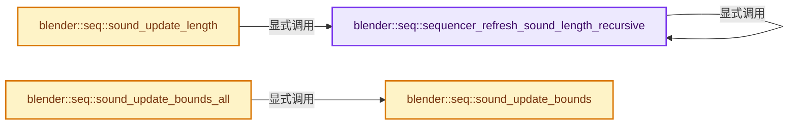
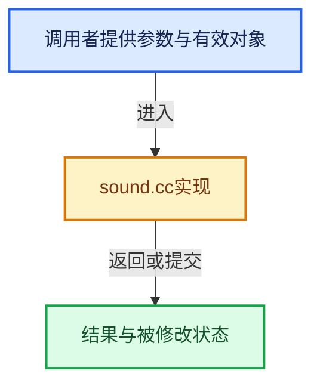

# 实现依赖专题：source/blender/sequencer/intern/sound.cc

[方向导航](README.md) · [符号索引](../%E7%AC%A6%E5%8F%B7%E4%BE%9D%E8%B5%96%E4%B8%8E%E5%AE%9E%E7%8E%B0%E7%B4%A2%E5%BC%95.md)

本专题从正文实际调用进入，集中保存共享实现。函数有稳定锚点，可从调用处直接跳到对应完整函数；递归与互相调用通过回链组织。

## 本文件的实现关系






## 完整成员与函数实现

<a id="f-72df51f4c8d4d5a5"></a>

### `blender::seq::sequencer_refresh_sound_length_recursive`

实现位置：[source/blender/sequencer/intern/sound.cc](../../../../../source/blender/sequencer/intern/sound.cc) · L56—L90。

接口参数：

- `Main *bmain`
- `Scene *scene`
- `ListBaseT<Strip> *seqbase`

**教学注释版**

<!-- annotated:74c658e588ecea -->

```cpp
static bool sequencer_refresh_sound_length_recursive(Main *bmain,
                                                     Scene *scene,
                                                     ListBaseT<Strip> *seqbase)
{
  bool changed = false;

  for (Strip &strip : *seqbase) {
    if (strip.type == STRIP_TYPE_META) {
      if (sequencer_refresh_sound_length_recursive(bmain, scene, &strip.seqbase)) {
        changed = true;
      }
    }
    else if (strip.type == STRIP_TYPE_SOUND && strip.sound) {
      SoundInfo info;
      if (!BKE_sound_info_get(bmain, strip.sound, &info)) {
        continue;
      }

      int old = strip.content_length();
      float fac;

      // [讲解] std::max：按比较关系选取较大值。本讲解中的增长公式同时满足最低请求和几何增长；若保存返回引用，还需注意实参寿命。
      strip.content_length_set(std::max(
          1, int(round((info.length - strip.sound->offset_time) * scene->frames_per_second()))));
      fac = float(strip.content_length()) / float(old);
      old = strip.startofs;
      strip.startofs *= fac;
      strip.endofs = strip.end_offset() * fac;
      strip.start += (old -
                      strip.startofs); /* So that visual/"real" start frame does not change! */

      changed = true;
    }
  }
  return changed;
}
```

<details>
<summary>核对原始源码：source/blender/sequencer/intern/sound.cc · L56—L90</summary>

<!-- original:74c658e588ecea:source/blender/sequencer/intern/sound.cc:56:90 -->

```cpp
static bool sequencer_refresh_sound_length_recursive(Main *bmain,
                                                     Scene *scene,
                                                     ListBaseT<Strip> *seqbase)
{
  bool changed = false;

  for (Strip &strip : *seqbase) {
    if (strip.type == STRIP_TYPE_META) {
      if (sequencer_refresh_sound_length_recursive(bmain, scene, &strip.seqbase)) {
        changed = true;
      }
    }
    else if (strip.type == STRIP_TYPE_SOUND && strip.sound) {
      SoundInfo info;
      if (!BKE_sound_info_get(bmain, strip.sound, &info)) {
        continue;
      }

      int old = strip.content_length();
      float fac;

      strip.content_length_set(std::max(
          1, int(round((info.length - strip.sound->offset_time) * scene->frames_per_second()))));
      fac = float(strip.content_length()) / float(old);
      old = strip.startofs;
      strip.startofs *= fac;
      strip.endofs = strip.end_offset() * fac;
      strip.start += (old -
                      strip.startofs); /* So that visual/"real" start frame does not change! */

      changed = true;
    }
  }
  return changed;
}
```

</details>

**沿实际写入检查状态**

- `changed = true;`
- `fac = float(strip.content_length()) / float(old);`
- `old = strip.startofs;`
- `strip.startofs *= fac;`
- `strip.endofs = strip.end_offset() * fac;`
- `strip.start += (old -`

**结果出口**

- `return changed;`

**继续追踪实现**

- `sequencer_refresh_sound_length_recursive` → [blender::seq::sequencer_refresh_sound_length_recursive · L56](%E4%BE%9D%E8%B5%96-sound-43e4bc.md#f-72df51f4c8d4d5a5)。
- `BKE_sound_info_get` → [blender::BKE_sound_info_get · L1556](%E4%BE%9D%E8%B5%96-sound-6c4717.md#f-2edf7e7a1c48000b)；[blender::BKE_sound_info_get · L2018](%E4%BE%9D%E8%B5%96-sound-6c4717.md#f-e8c0f994e91f7adc)。同名重载需按实参类型选择。
- `strip.content_length` → [调用协议](../%E6%A8%A1%E6%9D%BF%E5%AE%8F%E4%B8%8E%E5%8A%A8%E6%80%81%E5%88%86%E6%B4%BE%E5%8D%8F%E8%AE%AE.md)：接收对象类型依赖auto、返回值或模板实例；不按同名猜测目标。调用位置L74。
- `strip.content_length_set` → [调用协议](../%E6%A8%A1%E6%9D%BF%E5%AE%8F%E4%B8%8E%E5%8A%A8%E6%80%81%E5%88%86%E6%B4%BE%E5%8D%8F%E8%AE%AE.md)：接收对象类型依赖auto、返回值或模板实例；不按同名猜测目标。调用位置L77。
- `std::max` → [外部契约](https://eel.is/c++draft/alg.min.max)：按比较关系选取较大值。本讲解中的增长公式同时满足最低请求和几何增长；若保存返回引用，还需注意实参寿命。
- `round` → [round · L117](%E4%BE%9D%E8%B5%96-gpu_shader_cxx_builtin-8ae191.md#m-46b6cdaedd36)。宏定义由构建条件选择。
- `scene->frames_per_second` → [blender::Scene::frames_per_second · L1704](%E4%BE%9D%E8%B5%96-scene-94f43c.md#f-76be2374a615ddd5)。
- `strip.end_offset` → [调用协议](../%E6%A8%A1%E6%9D%BF%E5%AE%8F%E4%B8%8E%E5%8A%A8%E6%80%81%E5%88%86%E6%B4%BE%E5%8D%8F%E8%AE%AE.md)：接收对象类型依赖auto、返回值或模板实例；不按同名猜测目标。调用位置L82。

<a id="f-4fd4a71787223560"></a>

### `blender::seq::sound_update_length`

实现位置：[source/blender/sequencer/intern/sound.cc](../../../../../source/blender/sequencer/intern/sound.cc) · L93—L102。

接口参数：

- `Main *bmain`
- `Scene *scene`

**教学注释版**

<!-- annotated:8fb8ffff12fbe2 -->

```cpp
void sound_update_length(Main *bmain, Scene *scene)
{
#ifdef WITH_CONVOLUTION
  if (scene->ed) {
    sequencer_refresh_sound_length_recursive(bmain, scene, &scene->ed->seqbase);
  }
#else
  UNUSED_VARS(bmain, scene);
#endif
}
```

<details>
<summary>核对原始源码：source/blender/sequencer/intern/sound.cc · L93—L102</summary>

<!-- original:8fb8ffff12fbe2:source/blender/sequencer/intern/sound.cc:93:102 -->

```cpp
void sound_update_length(Main *bmain, Scene *scene)
{
#ifdef WITH_CONVOLUTION
  if (scene->ed) {
    sequencer_refresh_sound_length_recursive(bmain, scene, &scene->ed->seqbase);
  }
#else
  UNUSED_VARS(bmain, scene);
#endif
}
```

</details>

**继续追踪实现**

- `sequencer_refresh_sound_length_recursive` → [blender::seq::sequencer_refresh_sound_length_recursive · L56](%E4%BE%9D%E8%B5%96-sound-43e4bc.md#f-72df51f4c8d4d5a5)。
- `UNUSED_VARS` → [UNUSED_VARS · L522](../01-%E5%9F%BA%E7%A1%80%E5%AE%B9%E5%99%A8%E4%B8%8E%E7%8E%B0%E4%BB%A3CPP/%E4%BE%9D%E8%B5%96-BLI_utildefines-293a0a.md#m-013582537634)；[UNUSED_VARS · L41](%E4%BE%9D%E8%B5%96-GPU_shader_shared_utils-0adda3.md#m-05d9d7a33da0)；[UNUSED_VARS · L62](%E4%BE%9D%E8%B5%96-GPU_shader_shared_utils-0adda3.md#m-e12c683a4aca)。宏定义由构建条件选择。

<a id="f-66eaefe8f404ebfd"></a>

### `blender::seq::sound_update_bounds_all`

实现位置：[source/blender/sequencer/intern/sound.cc](../../../../../source/blender/sequencer/intern/sound.cc) · L104—L118。

接口参数：

- `Scene *scene`

**教学注释版**

<!-- annotated:651a2b377894f5 -->

```cpp
void sound_update_bounds_all(Scene *scene)
{
  Editing *ed = scene->ed;

  if (ed) {
    for (Strip &strip : ed->seqbase) {
      if (strip.type == STRIP_TYPE_META) {
        strip_update_sound_bounds_recursive(scene, &strip);
      }
      else if (ELEM(strip.type, STRIP_TYPE_SOUND, STRIP_TYPE_SCENE)) {
        sound_update_bounds(scene, &strip);
      }
    }
  }
}
```

<details>
<summary>核对原始源码：source/blender/sequencer/intern/sound.cc · L104—L118</summary>

<!-- original:651a2b377894f5:source/blender/sequencer/intern/sound.cc:104:118 -->

```cpp
void sound_update_bounds_all(Scene *scene)
{
  Editing *ed = scene->ed;

  if (ed) {
    for (Strip &strip : ed->seqbase) {
      if (strip.type == STRIP_TYPE_META) {
        strip_update_sound_bounds_recursive(scene, &strip);
      }
      else if (ELEM(strip.type, STRIP_TYPE_SOUND, STRIP_TYPE_SCENE)) {
        sound_update_bounds(scene, &strip);
      }
    }
  }
}
```

</details>

**继续追踪实现**

- `strip_update_sound_bounds_recursive` → [blender::seq::strip_update_sound_bounds_recursive · L138](%E4%BE%9D%E8%B5%96-strip_time-f49968.md#f-b313b2cfaede559f)。
- `ELEM` → [ELEM · L88](%E4%BE%9D%E8%B5%96-GHOST_utildefines-34b996.md#m-d28724a15928)；[ELEM · L135](../01-%E5%9F%BA%E7%A1%80%E5%AE%B9%E5%99%A8%E4%B8%8E%E7%8E%B0%E4%BB%A3CPP/%E4%BE%9D%E8%B5%96-BLI_utildefines-293a0a.md#m-d6572de7cae0)。宏定义由构建条件选择。
- `sound_update_bounds` → [blender::seq::sound_update_bounds · L120](%E4%BE%9D%E8%B5%96-sound-43e4bc.md#f-656dbcbbbc9555ed)。

<a id="f-656dbcbbbc9555ed"></a>

### `blender::seq::sound_update_bounds`

实现位置：[source/blender/sequencer/intern/sound.cc](../../../../../source/blender/sequencer/intern/sound.cc) · L120—L139。

接口参数：

- `Scene *scene`
- `Strip *strip`

**教学注释版**

<!-- annotated:37389229f0a4bc -->

```cpp
void sound_update_bounds(Scene *scene, Strip *strip)
{
  if (strip->type == STRIP_TYPE_SCENE) {
    if (strip->scene && strip->runtime->scene_sound) {
      /* We have to take into account start frame of the sequence's scene! */
      int startofs = strip->startofs + strip->anim_startofs + strip->scene->r.sfra;

      BKE_sound_move_scene_sound(scene,
                                 strip->runtime->scene_sound,
                                 strip->left_handle(),
                                 strip->right_handle(scene),
                                 startofs,
                                 0.0);
    }
  }
  else {
    BKE_sound_move_scene_sound_defaults(scene, strip);
  }
  /* mute is set in strip_update_muting_recursive */
}
```

<details>
<summary>核对原始源码：source/blender/sequencer/intern/sound.cc · L120—L139</summary>

<!-- original:37389229f0a4bc:source/blender/sequencer/intern/sound.cc:120:139 -->

```cpp
void sound_update_bounds(Scene *scene, Strip *strip)
{
  if (strip->type == STRIP_TYPE_SCENE) {
    if (strip->scene && strip->runtime->scene_sound) {
      /* We have to take into account start frame of the sequence's scene! */
      int startofs = strip->startofs + strip->anim_startofs + strip->scene->r.sfra;

      BKE_sound_move_scene_sound(scene,
                                 strip->runtime->scene_sound,
                                 strip->left_handle(),
                                 strip->right_handle(scene),
                                 startofs,
                                 0.0);
    }
  }
  else {
    BKE_sound_move_scene_sound_defaults(scene, strip);
  }
  /* mute is set in strip_update_muting_recursive */
}
```

</details>

**继续追踪实现**

- `BKE_sound_move_scene_sound` → [blender::BKE_sound_move_scene_sound · L981](%E4%BE%9D%E8%B5%96-sound-6c4717.md#f-2c3da1b7f0e980ca)；[blender::BKE_sound_move_scene_sound · L1954](%E4%BE%9D%E8%B5%96-sound-6c4717.md#f-1b8b0151e296e1b7)。同名重载需按实参类型选择。
- `strip->left_handle` → [blender::Strip::left_handle · L554](%E4%BE%9D%E8%B5%96-strip_time-f49968.md#f-3da05f695eaa2192)。
- `strip->right_handle` → [blender::Strip::right_handle · L563](%E4%BE%9D%E8%B5%96-strip_time-f49968.md#f-f083f08cb610fc60)。
- `BKE_sound_move_scene_sound_defaults` → [blender::BKE_sound_move_scene_sound_defaults · L999](%E4%BE%9D%E8%B5%96-sound-6c4717.md#f-625470382b3c2cf7)；[blender::BKE_sound_move_scene_sound_defaults · L1962](%E4%BE%9D%E8%B5%96-sound-6c4717.md#f-a85457ef00e6de96)。同名重载需按实参类型选择。
