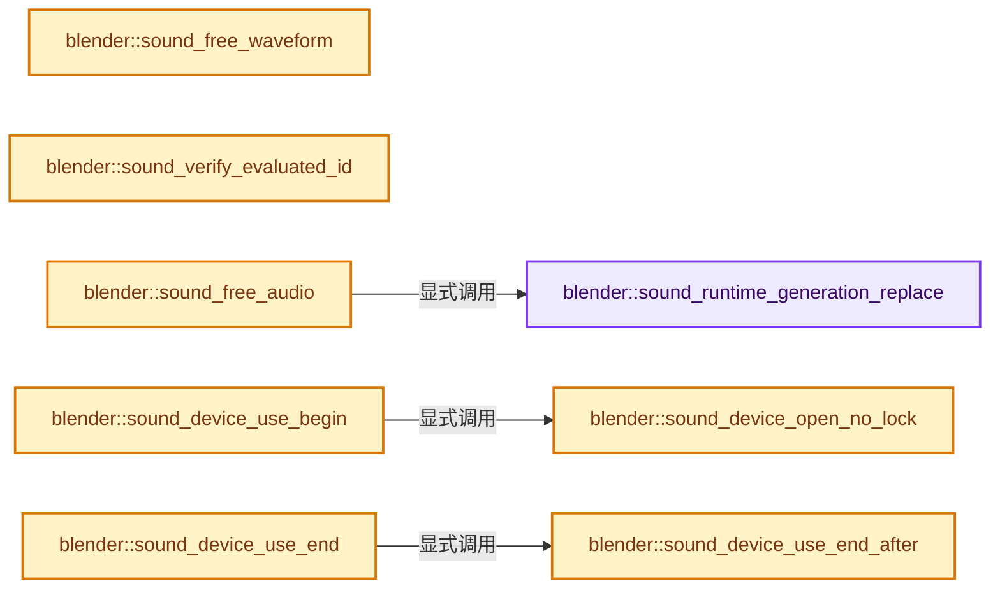
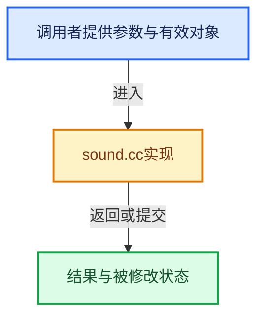

# 实现依赖专题：source/blender/blenkernel/intern/sound.cc

[方向导航](README.md) · [符号索引](../%E7%AC%A6%E5%8F%B7%E4%BE%9D%E8%B5%96%E4%B8%8E%E5%AE%9E%E7%8E%B0%E7%B4%A2%E5%BC%95.md)

本专题从正文实际调用进入，集中保存共享实现。函数有稳定锚点，可从调用处直接跳到对应完整函数；递归与互相调用通过回链组织。

## 本文件的实现关系






## 完整成员与函数实现

<a id="f-22623163e6e2badb"></a>

### `blender::sound_runtime_generation_replace`

实现位置：[source/blender/blenkernel/intern/sound.cc](../../../../../source/blender/blenkernel/intern/sound.cc) · L165—L175。

接口参数：

- `bSound *sound`
- `std::shared_ptr<bke::SoundRuntimeGeneration> generation`

**教学注释版**

<!-- annotated:757596bc271ba0 -->

```cpp
static void sound_runtime_generation_replace(
    bSound *sound, std::shared_ptr<bke::SoundRuntimeGeneration> generation)
{
  bke::SoundRuntime *runtime = sound->runtime;
  std::shared_ptr<bke::SoundRuntimeGeneration> old_generation;
  {
    std::lock_guard lock{runtime->generation_mutex};
    // [讲解] std::move：把表达式转换成可供移动重载选择的值类别；不保证真的移动，不结束源对象寿命，对const值可能选择复制。
    old_generation = std::move(runtime->generation);
    runtime->generation = std::move(generation);
  }
}
```

<details>
<summary>核对原始源码：source/blender/blenkernel/intern/sound.cc · L165—L175</summary>

<!-- original:757596bc271ba0:source/blender/blenkernel/intern/sound.cc:165:175 -->

```cpp
static void sound_runtime_generation_replace(
    bSound *sound, std::shared_ptr<bke::SoundRuntimeGeneration> generation)
{
  bke::SoundRuntime *runtime = sound->runtime;
  std::shared_ptr<bke::SoundRuntimeGeneration> old_generation;
  {
    std::lock_guard lock{runtime->generation_mutex};
    old_generation = std::move(runtime->generation);
    runtime->generation = std::move(generation);
  }
}
```

</details>

**沿实际写入检查状态**

- `old_generation = std::move(runtime->generation);`
- `runtime->generation = std::move(generation);`

**继续追踪实现**

- `std::move` → [外部契约](https://eel.is/c++draft/utility.forward)：把表达式转换成可供移动重载选择的值类别；不保证真的移动，不结束源对象寿命，对const值可能选择复制。

<a id="f-3792ab948169ac5c"></a>

### `blender::sound_free_waveform`

实现位置：[source/blender/blenkernel/intern/sound.cc](../../../../../source/blender/blenkernel/intern/sound.cc) · L186—L194。

接口参数：

- `bSound *sound`

**教学注释版**

<!-- annotated:53f28c9dbc71c0 -->

```cpp
static void sound_free_waveform(bSound *sound)
{
  bke::SoundRuntime *runtime = sound->runtime;
  if (!flag_is_set(runtime->tags, bke::SoundTags::WaveformNoReload)) {
    MEM_SAFE_DELETE(runtime->waveform);
  }
  /* This tag is only valid once. */
  runtime->tags &= ~bke::SoundTags::WaveformNoReload;
}
```

<details>
<summary>核对原始源码：source/blender/blenkernel/intern/sound.cc · L186—L194</summary>

<!-- original:53f28c9dbc71c0:source/blender/blenkernel/intern/sound.cc:186:194 -->

```cpp
static void sound_free_waveform(bSound *sound)
{
  bke::SoundRuntime *runtime = sound->runtime;
  if (!flag_is_set(runtime->tags, bke::SoundTags::WaveformNoReload)) {
    MEM_SAFE_DELETE(runtime->waveform);
  }
  /* This tag is only valid once. */
  runtime->tags &= ~bke::SoundTags::WaveformNoReload;
}
```

</details>

**沿实际写入检查状态**

- `runtime->tags &= ~bke::SoundTags::WaveformNoReload;`

**继续追踪实现**

- `flag_is_set` → [调用协议](../%E6%A8%A1%E6%9D%BF%E5%AE%8F%E4%B8%8E%E5%8A%A8%E6%80%81%E5%88%86%E6%B4%BE%E5%8D%8F%E8%AE%AE.md)：函数指针、局部可调用对象或未展开的宏；必须结合调用者环境。调用位置L189。
- `MEM_SAFE_DELETE` → [MEM_SAFE_DELETE · L436](../03-%E5%86%85%E5%AD%98%E5%88%86%E9%85%8D%E4%B8%8E%E8%BF%90%E8%A1%8C%E6%97%B6%E7%B1%BB%E5%9E%8B/%E4%BE%9D%E8%B5%96-MEM_guardedalloc-b54eca.md#m-eadb3bc5b902)。宏定义由构建条件选择。

<a id="f-c69b466db2887215"></a>

### `blender::sound_verify_evaluated_id`

实现位置：[source/blender/blenkernel/intern/sound.cc](../../../../../source/blender/blenkernel/intern/sound.cc) · L323—L340。

接口参数：

- `const ID *id`

**教学注释版**

<!-- annotated:e74d0a0af5e802 -->

```cpp
BLI_INLINE void sound_verify_evaluated_id(const ID *id)
{
  UNUSED_VARS_NDEBUG(id);
  /* This is a bit tricky and not quite reliable, but good enough check.
   *
   * We don't want audio system handles to be allocated on an original data-blocks, and only want
   * them to be allocated on a data-blocks which are result of dependency graph evaluation.
   *
   * Data-blocks which are covered by a copy-on-evaluation system of dependency graph will have
   * ID_TAG_COPIED_ON_EVAL tag set on them.
   *
   * Additionally, we also allow data-blocks outside of main database. Those can not be "original"
   * and could be used as a temporary evaluated result during operations like baking.
   *
   * NOTE: We consider ID evaluated if ANY of those flags is set. We do NOT require ALL of them.
   */
  BLI_assert(id->tag & (ID_TAG_COPIED_ON_EVAL | ID_TAG_NO_MAIN));
}
```

<details>
<summary>核对原始源码：source/blender/blenkernel/intern/sound.cc · L323—L340</summary>

<!-- original:e74d0a0af5e802:source/blender/blenkernel/intern/sound.cc:323:340 -->

```cpp
BLI_INLINE void sound_verify_evaluated_id(const ID *id)
{
  UNUSED_VARS_NDEBUG(id);
  /* This is a bit tricky and not quite reliable, but good enough check.
   *
   * We don't want audio system handles to be allocated on an original data-blocks, and only want
   * them to be allocated on a data-blocks which are result of dependency graph evaluation.
   *
   * Data-blocks which are covered by a copy-on-evaluation system of dependency graph will have
   * ID_TAG_COPIED_ON_EVAL tag set on them.
   *
   * Additionally, we also allow data-blocks outside of main database. Those can not be "original"
   * and could be used as a temporary evaluated result during operations like baking.
   *
   * NOTE: We consider ID evaluated if ANY of those flags is set. We do NOT require ALL of them.
   */
  BLI_assert(id->tag & (ID_TAG_COPIED_ON_EVAL | ID_TAG_NO_MAIN));
}
```

</details>

**继续追踪实现**

- `UNUSED_VARS_NDEBUG` → [UNUSED_VARS_NDEBUG · L526](../01-%E5%9F%BA%E7%A1%80%E5%AE%B9%E5%99%A8%E4%B8%8E%E7%8E%B0%E4%BB%A3CPP/%E4%BE%9D%E8%B5%96-BLI_utildefines-293a0a.md#m-fea439f7d366)；[UNUSED_VARS_NDEBUG · L528](../01-%E5%9F%BA%E7%A1%80%E5%AE%B9%E5%99%A8%E4%B8%8E%E7%8E%B0%E4%BB%A3CPP/%E4%BE%9D%E8%B5%96-BLI_utildefines-293a0a.md#m-a8f8cfac06c0)。宏定义由构建条件选择。
- `BLI_assert` → [BLI_assert · L48](../01-%E5%9F%BA%E7%A1%80%E5%AE%B9%E5%99%A8%E4%B8%8E%E7%8E%B0%E4%BB%A3CPP/%E4%BE%9D%E8%B5%96-BLI_assert-cc98e8.md#m-57a88495704d)；[BLI_assert · L63](../01-%E5%9F%BA%E7%A1%80%E5%AE%B9%E5%99%A8%E4%B8%8E%E7%8E%B0%E4%BB%A3CPP/%E4%BE%9D%E8%B5%96-BLI_assert-cc98e8.md#m-d07050020cb5)。宏定义由构建条件选择。

<a id="f-42a79b982ece51c5"></a>

### `blender::sound_free_audio`

实现位置：[source/blender/blenkernel/intern/sound.cc](../../../../../source/blender/blenkernel/intern/sound.cc) · L397—L408。

接口参数：

- `bSound *sound`

**教学注释版**

<!-- annotated:35fdf1ca526755 -->

```cpp
static void sound_free_audio(bSound *sound)
{
#ifdef WITH_AUDASPACE
  bke::SoundRuntime *runtime = sound->runtime;
  sound_runtime_generation_replace(sound, nullptr);
  runtime->handle.reset();
  runtime->playback_handle.reset();
  runtime->cache.reset();
#else
  UNUSED_VARS(sound);
#endif /* WITH_AUDASPACE */
}
```

<details>
<summary>核对原始源码：source/blender/blenkernel/intern/sound.cc · L397—L408</summary>

<!-- original:35fdf1ca526755:source/blender/blenkernel/intern/sound.cc:397:408 -->

```cpp
static void sound_free_audio(bSound *sound)
{
#ifdef WITH_AUDASPACE
  bke::SoundRuntime *runtime = sound->runtime;
  sound_runtime_generation_replace(sound, nullptr);
  runtime->handle.reset();
  runtime->playback_handle.reset();
  runtime->cache.reset();
#else
  UNUSED_VARS(sound);
#endif /* WITH_AUDASPACE */
}
```

</details>

**继续追踪实现**

- `sound_runtime_generation_replace` → [blender::sound_runtime_generation_replace · L165](%E4%BE%9D%E8%B5%96-sound-6c4717.md#f-22623163e6e2badb)。
- `runtime->handle.reset` → [调用协议](../%E6%A8%A1%E6%9D%BF%E5%AE%8F%E4%B8%8E%E5%8A%A8%E6%80%81%E5%88%86%E6%B4%BE%E5%8D%8F%E8%AE%AE.md)：接收对象类型依赖auto、返回值或模板实例；不按同名猜测目标。调用位置L402。
- `runtime->playback_handle.reset` → [调用协议](../%E6%A8%A1%E6%9D%BF%E5%AE%8F%E4%B8%8E%E5%8A%A8%E6%80%81%E5%88%86%E6%B4%BE%E5%8D%8F%E8%AE%AE.md)：接收对象类型依赖auto、返回值或模板实例；不按同名猜测目标。调用位置L403。
- `runtime->cache.reset` → [调用协议](../%E6%A8%A1%E6%9D%BF%E5%AE%8F%E4%B8%8E%E5%8A%A8%E6%80%81%E5%88%86%E6%B4%BE%E5%8D%8F%E8%AE%AE.md)：接收对象类型依赖auto、返回值或模板实例；不按同名猜测目标。调用位置L404。
- `UNUSED_VARS` → [UNUSED_VARS · L522](../01-%E5%9F%BA%E7%A1%80%E5%AE%B9%E5%99%A8%E4%B8%8E%E7%8E%B0%E4%BB%A3CPP/%E4%BE%9D%E8%B5%96-BLI_utildefines-293a0a.md#m-013582537634)；[UNUSED_VARS · L41](%E4%BE%9D%E8%B5%96-GPU_shader_shared_utils-0adda3.md#m-05d9d7a33da0)；[UNUSED_VARS · L62](%E4%BE%9D%E8%B5%96-GPU_shader_shared_utils-0adda3.md#m-e12c683a4aca)。宏定义由构建条件选择。

<a id="f-7a59db90a7062f64"></a>

### `blender::sound_device_open_no_lock`

实现位置：[source/blender/blenkernel/intern/sound.cc](../../../../../source/blender/blenkernel/intern/sound.cc) · L473—L487。

接口参数：

- `const aud::DeviceSpecs &requested_specs`

**教学注释版**

<!-- annotated:d1d520a5019c70 -->

```cpp
static void sound_device_open_no_lock(const aud::DeviceSpecs &requested_specs)
{
  BLI_assert(!g_state.sound_device);

  CLOG_DEBUG(&LOG, "Opening audio device name:%s", g_state.device_name);

  g_state.sound_device = bke::sound_device_init(
      g_state.device_name, requested_specs, g_state.buffer_size, "Blender");
  if (!g_state.sound_device) {
    g_state.sound_device = bke::sound_device_init(
        "None", requested_specs, g_state.buffer_size, "Blender");
  }

  g_state.initialized_specs = g_state.sound_device->getSpecs();
}
```

<details>
<summary>核对原始源码：source/blender/blenkernel/intern/sound.cc · L473—L487</summary>

<!-- original:d1d520a5019c70:source/blender/blenkernel/intern/sound.cc:473:487 -->

```cpp
static void sound_device_open_no_lock(const aud::DeviceSpecs &requested_specs)
{
  BLI_assert(!g_state.sound_device);

  CLOG_DEBUG(&LOG, "Opening audio device name:%s", g_state.device_name);

  g_state.sound_device = bke::sound_device_init(
      g_state.device_name, requested_specs, g_state.buffer_size, "Blender");
  if (!g_state.sound_device) {
    g_state.sound_device = bke::sound_device_init(
        "None", requested_specs, g_state.buffer_size, "Blender");
  }

  g_state.initialized_specs = g_state.sound_device->getSpecs();
}
```

</details>

**沿实际写入检查状态**

- `g_state.sound_device = bke::sound_device_init(`
- `g_state.initialized_specs = g_state.sound_device->getSpecs();`

**继续追踪实现**

- `BLI_assert` → [BLI_assert · L48](../01-%E5%9F%BA%E7%A1%80%E5%AE%B9%E5%99%A8%E4%B8%8E%E7%8E%B0%E4%BB%A3CPP/%E4%BE%9D%E8%B5%96-BLI_assert-cc98e8.md#m-57a88495704d)；[BLI_assert · L63](../01-%E5%9F%BA%E7%A1%80%E5%AE%B9%E5%99%A8%E4%B8%8E%E7%8E%B0%E4%BB%A3CPP/%E4%BE%9D%E8%B5%96-BLI_assert-cc98e8.md#m-d07050020cb5)。宏定义由构建条件选择。
- `CLOG_DEBUG` → [CLOG_DEBUG · L191](%E4%BE%9D%E8%B5%96-CLG_log-e9051b.md#m-e062f5f17675)。宏定义由构建条件选择。
- `bke::sound_device_init` → [blender::bke::sound_device_init · L1700](%E4%BE%9D%E8%B5%96-sound-6c4717.md#f-96b8e3e8c5c45fb7)。
- `g_state.sound_device->getSpecs` → [调用协议](../%E6%A8%A1%E6%9D%BF%E5%AE%8F%E4%B8%8E%E5%8A%A8%E6%80%81%E5%88%86%E6%B4%BE%E5%8D%8F%E8%AE%AE.md)：接收对象类型依赖auto、返回值或模板实例；不按同名猜测目标。调用位置L486。

<a id="f-9fcb621bb7c5314a"></a>

### `blender::sound_device_use_begin`

实现位置：[source/blender/blenkernel/intern/sound.cc](../../../../../source/blender/blenkernel/intern/sound.cc) · L489—L498。

**教学注释版**

<!-- annotated:b4cbbe1e471346 -->

```cpp
static void sound_device_use_begin()
{
  ++g_state.num_device_users;

  if (g_state.sound_device) {
    return;
  }

  sound_device_open_no_lock(g_state.initialized_specs);
}
```

<details>
<summary>核对原始源码：source/blender/blenkernel/intern/sound.cc · L489—L498</summary>

<!-- original:b4cbbe1e471346:source/blender/blenkernel/intern/sound.cc:489:498 -->

```cpp
static void sound_device_use_begin()
{
  ++g_state.num_device_users;

  if (g_state.sound_device) {
    return;
  }

  sound_device_open_no_lock(g_state.initialized_specs);
}
```

</details>

**继续追踪实现**

- `sound_device_open_no_lock` → [blender::sound_device_open_no_lock · L473](%E4%BE%9D%E8%B5%96-sound-6c4717.md#f-7a59db90a7062f64)。

<a id="f-2e7bbe43c28dc587"></a>

### `blender::sound_device_use_end_after`

实现位置：[source/blender/blenkernel/intern/sound.cc](../../../../../source/blender/blenkernel/intern/sound.cc) · L500—L512。

接口参数：

- `const std::chrono::milliseconds after_ms`

**教学注释版**

<!-- annotated:c9d1df97ce57e2 -->

```cpp
static void sound_device_use_end_after(const std::chrono::milliseconds after_ms)
{
  BLI_assert(g_state.num_device_users > 0);
  if (g_state.num_device_users == 0) {
    return;
  }

  --g_state.num_device_users;
  if (g_state.num_device_users == 0) {
    g_state.last_user_disconnect_time_point = std::chrono::steady_clock::now() + after_ms;
    g_state.delayed_close_cv.notify_one();
  }
}
```

<details>
<summary>核对原始源码：source/blender/blenkernel/intern/sound.cc · L500—L512</summary>

<!-- original:c9d1df97ce57e2:source/blender/blenkernel/intern/sound.cc:500:512 -->

```cpp
static void sound_device_use_end_after(const std::chrono::milliseconds after_ms)
{
  BLI_assert(g_state.num_device_users > 0);
  if (g_state.num_device_users == 0) {
    return;
  }

  --g_state.num_device_users;
  if (g_state.num_device_users == 0) {
    g_state.last_user_disconnect_time_point = std::chrono::steady_clock::now() + after_ms;
    g_state.delayed_close_cv.notify_one();
  }
}
```

</details>

**沿实际写入检查状态**

- `g_state.last_user_disconnect_time_point = std::chrono::steady_clock::now() + after_ms;`

**继续追踪实现**

- `BLI_assert` → [BLI_assert · L48](../01-%E5%9F%BA%E7%A1%80%E5%AE%B9%E5%99%A8%E4%B8%8E%E7%8E%B0%E4%BB%A3CPP/%E4%BE%9D%E8%B5%96-BLI_assert-cc98e8.md#m-57a88495704d)；[BLI_assert · L63](../01-%E5%9F%BA%E7%A1%80%E5%AE%B9%E5%99%A8%E4%B8%8E%E7%8E%B0%E4%BB%A3CPP/%E4%BE%9D%E8%B5%96-BLI_assert-cc98e8.md#m-d07050020cb5)。宏定义由构建条件选择。
- `std::chrono::steady_clock::now` → [外部契约](https://eel.is/c++draft/)：这个边界按实际表达式及所属类型核对参数、返回值、寿命与失败行为。这里提供接口入口，不声称已解释该第三方版本的内部实现。
- `g_state.delayed_close_cv.notify_one` → [调用协议](../%E6%A8%A1%E6%9D%BF%E5%AE%8F%E4%B8%8E%E5%8A%A8%E6%80%81%E5%88%86%E6%B4%BE%E5%8D%8F%E8%AE%AE.md)：接收对象类型依赖auto、返回值或模板实例；不按同名猜测目标。调用位置L510。

<a id="f-371de89581f4f19f"></a>

### `blender::sound_device_use_end`

实现位置：[source/blender/blenkernel/intern/sound.cc](../../../../../source/blender/blenkernel/intern/sound.cc) · L514—L517。

**教学注释版**

<!-- annotated:f9b6259ceb57d8 -->

```cpp
static void sound_device_use_end()
{
  sound_device_use_end_after(std::chrono::milliseconds(0));
}
```

<details>
<summary>核对原始源码：source/blender/blenkernel/intern/sound.cc · L514—L517</summary>

<!-- original:f9b6259ceb57d8:source/blender/blenkernel/intern/sound.cc:514:517 -->

```cpp
static void sound_device_use_end()
{
  sound_device_use_end_after(std::chrono::milliseconds(0));
}
```

</details>

**继续追踪实现**

- `sound_device_use_end_after` → [blender::sound_device_use_end_after · L500](%E4%BE%9D%E8%B5%96-sound-6c4717.md#f-2e7bbe43c28dc587)。
- `std::chrono::milliseconds` → [外部契约](https://eel.is/c++draft/)：这个边界按实际表达式及所属类型核对参数、返回值、寿命与失败行为。这里提供接口入口，不声称已解释该第三方版本的内部实现。

<a id="f-26b7935c33b8b623"></a>

### `blender::BKE_sound_refresh_callback_bmain`

实现位置：[source/blender/blenkernel/intern/sound.cc](../../../../../source/blender/blenkernel/intern/sound.cc) · L717—L723。

接口参数：

- `Main *bmain`

**教学注释版**

<!-- annotated:a4d69dbdfb952f -->

```cpp
void BKE_sound_refresh_callback_bmain(Main *bmain)
{
  std::lock_guard lock(g_state.sound_device_mutex);
  if (g_state.sound_device) {
    aud::DeviceManager::getDevice()->setSyncCallback(sound_sync_callback, bmain);
  }
}
```

<details>
<summary>核对原始源码：source/blender/blenkernel/intern/sound.cc · L717—L723</summary>

<!-- original:a4d69dbdfb952f:source/blender/blenkernel/intern/sound.cc:717:723 -->

```cpp
void BKE_sound_refresh_callback_bmain(Main *bmain)
{
  std::lock_guard lock(g_state.sound_device_mutex);
  if (g_state.sound_device) {
    aud::DeviceManager::getDevice()->setSyncCallback(sound_sync_callback, bmain);
  }
}
```

</details>

**继续追踪实现**

- `aud::DeviceManager::getDevice()->setSyncCallback` → [调用协议](../%E6%A8%A1%E6%9D%BF%E5%AE%8F%E4%B8%8E%E5%8A%A8%E6%80%81%E5%88%86%E6%B4%BE%E5%8D%8F%E8%AE%AE.md)：接收对象类型依赖auto、返回值或模板实例；不按同名猜测目标。调用位置L721。
- `aud::DeviceManager::getDevice` → [调用协议](../%E6%A8%A1%E6%9D%BF%E5%AE%8F%E4%B8%8E%E5%8A%A8%E6%80%81%E5%88%86%E6%B4%BE%E5%8D%8F%E8%AE%AE.md)：函数指针、局部可调用对象或未展开的宏；必须结合调用者环境。调用位置L721。

<a id="f-2f82b348a8385ea9"></a>

### `blender::sound_load_audio`

实现位置：[source/blender/blenkernel/intern/sound.cc](../../../../../source/blender/blenkernel/intern/sound.cc) · L725—L783。

接口参数：

- `Main *bmain`
- `bSound *sound`
- `bool free_waveform`

**教学注释版**

<!-- annotated:0d2802d9217f1c -->

```cpp
static void sound_load_audio(Main *bmain, bSound *sound, bool free_waveform)
{
  bke::SoundRuntime *runtime = sound->runtime;
  sound_runtime_generation_replace(sound, nullptr);
  runtime->cache.reset();
  runtime->handle.reset();
  runtime->playback_handle.reset();
  if (free_waveform) {
    sound_free_waveform(sound);
  }

  {
    char fullpath[FILE_MAX];

    /* load sound */
    PackedFile *pf = sound->packedfile;

    /* Don't modify `sound->filepath`, only change a copy. */
    STRNCPY(fullpath, sound->filepath);
    BLI_path_abs(fullpath, ID_BLEND_PATH(bmain, &sound->id));

    /* but we need a packed file then */
    if (pf) {
      runtime->handle = AUD_Sound(new aud::File((uchar *)pf->data, pf->size, sound->stream_index));
    }
    else {
      /* or else load it from disk */
      runtime->handle = AUD_Sound(new aud::File(fullpath, sound->stream_index));
    }
  }
  if (sound->flags & SOUND_FLAGS_MONO) {
    aud::DeviceSpecs specs;
    specs.channels = aud::CHANNELS_MONO;
    specs.rate = aud::RATE_INVALID;
    specs.format = aud::FORMAT_INVALID;
    runtime->handle = AUD_Sound(new aud::ChannelMapper(runtime->handle, specs));
  }

  if (sound->flags & SOUND_FLAGS_CACHING) {
    try {
      runtime->cache = AUD_Sound(new aud::StreamBuffer(runtime->handle));
    }
    catch (aud::Exception &ex) {
      (void)ex;
    }
  }

  if (runtime->cache) {
    runtime->playback_handle = runtime->cache;
  }
  else {
    runtime->playback_handle = runtime->handle;
  }

  // [讲解] std::make_shared<bke::SoundRuntimeGeneration>：构造由共享控制块管理的对象；共享寿命不自动使被指对象读写线程安全，强引用环需单独处理。
  auto generation = std::make_shared<bke::SoundRuntimeGeneration>();
  generation->handle = runtime->handle;
  generation->reader_cache = std::make_shared<bke::SoundReaderCache>(generation->handle);
  // [讲解] std::move：把表达式转换成可供移动重载选择的值类别；不保证真的移动，不结束源对象寿命，对const值可能选择复制。
  sound_runtime_generation_replace(sound, std::move(generation));
}
```

<details>
<summary>核对原始源码：source/blender/blenkernel/intern/sound.cc · L725—L783</summary>

<!-- original:0d2802d9217f1c:source/blender/blenkernel/intern/sound.cc:725:783 -->

```cpp
static void sound_load_audio(Main *bmain, bSound *sound, bool free_waveform)
{
  bke::SoundRuntime *runtime = sound->runtime;
  sound_runtime_generation_replace(sound, nullptr);
  runtime->cache.reset();
  runtime->handle.reset();
  runtime->playback_handle.reset();
  if (free_waveform) {
    sound_free_waveform(sound);
  }

  {
    char fullpath[FILE_MAX];

    /* load sound */
    PackedFile *pf = sound->packedfile;

    /* Don't modify `sound->filepath`, only change a copy. */
    STRNCPY(fullpath, sound->filepath);
    BLI_path_abs(fullpath, ID_BLEND_PATH(bmain, &sound->id));

    /* but we need a packed file then */
    if (pf) {
      runtime->handle = AUD_Sound(new aud::File((uchar *)pf->data, pf->size, sound->stream_index));
    }
    else {
      /* or else load it from disk */
      runtime->handle = AUD_Sound(new aud::File(fullpath, sound->stream_index));
    }
  }
  if (sound->flags & SOUND_FLAGS_MONO) {
    aud::DeviceSpecs specs;
    specs.channels = aud::CHANNELS_MONO;
    specs.rate = aud::RATE_INVALID;
    specs.format = aud::FORMAT_INVALID;
    runtime->handle = AUD_Sound(new aud::ChannelMapper(runtime->handle, specs));
  }

  if (sound->flags & SOUND_FLAGS_CACHING) {
    try {
      runtime->cache = AUD_Sound(new aud::StreamBuffer(runtime->handle));
    }
    catch (aud::Exception &ex) {
      (void)ex;
    }
  }

  if (runtime->cache) {
    runtime->playback_handle = runtime->cache;
  }
  else {
    runtime->playback_handle = runtime->handle;
  }

  auto generation = std::make_shared<bke::SoundRuntimeGeneration>();
  generation->handle = runtime->handle;
  generation->reader_cache = std::make_shared<bke::SoundReaderCache>(generation->handle);
  sound_runtime_generation_replace(sound, std::move(generation));
}
```

</details>

**沿实际写入检查状态**

- `runtime->handle = AUD_Sound(new aud::File((uchar *)pf->data, pf->size, sound->stream_index));`
- `runtime->handle = AUD_Sound(new aud::File(fullpath, sound->stream_index));`
- `specs.channels = aud::CHANNELS_MONO;`
- `specs.rate = aud::RATE_INVALID;`
- `specs.format = aud::FORMAT_INVALID;`
- `runtime->handle = AUD_Sound(new aud::ChannelMapper(runtime->handle, specs));`
- `runtime->cache = AUD_Sound(new aud::StreamBuffer(runtime->handle));`
- `runtime->playback_handle = runtime->cache;`
- `runtime->playback_handle = runtime->handle;`
- `generation->handle = runtime->handle;`
- `generation->reader_cache = std::make_shared<bke::SoundReaderCache>(generation->handle);`

**继续追踪实现**

- `sound_runtime_generation_replace` → [blender::sound_runtime_generation_replace · L165](%E4%BE%9D%E8%B5%96-sound-6c4717.md#f-22623163e6e2badb)。
- `runtime->cache.reset` → [调用协议](../%E6%A8%A1%E6%9D%BF%E5%AE%8F%E4%B8%8E%E5%8A%A8%E6%80%81%E5%88%86%E6%B4%BE%E5%8D%8F%E8%AE%AE.md)：接收对象类型依赖auto、返回值或模板实例；不按同名猜测目标。调用位置L729。
- `runtime->handle.reset` → [调用协议](../%E6%A8%A1%E6%9D%BF%E5%AE%8F%E4%B8%8E%E5%8A%A8%E6%80%81%E5%88%86%E6%B4%BE%E5%8D%8F%E8%AE%AE.md)：接收对象类型依赖auto、返回值或模板实例；不按同名猜测目标。调用位置L730。
- `runtime->playback_handle.reset` → [调用协议](../%E6%A8%A1%E6%9D%BF%E5%AE%8F%E4%B8%8E%E5%8A%A8%E6%80%81%E5%88%86%E6%B4%BE%E5%8D%8F%E8%AE%AE.md)：接收对象类型依赖auto、返回值或模板实例；不按同名猜测目标。调用位置L731。
- `sound_free_waveform` → [blender::sound_free_waveform · L186](%E4%BE%9D%E8%B5%96-sound-6c4717.md#f-3792ab948169ac5c)。
- `STRNCPY` → [blender::STRNCPY · L690](../01-%E5%9F%BA%E7%A1%80%E5%AE%B9%E5%99%A8%E4%B8%8E%E7%8E%B0%E4%BB%A3CPP/%E4%BE%9D%E8%B5%96-BLI_string-b43058.md#f-6b2d861724026be6)。
- `BLI_path_abs` → [BLI_path_abs · L1164](../01-%E5%9F%BA%E7%A1%80%E5%AE%B9%E5%99%A8%E4%B8%8E%E7%8E%B0%E4%BB%A3CPP/%E4%BE%9D%E8%B5%96-path_utils-b4d26a.md#f-002380948c1caeb6)。
- `ID_BLEND_PATH` → [ID_BLEND_PATH · L688](%E4%BE%9D%E8%B5%96-DNA_ID-3eb091.md#m-c69d4e48d3fd)。宏定义由构建条件选择。
- `AUD_Sound` → [调用协议](../%E6%A8%A1%E6%9D%BF%E5%AE%8F%E4%B8%8E%E5%8A%A8%E6%80%81%E5%88%86%E6%B4%BE%E5%8D%8F%E8%AE%AE.md)：函数指针、局部可调用对象或未展开的宏；必须结合调用者环境。调用位置L748。
- `std::make_shared<bke::SoundRuntimeGeneration>` → [外部契约](https://eel.is/c++draft/util.smartptr.shared.create)：构造由共享控制块管理的对象；共享寿命不自动使被指对象读写线程安全，强引用环需单独处理。
- `std::make_shared<bke::SoundReaderCache>` → [外部契约](https://eel.is/c++draft/util.smartptr.shared.create)：构造由共享控制块管理的对象；共享寿命不自动使被指对象读写线程安全，强引用环需单独处理。
- `std::move` → [外部契约](https://eel.is/c++draft/utility.forward)：把表达式转换成可供移动重载选择的值类别；不保证真的移动，不结束源对象寿命，对const值可能选择复制。

<a id="f-3a68a32f1734476f"></a>

### `blender::BKE_sound_load`

实现位置：[source/blender/blenkernel/intern/sound.cc](../../../../../source/blender/blenkernel/intern/sound.cc) · L785—L789。

接口参数：

- `Main *bmain`
- `bSound *sound`

**教学注释版**

<!-- annotated:0b85db14639dca -->

```cpp
void BKE_sound_load(Main *bmain, bSound *sound)
{
  sound_verify_evaluated_id(&sound->id);
  sound_load_audio(bmain, sound, true);
}
```

<details>
<summary>核对原始源码：source/blender/blenkernel/intern/sound.cc · L785—L789</summary>

<!-- original:0b85db14639dca:source/blender/blenkernel/intern/sound.cc:785:789 -->

```cpp
void BKE_sound_load(Main *bmain, bSound *sound)
{
  sound_verify_evaluated_id(&sound->id);
  sound_load_audio(bmain, sound, true);
}
```

</details>

**继续追踪实现**

- `sound_verify_evaluated_id` → [blender::sound_verify_evaluated_id · L323](%E4%BE%9D%E8%B5%96-sound-6c4717.md#f-c69b466db2887215)。
- `sound_load_audio` → [blender::sound_load_audio · L725](%E4%BE%9D%E8%B5%96-sound-6c4717.md#f-2f82b348a8385ea9)。

<a id="f-80c27c307e6ca7c5"></a>

### `blender::BKE_sound_create_scene`

实现位置：[source/blender/blenkernel/intern/sound.cc](../../../../../source/blender/blenkernel/intern/sound.cc) · L832—L854。

接口参数：

- `Scene *scene`

**教学注释版**

<!-- annotated:38858292ce2a28 -->

```cpp
void BKE_sound_create_scene(Scene *scene)
{
  sound_verify_evaluated_id(&scene->id);

  /* should be done in version patch, but this gets called before */
  if (scene->r.frs_sec_base == 0) {
    scene->r.frs_sec_base = 1;
  }

  bke::SceneAudioRuntime &audio = scene->runtime->audio;

  aud::Specs specs;
  specs.channels = aud::CHANNELS_STEREO;
  specs.rate = aud::RATE_48000;
  // [讲解] std::make_shared<aud::Sequence>：构造由共享控制块管理的对象；共享寿命不自动使被指对象读写线程安全，强引用环需单独处理。
  audio.sound_scene = std::make_shared<aud::Sequence>(
      specs, scene->frames_per_second(), scene->audio.flag & AUDIO_MUTE);
  audio.sound_scene->setSpeedOfSound(scene->audio.speed_of_sound);
  audio.sound_scene->setDopplerFactor(scene->audio.doppler_factor);
  audio.sound_scene->setDistanceModel(aud::DistanceModel(scene->audio.distance_model));
  audio.playback_handle = nullptr;
  audio.sound_scrub_handle = nullptr;
  audio.speaker_handles.clear();
}
```

<details>
<summary>核对原始源码：source/blender/blenkernel/intern/sound.cc · L832—L854</summary>

<!-- original:38858292ce2a28:source/blender/blenkernel/intern/sound.cc:832:854 -->

```cpp
void BKE_sound_create_scene(Scene *scene)
{
  sound_verify_evaluated_id(&scene->id);

  /* should be done in version patch, but this gets called before */
  if (scene->r.frs_sec_base == 0) {
    scene->r.frs_sec_base = 1;
  }

  bke::SceneAudioRuntime &audio = scene->runtime->audio;

  aud::Specs specs;
  specs.channels = aud::CHANNELS_STEREO;
  specs.rate = aud::RATE_48000;
  audio.sound_scene = std::make_shared<aud::Sequence>(
      specs, scene->frames_per_second(), scene->audio.flag & AUDIO_MUTE);
  audio.sound_scene->setSpeedOfSound(scene->audio.speed_of_sound);
  audio.sound_scene->setDopplerFactor(scene->audio.doppler_factor);
  audio.sound_scene->setDistanceModel(aud::DistanceModel(scene->audio.distance_model));
  audio.playback_handle = nullptr;
  audio.sound_scrub_handle = nullptr;
  audio.speaker_handles.clear();
}
```

</details>

**沿实际写入检查状态**

- `scene->r.frs_sec_base = 1;`
- `specs.channels = aud::CHANNELS_STEREO;`
- `specs.rate = aud::RATE_48000;`
- `audio.sound_scene = std::make_shared<aud::Sequence>(`
- `audio.playback_handle = nullptr;`
- `audio.sound_scrub_handle = nullptr;`

**继续追踪实现**

- `sound_verify_evaluated_id` → [blender::sound_verify_evaluated_id · L323](%E4%BE%9D%E8%B5%96-sound-6c4717.md#f-c69b466db2887215)。
- `std::make_shared<aud::Sequence>` → [外部契约](https://eel.is/c++draft/util.smartptr.shared.create)：构造由共享控制块管理的对象；共享寿命不自动使被指对象读写线程安全，强引用环需单独处理。
- `scene->frames_per_second` → [blender::Scene::frames_per_second · L1704](%E4%BE%9D%E8%B5%96-scene-94f43c.md#f-76be2374a615ddd5)。
- `audio.sound_scene->setSpeedOfSound` → [调用协议](../%E6%A8%A1%E6%9D%BF%E5%AE%8F%E4%B8%8E%E5%8A%A8%E6%80%81%E5%88%86%E6%B4%BE%E5%8D%8F%E8%AE%AE.md)：接收对象类型依赖auto、返回值或模板实例；不按同名猜测目标。调用位置L848。
- `audio.sound_scene->setDopplerFactor` → [调用协议](../%E6%A8%A1%E6%9D%BF%E5%AE%8F%E4%B8%8E%E5%8A%A8%E6%80%81%E5%88%86%E6%B4%BE%E5%8D%8F%E8%AE%AE.md)：接收对象类型依赖auto、返回值或模板实例；不按同名猜测目标。调用位置L849。
- `audio.sound_scene->setDistanceModel` → [调用协议](../%E6%A8%A1%E6%9D%BF%E5%AE%8F%E4%B8%8E%E5%8A%A8%E6%80%81%E5%88%86%E6%B4%BE%E5%8D%8F%E8%AE%AE.md)：接收对象类型依赖auto、返回值或模板实例；不按同名猜测目标。调用位置L850。
- `aud::DistanceModel` → [调用协议](../%E6%A8%A1%E6%9D%BF%E5%AE%8F%E4%B8%8E%E5%8A%A8%E6%80%81%E5%88%86%E6%B4%BE%E5%8D%8F%E8%AE%AE.md)：函数指针、局部可调用对象或未展开的宏；必须结合调用者环境。调用位置L850。
- `audio.speaker_handles.clear` → [调用协议](../%E6%A8%A1%E6%9D%BF%E5%AE%8F%E4%B8%8E%E5%8A%A8%E6%80%81%E5%88%86%E6%B4%BE%E5%8D%8F%E8%AE%AE.md)：接收对象类型依赖auto、返回值或模板实例；不按同名猜测目标。调用位置L853。

<a id="f-e3f1bf7c8fdfbcdf"></a>

### `blender::BKE_sound_reset_scene_specs`

实现位置：[source/blender/blenkernel/intern/sound.cc](../../../../../source/blender/blenkernel/intern/sound.cc) · L890—L897。

接口参数：

- `Scene *scene`

**教学注释版**

<!-- annotated:1c7d7bfc50d81b -->

```cpp
void BKE_sound_reset_scene_specs(Scene *scene)
{
  sound_verify_evaluated_id(&scene->id);

  if (scene->runtime->audio.sound_scene) {
    scene->runtime->audio.sound_scene->setSpecs(g_state.initialized_specs.specs);
  }
}
```

<details>
<summary>核对原始源码：source/blender/blenkernel/intern/sound.cc · L890—L897</summary>

<!-- original:1c7d7bfc50d81b:source/blender/blenkernel/intern/sound.cc:890:897 -->

```cpp
void BKE_sound_reset_scene_specs(Scene *scene)
{
  sound_verify_evaluated_id(&scene->id);

  if (scene->runtime->audio.sound_scene) {
    scene->runtime->audio.sound_scene->setSpecs(g_state.initialized_specs.specs);
  }
}
```

</details>

**继续追踪实现**

- `sound_verify_evaluated_id` → [blender::sound_verify_evaluated_id · L323](%E4%BE%9D%E8%B5%96-sound-6c4717.md#f-c69b466db2887215)。
- `scene->runtime->audio.sound_scene->setSpecs` → [调用协议](../%E6%A8%A1%E6%9D%BF%E5%AE%8F%E4%B8%8E%E5%8A%A8%E6%80%81%E5%88%86%E6%B4%BE%E5%8D%8F%E8%AE%AE.md)：接收对象类型依赖auto、返回值或模板实例；不按同名猜测目标。调用位置L895。

<a id="f-7661dd80db2f8205"></a>

### `blender::BKE_sound_mute_scene`

实现位置：[source/blender/blenkernel/intern/sound.cc](../../../../../source/blender/blenkernel/intern/sound.cc) · L899—L905。

接口参数：

- `Scene *scene`
- `bool muted`

**教学注释版**

<!-- annotated:0027582b3c697f -->

```cpp
void BKE_sound_mute_scene(Scene *scene, bool muted)
{
  sound_verify_evaluated_id(&scene->id);
  if (scene->runtime->audio.sound_scene) {
    scene->runtime->audio.sound_scene->mute(muted);
  }
}
```

<details>
<summary>核对原始源码：source/blender/blenkernel/intern/sound.cc · L899—L905</summary>

<!-- original:0027582b3c697f:source/blender/blenkernel/intern/sound.cc:899:905 -->

```cpp
void BKE_sound_mute_scene(Scene *scene, bool muted)
{
  sound_verify_evaluated_id(&scene->id);
  if (scene->runtime->audio.sound_scene) {
    scene->runtime->audio.sound_scene->mute(muted);
  }
}
```

</details>

**继续追踪实现**

- `sound_verify_evaluated_id` → [blender::sound_verify_evaluated_id · L323](%E4%BE%9D%E8%B5%96-sound-6c4717.md#f-c69b466db2887215)。
- `scene->runtime->audio.sound_scene->mute` → [调用协议](../%E6%A8%A1%E6%9D%BF%E5%AE%8F%E4%B8%8E%E5%8A%A8%E6%80%81%E5%88%86%E6%B4%BE%E5%8D%8F%E8%AE%AE.md)：接收对象类型依赖auto、返回值或模板实例；不按同名猜测目标。调用位置L903。

<a id="f-f6e0f2fb6e8e608f"></a>

### `blender::BKE_sound_update_fps`

实现位置：[source/blender/blenkernel/intern/sound.cc](../../../../../source/blender/blenkernel/intern/sound.cc) · L907—L916。

接口参数：

- `Main *bmain`
- `Scene *scene`

**教学注释版**

<!-- annotated:a4d34131f0dff9 -->

```cpp
void BKE_sound_update_fps(Main *bmain, Scene *scene)
{
  sound_verify_evaluated_id(&scene->id);

  if (scene->runtime->audio.sound_scene) {
    scene->runtime->audio.sound_scene->setFPS(scene->frames_per_second());
  }

  seq::sound_update_length(bmain, scene);
}
```

<details>
<summary>核对原始源码：source/blender/blenkernel/intern/sound.cc · L907—L916</summary>

<!-- original:a4d34131f0dff9:source/blender/blenkernel/intern/sound.cc:907:916 -->

```cpp
void BKE_sound_update_fps(Main *bmain, Scene *scene)
{
  sound_verify_evaluated_id(&scene->id);

  if (scene->runtime->audio.sound_scene) {
    scene->runtime->audio.sound_scene->setFPS(scene->frames_per_second());
  }

  seq::sound_update_length(bmain, scene);
}
```

</details>

**继续追踪实现**

- `sound_verify_evaluated_id` → [blender::sound_verify_evaluated_id · L323](%E4%BE%9D%E8%B5%96-sound-6c4717.md#f-c69b466db2887215)。
- `scene->runtime->audio.sound_scene->setFPS` → [调用协议](../%E6%A8%A1%E6%9D%BF%E5%AE%8F%E4%B8%8E%E5%8A%A8%E6%80%81%E5%88%86%E6%B4%BE%E5%8D%8F%E8%AE%AE.md)：接收对象类型依赖auto、返回值或模板实例；不按同名猜测目标。调用位置L912。
- `scene->frames_per_second` → [blender::Scene::frames_per_second · L1704](%E4%BE%9D%E8%B5%96-scene-94f43c.md#f-76be2374a615ddd5)。
- `seq::sound_update_length` → [blender::seq::sound_update_length · L93](%E4%BE%9D%E8%B5%96-sound-43e4bc.md#f-4fd4a71787223560)。

<a id="f-17a36ecdf430d711"></a>

### `blender::BKE_sound_update_scene_listener`

实现位置：[source/blender/blenkernel/intern/sound.cc](../../../../../source/blender/blenkernel/intern/sound.cc) · L918—L926。

接口参数：

- `Scene *scene`

**教学注释版**

<!-- annotated:42d87dc282db17 -->

```cpp
void BKE_sound_update_scene_listener(Scene *scene)
{
  sound_verify_evaluated_id(&scene->id);

  AUD_Sequence sound = scene->runtime->audio.sound_scene;
  sound->setSpeedOfSound(scene->audio.speed_of_sound);
  sound->setDopplerFactor(scene->audio.doppler_factor);
  sound->setDistanceModel(aud::DistanceModel(scene->audio.distance_model));
}
```

<details>
<summary>核对原始源码：source/blender/blenkernel/intern/sound.cc · L918—L926</summary>

<!-- original:42d87dc282db17:source/blender/blenkernel/intern/sound.cc:918:926 -->

```cpp
void BKE_sound_update_scene_listener(Scene *scene)
{
  sound_verify_evaluated_id(&scene->id);

  AUD_Sequence sound = scene->runtime->audio.sound_scene;
  sound->setSpeedOfSound(scene->audio.speed_of_sound);
  sound->setDopplerFactor(scene->audio.doppler_factor);
  sound->setDistanceModel(aud::DistanceModel(scene->audio.distance_model));
}
```

</details>

**继续追踪实现**

- `sound_verify_evaluated_id` → [blender::sound_verify_evaluated_id · L323](%E4%BE%9D%E8%B5%96-sound-6c4717.md#f-c69b466db2887215)。
- `sound->setSpeedOfSound` → [调用协议](../%E6%A8%A1%E6%9D%BF%E5%AE%8F%E4%B8%8E%E5%8A%A8%E6%80%81%E5%88%86%E6%B4%BE%E5%8D%8F%E8%AE%AE.md)：由接收对象具体类型或运行时策略提供实现。调用位置L923。
- `sound->setDopplerFactor` → [调用协议](../%E6%A8%A1%E6%9D%BF%E5%AE%8F%E4%B8%8E%E5%8A%A8%E6%80%81%E5%88%86%E6%B4%BE%E5%8D%8F%E8%AE%AE.md)：由接收对象具体类型或运行时策略提供实现。调用位置L924。
- `sound->setDistanceModel` → [调用协议](../%E6%A8%A1%E6%9D%BF%E5%AE%8F%E4%B8%8E%E5%8A%A8%E6%80%81%E5%88%86%E6%B4%BE%E5%8D%8F%E8%AE%AE.md)：由接收对象具体类型或运行时策略提供实现。调用位置L925。
- `aud::DistanceModel` → [调用协议](../%E6%A8%A1%E6%9D%BF%E5%AE%8F%E4%B8%8E%E5%8A%A8%E6%80%81%E5%88%86%E6%B4%BE%E5%8D%8F%E8%AE%AE.md)：函数指针、局部可调用对象或未展开的宏；必须结合调用者环境。调用位置L925。

<a id="f-49856c937884cb5f"></a>

### `blender::BKE_sound_mute_scene_sound`

实现位置：[source/blender/blenkernel/intern/sound.cc](../../../../../source/blender/blenkernel/intern/sound.cc) · L976—L979。

接口参数：

- `AUD_SequenceEntry handle`
- `bool mute`

**教学注释版**

<!-- annotated:8af0f753dfb0df -->

```cpp
void BKE_sound_mute_scene_sound(AUD_SequenceEntry handle, bool mute)
{
  handle->mute(mute);
}
```

<details>
<summary>核对原始源码：source/blender/blenkernel/intern/sound.cc · L976—L979</summary>

<!-- original:8af0f753dfb0df:source/blender/blenkernel/intern/sound.cc:976:979 -->

```cpp
void BKE_sound_mute_scene_sound(AUD_SequenceEntry handle, bool mute)
{
  handle->mute(mute);
}
```

</details>

**继续追踪实现**

- `handle->mute` → [调用协议](../%E6%A8%A1%E6%9D%BF%E5%AE%8F%E4%B8%8E%E5%8A%A8%E6%80%81%E5%88%86%E6%B4%BE%E5%8D%8F%E8%AE%AE.md)：由接收对象具体类型或运行时策略提供实现。调用位置L978。

<a id="f-2c3da1b7f0e980ca"></a>

### `blender::BKE_sound_move_scene_sound`

实现位置：[source/blender/blenkernel/intern/sound.cc](../../../../../source/blender/blenkernel/intern/sound.cc) · L981—L997。

接口参数：

- `const Scene *scene`
- `AUD_SequenceEntry handle`
- `int startframe`
- `int endframe`
- `int frameskip`
- `double audio_offset`

**教学注释版**

<!-- annotated:d0f7db7dbf6f1b -->

```cpp
void BKE_sound_move_scene_sound(const Scene *scene,
                                AUD_SequenceEntry handle,
                                int startframe,
                                int endframe,
                                int frameskip,
                                double audio_offset)
{
  sound_verify_evaluated_id(&scene->id);
  const double fps = scene->frames_per_second();
  const double offset_time = audio_offset - frameskip / fps;
  if (offset_time >= 0.0f) {
    handle->move(startframe / fps + offset_time, endframe / fps, 0.0f);
  }
  else {
    handle->move(startframe / fps, endframe / fps, -offset_time);
  }
}
```

<details>
<summary>核对原始源码：source/blender/blenkernel/intern/sound.cc · L981—L997</summary>

<!-- original:d0f7db7dbf6f1b:source/blender/blenkernel/intern/sound.cc:981:997 -->

```cpp
void BKE_sound_move_scene_sound(const Scene *scene,
                                AUD_SequenceEntry handle,
                                int startframe,
                                int endframe,
                                int frameskip,
                                double audio_offset)
{
  sound_verify_evaluated_id(&scene->id);
  const double fps = scene->frames_per_second();
  const double offset_time = audio_offset - frameskip / fps;
  if (offset_time >= 0.0f) {
    handle->move(startframe / fps + offset_time, endframe / fps, 0.0f);
  }
  else {
    handle->move(startframe / fps, endframe / fps, -offset_time);
  }
}
```

</details>

**继续追踪实现**

- `sound_verify_evaluated_id` → [blender::sound_verify_evaluated_id · L323](%E4%BE%9D%E8%B5%96-sound-6c4717.md#f-c69b466db2887215)。
- `scene->frames_per_second` → [blender::Scene::frames_per_second · L1704](%E4%BE%9D%E8%B5%96-scene-94f43c.md#f-76be2374a615ddd5)。
- `handle->move` → [blender::gpu::StaticShader::move · L451](%E4%BE%9D%E8%B5%96-GPU_shader-6d0644.md#f-3e863f1deccb97e7)。

<a id="f-625470382b3c2cf7"></a>

### `blender::BKE_sound_move_scene_sound_defaults`

实现位置：[source/blender/blenkernel/intern/sound.cc](../../../../../source/blender/blenkernel/intern/sound.cc) · L999—L1014。

接口参数：

- `Scene *scene`
- `Strip *strip`

**教学注释版**

<!-- annotated:2e7cb795fa2c8b -->

```cpp
void BKE_sound_move_scene_sound_defaults(Scene *scene, Strip *strip)
{
  sound_verify_evaluated_id(&scene->id);
  if (strip->runtime->scene_sound) {
    double offset_time = 0.0f;
    if (strip->sound != nullptr) {
      offset_time = strip->sound->offset_time + strip->sound_offset;
    }
    BKE_sound_move_scene_sound(scene,
                               strip->runtime->scene_sound,
                               strip->left_handle(),
                               strip->right_handle(scene),
                               strip->startofs + strip->anim_startofs,
                               offset_time);
  }
}
```

<details>
<summary>核对原始源码：source/blender/blenkernel/intern/sound.cc · L999—L1014</summary>

<!-- original:2e7cb795fa2c8b:source/blender/blenkernel/intern/sound.cc:999:1014 -->

```cpp
void BKE_sound_move_scene_sound_defaults(Scene *scene, Strip *strip)
{
  sound_verify_evaluated_id(&scene->id);
  if (strip->runtime->scene_sound) {
    double offset_time = 0.0f;
    if (strip->sound != nullptr) {
      offset_time = strip->sound->offset_time + strip->sound_offset;
    }
    BKE_sound_move_scene_sound(scene,
                               strip->runtime->scene_sound,
                               strip->left_handle(),
                               strip->right_handle(scene),
                               strip->startofs + strip->anim_startofs,
                               offset_time);
  }
}
```

</details>

**沿实际写入检查状态**

- `offset_time = strip->sound->offset_time + strip->sound_offset;`

**继续追踪实现**

- `sound_verify_evaluated_id` → [blender::sound_verify_evaluated_id · L323](%E4%BE%9D%E8%B5%96-sound-6c4717.md#f-c69b466db2887215)。
- `BKE_sound_move_scene_sound` → [blender::BKE_sound_move_scene_sound · L981](%E4%BE%9D%E8%B5%96-sound-6c4717.md#f-2c3da1b7f0e980ca)；[blender::BKE_sound_move_scene_sound · L1954](%E4%BE%9D%E8%B5%96-sound-6c4717.md#f-1b8b0151e296e1b7)。同名重载需按实参类型选择。
- `strip->left_handle` → [blender::Strip::left_handle · L554](%E4%BE%9D%E8%B5%96-strip_time-f49968.md#f-3da05f695eaa2192)。
- `strip->right_handle` → [blender::Strip::right_handle · L563](%E4%BE%9D%E8%B5%96-strip_time-f49968.md#f-f083f08cb610fc60)。

<a id="f-481fbf7ea15f6915"></a>

### `blender::set_audaspace_anim_property`

实现位置：[source/blender/blenkernel/intern/sound.cc](../../../../../source/blender/blenkernel/intern/sound.cc) · L1034—L1050。

接口参数：

- `std::shared_ptr<T> sound`
- `aud::AnimateablePropertyType type`
- `const int frame`
- `float *value`
- `bool animated`

**教学注释版**

<!-- annotated:3064d1fc4ff18f -->

```cpp
template<typename T>
static void set_audaspace_anim_property(std::shared_ptr<T> sound,
                                        aud::AnimateablePropertyType type,
                                        const int frame,
                                        float *value,
                                        bool animated)
{
  aud::AnimateableProperty *prop = sound->getAnimProperty(type);
  if (animated) {
    if (frame >= 0) {
      prop->write(value, frame, 1);
    }
  }
  else {
    prop->write(value);
  }
}
```

<details>
<summary>核对原始源码：source/blender/blenkernel/intern/sound.cc · L1034—L1050</summary>

<!-- original:3064d1fc4ff18f:source/blender/blenkernel/intern/sound.cc:1034:1050 -->

```cpp
template<typename T>
static void set_audaspace_anim_property(std::shared_ptr<T> sound,
                                        aud::AnimateablePropertyType type,
                                        const int frame,
                                        float *value,
                                        bool animated)
{
  aud::AnimateableProperty *prop = sound->getAnimProperty(type);
  if (animated) {
    if (frame >= 0) {
      prop->write(value, frame, 1);
    }
  }
  else {
    prop->write(value);
  }
}
```

</details>

**继续追踪实现**

- `sound->getAnimProperty` → [外部契约](https://eel.is/c++draft/)：这个边界按实际表达式及所属类型核对参数、返回值、寿命与失败行为。这里提供接口入口，不声称已解释该第三方版本的内部实现。
- `prop->write` → [blender::bNodeTreeInterface::write · L1750](%E4%BE%9D%E8%B5%96-node_tree_interface-893d31.md#f-f452b38f3e8d1b9c)。

<a id="f-377cbc6a59e2052a"></a>

### `blender::BKE_sound_set_scene_volume`

实现位置：[source/blender/blenkernel/intern/sound.cc](../../../../../source/blender/blenkernel/intern/sound.cc) · L1052—L1062。

接口参数：

- `Scene *scene`
- `float volume`

**教学注释版**

<!-- annotated:05f34803213e4a -->

```cpp
void BKE_sound_set_scene_volume(Scene *scene, float volume)
{
  sound_verify_evaluated_id(&scene->id);
  if (scene->runtime->audio.sound_scene == nullptr) {
    return;
  }
  const bool animated = (scene->audio.flag & AUDIO_VOLUME_ANIMATED) != 0;
  const int frame = scene->r.cfra;
  set_audaspace_anim_property(
      scene->runtime->audio.sound_scene, aud::AP_VOLUME, frame, &volume, animated);
}
```

<details>
<summary>核对原始源码：source/blender/blenkernel/intern/sound.cc · L1052—L1062</summary>

<!-- original:05f34803213e4a:source/blender/blenkernel/intern/sound.cc:1052:1062 -->

```cpp
void BKE_sound_set_scene_volume(Scene *scene, float volume)
{
  sound_verify_evaluated_id(&scene->id);
  if (scene->runtime->audio.sound_scene == nullptr) {
    return;
  }
  const bool animated = (scene->audio.flag & AUDIO_VOLUME_ANIMATED) != 0;
  const int frame = scene->r.cfra;
  set_audaspace_anim_property(
      scene->runtime->audio.sound_scene, aud::AP_VOLUME, frame, &volume, animated);
}
```

</details>

**继续追踪实现**

- `sound_verify_evaluated_id` → [blender::sound_verify_evaluated_id · L323](%E4%BE%9D%E8%B5%96-sound-6c4717.md#f-c69b466db2887215)。
- `set_audaspace_anim_property` → [blender::set_audaspace_anim_property · L1034](%E4%BE%9D%E8%B5%96-sound-6c4717.md#f-481fbf7ea15f6915)。

<a id="f-ea1cc8d1450423b0"></a>

### `blender::sound_start_play_scene`

实现位置：[source/blender/blenkernel/intern/sound.cc](../../../../../source/blender/blenkernel/intern/sound.cc) · L1111—L1127。

接口参数：

- `Scene *scene`

**教学注释版**

<!-- annotated:356cbb415ce17d -->

```cpp
static void sound_start_play_scene(Scene *scene)
{
  sound_verify_evaluated_id(&scene->id);

  bke::SceneAudioRuntime &audio = scene->runtime->audio;
  if (audio.playback_handle) {
    audio.playback_handle->stop();
    audio.playback_handle.reset();
  }

  BKE_sound_reset_scene_specs(scene);

  audio.playback_handle = bke::sound_device_play(g_state.sound_device, audio.sound_scene);
  if (audio.playback_handle) {
    audio.playback_handle->setLoopCount(-1);
  }
}
```

<details>
<summary>核对原始源码：source/blender/blenkernel/intern/sound.cc · L1111—L1127</summary>

<!-- original:356cbb415ce17d:source/blender/blenkernel/intern/sound.cc:1111:1127 -->

```cpp
static void sound_start_play_scene(Scene *scene)
{
  sound_verify_evaluated_id(&scene->id);

  bke::SceneAudioRuntime &audio = scene->runtime->audio;
  if (audio.playback_handle) {
    audio.playback_handle->stop();
    audio.playback_handle.reset();
  }

  BKE_sound_reset_scene_specs(scene);

  audio.playback_handle = bke::sound_device_play(g_state.sound_device, audio.sound_scene);
  if (audio.playback_handle) {
    audio.playback_handle->setLoopCount(-1);
  }
}
```

</details>

**沿实际写入检查状态**

- `audio.playback_handle = bke::sound_device_play(g_state.sound_device, audio.sound_scene);`

**继续追踪实现**

- `sound_verify_evaluated_id` → [blender::sound_verify_evaluated_id · L323](%E4%BE%9D%E8%B5%96-sound-6c4717.md#f-c69b466db2887215)。
- `audio.playback_handle->stop` → [调用协议](../%E6%A8%A1%E6%9D%BF%E5%AE%8F%E4%B8%8E%E5%8A%A8%E6%80%81%E5%88%86%E6%B4%BE%E5%8D%8F%E8%AE%AE.md)：接收对象类型依赖auto、返回值或模板实例；不按同名猜测目标。调用位置L1117。
- `audio.playback_handle.reset` → [调用协议](../%E6%A8%A1%E6%9D%BF%E5%AE%8F%E4%B8%8E%E5%8A%A8%E6%80%81%E5%88%86%E6%B4%BE%E5%8D%8F%E8%AE%AE.md)：接收对象类型依赖auto、返回值或模板实例；不按同名猜测目标。调用位置L1118。
- `BKE_sound_reset_scene_specs` → [blender::BKE_sound_reset_scene_specs · L890](%E4%BE%9D%E8%B5%96-sound-6c4717.md#f-e3f1bf7c8fdfbcdf)；[blender::BKE_sound_reset_scene_specs · L1942](%E4%BE%9D%E8%B5%96-sound-6c4717.md#f-7440fdaa474dbe40)。同名重载需按实参类型选择。
- `bke::sound_device_play` → [blender::bke::sound_device_play · L1731](%E4%BE%9D%E8%B5%96-sound-6c4717.md#f-bafa2fd91f7103ba)。
- `audio.playback_handle->setLoopCount` → [调用协议](../%E6%A8%A1%E6%9D%BF%E5%AE%8F%E4%B8%8E%E5%8A%A8%E6%80%81%E5%88%86%E6%B4%BE%E5%8D%8F%E8%AE%AE.md)：接收对象类型依赖auto、返回值或模板实例；不按同名猜测目标。调用位置L1125。

<a id="f-4cfc908d9adb75e5"></a>

### `blender::BKE_sound_seek_scene`

实现位置：[source/blender/blenkernel/intern/sound.cc](../../../../../source/blender/blenkernel/intern/sound.cc) · L1191—L1264。

接口参数：

- `Main *bmain`
- `Scene *scene`

**教学注释版**

<!-- annotated:753ccf079c9155 -->

```cpp
void BKE_sound_seek_scene(Main *bmain, Scene *scene)
{
  std::lock_guard lock(g_state.sound_device_mutex);
  bool animation_playing = false;
  for (bScreen *screen = bmain->screens.first(); screen;
       screen = static_cast<bScreen *>(screen->id.next))
  {
    if (screen->animtimer) {
      animation_playing = true;
      break;
    }
  }

  bool do_audio_scrub = scene->audio.flag & AUDIO_SCRUB && !animation_playing;

  if (do_audio_scrub) {
    /* Make sure the sound device is open for scrubbing. */
    sound_device_use_begin();
  }
  else if (g_state.sound_device == nullptr) {
    /* Nothing to do if there is no sound device and we are not doing audio scrubbing. */
    return;
  }
  sound_verify_evaluated_id(&scene->id);

  g_state.sound_device->lock();

  bke::SceneAudioRuntime &audio = scene->runtime->audio;
  aud::Status status = audio.playback_handle ? audio.playback_handle->getStatus() :
                                               aud::STATUS_INVALID;
  if (status == aud::STATUS_INVALID) {
    sound_start_play_scene(scene);

    if (!audio.playback_handle) {
      g_state.sound_device->unlock();
      if (do_audio_scrub) {
        sound_device_use_end();
      }
      return;
    }

    audio.playback_handle->pause();
  }

  const double one_frame = 1.0 / scene->frames_per_second() +
                           (U.audiorate > 0 ? U.mixbufsize / double(U.audiorate) : 0.0);
  const double cur_time = FRA2TIME(scene->r.cfra);

  if (do_audio_scrub) {
    /* Playback one frame of audio without advancing the timeline. */
    audio.playback_handle->seek(cur_time);
    audio.playback_handle->resume();
    if (audio.sound_scrub_handle && audio.sound_scrub_handle->getStatus() != aud::STATUS_INVALID) {
      audio.sound_scrub_handle->seek(0);
    }
    else {
      if (audio.sound_scrub_handle) {
        audio.sound_scrub_handle->stop();
      }
      audio.sound_scrub_handle = bke::sound_pause_after(audio.playback_handle, one_frame);
    }
    sound_device_use_end_after(std::chrono::milliseconds(int(one_frame * 1000)));
  }
  else if (status == aud::STATUS_PLAYING) {
    /* Seeking the synchronizer will also seek the playback handle.
     * Even if we don't have A/V sync on, keep the synchronizer and handle
     * seek time in sync.
     */
    aud::DeviceManager::getDevice()->seekSynchronizer(cur_time);
    audio.playback_handle->seek(cur_time);
  }

  g_state.sound_device->unlock();
}
```

<details>
<summary>核对原始源码：source/blender/blenkernel/intern/sound.cc · L1191—L1264</summary>

<!-- original:753ccf079c9155:source/blender/blenkernel/intern/sound.cc:1191:1264 -->

```cpp
void BKE_sound_seek_scene(Main *bmain, Scene *scene)
{
  std::lock_guard lock(g_state.sound_device_mutex);
  bool animation_playing = false;
  for (bScreen *screen = bmain->screens.first(); screen;
       screen = static_cast<bScreen *>(screen->id.next))
  {
    if (screen->animtimer) {
      animation_playing = true;
      break;
    }
  }

  bool do_audio_scrub = scene->audio.flag & AUDIO_SCRUB && !animation_playing;

  if (do_audio_scrub) {
    /* Make sure the sound device is open for scrubbing. */
    sound_device_use_begin();
  }
  else if (g_state.sound_device == nullptr) {
    /* Nothing to do if there is no sound device and we are not doing audio scrubbing. */
    return;
  }
  sound_verify_evaluated_id(&scene->id);

  g_state.sound_device->lock();

  bke::SceneAudioRuntime &audio = scene->runtime->audio;
  aud::Status status = audio.playback_handle ? audio.playback_handle->getStatus() :
                                               aud::STATUS_INVALID;
  if (status == aud::STATUS_INVALID) {
    sound_start_play_scene(scene);

    if (!audio.playback_handle) {
      g_state.sound_device->unlock();
      if (do_audio_scrub) {
        sound_device_use_end();
      }
      return;
    }

    audio.playback_handle->pause();
  }

  const double one_frame = 1.0 / scene->frames_per_second() +
                           (U.audiorate > 0 ? U.mixbufsize / double(U.audiorate) : 0.0);
  const double cur_time = FRA2TIME(scene->r.cfra);

  if (do_audio_scrub) {
    /* Playback one frame of audio without advancing the timeline. */
    audio.playback_handle->seek(cur_time);
    audio.playback_handle->resume();
    if (audio.sound_scrub_handle && audio.sound_scrub_handle->getStatus() != aud::STATUS_INVALID) {
      audio.sound_scrub_handle->seek(0);
    }
    else {
      if (audio.sound_scrub_handle) {
        audio.sound_scrub_handle->stop();
      }
      audio.sound_scrub_handle = bke::sound_pause_after(audio.playback_handle, one_frame);
    }
    sound_device_use_end_after(std::chrono::milliseconds(int(one_frame * 1000)));
  }
  else if (status == aud::STATUS_PLAYING) {
    /* Seeking the synchronizer will also seek the playback handle.
     * Even if we don't have A/V sync on, keep the synchronizer and handle
     * seek time in sync.
     */
    aud::DeviceManager::getDevice()->seekSynchronizer(cur_time);
    audio.playback_handle->seek(cur_time);
  }

  g_state.sound_device->unlock();
}
```

</details>

**沿实际写入检查状态**

- `screen = static_cast<bScreen *>(screen->id.next))`
- `animation_playing = true;`
- `audio.sound_scrub_handle = bke::sound_pause_after(audio.playback_handle, one_frame);`

**继续追踪实现**

- `bmain->screens.first` → [调用协议](../%E6%A8%A1%E6%9D%BF%E5%AE%8F%E4%B8%8E%E5%8A%A8%E6%80%81%E5%88%86%E6%B4%BE%E5%8D%8F%E8%AE%AE.md)：接收对象类型依赖auto、返回值或模板实例；不按同名猜测目标。调用位置L1195。
- `sound_device_use_begin` → [blender::sound_device_use_begin · L489](%E4%BE%9D%E8%B5%96-sound-6c4717.md#f-9fcb621bb7c5314a)。
- `sound_verify_evaluated_id` → [blender::sound_verify_evaluated_id · L323](%E4%BE%9D%E8%B5%96-sound-6c4717.md#f-c69b466db2887215)。
- `g_state.sound_device->lock` → [调用协议](../%E6%A8%A1%E6%9D%BF%E5%AE%8F%E4%B8%8E%E5%8A%A8%E6%80%81%E5%88%86%E6%B4%BE%E5%8D%8F%E8%AE%AE.md)：接收对象类型依赖auto、返回值或模板实例；不按同名猜测目标。调用位置L1216。
- `audio.playback_handle->getStatus` → [调用协议](../%E6%A8%A1%E6%9D%BF%E5%AE%8F%E4%B8%8E%E5%8A%A8%E6%80%81%E5%88%86%E6%B4%BE%E5%8D%8F%E8%AE%AE.md)：接收对象类型依赖auto、返回值或模板实例；不按同名猜测目标。调用位置L1219。
- `sound_start_play_scene` → [blender::sound_start_play_scene · L1111](%E4%BE%9D%E8%B5%96-sound-6c4717.md#f-ea1cc8d1450423b0)。
- `g_state.sound_device->unlock` → [调用协议](../%E6%A8%A1%E6%9D%BF%E5%AE%8F%E4%B8%8E%E5%8A%A8%E6%80%81%E5%88%86%E6%B4%BE%E5%8D%8F%E8%AE%AE.md)：接收对象类型依赖auto、返回值或模板实例；不按同名猜测目标。调用位置L1225。
- `sound_device_use_end` → [blender::sound_device_use_end · L514](%E4%BE%9D%E8%B5%96-sound-6c4717.md#f-371de89581f4f19f)。
- `audio.playback_handle->pause` → [调用协议](../%E6%A8%A1%E6%9D%BF%E5%AE%8F%E4%B8%8E%E5%8A%A8%E6%80%81%E5%88%86%E6%B4%BE%E5%8D%8F%E8%AE%AE.md)：接收对象类型依赖auto、返回值或模板实例；不按同名猜测目标。调用位置L1232。
- `scene->frames_per_second` → [blender::Scene::frames_per_second · L1704](%E4%BE%9D%E8%B5%96-scene-94f43c.md#f-76be2374a615ddd5)。
- `FRA2TIME` → [FRA2TIME · L3076](%E4%BE%9D%E8%B5%96-DNA_scene_types-6355de.md#m-99e421a8451b)。宏定义由构建条件选择。
- `audio.playback_handle->seek` → [调用协议](../%E6%A8%A1%E6%9D%BF%E5%AE%8F%E4%B8%8E%E5%8A%A8%E6%80%81%E5%88%86%E6%B4%BE%E5%8D%8F%E8%AE%AE.md)：接收对象类型依赖auto、返回值或模板实例；不按同名猜测目标。调用位置L1241。
- `audio.playback_handle->resume` → [调用协议](../%E6%A8%A1%E6%9D%BF%E5%AE%8F%E4%B8%8E%E5%8A%A8%E6%80%81%E5%88%86%E6%B4%BE%E5%8D%8F%E8%AE%AE.md)：接收对象类型依赖auto、返回值或模板实例；不按同名猜测目标。调用位置L1242。
- `audio.sound_scrub_handle->getStatus` → [调用协议](../%E6%A8%A1%E6%9D%BF%E5%AE%8F%E4%B8%8E%E5%8A%A8%E6%80%81%E5%88%86%E6%B4%BE%E5%8D%8F%E8%AE%AE.md)：接收对象类型依赖auto、返回值或模板实例；不按同名猜测目标。调用位置L1243。
- `audio.sound_scrub_handle->seek` → [调用协议](../%E6%A8%A1%E6%9D%BF%E5%AE%8F%E4%B8%8E%E5%8A%A8%E6%80%81%E5%88%86%E6%B4%BE%E5%8D%8F%E8%AE%AE.md)：接收对象类型依赖auto、返回值或模板实例；不按同名猜测目标。调用位置L1244。
- `audio.sound_scrub_handle->stop` → [调用协议](../%E6%A8%A1%E6%9D%BF%E5%AE%8F%E4%B8%8E%E5%8A%A8%E6%80%81%E5%88%86%E6%B4%BE%E5%8D%8F%E8%AE%AE.md)：接收对象类型依赖auto、返回值或模板实例；不按同名猜测目标。调用位置L1248。
- `bke::sound_pause_after` → [blender::bke::sound_pause_after · L1760](%E4%BE%9D%E8%B5%96-sound-6c4717.md#f-5c69c495b2295948)。
- `sound_device_use_end_after` → [blender::sound_device_use_end_after · L500](%E4%BE%9D%E8%B5%96-sound-6c4717.md#f-2e7bbe43c28dc587)。
- `std::chrono::milliseconds` → [外部契约](https://eel.is/c++draft/)：这个边界按实际表达式及所属类型核对参数、返回值、寿命与失败行为。这里提供接口入口，不声称已解释该第三方版本的内部实现。
- `aud::DeviceManager::getDevice()->seekSynchronizer` → [调用协议](../%E6%A8%A1%E6%9D%BF%E5%AE%8F%E4%B8%8E%E5%8A%A8%E6%80%81%E5%88%86%E6%B4%BE%E5%8D%8F%E8%AE%AE.md)：接收对象类型依赖auto、返回值或模板实例；不按同名猜测目标。调用位置L1259。
- `aud::DeviceManager::getDevice` → [调用协议](../%E6%A8%A1%E6%9D%BF%E5%AE%8F%E4%B8%8E%E5%8A%A8%E6%80%81%E5%88%86%E6%B4%BE%E5%8D%8F%E8%AE%AE.md)：函数指针、局部可调用对象或未展开的宏；必须结合调用者环境。调用位置L1259。

<a id="f-92c8d1f9799394e2"></a>

### `blender::sound_update_base`

实现位置：[source/blender/blenkernel/intern/sound.cc](../../../../../source/blender/blenkernel/intern/sound.cc) · L1408—L1479。

接口参数：

- `Scene *scene`
- `Object *object`
- `Set<AUD_SequenceEntry> &new_set`

**教学注释版**

<!-- annotated:0f452e647c8acb -->

```cpp
static void sound_update_base(Scene *scene, Object *object, Set<AUD_SequenceEntry> &new_set)
{
  Speaker *speaker;
  float quat[4];

  sound_verify_evaluated_id(&scene->id);
  sound_verify_evaluated_id(&object->id);

  if ((object->type != OB_SPEAKER) || !object->adt) {
    return;
  }

  for (NlaTrack &track : object->adt->nla_tracks) {
    for (NlaStrip &strip : track.strips) {
      if (strip.type != NLASTRIP_TYPE_SOUND) {
        continue;
      }
      speaker = (Speaker *)object->data;

      bke::NlaStripRuntime &strip_runtime = strip.runtime_get();

      if ((strip_runtime.speaker_handle != nullptr) &&
          scene->runtime->audio.speaker_handles.remove(strip_runtime.speaker_handle))
      {
        if (speaker->sound) {
          strip_runtime.speaker_handle->move(
              double(strip.start) / scene->frames_per_second(), FLT_MAX, 0);
        }
        else {
          scene->runtime->audio.sound_scene->remove(strip_runtime.speaker_handle);
          strip_runtime.speaker_handle = nullptr;
        }
      }
      else {
        if (speaker->sound) {
          strip_runtime.speaker_handle = AUD_SequenceEntry(scene->runtime->audio.sound_scene->add(
              speaker->sound->runtime->playback_handle,
              double(strip.start) / scene->frames_per_second(),
              FLT_MAX,
              0));
          strip_runtime.speaker_handle->setRelative(false);
        }
      }

      if (strip_runtime.speaker_handle) {
        const bool mute = ((strip.flag & NLASTRIP_FLAG_MUTED) || (speaker->flag & SPK_MUTED));
        // [讲解] new_set.add：按哈希与相等关系加入键或键值。
        new_set.add(strip_runtime.speaker_handle);
        strip_runtime.speaker_handle->setVolumeMaximum(speaker->volume_max);
        strip_runtime.speaker_handle->setVolumeMinimum(speaker->volume_min);
        strip_runtime.speaker_handle->setDistanceMaximum(speaker->distance_max);
        strip_runtime.speaker_handle->setDistanceReference(speaker->distance_reference);
        strip_runtime.speaker_handle->setAttenuation(speaker->attenuation);
        strip_runtime.speaker_handle->setConeAngleOuter(speaker->cone_angle_outer);
        strip_runtime.speaker_handle->setConeAngleInner(speaker->cone_angle_inner);
        strip_runtime.speaker_handle->setConeVolumeOuter(speaker->cone_volume_outer);

        mat4_to_quat(quat, object->object_to_world().ptr());
        float3 location = object->object_to_world().location();
        set_audaspace_anim_property(
            strip_runtime.speaker_handle, aud::AP_LOCATION, scene->r.cfra, location, true);
        set_audaspace_anim_property(
            strip_runtime.speaker_handle, aud::AP_ORIENTATION, scene->r.cfra, quat, true);
        set_audaspace_anim_property(
            strip_runtime.speaker_handle, aud::AP_VOLUME, scene->r.cfra, &speaker->volume, true);
        set_audaspace_anim_property(
            strip_runtime.speaker_handle, aud::AP_PITCH, scene->r.cfra, &speaker->pitch, true);
        strip_runtime.speaker_handle->setSound(speaker->sound->runtime->playback_handle);
        strip_runtime.speaker_handle->mute(mute);
      }
    }
  }
}
```

<details>
<summary>核对原始源码：source/blender/blenkernel/intern/sound.cc · L1408—L1479</summary>

<!-- original:0f452e647c8acb:source/blender/blenkernel/intern/sound.cc:1408:1479 -->

```cpp
static void sound_update_base(Scene *scene, Object *object, Set<AUD_SequenceEntry> &new_set)
{
  Speaker *speaker;
  float quat[4];

  sound_verify_evaluated_id(&scene->id);
  sound_verify_evaluated_id(&object->id);

  if ((object->type != OB_SPEAKER) || !object->adt) {
    return;
  }

  for (NlaTrack &track : object->adt->nla_tracks) {
    for (NlaStrip &strip : track.strips) {
      if (strip.type != NLASTRIP_TYPE_SOUND) {
        continue;
      }
      speaker = (Speaker *)object->data;

      bke::NlaStripRuntime &strip_runtime = strip.runtime_get();

      if ((strip_runtime.speaker_handle != nullptr) &&
          scene->runtime->audio.speaker_handles.remove(strip_runtime.speaker_handle))
      {
        if (speaker->sound) {
          strip_runtime.speaker_handle->move(
              double(strip.start) / scene->frames_per_second(), FLT_MAX, 0);
        }
        else {
          scene->runtime->audio.sound_scene->remove(strip_runtime.speaker_handle);
          strip_runtime.speaker_handle = nullptr;
        }
      }
      else {
        if (speaker->sound) {
          strip_runtime.speaker_handle = AUD_SequenceEntry(scene->runtime->audio.sound_scene->add(
              speaker->sound->runtime->playback_handle,
              double(strip.start) / scene->frames_per_second(),
              FLT_MAX,
              0));
          strip_runtime.speaker_handle->setRelative(false);
        }
      }

      if (strip_runtime.speaker_handle) {
        const bool mute = ((strip.flag & NLASTRIP_FLAG_MUTED) || (speaker->flag & SPK_MUTED));
        new_set.add(strip_runtime.speaker_handle);
        strip_runtime.speaker_handle->setVolumeMaximum(speaker->volume_max);
        strip_runtime.speaker_handle->setVolumeMinimum(speaker->volume_min);
        strip_runtime.speaker_handle->setDistanceMaximum(speaker->distance_max);
        strip_runtime.speaker_handle->setDistanceReference(speaker->distance_reference);
        strip_runtime.speaker_handle->setAttenuation(speaker->attenuation);
        strip_runtime.speaker_handle->setConeAngleOuter(speaker->cone_angle_outer);
        strip_runtime.speaker_handle->setConeAngleInner(speaker->cone_angle_inner);
        strip_runtime.speaker_handle->setConeVolumeOuter(speaker->cone_volume_outer);

        mat4_to_quat(quat, object->object_to_world().ptr());
        float3 location = object->object_to_world().location();
        set_audaspace_anim_property(
            strip_runtime.speaker_handle, aud::AP_LOCATION, scene->r.cfra, location, true);
        set_audaspace_anim_property(
            strip_runtime.speaker_handle, aud::AP_ORIENTATION, scene->r.cfra, quat, true);
        set_audaspace_anim_property(
            strip_runtime.speaker_handle, aud::AP_VOLUME, scene->r.cfra, &speaker->volume, true);
        set_audaspace_anim_property(
            strip_runtime.speaker_handle, aud::AP_PITCH, scene->r.cfra, &speaker->pitch, true);
        strip_runtime.speaker_handle->setSound(speaker->sound->runtime->playback_handle);
        strip_runtime.speaker_handle->mute(mute);
      }
    }
  }
}
```

</details>

**沿实际写入检查状态**

- `speaker = (Speaker *)object->data;`
- `strip_runtime.speaker_handle = nullptr;`
- `strip_runtime.speaker_handle = AUD_SequenceEntry(scene->runtime->audio.sound_scene->add(`

**继续追踪实现**

- `sound_verify_evaluated_id` → [blender::sound_verify_evaluated_id · L323](%E4%BE%9D%E8%B5%96-sound-6c4717.md#f-c69b466db2887215)。
- `strip.runtime_get` → [调用协议](../%E6%A8%A1%E6%9D%BF%E5%AE%8F%E4%B8%8E%E5%8A%A8%E6%80%81%E5%88%86%E6%B4%BE%E5%8D%8F%E8%AE%AE.md)：接收对象类型依赖auto、返回值或模板实例；不按同名猜测目标。调用位置L1427。
- `scene->runtime->audio.speaker_handles.remove` → [调用协议](../%E6%A8%A1%E6%9D%BF%E5%AE%8F%E4%B8%8E%E5%8A%A8%E6%80%81%E5%88%86%E6%B4%BE%E5%8D%8F%E8%AE%AE.md)：接收对象类型依赖auto、返回值或模板实例；不按同名猜测目标。调用位置L1430。
- `strip_runtime.speaker_handle->move` → [调用协议](../%E6%A8%A1%E6%9D%BF%E5%AE%8F%E4%B8%8E%E5%8A%A8%E6%80%81%E5%88%86%E6%B4%BE%E5%8D%8F%E8%AE%AE.md)：接收对象类型依赖auto、返回值或模板实例；不按同名猜测目标。调用位置L1433。
- `scene->frames_per_second` → [blender::Scene::frames_per_second · L1704](%E4%BE%9D%E8%B5%96-scene-94f43c.md#f-76be2374a615ddd5)。
- `scene->runtime->audio.sound_scene->remove` → [调用协议](../%E6%A8%A1%E6%9D%BF%E5%AE%8F%E4%B8%8E%E5%8A%A8%E6%80%81%E5%88%86%E6%B4%BE%E5%8D%8F%E8%AE%AE.md)：接收对象类型依赖auto、返回值或模板实例；不按同名猜测目标。调用位置L1437。
- `AUD_SequenceEntry` → [调用协议](../%E6%A8%A1%E6%9D%BF%E5%AE%8F%E4%B8%8E%E5%8A%A8%E6%80%81%E5%88%86%E6%B4%BE%E5%8D%8F%E8%AE%AE.md)：函数指针、局部可调用对象或未展开的宏；必须结合调用者环境。调用位置L1443。
- `scene->runtime->audio.sound_scene->add` → [调用协议](../%E6%A8%A1%E6%9D%BF%E5%AE%8F%E4%B8%8E%E5%8A%A8%E6%80%81%E5%88%86%E6%B4%BE%E5%8D%8F%E8%AE%AE.md)：接收对象类型依赖auto、返回值或模板实例；不按同名猜测目标。调用位置L1443。
- `strip_runtime.speaker_handle->setRelative` → [调用协议](../%E6%A8%A1%E6%9D%BF%E5%AE%8F%E4%B8%8E%E5%8A%A8%E6%80%81%E5%88%86%E6%B4%BE%E5%8D%8F%E8%AE%AE.md)：接收对象类型依赖auto、返回值或模板实例；不按同名猜测目标。调用位置L1448。
- `new_set.add` → [blender::Set::add · L248](../02-%E5%93%88%E5%B8%8C%E8%A1%A8%E4%B8%8E%E5%85%B3%E8%81%94%E6%95%B0%E6%8D%AE%E7%BB%93%E6%9E%84/08-Set%E4%B8%8E%E9%9B%86%E5%90%88%E8%AF%AD%E4%B9%89.md#f-c7498809c2327fba)；[blender::Set::add · L252](../02-%E5%93%88%E5%B8%8C%E8%A1%A8%E4%B8%8E%E5%85%B3%E8%81%94%E6%95%B0%E6%8D%AE%E7%BB%93%E6%9E%84/08-Set%E4%B8%8E%E9%9B%86%E5%90%88%E8%AF%AD%E4%B9%89.md#f-e3ac8d1c52c03c2b)。同名重载需按实参类型选择。
- `strip_runtime.speaker_handle->setVolumeMaximum` → [调用协议](../%E6%A8%A1%E6%9D%BF%E5%AE%8F%E4%B8%8E%E5%8A%A8%E6%80%81%E5%88%86%E6%B4%BE%E5%8D%8F%E8%AE%AE.md)：接收对象类型依赖auto、返回值或模板实例；不按同名猜测目标。调用位置L1455。
- `strip_runtime.speaker_handle->setVolumeMinimum` → [调用协议](../%E6%A8%A1%E6%9D%BF%E5%AE%8F%E4%B8%8E%E5%8A%A8%E6%80%81%E5%88%86%E6%B4%BE%E5%8D%8F%E8%AE%AE.md)：接收对象类型依赖auto、返回值或模板实例；不按同名猜测目标。调用位置L1456。
- `strip_runtime.speaker_handle->setDistanceMaximum` → [调用协议](../%E6%A8%A1%E6%9D%BF%E5%AE%8F%E4%B8%8E%E5%8A%A8%E6%80%81%E5%88%86%E6%B4%BE%E5%8D%8F%E8%AE%AE.md)：接收对象类型依赖auto、返回值或模板实例；不按同名猜测目标。调用位置L1457。
- `strip_runtime.speaker_handle->setDistanceReference` → [调用协议](../%E6%A8%A1%E6%9D%BF%E5%AE%8F%E4%B8%8E%E5%8A%A8%E6%80%81%E5%88%86%E6%B4%BE%E5%8D%8F%E8%AE%AE.md)：接收对象类型依赖auto、返回值或模板实例；不按同名猜测目标。调用位置L1458。
- `strip_runtime.speaker_handle->setAttenuation` → [调用协议](../%E6%A8%A1%E6%9D%BF%E5%AE%8F%E4%B8%8E%E5%8A%A8%E6%80%81%E5%88%86%E6%B4%BE%E5%8D%8F%E8%AE%AE.md)：接收对象类型依赖auto、返回值或模板实例；不按同名猜测目标。调用位置L1459。
- `strip_runtime.speaker_handle->setConeAngleOuter` → [调用协议](../%E6%A8%A1%E6%9D%BF%E5%AE%8F%E4%B8%8E%E5%8A%A8%E6%80%81%E5%88%86%E6%B4%BE%E5%8D%8F%E8%AE%AE.md)：接收对象类型依赖auto、返回值或模板实例；不按同名猜测目标。调用位置L1460。
- `strip_runtime.speaker_handle->setConeAngleInner` → [调用协议](../%E6%A8%A1%E6%9D%BF%E5%AE%8F%E4%B8%8E%E5%8A%A8%E6%80%81%E5%88%86%E6%B4%BE%E5%8D%8F%E8%AE%AE.md)：接收对象类型依赖auto、返回值或模板实例；不按同名猜测目标。调用位置L1461。
- `strip_runtime.speaker_handle->setConeVolumeOuter` → [调用协议](../%E6%A8%A1%E6%9D%BF%E5%AE%8F%E4%B8%8E%E5%8A%A8%E6%80%81%E5%88%86%E6%B4%BE%E5%8D%8F%E8%AE%AE.md)：接收对象类型依赖auto、返回值或模板实例；不按同名猜测目标。调用位置L1462。
- `mat4_to_quat` → [blender::mat4_to_quat · L417](../12-%E7%A9%BA%E9%97%B4%E6%95%B0%E6%8D%AE%E7%BB%93%E6%9E%84%E4%B8%8E%E5%87%A0%E4%BD%95%E7%AE%97%E6%B3%95/%E4%BE%9D%E8%B5%96-math_rotation_c-8e57f4.md#f-99ff19524e58cf1b)。
- `object->object_to_world().ptr` → [调用协议](../%E6%A8%A1%E6%9D%BF%E5%AE%8F%E4%B8%8E%E5%8A%A8%E6%80%81%E5%88%86%E6%B4%BE%E5%8D%8F%E8%AE%AE.md)：接收对象类型依赖auto、返回值或模板实例；不按同名猜测目标。调用位置L1464。
- `object->object_to_world` → [blender::Object::object_to_world · L5761](%E4%BE%9D%E8%B5%96-object-843689.md#f-12fc20026327d50c)。
- `object->object_to_world().location` → [调用协议](../%E6%A8%A1%E6%9D%BF%E5%AE%8F%E4%B8%8E%E5%8A%A8%E6%80%81%E5%88%86%E6%B4%BE%E5%8D%8F%E8%AE%AE.md)：接收对象类型依赖auto、返回值或模板实例；不按同名猜测目标。调用位置L1465。
- `set_audaspace_anim_property` → [blender::set_audaspace_anim_property · L1034](%E4%BE%9D%E8%B5%96-sound-6c4717.md#f-481fbf7ea15f6915)。
- `strip_runtime.speaker_handle->setSound` → [调用协议](../%E6%A8%A1%E6%9D%BF%E5%AE%8F%E4%B8%8E%E5%8A%A8%E6%80%81%E5%88%86%E6%B4%BE%E5%8D%8F%E8%AE%AE.md)：接收对象类型依赖auto、返回值或模板实例；不按同名猜测目标。调用位置L1474。
- `strip_runtime.speaker_handle->mute` → [调用协议](../%E6%A8%A1%E6%9D%BF%E5%AE%8F%E4%B8%8E%E5%8A%A8%E6%80%81%E5%88%86%E6%B4%BE%E5%8D%8F%E8%AE%AE.md)：接收对象类型依赖auto、返回值或模板实例；不按同名猜测目标。调用位置L1475。

<a id="f-c10e695e5d7fdc89"></a>

### `blender::BKE_sound_update_scene`

实现位置：[source/blender/blenkernel/intern/sound.cc](../../../../../source/blender/blenkernel/intern/sound.cc) · L1481—L1516。

接口参数：

- `Depsgraph *depsgraph`
- `Scene *scene`

**教学注释版**

<!-- annotated:28786d65488653 -->

```cpp
void BKE_sound_update_scene(Depsgraph *depsgraph, Scene *scene)
{
  sound_verify_evaluated_id(&scene->id);

  Set<AUD_SequenceEntry> new_set;
  float quat[4];

  /* cheap test to skip looping over all objects (no speakers is a common case) */
  if (DEG_id_type_any_exists(depsgraph, ID_SPK)) {
    DEGObjectIterSettings deg_iter_settings = {nullptr};
    deg_iter_settings.depsgraph = depsgraph;
    deg_iter_settings.flags = DEG_ITER_OBJECT_FLAG_LINKED_DIRECTLY |
                              DEG_ITER_OBJECT_FLAG_LINKED_INDIRECTLY |
                              DEG_ITER_OBJECT_FLAG_LINKED_VIA_SET;
    DEG_OBJECT_ITER_BEGIN (&deg_iter_settings, object) {
      sound_update_base(scene, object, new_set);
    }
    DEG_OBJECT_ITER_END;
  }

  bke::SceneAudioRuntime &audio = scene->runtime->audio;
  for (AUD_SequenceEntry handle : audio.speaker_handles) {
    audio.sound_scene->remove(handle);
  }
  audio.speaker_handles.clear();

  if (scene->camera) {
    mat4_to_quat(quat, scene->camera->object_to_world().ptr());
    float3 location = scene->camera->object_to_world().location();
    set_audaspace_anim_property(
        audio.sound_scene, aud::AP_LOCATION, scene->r.cfra, location, true);
    set_audaspace_anim_property(audio.sound_scene, aud::AP_ORIENTATION, scene->r.cfra, quat, true);
  }

  audio.speaker_handles = new_set;
}
```

<details>
<summary>核对原始源码：source/blender/blenkernel/intern/sound.cc · L1481—L1516</summary>

<!-- original:28786d65488653:source/blender/blenkernel/intern/sound.cc:1481:1516 -->

```cpp
void BKE_sound_update_scene(Depsgraph *depsgraph, Scene *scene)
{
  sound_verify_evaluated_id(&scene->id);

  Set<AUD_SequenceEntry> new_set;
  float quat[4];

  /* cheap test to skip looping over all objects (no speakers is a common case) */
  if (DEG_id_type_any_exists(depsgraph, ID_SPK)) {
    DEGObjectIterSettings deg_iter_settings = {nullptr};
    deg_iter_settings.depsgraph = depsgraph;
    deg_iter_settings.flags = DEG_ITER_OBJECT_FLAG_LINKED_DIRECTLY |
                              DEG_ITER_OBJECT_FLAG_LINKED_INDIRECTLY |
                              DEG_ITER_OBJECT_FLAG_LINKED_VIA_SET;
    DEG_OBJECT_ITER_BEGIN (&deg_iter_settings, object) {
      sound_update_base(scene, object, new_set);
    }
    DEG_OBJECT_ITER_END;
  }

  bke::SceneAudioRuntime &audio = scene->runtime->audio;
  for (AUD_SequenceEntry handle : audio.speaker_handles) {
    audio.sound_scene->remove(handle);
  }
  audio.speaker_handles.clear();

  if (scene->camera) {
    mat4_to_quat(quat, scene->camera->object_to_world().ptr());
    float3 location = scene->camera->object_to_world().location();
    set_audaspace_anim_property(
        audio.sound_scene, aud::AP_LOCATION, scene->r.cfra, location, true);
    set_audaspace_anim_property(audio.sound_scene, aud::AP_ORIENTATION, scene->r.cfra, quat, true);
  }

  audio.speaker_handles = new_set;
}
```

</details>

**沿实际写入检查状态**

- `deg_iter_settings.depsgraph = depsgraph;`
- `deg_iter_settings.flags = DEG_ITER_OBJECT_FLAG_LINKED_DIRECTLY |`
- `audio.speaker_handles = new_set;`

**继续追踪实现**

- `sound_verify_evaluated_id` → [blender::sound_verify_evaluated_id · L323](%E4%BE%9D%E8%B5%96-sound-6c4717.md#f-c69b466db2887215)。
- `DEG_id_type_any_exists` → [blender::DEG_id_type_any_exists · L158](../11-Depsgraph%E4%B8%8E%E5%B9%B6%E8%A1%8C%E4%BB%BB%E5%8A%A1%E7%B3%BB%E7%BB%9F/%E4%BE%9D%E8%B5%96-depsgraph_query-e8b1e4.md#f-a2bd55d39d7ae064)。
- `DEG_OBJECT_ITER_BEGIN` → [DEG_OBJECT_ITER_BEGIN · L301](../11-Depsgraph%E4%B8%8E%E5%B9%B6%E8%A1%8C%E4%BB%BB%E5%8A%A1%E7%B3%BB%E7%BB%9F/%E4%BE%9D%E8%B5%96-DEG_depsgraph_query-db0d31.md#m-b026ee27aef3)。宏定义由构建条件选择。
- `sound_update_base` → [blender::sound_update_base · L1408](%E4%BE%9D%E8%B5%96-sound-6c4717.md#f-92c8d1f9799394e2)。
- `audio.sound_scene->remove` → [调用协议](../%E6%A8%A1%E6%9D%BF%E5%AE%8F%E4%B8%8E%E5%8A%A8%E6%80%81%E5%88%86%E6%B4%BE%E5%8D%8F%E8%AE%AE.md)：接收对象类型依赖auto、返回值或模板实例；不按同名猜测目标。调用位置L1503。
- `audio.speaker_handles.clear` → [调用协议](../%E6%A8%A1%E6%9D%BF%E5%AE%8F%E4%B8%8E%E5%8A%A8%E6%80%81%E5%88%86%E6%B4%BE%E5%8D%8F%E8%AE%AE.md)：接收对象类型依赖auto、返回值或模板实例；不按同名猜测目标。调用位置L1505。
- `mat4_to_quat` → [blender::mat4_to_quat · L417](../12-%E7%A9%BA%E9%97%B4%E6%95%B0%E6%8D%AE%E7%BB%93%E6%9E%84%E4%B8%8E%E5%87%A0%E4%BD%95%E7%AE%97%E6%B3%95/%E4%BE%9D%E8%B5%96-math_rotation_c-8e57f4.md#f-99ff19524e58cf1b)。
- `scene->camera->object_to_world().ptr` → [调用协议](../%E6%A8%A1%E6%9D%BF%E5%AE%8F%E4%B8%8E%E5%8A%A8%E6%80%81%E5%88%86%E6%B4%BE%E5%8D%8F%E8%AE%AE.md)：接收对象类型依赖auto、返回值或模板实例；不按同名猜测目标。调用位置L1508。
- `scene->camera->object_to_world` → [调用协议](../%E6%A8%A1%E6%9D%BF%E5%AE%8F%E4%B8%8E%E5%8A%A8%E6%80%81%E5%88%86%E6%B4%BE%E5%8D%8F%E8%AE%AE.md)：接收对象类型依赖auto、返回值或模板实例；不按同名猜测目标。调用位置L1508。
- `scene->camera->object_to_world().location` → [调用协议](../%E6%A8%A1%E6%9D%BF%E5%AE%8F%E4%B8%8E%E5%8A%A8%E6%80%81%E5%88%86%E6%B4%BE%E5%8D%8F%E8%AE%AE.md)：接收对象类型依赖auto、返回值或模板实例；不按同名猜测目标。调用位置L1509。
- `set_audaspace_anim_property` → [blender::set_audaspace_anim_property · L1034](%E4%BE%9D%E8%B5%96-sound-6c4717.md#f-481fbf7ea15f6915)。

<a id="f-2edf7e7a1c48000b"></a>

### `blender::BKE_sound_info_get`

实现位置：[source/blender/blenkernel/intern/sound.cc](../../../../../source/blender/blenkernel/intern/sound.cc) · L1556—L1572。

接口参数：

- `Main *main`
- `bSound *sound`
- `SoundInfo *sound_info`

**教学注释版**

<!-- annotated:2c551c600e32e4 -->

```cpp
bool BKE_sound_info_get(Main *main, bSound *sound, SoundInfo *sound_info)
{
  if (sound->runtime->playback_handle != nullptr) {
    *sound_info = bke::sound_info_get(sound->runtime->playback_handle);
    return true;
  }
  /* TODO(sergey): Make it fully independent audio handle. */
  /* Don't free waveforms during non-destructive queries.
   * This causes unnecessary recalculation - see #69921 */
  sound_load_audio(main, sound, false);
  const bool result = sound->runtime->playback_handle != nullptr;
  if (result) {
    *sound_info = bke::sound_info_get(sound->runtime->playback_handle);
  }
  sound_free_audio(sound);
  return result;
}
```

<details>
<summary>核对原始源码：source/blender/blenkernel/intern/sound.cc · L1556—L1572</summary>

<!-- original:2c551c600e32e4:source/blender/blenkernel/intern/sound.cc:1556:1572 -->

```cpp
bool BKE_sound_info_get(Main *main, bSound *sound, SoundInfo *sound_info)
{
  if (sound->runtime->playback_handle != nullptr) {
    *sound_info = bke::sound_info_get(sound->runtime->playback_handle);
    return true;
  }
  /* TODO(sergey): Make it fully independent audio handle. */
  /* Don't free waveforms during non-destructive queries.
   * This causes unnecessary recalculation - see #69921 */
  sound_load_audio(main, sound, false);
  const bool result = sound->runtime->playback_handle != nullptr;
  if (result) {
    *sound_info = bke::sound_info_get(sound->runtime->playback_handle);
  }
  sound_free_audio(sound);
  return result;
}
```

</details>

**结果出口**

- `return true;`
- `return result;`

**继续追踪实现**

- `bke::sound_info_get` → [blender::bke::sound_info_get · L1672](%E4%BE%9D%E8%B5%96-sound-6c4717.md#f-32b8f5ea55e20cea)。
- `sound_load_audio` → [blender::sound_load_audio · L725](%E4%BE%9D%E8%B5%96-sound-6c4717.md#f-2f82b348a8385ea9)。
- `sound_free_audio` → [blender::sound_free_audio · L397](%E4%BE%9D%E8%B5%96-sound-6c4717.md#f-42a79b982ece51c5)。

<a id="f-32b8f5ea55e20cea"></a>

### `blender::bke::sound_info_get`

实现位置：[source/blender/blenkernel/intern/sound.cc](../../../../../source/blender/blenkernel/intern/sound.cc) · L1672—L1692。

接口参数：

- `AUD_Sound sound`

**教学注释版**

<!-- annotated:8b59a4cd4c7c11 -->

```cpp
SoundInfo bke::sound_info_get(AUD_Sound sound)
{
  SoundInfo res;
  res.length = 0.0f;
  res.specs.channels = SOUND_CHANNELS_INVALID;
  res.specs.samplerate = 0;

  try {
    std::shared_ptr<aud::IReader> reader = sound->createReader();
    if (reader) {
      aud::Specs specs = reader->getSpecs();
      res.specs.channels = eSoundChannels(specs.channels);
      res.specs.samplerate = specs.rate;
      res.length = reader->getLength() / float(specs.rate);
    }
  }
  catch (aud::Exception &ex) {
    (void)ex;
  }
  return res;
}
```

<details>
<summary>核对原始源码：source/blender/blenkernel/intern/sound.cc · L1672—L1692</summary>

<!-- original:8b59a4cd4c7c11:source/blender/blenkernel/intern/sound.cc:1672:1692 -->

```cpp
SoundInfo bke::sound_info_get(AUD_Sound sound)
{
  SoundInfo res;
  res.length = 0.0f;
  res.specs.channels = SOUND_CHANNELS_INVALID;
  res.specs.samplerate = 0;

  try {
    std::shared_ptr<aud::IReader> reader = sound->createReader();
    if (reader) {
      aud::Specs specs = reader->getSpecs();
      res.specs.channels = eSoundChannels(specs.channels);
      res.specs.samplerate = specs.rate;
      res.length = reader->getLength() / float(specs.rate);
    }
  }
  catch (aud::Exception &ex) {
    (void)ex;
  }
  return res;
}
```

</details>

**沿实际写入检查状态**

- `res.length = 0.0f;`
- `res.specs.channels = SOUND_CHANNELS_INVALID;`
- `res.specs.samplerate = 0;`
- `res.specs.channels = eSoundChannels(specs.channels);`
- `res.specs.samplerate = specs.rate;`
- `res.length = reader->getLength() / float(specs.rate);`

**结果出口**

- `return res;`

**继续追踪实现**

- `sound->createReader` → [blender::bke::tests::CountingSound::createReader · L35](%E4%BE%9D%E8%B5%96-sound_reader_cache_test-8c2fcc.md#f-8c0f97893c851c82)。
- `reader->getSpecs` → [外部契约](https://eel.is/c++draft/)：这个边界按实际表达式及所属类型核对参数、返回值、寿命与失败行为。这里提供接口入口，不声称已解释该第三方版本的内部实现。
- `eSoundChannels` → [blender::eSoundChannels](%E4%BE%9D%E8%B5%96-BKE_sound-4b4318.md#t-62aceacce02e)。
- `reader->getLength` → [外部契约](https://eel.is/c++draft/)：这个边界按实际表达式及所属类型核对参数、返回值、寿命与失败行为。这里提供接口入口，不声称已解释该第三方版本的内部实现。

<a id="f-96b8e3e8c5c45fb7"></a>

### `blender::bke::sound_device_init`

实现位置：[source/blender/blenkernel/intern/sound.cc](../../../../../source/blender/blenkernel/intern/sound.cc) · L1700—L1724。

接口参数：

- `const char *device`
- `const aud::DeviceSpecs &specs`
- `int buffersize`
- `const char *name`

**教学注释版**

<!-- annotated:de8676584218a5 -->

```cpp
AUD_Device bke::sound_device_init(const char *device,
                                  const aud::DeviceSpecs &specs,
                                  int buffersize,
                                  const char *name)
{
  using namespace aud;
  try {
    std::shared_ptr<IDeviceFactory> factory = device ? DeviceManager::getDeviceFactory(device) :
                                                       DeviceManager::getDefaultDeviceFactory();

    if (factory) {
      factory->setName(name);
      factory->setBufferSize(buffersize);
      factory->setSpecs(specs);
      auto device = factory->openDevice();
      DeviceManager::setDevice(device);

      return AUD_Device(device);
    }
  }
  catch (Exception &ex) {
    (void)ex;
  }
  return nullptr;
}
```

<details>
<summary>核对原始源码：source/blender/blenkernel/intern/sound.cc · L1700—L1724</summary>

<!-- original:de8676584218a5:source/blender/blenkernel/intern/sound.cc:1700:1724 -->

```cpp
AUD_Device bke::sound_device_init(const char *device,
                                  const aud::DeviceSpecs &specs,
                                  int buffersize,
                                  const char *name)
{
  using namespace aud;
  try {
    std::shared_ptr<IDeviceFactory> factory = device ? DeviceManager::getDeviceFactory(device) :
                                                       DeviceManager::getDefaultDeviceFactory();

    if (factory) {
      factory->setName(name);
      factory->setBufferSize(buffersize);
      factory->setSpecs(specs);
      auto device = factory->openDevice();
      DeviceManager::setDevice(device);

      return AUD_Device(device);
    }
  }
  catch (Exception &ex) {
    (void)ex;
  }
  return nullptr;
}
```

</details>

**结果出口**

- `return AUD_Device(device);`
- `return nullptr;`

**继续追踪实现**

- `DeviceManager::getDeviceFactory` → [调用协议](../%E6%A8%A1%E6%9D%BF%E5%AE%8F%E4%B8%8E%E5%8A%A8%E6%80%81%E5%88%86%E6%B4%BE%E5%8D%8F%E8%AE%AE.md)：函数指针、局部可调用对象或未展开的宏；必须结合调用者环境。调用位置L1707。
- `DeviceManager::getDefaultDeviceFactory` → [调用协议](../%E6%A8%A1%E6%9D%BF%E5%AE%8F%E4%B8%8E%E5%8A%A8%E6%80%81%E5%88%86%E6%B4%BE%E5%8D%8F%E8%AE%AE.md)：函数指针、局部可调用对象或未展开的宏；必须结合调用者环境。调用位置L1708。
- `factory->setName` → [外部契约](https://eel.is/c++draft/)：这个边界按实际表达式及所属类型核对参数、返回值、寿命与失败行为。这里提供接口入口，不声称已解释该第三方版本的内部实现。
- `factory->setBufferSize` → [外部契约](https://eel.is/c++draft/)：这个边界按实际表达式及所属类型核对参数、返回值、寿命与失败行为。这里提供接口入口，不声称已解释该第三方版本的内部实现。
- `factory->setSpecs` → [外部契约](https://eel.is/c++draft/)：这个边界按实际表达式及所属类型核对参数、返回值、寿命与失败行为。这里提供接口入口，不声称已解释该第三方版本的内部实现。
- `factory->openDevice` → [外部契约](https://eel.is/c++draft/)：这个边界按实际表达式及所属类型核对参数、返回值、寿命与失败行为。这里提供接口入口，不声称已解释该第三方版本的内部实现。
- `DeviceManager::setDevice` → [GHOST_NDOFManager::setDevice · L236](%E4%BE%9D%E8%B5%96-GHOST_NDOFManager-a4d1bc.md#f-0954689c15759e9e)。
- `AUD_Device` → [调用协议](../%E6%A8%A1%E6%9D%BF%E5%AE%8F%E4%B8%8E%E5%8A%A8%E6%80%81%E5%88%86%E6%B4%BE%E5%8D%8F%E8%AE%AE.md)：函数指针、局部可调用对象或未展开的宏；必须结合调用者环境。调用位置L1717。

<a id="f-bafa2fd91f7103ba"></a>

### `blender::bke::sound_device_play`

实现位置：[source/blender/blenkernel/intern/sound.cc](../../../../../source/blender/blenkernel/intern/sound.cc) · L1731—L1743。

接口参数：

- `AUD_Device device`
- `AUD_Sound sound`

**教学注释版**

<!-- annotated:6b5707f8261c5e -->

```cpp
AUD_Handle bke::sound_device_play(AUD_Device device, AUD_Sound sound)
{
  if (!device) {
    device = aud::DeviceManager::getDevice();
  }
  try {
    return device->play(sound, true);
  }
  catch (aud::Exception &ex) {
    (void)ex;
  }
  return nullptr;
}
```

<details>
<summary>核对原始源码：source/blender/blenkernel/intern/sound.cc · L1731—L1743</summary>

<!-- original:6b5707f8261c5e:source/blender/blenkernel/intern/sound.cc:1731:1743 -->

```cpp
AUD_Handle bke::sound_device_play(AUD_Device device, AUD_Sound sound)
{
  if (!device) {
    device = aud::DeviceManager::getDevice();
  }
  try {
    return device->play(sound, true);
  }
  catch (aud::Exception &ex) {
    (void)ex;
  }
  return nullptr;
}
```

</details>

**沿实际写入检查状态**

- `device = aud::DeviceManager::getDevice();`

**结果出口**

- `return device->play(sound, true);`
- `return nullptr;`

**继续追踪实现**

- `aud::DeviceManager::getDevice` → [调用协议](../%E6%A8%A1%E6%9D%BF%E5%AE%8F%E4%B8%8E%E5%8A%A8%E6%80%81%E5%88%86%E6%B4%BE%E5%8D%8F%E8%AE%AE.md)：函数指针、局部可调用对象或未展开的宏；必须结合调用者环境。调用位置L1734。
- `device->play` → [调用协议](../%E6%A8%A1%E6%9D%BF%E5%AE%8F%E4%B8%8E%E5%8A%A8%E6%80%81%E5%88%86%E6%B4%BE%E5%8D%8F%E8%AE%AE.md)：由接收对象具体类型或运行时策略提供实现。调用位置L1737。

<a id="f-5c69c495b2295948"></a>

### `blender::bke::sound_pause_after`

实现位置：[source/blender/blenkernel/intern/sound.cc](../../../../../source/blender/blenkernel/intern/sound.cc) · L1760—L1787。

接口参数：

- `AUD_Handle handle`
- `double seconds`

**教学注释版**

<!-- annotated:bfc48add25a00e -->

```cpp
AUD_Handle bke::sound_pause_after(AUD_Handle handle, double seconds)
{
  auto device = aud::DeviceManager::getDevice();

  AUD_Sound silence = AUD_Sound(new aud::Silence(device->getSpecs().rate));
  AUD_Sound limiter = AUD_Sound(new aud::Limiter(silence, 0, seconds));

  std::lock_guard<aud::ILockable> lock(*device);

  try {
    AUD_Handle handle2 = device->play(limiter);
    if (handle2.get()) {
      AUD_Handle *data = new AUD_Handle(handle);
      handle2->setStopCallback(
          [](void *data) {
            AUD_Handle *handle = (AUD_Handle *)data;
            (*handle)->pause();
            delete handle;
          },
          data);
      return handle2;
    }
  }
  catch (aud::Exception &ex) {
    (void)ex;
  }
  return nullptr;
}
```

<details>
<summary>核对原始源码：source/blender/blenkernel/intern/sound.cc · L1760—L1787</summary>

<!-- original:bfc48add25a00e:source/blender/blenkernel/intern/sound.cc:1760:1787 -->

```cpp
AUD_Handle bke::sound_pause_after(AUD_Handle handle, double seconds)
{
  auto device = aud::DeviceManager::getDevice();

  AUD_Sound silence = AUD_Sound(new aud::Silence(device->getSpecs().rate));
  AUD_Sound limiter = AUD_Sound(new aud::Limiter(silence, 0, seconds));

  std::lock_guard<aud::ILockable> lock(*device);

  try {
    AUD_Handle handle2 = device->play(limiter);
    if (handle2.get()) {
      AUD_Handle *data = new AUD_Handle(handle);
      handle2->setStopCallback(
          [](void *data) {
            AUD_Handle *handle = (AUD_Handle *)data;
            (*handle)->pause();
            delete handle;
          },
          data);
      return handle2;
    }
  }
  catch (aud::Exception &ex) {
    (void)ex;
  }
  return nullptr;
}
```

</details>

**结果出口**

- `return handle2;`
- `return nullptr;`

**继续追踪实现**

- `aud::DeviceManager::getDevice` → [调用协议](../%E6%A8%A1%E6%9D%BF%E5%AE%8F%E4%B8%8E%E5%8A%A8%E6%80%81%E5%88%86%E6%B4%BE%E5%8D%8F%E8%AE%AE.md)：函数指针、局部可调用对象或未展开的宏；必须结合调用者环境。调用位置L1762。
- `AUD_Sound` → [调用协议](../%E6%A8%A1%E6%9D%BF%E5%AE%8F%E4%B8%8E%E5%8A%A8%E6%80%81%E5%88%86%E6%B4%BE%E5%8D%8F%E8%AE%AE.md)：函数指针、局部可调用对象或未展开的宏；必须结合调用者环境。调用位置L1764。
- `device->getSpecs` → [调用协议](../%E6%A8%A1%E6%9D%BF%E5%AE%8F%E4%B8%8E%E5%8A%A8%E6%80%81%E5%88%86%E6%B4%BE%E5%8D%8F%E8%AE%AE.md)：接收对象类型依赖auto、返回值或模板实例；不按同名猜测目标。调用位置L1764。
- `device->play` → [调用协议](../%E6%A8%A1%E6%9D%BF%E5%AE%8F%E4%B8%8E%E5%8A%A8%E6%80%81%E5%88%86%E6%B4%BE%E5%8D%8F%E8%AE%AE.md)：接收对象类型依赖auto、返回值或模板实例；不按同名猜测目标。调用位置L1770。
- `handle2.get` → [blender::CPPType::get · L481](../03-%E5%86%85%E5%AD%98%E5%88%86%E9%85%8D%E4%B8%8E%E8%BF%90%E8%A1%8C%E6%97%B6%E7%B1%BB%E5%9E%8B/08-CPPType%E6%9E%84%E9%80%A0%E4%B8%8E%E6%9E%90%E6%9E%84.md#f-0cc10a3783d6abdb)；[blender::GVArrayCommon::get · L713](../04-%E8%99%9A%E6%8B%9F%E6%95%B0%E7%BB%84%E4%B8%8E%E7%B4%A2%E5%BC%95%E9%80%89%E6%8B%A9/05-GVArray%E8%BF%90%E8%A1%8C%E6%97%B6%E7%B1%BB%E5%9E%8B.md#f-1d82b6393ee549e4)；[blender::GVArrayCommon::get · L720](../04-%E8%99%9A%E6%8B%9F%E6%95%B0%E7%BB%84%E4%B8%8E%E7%B4%A2%E5%BC%95%E9%80%89%E6%8B%A9/05-GVArray%E8%BF%90%E8%A1%8C%E6%97%B6%E7%B1%BB%E5%9E%8B.md#f-edb10a209a2dac3e)；[blender::GVArray_For_GVVectorArrayIndex::get · L13](../01-%E5%9F%BA%E7%A1%80%E5%AE%B9%E5%99%A8%E4%B8%8E%E7%8E%B0%E4%BB%A3CPP/%E4%BE%9D%E8%B5%96-generic_virtual_vector_array-1f8a09.md#f-ebe7bbbaf4a9e27a)；[blender::GVArrayImpl::get · L55](../04-%E8%99%9A%E6%8B%9F%E6%95%B0%E7%BB%84%E4%B8%8E%E7%B4%A2%E5%BC%95%E9%80%89%E6%8B%A9/05-GVArray%E8%BF%90%E8%A1%8C%E6%97%B6%E7%B1%BB%E5%9E%8B.md#f-c7354dce945e059b)；[blender::GVArrayImpl_For_GSpan::get · L128](../04-%E8%99%9A%E6%8B%9F%E6%95%B0%E7%BB%84%E4%B8%8E%E7%B4%A2%E5%BC%95%E9%80%89%E6%8B%A9/05-GVArray%E8%BF%90%E8%A1%8C%E6%97%B6%E7%B1%BB%E5%9E%8B.md#f-f1934587bbbfdc36)；[blender::GVArrayImpl_For_SingleValueRef::get · L190](../04-%E8%99%9A%E6%8B%9F%E6%95%B0%E7%BB%84%E4%B8%8E%E7%B4%A2%E5%BC%95%E9%80%89%E6%8B%A9/05-GVArray%E8%BF%90%E8%A1%8C%E6%97%B6%E7%B1%BB%E5%9E%8B.md#f-9bd488af126f8344)；[blender::GPUBackend::get · L642](%E4%BE%9D%E8%B5%96-gpu_context-77a234.md#f-c876dc1cb5bd7700)。同名重载需按实参类型选择。
- `handle2->setStopCallback` → [调用协议](../%E6%A8%A1%E6%9D%BF%E5%AE%8F%E4%B8%8E%E5%8A%A8%E6%80%81%E5%88%86%E6%B4%BE%E5%8D%8F%E8%AE%AE.md)：由接收对象具体类型或运行时策略提供实现。调用位置L1773。
- `(*handle)->pause` → [调用协议](../%E6%A8%A1%E6%9D%BF%E5%AE%8F%E4%B8%8E%E5%8A%A8%E6%80%81%E5%88%86%E6%B4%BE%E5%8D%8F%E8%AE%AE.md)：接收对象类型依赖auto、返回值或模板实例；不按同名猜测目标。调用位置L1776。

<a id="f-829425f272207c14"></a>

### `blender::BKE_sound_load`

实现位置：[source/blender/blenkernel/intern/sound.cc](../../../../../source/blender/blenkernel/intern/sound.cc) · L1935—L1935。

接口参数：

- `Main *`
- `bSound *`

**教学注释版**

<!-- annotated:d24f7640b2fa2b -->

```cpp
void BKE_sound_load(Main * /*bmain*/, bSound * /*sound*/) {}
```

<details>
<summary>核对原始源码：source/blender/blenkernel/intern/sound.cc · L1935—L1935</summary>

<!-- original:d24f7640b2fa2b:source/blender/blenkernel/intern/sound.cc:1935:1935 -->

```cpp
void BKE_sound_load(Main * /*bmain*/, bSound * /*sound*/) {}
```

</details>

**继续追踪实现**

本实现没有需要继续展开的显式调用；检查返回表达式、对象转换和调用者前置条件。

<a id="f-b8ed2296bb1be5ec"></a>

### `blender::BKE_sound_create_scene`

实现位置：[source/blender/blenkernel/intern/sound.cc](../../../../../source/blender/blenkernel/intern/sound.cc) · L1937—L1937。

接口参数：

- `Scene *`

**教学注释版**

<!-- annotated:ad96896943ad2d -->

```cpp
void BKE_sound_create_scene(Scene * /*scene*/) {}
```

<details>
<summary>核对原始源码：source/blender/blenkernel/intern/sound.cc · L1937—L1937</summary>

<!-- original:ad96896943ad2d:source/blender/blenkernel/intern/sound.cc:1937:1937 -->

```cpp
void BKE_sound_create_scene(Scene * /*scene*/) {}
```

</details>

**继续追踪实现**

本实现没有需要继续展开的显式调用；检查返回表达式、对象转换和调用者前置条件。

<a id="f-feecb98f98ae6955"></a>

### `blender::BKE_sound_refresh_callback_bmain`

实现位置：[source/blender/blenkernel/intern/sound.cc](../../../../../source/blender/blenkernel/intern/sound.cc) · L1941—L1941。

接口参数：

- `Main *`

**教学注释版**

<!-- annotated:abaf6ce678212d -->

```cpp
void BKE_sound_refresh_callback_bmain(Main * /*bmain*/) {}
```

<details>
<summary>核对原始源码：source/blender/blenkernel/intern/sound.cc · L1941—L1941</summary>

<!-- original:abaf6ce678212d:source/blender/blenkernel/intern/sound.cc:1941:1941 -->

```cpp
void BKE_sound_refresh_callback_bmain(Main * /*bmain*/) {}
```

</details>

**继续追踪实现**

本实现没有需要继续展开的显式调用；检查返回表达式、对象转换和调用者前置条件。

<a id="f-7440fdaa474dbe40"></a>

### `blender::BKE_sound_reset_scene_specs`

实现位置：[source/blender/blenkernel/intern/sound.cc](../../../../../source/blender/blenkernel/intern/sound.cc) · L1942—L1942。

接口参数：

- `Scene *`

**教学注释版**

<!-- annotated:48b71969a63593 -->

```cpp
void BKE_sound_reset_scene_specs(Scene * /*scene*/) {}
```

<details>
<summary>核对原始源码：source/blender/blenkernel/intern/sound.cc · L1942—L1942</summary>

<!-- original:48b71969a63593:source/blender/blenkernel/intern/sound.cc:1942:1942 -->

```cpp
void BKE_sound_reset_scene_specs(Scene * /*scene*/) {}
```

</details>

**继续追踪实现**

本实现没有需要继续展开的显式调用；检查返回表达式、对象转换和调用者前置条件。

<a id="f-1e900f28b3b9a0fa"></a>

### `blender::BKE_sound_mute_scene`

实现位置：[source/blender/blenkernel/intern/sound.cc](../../../../../source/blender/blenkernel/intern/sound.cc) · L1943—L1943。

接口参数：

- `Scene *`
- `bool`

**教学注释版**

<!-- annotated:8367fe406fe397 -->

```cpp
void BKE_sound_mute_scene(Scene * /*scene*/, bool /*muted*/) {}
```

<details>
<summary>核对原始源码：source/blender/blenkernel/intern/sound.cc · L1943—L1943</summary>

<!-- original:8367fe406fe397:source/blender/blenkernel/intern/sound.cc:1943:1943 -->

```cpp
void BKE_sound_mute_scene(Scene * /*scene*/, bool /*muted*/) {}
```

</details>

**继续追踪实现**

本实现没有需要继续展开的显式调用；检查返回表达式、对象转换和调用者前置条件。

<a id="f-a75f20c0735e32f2"></a>

### `blender::BKE_sound_mute_scene_sound`

实现位置：[source/blender/blenkernel/intern/sound.cc](../../../../../source/blender/blenkernel/intern/sound.cc) · L1953—L1953。

接口参数：

- `AUD_SequenceEntry`
- `bool`

**教学注释版**

<!-- annotated:d900b6fa275929 -->

```cpp
void BKE_sound_mute_scene_sound(AUD_SequenceEntry /*handle*/, bool /*mute*/) {}
```

<details>
<summary>核对原始源码：source/blender/blenkernel/intern/sound.cc · L1953—L1953</summary>

<!-- original:d900b6fa275929:source/blender/blenkernel/intern/sound.cc:1953:1953 -->

```cpp
void BKE_sound_mute_scene_sound(AUD_SequenceEntry /*handle*/, bool /*mute*/) {}
```

</details>

**继续追踪实现**

本实现没有需要继续展开的显式调用；检查返回表达式、对象转换和调用者前置条件。

<a id="f-1b8b0151e296e1b7"></a>

### `blender::BKE_sound_move_scene_sound`

实现位置：[source/blender/blenkernel/intern/sound.cc](../../../../../source/blender/blenkernel/intern/sound.cc) · L1954—L1961。

接口参数：

- `const Scene *`
- `AUD_SequenceEntry`
- `int`
- `int`
- `int`
- `double`

**教学注释版**

<!-- annotated:679b2e5c3e5c54 -->

```cpp
void BKE_sound_move_scene_sound(const Scene * /*scene*/,
                                AUD_SequenceEntry /*handle*/,
                                int /*startframe*/,
                                int /*endframe*/,
                                int /*frameskip*/,
                                double /*audio_offset*/)
{
}
```

<details>
<summary>核对原始源码：source/blender/blenkernel/intern/sound.cc · L1954—L1961</summary>

<!-- original:679b2e5c3e5c54:source/blender/blenkernel/intern/sound.cc:1954:1961 -->

```cpp
void BKE_sound_move_scene_sound(const Scene * /*scene*/,
                                AUD_SequenceEntry /*handle*/,
                                int /*startframe*/,
                                int /*endframe*/,
                                int /*frameskip*/,
                                double /*audio_offset*/)
{
}
```

</details>

**继续追踪实现**

本实现没有需要继续展开的显式调用；检查返回表达式、对象转换和调用者前置条件。

<a id="f-a85457ef00e6de96"></a>

### `blender::BKE_sound_move_scene_sound_defaults`

实现位置：[source/blender/blenkernel/intern/sound.cc](../../../../../source/blender/blenkernel/intern/sound.cc) · L1962—L1962。

接口参数：

- `Scene *`
- `Strip *`

**教学注释版**

<!-- annotated:3139ac3d43ac59 -->

```cpp
void BKE_sound_move_scene_sound_defaults(Scene * /*scene*/, Strip * /*strip*/) {}
```

<details>
<summary>核对原始源码：source/blender/blenkernel/intern/sound.cc · L1962—L1962</summary>

<!-- original:3139ac3d43ac59:source/blender/blenkernel/intern/sound.cc:1962:1962 -->

```cpp
void BKE_sound_move_scene_sound_defaults(Scene * /*scene*/, Strip * /*strip*/) {}
```

</details>

**继续追踪实现**

本实现没有需要继续展开的显式调用；检查返回表达式、对象转换和调用者前置条件。

<a id="f-ef6282b37725f970"></a>

### `blender::BKE_sound_seek_scene`

实现位置：[source/blender/blenkernel/intern/sound.cc](../../../../../source/blender/blenkernel/intern/sound.cc) · L1965—L1965。

接口参数：

- `Main *`
- `Scene *`

**教学注释版**

<!-- annotated:43e2f4cf20134e -->

```cpp
void BKE_sound_seek_scene(Main * /*bmain*/, Scene * /*scene*/) {}
```

<details>
<summary>核对原始源码：source/blender/blenkernel/intern/sound.cc · L1965—L1965</summary>

<!-- original:43e2f4cf20134e:source/blender/blenkernel/intern/sound.cc:1965:1965 -->

```cpp
void BKE_sound_seek_scene(Main * /*bmain*/, Scene * /*scene*/) {}
```

</details>

**继续追踪实现**

本实现没有需要继续展开的显式调用；检查返回表达式、对象转换和调用者前置条件。

<a id="f-1e23b2cfd1b0fe6e"></a>

### `blender::BKE_sound_update_scene`

实现位置：[source/blender/blenkernel/intern/sound.cc](../../../../../source/blender/blenkernel/intern/sound.cc) · L1979—L1979。

接口参数：

- `Depsgraph *`
- `Scene *`

**教学注释版**

<!-- annotated:80bf3d326983d3 -->

```cpp
void BKE_sound_update_scene(Depsgraph * /*depsgraph*/, Scene * /*scene*/) {}
```

<details>
<summary>核对原始源码：source/blender/blenkernel/intern/sound.cc · L1979—L1979</summary>

<!-- original:80bf3d326983d3:source/blender/blenkernel/intern/sound.cc:1979:1979 -->

```cpp
void BKE_sound_update_scene(Depsgraph * /*depsgraph*/, Scene * /*scene*/) {}
```

</details>

**继续追踪实现**

本实现没有需要继续展开的显式调用；检查返回表达式、对象转换和调用者前置条件。

<a id="f-d2413bce224b613b"></a>

### `blender::BKE_sound_update_scene_listener`

实现位置：[source/blender/blenkernel/intern/sound.cc](../../../../../source/blender/blenkernel/intern/sound.cc) · L1981—L1981。

接口参数：

- `Scene *`

**教学注释版**

<!-- annotated:8f2256c2a53ec2 -->

```cpp
void BKE_sound_update_scene_listener(Scene * /*scene*/) {}
```

<details>
<summary>核对原始源码：source/blender/blenkernel/intern/sound.cc · L1981—L1981</summary>

<!-- original:8f2256c2a53ec2:source/blender/blenkernel/intern/sound.cc:1981:1981 -->

```cpp
void BKE_sound_update_scene_listener(Scene * /*scene*/) {}
```

</details>

**继续追踪实现**

本实现没有需要继续展开的显式调用；检查返回表达式、对象转换和调用者前置条件。

<a id="f-413fb7ab3e464bb6"></a>

### `blender::BKE_sound_update_fps`

实现位置：[source/blender/blenkernel/intern/sound.cc](../../../../../source/blender/blenkernel/intern/sound.cc) · L1982—L1982。

接口参数：

- `Main *`
- `Scene *`

**教学注释版**

<!-- annotated:9f685147bb8fd5 -->

```cpp
void BKE_sound_update_fps(Main * /*bmain*/, Scene * /*scene*/) {}
```

<details>
<summary>核对原始源码：source/blender/blenkernel/intern/sound.cc · L1982—L1982</summary>

<!-- original:9f685147bb8fd5:source/blender/blenkernel/intern/sound.cc:1982:1982 -->

```cpp
void BKE_sound_update_fps(Main * /*bmain*/, Scene * /*scene*/) {}
```

</details>

**继续追踪实现**

本实现没有需要继续展开的显式调用；检查返回表达式、对象转换和调用者前置条件。

<a id="f-b6f36513367df49e"></a>

### `blender::BKE_sound_set_scene_volume`

实现位置：[source/blender/blenkernel/intern/sound.cc](../../../../../source/blender/blenkernel/intern/sound.cc) · L1995—L1995。

接口参数：

- `Scene *`
- `float`

**教学注释版**

<!-- annotated:0c3bddc4d4c45b -->

```cpp
void BKE_sound_set_scene_volume(Scene * /*scene*/, float /*volume*/) {}
```

<details>
<summary>核对原始源码：source/blender/blenkernel/intern/sound.cc · L1995—L1995</summary>

<!-- original:0c3bddc4d4c45b:source/blender/blenkernel/intern/sound.cc:1995:1995 -->

```cpp
void BKE_sound_set_scene_volume(Scene * /*scene*/, float /*volume*/) {}
```

</details>

**继续追踪实现**

本实现没有需要继续展开的显式调用；检查返回表达式、对象转换和调用者前置条件。

<a id="f-e8c0f994e91f7adc"></a>

### `blender::BKE_sound_info_get`

实现位置：[source/blender/blenkernel/intern/sound.cc](../../../../../source/blender/blenkernel/intern/sound.cc) · L2018—L2021。

接口参数：

- `Main *`
- `bSound *`
- `SoundInfo *`

**教学注释版**

<!-- annotated:27d0f6f32ca201 -->

```cpp
bool BKE_sound_info_get(Main * /*main*/, bSound * /*sound*/, SoundInfo * /*sound_info*/)
{
  return false;
}
```

<details>
<summary>核对原始源码：source/blender/blenkernel/intern/sound.cc · L2018—L2021</summary>

<!-- original:27d0f6f32ca201:source/blender/blenkernel/intern/sound.cc:2018:2021 -->

```cpp
bool BKE_sound_info_get(Main * /*main*/, bSound * /*sound*/, SoundInfo * /*sound_info*/)
{
  return false;
}
```

</details>

**结果出口**

- `return false;`

**继续追踪实现**

本实现没有需要继续展开的显式调用；检查返回表达式、对象转换和调用者前置条件。

<a id="f-d9bd478feb1afb9c"></a>

### `blender::BKE_sound_ensure_scene`

实现位置：[source/blender/blenkernel/intern/sound.cc](../../../../../source/blender/blenkernel/intern/sound.cc) · L2058—L2064。

接口参数：

- `Scene *scene`

**教学注释版**

<!-- annotated:134b5a59408ebd -->

```cpp
void BKE_sound_ensure_scene(Scene *scene)
{
  if (scene->runtime->audio.sound_scene != nullptr) {
    return;
  }
  BKE_sound_create_scene(scene);
}
```

<details>
<summary>核对原始源码：source/blender/blenkernel/intern/sound.cc · L2058—L2064</summary>

<!-- original:134b5a59408ebd:source/blender/blenkernel/intern/sound.cc:2058:2064 -->

```cpp
void BKE_sound_ensure_scene(Scene *scene)
{
  if (scene->runtime->audio.sound_scene != nullptr) {
    return;
  }
  BKE_sound_create_scene(scene);
}
```

</details>

**继续追踪实现**

- `BKE_sound_create_scene` → [blender::BKE_sound_create_scene · L832](%E4%BE%9D%E8%B5%96-sound-6c4717.md#f-80c27c307e6ca7c5)；[blender::BKE_sound_create_scene · L1937](%E4%BE%9D%E8%B5%96-sound-6c4717.md#f-b8ed2296bb1be5ec)。同名重载需按实参类型选择。

<a id="f-43d21741cb4c7e9e"></a>

### `blender::sound_ensure_loaded`

实现位置：[source/blender/blenkernel/intern/sound.cc](../../../../../source/blender/blenkernel/intern/sound.cc) · L2066—L2072。

接口参数：

- `Main *bmain`
- `bSound *sound`

**教学注释版**

<!-- annotated:147f904c4406bc -->

```cpp
static void sound_ensure_loaded(Main *bmain, bSound *sound)
{
  if (sound->runtime->cache != nullptr) {
    return;
  }
  BKE_sound_load(bmain, sound);
}
```

<details>
<summary>核对原始源码：source/blender/blenkernel/intern/sound.cc · L2066—L2072</summary>

<!-- original:147f904c4406bc:source/blender/blenkernel/intern/sound.cc:2066:2072 -->

```cpp
static void sound_ensure_loaded(Main *bmain, bSound *sound)
{
  if (sound->runtime->cache != nullptr) {
    return;
  }
  BKE_sound_load(bmain, sound);
}
```

</details>

**继续追踪实现**

- `BKE_sound_load` → [blender::BKE_sound_load · L785](%E4%BE%9D%E8%B5%96-sound-6c4717.md#f-3a68a32f1734476f)；[blender::BKE_sound_load · L1935](%E4%BE%9D%E8%B5%96-sound-6c4717.md#f-829425f272207c14)。同名重载需按实参类型选择。

<a id="f-0e51bfe602d52809"></a>

### `blender::BKE_sound_evaluate`

实现位置：[source/blender/blenkernel/intern/sound.cc](../../../../../source/blender/blenkernel/intern/sound.cc) · L2109—L2123。

接口参数：

- `Depsgraph *depsgraph`
- `Main *bmain`
- `bSound *sound`

**教学注释版**

<!-- annotated:50533f383d4b2a -->

```cpp
void BKE_sound_evaluate(Depsgraph *depsgraph, Main *bmain, bSound *sound)
{
  DEG_debug_print_eval(depsgraph, __func__, sound->id.name, sound);
  if (sound->id.recalc & ID_RECALC_SOURCE) {
    /* Sequencer checks this flag to see if the strip sound is to be updated from the Audaspace
     * side. */
    sound->id.recalc |= ID_RECALC_AUDIO;
  }

  if (sound->id.recalc & ID_RECALC_AUDIO) {
    BKE_sound_load(bmain, sound);
    return;
  }
  sound_ensure_loaded(bmain, sound);
}
```

<details>
<summary>核对原始源码：source/blender/blenkernel/intern/sound.cc · L2109—L2123</summary>

<!-- original:50533f383d4b2a:source/blender/blenkernel/intern/sound.cc:2109:2123 -->

```cpp
void BKE_sound_evaluate(Depsgraph *depsgraph, Main *bmain, bSound *sound)
{
  DEG_debug_print_eval(depsgraph, __func__, sound->id.name, sound);
  if (sound->id.recalc & ID_RECALC_SOURCE) {
    /* Sequencer checks this flag to see if the strip sound is to be updated from the Audaspace
     * side. */
    sound->id.recalc |= ID_RECALC_AUDIO;
  }

  if (sound->id.recalc & ID_RECALC_AUDIO) {
    BKE_sound_load(bmain, sound);
    return;
  }
  sound_ensure_loaded(bmain, sound);
}
```

</details>

**沿实际写入检查状态**

- `sound->id.recalc |= ID_RECALC_AUDIO;`

**继续追踪实现**

- `DEG_debug_print_eval` → [blender::DEG_debug_print_eval · L240](../11-Depsgraph%E4%B8%8E%E5%B9%B6%E8%A1%8C%E4%BB%BB%E5%8A%A1%E7%B3%BB%E7%BB%9F/%E4%BE%9D%E8%B5%96-depsgraph_debug-f95ade.md#f-f2c4ea506dd14a2f)。
- `BKE_sound_load` → [blender::BKE_sound_load · L785](%E4%BE%9D%E8%B5%96-sound-6c4717.md#f-3a68a32f1734476f)；[blender::BKE_sound_load · L1935](%E4%BE%9D%E8%B5%96-sound-6c4717.md#f-829425f272207c14)。同名重载需按实参类型选择。
- `sound_ensure_loaded` → [blender::sound_ensure_loaded · L2066](%E4%BE%9D%E8%B5%96-sound-6c4717.md#f-43d21741cb4c7e9e)。
