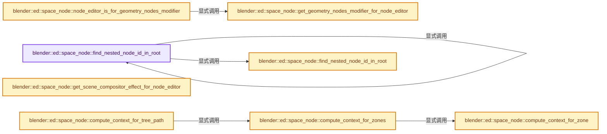
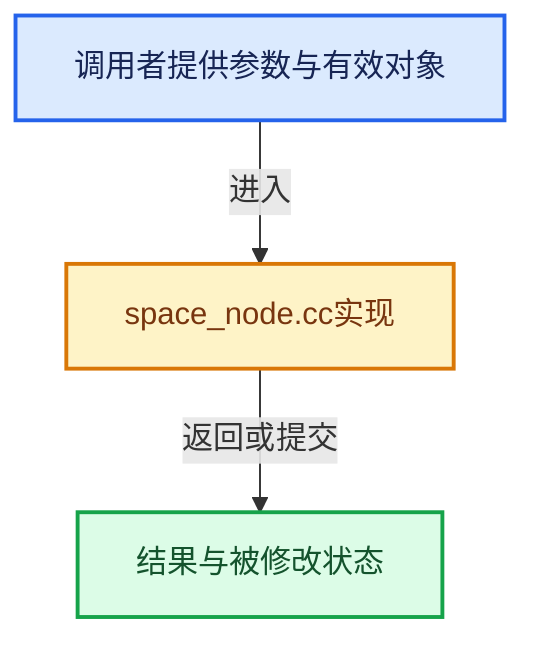

# 实现依赖专题：source/blender/editors/space_node/space_node.cc

[方向导航](README.md) · [符号索引](../%E7%AC%A6%E5%8F%B7%E4%BE%9D%E8%B5%96%E4%B8%8E%E5%AE%9E%E7%8E%B0%E7%B4%A2%E5%BC%95.md)

本专题从正文实际调用进入，集中保存共享实现。函数有稳定锚点，可从调用处直接跳到对应完整函数；递归与互相调用通过回链组织。

## 本文件的实现关系






## 相关类型布局与成员入口

<a id="t-da0245e9c42d"></a>

### `blender::ed::space_node::SceneAndCompositorEffect`

原始声明：[source/blender/editors/space_node/space_node.cc](../../../../../source/blender/editors/space_node/space_node.cc) · L438—L441。

成员布局：

- `Scene scene`
- `SceneCompositorEffect effect`

以下保留类的数据声明与编译条件，成员函数实现通过后面的精确链接阅读。

<!-- annotated:009914a451603b -->

```cpp
struct SceneAndCompositorEffect {
  const Scene *scene = nullptr;
  const SceneCompositorEffect *effect = nullptr;
};
```

<details>
<summary>核对原始源码：source/blender/editors/space_node/space_node.cc · L438—L441</summary>

<!-- original:009914a451603b:source/blender/editors/space_node/space_node.cc:438:441 -->

```cpp
struct SceneAndCompositorEffect {
  const Scene *scene = nullptr;
  const SceneCompositorEffect *effect = nullptr;
};
```

</details>


## 完整成员与函数实现

<a id="f-cfa01af641cfa64c"></a>

### `blender::ed::space_node::find_nested_node_id_in_root`

实现位置：[source/blender/editors/space_node/space_node.cc](../../../../../source/blender/editors/space_node/space_node.cc) · L315—L326。

接口参数：

- `const SpaceNode &snode`
- `const bNode &query_node`

**教学注释版**

<!-- annotated:60dbb291d4b823 -->

```cpp
std::optional<nodes::FoundNestedNodeID> find_nested_node_id_in_root(const SpaceNode &snode,
                                                                    const bNode &query_node)
{
  BLI_assert(snode.edittree->runtime->nodes_by_id.contains(const_cast<bNode *>(&query_node)));
  bke::ComputeContextCache compute_context_cache;
  const ComputeContext *compute_context = compute_context_for_edittree_node(
      snode, compute_context_cache, query_node);
  if (!compute_context) {
    return {};
  }
  return find_nested_node_id_in_root(*snode.nodetree, compute_context, query_node.identifier);
}
```

<details>
<summary>核对原始源码：source/blender/editors/space_node/space_node.cc · L315—L326</summary>

<!-- original:60dbb291d4b823:source/blender/editors/space_node/space_node.cc:315:326 -->

```cpp
std::optional<nodes::FoundNestedNodeID> find_nested_node_id_in_root(const SpaceNode &snode,
                                                                    const bNode &query_node)
{
  BLI_assert(snode.edittree->runtime->nodes_by_id.contains(const_cast<bNode *>(&query_node)));
  bke::ComputeContextCache compute_context_cache;
  const ComputeContext *compute_context = compute_context_for_edittree_node(
      snode, compute_context_cache, query_node);
  if (!compute_context) {
    return {};
  }
  return find_nested_node_id_in_root(*snode.nodetree, compute_context, query_node.identifier);
}
```

</details>

**结果出口**

- `return {};`
- `return find_nested_node_id_in_root(*snode.nodetree, compute_context, query_node.identifier);`

**继续追踪实现**

- `BLI_assert` → [BLI_assert · L48](../01-%E5%9F%BA%E7%A1%80%E5%AE%B9%E5%99%A8%E4%B8%8E%E7%8E%B0%E4%BB%A3CPP/%E4%BE%9D%E8%B5%96-BLI_assert-cc98e8.md#m-57a88495704d)；[BLI_assert · L63](../01-%E5%9F%BA%E7%A1%80%E5%AE%B9%E5%99%A8%E4%B8%8E%E7%8E%B0%E4%BB%A3CPP/%E4%BE%9D%E8%B5%96-BLI_assert-cc98e8.md#m-d07050020cb5)。宏定义由构建条件选择。
- `snode.edittree->runtime->nodes_by_id.contains` → [调用协议](../%E6%A8%A1%E6%9D%BF%E5%AE%8F%E4%B8%8E%E5%8A%A8%E6%80%81%E5%88%86%E6%B4%BE%E5%8D%8F%E8%AE%AE.md)：接收对象类型依赖auto、返回值或模板实例；不按同名猜测目标。调用位置L318。
- `compute_context_for_edittree_node` → [blender::ed::space_node::compute_context_for_edittree_node · L651](%E4%BE%9D%E8%B5%96-space_node-ab8ae3.md#f-e0436aa571b2dcad)。
- `find_nested_node_id_in_root` → [blender::ed::space_node::find_nested_node_id_in_root · L315](%E4%BE%9D%E8%B5%96-space_node-ab8ae3.md#f-cfa01af641cfa64c)；[blender::ed::space_node::find_nested_node_id_in_root · L328](%E4%BE%9D%E8%B5%96-space_node-ab8ae3.md#f-27fa8feb452830a5)。同名重载需按实参类型选择。

<a id="f-27fa8feb452830a5"></a>

### `blender::ed::space_node::find_nested_node_id_in_root`

实现位置：[source/blender/editors/space_node/space_node.cc](../../../../../source/blender/editors/space_node/space_node.cc) · L328—L362。

接口参数：

- `const bNodeTree &root_tree`
- `const ComputeContext *compute_context`
- `const int node_id`

**教学注释版**

<!-- annotated:591b09c62d9aaa -->

```cpp
std::optional<nodes::FoundNestedNodeID> find_nested_node_id_in_root(
    const bNodeTree &root_tree, const ComputeContext *compute_context, const int node_id)
{
  nodes::FoundNestedNodeID found;
  Vector<int> node_ids;
  for (const ComputeContext *context = compute_context; context != nullptr;
       context = context->parent())
  {
    if (const auto *node_context = dynamic_cast<const bke::GroupNodeComputeContext *>(context)) {
      // [讲解] node_ids.append：在尾部建立新元素，必要时先扩大存储。
      node_ids.append(node_context->node_id());
    }
    else if (dynamic_cast<const bke::RepeatZoneComputeContext *>(context) != nullptr) {
      found.is_in_loop = true;
    }
    else if (dynamic_cast<const bke::SimulationZoneComputeContext *>(context) != nullptr) {
      found.is_in_simulation = true;
    }
    else if (dynamic_cast<const bke::ForeachGeometryElementZoneComputeContext *>(context) !=
             nullptr)
    {
      found.is_in_loop = true;
    }
    else if (dynamic_cast<const bke::EvaluateClosureComputeContext *>(context) != nullptr) {
      found.is_in_closure = true;
    }
  }
  // [讲解] node_ids.begin：提供当前存储或有效范围的地址。
  std::reverse(node_ids.begin(), node_ids.end());
  node_ids.append(node_id);
  const bNestedNodeRef *nested_node_ref = root_tree.nested_node_ref_from_node_id_path(node_ids);
  if (nested_node_ref == nullptr) {
    return std::nullopt;
  }
  found.id = nested_node_ref->id;
  return found;
}
```

<details>
<summary>核对原始源码：source/blender/editors/space_node/space_node.cc · L328—L362</summary>

<!-- original:591b09c62d9aaa:source/blender/editors/space_node/space_node.cc:328:362 -->

```cpp
std::optional<nodes::FoundNestedNodeID> find_nested_node_id_in_root(
    const bNodeTree &root_tree, const ComputeContext *compute_context, const int node_id)
{
  nodes::FoundNestedNodeID found;
  Vector<int> node_ids;
  for (const ComputeContext *context = compute_context; context != nullptr;
       context = context->parent())
  {
    if (const auto *node_context = dynamic_cast<const bke::GroupNodeComputeContext *>(context)) {
      node_ids.append(node_context->node_id());
    }
    else if (dynamic_cast<const bke::RepeatZoneComputeContext *>(context) != nullptr) {
      found.is_in_loop = true;
    }
    else if (dynamic_cast<const bke::SimulationZoneComputeContext *>(context) != nullptr) {
      found.is_in_simulation = true;
    }
    else if (dynamic_cast<const bke::ForeachGeometryElementZoneComputeContext *>(context) !=
             nullptr)
    {
      found.is_in_loop = true;
    }
    else if (dynamic_cast<const bke::EvaluateClosureComputeContext *>(context) != nullptr) {
      found.is_in_closure = true;
    }
  }
  std::reverse(node_ids.begin(), node_ids.end());
  node_ids.append(node_id);
  const bNestedNodeRef *nested_node_ref = root_tree.nested_node_ref_from_node_id_path(node_ids);
  if (nested_node_ref == nullptr) {
    return std::nullopt;
  }
  found.id = nested_node_ref->id;
  return found;
}
```

</details>

**沿实际写入检查状态**

- `context = context->parent())`
- `found.is_in_loop = true;`
- `found.is_in_simulation = true;`
- `found.is_in_closure = true;`
- `found.id = nested_node_ref->id;`

**结果出口**

- `return std::nullopt;`
- `return found;`

**继续追踪实现**

- `context->parent` → [blender::ComputeContext::parent · L117](../01-%E5%9F%BA%E7%A1%80%E5%AE%B9%E5%99%A8%E4%B8%8E%E7%8E%B0%E4%BB%A3CPP/%E4%BE%9D%E8%B5%96-BLI_compute_context-ba44a7.md#f-6c97ea64470f3be0)。
- `node_ids.append` → [blender::Vector::append · L498](../01-%E5%9F%BA%E7%A1%80%E5%AE%B9%E5%99%A8%E4%B8%8E%E7%8E%B0%E4%BB%A3CPP/11-Vector%E6%8F%92%E5%85%A5%E5%88%A0%E9%99%A4%E4%B8%8E%E9%87%8D%E6%8E%92.md#f-5bde268a69e443ec)；[blender::Vector::append · L502](../01-%E5%9F%BA%E7%A1%80%E5%AE%B9%E5%99%A8%E4%B8%8E%E7%8E%B0%E4%BB%A3CPP/11-Vector%E6%8F%92%E5%85%A5%E5%88%A0%E9%99%A4%E4%B8%8E%E9%87%8D%E6%8E%92.md#f-591e0b15e6308532)。同名重载需按实参类型选择。
- `node_context->node_id` → [调用协议](../%E6%A8%A1%E6%9D%BF%E5%AE%8F%E4%B8%8E%E5%8A%A8%E6%80%81%E5%88%86%E6%B4%BE%E5%8D%8F%E8%AE%AE.md)：接收对象类型依赖auto、返回值或模板实例；不按同名猜测目标。调用位置L337。
- `std::reverse` → [外部契约](https://eel.is/c++draft/)：这个边界按实际表达式及所属类型核对参数、返回值、寿命与失败行为。这里提供接口入口，不声称已解释该第三方版本的内部实现。
- `node_ids.begin` → [blender::Vector::begin · L967](../01-%E5%9F%BA%E7%A1%80%E5%AE%B9%E5%99%A8%E4%B8%8E%E7%8E%B0%E4%BB%A3CPP/12-Vector%E5%BC%82%E5%B8%B8%E5%AE%89%E5%85%A8%E4%B8%8E%E8%BE%B9%E7%95%8C.md#f-64fb75a6663b953c)；[blender::Vector::begin · L976](../01-%E5%9F%BA%E7%A1%80%E5%AE%B9%E5%99%A8%E4%B8%8E%E7%8E%B0%E4%BB%A3CPP/12-Vector%E5%BC%82%E5%B8%B8%E5%AE%89%E5%85%A8%E4%B8%8E%E8%BE%B9%E7%95%8C.md#f-7c6486a8b8e8f13f)。同名重载需按实参类型选择。
- `node_ids.end` → [blender::Vector::end · L971](../01-%E5%9F%BA%E7%A1%80%E5%AE%B9%E5%99%A8%E4%B8%8E%E7%8E%B0%E4%BB%A3CPP/12-Vector%E5%BC%82%E5%B8%B8%E5%AE%89%E5%85%A8%E4%B8%8E%E8%BE%B9%E7%95%8C.md#f-8a6033745be8f712)；[blender::Vector::end · L980](../01-%E5%9F%BA%E7%A1%80%E5%AE%B9%E5%99%A8%E4%B8%8E%E7%8E%B0%E4%BB%A3CPP/12-Vector%E5%BC%82%E5%B8%B8%E5%AE%89%E5%85%A8%E4%B8%8E%E8%BE%B9%E7%95%8C.md#f-ebb3ada259887677)。同名重载需按实参类型选择。
- `root_tree.nested_node_ref_from_node_id_path` → [blender::bNodeTree::nested_node_ref_from_node_id_path · L636](%E4%BE%9D%E8%B5%96-node_runtime-ee7c39.md#f-e64a64a3d050784a)。

<a id="f-dfd32d7212fc51c5"></a>

### `blender::ed::space_node::get_geometry_nodes_modifier_for_node_editor`

实现位置：[source/blender/editors/space_node/space_node.cc](../../../../../source/blender/editors/space_node/space_node.cc) · L377—L420。

接口参数：

- `const SpaceNode &snode`

**教学注释版**

<!-- annotated:86990972883258 -->

```cpp
std::optional<ObjectAndModifier> get_geometry_nodes_modifier_for_node_editor(
    const SpaceNode &snode)
{
  if (snode.node_tree_sub_type != SNODE_GEOMETRY_MODIFIER) {
    return std::nullopt;
  }
  if (snode.id == nullptr) {
    return std::nullopt;
  }
  if (GS(snode.id->name) != ID_OB) {
    return std::nullopt;
  }
  const Object *object = reinterpret_cast<Object *>(snode.id);
  const NodesModifierData *used_modifier = nullptr;
  if (snode.flag & SNODE_PIN) {
    for (const ModifierData &md : object->modifiers) {
      if (md.type == eModifierType_Nodes) {
        const NodesModifierData *nmd = reinterpret_cast<const NodesModifierData *>(&md);
        /* Would be good to store the name of the pinned modifier in the node editor. */
        if (nmd->node_group == snode.nodetree) {
          used_modifier = nmd;
          break;
        }
      }
    }
  }
  else {
    for (const ModifierData &md : object->modifiers) {
      if (md.type == eModifierType_Nodes) {
        const NodesModifierData *nmd = reinterpret_cast<const NodesModifierData *>(&md);
        if (nmd->node_group == snode.nodetree) {
          if (md.flag & eModifierFlag_Active) {
            used_modifier = nmd;
            break;
          }
        }
      }
    }
  }
  if (used_modifier == nullptr) {
    return std::nullopt;
  }
  return ObjectAndModifier{object, used_modifier};
}
```

<details>
<summary>核对原始源码：source/blender/editors/space_node/space_node.cc · L377—L420</summary>

<!-- original:86990972883258:source/blender/editors/space_node/space_node.cc:377:420 -->

```cpp
std::optional<ObjectAndModifier> get_geometry_nodes_modifier_for_node_editor(
    const SpaceNode &snode)
{
  if (snode.node_tree_sub_type != SNODE_GEOMETRY_MODIFIER) {
    return std::nullopt;
  }
  if (snode.id == nullptr) {
    return std::nullopt;
  }
  if (GS(snode.id->name) != ID_OB) {
    return std::nullopt;
  }
  const Object *object = reinterpret_cast<Object *>(snode.id);
  const NodesModifierData *used_modifier = nullptr;
  if (snode.flag & SNODE_PIN) {
    for (const ModifierData &md : object->modifiers) {
      if (md.type == eModifierType_Nodes) {
        const NodesModifierData *nmd = reinterpret_cast<const NodesModifierData *>(&md);
        /* Would be good to store the name of the pinned modifier in the node editor. */
        if (nmd->node_group == snode.nodetree) {
          used_modifier = nmd;
          break;
        }
      }
    }
  }
  else {
    for (const ModifierData &md : object->modifiers) {
      if (md.type == eModifierType_Nodes) {
        const NodesModifierData *nmd = reinterpret_cast<const NodesModifierData *>(&md);
        if (nmd->node_group == snode.nodetree) {
          if (md.flag & eModifierFlag_Active) {
            used_modifier = nmd;
            break;
          }
        }
      }
    }
  }
  if (used_modifier == nullptr) {
    return std::nullopt;
  }
  return ObjectAndModifier{object, used_modifier};
}
```

</details>

**沿实际写入检查状态**

- `used_modifier = nmd;`

**结果出口**

- `return std::nullopt;`
- `return ObjectAndModifier{object, used_modifier};`

**继续追踪实现**

- `GS` → [blender::GS · L410](%E4%BE%9D%E8%B5%96-DNA_ID-3eb091.md#f-c3ff509f79f21b05)。

<a id="f-0d35a4c672c3e1ae"></a>

### `blender::ed::space_node::node_editor_is_for_geometry_nodes_modifier`

实现位置：[source/blender/editors/space_node/space_node.cc](../../../../../source/blender/editors/space_node/space_node.cc) · L422—L436。

接口参数：

- `const SpaceNode &snode`
- `const Object &object`
- `const NodesModifierData &nmd`

**教学注释版**

<!-- annotated:d9cc114ffe9775 -->

```cpp
bool node_editor_is_for_geometry_nodes_modifier(const SpaceNode &snode,
                                                const Object &object,
                                                const NodesModifierData &nmd)
{
  const std::optional<ObjectAndModifier> object_and_modifier =
      get_geometry_nodes_modifier_for_node_editor(snode);
  if (!object_and_modifier) {
    return false;
  }
  const Object *object_orig = DEG_is_original(&object) ? &object : DEG_get_original(&object);
  if (object_and_modifier->object != object_orig) {
    return false;
  }
  return object_and_modifier->nmd->modifier.persistent_uid == nmd.modifier.persistent_uid;
}
```

<details>
<summary>核对原始源码：source/blender/editors/space_node/space_node.cc · L422—L436</summary>

<!-- original:d9cc114ffe9775:source/blender/editors/space_node/space_node.cc:422:436 -->

```cpp
bool node_editor_is_for_geometry_nodes_modifier(const SpaceNode &snode,
                                                const Object &object,
                                                const NodesModifierData &nmd)
{
  const std::optional<ObjectAndModifier> object_and_modifier =
      get_geometry_nodes_modifier_for_node_editor(snode);
  if (!object_and_modifier) {
    return false;
  }
  const Object *object_orig = DEG_is_original(&object) ? &object : DEG_get_original(&object);
  if (object_and_modifier->object != object_orig) {
    return false;
  }
  return object_and_modifier->nmd->modifier.persistent_uid == nmd.modifier.persistent_uid;
}
```

</details>

**结果出口**

- `return false;`
- `return object_and_modifier->nmd->modifier.persistent_uid == nmd.modifier.persistent_uid;`

**继续追踪实现**

- `get_geometry_nodes_modifier_for_node_editor` → [blender::ed::space_node::get_geometry_nodes_modifier_for_node_editor · L377](%E4%BE%9D%E8%B5%96-space_node-ab8ae3.md#f-dfd32d7212fc51c5)。
- `DEG_is_original` → [blender::DEG_is_original · L158](../11-Depsgraph%E4%B8%8E%E5%B9%B6%E8%A1%8C%E4%BB%BB%E5%8A%A1%E7%B3%BB%E7%BB%9F/%E4%BE%9D%E8%B5%96-DEG_depsgraph_query-db0d31.md#f-729ea058ec76a2a8)。
- `DEG_get_original` → [blender::DEG_get_original · L128](../11-Depsgraph%E4%B8%8E%E5%B9%B6%E8%A1%8C%E4%BB%BB%E5%8A%A1%E7%B3%BB%E7%BB%9F/%E4%BE%9D%E8%B5%96-DEG_depsgraph_query-db0d31.md#f-79782eab82a92d86)；[blender::DEG_get_original · L134](../11-Depsgraph%E4%B8%8E%E5%B9%B6%E8%A1%8C%E4%BB%BB%E5%8A%A1%E7%B3%BB%E7%BB%9F/%E4%BE%9D%E8%B5%96-DEG_depsgraph_query-db0d31.md#f-c032f06e9ef8f0cb)。同名重载需按实参类型选择。

<a id="f-e8b0c6d385a1d025"></a>

### `blender::ed::space_node::get_scene_compositor_effect_for_node_editor`

实现位置：[source/blender/editors/space_node/space_node.cc](../../../../../source/blender/editors/space_node/space_node.cc) · L443—L473。

接口参数：

- `const SpaceNode &space_node`

**教学注释版**

<!-- annotated:263db2efabf92e -->

```cpp
static std::optional<SceneAndCompositorEffect> get_scene_compositor_effect_for_node_editor(
    const SpaceNode &space_node)
{
  if (space_node.node_tree_sub_type != SNODE_COMPOSITOR_SCENE) {
    return std::nullopt;
  }

  if (!space_node.id) {
    return std::nullopt;
  }

  if (GS(space_node.id->name) != ID_SCE) {
    return std::nullopt;
  }

  const Scene *scene = id_cast<Scene *>(space_node.id);
  if (space_node.flag & SNODE_PIN) {
    for (const SceneCompositorEffect &effect : scene->compositor_effects) {
      if (effect.node_group == space_node.nodetree) {
        return SceneAndCompositorEffect(scene, &effect);
      }
    }
    return std::nullopt;
  }

  const SceneCompositorEffect *active_effect = bke::compositor::get_active_effect(*scene);
  if (!active_effect) {
    return std::nullopt;
  }
  return SceneAndCompositorEffect(scene, active_effect);
}
```

<details>
<summary>核对原始源码：source/blender/editors/space_node/space_node.cc · L443—L473</summary>

<!-- original:263db2efabf92e:source/blender/editors/space_node/space_node.cc:443:473 -->

```cpp
static std::optional<SceneAndCompositorEffect> get_scene_compositor_effect_for_node_editor(
    const SpaceNode &space_node)
{
  if (space_node.node_tree_sub_type != SNODE_COMPOSITOR_SCENE) {
    return std::nullopt;
  }

  if (!space_node.id) {
    return std::nullopt;
  }

  if (GS(space_node.id->name) != ID_SCE) {
    return std::nullopt;
  }

  const Scene *scene = id_cast<Scene *>(space_node.id);
  if (space_node.flag & SNODE_PIN) {
    for (const SceneCompositorEffect &effect : scene->compositor_effects) {
      if (effect.node_group == space_node.nodetree) {
        return SceneAndCompositorEffect(scene, &effect);
      }
    }
    return std::nullopt;
  }

  const SceneCompositorEffect *active_effect = bke::compositor::get_active_effect(*scene);
  if (!active_effect) {
    return std::nullopt;
  }
  return SceneAndCompositorEffect(scene, active_effect);
}
```

</details>

**结果出口**

- `return std::nullopt;`
- `return SceneAndCompositorEffect(scene, &effect);`
- `return SceneAndCompositorEffect(scene, active_effect);`

**继续追踪实现**

- `GS` → [blender::GS · L410](%E4%BE%9D%E8%B5%96-DNA_ID-3eb091.md#f-c3ff509f79f21b05)。
- `id_cast<Scene *>` → [blender::id_cast · L1417](%E4%BE%9D%E8%B5%96-DNA_ID-3eb091.md#f-6c8ac6412850ac5a)。
- `SceneAndCompositorEffect` → [blender::ed::space_node::SceneAndCompositorEffect](%E4%BE%9D%E8%B5%96-space_node-ab8ae3.md#t-da0245e9c42d)。
- `bke::compositor::get_active_effect` → [blender::bke::compositor::get_active_effect · L206](%E4%BE%9D%E8%B5%96-compositor-ce5aa3.md#f-4aa576dadb9cfd59)。

<a id="f-d80a6d8aed0ef7a7"></a>

### `blender::ed::space_node::compute_context_for_zone`

实现位置：[source/blender/editors/space_node/space_node.cc](../../../../../source/blender/editors/space_node/space_node.cc) · L475—L515。

接口参数：

- `const bke::bNodeTreeZone &zone`
- `bke::ComputeContextCache &compute_context_cache`
- `const ComputeContext *parent_compute_context`

**教学注释版**

<!-- annotated:8c0fe7ac1854fc -->

```cpp
const ComputeContext *compute_context_for_zone(const bke::bNodeTreeZone &zone,
                                               bke::ComputeContextCache &compute_context_cache,
                                               const ComputeContext *parent_compute_context)
{
  const bNode *output_node_ptr = zone.output_node();
  if (!output_node_ptr) {
    return nullptr;
  }
  const bNode &output_node = *output_node_ptr;
  switch (output_node.type_legacy) {
    case GEO_NODE_SIMULATION_OUTPUT: {
      return &compute_context_cache.for_simulation_zone(parent_compute_context, output_node);
    }
    case GEO_NODE_REPEAT_OUTPUT: {
      const auto &storage = *static_cast<const NodeGeometryRepeatOutput *>(output_node.storage);
      return &compute_context_cache.for_repeat_zone(
          parent_compute_context, output_node, storage.inspection_index);
    }
    case GEO_NODE_FOREACH_GEOMETRY_ELEMENT_OUTPUT: {
      const auto &storage = *static_cast<const NodeGeometryForeachGeometryElementOutput *>(
          output_node.storage);
      return &compute_context_cache.for_foreach_geometry_element_zone(
          parent_compute_context, output_node, storage.inspection_index);
    }
    case NODE_CLOSURE_OUTPUT: {
      nodes::ClosureSourceLocation source_location{};
      const bNodeTree &tree = output_node.owner_tree();
      source_location.tree = &tree;
      source_location.closure_output_node_id = output_node.identifier;
      source_location.compute_context_hash = parent_compute_context ?
                                                 parent_compute_context->hash() :
                                                 ComputeContextHash{};
      source_location.compute_context = parent_compute_context;
      return compute_context_for_closure_evaluation(parent_compute_context,
                                                    output_node.output_socket(0),
                                                    compute_context_cache,
                                                    source_location);
    }
  }
  return nullptr;
}
```

<details>
<summary>核对原始源码：source/blender/editors/space_node/space_node.cc · L475—L515</summary>

<!-- original:8c0fe7ac1854fc:source/blender/editors/space_node/space_node.cc:475:515 -->

```cpp
const ComputeContext *compute_context_for_zone(const bke::bNodeTreeZone &zone,
                                               bke::ComputeContextCache &compute_context_cache,
                                               const ComputeContext *parent_compute_context)
{
  const bNode *output_node_ptr = zone.output_node();
  if (!output_node_ptr) {
    return nullptr;
  }
  const bNode &output_node = *output_node_ptr;
  switch (output_node.type_legacy) {
    case GEO_NODE_SIMULATION_OUTPUT: {
      return &compute_context_cache.for_simulation_zone(parent_compute_context, output_node);
    }
    case GEO_NODE_REPEAT_OUTPUT: {
      const auto &storage = *static_cast<const NodeGeometryRepeatOutput *>(output_node.storage);
      return &compute_context_cache.for_repeat_zone(
          parent_compute_context, output_node, storage.inspection_index);
    }
    case GEO_NODE_FOREACH_GEOMETRY_ELEMENT_OUTPUT: {
      const auto &storage = *static_cast<const NodeGeometryForeachGeometryElementOutput *>(
          output_node.storage);
      return &compute_context_cache.for_foreach_geometry_element_zone(
          parent_compute_context, output_node, storage.inspection_index);
    }
    case NODE_CLOSURE_OUTPUT: {
      nodes::ClosureSourceLocation source_location{};
      const bNodeTree &tree = output_node.owner_tree();
      source_location.tree = &tree;
      source_location.closure_output_node_id = output_node.identifier;
      source_location.compute_context_hash = parent_compute_context ?
                                                 parent_compute_context->hash() :
                                                 ComputeContextHash{};
      source_location.compute_context = parent_compute_context;
      return compute_context_for_closure_evaluation(parent_compute_context,
                                                    output_node.output_socket(0),
                                                    compute_context_cache,
                                                    source_location);
    }
  }
  return nullptr;
}
```

</details>

**沿实际写入检查状态**

- `source_location.tree = &tree;`
- `source_location.closure_output_node_id = output_node.identifier;`
- `source_location.compute_context_hash = parent_compute_context ?`
- `source_location.compute_context = parent_compute_context;`

**结果出口**

- `return nullptr;`
- `return &compute_context_cache.for_simulation_zone(parent_compute_context, output_node);`
- `return &compute_context_cache.for_repeat_zone(`
- `return &compute_context_cache.for_foreach_geometry_element_zone(`
- `return compute_context_for_closure_evaluation(parent_compute_context,`

**继续追踪实现**

- `zone.output_node` → [blender::bke::bNodeTreeZone::output_node · L593](%E4%BE%9D%E8%B5%96-node_tree_zones-eecd0c.md#f-512b761599384e03)。
- `compute_context_cache.for_simulation_zone` → [blender::bke::ComputeContextCache::for_simulation_zone · L369](%E4%BE%9D%E8%B5%96-compute_contexts-daf7f5.md#f-0923b6080a4968ba)；[blender::bke::ComputeContextCache::for_simulation_zone · L378](%E4%BE%9D%E8%B5%96-compute_contexts-daf7f5.md#f-011b757f77eed842)。同名重载需按实参类型选择。
- `compute_context_cache.for_repeat_zone` → [blender::bke::ComputeContextCache::for_repeat_zone · L387](%E4%BE%9D%E8%B5%96-compute_contexts-daf7f5.md#f-8ff2c2bf4820c044)；[blender::bke::ComputeContextCache::for_repeat_zone · L398](%E4%BE%9D%E8%B5%96-compute_contexts-daf7f5.md#f-603cb5361feedd9b)。同名重载需按实参类型选择。
- `compute_context_cache.for_foreach_geometry_element_zone` → [blender::bke::for_foreach_geometry_element_zone · L408](%E4%BE%9D%E8%B5%96-compute_contexts-daf7f5.md#f-76ee6329b9b0d44e)；[blender::bke::for_foreach_geometry_element_zone · L420](%E4%BE%9D%E8%B5%96-compute_contexts-daf7f5.md#f-976cb54ce4a8bf38)。同名重载需按实参类型选择。
- `output_node.owner_tree` → [blender::bNode::owner_tree · L866](%E4%BE%9D%E8%B5%96-BKE_node_runtime-ee561b.md#f-7e471005a1325135)；[blender::bNode::owner_tree · L872](%E4%BE%9D%E8%B5%96-BKE_node_runtime-ee561b.md#f-641a1000c92d9a52)。同名重载需按实参类型选择。
- `parent_compute_context->hash` → [blender::ComputeContext::hash · L111](../01-%E5%9F%BA%E7%A1%80%E5%AE%B9%E5%99%A8%E4%B8%8E%E7%8E%B0%E4%BB%A3CPP/%E4%BE%9D%E8%B5%96-BLI_compute_context-ba44a7.md#f-12bb4fe289dd6f55)。
- `compute_context_for_closure_evaluation` → [blender::nodes::compute_context_for_closure_evaluation · L317](../09-LazyFunction%E4%B8%8E%E8%8A%82%E7%82%B9%E6%89%A7%E8%A1%8C%E6%9E%B6%E6%9E%84/%E4%BE%9D%E8%B5%96-trace_values-1ee732.md#f-057bea59cda17891)。
- `output_node.output_socket` → [blender::bNode::output_socket · L824](%E4%BE%9D%E8%B5%96-BKE_node_runtime-ee561b.md#f-9e46f3a437215eb5)；[blender::bNode::output_socket · L836](%E4%BE%9D%E8%B5%96-BKE_node_runtime-ee561b.md#f-39021ff32ee7c409)。同名重载需按实参类型选择。

<a id="f-884b82fd50a8f9ee"></a>

### `blender::ed::space_node::compute_context_for_zones`

实现位置：[source/blender/editors/space_node/space_node.cc](../../../../../source/blender/editors/space_node/space_node.cc) · L517—L529。

接口参数：

- `const Span<const bke::bNodeTreeZone *> zones`
- `bke::ComputeContextCache &compute_context_cache`
- `const ComputeContext *parent_compute_context`

**教学注释版**

<!-- annotated:a534236c1e67bf -->

```cpp
const ComputeContext *compute_context_for_zones(const Span<const bke::bNodeTreeZone *> zones,
                                                bke::ComputeContextCache &compute_context_cache,
                                                const ComputeContext *parent_compute_context)
{
  const ComputeContext *current = parent_compute_context;
  for (const bke::bNodeTreeZone *zone : zones) {
    current = compute_context_for_zone(*zone, compute_context_cache, current);
    if (!current) {
      return nullptr;
    }
  }
  return current;
}
```

<details>
<summary>核对原始源码：source/blender/editors/space_node/space_node.cc · L517—L529</summary>

<!-- original:a534236c1e67bf:source/blender/editors/space_node/space_node.cc:517:529 -->

```cpp
const ComputeContext *compute_context_for_zones(const Span<const bke::bNodeTreeZone *> zones,
                                                bke::ComputeContextCache &compute_context_cache,
                                                const ComputeContext *parent_compute_context)
{
  const ComputeContext *current = parent_compute_context;
  for (const bke::bNodeTreeZone *zone : zones) {
    current = compute_context_for_zone(*zone, compute_context_cache, current);
    if (!current) {
      return nullptr;
    }
  }
  return current;
}
```

</details>

**沿实际写入检查状态**

- `current = compute_context_for_zone(*zone, compute_context_cache, current);`

**结果出口**

- `return nullptr;`
- `return current;`

**继续追踪实现**

- `compute_context_for_zone` → [blender::ed::space_node::compute_context_for_zone · L475](%E4%BE%9D%E8%B5%96-space_node-ab8ae3.md#f-d80a6d8aed0ef7a7)。

<a id="f-ab75bb2f3590a94c"></a>

### `blender::ed::space_node::compute_context_for_tree_path`

实现位置：[source/blender/editors/space_node/space_node.cc](../../../../../source/blender/editors/space_node/space_node.cc) · L531—L565。

接口参数：

- `const SpaceNode &snode`
- `bke::ComputeContextCache &compute_context_cache`
- `const ComputeContext *parent_compute_context`

**教学注释版**

<!-- annotated:b7113a368dc557 -->

```cpp
static std::optional<const ComputeContext *> compute_context_for_tree_path(
    const SpaceNode &snode,
    bke::ComputeContextCache &compute_context_cache,
    const ComputeContext *parent_compute_context)
{
  const ComputeContext *current = parent_compute_context;
  Vector<const bNodeTreePath *> tree_path;
  for (const bNodeTreePath &item : snode.treepath) {
    // [讲解] tree_path.append：在尾部建立新元素，必要时先扩大存储。
    tree_path.append(&item);
  }
  if (tree_path.is_empty()) {
    return current;
  }

  for (const int i : tree_path.index_range().drop_back(1)) {
    bNodeTree *tree = tree_path[i]->nodetree;
    const char *group_node_name = tree_path[i + 1]->node_name;
    const bNode *group_node = bke::node_find_node_by_name(*tree, group_node_name);
    if (group_node == nullptr) {
      return std::nullopt;
    }
    const bke::bNodeTreeZones *tree_zones = tree->zones();
    if (tree_zones == nullptr) {
      return std::nullopt;
    }
    const Vector<const bke::bNodeTreeZone *> zone_stack = tree_zones->get_zones_to_enter_from_root(
        tree_zones->get_zone_by_node(group_node->identifier));
    current = compute_context_for_zones(zone_stack, compute_context_cache, current);
    if (!current) {
      return std::nullopt;
    }
    current = &compute_context_cache.for_group_node(current, group_node->identifier, tree);
  }
  return current;
}
```

<details>
<summary>核对原始源码：source/blender/editors/space_node/space_node.cc · L531—L565</summary>

<!-- original:b7113a368dc557:source/blender/editors/space_node/space_node.cc:531:565 -->

```cpp
static std::optional<const ComputeContext *> compute_context_for_tree_path(
    const SpaceNode &snode,
    bke::ComputeContextCache &compute_context_cache,
    const ComputeContext *parent_compute_context)
{
  const ComputeContext *current = parent_compute_context;
  Vector<const bNodeTreePath *> tree_path;
  for (const bNodeTreePath &item : snode.treepath) {
    tree_path.append(&item);
  }
  if (tree_path.is_empty()) {
    return current;
  }

  for (const int i : tree_path.index_range().drop_back(1)) {
    bNodeTree *tree = tree_path[i]->nodetree;
    const char *group_node_name = tree_path[i + 1]->node_name;
    const bNode *group_node = bke::node_find_node_by_name(*tree, group_node_name);
    if (group_node == nullptr) {
      return std::nullopt;
    }
    const bke::bNodeTreeZones *tree_zones = tree->zones();
    if (tree_zones == nullptr) {
      return std::nullopt;
    }
    const Vector<const bke::bNodeTreeZone *> zone_stack = tree_zones->get_zones_to_enter_from_root(
        tree_zones->get_zone_by_node(group_node->identifier));
    current = compute_context_for_zones(zone_stack, compute_context_cache, current);
    if (!current) {
      return std::nullopt;
    }
    current = &compute_context_cache.for_group_node(current, group_node->identifier, tree);
  }
  return current;
}
```

</details>

**沿实际写入检查状态**

- `current = compute_context_for_zones(zone_stack, compute_context_cache, current);`
- `current = &compute_context_cache.for_group_node(current, group_node->identifier, tree);`

**结果出口**

- `return current;`
- `return std::nullopt;`

**继续追踪实现**

- `tree_path.append` → [blender::Vector::append · L498](../01-%E5%9F%BA%E7%A1%80%E5%AE%B9%E5%99%A8%E4%B8%8E%E7%8E%B0%E4%BB%A3CPP/11-Vector%E6%8F%92%E5%85%A5%E5%88%A0%E9%99%A4%E4%B8%8E%E9%87%8D%E6%8E%92.md#f-5bde268a69e443ec)；[blender::Vector::append · L502](../01-%E5%9F%BA%E7%A1%80%E5%AE%B9%E5%99%A8%E4%B8%8E%E7%8E%B0%E4%BB%A3CPP/11-Vector%E6%8F%92%E5%85%A5%E5%88%A0%E9%99%A4%E4%B8%8E%E9%87%8D%E6%8E%92.md#f-591e0b15e6308532)。同名重载需按实参类型选择。
- `tree_path.is_empty` → [blender::Vector::is_empty · L792](../01-%E5%9F%BA%E7%A1%80%E5%AE%B9%E5%99%A8%E4%B8%8E%E7%8E%B0%E4%BB%A3CPP/11-Vector%E6%8F%92%E5%85%A5%E5%88%A0%E9%99%A4%E4%B8%8E%E9%87%8D%E6%8E%92.md#f-937bbd9cb80bdcc8)。
- `tree_path.index_range().drop_back` → [调用协议](../%E6%A8%A1%E6%9D%BF%E5%AE%8F%E4%B8%8E%E5%8A%A8%E6%80%81%E5%88%86%E6%B4%BE%E5%8D%8F%E8%AE%AE.md)：接收对象类型依赖auto、返回值或模板实例；不按同名猜测目标。调用位置L545。
- `tree_path.index_range` → [blender::Vector::index_range · L1026](../01-%E5%9F%BA%E7%A1%80%E5%AE%B9%E5%99%A8%E4%B8%8E%E7%8E%B0%E4%BB%A3CPP/12-Vector%E5%BC%82%E5%B8%B8%E5%AE%89%E5%85%A8%E4%B8%8E%E8%BE%B9%E7%95%8C.md#f-ac29cf36ef185ab9)。
- `bke::node_find_node_by_name` → [blender::bke::node_find_node_by_name · L4047](%E4%BE%9D%E8%B5%96-node-89d753.md#f-584f0c90bb9eb92a)。
- `tree->zones` → [blender::bNodeTree::zones · L117](%E4%BE%9D%E8%B5%96-BKE_node_tree_zones-856b67.md#f-892779c41416b689)。
- `tree_zones->get_zones_to_enter_from_root` → [blender::bke::bNodeTreeZones::get_zones_to_enter_from_root · L486](%E4%BE%9D%E8%B5%96-node_tree_zones-eecd0c.md#f-cc9a16cd8896fd73)。
- `tree_zones->get_zone_by_node` → [blender::bke::bNodeTreeZones::get_zone_by_node · L437](%E4%BE%9D%E8%B5%96-node_tree_zones-eecd0c.md#f-dcc4746d65b4807a)。
- `compute_context_for_zones` → [blender::ed::space_node::compute_context_for_zones · L517](%E4%BE%9D%E8%B5%96-space_node-ab8ae3.md#f-884b82fd50a8f9ee)。
- `compute_context_cache.for_group_node` → [blender::bke::ComputeContextCache::for_group_node · L360](%E4%BE%9D%E8%B5%96-compute_contexts-daf7f5.md#f-e682e12ad78f58a0)。

<a id="f-554877ae3b69f20e"></a>

### `blender::ed::space_node::get_node_editor_root_compute_context`

实现位置：[source/blender/editors/space_node/space_node.cc](../../../../../source/blender/editors/space_node/space_node.cc) · L567—L612。

接口参数：

- `const SpaceNode &snode`
- `bke::ComputeContextCache &compute_context_cache`

**教学注释版**

<!-- annotated:112dcf84da27a2 -->

```cpp
static const ComputeContext *get_node_editor_root_compute_context(
    const SpaceNode &snode, bke::ComputeContextCache &compute_context_cache)
{
  if (snode.nodetree->type == NTREE_GEOMETRY) {
    switch (SpaceNodeGeometryNodesType(snode.node_tree_sub_type)) {
      case SNODE_GEOMETRY_MODIFIER: {
        std::optional<ed::space_node::ObjectAndModifier> object_and_modifier =
            ed::space_node::get_geometry_nodes_modifier_for_node_editor(snode);
        if (!object_and_modifier) {
          return nullptr;
        }
        const bke::DataBlockComputeContext &object_context = compute_context_cache.for_data_block(
            nullptr, object_and_modifier->object->id);
        return &compute_context_cache.for_geometry_nodes_modifier(&object_context,
                                                                  *object_and_modifier->nmd);
      }
      case SNODE_GEOMETRY_TOOL: {
        return &compute_context_cache.for_operator(nullptr);
      }
    }
    return nullptr;
  }
  if (snode.nodetree->type == NTREE_COMPOSIT) {
    switch (SpaceNodeCompositorNodesType(snode.node_tree_sub_type)) {
      case SNODE_COMPOSITOR_SCENE: {
        std::optional<SceneAndCompositorEffect> scene_and_effect =
            ed::space_node::get_scene_compositor_effect_for_node_editor(snode);
        if (!scene_and_effect) {
          return nullptr;
        }
        const bke::DataBlockComputeContext &scene_context = compute_context_cache.for_data_block(
            nullptr, scene_and_effect->scene->id);
        return &compute_context_cache.for_scene_compositor_effect(&scene_context,
                                                                  *scene_and_effect->effect);
      }
      case SNODE_COMPOSITOR_SEQUENCER: {
        return nullptr;
      }
    }
    return nullptr;
  }
  if (snode.nodetree->type == NTREE_SHADER) {
    return &compute_context_cache.for_shader(nullptr, snode.nodetree);
  }
  return nullptr;
}
```

<details>
<summary>核对原始源码：source/blender/editors/space_node/space_node.cc · L567—L612</summary>

<!-- original:112dcf84da27a2:source/blender/editors/space_node/space_node.cc:567:612 -->

```cpp
static const ComputeContext *get_node_editor_root_compute_context(
    const SpaceNode &snode, bke::ComputeContextCache &compute_context_cache)
{
  if (snode.nodetree->type == NTREE_GEOMETRY) {
    switch (SpaceNodeGeometryNodesType(snode.node_tree_sub_type)) {
      case SNODE_GEOMETRY_MODIFIER: {
        std::optional<ed::space_node::ObjectAndModifier> object_and_modifier =
            ed::space_node::get_geometry_nodes_modifier_for_node_editor(snode);
        if (!object_and_modifier) {
          return nullptr;
        }
        const bke::DataBlockComputeContext &object_context = compute_context_cache.for_data_block(
            nullptr, object_and_modifier->object->id);
        return &compute_context_cache.for_geometry_nodes_modifier(&object_context,
                                                                  *object_and_modifier->nmd);
      }
      case SNODE_GEOMETRY_TOOL: {
        return &compute_context_cache.for_operator(nullptr);
      }
    }
    return nullptr;
  }
  if (snode.nodetree->type == NTREE_COMPOSIT) {
    switch (SpaceNodeCompositorNodesType(snode.node_tree_sub_type)) {
      case SNODE_COMPOSITOR_SCENE: {
        std::optional<SceneAndCompositorEffect> scene_and_effect =
            ed::space_node::get_scene_compositor_effect_for_node_editor(snode);
        if (!scene_and_effect) {
          return nullptr;
        }
        const bke::DataBlockComputeContext &scene_context = compute_context_cache.for_data_block(
            nullptr, scene_and_effect->scene->id);
        return &compute_context_cache.for_scene_compositor_effect(&scene_context,
                                                                  *scene_and_effect->effect);
      }
      case SNODE_COMPOSITOR_SEQUENCER: {
        return nullptr;
      }
    }
    return nullptr;
  }
  if (snode.nodetree->type == NTREE_SHADER) {
    return &compute_context_cache.for_shader(nullptr, snode.nodetree);
  }
  return nullptr;
}
```

</details>

**结果出口**

- `return nullptr;`
- `return &compute_context_cache.for_geometry_nodes_modifier(&object_context,`
- `return &compute_context_cache.for_operator(nullptr);`
- `return &compute_context_cache.for_scene_compositor_effect(&scene_context,`
- `return &compute_context_cache.for_shader(nullptr, snode.nodetree);`

**继续追踪实现**

- `SpaceNodeGeometryNodesType` → [blender::SpaceNodeGeometryNodesType](%E4%BE%9D%E8%B5%96-DNA_space_enums-4e70fa.md#t-cc00426cc15e)。
- `ed::space_node::get_geometry_nodes_modifier_for_node_editor` → [blender::ed::space_node::get_geometry_nodes_modifier_for_node_editor · L377](%E4%BE%9D%E8%B5%96-space_node-ab8ae3.md#f-dfd32d7212fc51c5)。
- `compute_context_cache.for_data_block` → [blender::bke::ComputeContextCache::for_data_block · L292](%E4%BE%9D%E8%B5%96-compute_contexts-daf7f5.md#f-e018edb6791310c0)；[blender::bke::ComputeContextCache::for_data_block · L301](%E4%BE%9D%E8%B5%96-compute_contexts-daf7f5.md#f-f443c09ac8446ed0)。同名重载需按实参类型选择。
- `compute_context_cache.for_geometry_nodes_modifier` → [blender::bke::ComputeContextCache::for_geometry_nodes_modifier · L314](%E4%BE%9D%E8%B5%96-compute_contexts-daf7f5.md#f-0611ac92ae7cd3e8)；[blender::bke::ComputeContextCache::for_geometry_nodes_modifier · L322](%E4%BE%9D%E8%B5%96-compute_contexts-daf7f5.md#f-9a6e3ad85b57e5b9)。同名重载需按实参类型选择。
- `compute_context_cache.for_operator` → [blender::bke::ComputeContextCache::for_operator · L340](%E4%BE%9D%E8%B5%96-compute_contexts-daf7f5.md#f-21325c7308c988a7)；[blender::bke::ComputeContextCache::for_operator · L346](%E4%BE%9D%E8%B5%96-compute_contexts-daf7f5.md#f-16ef4b033ef1fa9c)。同名重载需按实参类型选择。
- `SpaceNodeCompositorNodesType` → [blender::SpaceNodeCompositorNodesType](%E4%BE%9D%E8%B5%96-DNA_space_enums-4e70fa.md#t-b0987f17e073)。
- `ed::space_node::get_scene_compositor_effect_for_node_editor` → [blender::ed::space_node::get_scene_compositor_effect_for_node_editor · L443](%E4%BE%9D%E8%B5%96-space_node-ab8ae3.md#f-e8b0c6d385a1d025)。
- `compute_context_cache.for_scene_compositor_effect` → [blender::bke::ComputeContextCache::for_scene_compositor_effect · L331](%E4%BE%9D%E8%B5%96-compute_contexts-daf7f5.md#f-abf54ba23d93b191)。
- `compute_context_cache.for_shader` → [blender::bke::ComputeContextCache::for_shader · L353](%E4%BE%9D%E8%B5%96-compute_contexts-daf7f5.md#f-d3dcbeb9c9f4aaec)。

<a id="f-73c6cdf3228e826c"></a>

### `blender::ed::space_node::compute_context_for_edittree`

实现位置：[source/blender/editors/space_node/space_node.cc](../../../../../source/blender/editors/space_node/space_node.cc) · L614—L631。

接口参数：

- `const SpaceNode &snode`
- `bke::ComputeContextCache &compute_context_cache`

**教学注释版**

<!-- annotated:bec0312c0b97f8 -->

```cpp
[[nodiscard]] const ComputeContext *compute_context_for_edittree(
    const SpaceNode &snode, bke::ComputeContextCache &compute_context_cache)
{
  if (!snode.edittree) {
    return nullptr;
  }
  if (!ELEM(snode.edittree->type, NTREE_GEOMETRY, NTREE_SHADER, NTREE_COMPOSIT)) {
    return nullptr;
  }
  const ComputeContext *root_context = get_node_editor_root_compute_context(snode,
                                                                            compute_context_cache);
  if (!root_context) {
    return nullptr;
  }
  const ComputeContext *edittree_context =
      compute_context_for_tree_path(snode, compute_context_cache, root_context).value_or(nullptr);
  return edittree_context;
}
```

<details>
<summary>核对原始源码：source/blender/editors/space_node/space_node.cc · L614—L631</summary>

<!-- original:bec0312c0b97f8:source/blender/editors/space_node/space_node.cc:614:631 -->

```cpp
[[nodiscard]] const ComputeContext *compute_context_for_edittree(
    const SpaceNode &snode, bke::ComputeContextCache &compute_context_cache)
{
  if (!snode.edittree) {
    return nullptr;
  }
  if (!ELEM(snode.edittree->type, NTREE_GEOMETRY, NTREE_SHADER, NTREE_COMPOSIT)) {
    return nullptr;
  }
  const ComputeContext *root_context = get_node_editor_root_compute_context(snode,
                                                                            compute_context_cache);
  if (!root_context) {
    return nullptr;
  }
  const ComputeContext *edittree_context =
      compute_context_for_tree_path(snode, compute_context_cache, root_context).value_or(nullptr);
  return edittree_context;
}
```

</details>

**结果出口**

- `return nullptr;`
- `return edittree_context;`

**继续追踪实现**

- `ELEM` → [ELEM · L88](%E4%BE%9D%E8%B5%96-GHOST_utildefines-34b996.md#m-d28724a15928)；[ELEM · L135](../01-%E5%9F%BA%E7%A1%80%E5%AE%B9%E5%99%A8%E4%B8%8E%E7%8E%B0%E4%BB%A3CPP/%E4%BE%9D%E8%B5%96-BLI_utildefines-293a0a.md#m-d6572de7cae0)。宏定义由构建条件选择。
- `get_node_editor_root_compute_context` → [blender::ed::space_node::get_node_editor_root_compute_context · L567](%E4%BE%9D%E8%B5%96-space_node-ab8ae3.md#f-554877ae3b69f20e)。
- `compute_context_for_tree_path(snode, compute_context_cache, root_context).value_or` → [调用协议](../%E6%A8%A1%E6%9D%BF%E5%AE%8F%E4%B8%8E%E5%8A%A8%E6%80%81%E5%88%86%E6%B4%BE%E5%8D%8F%E8%AE%AE.md)：接收对象类型依赖auto、返回值或模板实例；不按同名猜测目标。调用位置L629。
- `compute_context_for_tree_path` → [blender::ed::space_node::compute_context_for_tree_path · L531](%E4%BE%9D%E8%B5%96-space_node-ab8ae3.md#f-ab75bb2f3590a94c)。

<a id="f-e0436aa571b2dcad"></a>

### `blender::ed::space_node::compute_context_for_edittree_node`

实现位置：[source/blender/editors/space_node/space_node.cc](../../../../../source/blender/editors/space_node/space_node.cc) · L651—L665。

接口参数：

- `const SpaceNode &snode`
- `bke::ComputeContextCache &compute_context_cache`
- `const bNode &node`

**教学注释版**

<!-- annotated:9b3ba069542ddd -->

```cpp
const ComputeContext *compute_context_for_edittree_node(
    const SpaceNode &snode, bke::ComputeContextCache &compute_context_cache, const bNode &node)
{
  const ComputeContext *context = compute_context_for_edittree(snode, compute_context_cache);
  if (!context) {
    return nullptr;
  }
  const bke::bNodeTreeZones *zones = snode.edittree->zones();
  if (!zones) {
    return nullptr;
  }
  const bke::bNodeTreeZone *zone = zones->get_zone_by_node(node.identifier);
  const Vector<const bke::bNodeTreeZone *> zone_stack = zones->get_zones_to_enter_from_root(zone);
  return compute_context_for_zones(zone_stack, compute_context_cache, context);
}
```

<details>
<summary>核对原始源码：source/blender/editors/space_node/space_node.cc · L651—L665</summary>

<!-- original:9b3ba069542ddd:source/blender/editors/space_node/space_node.cc:651:665 -->

```cpp
const ComputeContext *compute_context_for_edittree_node(
    const SpaceNode &snode, bke::ComputeContextCache &compute_context_cache, const bNode &node)
{
  const ComputeContext *context = compute_context_for_edittree(snode, compute_context_cache);
  if (!context) {
    return nullptr;
  }
  const bke::bNodeTreeZones *zones = snode.edittree->zones();
  if (!zones) {
    return nullptr;
  }
  const bke::bNodeTreeZone *zone = zones->get_zone_by_node(node.identifier);
  const Vector<const bke::bNodeTreeZone *> zone_stack = zones->get_zones_to_enter_from_root(zone);
  return compute_context_for_zones(zone_stack, compute_context_cache, context);
}
```

</details>

**结果出口**

- `return nullptr;`
- `return compute_context_for_zones(zone_stack, compute_context_cache, context);`

**继续追踪实现**

- `compute_context_for_edittree` → [blender::ed::space_node::compute_context_for_edittree · L614](%E4%BE%9D%E8%B5%96-space_node-ab8ae3.md#f-73c6cdf3228e826c)。
- `snode.edittree->zones` → [调用协议](../%E6%A8%A1%E6%9D%BF%E5%AE%8F%E4%B8%8E%E5%8A%A8%E6%80%81%E5%88%86%E6%B4%BE%E5%8D%8F%E8%AE%AE.md)：接收对象类型依赖auto、返回值或模板实例；不按同名猜测目标。调用位置L658。
- `zones->get_zone_by_node` → [blender::bke::bNodeTreeZones::get_zone_by_node · L437](%E4%BE%9D%E8%B5%96-node_tree_zones-eecd0c.md#f-dcc4746d65b4807a)。
- `zones->get_zones_to_enter_from_root` → [blender::bke::bNodeTreeZones::get_zones_to_enter_from_root · L486](%E4%BE%9D%E8%B5%96-node_tree_zones-eecd0c.md#f-cc9a16cd8896fd73)。
- `compute_context_for_zones` → [blender::ed::space_node::compute_context_for_zones · L517](%E4%BE%9D%E8%B5%96-space_node-ab8ae3.md#f-884b82fd50a8f9ee)。
