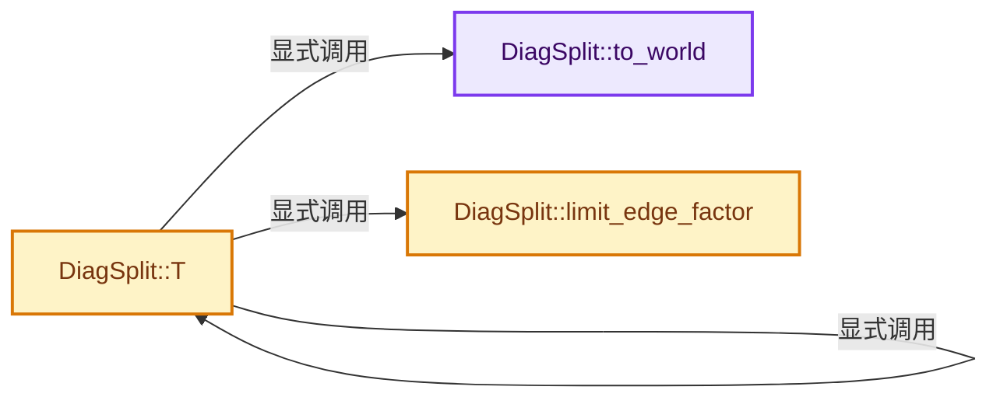
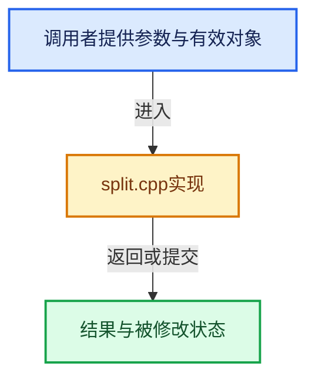

# 实现依赖专题：intern/cycles/subd/split.cpp

[方向导航](README.md) · [符号索引](../%E7%AC%A6%E5%8F%B7%E4%BE%9D%E8%B5%96%E4%B8%8E%E5%AE%9E%E7%8E%B0%E7%B4%A2%E5%BC%95.md)

本专题从正文实际调用进入，集中保存共享实现。函数有稳定锚点，可从调用处直接跳到对应完整函数；递归与互相调用通过回链组织。

## 本文件的实现关系






## 完整成员与函数实现

<a id="f-4842e7b46726095a"></a>

### `DiagSplit::to_world`

实现位置：[intern/cycles/subd/split.cpp](../../../../../intern/cycles/subd/split.cpp) · L84—L94。

接口参数：

- `const Patch *patch`
- `const float2 uv`

**教学注释版**

<!-- annotated:e4ce22fba22605 -->

```cpp
float3 DiagSplit::to_world(const Patch *patch, const float2 uv)
{
  float3 P;

  patch->eval(&P, nullptr, nullptr, nullptr, uv.x, uv.y);
  if (params.camera) {
    P = transform_point(&params.objecttoworld, P);
  }

  return P;
}
```

<details>
<summary>核对原始源码：intern/cycles/subd/split.cpp · L84—L94</summary>

<!-- original:e4ce22fba22605:intern/cycles/subd/split.cpp:84:94 -->

```cpp
float3 DiagSplit::to_world(const Patch *patch, const float2 uv)
{
  float3 P;

  patch->eval(&P, nullptr, nullptr, nullptr, uv.x, uv.y);
  if (params.camera) {
    P = transform_point(&params.objecttoworld, P);
  }

  return P;
}
```

</details>

**沿实际写入检查状态**

- `P = transform_point(&params.objecttoworld, P);`

**结果出口**

- `return P;`

**继续追踪实现**

- `patch->eval` → [LinearQuadPatch::eval · L52](%E4%BE%9D%E8%B5%96-patch-26f041.md#f-79ab1e763912b04a)；[BicubicPatch::eval · L88](%E4%BE%9D%E8%B5%96-patch-26f041.md#f-66a2b15808c8c4d1)；[OsdPatch::eval · L366](%E4%BE%9D%E8%B5%96-osd-7e2706.md#f-56535a40cc9e477e)。同名重载需按实参类型选择。
- `transform_point` → [transform_point · L79](%E4%BE%9D%E8%B5%96-transform-df248a.md#f-c54f558be16850d3)；[transform_point · L86](%E4%BE%9D%E8%B5%96-transform-df248a.md#f-40fff362e774b7f3)；[transform_point · L106](%E4%BE%9D%E8%B5%96-transform-df248a.md#f-683ef34ad3e9026d)；[transform_point · L16](%E4%BE%9D%E8%B5%96-gpu_shader_math_matrix_transform.bsl-846287.md#f-310baff1ea9fe157)；[transform_point · L24](%E4%BE%9D%E8%B5%96-gpu_shader_math_matrix_transform.bsl-846287.md#f-2513e8fa2340a0da)；[transform_point · L32](%E4%BE%9D%E8%B5%96-gpu_shader_math_matrix_transform.bsl-846287.md#f-eed6772306122f84)。同名重载需按实参类型选择。

<a id="f-d5d0885c790cc4e4"></a>

### `DiagSplit::T`

实现位置：[intern/cycles/subd/split.cpp](../../../../../intern/cycles/subd/split.cpp) · L96—L166。

接口参数：

- `const Patch *patch`
- `float2 uv_start`
- `float2 uv_end`
- `const int depth`
- `const bool recursive_resolve`

**教学注释版**

<!-- annotated:5fe460464ab149 -->

```cpp
std::pair<int, float> DiagSplit::T(const Patch *patch,
                                   float2 uv_start,
                                   float2 uv_end,
                                   const int depth,
                                   const bool recursive_resolve)
{
  /* May not be necessary, but better to be safe. */
  if (uv_end.x < uv_start.x || uv_end.y < uv_start.y) {
    swap(uv_start, uv_end);
  }

  float Lsum = 0.0f;
  float Lmax = 0.0f;
  float Lsum_world = 0.0f;

  float3 Plast = to_world(patch, uv_start);

  for (int i = 1; i < params.test_steps; i++) {
    const float t = i / (float)(params.test_steps - 1);

    const float3 P = to_world(patch, uv_start + t * (uv_end - uv_start));

    float L = len(P - Plast);
    Lsum_world += L;

    if (params.camera) {
      Camera *cam = params.camera;

      const float pixel_width = cam->world_to_raster_size((P + Plast) * 0.5f);
      L /= pixel_width;
    }

    Lsum += L;
    Lmax = max(L, Lmax);

    Plast = P;
  }

  const int tmin = (int)ceilf(Lsum / params.dicing_rate);
  const int tmax = (int)ceilf(
      (params.test_steps - 1) * Lmax /
      params.dicing_rate);  // XXX paper says N instead of N-1, seems wrong?
  int res = max(tmax, 1);

  if (tmax - tmin > params.split_threshold) {
    if (!recursive_resolve) {
      res = DSPLIT_NON_UNIFORM;
    }
    else {
      const float2 uv_mid = (uv_start + uv_end) * 0.5f;
      const auto result_a = T(patch, uv_start, uv_mid, depth, true);
      const auto result_b = T(patch, uv_mid, uv_end, depth, true);
      res = result_a.first + result_b.first;
      Lsum_world = result_a.second + result_b.second;
    }
  }

  if (!recursive_resolve && res > DSPLIT_MAX_SEGMENTS) {
    res = DSPLIT_NON_UNIFORM;
  }

  res = limit_edge_factor(patch, uv_start, uv_end, res);

  /* Limit edge factor so we don't go beyond max depth. -3 is so that
   * for triangle patches, all 3 edges get an opportunity to get split. */
  if (depth >= DSPLIT_MAX_DEPTH - 3 && res == DSPLIT_NON_UNIFORM) {
    res = DSPLIT_MAX_SEGMENTS;
  }

  return std::make_pair(res, Lsum_world);
}
```

<details>
<summary>核对原始源码：intern/cycles/subd/split.cpp · L96—L166</summary>

<!-- original:5fe460464ab149:intern/cycles/subd/split.cpp:96:166 -->

```cpp
std::pair<int, float> DiagSplit::T(const Patch *patch,
                                   float2 uv_start,
                                   float2 uv_end,
                                   const int depth,
                                   const bool recursive_resolve)
{
  /* May not be necessary, but better to be safe. */
  if (uv_end.x < uv_start.x || uv_end.y < uv_start.y) {
    swap(uv_start, uv_end);
  }

  float Lsum = 0.0f;
  float Lmax = 0.0f;
  float Lsum_world = 0.0f;

  float3 Plast = to_world(patch, uv_start);

  for (int i = 1; i < params.test_steps; i++) {
    const float t = i / (float)(params.test_steps - 1);

    const float3 P = to_world(patch, uv_start + t * (uv_end - uv_start));

    float L = len(P - Plast);
    Lsum_world += L;

    if (params.camera) {
      Camera *cam = params.camera;

      const float pixel_width = cam->world_to_raster_size((P + Plast) * 0.5f);
      L /= pixel_width;
    }

    Lsum += L;
    Lmax = max(L, Lmax);

    Plast = P;
  }

  const int tmin = (int)ceilf(Lsum / params.dicing_rate);
  const int tmax = (int)ceilf(
      (params.test_steps - 1) * Lmax /
      params.dicing_rate);  // XXX paper says N instead of N-1, seems wrong?
  int res = max(tmax, 1);

  if (tmax - tmin > params.split_threshold) {
    if (!recursive_resolve) {
      res = DSPLIT_NON_UNIFORM;
    }
    else {
      const float2 uv_mid = (uv_start + uv_end) * 0.5f;
      const auto result_a = T(patch, uv_start, uv_mid, depth, true);
      const auto result_b = T(patch, uv_mid, uv_end, depth, true);
      res = result_a.first + result_b.first;
      Lsum_world = result_a.second + result_b.second;
    }
  }

  if (!recursive_resolve && res > DSPLIT_MAX_SEGMENTS) {
    res = DSPLIT_NON_UNIFORM;
  }

  res = limit_edge_factor(patch, uv_start, uv_end, res);

  /* Limit edge factor so we don't go beyond max depth. -3 is so that
   * for triangle patches, all 3 edges get an opportunity to get split. */
  if (depth >= DSPLIT_MAX_DEPTH - 3 && res == DSPLIT_NON_UNIFORM) {
    res = DSPLIT_MAX_SEGMENTS;
  }

  return std::make_pair(res, Lsum_world);
}
```

</details>

**沿实际写入检查状态**

- `Lsum_world += L;`
- `Lsum += L;`
- `Lmax = max(L, Lmax);`
- `Plast = P;`
- `res = DSPLIT_NON_UNIFORM;`
- `res = result_a.first + result_b.first;`
- `Lsum_world = result_a.second + result_b.second;`
- `res = limit_edge_factor(patch, uv_start, uv_end, res);`
- `res = DSPLIT_MAX_SEGMENTS;`

**结果出口**

- `return std::make_pair(res, Lsum_world);`

**继续追踪实现**

- `swap` → [swap · L61](../01-%E5%9F%BA%E7%A1%80%E5%AE%B9%E5%99%A8%E4%B8%8E%E7%8E%B0%E4%BB%A3CPP/%E4%BE%9D%E8%B5%96-sort-db51c6.md#m-43784d4732ac)。宏定义由构建条件选择。
- `to_world` → [DiagSplit::to_world · L84](%E4%BE%9D%E8%B5%96-split-5f5804.md#f-4842e7b46726095a)。
- `len` → [len · L356](%E4%BE%9D%E8%B5%96-sky_math-8091a6.md#f-183f8b9a7fc82fb1)；[len · L386](%E4%BE%9D%E8%B5%96-sky_math-8091a6.md#f-6c84346f8bb3abe8)；[len · L416](%E4%BE%9D%E8%B5%96-sky_math-8091a6.md#f-1b53820d64eb218d)；[len · L406](%E4%BE%9D%E8%B5%96-math_float4-2d91ea.md#f-29e4111dc3b54304)；[len · L288](%E4%BE%9D%E8%B5%96-math_float3-eb3e6f.md#f-d5a256d9bc7d0c11)；[len · L163](%E4%BE%9D%E8%B5%96-math_float2-be3c03.md#f-98f6c8872834fb9a)；[len · L263](%E4%BE%9D%E8%B5%96-math_dual-a0f3ee.md#f-3e89f4758d13a426)。同名重载需按实参类型选择。
- `cam->world_to_raster_size` → [调用协议](../%E6%A8%A1%E6%9D%BF%E5%AE%8F%E4%B8%8E%E5%8A%A8%E6%80%81%E5%88%86%E6%B4%BE%E5%8D%8F%E8%AE%AE.md)：由接收对象具体类型或运行时策略提供实现。调用位置L124。
- `max` → [max · L431](%E4%BE%9D%E8%B5%96-sky_math-8091a6.md#f-856cfe34a635fe26)；[max · L242](%E4%BE%9D%E8%B5%96-math_int8-80ce43.md#f-e1400b85f504d6d4)；[max · L223](%E4%BE%9D%E8%B5%96-math_int4-34bf39.md#f-5ce4cecb9a3a087a)；[max · L21](%E4%BE%9D%E8%B5%96-math_int3-53dfcc.md#f-bf8b53c372ff2488)；[max · L229](%E4%BE%9D%E8%B5%96-math_float8-4760ed.md#f-9573fd724ef1191f)；[max · L223](%E4%BE%9D%E8%B5%96-math_float4-2d91ea.md#f-6d01bd81cfae3de4)；[max · L351](%E4%BE%9D%E8%B5%96-math_float3-eb3e6f.md#f-49542b78174b3b34)；[max · L221](%E4%BE%9D%E8%B5%96-math_float2-be3c03.md#f-66894c57f4db2ebc)；[max · L231](%E4%BE%9D%E8%B5%96-math_dual-a0f3ee.md#f-e03e09c0f68792ab)；[max · L236](%E4%BE%9D%E8%B5%96-math_dual-a0f3ee.md#f-efa9d35a2bee4e4e)；[max · L134](%E4%BE%9D%E8%B5%96-math_base-b01ba9.md#f-be3bc38e3153af35)；[max · L144](%E4%BE%9D%E8%B5%96-math_base-b01ba9.md#f-cb944bef941ca727)；[max · L154](%E4%BE%9D%E8%B5%96-math_base-b01ba9.md#f-8e59280f98f73041)；[max · L171](%E4%BE%9D%E8%B5%96-math_base-b01ba9.md#f-dfaf6a7778834912)；[max · L183](%E4%BE%9D%E8%B5%96-math_base-b01ba9.md#f-39b21f7718ce6dcd)；[max · L193](%E4%BE%9D%E8%B5%96-math_base-b01ba9.md#f-d13b975582ffcad7)。同名重载需按实参类型选择。
- `ceilf` → [ceilf · L19](%E4%BE%9D%E8%B5%96-radial_tiling_shared-98abf9.md#m-30f54371dd32)；[ceilf · L41](%E4%BE%9D%E8%B5%96-radial_tiling_shared-98abf9.md#m-227f233ea8b8)；[ceilf · L72](%E4%BE%9D%E8%B5%96-radial_tiling_shared-98abf9.md#m-093dc1c96d76)；[ceilf · L23](../01-%E5%9F%BA%E7%A1%80%E5%AE%B9%E5%99%A8%E4%B8%8E%E7%8E%B0%E4%BB%A3CPP/%E4%BE%9D%E8%B5%96-radial_tiling_shared-7989a4.md#m-d2cb70ab3380)；[ceilf · L45](../01-%E5%9F%BA%E7%A1%80%E5%AE%B9%E5%99%A8%E4%B8%8E%E7%8E%B0%E4%BB%A3CPP/%E4%BE%9D%E8%B5%96-radial_tiling_shared-7989a4.md#m-e7bc3f4e92a8)；[ceilf · L76](../01-%E5%9F%BA%E7%A1%80%E5%AE%B9%E5%99%A8%E4%B8%8E%E7%8E%B0%E4%BB%A3CPP/%E4%BE%9D%E8%B5%96-radial_tiling_shared-7989a4.md#m-3815d2ca4ed1)；[ceilf · L19](%E4%BE%9D%E8%B5%96-node_radial_tiling_shared-b14bc2.md#m-392d4a61825d)；[ceilf · L41](%E4%BE%9D%E8%B5%96-node_radial_tiling_shared-b14bc2.md#m-6bc83db21146)；[ceilf · L72](%E4%BE%9D%E8%B5%96-node_radial_tiling_shared-b14bc2.md#m-3cb77b1f59b4)；[ceilf · L173](%E4%BE%9D%E8%B5%96-compat-56205c.md#m-8b19a4af8ed1)；[ceilf · L271](%E4%BE%9D%E8%B5%96-compat-efe0e9.md#m-95cb074a923c)；[ceilf · L50](%E4%BE%9D%E8%B5%96-GPU_shader_shared_utils-0adda3.md#m-9a3148f04496)；[ceilf · L71](%E4%BE%9D%E8%B5%96-GPU_shader_shared_utils-0adda3.md#m-a5269177f54f)。宏定义由构建条件选择。
- `T` → [DiagSplit::T · L96](%E4%BE%9D%E8%B5%96-split-5f5804.md#f-d5d0885c790cc4e4)。
- `limit_edge_factor` → [DiagSplit::limit_edge_factor · L168](%E4%BE%9D%E8%B5%96-split-5f5804.md#f-48e2ab5ce5554a21)。
- `std::make_pair` → [外部契约](https://eel.is/c++draft/)：这个边界按实际表达式及所属类型核对参数、返回值、寿命与失败行为。这里提供接口入口，不声称已解释该第三方版本的内部实现。

<a id="f-48e2ab5ce5554a21"></a>

### `DiagSplit::limit_edge_factor`

实现位置：[intern/cycles/subd/split.cpp](../../../../../intern/cycles/subd/split.cpp) · L168—L184。

接口参数：

- `const Patch *patch`
- `const float2 uv_start`
- `const float2 uv_end`
- `const int T`

**教学注释版**

<!-- annotated:9458069e802042 -->

```cpp
int DiagSplit::limit_edge_factor(const Patch *patch,
                                 const float2 uv_start,
                                 const float2 uv_end,
                                 const int T)
{
  const int max_t = 1 << params.max_level;
  int max_t_for_edge = int(max_t * len(uv_start - uv_end));

  if (patch->from_ngon) {
    max_t_for_edge >>= 1; /* Initial split of ngon causes edges to extend half the distance. */
  }

  const int limit_T = (max_t_for_edge <= 1) ? 1 : min(T, max_t_for_edge);

  // [讲解] assert：检查开发者预期条件，配置可能关闭；不承担完整输入处理或自动修复。
  assert(limit_T != 0);
  return limit_T;
}
```

<details>
<summary>核对原始源码：intern/cycles/subd/split.cpp · L168—L184</summary>

<!-- original:9458069e802042:intern/cycles/subd/split.cpp:168:184 -->

```cpp
int DiagSplit::limit_edge_factor(const Patch *patch,
                                 const float2 uv_start,
                                 const float2 uv_end,
                                 const int T)
{
  const int max_t = 1 << params.max_level;
  int max_t_for_edge = int(max_t * len(uv_start - uv_end));

  if (patch->from_ngon) {
    max_t_for_edge >>= 1; /* Initial split of ngon causes edges to extend half the distance. */
  }

  const int limit_T = (max_t_for_edge <= 1) ? 1 : min(T, max_t_for_edge);

  assert(limit_T != 0);
  return limit_T;
}
```

</details>

**结果出口**

- `return limit_T;`

**继续追踪实现**

- `len` → [len · L356](%E4%BE%9D%E8%B5%96-sky_math-8091a6.md#f-183f8b9a7fc82fb1)；[len · L386](%E4%BE%9D%E8%B5%96-sky_math-8091a6.md#f-6c84346f8bb3abe8)；[len · L416](%E4%BE%9D%E8%B5%96-sky_math-8091a6.md#f-1b53820d64eb218d)；[len · L406](%E4%BE%9D%E8%B5%96-math_float4-2d91ea.md#f-29e4111dc3b54304)；[len · L288](%E4%BE%9D%E8%B5%96-math_float3-eb3e6f.md#f-d5a256d9bc7d0c11)；[len · L163](%E4%BE%9D%E8%B5%96-math_float2-be3c03.md#f-98f6c8872834fb9a)；[len · L263](%E4%BE%9D%E8%B5%96-math_dual-a0f3ee.md#f-3e89f4758d13a426)。同名重载需按实参类型选择。
- `min` → [min · L226](%E4%BE%9D%E8%B5%96-math_int8-80ce43.md#f-400011938c4cd2cd)；[min · L214](%E4%BE%9D%E8%B5%96-math_int4-34bf39.md#f-80d13bb330598f80)；[min · L12](%E4%BE%9D%E8%B5%96-math_int3-53dfcc.md#f-c774467adc8e8250)；[min · L213](%E4%BE%9D%E8%B5%96-math_float8-4760ed.md#f-9cd9a897bf18844f)；[min · L214](%E4%BE%9D%E8%B5%96-math_float4-2d91ea.md#f-66c307394ea4fc4d)；[min · L342](%E4%BE%9D%E8%B5%96-math_float3-eb3e6f.md#f-54d32892316f5dc2)；[min · L216](%E4%BE%9D%E8%B5%96-math_float2-be3c03.md#f-453657a570c88deb)；[min · L226](%E4%BE%9D%E8%B5%96-math_dual-a0f3ee.md#f-e3b16fd88ae5021d)；[min · L139](%E4%BE%9D%E8%B5%96-math_base-b01ba9.md#f-132cbc27cd589027)；[min · L149](%E4%BE%9D%E8%B5%96-math_base-b01ba9.md#f-733b8b6acf5f9cb8)；[min · L159](%E4%BE%9D%E8%B5%96-math_base-b01ba9.md#f-176637a5db19a58e)；[min · L177](%E4%BE%9D%E8%B5%96-math_base-b01ba9.md#f-0b9990b19e0aeca9)；[min · L188](%E4%BE%9D%E8%B5%96-math_base-b01ba9.md#f-6fbc336efe06d407)；[min · L198](%E4%BE%9D%E8%B5%96-math_base-b01ba9.md#f-43dfeca9722749ab)。同名重载需按实参类型选择。
- `assert` → [外部契约](https://eel.is/c++draft/assertions)：检查开发者预期条件，配置可能关闭；不承担完整输入处理或自动修复。
