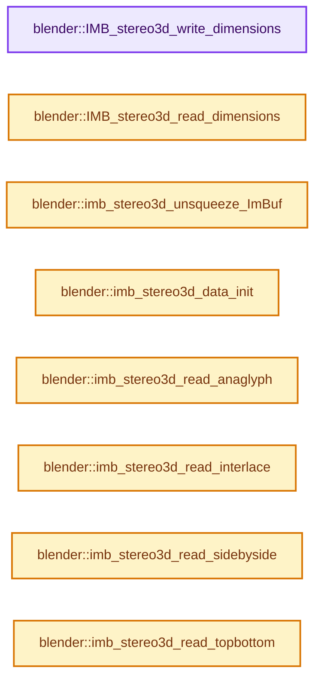
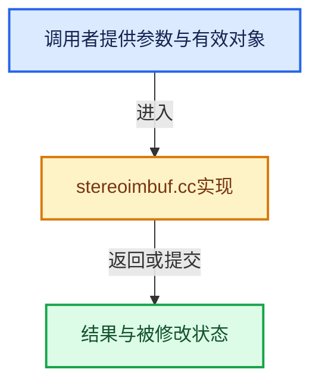

# 实现依赖专题：source/blender/imbuf/intern/stereoimbuf.cc

[方向导航](README.md) · [符号索引](../%E7%AC%A6%E5%8F%B7%E4%BE%9D%E8%B5%96%E4%B8%8E%E5%AE%9E%E7%8E%B0%E7%B4%A2%E5%BC%95.md)

本专题从正文实际调用进入，集中保存共享实现。函数有稳定锚点，可从调用处直接跳到对应完整函数；递归与互相调用通过回链组织。

## 本文件的实现关系






## 完整成员与函数实现

<a id="f-59eac69d93b5e860"></a>

### `blender::IMB_stereo3d_write_dimensions`

实现位置：[source/blender/imbuf/intern/stereoimbuf.cc](../../../../../source/blender/imbuf/intern/stereoimbuf.cc) · L498—L524。

接口参数：

- `const char mode`
- `const bool is_squeezed`
- `const size_t width`
- `const size_t height`
- `size_t *r_width`
- `size_t *r_height`

**教学注释版**

<!-- annotated:e7c41a81567545 -->

```cpp
void IMB_stereo3d_write_dimensions(const char mode,
                                   const bool is_squeezed,
                                   const size_t width,
                                   const size_t height,
                                   size_t *r_width,
                                   size_t *r_height)
{
  switch (mode) {
    case S3D_DISPLAY_SIDEBYSIDE: {
      *r_width = is_squeezed ? width : width * 2;
      *r_height = height;
      break;
    }
    case S3D_DISPLAY_TOPBOTTOM: {
      *r_width = width;
      *r_height = is_squeezed ? height : height * 2;
      break;
    }
    case S3D_DISPLAY_ANAGLYPH:
    case S3D_DISPLAY_INTERLACE:
    default: {
      *r_width = width;
      *r_height = height;
      break;
    }
  }
}
```

<details>
<summary>核对原始源码：source/blender/imbuf/intern/stereoimbuf.cc · L498—L524</summary>

<!-- original:e7c41a81567545:source/blender/imbuf/intern/stereoimbuf.cc:498:524 -->

```cpp
void IMB_stereo3d_write_dimensions(const char mode,
                                   const bool is_squeezed,
                                   const size_t width,
                                   const size_t height,
                                   size_t *r_width,
                                   size_t *r_height)
{
  switch (mode) {
    case S3D_DISPLAY_SIDEBYSIDE: {
      *r_width = is_squeezed ? width : width * 2;
      *r_height = height;
      break;
    }
    case S3D_DISPLAY_TOPBOTTOM: {
      *r_width = width;
      *r_height = is_squeezed ? height : height * 2;
      break;
    }
    case S3D_DISPLAY_ANAGLYPH:
    case S3D_DISPLAY_INTERLACE:
    default: {
      *r_width = width;
      *r_height = height;
      break;
    }
  }
}
```

</details>

**继续追踪实现**

本实现没有需要继续展开的显式调用；检查返回表达式、对象转换和调用者前置条件。

<a id="f-ef97672cd46fcf77"></a>

### `blender::IMB_stereo3d_read_dimensions`

实现位置：[source/blender/imbuf/intern/stereoimbuf.cc](../../../../../source/blender/imbuf/intern/stereoimbuf.cc) · L526—L552。

接口参数：

- `const char mode`
- `const bool is_squeezed`
- `const size_t width`
- `const size_t height`
- `size_t *r_width`
- `size_t *r_height`

**教学注释版**

<!-- annotated:bd74398d8126f9 -->

```cpp
void IMB_stereo3d_read_dimensions(const char mode,
                                  const bool is_squeezed,
                                  const size_t width,
                                  const size_t height,
                                  size_t *r_width,
                                  size_t *r_height)
{
  switch (mode) {
    case S3D_DISPLAY_SIDEBYSIDE: {
      *r_width = is_squeezed ? width / 2 : width;
      *r_height = height;
      break;
    }
    case S3D_DISPLAY_TOPBOTTOM: {
      *r_width = width;
      *r_height = is_squeezed ? height / 2 : height;
      break;
    }
    case S3D_DISPLAY_ANAGLYPH:
    case S3D_DISPLAY_INTERLACE:
    default: {
      *r_width = width;
      *r_height = height;
      break;
    }
  }
}
```

<details>
<summary>核对原始源码：source/blender/imbuf/intern/stereoimbuf.cc · L526—L552</summary>

<!-- original:bd74398d8126f9:source/blender/imbuf/intern/stereoimbuf.cc:526:552 -->

```cpp
void IMB_stereo3d_read_dimensions(const char mode,
                                  const bool is_squeezed,
                                  const size_t width,
                                  const size_t height,
                                  size_t *r_width,
                                  size_t *r_height)
{
  switch (mode) {
    case S3D_DISPLAY_SIDEBYSIDE: {
      *r_width = is_squeezed ? width / 2 : width;
      *r_height = height;
      break;
    }
    case S3D_DISPLAY_TOPBOTTOM: {
      *r_width = width;
      *r_height = is_squeezed ? height / 2 : height;
      break;
    }
    case S3D_DISPLAY_ANAGLYPH:
    case S3D_DISPLAY_INTERLACE:
    default: {
      *r_width = width;
      *r_height = height;
      break;
    }
  }
}
```

</details>

**继续追踪实现**

本实现没有需要继续展开的显式调用；检查返回表达式、对象转换和调用者前置条件。

<a id="f-2259bdf1fcd6bce1"></a>

### `blender::imb_stereo3d_unsqueeze_ImBuf`

实现位置：[source/blender/imbuf/intern/stereoimbuf.cc](../../../../../source/blender/imbuf/intern/stereoimbuf.cc) · L576—L590。

接口参数：

- `ImBuf *ibuf`
- `const Stereo3dFormat *s3d`
- `const size_t x`
- `const size_t y`

**教学注释版**

<!-- annotated:82521177be6104 -->

```cpp
static void imb_stereo3d_unsqueeze_ImBuf(ImBuf *ibuf,
                                         const Stereo3dFormat *s3d,
                                         const size_t x,
                                         const size_t y)
{
  if (ELEM(s3d->display_mode, S3D_DISPLAY_SIDEBYSIDE, S3D_DISPLAY_TOPBOTTOM) == false) {
    return;
  }

  if ((s3d->flag & S3D_SQUEEZED_FRAME) == 0) {
    return;
  }

  IMB_scale(ibuf, x, y, IMBScaleFilter::Bilinear);
}
```

<details>
<summary>核对原始源码：source/blender/imbuf/intern/stereoimbuf.cc · L576—L590</summary>

<!-- original:82521177be6104:source/blender/imbuf/intern/stereoimbuf.cc:576:590 -->

```cpp
static void imb_stereo3d_unsqueeze_ImBuf(ImBuf *ibuf,
                                         const Stereo3dFormat *s3d,
                                         const size_t x,
                                         const size_t y)
{
  if (ELEM(s3d->display_mode, S3D_DISPLAY_SIDEBYSIDE, S3D_DISPLAY_TOPBOTTOM) == false) {
    return;
  }

  if ((s3d->flag & S3D_SQUEEZED_FRAME) == 0) {
    return;
  }

  IMB_scale(ibuf, x, y, IMBScaleFilter::Bilinear);
}
```

</details>

**继续追踪实现**

- `ELEM` → [ELEM · L88](%E4%BE%9D%E8%B5%96-GHOST_utildefines-34b996.md#m-d28724a15928)；[ELEM · L135](../01-%E5%9F%BA%E7%A1%80%E5%AE%B9%E5%99%A8%E4%B8%8E%E7%8E%B0%E4%BB%A3CPP/%E4%BE%9D%E8%B5%96-BLI_utildefines-293a0a.md#m-d6572de7cae0)。宏定义由构建条件选择。
- `IMB_scale` → [blender::IMB_scale · L467](%E4%BE%9D%E8%B5%96-scaling-da6dee.md#f-61fcfc7ba7a3284f)。

<a id="f-7d3fbd76aaafb4b5"></a>

### `blender::imb_stereo3d_data_init`

实现位置：[source/blender/imbuf/intern/stereoimbuf.cc](../../../../../source/blender/imbuf/intern/stereoimbuf.cc) · L598—L620。

接口参数：

- `Stereo3DData *s3d_data`
- `const bool is_float`
- `const size_t x`
- `const size_t y`
- `const size_t channels`
- `int *rect_left`
- `int *rect_right`
- `int *rect_stereo`
- `float *rectf_left`
- `float *rectf_right`
- `float *rectf_stereo`

**教学注释版**

<!-- annotated:6e58f9e12ef758 -->

```cpp
static void imb_stereo3d_data_init(Stereo3DData *s3d_data,
                                   const bool is_float,
                                   const size_t x,
                                   const size_t y,
                                   const size_t channels,
                                   int *rect_left,
                                   int *rect_right,
                                   int *rect_stereo,
                                   float *rectf_left,
                                   float *rectf_right,
                                   float *rectf_stereo)
{
  s3d_data->is_float = is_float;
  s3d_data->x = x;
  s3d_data->y = y;
  s3d_data->channels = channels;
  s3d_data->rect.left = reinterpret_cast<uchar *>(rect_left);
  s3d_data->rect.right = reinterpret_cast<uchar *>(rect_right);
  s3d_data->rect.stereo = reinterpret_cast<uchar *>(rect_stereo);
  s3d_data->rectf.left = rectf_left;
  s3d_data->rectf.right = rectf_right;
  s3d_data->rectf.stereo = rectf_stereo;
}
```

<details>
<summary>核对原始源码：source/blender/imbuf/intern/stereoimbuf.cc · L598—L620</summary>

<!-- original:6e58f9e12ef758:source/blender/imbuf/intern/stereoimbuf.cc:598:620 -->

```cpp
static void imb_stereo3d_data_init(Stereo3DData *s3d_data,
                                   const bool is_float,
                                   const size_t x,
                                   const size_t y,
                                   const size_t channels,
                                   int *rect_left,
                                   int *rect_right,
                                   int *rect_stereo,
                                   float *rectf_left,
                                   float *rectf_right,
                                   float *rectf_stereo)
{
  s3d_data->is_float = is_float;
  s3d_data->x = x;
  s3d_data->y = y;
  s3d_data->channels = channels;
  s3d_data->rect.left = reinterpret_cast<uchar *>(rect_left);
  s3d_data->rect.right = reinterpret_cast<uchar *>(rect_right);
  s3d_data->rect.stereo = reinterpret_cast<uchar *>(rect_stereo);
  s3d_data->rectf.left = rectf_left;
  s3d_data->rectf.right = rectf_right;
  s3d_data->rectf.stereo = rectf_stereo;
}
```

</details>

**沿实际写入检查状态**

- `s3d_data->is_float = is_float;`
- `s3d_data->x = x;`
- `s3d_data->y = y;`
- `s3d_data->channels = channels;`
- `s3d_data->rect.left = reinterpret_cast<uchar *>(rect_left);`
- `s3d_data->rect.right = reinterpret_cast<uchar *>(rect_right);`
- `s3d_data->rect.stereo = reinterpret_cast<uchar *>(rect_stereo);`
- `s3d_data->rectf.left = rectf_left;`
- `s3d_data->rectf.right = rectf_right;`
- `s3d_data->rectf.stereo = rectf_stereo;`

**继续追踪实现**

本实现没有需要继续展开的显式调用；检查返回表达式、对象转换和调用者前置条件。

<a id="f-9c54b16b063da117"></a>

### `blender::imb_stereo3d_read_anaglyph`

实现位置：[source/blender/imbuf/intern/stereoimbuf.cc](../../../../../source/blender/imbuf/intern/stereoimbuf.cc) · L697—L793。

接口参数：

- `const Stereo3DData *s3d`
- `enum eStereo3dAnaglyphType mode`

**教学注释版**

<!-- annotated:e7e6a400f1ae35 -->

```cpp
static void imb_stereo3d_read_anaglyph(const Stereo3DData *s3d, enum eStereo3dAnaglyphType mode)
{
  int x, y;
  size_t width = s3d->x;
  size_t height = s3d->y;
  const size_t channels = s3d->channels;

  const int stride_from = width;
  const int stride_to = width;

  const int anaglyph_encoding[3][3] = {
      {0, 1, 1},
      {1, 0, 1},
      {0, 0, 1},
  };

  int r, g, b;

  r = anaglyph_encoding[mode][0];
  g = anaglyph_encoding[mode][1];
  b = anaglyph_encoding[mode][2];

  if (s3d->is_float) {
    float *rect_left = s3d->rectf.left;
    float *rect_right = s3d->rectf.right;
    float *rect_from = s3d->rectf.stereo;

    if (channels == 3) {
      for (y = 0; y < height; y++) {
        float *from = rect_from + stride_from * y * 3;
        float *to[2] = {
            rect_left + stride_to * y * 3,
            rect_right + stride_to * y * 3,
        };

        for (x = 0; x < width; x++, from += 3, to[0] += 3, to[1] += 3) {
          to[r][0] = from[0];
          to[g][1] = from[1];
          to[b][2] = from[2];
        }
      }
    }
    else if (channels == 4) {
      for (y = 0; y < height; y++) {
        float *from = rect_from + stride_from * y * 4;
        float *to[2] = {
            rect_left + stride_to * y * 4,
            rect_right + stride_to * y * 4,
        };

        for (x = 0; x < width; x++, from += 4, to[0] += 4, to[1] += 4) {
          to[r][0] = from[0];
          to[g][1] = from[1];
          to[b][2] = from[2];
          to[0][3] = to[1][3] = from[3];
        }
      }
    }
  }
  else {
    uchar *rect_left = s3d->rect.left;
    uchar *rect_right = s3d->rect.right;
    uchar *rect_from = s3d->rect.stereo;

    if (channels == 3) {
      for (y = 0; y < height; y++) {
        uchar *from = rect_from + stride_from * y * 3;
        uchar *to[2] = {
            rect_left + stride_to * y * 3,
            rect_right + stride_to * y * 3,
        };

        for (x = 0; x < width; x++, from += 3, to[0] += 3, to[1] += 3) {
          to[r][0] = from[0];
          to[g][1] = from[1];
          to[b][2] = from[2];
        }
      }
    }
    else if (channels == 4) {
      for (y = 0; y < height; y++) {
        uchar *from = rect_from + stride_from * y * 4;
        uchar *to[2] = {
            rect_left + stride_to * y * 4,
            rect_right + stride_to * y * 4,
        };

        for (x = 0; x < width; x++, from += 4, to[0] += 4, to[1] += 4) {
          to[r][0] = from[0];
          to[g][1] = from[1];
          to[b][2] = from[2];
          to[0][3] = to[1][3] = from[3];
        }
      }
    }
  }
}
```

<details>
<summary>核对原始源码：source/blender/imbuf/intern/stereoimbuf.cc · L697—L793</summary>

<!-- original:e7e6a400f1ae35:source/blender/imbuf/intern/stereoimbuf.cc:697:793 -->

```cpp
static void imb_stereo3d_read_anaglyph(const Stereo3DData *s3d, enum eStereo3dAnaglyphType mode)
{
  int x, y;
  size_t width = s3d->x;
  size_t height = s3d->y;
  const size_t channels = s3d->channels;

  const int stride_from = width;
  const int stride_to = width;

  const int anaglyph_encoding[3][3] = {
      {0, 1, 1},
      {1, 0, 1},
      {0, 0, 1},
  };

  int r, g, b;

  r = anaglyph_encoding[mode][0];
  g = anaglyph_encoding[mode][1];
  b = anaglyph_encoding[mode][2];

  if (s3d->is_float) {
    float *rect_left = s3d->rectf.left;
    float *rect_right = s3d->rectf.right;
    float *rect_from = s3d->rectf.stereo;

    if (channels == 3) {
      for (y = 0; y < height; y++) {
        float *from = rect_from + stride_from * y * 3;
        float *to[2] = {
            rect_left + stride_to * y * 3,
            rect_right + stride_to * y * 3,
        };

        for (x = 0; x < width; x++, from += 3, to[0] += 3, to[1] += 3) {
          to[r][0] = from[0];
          to[g][1] = from[1];
          to[b][2] = from[2];
        }
      }
    }
    else if (channels == 4) {
      for (y = 0; y < height; y++) {
        float *from = rect_from + stride_from * y * 4;
        float *to[2] = {
            rect_left + stride_to * y * 4,
            rect_right + stride_to * y * 4,
        };

        for (x = 0; x < width; x++, from += 4, to[0] += 4, to[1] += 4) {
          to[r][0] = from[0];
          to[g][1] = from[1];
          to[b][2] = from[2];
          to[0][3] = to[1][3] = from[3];
        }
      }
    }
  }
  else {
    uchar *rect_left = s3d->rect.left;
    uchar *rect_right = s3d->rect.right;
    uchar *rect_from = s3d->rect.stereo;

    if (channels == 3) {
      for (y = 0; y < height; y++) {
        uchar *from = rect_from + stride_from * y * 3;
        uchar *to[2] = {
            rect_left + stride_to * y * 3,
            rect_right + stride_to * y * 3,
        };

        for (x = 0; x < width; x++, from += 3, to[0] += 3, to[1] += 3) {
          to[r][0] = from[0];
          to[g][1] = from[1];
          to[b][2] = from[2];
        }
      }
    }
    else if (channels == 4) {
      for (y = 0; y < height; y++) {
        uchar *from = rect_from + stride_from * y * 4;
        uchar *to[2] = {
            rect_left + stride_to * y * 4,
            rect_right + stride_to * y * 4,
        };

        for (x = 0; x < width; x++, from += 4, to[0] += 4, to[1] += 4) {
          to[r][0] = from[0];
          to[g][1] = from[1];
          to[b][2] = from[2];
          to[0][3] = to[1][3] = from[3];
        }
      }
    }
  }
}
```

</details>

**沿实际写入检查状态**

- `r = anaglyph_encoding[mode][0];`
- `g = anaglyph_encoding[mode][1];`
- `b = anaglyph_encoding[mode][2];`
- `to[r][0] = from[0];`
- `to[g][1] = from[1];`
- `to[b][2] = from[2];`
- `to[0][3] = to[1][3] = from[3];`

**继续追踪实现**

本实现没有需要继续展开的显式调用；检查返回表达式、对象转换和调用者前置条件。

<a id="f-f50c1187567655ad"></a>

### `blender::imb_stereo3d_read_interlace`

实现位置：[source/blender/imbuf/intern/stereoimbuf.cc](../../../../../source/blender/imbuf/intern/stereoimbuf.cc) · L795—L1050。

接口参数：

- `const Stereo3DData *s3d`
- `enum eStereo3dInterlaceType mode`
- `const bool swap`

**教学注释版**

<!-- annotated:4d7dcd9acf4108 -->

```cpp
static void imb_stereo3d_read_interlace(const Stereo3DData *s3d,
                                        enum eStereo3dInterlaceType mode,
                                        const bool swap)
{
  int x, y;
  size_t width = s3d->x;
  size_t height = s3d->y;
  const size_t channels = s3d->channels;

  const int stride_from = width;
  const int stride_to = width;

  if (s3d->is_float) {
    float *rect_left = s3d->rectf.left;
    float *rect_right = s3d->rectf.right;
    const float *rect_from = s3d->rectf.stereo;

    switch (mode) {
      case S3D_INTERLACE_ROW: {
        char i = char(swap);
        for (y = 0; y < height; y++) {
          const float *from = rect_from + stride_from * y * channels;
          float *to[2] = {
              rect_left + stride_to * y * channels,
              rect_right + stride_to * y * channels,
          };
          // [讲解] memcpy：复制字节，源与目标不应重叠。类型生命周期、对齐和可复制表示须由调用者证明，不是任意对象的复制构造。
          memcpy(to[i], from, sizeof(float) * channels * stride_to);
          i = !i;
        }
        break;
      }
      case S3D_INTERLACE_COLUMN: {
        if (channels == 1) {
          for (y = 0; y < height; y++) {
            const float *from = rect_from + stride_from * y;
            float *to[2] = {
                rect_left + stride_to * y,
                rect_right + stride_to * y,
            };

            char i = char(swap);
            for (x = 0; x < width; x++, from += 1, to[0] += 1, to[1] += 1) {
              to[i][0] = from[0];
              i = !i;
            }
          }
        }
        else if (channels == 3) {
          for (y = 0; y < height; y++) {
            const float *from = rect_from + stride_from * y * 3;
            float *to[2] = {
                rect_left + stride_to * y * 3,
                rect_right + stride_to * y * 3,
            };

            char i = char(swap);
            for (x = 0; x < width; x++, from += 3, to[0] += 3, to[1] += 3) {
              copy_v3_v3(to[i], from);
              i = !i;
            }
          }
        }
        else if (channels == 4) {
          for (y = 0; y < height; y++) {
            const float *from = rect_from + stride_from * y * channels;
            float *to[2] = {
                rect_left + stride_to * y * channels,
                rect_right + stride_to * y * channels,
            };

            char i = char(swap);
            for (x = 0; x < width; x++, from += 4, to[0] += 4, to[1] += 4) {
              copy_v4_v4(to[i], from);
              i = !i;
            }
          }
        }
        break;
      }
      case S3D_INTERLACE_CHECKERBOARD: {
        if (channels == 1) {
          char i = char(swap);
          for (y = 0; y < height; y++) {
            const float *from = rect_from + stride_from * y;
            float *to[2] = {
                rect_left + stride_to * y,
                rect_right + stride_to * y,
            };
            char j = i;
            for (x = 0; x < width; x++, from += 1, to[0] += 1, to[1] += 1) {
              to[j][0] = from[0];
              j = !j;
            }
            i = !i;
          }
        }
        else if (channels == 3) {
          char i = char(swap);
          for (y = 0; y < height; y++) {
            const float *from = rect_from + stride_from * y * 3;
            float *to[2] = {
                rect_left + stride_to * y * 3,
                rect_right + stride_to * y * 3,
            };
            char j = i;
            for (x = 0; x < width; x++, from += 3, to[0] += 3, to[1] += 3) {
              copy_v3_v3(to[j], from);
              j = !j;
            }
            i = !i;
          }
        }
        else if (channels == 4) {
          char i = char(swap);
          for (y = 0; y < height; y++) {
            const float *from = rect_from + stride_from * y * 4;
            float *to[2] = {
                rect_left + stride_to * y * 4,
                rect_right + stride_to * y * 4,
            };
            char j = i;
            for (x = 0; x < width; x++, from += 4, to[0] += 4, to[1] += 4) {
              copy_v4_v4(to[j], from);
              j = !j;
            }
            i = !i;
          }
        }
        break;
      }
      default: {
        break;
      }
    }
  }
  else {
    uchar *rect_left = s3d->rect.right;
    uchar *rect_right = s3d->rect.left;
    const uchar *rect_from = s3d->rect.stereo;

    switch (mode) {
      case S3D_INTERLACE_ROW: {
        char i = char(swap);
        for (y = 0; y < height; y++) {
          const uchar *from = rect_from + stride_from * y * channels;
          uchar *to[2] = {
              rect_left + stride_to * y * channels,
              rect_right + stride_to * y * channels,
          };
          memcpy(to[i], from, sizeof(uchar) * channels * stride_to);
          i = !i;
        }
        break;
      }
      case S3D_INTERLACE_COLUMN: {
        if (channels == 1) {
          for (y = 0; y < height; y++) {
            const uchar *from = rect_from + stride_from * y;
            uchar *to[2] = {
                rect_left + stride_to * y,
                rect_right + stride_to * y,
            };
            char i = char(swap);
            for (x = 0; x < width; x++, from += 1, to[0] += 1, to[1] += 1) {
              to[i][0] = from[0];
              i = !i;
            }
          }
        }
        else if (channels == 3) {
          for (y = 0; y < height; y++) {
            const uchar *from = rect_from + stride_from * y * 3;
            uchar *to[2] = {
                rect_left + stride_to * y * 3,
                rect_right + stride_to * y * 3,
            };
            char i = char(swap);
            for (x = 0; x < width; x++, from += 3, to[0] += 3, to[1] += 3) {
              copy_v3_v3_uchar(to[i], from);
              i = !i;
            }
          }
        }
        else if (channels == 4) {
          for (y = 0; y < height; y++) {
            const uchar *from = rect_from + stride_from * y * 4;
            uchar *to[2] = {
                rect_left + stride_to * y * 4,
                rect_right + stride_to * y * 4,
            };
            char i = char(swap);
            for (x = 0; x < width; x++, from += 4, to[0] += 4, to[1] += 4) {
              copy_v4_v4_uchar(to[i], from);
              i = !i;
            }
          }
        }
        break;
      }
      case S3D_INTERLACE_CHECKERBOARD: {
        if (channels == 1) {
          char i = char(swap);
          for (y = 0; y < height; y++) {
            const uchar *from = rect_from + stride_from * y;
            uchar *to[2] = {
                rect_left + stride_to * y,
                rect_right + stride_to * y,
            };
            char j = i;
            for (x = 0; x < width; x++, from += 1, to[0] += 1, to[1] += 1) {
              to[j][0] = from[0];
              j = !j;
            }
            i = !i;
          }
        }
        else if (channels == 3) {
          char i = char(swap);
          for (y = 0; y < height; y++) {
            const uchar *from = rect_from + stride_from * y * 3;
            uchar *to[2] = {
                rect_left + stride_to * y * 3,
                rect_right + stride_to * y * 3,
            };
            char j = i;
            for (x = 0; x < width; x++, from += 3, to[0] += 3, to[1] += 3) {
              copy_v3_v3_uchar(to[j], from);
              j = !j;
            }
            i = !i;
          }
        }
        else if (channels == 4) {
          char i = char(swap);
          for (y = 0; y < height; y++) {
            const uchar *from = rect_from + stride_from * y * 4;
            uchar *to[2] = {
                rect_left + stride_to * y * 4,
                rect_right + stride_to * y * 4,
            };
            char j = i;
            for (x = 0; x < width; x++, from += 4, to[0] += 4, to[1] += 4) {
              copy_v4_v4_uchar(to[j], from);
              j = !j;
            }
            i = !i;
          }
        }
        break;
      }
      default: {
        break;
      }
    }
  }
}
```

<details>
<summary>核对原始源码：source/blender/imbuf/intern/stereoimbuf.cc · L795—L1050</summary>

<!-- original:4d7dcd9acf4108:source/blender/imbuf/intern/stereoimbuf.cc:795:1050 -->

```cpp
static void imb_stereo3d_read_interlace(const Stereo3DData *s3d,
                                        enum eStereo3dInterlaceType mode,
                                        const bool swap)
{
  int x, y;
  size_t width = s3d->x;
  size_t height = s3d->y;
  const size_t channels = s3d->channels;

  const int stride_from = width;
  const int stride_to = width;

  if (s3d->is_float) {
    float *rect_left = s3d->rectf.left;
    float *rect_right = s3d->rectf.right;
    const float *rect_from = s3d->rectf.stereo;

    switch (mode) {
      case S3D_INTERLACE_ROW: {
        char i = char(swap);
        for (y = 0; y < height; y++) {
          const float *from = rect_from + stride_from * y * channels;
          float *to[2] = {
              rect_left + stride_to * y * channels,
              rect_right + stride_to * y * channels,
          };
          memcpy(to[i], from, sizeof(float) * channels * stride_to);
          i = !i;
        }
        break;
      }
      case S3D_INTERLACE_COLUMN: {
        if (channels == 1) {
          for (y = 0; y < height; y++) {
            const float *from = rect_from + stride_from * y;
            float *to[2] = {
                rect_left + stride_to * y,
                rect_right + stride_to * y,
            };

            char i = char(swap);
            for (x = 0; x < width; x++, from += 1, to[0] += 1, to[1] += 1) {
              to[i][0] = from[0];
              i = !i;
            }
          }
        }
        else if (channels == 3) {
          for (y = 0; y < height; y++) {
            const float *from = rect_from + stride_from * y * 3;
            float *to[2] = {
                rect_left + stride_to * y * 3,
                rect_right + stride_to * y * 3,
            };

            char i = char(swap);
            for (x = 0; x < width; x++, from += 3, to[0] += 3, to[1] += 3) {
              copy_v3_v3(to[i], from);
              i = !i;
            }
          }
        }
        else if (channels == 4) {
          for (y = 0; y < height; y++) {
            const float *from = rect_from + stride_from * y * channels;
            float *to[2] = {
                rect_left + stride_to * y * channels,
                rect_right + stride_to * y * channels,
            };

            char i = char(swap);
            for (x = 0; x < width; x++, from += 4, to[0] += 4, to[1] += 4) {
              copy_v4_v4(to[i], from);
              i = !i;
            }
          }
        }
        break;
      }
      case S3D_INTERLACE_CHECKERBOARD: {
        if (channels == 1) {
          char i = char(swap);
          for (y = 0; y < height; y++) {
            const float *from = rect_from + stride_from * y;
            float *to[2] = {
                rect_left + stride_to * y,
                rect_right + stride_to * y,
            };
            char j = i;
            for (x = 0; x < width; x++, from += 1, to[0] += 1, to[1] += 1) {
              to[j][0] = from[0];
              j = !j;
            }
            i = !i;
          }
        }
        else if (channels == 3) {
          char i = char(swap);
          for (y = 0; y < height; y++) {
            const float *from = rect_from + stride_from * y * 3;
            float *to[2] = {
                rect_left + stride_to * y * 3,
                rect_right + stride_to * y * 3,
            };
            char j = i;
            for (x = 0; x < width; x++, from += 3, to[0] += 3, to[1] += 3) {
              copy_v3_v3(to[j], from);
              j = !j;
            }
            i = !i;
          }
        }
        else if (channels == 4) {
          char i = char(swap);
          for (y = 0; y < height; y++) {
            const float *from = rect_from + stride_from * y * 4;
            float *to[2] = {
                rect_left + stride_to * y * 4,
                rect_right + stride_to * y * 4,
            };
            char j = i;
            for (x = 0; x < width; x++, from += 4, to[0] += 4, to[1] += 4) {
              copy_v4_v4(to[j], from);
              j = !j;
            }
            i = !i;
          }
        }
        break;
      }
      default: {
        break;
      }
    }
  }
  else {
    uchar *rect_left = s3d->rect.right;
    uchar *rect_right = s3d->rect.left;
    const uchar *rect_from = s3d->rect.stereo;

    switch (mode) {
      case S3D_INTERLACE_ROW: {
        char i = char(swap);
        for (y = 0; y < height; y++) {
          const uchar *from = rect_from + stride_from * y * channels;
          uchar *to[2] = {
              rect_left + stride_to * y * channels,
              rect_right + stride_to * y * channels,
          };
          memcpy(to[i], from, sizeof(uchar) * channels * stride_to);
          i = !i;
        }
        break;
      }
      case S3D_INTERLACE_COLUMN: {
        if (channels == 1) {
          for (y = 0; y < height; y++) {
            const uchar *from = rect_from + stride_from * y;
            uchar *to[2] = {
                rect_left + stride_to * y,
                rect_right + stride_to * y,
            };
            char i = char(swap);
            for (x = 0; x < width; x++, from += 1, to[0] += 1, to[1] += 1) {
              to[i][0] = from[0];
              i = !i;
            }
          }
        }
        else if (channels == 3) {
          for (y = 0; y < height; y++) {
            const uchar *from = rect_from + stride_from * y * 3;
            uchar *to[2] = {
                rect_left + stride_to * y * 3,
                rect_right + stride_to * y * 3,
            };
            char i = char(swap);
            for (x = 0; x < width; x++, from += 3, to[0] += 3, to[1] += 3) {
              copy_v3_v3_uchar(to[i], from);
              i = !i;
            }
          }
        }
        else if (channels == 4) {
          for (y = 0; y < height; y++) {
            const uchar *from = rect_from + stride_from * y * 4;
            uchar *to[2] = {
                rect_left + stride_to * y * 4,
                rect_right + stride_to * y * 4,
            };
            char i = char(swap);
            for (x = 0; x < width; x++, from += 4, to[0] += 4, to[1] += 4) {
              copy_v4_v4_uchar(to[i], from);
              i = !i;
            }
          }
        }
        break;
      }
      case S3D_INTERLACE_CHECKERBOARD: {
        if (channels == 1) {
          char i = char(swap);
          for (y = 0; y < height; y++) {
            const uchar *from = rect_from + stride_from * y;
            uchar *to[2] = {
                rect_left + stride_to * y,
                rect_right + stride_to * y,
            };
            char j = i;
            for (x = 0; x < width; x++, from += 1, to[0] += 1, to[1] += 1) {
              to[j][0] = from[0];
              j = !j;
            }
            i = !i;
          }
        }
        else if (channels == 3) {
          char i = char(swap);
          for (y = 0; y < height; y++) {
            const uchar *from = rect_from + stride_from * y * 3;
            uchar *to[2] = {
                rect_left + stride_to * y * 3,
                rect_right + stride_to * y * 3,
            };
            char j = i;
            for (x = 0; x < width; x++, from += 3, to[0] += 3, to[1] += 3) {
              copy_v3_v3_uchar(to[j], from);
              j = !j;
            }
            i = !i;
          }
        }
        else if (channels == 4) {
          char i = char(swap);
          for (y = 0; y < height; y++) {
            const uchar *from = rect_from + stride_from * y * 4;
            uchar *to[2] = {
                rect_left + stride_to * y * 4,
                rect_right + stride_to * y * 4,
            };
            char j = i;
            for (x = 0; x < width; x++, from += 4, to[0] += 4, to[1] += 4) {
              copy_v4_v4_uchar(to[j], from);
              j = !j;
            }
            i = !i;
          }
        }
        break;
      }
      default: {
        break;
      }
    }
  }
}
```

</details>

**沿实际写入检查状态**

- `i = !i;`
- `to[i][0] = from[0];`
- `to[j][0] = from[0];`
- `j = !j;`

**继续追踪实现**

- `memcpy` → [外部契约](https://eel.is/c++draft/cstring.syn)：复制字节，源与目标不应重叠。类型生命周期、对齐和可复制表示须由调用者证明，不是任意对象的复制构造。
- `copy_v3_v3` → [blender::copy_v3_v3 · L47](../12-%E7%A9%BA%E9%97%B4%E6%95%B0%E6%8D%AE%E7%BB%93%E6%9E%84%E4%B8%8E%E5%87%A0%E4%BD%95%E7%AE%97%E6%B3%95/%E4%BE%9D%E8%B5%96-math_vector_inline-0c8541.md#f-037a0d5fa5060bd6)。
- `copy_v4_v4` → [blender::copy_v4_v4 · L54](../12-%E7%A9%BA%E9%97%B4%E6%95%B0%E6%8D%AE%E7%BB%93%E6%9E%84%E4%B8%8E%E5%87%A0%E4%BD%95%E7%AE%97%E6%B3%95/%E4%BE%9D%E8%B5%96-math_vector_inline-0c8541.md#f-0cf225fc326edf4a)。
- `copy_v3_v3_uchar` → [blender::copy_v3_v3_uchar · L85](../12-%E7%A9%BA%E9%97%B4%E6%95%B0%E6%8D%AE%E7%BB%93%E6%9E%84%E4%B8%8E%E5%87%A0%E4%BD%95%E7%AE%97%E6%B3%95/%E4%BE%9D%E8%B5%96-math_vector_inline-0c8541.md#f-5d8d4ac0d4d3489c)。
- `copy_v4_v4_uchar` → [blender::copy_v4_v4_uchar · L92](../12-%E7%A9%BA%E9%97%B4%E6%95%B0%E6%8D%AE%E7%BB%93%E6%9E%84%E4%B8%8E%E5%87%A0%E4%BD%95%E7%AE%97%E6%B3%95/%E4%BE%9D%E8%B5%96-math_vector_inline-0c8541.md#f-4acd2fff1ffdebcc)。

<a id="f-17dca12e34da762c"></a>

### `blender::imb_stereo3d_read_sidebyside`

实现位置：[source/blender/imbuf/intern/stereoimbuf.cc](../../../../../source/blender/imbuf/intern/stereoimbuf.cc) · L1053—L1099。

接口参数：

- `const Stereo3DData *s3d`
- `const bool crosseyed`

**教学注释版**

<!-- annotated:78a0810af6d62d -->

```cpp
static void imb_stereo3d_read_sidebyside(const Stereo3DData *s3d, const bool crosseyed)
{
  int y;
  size_t width = s3d->x;
  size_t height = s3d->y;
  const size_t channels = s3d->channels;

  const int stride_from = width * 2;
  const int stride_to = width;

  const int l = int(crosseyed);
  const int r = !l;

  if (s3d->is_float) {
    float *rect_left = s3d->rectf.left;
    float *rect_right = s3d->rectf.right;
    const float *rect_from = s3d->rectf.stereo;

    for (y = 0; y < height; y++) {
      const float *from = rect_from + stride_from * y * channels;
      float *to[2] = {
          rect_left + stride_to * y * channels,
          rect_right + stride_to * y * channels,
      };

      // [讲解] memcpy：复制字节，源与目标不应重叠。类型生命周期、对齐和可复制表示须由调用者证明，不是任意对象的复制构造。
      memcpy(to[l], from, sizeof(float) * channels * stride_to);
      memcpy(to[r], from + channels * stride_to, sizeof(float) * channels * stride_to);
    }
  }
  else {
    uchar *rect_left = s3d->rect.left;
    uchar *rect_right = s3d->rect.right;
    const uchar *rect_from = s3d->rect.stereo;

    /* always RGBA input/output */
    for (y = 0; y < height; y++) {
      const uchar *from = rect_from + stride_from * y * channels;
      uchar *to[2] = {
          rect_left + stride_to * y * channels,
          rect_right + stride_to * y * channels,
      };

      memcpy(to[l], from, sizeof(uchar) * channels * stride_to);
      memcpy(to[r], from + channels * stride_to, sizeof(uchar) * channels * stride_to);
    }
  }
}
```

<details>
<summary>核对原始源码：source/blender/imbuf/intern/stereoimbuf.cc · L1053—L1099</summary>

<!-- original:78a0810af6d62d:source/blender/imbuf/intern/stereoimbuf.cc:1053:1099 -->

```cpp
static void imb_stereo3d_read_sidebyside(const Stereo3DData *s3d, const bool crosseyed)
{
  int y;
  size_t width = s3d->x;
  size_t height = s3d->y;
  const size_t channels = s3d->channels;

  const int stride_from = width * 2;
  const int stride_to = width;

  const int l = int(crosseyed);
  const int r = !l;

  if (s3d->is_float) {
    float *rect_left = s3d->rectf.left;
    float *rect_right = s3d->rectf.right;
    const float *rect_from = s3d->rectf.stereo;

    for (y = 0; y < height; y++) {
      const float *from = rect_from + stride_from * y * channels;
      float *to[2] = {
          rect_left + stride_to * y * channels,
          rect_right + stride_to * y * channels,
      };

      memcpy(to[l], from, sizeof(float) * channels * stride_to);
      memcpy(to[r], from + channels * stride_to, sizeof(float) * channels * stride_to);
    }
  }
  else {
    uchar *rect_left = s3d->rect.left;
    uchar *rect_right = s3d->rect.right;
    const uchar *rect_from = s3d->rect.stereo;

    /* always RGBA input/output */
    for (y = 0; y < height; y++) {
      const uchar *from = rect_from + stride_from * y * channels;
      uchar *to[2] = {
          rect_left + stride_to * y * channels,
          rect_right + stride_to * y * channels,
      };

      memcpy(to[l], from, sizeof(uchar) * channels * stride_to);
      memcpy(to[r], from + channels * stride_to, sizeof(uchar) * channels * stride_to);
    }
  }
}
```

</details>

**继续追踪实现**

- `memcpy` → [外部契约](https://eel.is/c++draft/cstring.syn)：复制字节，源与目标不应重叠。类型生命周期、对齐和可复制表示须由调用者证明，不是任意对象的复制构造。

<a id="f-0a5aad72d8c8d560"></a>

### `blender::imb_stereo3d_read_topbottom`

实现位置：[source/blender/imbuf/intern/stereoimbuf.cc](../../../../../source/blender/imbuf/intern/stereoimbuf.cc) · L1102—L1144。

接口参数：

- `const Stereo3DData *s3d`

**教学注释版**

<!-- annotated:b14314ec405e1d -->

```cpp
static void imb_stereo3d_read_topbottom(const Stereo3DData *s3d)
{
  int y;
  size_t width = s3d->x;
  size_t height = s3d->y;
  const size_t channels = s3d->channels;

  const int stride_from = width;
  const int stride_to = width;

  if (s3d->is_float) {
    float *rect_left = s3d->rectf.left;
    float *rect_right = s3d->rectf.right;
    const float *rect_from = s3d->rectf.stereo;

    for (y = 0; y < height; y++) {
      const float *from = rect_from + stride_from * y * channels;
      float *to[2] = {
          rect_left + stride_to * y * channels,
          rect_right + stride_to * y * channels,
      };

      // [讲解] memcpy：复制字节，源与目标不应重叠。类型生命周期、对齐和可复制表示须由调用者证明，不是任意对象的复制构造。
      memcpy(to[1], from, sizeof(float) * channels * stride_to);
      memcpy(to[0], from + channels * height * stride_to, sizeof(float) * channels * stride_to);
    }
  }
  else {
    uchar *rect_left = s3d->rect.left;
    uchar *rect_right = s3d->rect.right;
    const uchar *rect_from = s3d->rect.stereo;

    for (y = 0; y < height; y++) {
      const uchar *from = rect_from + stride_from * y * channels;
      uchar *to[2] = {
          rect_left + stride_to * y * channels,
          rect_right + stride_to * y * channels,
      };

      memcpy(to[1], from, sizeof(uchar) * channels * stride_to);
      memcpy(to[0], from + channels * height * stride_to, sizeof(uchar) * channels * stride_to);
    }
  }
}
```

<details>
<summary>核对原始源码：source/blender/imbuf/intern/stereoimbuf.cc · L1102—L1144</summary>

<!-- original:b14314ec405e1d:source/blender/imbuf/intern/stereoimbuf.cc:1102:1144 -->

```cpp
static void imb_stereo3d_read_topbottom(const Stereo3DData *s3d)
{
  int y;
  size_t width = s3d->x;
  size_t height = s3d->y;
  const size_t channels = s3d->channels;

  const int stride_from = width;
  const int stride_to = width;

  if (s3d->is_float) {
    float *rect_left = s3d->rectf.left;
    float *rect_right = s3d->rectf.right;
    const float *rect_from = s3d->rectf.stereo;

    for (y = 0; y < height; y++) {
      const float *from = rect_from + stride_from * y * channels;
      float *to[2] = {
          rect_left + stride_to * y * channels,
          rect_right + stride_to * y * channels,
      };

      memcpy(to[1], from, sizeof(float) * channels * stride_to);
      memcpy(to[0], from + channels * height * stride_to, sizeof(float) * channels * stride_to);
    }
  }
  else {
    uchar *rect_left = s3d->rect.left;
    uchar *rect_right = s3d->rect.right;
    const uchar *rect_from = s3d->rect.stereo;

    for (y = 0; y < height; y++) {
      const uchar *from = rect_from + stride_from * y * channels;
      uchar *to[2] = {
          rect_left + stride_to * y * channels,
          rect_right + stride_to * y * channels,
      };

      memcpy(to[1], from, sizeof(uchar) * channels * stride_to);
      memcpy(to[0], from + channels * height * stride_to, sizeof(uchar) * channels * stride_to);
    }
  }
}
```

</details>

**继续追踪实现**

- `memcpy` → [外部契约](https://eel.is/c++draft/cstring.syn)：复制字节，源与目标不应重叠。类型生命周期、对齐和可复制表示须由调用者证明，不是任意对象的复制构造。

<a id="f-b10d52a681fb03ef"></a>

### `blender::IMB_ImBufFromStereo3d`

实现位置：[source/blender/imbuf/intern/stereoimbuf.cc](../../../../../source/blender/imbuf/intern/stereoimbuf.cc) · L1152—L1216。

接口参数：

- `const Stereo3dFormat *s3d`
- `ImBuf *ibuf_stereo3d`
- `ImBuf **r_ibuf_left`
- `ImBuf **r_ibuf_right`

**教学注释版**

<!-- annotated:a6df697adfa6a7 -->

```cpp
void IMB_ImBufFromStereo3d(const Stereo3dFormat *s3d,
                           ImBuf *ibuf_stereo3d,
                           ImBuf **r_ibuf_left,
                           ImBuf **r_ibuf_right)
{
  Stereo3DData s3d_data = {{nullptr}};
  ImBuf *ibuf_left, *ibuf_right;
  size_t width, height;
  const bool is_float = (ibuf_stereo3d->float_data() != nullptr);

  IMB_stereo3d_read_dimensions(s3d->display_mode,
                               ((s3d->flag & S3D_SQUEEZED_FRAME) == 0),
                               ibuf_stereo3d->x,
                               ibuf_stereo3d->y,
                               &width,
                               &height);

  ibuf_left = IMB_allocImBuf(width, height, ImBufFlags::Zero);
  ibuf_right = IMB_allocImBuf(width, height, ImBufFlags::Zero);
  ibuf_left->color_mode = ibuf_right->color_mode = ibuf_stereo3d->color_mode;

  if (is_float) {
    IMB_alloc_float_pixels(ibuf_left, ibuf_stereo3d->channels);
    IMB_alloc_float_pixels(ibuf_right, ibuf_stereo3d->channels);
    ibuf_left->float_buffer.colorspace = ibuf_stereo3d->float_buffer.colorspace;
    ibuf_right->float_buffer.colorspace = ibuf_stereo3d->float_buffer.colorspace;
  }
  else {
    IMB_alloc_byte_pixels(ibuf_left);
    IMB_alloc_byte_pixels(ibuf_right);
    ibuf_left->byte_buffer.colorspace = ibuf_stereo3d->byte_buffer.colorspace;
    ibuf_right->byte_buffer.colorspace = ibuf_stereo3d->byte_buffer.colorspace;
  }

  ibuf_left->flags = ibuf_stereo3d->flags;
  ibuf_right->flags = ibuf_stereo3d->flags;

  /* we always work with unsqueezed formats */
  IMB_stereo3d_write_dimensions(s3d->display_mode,
                                ((s3d->flag & S3D_SQUEEZED_FRAME) == 0),
                                ibuf_stereo3d->x,
                                ibuf_stereo3d->y,
                                &width,
                                &height);
  imb_stereo3d_unsqueeze_ImBuf(ibuf_stereo3d, s3d, width, height);

  imb_stereo3d_data_init(&s3d_data,
                         is_float,
                         ibuf_left->x,
                         ibuf_left->y,
                         ibuf_left->channels,
                         reinterpret_cast<int *>(ibuf_left->byte_data_for_write()),
                         reinterpret_cast<int *>(ibuf_right->byte_data_for_write()),
                         reinterpret_cast<int *>(ibuf_stereo3d->byte_data_for_write()),
                         ibuf_left->float_data_for_write(),
                         ibuf_right->float_data_for_write(),
                         ibuf_stereo3d->float_data_for_write());

  imb_stereo3d_read_doit(&s3d_data, s3d);

  IMB_freeImBuf(ibuf_stereo3d);

  *r_ibuf_left = ibuf_left;
  *r_ibuf_right = ibuf_right;
}
```

<details>
<summary>核对原始源码：source/blender/imbuf/intern/stereoimbuf.cc · L1152—L1216</summary>

<!-- original:a6df697adfa6a7:source/blender/imbuf/intern/stereoimbuf.cc:1152:1216 -->

```cpp
void IMB_ImBufFromStereo3d(const Stereo3dFormat *s3d,
                           ImBuf *ibuf_stereo3d,
                           ImBuf **r_ibuf_left,
                           ImBuf **r_ibuf_right)
{
  Stereo3DData s3d_data = {{nullptr}};
  ImBuf *ibuf_left, *ibuf_right;
  size_t width, height;
  const bool is_float = (ibuf_stereo3d->float_data() != nullptr);

  IMB_stereo3d_read_dimensions(s3d->display_mode,
                               ((s3d->flag & S3D_SQUEEZED_FRAME) == 0),
                               ibuf_stereo3d->x,
                               ibuf_stereo3d->y,
                               &width,
                               &height);

  ibuf_left = IMB_allocImBuf(width, height, ImBufFlags::Zero);
  ibuf_right = IMB_allocImBuf(width, height, ImBufFlags::Zero);
  ibuf_left->color_mode = ibuf_right->color_mode = ibuf_stereo3d->color_mode;

  if (is_float) {
    IMB_alloc_float_pixels(ibuf_left, ibuf_stereo3d->channels);
    IMB_alloc_float_pixels(ibuf_right, ibuf_stereo3d->channels);
    ibuf_left->float_buffer.colorspace = ibuf_stereo3d->float_buffer.colorspace;
    ibuf_right->float_buffer.colorspace = ibuf_stereo3d->float_buffer.colorspace;
  }
  else {
    IMB_alloc_byte_pixels(ibuf_left);
    IMB_alloc_byte_pixels(ibuf_right);
    ibuf_left->byte_buffer.colorspace = ibuf_stereo3d->byte_buffer.colorspace;
    ibuf_right->byte_buffer.colorspace = ibuf_stereo3d->byte_buffer.colorspace;
  }

  ibuf_left->flags = ibuf_stereo3d->flags;
  ibuf_right->flags = ibuf_stereo3d->flags;

  /* we always work with unsqueezed formats */
  IMB_stereo3d_write_dimensions(s3d->display_mode,
                                ((s3d->flag & S3D_SQUEEZED_FRAME) == 0),
                                ibuf_stereo3d->x,
                                ibuf_stereo3d->y,
                                &width,
                                &height);
  imb_stereo3d_unsqueeze_ImBuf(ibuf_stereo3d, s3d, width, height);

  imb_stereo3d_data_init(&s3d_data,
                         is_float,
                         ibuf_left->x,
                         ibuf_left->y,
                         ibuf_left->channels,
                         reinterpret_cast<int *>(ibuf_left->byte_data_for_write()),
                         reinterpret_cast<int *>(ibuf_right->byte_data_for_write()),
                         reinterpret_cast<int *>(ibuf_stereo3d->byte_data_for_write()),
                         ibuf_left->float_data_for_write(),
                         ibuf_right->float_data_for_write(),
                         ibuf_stereo3d->float_data_for_write());

  imb_stereo3d_read_doit(&s3d_data, s3d);

  IMB_freeImBuf(ibuf_stereo3d);

  *r_ibuf_left = ibuf_left;
  *r_ibuf_right = ibuf_right;
}
```

</details>

**沿实际写入检查状态**

- `ibuf_left = IMB_allocImBuf(width, height, ImBufFlags::Zero);`
- `ibuf_right = IMB_allocImBuf(width, height, ImBufFlags::Zero);`
- `ibuf_left->color_mode = ibuf_right->color_mode = ibuf_stereo3d->color_mode;`
- `ibuf_left->float_buffer.colorspace = ibuf_stereo3d->float_buffer.colorspace;`
- `ibuf_right->float_buffer.colorspace = ibuf_stereo3d->float_buffer.colorspace;`
- `ibuf_left->byte_buffer.colorspace = ibuf_stereo3d->byte_buffer.colorspace;`
- `ibuf_right->byte_buffer.colorspace = ibuf_stereo3d->byte_buffer.colorspace;`
- `ibuf_left->flags = ibuf_stereo3d->flags;`
- `ibuf_right->flags = ibuf_stereo3d->flags;`

**继续追踪实现**

- `ibuf_stereo3d->float_data` → [blender::ImBuf::float_data · L358](%E4%BE%9D%E8%B5%96-IMB_imbuf_types-f69e60.md#f-2e52aa77544ffaee)。
- `IMB_stereo3d_read_dimensions` → [blender::IMB_stereo3d_read_dimensions · L526](%E4%BE%9D%E8%B5%96-stereoimbuf-a4c335.md#f-ef97672cd46fcf77)。
- `IMB_allocImBuf` → [blender::IMB_allocImBuf · L367](%E4%BE%9D%E8%B5%96-allocimbuf-bc68dd.md#f-971d0005c46aad53)。
- `IMB_alloc_float_pixels` → [blender::IMB_alloc_float_pixels · L200](%E4%BE%9D%E8%B5%96-allocimbuf-bc68dd.md#f-ffd386ee67c57b36)。
- `IMB_alloc_byte_pixels` → [blender::IMB_alloc_byte_pixels · L219](%E4%BE%9D%E8%B5%96-allocimbuf-bc68dd.md#f-2186a459f2bdfa43)。
- `IMB_stereo3d_write_dimensions` → [blender::IMB_stereo3d_write_dimensions · L498](%E4%BE%9D%E8%B5%96-stereoimbuf-a4c335.md#f-59eac69d93b5e860)。
- `imb_stereo3d_unsqueeze_ImBuf` → [blender::imb_stereo3d_unsqueeze_ImBuf · L576](%E4%BE%9D%E8%B5%96-stereoimbuf-a4c335.md#f-2259bdf1fcd6bce1)。
- `imb_stereo3d_data_init` → [blender::imb_stereo3d_data_init · L598](%E4%BE%9D%E8%B5%96-stereoimbuf-a4c335.md#f-7d3fbd76aaafb4b5)。
- `ibuf_left->byte_data_for_write` → [blender::ImBuf::byte_data_for_write · L60](%E4%BE%9D%E8%B5%96-allocimbuf-bc68dd.md#f-9ae201bd1c52aa87)。
- `ibuf_right->byte_data_for_write` → [调用协议](../%E6%A8%A1%E6%9D%BF%E5%AE%8F%E4%B8%8E%E5%8A%A8%E6%80%81%E5%88%86%E6%B4%BE%E5%8D%8F%E8%AE%AE.md)：接收对象类型依赖auto、返回值或模板实例；不按同名猜测目标。调用位置L1204。
- `ibuf_stereo3d->byte_data_for_write` → [blender::ImBuf::byte_data_for_write · L60](%E4%BE%9D%E8%B5%96-allocimbuf-bc68dd.md#f-9ae201bd1c52aa87)。
- `ibuf_left->float_data_for_write` → [blender::ImBuf::float_data_for_write · L79](%E4%BE%9D%E8%B5%96-allocimbuf-bc68dd.md#f-1956ac4db88ed3eb)。
- `ibuf_right->float_data_for_write` → [调用协议](../%E6%A8%A1%E6%9D%BF%E5%AE%8F%E4%B8%8E%E5%8A%A8%E6%80%81%E5%88%86%E6%B4%BE%E5%8D%8F%E8%AE%AE.md)：接收对象类型依赖auto、返回值或模板实例；不按同名猜测目标。调用位置L1207。
- `ibuf_stereo3d->float_data_for_write` → [blender::ImBuf::float_data_for_write · L79](%E4%BE%9D%E8%B5%96-allocimbuf-bc68dd.md#f-1956ac4db88ed3eb)。
- `imb_stereo3d_read_doit` → [blender::imb_stereo3d_read_doit · L1218](%E4%BE%9D%E8%B5%96-stereoimbuf-a4c335.md#f-b524972289381791)。
- `IMB_freeImBuf` → [blender::IMB_freeImBuf · L144](%E4%BE%9D%E8%B5%96-allocimbuf-bc68dd.md#f-c830f56ede6f345b)。

<a id="f-b524972289381791"></a>

### `blender::imb_stereo3d_read_doit`

实现位置：[source/blender/imbuf/intern/stereoimbuf.cc](../../../../../source/blender/imbuf/intern/stereoimbuf.cc) · L1218—L1238。

接口参数：

- `Stereo3DData *s3d_data`
- `const Stereo3dFormat *s3d`

**教学注释版**

<!-- annotated:ab42602aa0f388 -->

```cpp
static void imb_stereo3d_read_doit(Stereo3DData *s3d_data, const Stereo3dFormat *s3d)
{
  switch (s3d->display_mode) {
    case S3D_DISPLAY_ANAGLYPH:
      imb_stereo3d_read_anaglyph(s3d_data, eStereo3dAnaglyphType(s3d->anaglyph_type));
      break;
    case S3D_DISPLAY_INTERLACE:
      imb_stereo3d_read_interlace(s3d_data,
                                  eStereo3dInterlaceType(s3d->interlace_type),
                                  (s3d->flag & S3D_INTERLACE_SWAP) != 0);
      break;
    case S3D_DISPLAY_SIDEBYSIDE:
      imb_stereo3d_read_sidebyside(s3d_data, (s3d->flag & S3D_SIDEBYSIDE_CROSSEYED) != 0);
      break;
    case S3D_DISPLAY_TOPBOTTOM:
      imb_stereo3d_read_topbottom(s3d_data);
      break;
    default:
      break;
  }
}
```

<details>
<summary>核对原始源码：source/blender/imbuf/intern/stereoimbuf.cc · L1218—L1238</summary>

<!-- original:ab42602aa0f388:source/blender/imbuf/intern/stereoimbuf.cc:1218:1238 -->

```cpp
static void imb_stereo3d_read_doit(Stereo3DData *s3d_data, const Stereo3dFormat *s3d)
{
  switch (s3d->display_mode) {
    case S3D_DISPLAY_ANAGLYPH:
      imb_stereo3d_read_anaglyph(s3d_data, eStereo3dAnaglyphType(s3d->anaglyph_type));
      break;
    case S3D_DISPLAY_INTERLACE:
      imb_stereo3d_read_interlace(s3d_data,
                                  eStereo3dInterlaceType(s3d->interlace_type),
                                  (s3d->flag & S3D_INTERLACE_SWAP) != 0);
      break;
    case S3D_DISPLAY_SIDEBYSIDE:
      imb_stereo3d_read_sidebyside(s3d_data, (s3d->flag & S3D_SIDEBYSIDE_CROSSEYED) != 0);
      break;
    case S3D_DISPLAY_TOPBOTTOM:
      imb_stereo3d_read_topbottom(s3d_data);
      break;
    default:
      break;
  }
}
```

</details>

**继续追踪实现**

- `imb_stereo3d_read_anaglyph` → [blender::imb_stereo3d_read_anaglyph · L697](%E4%BE%9D%E8%B5%96-stereoimbuf-a4c335.md#f-9c54b16b063da117)。
- `eStereo3dAnaglyphType` → [blender::eStereo3dAnaglyphType](%E4%BE%9D%E8%B5%96-DNA_scene_enums-9be265.md#t-a184353c1c92)。
- `imb_stereo3d_read_interlace` → [blender::imb_stereo3d_read_interlace · L795](%E4%BE%9D%E8%B5%96-stereoimbuf-a4c335.md#f-f50c1187567655ad)。
- `eStereo3dInterlaceType` → [blender::eStereo3dInterlaceType](%E4%BE%9D%E8%B5%96-DNA_scene_enums-9be265.md#t-678c71b454f2)。
- `imb_stereo3d_read_sidebyside` → [blender::imb_stereo3d_read_sidebyside · L1053](%E4%BE%9D%E8%B5%96-stereoimbuf-a4c335.md#f-17dca12e34da762c)。
- `imb_stereo3d_read_topbottom` → [blender::imb_stereo3d_read_topbottom · L1102](%E4%BE%9D%E8%B5%96-stereoimbuf-a4c335.md#f-0a5aad72d8c8d560)。
