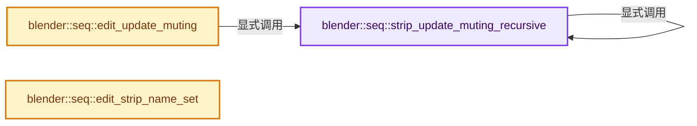
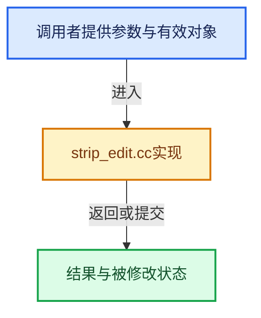

# 实现依赖专题：source/blender/sequencer/intern/strip_edit.cc

[方向导航](README.md) · [符号索引](../%E7%AC%A6%E5%8F%B7%E4%BE%9D%E8%B5%96%E4%B8%8E%E5%AE%9E%E7%8E%B0%E7%B4%A2%E5%BC%95.md)

本专题从正文实际调用进入，集中保存共享实现。函数有稳定锚点，可从调用处直接跳到对应完整函数；递归与互相调用通过回链组织。

## 本文件的实现关系






## 完整成员与函数实现

<a id="f-cd51d9f7df6a080c"></a>

### `blender::seq::strip_update_muting_recursive`

实现位置：[source/blender/sequencer/intern/strip_edit.cc](../../../../../source/blender/sequencer/intern/strip_edit.cc) · L102—L127。

接口参数：

- `ListBaseT<SeqTimelineChannel> *channels`
- `ListBaseT<Strip> *seqbasep`
- `Strip *strip_meta`
- `const bool mute`

**教学注释版**

<!-- annotated:a1be8ac5043178 -->

```cpp
static void strip_update_muting_recursive(ListBaseT<SeqTimelineChannel> *channels,
                                          ListBaseT<Strip> *seqbasep,
                                          Strip *strip_meta,
                                          const bool mute)
{
  /* For sound we go over full meta tree to update muted state,
   * since sound is played outside of evaluating the imbufs. */
  for (Strip &strip : *seqbasep) {
    bool strip_mute = (mute || render_is_muted(channels, &strip));

    if (strip.type == STRIP_TYPE_META) {
      /* if this is the current meta-strip, unmute because
       * all strips above this were set to mute */
      if (&strip == strip_meta) {
        strip_mute = false;
      }

      strip_update_muting_recursive(&strip.channels, &strip.seqbase, strip_meta, strip_mute);
    }
    else if (ELEM(strip.type, STRIP_TYPE_SOUND, STRIP_TYPE_SCENE)) {
      if (strip.runtime->scene_sound) {
        BKE_sound_mute_scene_sound(strip.runtime->scene_sound, strip_mute);
      }
    }
  }
}
```

<details>
<summary>核对原始源码：source/blender/sequencer/intern/strip_edit.cc · L102—L127</summary>

<!-- original:a1be8ac5043178:source/blender/sequencer/intern/strip_edit.cc:102:127 -->

```cpp
static void strip_update_muting_recursive(ListBaseT<SeqTimelineChannel> *channels,
                                          ListBaseT<Strip> *seqbasep,
                                          Strip *strip_meta,
                                          const bool mute)
{
  /* For sound we go over full meta tree to update muted state,
   * since sound is played outside of evaluating the imbufs. */
  for (Strip &strip : *seqbasep) {
    bool strip_mute = (mute || render_is_muted(channels, &strip));

    if (strip.type == STRIP_TYPE_META) {
      /* if this is the current meta-strip, unmute because
       * all strips above this were set to mute */
      if (&strip == strip_meta) {
        strip_mute = false;
      }

      strip_update_muting_recursive(&strip.channels, &strip.seqbase, strip_meta, strip_mute);
    }
    else if (ELEM(strip.type, STRIP_TYPE_SOUND, STRIP_TYPE_SCENE)) {
      if (strip.runtime->scene_sound) {
        BKE_sound_mute_scene_sound(strip.runtime->scene_sound, strip_mute);
      }
    }
  }
}
```

</details>

**沿实际写入检查状态**

- `strip_mute = false;`

**继续追踪实现**

- `render_is_muted` → [blender::seq::render_is_muted · L2194](%E4%BE%9D%E8%B5%96-render-79404c.md#f-ee8903b9e2968421)。
- `strip_update_muting_recursive` → [blender::seq::strip_update_muting_recursive · L102](%E4%BE%9D%E8%B5%96-strip_edit-be093a.md#f-cd51d9f7df6a080c)。
- `ELEM` → [ELEM · L88](%E4%BE%9D%E8%B5%96-GHOST_utildefines-34b996.md#m-d28724a15928)；[ELEM · L135](../01-%E5%9F%BA%E7%A1%80%E5%AE%B9%E5%99%A8%E4%B8%8E%E7%8E%B0%E4%BB%A3CPP/%E4%BE%9D%E8%B5%96-BLI_utildefines-293a0a.md#m-d6572de7cae0)。宏定义由构建条件选择。
- `BKE_sound_mute_scene_sound` → [blender::BKE_sound_mute_scene_sound · L976](%E4%BE%9D%E8%B5%96-sound-6c4717.md#f-49856c937884cb5f)；[blender::BKE_sound_mute_scene_sound · L1953](%E4%BE%9D%E8%B5%96-sound-6c4717.md#f-a75f20c0735e32f2)。同名重载需按实参类型选择。

<a id="f-b91b62421cda9c12"></a>

### `blender::seq::edit_update_muting`

实现位置：[source/blender/sequencer/intern/strip_edit.cc](../../../../../source/blender/sequencer/intern/strip_edit.cc) · L129—L142。

接口参数：

- `Editing *ed`

**教学注释版**

<!-- annotated:97d7a40f0c882b -->

```cpp
void edit_update_muting(Editing *ed)
{
  if (ed) {
    /* mute all sounds up to current metastack list */
    MetaStack *ms = ed->metastack.last();

    if (ms) {
      strip_update_muting_recursive(&ed->channels, &ed->seqbase, ms->parent_strip, true);
    }
    else {
      strip_update_muting_recursive(&ed->channels, &ed->seqbase, nullptr, false);
    }
  }
}
```

<details>
<summary>核对原始源码：source/blender/sequencer/intern/strip_edit.cc · L129—L142</summary>

<!-- original:97d7a40f0c882b:source/blender/sequencer/intern/strip_edit.cc:129:142 -->

```cpp
void edit_update_muting(Editing *ed)
{
  if (ed) {
    /* mute all sounds up to current metastack list */
    MetaStack *ms = ed->metastack.last();

    if (ms) {
      strip_update_muting_recursive(&ed->channels, &ed->seqbase, ms->parent_strip, true);
    }
    else {
      strip_update_muting_recursive(&ed->channels, &ed->seqbase, nullptr, false);
    }
  }
}
```

</details>

**继续追踪实现**

- `ed->metastack.last` → [调用协议](../%E6%A8%A1%E6%9D%BF%E5%AE%8F%E4%B8%8E%E5%8A%A8%E6%80%81%E5%88%86%E6%B4%BE%E5%8D%8F%E8%AE%AE.md)：接收对象类型依赖auto、返回值或模板实例；不按同名猜测目标。调用位置L133。
- `strip_update_muting_recursive` → [blender::seq::strip_update_muting_recursive · L102](%E4%BE%9D%E8%B5%96-strip_edit-be093a.md#f-cd51d9f7df6a080c)。

<a id="f-88dfb3230bb6a917"></a>

### `blender::seq::edit_strip_name_set`

实现位置：[source/blender/sequencer/intern/strip_edit.cc](../../../../../source/blender/sequencer/intern/strip_edit.cc) · L537—L542。

接口参数：

- `Scene *scene`
- `Strip *strip`
- `const char *new_name`

**教学注释版**

<!-- annotated:5d541fc1f20992 -->

```cpp
void edit_strip_name_set(Scene *scene, Strip *strip, const char *new_name)
{
  BLI_strncpy_utf8(strip->name + 2, new_name, MAX_NAME - 2);
  BLI_str_utf8_invalid_strip(strip->name + 2, strlen(strip->name + 2));
  strip_lookup_invalidate(scene->ed);
}
```

<details>
<summary>核对原始源码：source/blender/sequencer/intern/strip_edit.cc · L537—L542</summary>

<!-- original:5d541fc1f20992:source/blender/sequencer/intern/strip_edit.cc:537:542 -->

```cpp
void edit_strip_name_set(Scene *scene, Strip *strip, const char *new_name)
{
  BLI_strncpy_utf8(strip->name + 2, new_name, MAX_NAME - 2);
  BLI_str_utf8_invalid_strip(strip->name + 2, strlen(strip->name + 2));
  strip_lookup_invalidate(scene->ed);
}
```

</details>

**继续追踪实现**

- `BLI_strncpy_utf8` → [blender::BLI_strncpy_utf8 · L404](../01-%E5%9F%BA%E7%A1%80%E5%AE%B9%E5%99%A8%E4%B8%8E%E7%8E%B0%E4%BB%A3CPP/%E4%BE%9D%E8%B5%96-string_utf8-3c62ca.md#f-ff7c5f28742085a0)。
- `BLI_str_utf8_invalid_strip` → [blender::BLI_str_utf8_invalid_strip · L289](../01-%E5%9F%BA%E7%A1%80%E5%AE%B9%E5%99%A8%E4%B8%8E%E7%8E%B0%E4%BB%A3CPP/%E4%BE%9D%E8%B5%96-string_utf8-3c62ca.md#f-1870ea2045c820fa)。
- `strlen` → [外部契约](https://eel.is/c++draft/)：这个边界按实际表达式及所属类型核对参数、返回值、寿命与失败行为。这里提供接口入口，不声称已解释该第三方版本的内部实现。
- `strip_lookup_invalidate` → [blender::seq::strip_lookup_invalidate · L231](%E4%BE%9D%E8%B5%96-strip_lookup-2aba9a.md#f-c1cb155c7175f2de)。
