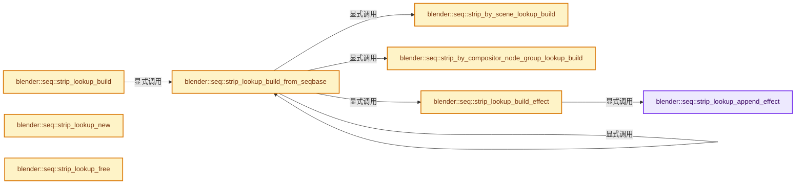
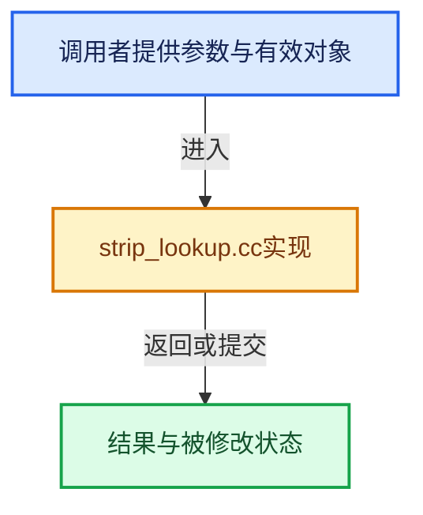

# 实现依赖专题：source/blender/sequencer/intern/strip_lookup.cc

[方向导航](README.md) · [符号索引](../%E7%AC%A6%E5%8F%B7%E4%BE%9D%E8%B5%96%E4%B8%8E%E5%AE%9E%E7%8E%B0%E7%B4%A2%E5%BC%95.md)

本专题从正文实际调用进入，集中保存共享实现。函数有稳定锚点，可从调用处直接跳到对应完整函数；递归与互相调用通过回链组织。

## 本文件的实现关系






## 完整成员与函数实现

<a id="f-45598196a09e340a"></a>

### `blender::seq::strip_lookup_append_effect`

实现位置：[source/blender/sequencer/intern/strip_lookup.cc](../../../../../source/blender/sequencer/intern/strip_lookup.cc) · L38—L47。

接口参数：

- `const Strip *input`
- `Strip *effect`
- `StripLookup *lookup`

**教学注释版**

<!-- annotated:53f6db9f13d650 -->

```cpp
static void strip_lookup_append_effect(const Strip *input, Strip *effect, StripLookup *lookup)
{
  if (input == nullptr) {
    return;
  }

  VectorSet<Strip *> &effects = lookup->effects_by_strip.lookup_or_add_default(input);

  // [讲解] effects.add：按哈希与相等关系加入键或键值。
  effects.add(effect);
}
```

<details>
<summary>核对原始源码：source/blender/sequencer/intern/strip_lookup.cc · L38—L47</summary>

<!-- original:53f6db9f13d650:source/blender/sequencer/intern/strip_lookup.cc:38:47 -->

```cpp
static void strip_lookup_append_effect(const Strip *input, Strip *effect, StripLookup *lookup)
{
  if (input == nullptr) {
    return;
  }

  VectorSet<Strip *> &effects = lookup->effects_by_strip.lookup_or_add_default(input);

  effects.add(effect);
}
```

</details>

**继续追踪实现**

- `lookup->effects_by_strip.lookup_or_add_default` → [调用协议](../%E6%A8%A1%E6%9D%BF%E5%AE%8F%E4%B8%8E%E5%8A%A8%E6%80%81%E5%88%86%E6%B4%BE%E5%8D%8F%E8%AE%AE.md)：接收对象类型依赖auto、返回值或模板实例；不按同名猜测目标。调用位置L44。
- `effects.add` → [blender::VectorSet::add · L351](../01-%E5%9F%BA%E7%A1%80%E5%AE%B9%E5%99%A8%E4%B8%8E%E7%8E%B0%E4%BB%A3CPP/14-VectorSet%E7%A8%B3%E5%AE%9A%E7%B4%A2%E5%BC%95%E4%B8%8E%E5%8E%BB%E9%87%8D.md#f-96bfe2bf376d6298)；[blender::VectorSet::add · L355](../01-%E5%9F%BA%E7%A1%80%E5%AE%B9%E5%99%A8%E4%B8%8E%E7%8E%B0%E4%BB%A3CPP/14-VectorSet%E7%A8%B3%E5%AE%9A%E7%B4%A2%E5%BC%95%E4%B8%8E%E5%8E%BB%E9%87%8D.md#f-c0474f6a0568033b)。同名重载需按实参类型选择。

<a id="f-26e653c1df94be6f"></a>

### `blender::seq::strip_by_scene_lookup_build`

实现位置：[source/blender/sequencer/intern/strip_lookup.cc](../../../../../source/blender/sequencer/intern/strip_lookup.cc) · L49—L56。

接口参数：

- `Strip *strip`
- `StripLookup *lookup`

**教学注释版**

<!-- annotated:a3cee9a54ccf05 -->

```cpp
static void strip_by_scene_lookup_build(Strip *strip, StripLookup *lookup)
{
  if (strip->scene == nullptr) {
    return;
  }
  VectorSet<Strip *> &strips = lookup->strips_by_scene.lookup_or_add_default(strip->scene);
  // [讲解] strips.add：按哈希与相等关系加入键或键值。
  strips.add(strip);
}
```

<details>
<summary>核对原始源码：source/blender/sequencer/intern/strip_lookup.cc · L49—L56</summary>

<!-- original:a3cee9a54ccf05:source/blender/sequencer/intern/strip_lookup.cc:49:56 -->

```cpp
static void strip_by_scene_lookup_build(Strip *strip, StripLookup *lookup)
{
  if (strip->scene == nullptr) {
    return;
  }
  VectorSet<Strip *> &strips = lookup->strips_by_scene.lookup_or_add_default(strip->scene);
  strips.add(strip);
}
```

</details>

**继续追踪实现**

- `lookup->strips_by_scene.lookup_or_add_default` → [调用协议](../%E6%A8%A1%E6%9D%BF%E5%AE%8F%E4%B8%8E%E5%8A%A8%E6%80%81%E5%88%86%E6%B4%BE%E5%8D%8F%E8%AE%AE.md)：接收对象类型依赖auto、返回值或模板实例；不按同名猜测目标。调用位置L54。
- `strips.add` → [blender::VectorSet::add · L351](../01-%E5%9F%BA%E7%A1%80%E5%AE%B9%E5%99%A8%E4%B8%8E%E7%8E%B0%E4%BB%A3CPP/14-VectorSet%E7%A8%B3%E5%AE%9A%E7%B4%A2%E5%BC%95%E4%B8%8E%E5%8E%BB%E9%87%8D.md#f-96bfe2bf376d6298)；[blender::VectorSet::add · L355](../01-%E5%9F%BA%E7%A1%80%E5%AE%B9%E5%99%A8%E4%B8%8E%E7%8E%B0%E4%BB%A3CPP/14-VectorSet%E7%A8%B3%E5%AE%9A%E7%B4%A2%E5%BC%95%E4%B8%8E%E5%8E%BB%E9%87%8D.md#f-c0474f6a0568033b)。同名重载需按实参类型选择。

<a id="f-777d42b0d0cb502f"></a>

### `blender::seq::strip_by_compositor_node_group_lookup_build`

实现位置：[source/blender/sequencer/intern/strip_lookup.cc](../../../../../source/blender/sequencer/intern/strip_lookup.cc) · L58—L84。

接口参数：

- `Strip *strip`
- `StripLookup *lookup`

**教学注释版**

<!-- annotated:05329f339c03e7 -->

```cpp
static void strip_by_compositor_node_group_lookup_build(Strip *strip, StripLookup *lookup)
{
  if (strip->type == STRIP_TYPE_COMPOSITOR && strip->effectdata) {
    const CompositorEffectVars *comp_data = static_cast<CompositorEffectVars *>(strip->effectdata);
    if (comp_data->node_group) {
      VectorSet<Strip *> &strips = lookup->strips_by_compositor_node_group.lookup_or_add_default(
          comp_data->node_group);
      // [讲解] strips.add：按哈希与相等关系加入键或键值。
      strips.add(strip);
    }
  }

  for (StripModifierData &modifier : strip->modifiers) {
    if (modifier.type != eSeqModifierType_Compositor) {
      continue;
    }

    const SequencerCompositorModifierData *modifier_data =
        reinterpret_cast<SequencerCompositorModifierData *>(&modifier);
    if (!modifier_data->node_group) {
      continue;
    }

    VectorSet<Strip *> &strips = lookup->strips_by_compositor_node_group.lookup_or_add_default(
        modifier_data->node_group);
    strips.add(strip);
  }
}
```

<details>
<summary>核对原始源码：source/blender/sequencer/intern/strip_lookup.cc · L58—L84</summary>

<!-- original:05329f339c03e7:source/blender/sequencer/intern/strip_lookup.cc:58:84 -->

```cpp
static void strip_by_compositor_node_group_lookup_build(Strip *strip, StripLookup *lookup)
{
  if (strip->type == STRIP_TYPE_COMPOSITOR && strip->effectdata) {
    const CompositorEffectVars *comp_data = static_cast<CompositorEffectVars *>(strip->effectdata);
    if (comp_data->node_group) {
      VectorSet<Strip *> &strips = lookup->strips_by_compositor_node_group.lookup_or_add_default(
          comp_data->node_group);
      strips.add(strip);
    }
  }

  for (StripModifierData &modifier : strip->modifiers) {
    if (modifier.type != eSeqModifierType_Compositor) {
      continue;
    }

    const SequencerCompositorModifierData *modifier_data =
        reinterpret_cast<SequencerCompositorModifierData *>(&modifier);
    if (!modifier_data->node_group) {
      continue;
    }

    VectorSet<Strip *> &strips = lookup->strips_by_compositor_node_group.lookup_or_add_default(
        modifier_data->node_group);
    strips.add(strip);
  }
}
```

</details>

**继续追踪实现**

- `lookup->strips_by_compositor_node_group.lookup_or_add_default` → [调用协议](../%E6%A8%A1%E6%9D%BF%E5%AE%8F%E4%B8%8E%E5%8A%A8%E6%80%81%E5%88%86%E6%B4%BE%E5%8D%8F%E8%AE%AE.md)：接收对象类型依赖auto、返回值或模板实例；不按同名猜测目标。调用位置L63。
- `strips.add` → [blender::VectorSet::add · L351](../01-%E5%9F%BA%E7%A1%80%E5%AE%B9%E5%99%A8%E4%B8%8E%E7%8E%B0%E4%BB%A3CPP/14-VectorSet%E7%A8%B3%E5%AE%9A%E7%B4%A2%E5%BC%95%E4%B8%8E%E5%8E%BB%E9%87%8D.md#f-96bfe2bf376d6298)；[blender::VectorSet::add · L355](../01-%E5%9F%BA%E7%A1%80%E5%AE%B9%E5%99%A8%E4%B8%8E%E7%8E%B0%E4%BB%A3CPP/14-VectorSet%E7%A8%B3%E5%AE%9A%E7%B4%A2%E5%BC%95%E4%B8%8E%E5%8E%BB%E9%87%8D.md#f-c0474f6a0568033b)。同名重载需按实参类型选择。

<a id="f-8c02991783435b48"></a>

### `blender::seq::strip_lookup_build_effect`

实现位置：[source/blender/sequencer/intern/strip_lookup.cc](../../../../../source/blender/sequencer/intern/strip_lookup.cc) · L86—L94。

接口参数：

- `Strip *strip`
- `StripLookup *lookup`

**教学注释版**

<!-- annotated:0dfd98a45e7305 -->

```cpp
static void strip_lookup_build_effect(Strip *strip, StripLookup *lookup)
{
  if (!strip->is_effect()) {
    return;
  }

  strip_lookup_append_effect(strip->input1, strip, lookup);
  strip_lookup_append_effect(strip->input2, strip, lookup);
}
```

<details>
<summary>核对原始源码：source/blender/sequencer/intern/strip_lookup.cc · L86—L94</summary>

<!-- original:0dfd98a45e7305:source/blender/sequencer/intern/strip_lookup.cc:86:94 -->

```cpp
static void strip_lookup_build_effect(Strip *strip, StripLookup *lookup)
{
  if (!strip->is_effect()) {
    return;
  }

  strip_lookup_append_effect(strip->input1, strip, lookup);
  strip_lookup_append_effect(strip->input2, strip, lookup);
}
```

</details>

**继续追踪实现**

- `strip->is_effect` → [blender::Strip::is_effect · L1391](%E4%BE%9D%E8%B5%96-sequencer-837668.md#f-26a10ad33ac0e4b2)。
- `strip_lookup_append_effect` → [blender::seq::strip_lookup_append_effect · L38](%E4%BE%9D%E8%B5%96-strip_lookup-2aba9a.md#f-45598196a09e340a)。

<a id="f-777015f8bcbc9eb4"></a>

### `blender::seq::strip_lookup_build_from_seqbase`

实现位置：[source/blender/sequencer/intern/strip_lookup.cc](../../../../../source/blender/sequencer/intern/strip_lookup.cc) · L96—L117。

接口参数：

- `Strip *parent_meta`
- `const ListBaseT<Strip> *seqbase`
- `StripLookup *lookup`

**教学注释版**

<!-- annotated:cbc24d03cb43a5 -->

```cpp
static void strip_lookup_build_from_seqbase(Strip *parent_meta,
                                            const ListBaseT<Strip> *seqbase,
                                            StripLookup *lookup)
{
  if (parent_meta != nullptr) {
    for (SeqTimelineChannel &channel : parent_meta->channels) {
      lookup->owner_by_channel.add(&channel, parent_meta);
    }
  }

  for (Strip &strip : *seqbase) {
    lookup->strip_by_name.add(strip.name + 2, &strip);
    lookup->meta_by_strip.add(&strip, parent_meta);
    strip_lookup_build_effect(&strip, lookup);
    strip_by_scene_lookup_build(&strip, lookup);
    strip_by_compositor_node_group_lookup_build(&strip, lookup);

    if (strip.type == STRIP_TYPE_META) {
      strip_lookup_build_from_seqbase(&strip, &strip.seqbase, lookup);
    }
  }
}
```

<details>
<summary>核对原始源码：source/blender/sequencer/intern/strip_lookup.cc · L96—L117</summary>

<!-- original:cbc24d03cb43a5:source/blender/sequencer/intern/strip_lookup.cc:96:117 -->

```cpp
static void strip_lookup_build_from_seqbase(Strip *parent_meta,
                                            const ListBaseT<Strip> *seqbase,
                                            StripLookup *lookup)
{
  if (parent_meta != nullptr) {
    for (SeqTimelineChannel &channel : parent_meta->channels) {
      lookup->owner_by_channel.add(&channel, parent_meta);
    }
  }

  for (Strip &strip : *seqbase) {
    lookup->strip_by_name.add(strip.name + 2, &strip);
    lookup->meta_by_strip.add(&strip, parent_meta);
    strip_lookup_build_effect(&strip, lookup);
    strip_by_scene_lookup_build(&strip, lookup);
    strip_by_compositor_node_group_lookup_build(&strip, lookup);

    if (strip.type == STRIP_TYPE_META) {
      strip_lookup_build_from_seqbase(&strip, &strip.seqbase, lookup);
    }
  }
}
```

</details>

**继续追踪实现**

- `lookup->owner_by_channel.add` → [调用协议](../%E6%A8%A1%E6%9D%BF%E5%AE%8F%E4%B8%8E%E5%8A%A8%E6%80%81%E5%88%86%E6%B4%BE%E5%8D%8F%E8%AE%AE.md)：接收对象类型依赖auto、返回值或模板实例；不按同名猜测目标。调用位置L102。
- `lookup->strip_by_name.add` → [调用协议](../%E6%A8%A1%E6%9D%BF%E5%AE%8F%E4%B8%8E%E5%8A%A8%E6%80%81%E5%88%86%E6%B4%BE%E5%8D%8F%E8%AE%AE.md)：接收对象类型依赖auto、返回值或模板实例；不按同名猜测目标。调用位置L107。
- `lookup->meta_by_strip.add` → [调用协议](../%E6%A8%A1%E6%9D%BF%E5%AE%8F%E4%B8%8E%E5%8A%A8%E6%80%81%E5%88%86%E6%B4%BE%E5%8D%8F%E8%AE%AE.md)：接收对象类型依赖auto、返回值或模板实例；不按同名猜测目标。调用位置L108。
- `strip_lookup_build_effect` → [blender::seq::strip_lookup_build_effect · L86](%E4%BE%9D%E8%B5%96-strip_lookup-2aba9a.md#f-8c02991783435b48)。
- `strip_by_scene_lookup_build` → [blender::seq::strip_by_scene_lookup_build · L49](%E4%BE%9D%E8%B5%96-strip_lookup-2aba9a.md#f-26e653c1df94be6f)。
- `strip_by_compositor_node_group_lookup_build` → [blender::seq::strip_by_compositor_node_group_lookup_build · L58](%E4%BE%9D%E8%B5%96-strip_lookup-2aba9a.md#f-777d42b0d0cb502f)。
- `strip_lookup_build_from_seqbase` → [blender::seq::strip_lookup_build_from_seqbase · L96](%E4%BE%9D%E8%B5%96-strip_lookup-2aba9a.md#f-777015f8bcbc9eb4)。

<a id="f-050bef381dff8b61"></a>

### `blender::seq::strip_lookup_build`

实现位置：[source/blender/sequencer/intern/strip_lookup.cc](../../../../../source/blender/sequencer/intern/strip_lookup.cc) · L119—L123。

接口参数：

- `const Editing *ed`
- `StripLookup *lookup`

**教学注释版**

<!-- annotated:06e61d8213cc4f -->

```cpp
static void strip_lookup_build(const Editing *ed, StripLookup *lookup)
{
  strip_lookup_build_from_seqbase(nullptr, &ed->seqbase, lookup);
  lookup->is_valid = true;
}
```

<details>
<summary>核对原始源码：source/blender/sequencer/intern/strip_lookup.cc · L119—L123</summary>

<!-- original:06e61d8213cc4f:source/blender/sequencer/intern/strip_lookup.cc:119:123 -->

```cpp
static void strip_lookup_build(const Editing *ed, StripLookup *lookup)
{
  strip_lookup_build_from_seqbase(nullptr, &ed->seqbase, lookup);
  lookup->is_valid = true;
}
```

</details>

**沿实际写入检查状态**

- `lookup->is_valid = true;`

**继续追踪实现**

- `strip_lookup_build_from_seqbase` → [blender::seq::strip_lookup_build_from_seqbase · L96](%E4%BE%9D%E8%B5%96-strip_lookup-2aba9a.md#f-777015f8bcbc9eb4)。

<a id="f-91b83be06fe3b164"></a>

### `blender::seq::strip_lookup_new`

实现位置：[source/blender/sequencer/intern/strip_lookup.cc](../../../../../source/blender/sequencer/intern/strip_lookup.cc) · L125—L129。

**教学注释版**

<!-- annotated:3da224c978623a -->

```cpp
static StripLookup *strip_lookup_new()
{
  StripLookup *lookup = MEM_new<StripLookup>(__func__);
  return lookup;
}
```

<details>
<summary>核对原始源码：source/blender/sequencer/intern/strip_lookup.cc · L125—L129</summary>

<!-- original:3da224c978623a:source/blender/sequencer/intern/strip_lookup.cc:125:129 -->

```cpp
static StripLookup *strip_lookup_new()
{
  StripLookup *lookup = MEM_new<StripLookup>(__func__);
  return lookup;
}
```

</details>

**结果出口**

- `return lookup;`

**继续追踪实现**

- `MEM_new<StripLookup>` → [MEM_new · L351](../03-%E5%86%85%E5%AD%98%E5%88%86%E9%85%8D%E4%B8%8E%E8%BF%90%E8%A1%8C%E6%97%B6%E7%B1%BB%E5%9E%8B/%E4%BE%9D%E8%B5%96-MEM_guardedalloc-b54eca.md#f-115f9b6784f89912)。

<a id="f-7c2f49114f1ecc81"></a>

### `blender::seq::strip_lookup_free`

实现位置：[source/blender/sequencer/intern/strip_lookup.cc](../../../../../source/blender/sequencer/intern/strip_lookup.cc) · L131—L135。

接口参数：

- `StripLookup **lookup`

**教学注释版**

<!-- annotated:ee7a4812ea464c -->

```cpp
static void strip_lookup_free(StripLookup **lookup)
{
  MEM_delete(*lookup);
  *lookup = nullptr;
}
```

<details>
<summary>核对原始源码：source/blender/sequencer/intern/strip_lookup.cc · L131—L135</summary>

<!-- original:ee7a4812ea464c:source/blender/sequencer/intern/strip_lookup.cc:131:135 -->

```cpp
static void strip_lookup_free(StripLookup **lookup)
{
  MEM_delete(*lookup);
  *lookup = nullptr;
}
```

</details>

**继续追踪实现**

- `MEM_delete` → [MEM_delete · L400](../03-%E5%86%85%E5%AD%98%E5%88%86%E9%85%8D%E4%B8%8E%E8%BF%90%E8%A1%8C%E6%97%B6%E7%B1%BB%E5%9E%8B/%E4%BE%9D%E8%B5%96-MEM_guardedalloc-b54eca.md#f-9049ffdd1682887c)。

<a id="f-3807b014db891ced"></a>

### `blender::seq::strip_lookup_rebuild`

实现位置：[source/blender/sequencer/intern/strip_lookup.cc](../../../../../source/blender/sequencer/intern/strip_lookup.cc) · L137—L142。

接口参数：

- `const Editing *ed`
- `StripLookup **lookup`

**教学注释版**

<!-- annotated:56f0666a22ccbe -->

```cpp
static void strip_lookup_rebuild(const Editing *ed, StripLookup **lookup)
{
  strip_lookup_free(lookup);
  *lookup = strip_lookup_new();
  strip_lookup_build(ed, *lookup);
}
```

<details>
<summary>核对原始源码：source/blender/sequencer/intern/strip_lookup.cc · L137—L142</summary>

<!-- original:56f0666a22ccbe:source/blender/sequencer/intern/strip_lookup.cc:137:142 -->

```cpp
static void strip_lookup_rebuild(const Editing *ed, StripLookup **lookup)
{
  strip_lookup_free(lookup);
  *lookup = strip_lookup_new();
  strip_lookup_build(ed, *lookup);
}
```

</details>

**继续追踪实现**

- `strip_lookup_free` → [blender::seq::strip_lookup_free · L131](%E4%BE%9D%E8%B5%96-strip_lookup-2aba9a.md#f-7c2f49114f1ecc81)；[blender::seq::strip_lookup_free · L156](%E4%BE%9D%E8%B5%96-strip_lookup-2aba9a.md#f-8cf9befd64a96c91)。同名重载需按实参类型选择。
- `strip_lookup_new` → [blender::seq::strip_lookup_new · L125](%E4%BE%9D%E8%B5%96-strip_lookup-2aba9a.md#f-91b83be06fe3b164)。
- `strip_lookup_build` → [blender::seq::strip_lookup_build · L119](%E4%BE%9D%E8%B5%96-strip_lookup-2aba9a.md#f-050bef381dff8b61)。

<a id="f-cf6357d38cdf6494"></a>

### `blender::seq::strip_lookup_update_if_needed`

实现位置：[source/blender/sequencer/intern/strip_lookup.cc](../../../../../source/blender/sequencer/intern/strip_lookup.cc) · L144—L154。

接口参数：

- `const Editing *ed`
- `StripLookup **lookup`

**教学注释版**

<!-- annotated:c77686dae99052 -->

```cpp
static void strip_lookup_update_if_needed(const Editing *ed, StripLookup **lookup)
{
  if (!ed) {
    return;
  }
  if (*lookup && (*lookup)->is_valid) {
    return;
  }

  strip_lookup_rebuild(ed, lookup);
}
```

<details>
<summary>核对原始源码：source/blender/sequencer/intern/strip_lookup.cc · L144—L154</summary>

<!-- original:c77686dae99052:source/blender/sequencer/intern/strip_lookup.cc:144:154 -->

```cpp
static void strip_lookup_update_if_needed(const Editing *ed, StripLookup **lookup)
{
  if (!ed) {
    return;
  }
  if (*lookup && (*lookup)->is_valid) {
    return;
  }

  strip_lookup_rebuild(ed, lookup);
}
```

</details>

**继续追踪实现**

- `strip_lookup_rebuild` → [blender::seq::strip_lookup_rebuild · L137](%E4%BE%9D%E8%B5%96-strip_lookup-2aba9a.md#f-3807b014db891ced)。

<a id="f-8cf9befd64a96c91"></a>

### `blender::seq::strip_lookup_free`

实现位置：[source/blender/sequencer/intern/strip_lookup.cc](../../../../../source/blender/sequencer/intern/strip_lookup.cc) · L156—L161。

接口参数：

- `Editing *ed`

**教学注释版**

<!-- annotated:836518d2a8da00 -->

```cpp
void strip_lookup_free(Editing *ed)
{
  BLI_assert(ed != nullptr);
  std::lock_guard lock(lookup_lock);
  strip_lookup_free(&ed->runtime->strip_lookup);
}
```

<details>
<summary>核对原始源码：source/blender/sequencer/intern/strip_lookup.cc · L156—L161</summary>

<!-- original:836518d2a8da00:source/blender/sequencer/intern/strip_lookup.cc:156:161 -->

```cpp
void strip_lookup_free(Editing *ed)
{
  BLI_assert(ed != nullptr);
  std::lock_guard lock(lookup_lock);
  strip_lookup_free(&ed->runtime->strip_lookup);
}
```

</details>

**继续追踪实现**

- `BLI_assert` → [BLI_assert · L48](../01-%E5%9F%BA%E7%A1%80%E5%AE%B9%E5%99%A8%E4%B8%8E%E7%8E%B0%E4%BB%A3CPP/%E4%BE%9D%E8%B5%96-BLI_assert-cc98e8.md#m-57a88495704d)；[BLI_assert · L63](../01-%E5%9F%BA%E7%A1%80%E5%AE%B9%E5%99%A8%E4%B8%8E%E7%8E%B0%E4%BB%A3CPP/%E4%BE%9D%E8%B5%96-BLI_assert-cc98e8.md#m-d07050020cb5)。宏定义由构建条件选择。
- `strip_lookup_free` → [blender::seq::strip_lookup_free · L131](%E4%BE%9D%E8%B5%96-strip_lookup-2aba9a.md#f-7c2f49114f1ecc81)；[blender::seq::strip_lookup_free · L156](%E4%BE%9D%E8%B5%96-strip_lookup-2aba9a.md#f-8cf9befd64a96c91)。同名重载需按实参类型选择。

<a id="f-2c81ecce868f7f6f"></a>

### `blender::seq::lookup_meta_by_strip`

实现位置：[source/blender/sequencer/intern/strip_lookup.cc](../../../../../source/blender/sequencer/intern/strip_lookup.cc) · L203—L210。

接口参数：

- `Editing *ed`
- `const Strip *key`

**教学注释版**

<!-- annotated:5a57461a732c03 -->

```cpp
Strip *lookup_meta_by_strip(Editing *ed, const Strip *key)
{
  BLI_assert(ed != nullptr);
  std::lock_guard lock(lookup_lock);
  strip_lookup_update_if_needed(ed, &ed->runtime->strip_lookup);
  StripLookup *lookup = ed->runtime->strip_lookup;
  return lookup->meta_by_strip.lookup_default(key, nullptr);
}
```

<details>
<summary>核对原始源码：source/blender/sequencer/intern/strip_lookup.cc · L203—L210</summary>

<!-- original:5a57461a732c03:source/blender/sequencer/intern/strip_lookup.cc:203:210 -->

```cpp
Strip *lookup_meta_by_strip(Editing *ed, const Strip *key)
{
  BLI_assert(ed != nullptr);
  std::lock_guard lock(lookup_lock);
  strip_lookup_update_if_needed(ed, &ed->runtime->strip_lookup);
  StripLookup *lookup = ed->runtime->strip_lookup;
  return lookup->meta_by_strip.lookup_default(key, nullptr);
}
```

</details>

**结果出口**

- `return lookup->meta_by_strip.lookup_default(key, nullptr);`

**继续追踪实现**

- `BLI_assert` → [BLI_assert · L48](../01-%E5%9F%BA%E7%A1%80%E5%AE%B9%E5%99%A8%E4%B8%8E%E7%8E%B0%E4%BB%A3CPP/%E4%BE%9D%E8%B5%96-BLI_assert-cc98e8.md#m-57a88495704d)；[BLI_assert · L63](../01-%E5%9F%BA%E7%A1%80%E5%AE%B9%E5%99%A8%E4%B8%8E%E7%8E%B0%E4%BB%A3CPP/%E4%BE%9D%E8%B5%96-BLI_assert-cc98e8.md#m-d07050020cb5)。宏定义由构建条件选择。
- `strip_lookup_update_if_needed` → [blender::seq::strip_lookup_update_if_needed · L144](%E4%BE%9D%E8%B5%96-strip_lookup-2aba9a.md#f-cf6357d38cdf6494)。
- `lookup->meta_by_strip.lookup_default` → [调用协议](../%E6%A8%A1%E6%9D%BF%E5%AE%8F%E4%B8%8E%E5%8A%A8%E6%80%81%E5%88%86%E6%B4%BE%E5%8D%8F%E8%AE%AE.md)：接收对象类型依赖auto、返回值或模板实例；不按同名猜测目标。调用位置L209。

<a id="f-c1cb155c7175f2de"></a>

### `blender::seq::strip_lookup_invalidate`

实现位置：[source/blender/sequencer/intern/strip_lookup.cc](../../../../../source/blender/sequencer/intern/strip_lookup.cc) · L231—L242。

接口参数：

- `const Editing *ed`

**教学注释版**

<!-- annotated:9667b1c48834ae -->

```cpp
void strip_lookup_invalidate(const Editing *ed)
{
  if (ed == nullptr) {
    return;
  }

  std::lock_guard lock(lookup_lock);
  StripLookup *lookup = ed->runtime->strip_lookup;
  if (lookup != nullptr) {
    lookup->is_valid = false;
  }
}
```

<details>
<summary>核对原始源码：source/blender/sequencer/intern/strip_lookup.cc · L231—L242</summary>

<!-- original:9667b1c48834ae:source/blender/sequencer/intern/strip_lookup.cc:231:242 -->

```cpp
void strip_lookup_invalidate(const Editing *ed)
{
  if (ed == nullptr) {
    return;
  }

  std::lock_guard lock(lookup_lock);
  StripLookup *lookup = ed->runtime->strip_lookup;
  if (lookup != nullptr) {
    lookup->is_valid = false;
  }
}
```

</details>

**沿实际写入检查状态**

- `lookup->is_valid = false;`

**继续追踪实现**

本实现没有需要继续展开的显式调用；检查返回表达式、对象转换和调用者前置条件。
