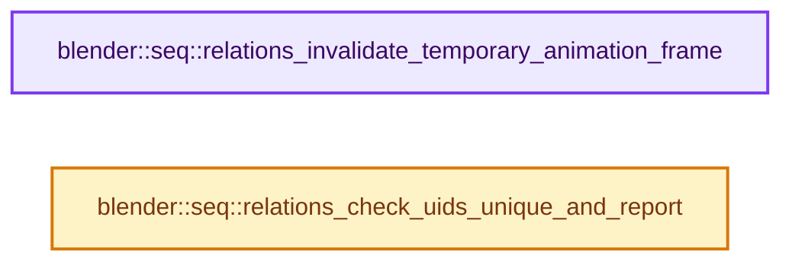
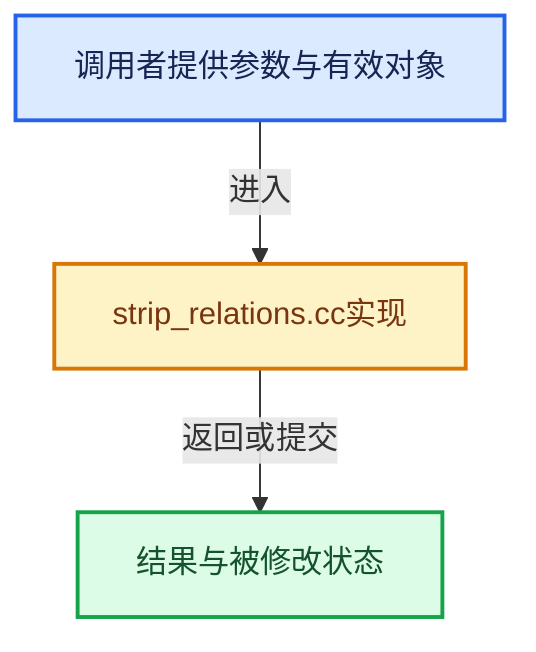

# 实现依赖专题：source/blender/sequencer/intern/strip_relations.cc

[方向导航](README.md) · [符号索引](../%E7%AC%A6%E5%8F%B7%E4%BE%9D%E8%B5%96%E4%B8%8E%E5%AE%9E%E7%8E%B0%E7%B4%A2%E5%BC%95.md)

本专题从正文实际调用进入，集中保存共享实现。函数有稳定锚点，可从调用处直接跳到对应完整函数；递归与互相调用通过回链组织。

## 本文件的实现关系






## 完整成员与函数实现

<a id="f-59867b43110e719a"></a>

### `blender::seq::relations_invalidate_temporary_animation_frame`

实现位置：[source/blender/sequencer/intern/strip_relations.cc](../../../../../source/blender/sequencer/intern/strip_relations.cc) · L195—L207。

接口参数：

- `Scene *scene`

**教学注释版**

<!-- annotated:12f91dec3be324 -->

```cpp
void relations_invalidate_temporary_animation_frame(Scene *scene)
{
  Editing *ed = editing_get(scene);
  if (ed == nullptr || !ed->runtime->temporary_animation_frame.has_value()) {
    return;
  }

  const float temp_frame = ed->runtime->temporary_animation_frame.value();
  if (temp_frame != BKE_scene_frame_get(scene)) {
    final_image_cache_invalidate_frame_range(scene, temp_frame, temp_frame);
    ed->runtime->temporary_animation_frame.reset();
  }
}
```

<details>
<summary>核对原始源码：source/blender/sequencer/intern/strip_relations.cc · L195—L207</summary>

<!-- original:12f91dec3be324:source/blender/sequencer/intern/strip_relations.cc:195:207 -->

```cpp
void relations_invalidate_temporary_animation_frame(Scene *scene)
{
  Editing *ed = editing_get(scene);
  if (ed == nullptr || !ed->runtime->temporary_animation_frame.has_value()) {
    return;
  }

  const float temp_frame = ed->runtime->temporary_animation_frame.value();
  if (temp_frame != BKE_scene_frame_get(scene)) {
    final_image_cache_invalidate_frame_range(scene, temp_frame, temp_frame);
    ed->runtime->temporary_animation_frame.reset();
  }
}
```

</details>

**继续追踪实现**

- `editing_get` → [blender::seq::editing_get · L304](%E4%BE%9D%E8%B5%96-sequencer-837668.md#f-6332e57a33c5dd16)。
- `ed->runtime->temporary_animation_frame.has_value` → [调用协议](../%E6%A8%A1%E6%9D%BF%E5%AE%8F%E4%B8%8E%E5%8A%A8%E6%80%81%E5%88%86%E6%B4%BE%E5%8D%8F%E8%AE%AE.md)：接收对象类型依赖auto、返回值或模板实例；不按同名猜测目标。调用位置L198。
- `ed->runtime->temporary_animation_frame.value` → [调用协议](../%E6%A8%A1%E6%9D%BF%E5%AE%8F%E4%B8%8E%E5%8A%A8%E6%80%81%E5%88%86%E6%B4%BE%E5%8D%8F%E8%AE%AE.md)：接收对象类型依赖auto、返回值或模板实例；不按同名猜测目标。调用位置L202。
- `BKE_scene_frame_get` → [blender::BKE_scene_frame_get · L2605](%E4%BE%9D%E8%B5%96-scene-94f43c.md#f-f5a9b57ad7195b79)。
- `final_image_cache_invalidate_frame_range` → [blender::seq::final_image_cache_invalidate_frame_range · L142](%E4%BE%9D%E8%B5%96-final_image_cache-1c7855.md#f-25616fff0796700e)。
- `ed->runtime->temporary_animation_frame.reset` → [调用协议](../%E6%A8%A1%E6%9D%BF%E5%AE%8F%E4%B8%8E%E5%8A%A8%E6%80%81%E5%88%86%E6%B4%BE%E5%8D%8F%E8%AE%AE.md)：接收对象类型依赖auto、返回值或模板实例；不按同名猜测目标。调用位置L205。

<a id="f-768d08a98bcb2f14"></a>

### `blender::seq::relations_check_uids_unique_and_report`

实现位置：[source/blender/sequencer/intern/strip_relations.cc](../../../../../source/blender/sequencer/intern/strip_relations.cc) · L431—L439。

接口参数：

- `const Scene *scene`

**教学注释版**

<!-- annotated:f9d6ab5c8650df -->

```cpp
void relations_check_uids_unique_and_report(const Scene *scene)
{
  if (scene->ed == nullptr) {
    return;
  }

  Set<SessionUID> used_uids;
  foreach_strip(&scene->ed->seqbase, get_uids_cb, &used_uids);
}
```

<details>
<summary>核对原始源码：source/blender/sequencer/intern/strip_relations.cc · L431—L439</summary>

<!-- original:f9d6ab5c8650df:source/blender/sequencer/intern/strip_relations.cc:431:439 -->

```cpp
void relations_check_uids_unique_and_report(const Scene *scene)
{
  if (scene->ed == nullptr) {
    return;
  }

  Set<SessionUID> used_uids;
  foreach_strip(&scene->ed->seqbase, get_uids_cb, &used_uids);
}
```

</details>

**继续追踪实现**

- `foreach_strip` → [blender::seq::foreach_strip · L60](%E4%BE%9D%E8%B5%96-iterator-5c8b05.md#f-86cee6cf86eb707c)；[blender::seq::foreach_strip · L65](%E4%BE%9D%E8%B5%96-iterator-5c8b05.md#f-f628b6218602a592)。同名重载需按实参类型选择。
