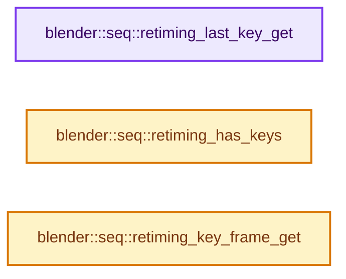
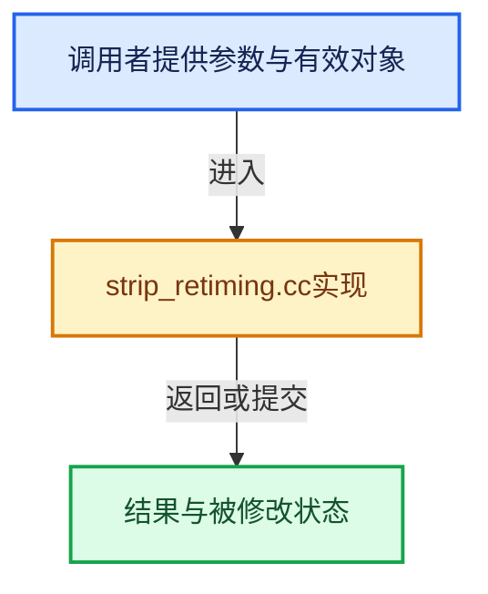

# 实现依赖专题：source/blender/sequencer/intern/strip_retiming.cc

[方向导航](README.md) · [符号索引](../%E7%AC%A6%E5%8F%B7%E4%BE%9D%E8%B5%96%E4%B8%8E%E5%AE%9E%E7%8E%B0%E7%B4%A2%E5%BC%95.md)

本专题从正文实际调用进入，集中保存共享实现。函数有稳定锚点，可从调用处直接跳到对应完整函数；递归与互相调用通过回链组织。

## 本文件的实现关系






## 完整成员与函数实现

<a id="f-d3a2a056fe6c7ca1"></a>

### `blender::seq::retiming_last_key_get`

实现位置：[source/blender/sequencer/intern/strip_retiming.cc](../../../../../source/blender/sequencer/intern/strip_retiming.cc) · L56—L59。

接口参数：

- `const Strip *strip`

**教学注释版**

<!-- annotated:6b5f3470addc85 -->

```cpp
SeqRetimingKey *retiming_last_key_get(const Strip *strip)
{
  return strip->retiming_keys + strip->retiming_keys_num - 1;
}
```

<details>
<summary>核对原始源码：source/blender/sequencer/intern/strip_retiming.cc · L56—L59</summary>

<!-- original:6b5f3470addc85:source/blender/sequencer/intern/strip_retiming.cc:56:59 -->

```cpp
SeqRetimingKey *retiming_last_key_get(const Strip *strip)
{
  return strip->retiming_keys + strip->retiming_keys_num - 1;
}
```

</details>

**结果出口**

- `return strip->retiming_keys + strip->retiming_keys_num - 1;`

**继续追踪实现**

本实现没有需要继续展开的显式调用；检查返回表达式、对象转换和调用者前置条件。

<a id="f-d0585b45f3931d2a"></a>

### `blender::seq::retiming_has_keys`

实现位置：[source/blender/sequencer/intern/strip_retiming.cc](../../../../../source/blender/sequencer/intern/strip_retiming.cc) · L171—L175。

接口参数：

- `const Strip *strip`

**教学注释版**

<!-- annotated:bada2afe3b9e68 -->

```cpp
bool retiming_has_keys(const Strip *strip)
{
  /* Technically all strips must have at least 2 keys, but we can assume none violate this. */
  return strip->retiming_keys_num > 0;
}
```

<details>
<summary>核对原始源码：source/blender/sequencer/intern/strip_retiming.cc · L171—L175</summary>

<!-- original:bada2afe3b9e68:source/blender/sequencer/intern/strip_retiming.cc:171:175 -->

```cpp
bool retiming_has_keys(const Strip *strip)
{
  /* Technically all strips must have at least 2 keys, but we can assume none violate this. */
  return strip->retiming_keys_num > 0;
}
```

</details>

**结果出口**

- `return strip->retiming_keys_num > 0;`

**继续追踪实现**

本实现没有需要继续展开的显式调用；检查返回表达式、对象转换和调用者前置条件。

<a id="f-c64b88ee35d51f3e"></a>

### `blender::seq::retiming_key_frame_get`

实现位置：[source/blender/sequencer/intern/strip_retiming.cc](../../../../../source/blender/sequencer/intern/strip_retiming.cc) · L196—L202。

接口参数：

- `const Scene *scene`
- `const Strip *strip`
- `const SeqRetimingKey *key`

**教学注释版**

<!-- annotated:2c2372ff05b3e2 -->

```cpp
int retiming_key_frame_get(const Scene *scene, const Strip *strip, const SeqRetimingKey *key)
{
  const float scene_fps = float(scene->frames_per_second());
  const int sound_offset = strip->rounded_sound_offset(scene_fps);
  return round_fl_to_int(strip->content_start() + sound_offset +
                         key->strip_frame_index / strip->media_playback_rate_factor(scene_fps));
}
```

<details>
<summary>核对原始源码：source/blender/sequencer/intern/strip_retiming.cc · L196—L202</summary>

<!-- original:2c2372ff05b3e2:source/blender/sequencer/intern/strip_retiming.cc:196:202 -->

```cpp
int retiming_key_frame_get(const Scene *scene, const Strip *strip, const SeqRetimingKey *key)
{
  const float scene_fps = float(scene->frames_per_second());
  const int sound_offset = strip->rounded_sound_offset(scene_fps);
  return round_fl_to_int(strip->content_start() + sound_offset +
                         key->strip_frame_index / strip->media_playback_rate_factor(scene_fps));
}
```

</details>

**结果出口**

- `return round_fl_to_int(strip->content_start() + sound_offset +`

**继续追踪实现**

- `scene->frames_per_second` → [blender::Scene::frames_per_second · L1704](%E4%BE%9D%E8%B5%96-scene-94f43c.md#f-76be2374a615ddd5)。
- `strip->rounded_sound_offset` → [blender::Strip::rounded_sound_offset · L546](%E4%BE%9D%E8%B5%96-strip_time-f49968.md#f-afdfa19d85f9c942)。
- `round_fl_to_int` → [blender::round_fl_to_int · L193](../12-%E7%A9%BA%E9%97%B4%E6%95%B0%E6%8D%AE%E7%BB%93%E6%9E%84%E4%B8%8E%E5%87%A0%E4%BD%95%E7%AE%97%E6%B3%95/%E4%BE%9D%E8%B5%96-math_base_inline-546b00.md#f-ce88de51b67ea3e6)。
- `strip->content_start` → [blender::Strip::content_start · L514](%E4%BE%9D%E8%B5%96-strip_time-f49968.md#f-6fb9f553ebe290be)。
- `strip->media_playback_rate_factor` → [blender::Strip::media_playback_rate_factor · L477](%E4%BE%9D%E8%B5%96-strip_time-f49968.md#f-729597a8ff964ddd)。
