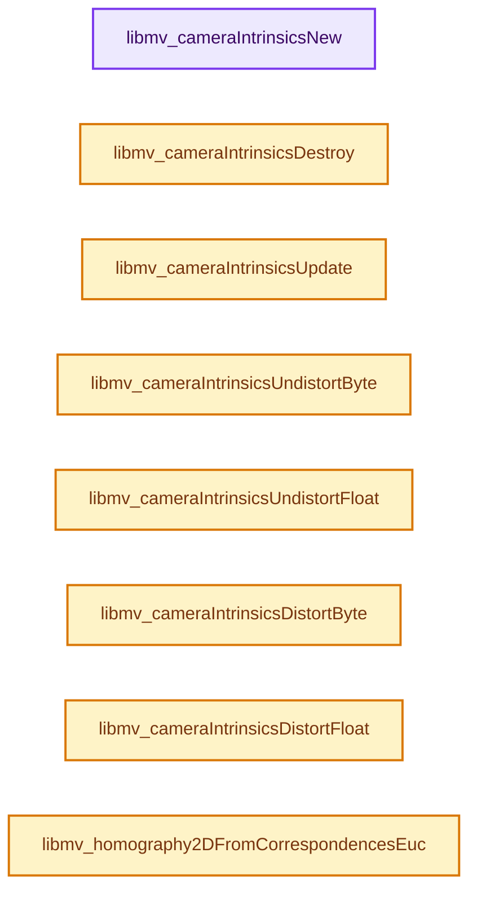
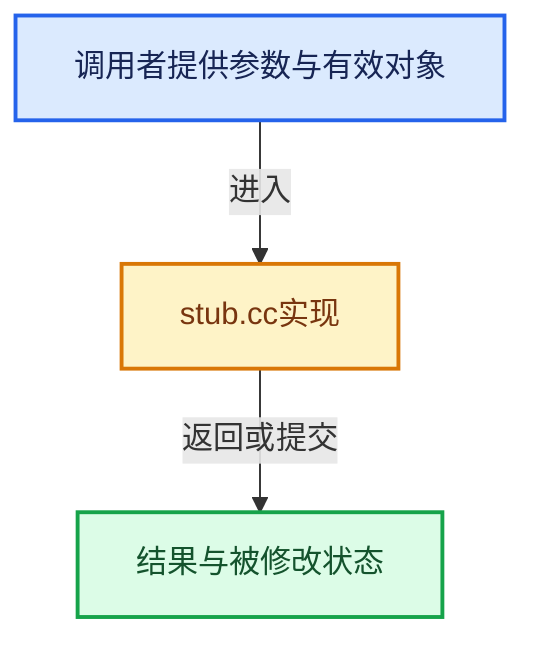

# 实现依赖专题：intern/libmv/intern/stub.cc

[方向导航](README.md) · [符号索引](../%E7%AC%A6%E5%8F%B7%E4%BE%9D%E8%B5%96%E4%B8%8E%E5%AE%9E%E7%8E%B0%E7%B4%A2%E5%BC%95.md)

本专题从正文实际调用进入，集中保存共享实现。函数有稳定锚点，可从调用处直接跳到对应完整函数；递归与互相调用通过回链组织。

## 本文件的实现关系






## 完整成员与函数实现

<a id="f-507f21cb8a36af17"></a>

### `libmv_cameraIntrinsicsNew`

实现位置：[intern/libmv/intern/stub.cc](../../../../../intern/libmv/intern/stub.cc) · L202—L205。

接口参数：

- `const libmv_CameraIntrinsicsOptions*`

**教学注释版**

<!-- annotated:35ec823c4bed1d -->

```cpp
libmv_CameraIntrinsics* libmv_cameraIntrinsicsNew(
    const libmv_CameraIntrinsicsOptions* /*libmv_camera_intrinsics_options*/) {
  return NULL;
}
```

<details>
<summary>核对原始源码：intern/libmv/intern/stub.cc · L202—L205</summary>

<!-- original:35ec823c4bed1d:intern/libmv/intern/stub.cc:202:205 -->

```cpp
libmv_CameraIntrinsics* libmv_cameraIntrinsicsNew(
    const libmv_CameraIntrinsicsOptions* /*libmv_camera_intrinsics_options*/) {
  return NULL;
}
```

</details>

**结果出口**

- `return NULL;`

**继续追踪实现**

本实现没有需要继续展开的显式调用；检查返回表达式、对象转换和调用者前置条件。

<a id="f-944538c493ac510d"></a>

### `libmv_cameraIntrinsicsDestroy`

实现位置：[intern/libmv/intern/stub.cc](../../../../../intern/libmv/intern/stub.cc) · L212—L214。

接口参数：

- `libmv_CameraIntrinsics*`

**教学注释版**

<!-- annotated:5c38d6eab435ff -->

```cpp
void libmv_cameraIntrinsicsDestroy(
    libmv_CameraIntrinsics* /*libmvIntrinsics*/) {
}
```

<details>
<summary>核对原始源码：intern/libmv/intern/stub.cc · L212—L214</summary>

<!-- original:5c38d6eab435ff:intern/libmv/intern/stub.cc:212:214 -->

```cpp
void libmv_cameraIntrinsicsDestroy(
    libmv_CameraIntrinsics* /*libmvIntrinsics*/) {
}
```

</details>

**继续追踪实现**

本实现没有需要继续展开的显式调用；检查返回表达式、对象转换和调用者前置条件。

<a id="f-ab89f70344a926f2"></a>

### `libmv_cameraIntrinsicsUpdate`

实现位置：[intern/libmv/intern/stub.cc](../../../../../intern/libmv/intern/stub.cc) · L216—L219。

接口参数：

- `const libmv_CameraIntrinsicsOptions*`
- `libmv_CameraIntrinsics*`

**教学注释版**

<!-- annotated:abae88650f3cd4 -->

```cpp
void libmv_cameraIntrinsicsUpdate(
    const libmv_CameraIntrinsicsOptions* /*libmv_camera_intrinsics_options*/,
    libmv_CameraIntrinsics* /*libmv_intrinsics*/) {
}
```

<details>
<summary>核对原始源码：intern/libmv/intern/stub.cc · L216—L219</summary>

<!-- original:abae88650f3cd4:intern/libmv/intern/stub.cc:216:219 -->

```cpp
void libmv_cameraIntrinsicsUpdate(
    const libmv_CameraIntrinsicsOptions* /*libmv_camera_intrinsics_options*/,
    libmv_CameraIntrinsics* /*libmv_intrinsics*/) {
}
```

</details>

**继续追踪实现**

本实现没有需要继续展开的显式调用；检查返回表达式、对象转换和调用者前置条件。

<a id="f-e3567ab7e6d74a61"></a>

### `libmv_cameraIntrinsicsUndistortByte`

实现位置：[intern/libmv/intern/stub.cc](../../../../../intern/libmv/intern/stub.cc) · L228—L239。

接口参数：

- `const libmv_CameraIntrinsics*`
- `const unsigned char* source_image`
- `int width`
- `int height`
- `float`
- `int channels`
- `unsigned char* destination_image`

**教学注释版**

<!-- annotated:25d5616ce2602d -->

```cpp
void libmv_cameraIntrinsicsUndistortByte(
    const libmv_CameraIntrinsics* /*libmv_intrinsics*/,
    const unsigned char* source_image,
    int width,
    int height,
    float /*overscan*/,
    int channels,
    unsigned char* destination_image) {
  // [讲解] memcpy：复制字节，源与目标不应重叠。类型生命周期、对齐和可复制表示须由调用者证明，不是任意对象的复制构造。
  memcpy(destination_image,
         source_image,
         channels * width * height * sizeof(unsigned char));
}
```

<details>
<summary>核对原始源码：intern/libmv/intern/stub.cc · L228—L239</summary>

<!-- original:25d5616ce2602d:intern/libmv/intern/stub.cc:228:239 -->

```cpp
void libmv_cameraIntrinsicsUndistortByte(
    const libmv_CameraIntrinsics* /*libmv_intrinsics*/,
    const unsigned char* source_image,
    int width,
    int height,
    float /*overscan*/,
    int channels,
    unsigned char* destination_image) {
  memcpy(destination_image,
         source_image,
         channels * width * height * sizeof(unsigned char));
}
```

</details>

**继续追踪实现**

- `memcpy` → [外部契约](https://eel.is/c++draft/cstring.syn)：复制字节，源与目标不应重叠。类型生命周期、对齐和可复制表示须由调用者证明，不是任意对象的复制构造。

<a id="f-7ed9b6bb7168b837"></a>

### `libmv_cameraIntrinsicsUndistortFloat`

实现位置：[intern/libmv/intern/stub.cc](../../../../../intern/libmv/intern/stub.cc) · L241—L252。

接口参数：

- `const libmv_CameraIntrinsics*`
- `const float* source_image`
- `int width`
- `int height`
- `float`
- `int channels`
- `float* destination_image`

**教学注释版**

<!-- annotated:af9b75d27b2a02 -->

```cpp
void libmv_cameraIntrinsicsUndistortFloat(
    const libmv_CameraIntrinsics* /*libmv_intrinsics*/,
    const float* source_image,
    int width,
    int height,
    float /*overscan*/,
    int channels,
    float* destination_image) {
  // [讲解] memcpy：复制字节，源与目标不应重叠。类型生命周期、对齐和可复制表示须由调用者证明，不是任意对象的复制构造。
  memcpy(destination_image,
         source_image,
         channels * width * height * sizeof(float));
}
```

<details>
<summary>核对原始源码：intern/libmv/intern/stub.cc · L241—L252</summary>

<!-- original:af9b75d27b2a02:intern/libmv/intern/stub.cc:241:252 -->

```cpp
void libmv_cameraIntrinsicsUndistortFloat(
    const libmv_CameraIntrinsics* /*libmv_intrinsics*/,
    const float* source_image,
    int width,
    int height,
    float /*overscan*/,
    int channels,
    float* destination_image) {
  memcpy(destination_image,
         source_image,
         channels * width * height * sizeof(float));
}
```

</details>

**继续追踪实现**

- `memcpy` → [外部契约](https://eel.is/c++draft/cstring.syn)：复制字节，源与目标不应重叠。类型生命周期、对齐和可复制表示须由调用者证明，不是任意对象的复制构造。

<a id="f-a9632642ad54bc04"></a>

### `libmv_cameraIntrinsicsDistortByte`

实现位置：[intern/libmv/intern/stub.cc](../../../../../intern/libmv/intern/stub.cc) · L254—L265。

接口参数：

- `const struct libmv_CameraIntrinsics*`
- `const unsigned char* source_image`
- `int width`
- `int height`
- `float`
- `int channels`
- `unsigned char* destination_image`

**教学注释版**

<!-- annotated:9fb6bacf2d59e4 -->

```cpp
void libmv_cameraIntrinsicsDistortByte(
    const struct libmv_CameraIntrinsics* /*libmv_intrinsics*/,
    const unsigned char* source_image,
    int width,
    int height,
    float /*overscan*/,
    int channels,
    unsigned char* destination_image) {
  // [讲解] memcpy：复制字节，源与目标不应重叠。类型生命周期、对齐和可复制表示须由调用者证明，不是任意对象的复制构造。
  memcpy(destination_image,
         source_image,
         channels * width * height * sizeof(unsigned char));
}
```

<details>
<summary>核对原始源码：intern/libmv/intern/stub.cc · L254—L265</summary>

<!-- original:9fb6bacf2d59e4:intern/libmv/intern/stub.cc:254:265 -->

```cpp
void libmv_cameraIntrinsicsDistortByte(
    const struct libmv_CameraIntrinsics* /*libmv_intrinsics*/,
    const unsigned char* source_image,
    int width,
    int height,
    float /*overscan*/,
    int channels,
    unsigned char* destination_image) {
  memcpy(destination_image,
         source_image,
         channels * width * height * sizeof(unsigned char));
}
```

</details>

**继续追踪实现**

- `memcpy` → [外部契约](https://eel.is/c++draft/cstring.syn)：复制字节，源与目标不应重叠。类型生命周期、对齐和可复制表示须由调用者证明，不是任意对象的复制构造。

<a id="f-6029285c1ff89944"></a>

### `libmv_cameraIntrinsicsDistortFloat`

实现位置：[intern/libmv/intern/stub.cc](../../../../../intern/libmv/intern/stub.cc) · L267—L278。

接口参数：

- `const libmv_CameraIntrinsics*`
- `float* source_image`
- `int width`
- `int height`
- `float`
- `int channels`
- `float* destination_image`

**教学注释版**

<!-- annotated:5a64d427e2d713 -->

```cpp
void libmv_cameraIntrinsicsDistortFloat(
    const libmv_CameraIntrinsics* /*libmv_intrinsics*/,
    float* source_image,
    int width,
    int height,
    float /*overscan*/,
    int channels,
    float* destination_image) {
  // [讲解] memcpy：复制字节，源与目标不应重叠。类型生命周期、对齐和可复制表示须由调用者证明，不是任意对象的复制构造。
  memcpy(destination_image,
         source_image,
         channels * width * height * sizeof(float));
}
```

<details>
<summary>核对原始源码：intern/libmv/intern/stub.cc · L267—L278</summary>

<!-- original:5a64d427e2d713:intern/libmv/intern/stub.cc:267:278 -->

```cpp
void libmv_cameraIntrinsicsDistortFloat(
    const libmv_CameraIntrinsics* /*libmv_intrinsics*/,
    float* source_image,
    int width,
    int height,
    float /*overscan*/,
    int channels,
    float* destination_image) {
  memcpy(destination_image,
         source_image,
         channels * width * height * sizeof(float));
}
```

</details>

**继续追踪实现**

- `memcpy` → [外部契约](https://eel.is/c++draft/cstring.syn)：复制字节，源与目标不应重叠。类型生命周期、对齐和可复制表示须由调用者证明，不是任意对象的复制构造。

<a id="f-78f4dc7dd4881e4b"></a>

### `libmv_homography2DFromCorrespondencesEuc`

实现位置：[intern/libmv/intern/stub.cc](../../../../../intern/libmv/intern/stub.cc) · L302—L310。

接口参数：

- `double (* /*x1*/)[2]`
- `double (* /*x2*/)[2]`
- `int`
- `double H[3][3]`

**教学注释版**

<!-- annotated:607f326346e576 -->

```cpp
void libmv_homography2DFromCorrespondencesEuc(/* const */ double (* /*x1*/)[2],
                                              /* const */ double (* /*x2*/)[2],
                                              int /*num_points*/,
                                              double H[3][3]) {
  // [讲解] memset：填充字节，不调用T构造函数，也不保证任意类型的全零表示是合法或期望值。
  memset(H, 0, sizeof(double[3][3]));
  H[0][0] = 1.0f;
  H[1][1] = 1.0f;
  H[2][2] = 1.0f;
}
```

<details>
<summary>核对原始源码：intern/libmv/intern/stub.cc · L302—L310</summary>

<!-- original:607f326346e576:intern/libmv/intern/stub.cc:302:310 -->

```cpp
void libmv_homography2DFromCorrespondencesEuc(/* const */ double (* /*x1*/)[2],
                                              /* const */ double (* /*x2*/)[2],
                                              int /*num_points*/,
                                              double H[3][3]) {
  memset(H, 0, sizeof(double[3][3]));
  H[0][0] = 1.0f;
  H[1][1] = 1.0f;
  H[2][2] = 1.0f;
}
```

</details>

**沿实际写入检查状态**

- `H[0][0] = 1.0f;`
- `H[1][1] = 1.0f;`
- `H[2][2] = 1.0f;`

**继续追踪实现**

- `memset` → [外部契约](https://eel.is/c++draft/cstring.syn)：填充字节，不调用T构造函数，也不保证任意类型的全零表示是合法或期望值。
