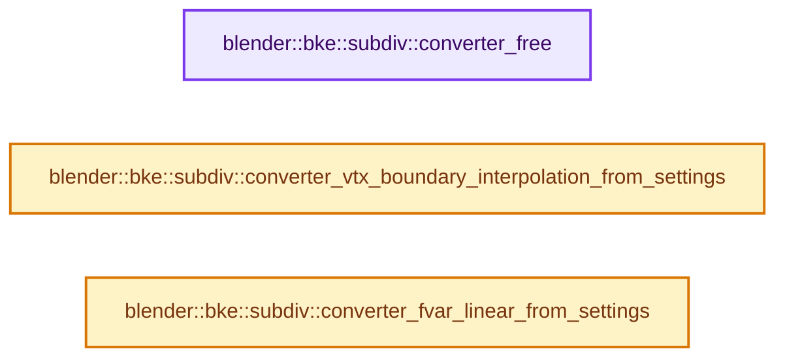

# 实现依赖专题：source/blender/blenkernel/intern/subdiv_converter.cc

[方向导航](README.md) · [符号索引](../%E7%AC%A6%E5%8F%B7%E4%BE%9D%E8%B5%96%E4%B8%8E%E5%AE%9E%E7%8E%B0%E7%B4%A2%E5%BC%95.md)

本专题从正文实际调用进入，集中保存共享实现。函数有稳定锚点，可从调用处直接跳到对应完整函数；递归与互相调用通过回链组织。

## 本文件的实现关系




## 完整成员与函数实现

<a id="f-cb699c2ac85acac1"></a>

### `blender::bke::subdiv::converter_free`

实现位置：[source/blender/blenkernel/intern/subdiv_converter.cc](../../../../../source/blender/blenkernel/intern/subdiv_converter.cc) · L15—L20。

接口参数：

- `OpenSubdiv_Converter *converter`

**教学注释版**

<!-- annotated:3e7cf483e24ecf -->

```cpp
void converter_free(OpenSubdiv_Converter *converter)
{
  if (converter->freeUserData) {
    converter->freeUserData(converter);
  }
}
```

<details>
<summary>核对原始源码：source/blender/blenkernel/intern/subdiv_converter.cc · L15—L20</summary>

<!-- original:3e7cf483e24ecf:source/blender/blenkernel/intern/subdiv_converter.cc:15:20 -->

```cpp
void converter_free(OpenSubdiv_Converter *converter)
{
  if (converter->freeUserData) {
    converter->freeUserData(converter);
  }
}
```

</details>

**继续追踪实现**

- `converter->freeUserData` → [调用协议](../%E6%A8%A1%E6%9D%BF%E5%AE%8F%E4%B8%8E%E5%8A%A8%E6%80%81%E5%88%86%E6%B4%BE%E5%8D%8F%E8%AE%AE.md)：由接收对象具体类型或运行时策略提供实现。调用位置L18。

<a id="f-54443f9f34f46e96"></a>

### `blender::bke::subdiv::converter_vtx_boundary_interpolation_from_settings`

实现位置：[source/blender/blenkernel/intern/subdiv_converter.cc](../../../../../source/blender/blenkernel/intern/subdiv_converter.cc) · L22—L34。

接口参数：

- `const Settings *settings`

**教学注释版**

<!-- annotated:f971bab64541e5 -->

```cpp
int converter_vtx_boundary_interpolation_from_settings(const Settings *settings)
{
  switch (settings->vtx_boundary_interpolation) {
    case SUBDIV_VTX_BOUNDARY_NONE:
      return OSD_VTX_BOUNDARY_NONE;
    case SUBDIV_VTX_BOUNDARY_EDGE_ONLY:
      return OSD_VTX_BOUNDARY_EDGE_ONLY;
    case SUBDIV_VTX_BOUNDARY_EDGE_AND_CORNER:
      return OSD_VTX_BOUNDARY_EDGE_AND_CORNER;
  }
  BLI_assert_msg(0, "Unknown vtx boundary interpolation");
  return OSD_VTX_BOUNDARY_EDGE_ONLY;
}
```

<details>
<summary>核对原始源码：source/blender/blenkernel/intern/subdiv_converter.cc · L22—L34</summary>

<!-- original:f971bab64541e5:source/blender/blenkernel/intern/subdiv_converter.cc:22:34 -->

```cpp
int converter_vtx_boundary_interpolation_from_settings(const Settings *settings)
{
  switch (settings->vtx_boundary_interpolation) {
    case SUBDIV_VTX_BOUNDARY_NONE:
      return OSD_VTX_BOUNDARY_NONE;
    case SUBDIV_VTX_BOUNDARY_EDGE_ONLY:
      return OSD_VTX_BOUNDARY_EDGE_ONLY;
    case SUBDIV_VTX_BOUNDARY_EDGE_AND_CORNER:
      return OSD_VTX_BOUNDARY_EDGE_AND_CORNER;
  }
  BLI_assert_msg(0, "Unknown vtx boundary interpolation");
  return OSD_VTX_BOUNDARY_EDGE_ONLY;
}
```

</details>

**结果出口**

- `return OSD_VTX_BOUNDARY_NONE;`
- `return OSD_VTX_BOUNDARY_EDGE_ONLY;`
- `return OSD_VTX_BOUNDARY_EDGE_AND_CORNER;`

**继续追踪实现**

- `BLI_assert_msg` → [BLI_assert_msg · L55](../01-%E5%9F%BA%E7%A1%80%E5%AE%B9%E5%99%A8%E4%B8%8E%E7%8E%B0%E4%BB%A3CPP/%E4%BE%9D%E8%B5%96-BLI_assert-cc98e8.md#m-695eed20dceb)；[BLI_assert_msg · L64](../01-%E5%9F%BA%E7%A1%80%E5%AE%B9%E5%99%A8%E4%B8%8E%E7%8E%B0%E4%BB%A3CPP/%E4%BE%9D%E8%B5%96-BLI_assert-cc98e8.md#m-7de5563de4db)。宏定义由构建条件选择。

<a id="f-f2315c2d0f548b26"></a>

### `blender::bke::subdiv::converter_fvar_linear_from_settings`

实现位置：[source/blender/blenkernel/intern/subdiv_converter.cc](../../../../../source/blender/blenkernel/intern/subdiv_converter.cc) · L36—L55。

接口参数：

- `const Settings *settings`

**教学注释版**

<!-- annotated:b1707f524a5585 -->

```cpp
/*OpenSubdiv_FVarLinearInterpolation*/ int converter_fvar_linear_from_settings(
    const Settings *settings)
{
  switch (settings->fvar_linear_interpolation) {
    case SUBDIV_FVAR_LINEAR_INTERPOLATION_NONE:
      return OSD_FVAR_LINEAR_INTERPOLATION_NONE;
    case SUBDIV_FVAR_LINEAR_INTERPOLATION_CORNERS_ONLY:
      return OSD_FVAR_LINEAR_INTERPOLATION_CORNERS_ONLY;
    case SUBDIV_FVAR_LINEAR_INTERPOLATION_CORNERS_AND_JUNCTIONS:
      return OSD_FVAR_LINEAR_INTERPOLATION_CORNERS_PLUS1;
    case SUBDIV_FVAR_LINEAR_INTERPOLATION_CORNERS_JUNCTIONS_AND_CONCAVE:
      return OSD_FVAR_LINEAR_INTERPOLATION_CORNERS_PLUS2;
    case SUBDIV_FVAR_LINEAR_INTERPOLATION_BOUNDARIES:
      return OSD_FVAR_LINEAR_INTERPOLATION_BOUNDARIES;
    case SUBDIV_FVAR_LINEAR_INTERPOLATION_ALL:
      return OSD_FVAR_LINEAR_INTERPOLATION_ALL;
  }
  BLI_assert_msg(0, "Unknown fvar linear interpolation");
  return OSD_FVAR_LINEAR_INTERPOLATION_NONE;
}
```

<details>
<summary>核对原始源码：source/blender/blenkernel/intern/subdiv_converter.cc · L36—L55</summary>

<!-- original:b1707f524a5585:source/blender/blenkernel/intern/subdiv_converter.cc:36:55 -->

```cpp
/*OpenSubdiv_FVarLinearInterpolation*/ int converter_fvar_linear_from_settings(
    const Settings *settings)
{
  switch (settings->fvar_linear_interpolation) {
    case SUBDIV_FVAR_LINEAR_INTERPOLATION_NONE:
      return OSD_FVAR_LINEAR_INTERPOLATION_NONE;
    case SUBDIV_FVAR_LINEAR_INTERPOLATION_CORNERS_ONLY:
      return OSD_FVAR_LINEAR_INTERPOLATION_CORNERS_ONLY;
    case SUBDIV_FVAR_LINEAR_INTERPOLATION_CORNERS_AND_JUNCTIONS:
      return OSD_FVAR_LINEAR_INTERPOLATION_CORNERS_PLUS1;
    case SUBDIV_FVAR_LINEAR_INTERPOLATION_CORNERS_JUNCTIONS_AND_CONCAVE:
      return OSD_FVAR_LINEAR_INTERPOLATION_CORNERS_PLUS2;
    case SUBDIV_FVAR_LINEAR_INTERPOLATION_BOUNDARIES:
      return OSD_FVAR_LINEAR_INTERPOLATION_BOUNDARIES;
    case SUBDIV_FVAR_LINEAR_INTERPOLATION_ALL:
      return OSD_FVAR_LINEAR_INTERPOLATION_ALL;
  }
  BLI_assert_msg(0, "Unknown fvar linear interpolation");
  return OSD_FVAR_LINEAR_INTERPOLATION_NONE;
}
```

</details>

**结果出口**

- `return OSD_FVAR_LINEAR_INTERPOLATION_NONE;`
- `return OSD_FVAR_LINEAR_INTERPOLATION_CORNERS_ONLY;`
- `return OSD_FVAR_LINEAR_INTERPOLATION_CORNERS_PLUS1;`
- `return OSD_FVAR_LINEAR_INTERPOLATION_CORNERS_PLUS2;`
- `return OSD_FVAR_LINEAR_INTERPOLATION_BOUNDARIES;`
- `return OSD_FVAR_LINEAR_INTERPOLATION_ALL;`

**继续追踪实现**

- `BLI_assert_msg` → [BLI_assert_msg · L55](../01-%E5%9F%BA%E7%A1%80%E5%AE%B9%E5%99%A8%E4%B8%8E%E7%8E%B0%E4%BB%A3CPP/%E4%BE%9D%E8%B5%96-BLI_assert-cc98e8.md#m-695eed20dceb)；[BLI_assert_msg · L64](../01-%E5%9F%BA%E7%A1%80%E5%AE%B9%E5%99%A8%E4%B8%8E%E7%8E%B0%E4%BB%A3CPP/%E4%BE%9D%E8%B5%96-BLI_assert-cc98e8.md#m-7de5563de4db)。宏定义由构建条件选择。
