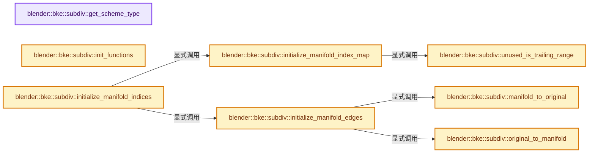
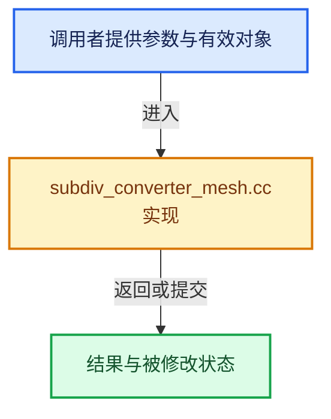

# 实现依赖专题：source/blender/blenkernel/intern/subdiv_converter_mesh.cc

[方向导航](README.md) · [符号索引](../%E7%AC%A6%E5%8F%B7%E4%BE%9D%E8%B5%96%E4%B8%8E%E5%AE%9E%E7%8E%B0%E7%B4%A2%E5%BC%95.md)

本专题从正文实际调用进入，集中保存共享实现。函数有稳定锚点，可从调用处直接跳到对应完整函数；递归与互相调用通过回链组织。

## 本文件的实现关系






## 完整成员与函数实现

<a id="f-48e20455c63a01a9"></a>

### `blender::bke::subdiv::get_scheme_type`

实现位置：[source/blender/blenkernel/intern/subdiv_converter_mesh.cc](../../../../../source/blender/blenkernel/intern/subdiv_converter_mesh.cc) · L81—L94。

接口参数：

- `const Settings &settings`

**教学注释版**

<!-- annotated:a3783728af2321 -->

```cpp
static OpenSubdiv_SchemeType get_scheme_type(const Settings &settings)
{
#if BUGGY_SIMPLE_SCHEME_WORKAROUND
  (void)settings;
  return OSD_SCHEME_CATMARK;
#else
  if (settings.is_simple) {
    return OSD_SCHEME_BILINEAR;
  }
  else {
    return OSD_SCHEME_CATMARK;
  }
#endif
}
```

<details>
<summary>核对原始源码：source/blender/blenkernel/intern/subdiv_converter_mesh.cc · L81—L94</summary>

<!-- original:a3783728af2321:source/blender/blenkernel/intern/subdiv_converter_mesh.cc:81:94 -->

```cpp
static OpenSubdiv_SchemeType get_scheme_type(const Settings &settings)
{
#if BUGGY_SIMPLE_SCHEME_WORKAROUND
  (void)settings;
  return OSD_SCHEME_CATMARK;
#else
  if (settings.is_simple) {
    return OSD_SCHEME_BILINEAR;
  }
  else {
    return OSD_SCHEME_CATMARK;
  }
#endif
}
```

</details>

**结果出口**

- `return OSD_SCHEME_CATMARK;`
- `return OSD_SCHEME_BILINEAR;`

**继续追踪实现**

本实现没有需要继续展开的显式调用；检查返回表达式、对象转换和调用者前置条件。

<a id="f-ea721b54a73fc83d"></a>

### `blender::bke::subdiv::original_to_manifold`

实现位置：[source/blender/blenkernel/intern/subdiv_converter_mesh.cc](../../../../../source/blender/blenkernel/intern/subdiv_converter_mesh.cc) · L106—L109。

接口参数：

- `const Array<int> &forward_map`
- `const int original_index`

**教学注释版**

<!-- annotated:6903391568737c -->

```cpp
static int original_to_manifold(const Array<int> &forward_map, const int original_index)
{
  // [讲解] forward_map.is_empty：查询固定有效长度及其索引范围。
  return forward_map.is_empty() ? original_index : forward_map[original_index];
}
```

<details>
<summary>核对原始源码：source/blender/blenkernel/intern/subdiv_converter_mesh.cc · L106—L109</summary>

<!-- original:6903391568737c:source/blender/blenkernel/intern/subdiv_converter_mesh.cc:106:109 -->

```cpp
static int original_to_manifold(const Array<int> &forward_map, const int original_index)
{
  return forward_map.is_empty() ? original_index : forward_map[original_index];
}
```

</details>

**结果出口**

- `return forward_map.is_empty() ? original_index : forward_map[original_index];`

**继续追踪实现**

- `forward_map.is_empty` → [blender::Array::is_empty · L275](../01-%E5%9F%BA%E7%A1%80%E5%AE%B9%E5%99%A8%E4%B8%8E%E7%8E%B0%E4%BB%A3CPP/08-Array%E5%A4%8D%E5%88%B6%E7%A7%BB%E5%8A%A8%E4%B8%8E%E9%94%80%E6%AF%81.md#f-5eba6dba0f0e521b)。

<a id="f-f6c766dedba061c8"></a>

### `blender::bke::subdiv::manifold_to_original`

实现位置：[source/blender/blenkernel/intern/subdiv_converter_mesh.cc](../../../../../source/blender/blenkernel/intern/subdiv_converter_mesh.cc) · L111—L114。

接口参数：

- `const Array<int> &reverse_map`
- `const int manifold_index`

**教学注释版**

<!-- annotated:c093370a1b9912 -->

```cpp
static int manifold_to_original(const Array<int> &reverse_map, const int manifold_index)
{
  // [讲解] reverse_map.is_empty：查询固定有效长度及其索引范围。
  return reverse_map.is_empty() ? manifold_index : reverse_map[manifold_index];
}
```

<details>
<summary>核对原始源码：source/blender/blenkernel/intern/subdiv_converter_mesh.cc · L111—L114</summary>

<!-- original:c093370a1b9912:source/blender/blenkernel/intern/subdiv_converter_mesh.cc:111:114 -->

```cpp
static int manifold_to_original(const Array<int> &reverse_map, const int manifold_index)
{
  return reverse_map.is_empty() ? manifold_index : reverse_map[manifold_index];
}
```

</details>

**结果出口**

- `return reverse_map.is_empty() ? manifold_index : reverse_map[manifold_index];`

**继续追踪实现**

- `reverse_map.is_empty` → [blender::Array::is_empty · L275](../01-%E5%9F%BA%E7%A1%80%E5%AE%B9%E5%99%A8%E4%B8%8E%E7%8E%B0%E4%BB%A3CPP/08-Array%E5%A4%8D%E5%88%B6%E7%A7%BB%E5%8A%A8%E4%B8%8E%E9%94%80%E6%AF%81.md#f-5eba6dba0f0e521b)。

<a id="f-ff96a456e7a791ea"></a>

### `blender::bke::subdiv::init_functions`

实现位置：[source/blender/blenkernel/intern/subdiv_converter_mesh.cc](../../../../../source/blender/blenkernel/intern/subdiv_converter_mesh.cc) · L182—L203。

接口参数：

- `OpenSubdiv_Converter *converter`

**教学注释版**

<!-- annotated:dd6cc17a416f91 -->

```cpp
static void init_functions(OpenSubdiv_Converter *converter)
{
  converter->specifiesFullTopology = specifies_full_topology;

  converter->getFaceEdges = nullptr;

  converter->getNumEdgeFaces = nullptr;
  converter->getEdgeFaces = nullptr;

  converter->getNumVertexEdges = nullptr;
  converter->getVertexEdges = nullptr;
  converter->getNumVertexFaces = nullptr;
  converter->getVertexFaces = nullptr;

  converter->getNumUVLayers = get_num_uv_layers;
  converter->precalcUVLayer = precalc_uv_layer;
  converter->finishUVLayer = finish_uv_layer;
  converter->getNumUVCoordinates = get_num_uvs;
  converter->getFaceCornerUVIndex = get_face_corner_uv_index;

  converter->freeUserData = free_user_data;
}
```

<details>
<summary>核对原始源码：source/blender/blenkernel/intern/subdiv_converter_mesh.cc · L182—L203</summary>

<!-- original:dd6cc17a416f91:source/blender/blenkernel/intern/subdiv_converter_mesh.cc:182:203 -->

```cpp
static void init_functions(OpenSubdiv_Converter *converter)
{
  converter->specifiesFullTopology = specifies_full_topology;

  converter->getFaceEdges = nullptr;

  converter->getNumEdgeFaces = nullptr;
  converter->getEdgeFaces = nullptr;

  converter->getNumVertexEdges = nullptr;
  converter->getVertexEdges = nullptr;
  converter->getNumVertexFaces = nullptr;
  converter->getVertexFaces = nullptr;

  converter->getNumUVLayers = get_num_uv_layers;
  converter->precalcUVLayer = precalc_uv_layer;
  converter->finishUVLayer = finish_uv_layer;
  converter->getNumUVCoordinates = get_num_uvs;
  converter->getFaceCornerUVIndex = get_face_corner_uv_index;

  converter->freeUserData = free_user_data;
}
```

</details>

**沿实际写入检查状态**

- `converter->specifiesFullTopology = specifies_full_topology;`
- `converter->getFaceEdges = nullptr;`
- `converter->getNumEdgeFaces = nullptr;`
- `converter->getEdgeFaces = nullptr;`
- `converter->getNumVertexEdges = nullptr;`
- `converter->getVertexEdges = nullptr;`
- `converter->getNumVertexFaces = nullptr;`
- `converter->getVertexFaces = nullptr;`
- `converter->getNumUVLayers = get_num_uv_layers;`
- `converter->precalcUVLayer = precalc_uv_layer;`
- `converter->finishUVLayer = finish_uv_layer;`
- `converter->getNumUVCoordinates = get_num_uvs;`
- `converter->getFaceCornerUVIndex = get_face_corner_uv_index;`
- `converter->freeUserData = free_user_data;`

**继续追踪实现**

本实现没有需要继续展开的显式调用；检查返回表达式、对象转换和调用者前置条件。

<a id="f-16677521f2bce409"></a>

### `blender::bke::subdiv::unused_is_trailing_range`

实现位置：[source/blender/blenkernel/intern/subdiv_converter_mesh.cc](../../../../../source/blender/blenkernel/intern/subdiv_converter_mesh.cc) · L208—L215。

接口参数：

- `const IndexMask &unused_mask`
- `const int num_elements`

**教学注释版**

<!-- annotated:c21ba7c2529831 -->

```cpp
static bool unused_is_trailing_range(const IndexMask &unused_mask, const int num_elements)
{
  if (unused_mask.is_empty()) {
    return true;
  }
  const std::optional<IndexRange> range = unused_mask.to_range();
  return range.has_value() && range->one_after_last() == num_elements;
}
```

<details>
<summary>核对原始源码：source/blender/blenkernel/intern/subdiv_converter_mesh.cc · L208—L215</summary>

<!-- original:c21ba7c2529831:source/blender/blenkernel/intern/subdiv_converter_mesh.cc:208:215 -->

```cpp
static bool unused_is_trailing_range(const IndexMask &unused_mask, const int num_elements)
{
  if (unused_mask.is_empty()) {
    return true;
  }
  const std::optional<IndexRange> range = unused_mask.to_range();
  return range.has_value() && range->one_after_last() == num_elements;
}
```

</details>

**结果出口**

- `return true;`
- `return range.has_value() && range->one_after_last() == num_elements;`

**继续追踪实现**

- `unused_mask.is_empty` → [blender::index_mask::IndexMask::is_empty · L748](../04-%E8%99%9A%E6%8B%9F%E6%95%B0%E7%BB%84%E4%B8%8E%E7%B4%A2%E5%BC%95%E9%80%89%E6%8B%A9/09-%E5%88%86%E6%AE%B5%E5%AD%98%E5%82%A8%E4%B8%8E%E9%81%8D%E5%8E%86.md#f-190ac996386064f4)。
- `unused_mask.to_range` → [blender::index_mask::IndexMask::to_range · L1136](../04-%E8%99%9A%E6%8B%9F%E6%95%B0%E7%BB%84%E4%B8%8E%E7%B4%A2%E5%BC%95%E9%80%89%E6%8B%A9/12-%E9%87%8D%E6%9E%84%E5%8E%86%E5%8F%B2%E4%B8%8E%E5%9F%BA%E5%87%86%E7%BB%83%E4%B9%A0.md#f-bcc016bae424bbaf)。
- `range.has_value` → [外部契约](https://eel.is/c++draft/)：这个边界按实际表达式及所属类型核对参数、返回值、寿命与失败行为。这里提供接口入口，不声称已解释该第三方版本的内部实现。
- `range->one_after_last` → [外部契约](https://eel.is/c++draft/)：这个边界按实际表达式及所属类型核对参数、返回值、寿命与失败行为。这里提供接口入口，不声称已解释该第三方版本的内部实现。

<a id="f-f004e23d20daaa85"></a>

### `blender::bke::subdiv::initialize_manifold_index_map`

实现位置：[source/blender/blenkernel/intern/subdiv_converter_mesh.cc](../../../../../source/blender/blenkernel/intern/subdiv_converter_mesh.cc) · L219—L239。

接口参数：

- `const IndexMask &unused_mask`
- `const int num_elements`
- `Array<int> *r_index_forward`
- `Array<int> *r_index_reverse`

**教学注释版**

<!-- annotated:bdc919dd8bfbd7 -->

```cpp
static int initialize_manifold_index_map(const IndexMask &unused_mask,
                                         const int num_elements,
                                         Array<int> *r_index_forward,
                                         Array<int> *r_index_reverse)
{
  const int num_manifold_elements = num_elements - unused_mask.size();
  if (unused_is_trailing_range(unused_mask, num_elements)) {
    return num_manifold_elements;
  }
  IndexMaskMemory memory;
  const IndexMask used_mask = unused_mask.complement(IndexRange(num_elements), memory);
  if (r_index_forward != nullptr) {
    // [讲解] r_index_forward->reinitialize：以新长度重建数组。
    r_index_forward->reinitialize(num_elements);
    index_mask::build_reverse_map<int>(used_mask, *r_index_forward);
  }
  if (r_index_reverse != nullptr) {
    r_index_reverse->reinitialize(num_manifold_elements);
    used_mask.to_indices<int>(*r_index_reverse);
  }
  return num_manifold_elements;
}
```

<details>
<summary>核对原始源码：source/blender/blenkernel/intern/subdiv_converter_mesh.cc · L219—L239</summary>

<!-- original:bdc919dd8bfbd7:source/blender/blenkernel/intern/subdiv_converter_mesh.cc:219:239 -->

```cpp
static int initialize_manifold_index_map(const IndexMask &unused_mask,
                                         const int num_elements,
                                         Array<int> *r_index_forward,
                                         Array<int> *r_index_reverse)
{
  const int num_manifold_elements = num_elements - unused_mask.size();
  if (unused_is_trailing_range(unused_mask, num_elements)) {
    return num_manifold_elements;
  }
  IndexMaskMemory memory;
  const IndexMask used_mask = unused_mask.complement(IndexRange(num_elements), memory);
  if (r_index_forward != nullptr) {
    r_index_forward->reinitialize(num_elements);
    index_mask::build_reverse_map<int>(used_mask, *r_index_forward);
  }
  if (r_index_reverse != nullptr) {
    r_index_reverse->reinitialize(num_manifold_elements);
    used_mask.to_indices<int>(*r_index_reverse);
  }
  return num_manifold_elements;
}
```

</details>

**结果出口**

- `return num_manifold_elements;`

**继续追踪实现**

- `unused_mask.size` → [blender::index_mask::IndexMask::size · L743](../04-%E8%99%9A%E6%8B%9F%E6%95%B0%E7%BB%84%E4%B8%8E%E7%B4%A2%E5%BC%95%E9%80%89%E6%8B%A9/09-%E5%88%86%E6%AE%B5%E5%AD%98%E5%82%A8%E4%B8%8E%E9%81%8D%E5%8E%86.md#f-0163b32abc9a0d9c)。
- `unused_is_trailing_range` → [blender::bke::subdiv::unused_is_trailing_range · L208](%E4%BE%9D%E8%B5%96-subdiv_converter_mesh-b9292d.md#f-16677521f2bce409)。
- `unused_mask.complement` → [blender::index_mask::IndexMask::complement · L407](../04-%E8%99%9A%E6%8B%9F%E6%95%B0%E7%BB%84%E4%B8%8E%E7%B4%A2%E5%BC%95%E9%80%89%E6%8B%A9/10-IndexMask%E6%9E%84%E5%BB%BA%E4%B8%8E%E5%B9%B6%E8%A1%8C.md#f-1e9932d5baa6f719)。
- `IndexRange` → [blender::IndexRange](../01-%E5%9F%BA%E7%A1%80%E5%AE%B9%E5%99%A8%E4%B8%8E%E7%8E%B0%E4%BB%A3CPP/%E4%BE%9D%E8%B5%96-BLI_index_range-7d7cc5.md#t-caa3466d6776)；[blender::gpu::shader::parser::IndexRange](%E4%BE%9D%E8%B5%96-utils-06433d.md#t-82d2bd4ea71c)；[blender::IndexRange](%E4%BE%9D%E8%B5%96-DNA_node_types-6708b9.md#t-0448cc889d39)。
- `r_index_forward->reinitialize` → [blender::Array::reinitialize · L430](../01-%E5%9F%BA%E7%A1%80%E5%AE%B9%E5%99%A8%E4%B8%8E%E7%8E%B0%E4%BB%A3CPP/08-Array%E5%A4%8D%E5%88%B6%E7%A7%BB%E5%8A%A8%E4%B8%8E%E9%94%80%E6%AF%81.md#f-3414f619e246b688)。
- `index_mask::build_reverse_map<int>` → [blender::index_mask::build_reverse_map · L36](../04-%E8%99%9A%E6%8B%9F%E6%95%B0%E7%BB%84%E4%B8%8E%E7%B4%A2%E5%BC%95%E9%80%89%E6%8B%A9/10-IndexMask%E6%9E%84%E5%BB%BA%E4%B8%8E%E5%B9%B6%E8%A1%8C.md#f-70299191942ae7f9)。
- `r_index_reverse->reinitialize` → [blender::Array::reinitialize · L430](../01-%E5%9F%BA%E7%A1%80%E5%AE%B9%E5%99%A8%E4%B8%8E%E7%8E%B0%E4%BB%A3CPP/08-Array%E5%A4%8D%E5%88%B6%E7%A7%BB%E5%8A%A8%E4%B8%8E%E9%94%80%E6%AF%81.md#f-3414f619e246b688)。
- `used_mask.to_indices<int>` → [blender::index_mask::IndexMask::to_indices · L1129](../04-%E8%99%9A%E6%8B%9F%E6%95%B0%E7%BB%84%E4%B8%8E%E7%B4%A2%E5%BC%95%E9%80%89%E6%8B%A9/12-%E9%87%8D%E6%9E%84%E5%8E%86%E5%8F%B2%E4%B8%8E%E5%9F%BA%E5%87%86%E7%BB%83%E4%B9%A0.md#f-9821e0729f14f866)；[blender::index_mask::IndexMask::to_indices · L766](../04-%E8%99%9A%E6%8B%9F%E6%95%B0%E7%BB%84%E4%B8%8E%E7%B4%A2%E5%BC%95%E9%80%89%E6%8B%A9/10-IndexMask%E6%9E%84%E5%BB%BA%E4%B8%8E%E5%B9%B6%E8%A1%8C.md#f-7d2f4148b6937424)。同名重载需按实参类型选择。

<a id="f-fb2d0265b38e2ce6"></a>

### `blender::bke::subdiv::initialize_manifold_edges`

实现位置：[source/blender/blenkernel/intern/subdiv_converter_mesh.cc](../../../../../source/blender/blenkernel/intern/subdiv_converter_mesh.cc) · L243—L263。

接口参数：

- `ConverterStorage &storage`

**教学注释版**

<!-- annotated:5ef89036595eaf -->

```cpp
static void initialize_manifold_edges(ConverterStorage &storage)
{
  const Span<int2> mesh_edges = storage.mesh->edges();
  if (storage.manifold_edge_to_orig.is_empty() && storage.manifold_verts.is_empty()) {
    // [讲解] mesh_edges.take_front：从两端裁去或选取一定数量元素形成新视图。
    storage.edges = mesh_edges.take_front(storage.num_manifold_edges);
    return;
  }
  storage.edges_manifold.reinitialize(storage.num_manifold_edges);
  const MutableSpan<int2> edges_manifold = storage.edges_manifold;
  // [讲解] edges_manifold.index_range：查询视图长度或生成对应有效索引区间。
  threading::parallel_for(edges_manifold.index_range(), 4096, [&](const IndexRange range) {
    for (const int manifold_edge_index : range) {
      const int edge_index = manifold_to_original(storage.manifold_edge_to_orig,
                                                  manifold_edge_index);
      const int2 &edge = mesh_edges[edge_index];
      edges_manifold[manifold_edge_index] = int2(
          original_to_manifold(storage.manifold_verts, edge[0]),
          original_to_manifold(storage.manifold_verts, edge[1]));
    }
  });
  storage.edges = storage.edges_manifold;
}
```

<details>
<summary>核对原始源码：source/blender/blenkernel/intern/subdiv_converter_mesh.cc · L243—L263</summary>

<!-- original:5ef89036595eaf:source/blender/blenkernel/intern/subdiv_converter_mesh.cc:243:263 -->

```cpp
static void initialize_manifold_edges(ConverterStorage &storage)
{
  const Span<int2> mesh_edges = storage.mesh->edges();
  if (storage.manifold_edge_to_orig.is_empty() && storage.manifold_verts.is_empty()) {
    storage.edges = mesh_edges.take_front(storage.num_manifold_edges);
    return;
  }
  storage.edges_manifold.reinitialize(storage.num_manifold_edges);
  const MutableSpan<int2> edges_manifold = storage.edges_manifold;
  threading::parallel_for(edges_manifold.index_range(), 4096, [&](const IndexRange range) {
    for (const int manifold_edge_index : range) {
      const int edge_index = manifold_to_original(storage.manifold_edge_to_orig,
                                                  manifold_edge_index);
      const int2 &edge = mesh_edges[edge_index];
      edges_manifold[manifold_edge_index] = int2(
          original_to_manifold(storage.manifold_verts, edge[0]),
          original_to_manifold(storage.manifold_verts, edge[1]));
    }
  });
  storage.edges = storage.edges_manifold;
}
```

</details>

**沿实际写入检查状态**

- `storage.edges = mesh_edges.take_front(storage.num_manifold_edges);`
- `edges_manifold[manifold_edge_index] = int2(`
- `storage.edges = storage.edges_manifold;`

**继续追踪实现**

- `storage.mesh->edges` → [调用协议](../%E6%A8%A1%E6%9D%BF%E5%AE%8F%E4%B8%8E%E5%8A%A8%E6%80%81%E5%88%86%E6%B4%BE%E5%8D%8F%E8%AE%AE.md)：接收对象类型依赖auto、返回值或模板实例；不按同名猜测目标。调用位置L245。
- `storage.manifold_edge_to_orig.is_empty` → [调用协议](../%E6%A8%A1%E6%9D%BF%E5%AE%8F%E4%B8%8E%E5%8A%A8%E6%80%81%E5%88%86%E6%B4%BE%E5%8D%8F%E8%AE%AE.md)：接收对象类型依赖auto、返回值或模板实例；不按同名猜测目标。调用位置L246。
- `storage.manifold_verts.is_empty` → [调用协议](../%E6%A8%A1%E6%9D%BF%E5%AE%8F%E4%B8%8E%E5%8A%A8%E6%80%81%E5%88%86%E6%B4%BE%E5%8D%8F%E8%AE%AE.md)：接收对象类型依赖auto、返回值或模板实例；不按同名猜测目标。调用位置L246。
- `mesh_edges.take_front` → [blender::Span::take_front · L197](../01-%E5%9F%BA%E7%A1%80%E5%AE%B9%E5%99%A8%E4%B8%8E%E7%8E%B0%E4%BB%A3CPP/05-Span%E5%8F%AA%E8%AF%BB%E8%BF%9E%E7%BB%AD%E8%A7%86%E5%9B%BE.md#f-1556b8b4aac9d42f)。
- `storage.edges_manifold.reinitialize` → [调用协议](../%E6%A8%A1%E6%9D%BF%E5%AE%8F%E4%B8%8E%E5%8A%A8%E6%80%81%E5%88%86%E6%B4%BE%E5%8D%8F%E8%AE%AE.md)：接收对象类型依赖auto、返回值或模板实例；不按同名猜测目标。调用位置L250。
- `threading::parallel_for` → [blender::threading::parallel_for · L68](../11-Depsgraph%E4%B8%8E%E5%B9%B6%E8%A1%8C%E4%BB%BB%E5%8A%A1%E7%B3%BB%E7%BB%9F/07-%E4%BB%BB%E5%8A%A1%E6%B1%A0%E4%B8%8ETBB%E6%8E%A5%E5%85%A5.md#f-838294754c24426c)。
- `edges_manifold.index_range` → [blender::MutableSpan::index_range · L676](../01-%E5%9F%BA%E7%A1%80%E5%AE%B9%E5%99%A8%E4%B8%8E%E7%8E%B0%E4%BB%A3CPP/06-MutableSpan%E5%8F%AF%E5%86%99%E8%A7%86%E5%9B%BE.md#f-f9a9d59a69ca64b5)。
- `manifold_to_original` → [blender::bke::subdiv::manifold_to_original · L111](%E4%BE%9D%E8%B5%96-subdiv_converter_mesh-b9292d.md#f-f6c766dedba061c8)。
- `int2` → [int2 · L643](%E4%BE%9D%E8%B5%96-smaa-b67bc2.md#m-8960c8e6139d)。宏定义由构建条件选择。
- `original_to_manifold` → [blender::bke::subdiv::original_to_manifold · L106](%E4%BE%9D%E8%B5%96-subdiv_converter_mesh-b9292d.md#f-ea721b54a73fc83d)。

<a id="f-c77b8f7c632b3406"></a>

### `blender::bke::subdiv::initialize_manifold_indices`

实现位置：[source/blender/blenkernel/intern/subdiv_converter_mesh.cc](../../../../../source/blender/blenkernel/intern/subdiv_converter_mesh.cc) · L265—L288。

接口参数：

- `ConverterStorage &storage`

**教学注释版**

<!-- annotated:de920e1b519ab2 -->

```cpp
static void initialize_manifold_indices(ConverterStorage &storage)
{
  const Mesh *mesh = storage.mesh;
  const IndexMask &loose_verts = mesh->verts_no_face();
  const IndexMask &loose_edges = mesh->loose_edges();

  storage.num_manifold_vertices = initialize_manifold_index_map(
      loose_verts, mesh->verts_num, &storage.manifold_verts, &storage.manifold_vert_to_orig);
  if (storage.manifold_verts.is_empty()) {
    storage.corner_verts = mesh->corner_verts();
  }
  else {
    const Span<int> mesh_corner_verts = mesh->corner_verts();
    // [讲解] mesh_corner_verts.size：查询视图长度或生成对应有效索引区间。
    storage.corner_verts_manifold.reinitialize(mesh_corner_verts.size());
    array_utils::gather(storage.manifold_verts.as_span(),
                        mesh_corner_verts,
                        storage.corner_verts_manifold.as_mutable_span());
    storage.corner_verts = storage.corner_verts_manifold;
  }

  storage.num_manifold_edges = initialize_manifold_index_map(
      loose_edges, mesh->edges_num, nullptr, &storage.manifold_edge_to_orig);
  initialize_manifold_edges(storage);
}
```

<details>
<summary>核对原始源码：source/blender/blenkernel/intern/subdiv_converter_mesh.cc · L265—L288</summary>

<!-- original:de920e1b519ab2:source/blender/blenkernel/intern/subdiv_converter_mesh.cc:265:288 -->

```cpp
static void initialize_manifold_indices(ConverterStorage &storage)
{
  const Mesh *mesh = storage.mesh;
  const IndexMask &loose_verts = mesh->verts_no_face();
  const IndexMask &loose_edges = mesh->loose_edges();

  storage.num_manifold_vertices = initialize_manifold_index_map(
      loose_verts, mesh->verts_num, &storage.manifold_verts, &storage.manifold_vert_to_orig);
  if (storage.manifold_verts.is_empty()) {
    storage.corner_verts = mesh->corner_verts();
  }
  else {
    const Span<int> mesh_corner_verts = mesh->corner_verts();
    storage.corner_verts_manifold.reinitialize(mesh_corner_verts.size());
    array_utils::gather(storage.manifold_verts.as_span(),
                        mesh_corner_verts,
                        storage.corner_verts_manifold.as_mutable_span());
    storage.corner_verts = storage.corner_verts_manifold;
  }

  storage.num_manifold_edges = initialize_manifold_index_map(
      loose_edges, mesh->edges_num, nullptr, &storage.manifold_edge_to_orig);
  initialize_manifold_edges(storage);
}
```

</details>

**沿实际写入检查状态**

- `storage.num_manifold_vertices = initialize_manifold_index_map(`
- `storage.corner_verts = mesh->corner_verts();`
- `storage.corner_verts = storage.corner_verts_manifold;`
- `storage.num_manifold_edges = initialize_manifold_index_map(`

**继续追踪实现**

- `mesh->verts_no_face` → [blender::Mesh::verts_no_face · L176](../06-%E9%9A%90%E5%BC%8F%E5%85%B1%E4%BA%AB%E4%B8%8E%E7%BC%93%E5%AD%98%E7%B3%BB%E7%BB%9F/10-%E5%B1%80%E9%83%A8%E6%9B%B4%E6%96%B0%E4%B8%8E%E5%A4%B1%E6%95%88%E4%BF%AE%E5%A4%8D.md#f-11b9bed425be6cbf)。
- `mesh->loose_edges` → [blender::Mesh::loose_edges · L194](../06-%E9%9A%90%E5%BC%8F%E5%85%B1%E4%BA%AB%E4%B8%8E%E7%BC%93%E5%AD%98%E7%B3%BB%E7%BB%9F/10-%E5%B1%80%E9%83%A8%E6%9B%B4%E6%96%B0%E4%B8%8E%E5%A4%B1%E6%95%88%E4%BF%AE%E5%A4%8D.md#f-80e2cb4f8c0f449d)。
- `initialize_manifold_index_map` → [blender::bke::subdiv::initialize_manifold_index_map · L219](%E4%BE%9D%E8%B5%96-subdiv_converter_mesh-b9292d.md#f-f004e23d20daaa85)。
- `storage.manifold_verts.is_empty` → [调用协议](../%E6%A8%A1%E6%9D%BF%E5%AE%8F%E4%B8%8E%E5%8A%A8%E6%80%81%E5%88%86%E6%B4%BE%E5%8D%8F%E8%AE%AE.md)：接收对象类型依赖auto、返回值或模板实例；不按同名猜测目标。调用位置L273。
- `mesh->corner_verts` → [Mesh::corner_verts · L1238](03-MPoly%E8%BF%81%E7%A7%BB%E4%B8%8E%E5%85%BC%E5%AE%B9.md#f-a59c61f583b64bc4)。
- `storage.corner_verts_manifold.reinitialize` → [调用协议](../%E6%A8%A1%E6%9D%BF%E5%AE%8F%E4%B8%8E%E5%8A%A8%E6%80%81%E5%88%86%E6%B4%BE%E5%8D%8F%E8%AE%AE.md)：接收对象类型依赖auto、返回值或模板实例；不按同名猜测目标。调用位置L278。
- `mesh_corner_verts.size` → [blender::Span::size · L256](../01-%E5%9F%BA%E7%A1%80%E5%AE%B9%E5%99%A8%E4%B8%8E%E7%8E%B0%E4%BB%A3CPP/05-Span%E5%8F%AA%E8%AF%BB%E8%BF%9E%E7%BB%AD%E8%A7%86%E5%9B%BE.md#f-5f80fa006089c998)。
- `array_utils::gather` → [blender::array_utils::gather · L187](../01-%E5%9F%BA%E7%A1%80%E5%AE%B9%E5%99%A8%E4%B8%8E%E7%8E%B0%E4%BB%A3CPP/20-%E5%AE%B9%E5%99%A8%E9%80%89%E6%8B%A9%E4%B8%8E%E7%8B%AC%E7%AB%8B%E5%AE%9E%E7%8E%B0.md#f-1760adec5858a42f)；[blender::array_utils::gather · L209](../01-%E5%9F%BA%E7%A1%80%E5%AE%B9%E5%99%A8%E4%B8%8E%E7%8E%B0%E4%BB%A3CPP/20-%E5%AE%B9%E5%99%A8%E9%80%89%E6%8B%A9%E4%B8%8E%E7%8B%AC%E7%AB%8B%E5%AE%9E%E7%8E%B0.md#f-a9f65820788454bf)；[blender::array_utils::gather · L225](../01-%E5%9F%BA%E7%A1%80%E5%AE%B9%E5%99%A8%E4%B8%8E%E7%8E%B0%E4%BB%A3CPP/20-%E5%AE%B9%E5%99%A8%E9%80%89%E6%8B%A9%E4%B8%8E%E7%8B%AC%E7%AB%8B%E5%AE%9E%E7%8E%B0.md#f-279764b4196f0b63)；[blender::array_utils::gather · L237](../01-%E5%9F%BA%E7%A1%80%E5%AE%B9%E5%99%A8%E4%B8%8E%E7%8E%B0%E4%BB%A3CPP/20-%E5%AE%B9%E5%99%A8%E9%80%89%E6%8B%A9%E4%B8%8E%E7%8B%AC%E7%AB%8B%E5%AE%9E%E7%8E%B0.md#f-e310fd489b49341b)；[blender::array_utils::gather · L268](../01-%E5%9F%BA%E7%A1%80%E5%AE%B9%E5%99%A8%E4%B8%8E%E7%8E%B0%E4%BB%A3CPP/20-%E5%AE%B9%E5%99%A8%E9%80%89%E6%8B%A9%E4%B8%8E%E7%8B%AC%E7%AB%8B%E5%AE%9E%E7%8E%B0.md#f-7b21c29791903615)；[blender::array_utils::gather · L63](../01-%E5%9F%BA%E7%A1%80%E5%AE%B9%E5%99%A8%E4%B8%8E%E7%8E%B0%E4%BB%A3CPP/%E4%BE%9D%E8%B5%96-array_utils-cbb70f.md#f-5c2b501b03ddbb1f)；[blender::array_utils::gather · L82](../01-%E5%9F%BA%E7%A1%80%E5%AE%B9%E5%99%A8%E4%B8%8E%E7%8E%B0%E4%BB%A3CPP/%E4%BE%9D%E8%B5%96-array_utils-cbb70f.md#f-ea4dd9e673fe81e4)。同名重载需按实参类型选择。
- `storage.manifold_verts.as_span` → [调用协议](../%E6%A8%A1%E6%9D%BF%E5%AE%8F%E4%B8%8E%E5%8A%A8%E6%80%81%E5%88%86%E6%B4%BE%E5%8D%8F%E8%AE%AE.md)：接收对象类型依赖auto、返回值或模板实例；不按同名猜测目标。调用位置L279。
- `storage.corner_verts_manifold.as_mutable_span` → [调用协议](../%E6%A8%A1%E6%9D%BF%E5%AE%8F%E4%B8%8E%E5%8A%A8%E6%80%81%E5%88%86%E6%B4%BE%E5%8D%8F%E8%AE%AE.md)：接收对象类型依赖auto、返回值或模板实例；不按同名猜测目标。调用位置L281。
- `initialize_manifold_edges` → [blender::bke::subdiv::initialize_manifold_edges · L243](%E4%BE%9D%E8%B5%96-subdiv_converter_mesh-b9292d.md#f-fb2d0265b38e2ce6)。

<a id="f-41f0df381bc1a813"></a>

### `blender::bke::subdiv::gather_manifold_sharpness`

实现位置：[source/blender/blenkernel/intern/subdiv_converter_mesh.cc](../../../../../source/blender/blenkernel/intern/subdiv_converter_mesh.cc) · L293—L308。

接口参数：

- `const Span<float> creases`
- `const Span<int> manifold_to_orig`
- `const MutableSpan<float> sharpness`

**教学注释版**

<!-- annotated:42d2a1dc4fffeb -->

```cpp
static void gather_manifold_sharpness(const Span<float> creases,
                                      const Span<int> manifold_to_orig,
                                      const MutableSpan<float> sharpness)
{
  // [讲解] manifold_to_orig.is_empty：查询视图长度或生成对应有效索引区间。
  if (manifold_to_orig.is_empty()) {
    // [讲解] creases.take_front：从两端裁去或选取一定数量元素形成新视图。
    array_utils::copy(creases.take_front(sharpness.size()), sharpness);
  }
  else {
    array_utils::gather(creases, manifold_to_orig, sharpness);
  }
  // [讲解] sharpness.index_range：查询视图长度或生成对应有效索引区间。
  threading::parallel_for(sharpness.index_range(), 4096, [&](const IndexRange range) {
    for (const int i : range) {
      sharpness[i] = crease_to_sharpness(sharpness[i]);
    }
  });
}
```

<details>
<summary>核对原始源码：source/blender/blenkernel/intern/subdiv_converter_mesh.cc · L293—L308</summary>

<!-- original:42d2a1dc4fffeb:source/blender/blenkernel/intern/subdiv_converter_mesh.cc:293:308 -->

```cpp
static void gather_manifold_sharpness(const Span<float> creases,
                                      const Span<int> manifold_to_orig,
                                      const MutableSpan<float> sharpness)
{
  if (manifold_to_orig.is_empty()) {
    array_utils::copy(creases.take_front(sharpness.size()), sharpness);
  }
  else {
    array_utils::gather(creases, manifold_to_orig, sharpness);
  }
  threading::parallel_for(sharpness.index_range(), 4096, [&](const IndexRange range) {
    for (const int i : range) {
      sharpness[i] = crease_to_sharpness(sharpness[i]);
    }
  });
}
```

</details>

**沿实际写入检查状态**

- `sharpness[i] = crease_to_sharpness(sharpness[i]);`

**继续追踪实现**

- `manifold_to_orig.is_empty` → [blender::Span::is_empty · L264](../01-%E5%9F%BA%E7%A1%80%E5%AE%B9%E5%99%A8%E4%B8%8E%E7%8E%B0%E4%BB%A3CPP/05-Span%E5%8F%AA%E8%AF%BB%E8%BF%9E%E7%BB%AD%E8%A7%86%E5%9B%BE.md#f-8cc1d7ba8feb50e6)。
- `array_utils::copy` → [blender::array_utils::copy · L54](../01-%E5%9F%BA%E7%A1%80%E5%AE%B9%E5%99%A8%E4%B8%8E%E7%8E%B0%E4%BB%A3CPP/20-%E5%AE%B9%E5%99%A8%E9%80%89%E6%8B%A9%E4%B8%8E%E7%8B%AC%E7%AB%8B%E5%AE%9E%E7%8E%B0.md#f-82e21acdac93f91c)；[blender::array_utils::copy · L72](../01-%E5%9F%BA%E7%A1%80%E5%AE%B9%E5%99%A8%E4%B8%8E%E7%8E%B0%E4%BB%A3CPP/20-%E5%AE%B9%E5%99%A8%E9%80%89%E6%8B%A9%E4%B8%8E%E7%8B%AC%E7%AB%8B%E5%AE%9E%E7%8E%B0.md#f-ee9c17de026a6c9a)；[blender::array_utils::copy · L98](../01-%E5%9F%BA%E7%A1%80%E5%AE%B9%E5%99%A8%E4%B8%8E%E7%8E%B0%E4%BB%A3CPP/20-%E5%AE%B9%E5%99%A8%E9%80%89%E6%8B%A9%E4%B8%8E%E7%8B%AC%E7%AB%8B%E5%AE%9E%E7%8E%B0.md#f-ec9fd099c7280717)；[blender::array_utils::copy · L27](../01-%E5%9F%BA%E7%A1%80%E5%AE%B9%E5%99%A8%E4%B8%8E%E7%8E%B0%E4%BB%A3CPP/%E4%BE%9D%E8%B5%96-array_utils-cbb70f.md#f-245f7c23437cf35f)；[blender::array_utils::copy · L43](../01-%E5%9F%BA%E7%A1%80%E5%AE%B9%E5%99%A8%E4%B8%8E%E7%8E%B0%E4%BB%A3CPP/%E4%BE%9D%E8%B5%96-array_utils-cbb70f.md#f-6170524934215b36)。同名重载需按实参类型选择。
- `creases.take_front` → [blender::Span::take_front · L197](../01-%E5%9F%BA%E7%A1%80%E5%AE%B9%E5%99%A8%E4%B8%8E%E7%8E%B0%E4%BB%A3CPP/05-Span%E5%8F%AA%E8%AF%BB%E8%BF%9E%E7%BB%AD%E8%A7%86%E5%9B%BE.md#f-1556b8b4aac9d42f)。
- `sharpness.size` → [blender::MutableSpan::size · L499](../01-%E5%9F%BA%E7%A1%80%E5%AE%B9%E5%99%A8%E4%B8%8E%E7%8E%B0%E4%BB%A3CPP/06-MutableSpan%E5%8F%AF%E5%86%99%E8%A7%86%E5%9B%BE.md#f-1de6a66839c304a8)；[blender::gpu::shader::parser::MutableSpan::size · L87](%E4%BE%9D%E8%B5%96-utils-06433d.md#f-5e684af6ee7990e9)。同名重载需按实参类型选择。
- `array_utils::gather` → [blender::array_utils::gather · L187](../01-%E5%9F%BA%E7%A1%80%E5%AE%B9%E5%99%A8%E4%B8%8E%E7%8E%B0%E4%BB%A3CPP/20-%E5%AE%B9%E5%99%A8%E9%80%89%E6%8B%A9%E4%B8%8E%E7%8B%AC%E7%AB%8B%E5%AE%9E%E7%8E%B0.md#f-1760adec5858a42f)；[blender::array_utils::gather · L209](../01-%E5%9F%BA%E7%A1%80%E5%AE%B9%E5%99%A8%E4%B8%8E%E7%8E%B0%E4%BB%A3CPP/20-%E5%AE%B9%E5%99%A8%E9%80%89%E6%8B%A9%E4%B8%8E%E7%8B%AC%E7%AB%8B%E5%AE%9E%E7%8E%B0.md#f-a9f65820788454bf)；[blender::array_utils::gather · L225](../01-%E5%9F%BA%E7%A1%80%E5%AE%B9%E5%99%A8%E4%B8%8E%E7%8E%B0%E4%BB%A3CPP/20-%E5%AE%B9%E5%99%A8%E9%80%89%E6%8B%A9%E4%B8%8E%E7%8B%AC%E7%AB%8B%E5%AE%9E%E7%8E%B0.md#f-279764b4196f0b63)；[blender::array_utils::gather · L237](../01-%E5%9F%BA%E7%A1%80%E5%AE%B9%E5%99%A8%E4%B8%8E%E7%8E%B0%E4%BB%A3CPP/20-%E5%AE%B9%E5%99%A8%E9%80%89%E6%8B%A9%E4%B8%8E%E7%8B%AC%E7%AB%8B%E5%AE%9E%E7%8E%B0.md#f-e310fd489b49341b)；[blender::array_utils::gather · L268](../01-%E5%9F%BA%E7%A1%80%E5%AE%B9%E5%99%A8%E4%B8%8E%E7%8E%B0%E4%BB%A3CPP/20-%E5%AE%B9%E5%99%A8%E9%80%89%E6%8B%A9%E4%B8%8E%E7%8B%AC%E7%AB%8B%E5%AE%9E%E7%8E%B0.md#f-7b21c29791903615)；[blender::array_utils::gather · L63](../01-%E5%9F%BA%E7%A1%80%E5%AE%B9%E5%99%A8%E4%B8%8E%E7%8E%B0%E4%BB%A3CPP/%E4%BE%9D%E8%B5%96-array_utils-cbb70f.md#f-5c2b501b03ddbb1f)；[blender::array_utils::gather · L82](../01-%E5%9F%BA%E7%A1%80%E5%AE%B9%E5%99%A8%E4%B8%8E%E7%8E%B0%E4%BB%A3CPP/%E4%BE%9D%E8%B5%96-array_utils-cbb70f.md#f-ea4dd9e673fe81e4)。同名重载需按实参类型选择。
- `threading::parallel_for` → [blender::threading::parallel_for · L68](../11-Depsgraph%E4%B8%8E%E5%B9%B6%E8%A1%8C%E4%BB%BB%E5%8A%A1%E7%B3%BB%E7%BB%9F/07-%E4%BB%BB%E5%8A%A1%E6%B1%A0%E4%B8%8ETBB%E6%8E%A5%E5%85%A5.md#f-838294754c24426c)。
- `sharpness.index_range` → [blender::MutableSpan::index_range · L676](../01-%E5%9F%BA%E7%A1%80%E5%AE%B9%E5%99%A8%E4%B8%8E%E7%8E%B0%E4%BB%A3CPP/06-MutableSpan%E5%8F%AF%E5%86%99%E8%A7%86%E5%9B%BE.md#f-f9a9d59a69ca64b5)。
- `crease_to_sharpness` → [blender::bke::subdiv::crease_to_sharpness · L116](%E4%BE%9D%E8%B5%96-subdiv_inline-5c22ff.md#f-869399627b052e22)。

<a id="f-4c75fba11dd9d0e4"></a>

### `blender::bke::subdiv::initialize_edge_sharpness`

实现位置：[source/blender/blenkernel/intern/subdiv_converter_mesh.cc](../../../../../source/blender/blenkernel/intern/subdiv_converter_mesh.cc) · L312—L328。

接口参数：

- `ConverterStorage &storage`

**教学注释版**

<!-- annotated:f7d588779f9087 -->

```cpp
static void initialize_edge_sharpness(ConverterStorage &storage)
{
#if BUGGY_SIMPLE_SCHEME_WORKAROUND
  if (storage.settings.is_simple) {
    /* Emulate the bilinear scheme by making every edge infinitely sharp. */
    storage.edge_sharpness = Array<float>(storage.num_manifold_edges,
                                          OPENSUBDIV_SHARPNESS_INFINITE);
    return;
  }
#endif
  if (storage.cd_edge_crease.is_empty()) {
    return;
  }
  storage.edge_sharpness.reinitialize(storage.num_manifold_edges);
  gather_manifold_sharpness(
      storage.cd_edge_crease, storage.manifold_edge_to_orig, storage.edge_sharpness);
}
```

<details>
<summary>核对原始源码：source/blender/blenkernel/intern/subdiv_converter_mesh.cc · L312—L328</summary>

<!-- original:f7d588779f9087:source/blender/blenkernel/intern/subdiv_converter_mesh.cc:312:328 -->

```cpp
static void initialize_edge_sharpness(ConverterStorage &storage)
{
#if BUGGY_SIMPLE_SCHEME_WORKAROUND
  if (storage.settings.is_simple) {
    /* Emulate the bilinear scheme by making every edge infinitely sharp. */
    storage.edge_sharpness = Array<float>(storage.num_manifold_edges,
                                          OPENSUBDIV_SHARPNESS_INFINITE);
    return;
  }
#endif
  if (storage.cd_edge_crease.is_empty()) {
    return;
  }
  storage.edge_sharpness.reinitialize(storage.num_manifold_edges);
  gather_manifold_sharpness(
      storage.cd_edge_crease, storage.manifold_edge_to_orig, storage.edge_sharpness);
}
```

</details>

**沿实际写入检查状态**

- `storage.edge_sharpness = Array<float>(storage.num_manifold_edges,`

**继续追踪实现**

- `Array<float>` → [blender::Array::Array · L78](../01-%E5%9F%BA%E7%A1%80%E5%AE%B9%E5%99%A8%E4%B8%8E%E7%8E%B0%E4%BB%A3CPP/07-Array%E6%9E%84%E9%80%A0%E4%B8%8E%E5%AD%98%E5%82%A8.md#f-001fd5eb3c658238)；[blender::Array::Array · L84](../01-%E5%9F%BA%E7%A1%80%E5%AE%B9%E5%99%A8%E4%B8%8E%E7%8E%B0%E4%BB%A3CPP/07-Array%E6%9E%84%E9%80%A0%E4%B8%8E%E5%AD%98%E5%82%A8.md#f-674e2f10361a462b)；[blender::Array::Array · L89](../01-%E5%9F%BA%E7%A1%80%E5%AE%B9%E5%99%A8%E4%B8%8E%E7%8E%B0%E4%BB%A3CPP/07-Array%E6%9E%84%E9%80%A0%E4%B8%8E%E5%AD%98%E5%82%A8.md#f-aa1e5908a9b67557)；[blender::Array::Array · L103](../01-%E5%9F%BA%E7%A1%80%E5%AE%B9%E5%99%A8%E4%B8%8E%E7%8E%B0%E4%BB%A3CPP/07-Array%E6%9E%84%E9%80%A0%E4%B8%8E%E5%AD%98%E5%82%A8.md#f-b141be39084346f3)；[blender::Array::Array · L110](../01-%E5%9F%BA%E7%A1%80%E5%AE%B9%E5%99%A8%E4%B8%8E%E7%8E%B0%E4%BB%A3CPP/07-Array%E6%9E%84%E9%80%A0%E4%B8%8E%E5%AD%98%E5%82%A8.md#f-452e276f39e81a2a)；[blender::Array::Array · L123](../01-%E5%9F%BA%E7%A1%80%E5%AE%B9%E5%99%A8%E4%B8%8E%E7%8E%B0%E4%BB%A3CPP/07-Array%E6%9E%84%E9%80%A0%E4%B8%8E%E5%AD%98%E5%82%A8.md#f-646aa58152ec44f6)；[blender::Array::Array · L135](../01-%E5%9F%BA%E7%A1%80%E5%AE%B9%E5%99%A8%E4%B8%8E%E7%8E%B0%E4%BB%A3CPP/07-Array%E6%9E%84%E9%80%A0%E4%B8%8E%E5%AD%98%E5%82%A8.md#f-0a9de4a549125f99)；[blender::Array::Array · L168](../01-%E5%9F%BA%E7%A1%80%E5%AE%B9%E5%99%A8%E4%B8%8E%E7%8E%B0%E4%BB%A3CPP/07-Array%E6%9E%84%E9%80%A0%E4%B8%8E%E5%AD%98%E5%82%A8.md#f-31f001eb92069e9d)；[blender::Array::Array · L176](../01-%E5%9F%BA%E7%A1%80%E5%AE%B9%E5%99%A8%E4%B8%8E%E7%8E%B0%E4%BB%A3CPP/07-Array%E6%9E%84%E9%80%A0%E4%B8%8E%E5%AD%98%E5%82%A8.md#f-cf8148f06fc6747a)；[blender::Array::Array · L178](../01-%E5%9F%BA%E7%A1%80%E5%AE%B9%E5%99%A8%E4%B8%8E%E7%8E%B0%E4%BB%A3CPP/07-Array%E6%9E%84%E9%80%A0%E4%B8%8E%E5%AD%98%E5%82%A8.md#f-2ddca2fb9dd964b3)。同名重载需按实参类型选择。
- `storage.cd_edge_crease.is_empty` → [调用协议](../%E6%A8%A1%E6%9D%BF%E5%AE%8F%E4%B8%8E%E5%8A%A8%E6%80%81%E5%88%86%E6%B4%BE%E5%8D%8F%E8%AE%AE.md)：接收对象类型依赖auto、返回值或模板实例；不按同名猜测目标。调用位置L322。
- `storage.edge_sharpness.reinitialize` → [调用协议](../%E6%A8%A1%E6%9D%BF%E5%AE%8F%E4%B8%8E%E5%8A%A8%E6%80%81%E5%88%86%E6%B4%BE%E5%8D%8F%E8%AE%AE.md)：接收对象类型依赖auto、返回值或模板实例；不按同名猜测目标。调用位置L325。
- `gather_manifold_sharpness` → [blender::bke::subdiv::gather_manifold_sharpness · L293](%E4%BE%9D%E8%B5%96-subdiv_converter_mesh-b9292d.md#f-41f0df381bc1a813)。

<a id="f-a043f9273b820844"></a>

### `blender::bke::subdiv::initialize_vert_sharpness`

实现位置：[source/blender/blenkernel/intern/subdiv_converter_mesh.cc](../../../../../source/blender/blenkernel/intern/subdiv_converter_mesh.cc) · L334—L382。

接口参数：

- `ConverterStorage &storage`

**教学注释版**

<!-- annotated:696c606f8d6e9b -->

```cpp
static void initialize_vert_sharpness(ConverterStorage &storage)
{
#if BUGGY_SIMPLE_SCHEME_WORKAROUND
  if (storage.settings.is_simple) {
    /* Emulate the bilinear scheme by making every vertex infinitely sharp. */
    storage.vert_sharpness = Array<float>(storage.num_manifold_vertices,
                                          OPENSUBDIV_SHARPNESS_INFINITE);
    return;
  }
#endif
  const Mesh *mesh = storage.mesh;
  const IndexMask &loose_edges = mesh->loose_edges();
  if (storage.cd_vertex_crease.is_empty() && loose_edges.is_empty()) {
    return;
  }

  storage.vert_sharpness.reinitialize(storage.num_manifold_vertices);
  const MutableSpan<float> sharpness = storage.vert_sharpness;
  if (storage.cd_vertex_crease.is_empty()) {
    // [讲解] sharpness.fill：修改已有目标元素，不改变底层容器长度。
    sharpness.fill(0.0f);
  }
  else {
    gather_manifold_sharpness(storage.cd_vertex_crease, storage.manifold_vert_to_orig, sharpness);
  }

  if (loose_edges.is_empty()) {
    return;
  }

  /* Vertices adjacent to a loose edge are infinitely sharp, which overrides the vertex crease.
   * The map is indexed by the original vertex index, since such a vertex may itself be loose, in
   * which case it is not one of the manifold vertices at all. */
  BitVector<> infinite_sharp_verts(mesh->verts_num, false);
  const Span<int2> edges = mesh->edges();
  loose_edges.foreach_index([&](const int edge_index) {
    const int2 edge = edges[edge_index];
    infinite_sharp_verts[edge[0]].set();
    infinite_sharp_verts[edge[1]].set();
  });
  // [讲解] sharpness.index_range：查询视图长度或生成对应有效索引区间。
  threading::parallel_for(sharpness.index_range(), 4096, [&](const IndexRange range) {
    for (const int manifold_vertex_index : range) {
      const int vertex_index = manifold_to_original(storage.manifold_vert_to_orig,
                                                    manifold_vertex_index);
      if (infinite_sharp_verts[vertex_index]) {
        sharpness[manifold_vertex_index] = OPENSUBDIV_SHARPNESS_INFINITE;
      }
    }
  });
}
```

<details>
<summary>核对原始源码：source/blender/blenkernel/intern/subdiv_converter_mesh.cc · L334—L382</summary>

<!-- original:696c606f8d6e9b:source/blender/blenkernel/intern/subdiv_converter_mesh.cc:334:382 -->

```cpp
static void initialize_vert_sharpness(ConverterStorage &storage)
{
#if BUGGY_SIMPLE_SCHEME_WORKAROUND
  if (storage.settings.is_simple) {
    /* Emulate the bilinear scheme by making every vertex infinitely sharp. */
    storage.vert_sharpness = Array<float>(storage.num_manifold_vertices,
                                          OPENSUBDIV_SHARPNESS_INFINITE);
    return;
  }
#endif
  const Mesh *mesh = storage.mesh;
  const IndexMask &loose_edges = mesh->loose_edges();
  if (storage.cd_vertex_crease.is_empty() && loose_edges.is_empty()) {
    return;
  }

  storage.vert_sharpness.reinitialize(storage.num_manifold_vertices);
  const MutableSpan<float> sharpness = storage.vert_sharpness;
  if (storage.cd_vertex_crease.is_empty()) {
    sharpness.fill(0.0f);
  }
  else {
    gather_manifold_sharpness(storage.cd_vertex_crease, storage.manifold_vert_to_orig, sharpness);
  }

  if (loose_edges.is_empty()) {
    return;
  }

  /* Vertices adjacent to a loose edge are infinitely sharp, which overrides the vertex crease.
   * The map is indexed by the original vertex index, since such a vertex may itself be loose, in
   * which case it is not one of the manifold vertices at all. */
  BitVector<> infinite_sharp_verts(mesh->verts_num, false);
  const Span<int2> edges = mesh->edges();
  loose_edges.foreach_index([&](const int edge_index) {
    const int2 edge = edges[edge_index];
    infinite_sharp_verts[edge[0]].set();
    infinite_sharp_verts[edge[1]].set();
  });
  threading::parallel_for(sharpness.index_range(), 4096, [&](const IndexRange range) {
    for (const int manifold_vertex_index : range) {
      const int vertex_index = manifold_to_original(storage.manifold_vert_to_orig,
                                                    manifold_vertex_index);
      if (infinite_sharp_verts[vertex_index]) {
        sharpness[manifold_vertex_index] = OPENSUBDIV_SHARPNESS_INFINITE;
      }
    }
  });
}
```

</details>

**沿实际写入检查状态**

- `storage.vert_sharpness = Array<float>(storage.num_manifold_vertices,`
- `sharpness[manifold_vertex_index] = OPENSUBDIV_SHARPNESS_INFINITE;`

**继续追踪实现**

- `Array<float>` → [blender::Array::Array · L78](../01-%E5%9F%BA%E7%A1%80%E5%AE%B9%E5%99%A8%E4%B8%8E%E7%8E%B0%E4%BB%A3CPP/07-Array%E6%9E%84%E9%80%A0%E4%B8%8E%E5%AD%98%E5%82%A8.md#f-001fd5eb3c658238)；[blender::Array::Array · L84](../01-%E5%9F%BA%E7%A1%80%E5%AE%B9%E5%99%A8%E4%B8%8E%E7%8E%B0%E4%BB%A3CPP/07-Array%E6%9E%84%E9%80%A0%E4%B8%8E%E5%AD%98%E5%82%A8.md#f-674e2f10361a462b)；[blender::Array::Array · L89](../01-%E5%9F%BA%E7%A1%80%E5%AE%B9%E5%99%A8%E4%B8%8E%E7%8E%B0%E4%BB%A3CPP/07-Array%E6%9E%84%E9%80%A0%E4%B8%8E%E5%AD%98%E5%82%A8.md#f-aa1e5908a9b67557)；[blender::Array::Array · L103](../01-%E5%9F%BA%E7%A1%80%E5%AE%B9%E5%99%A8%E4%B8%8E%E7%8E%B0%E4%BB%A3CPP/07-Array%E6%9E%84%E9%80%A0%E4%B8%8E%E5%AD%98%E5%82%A8.md#f-b141be39084346f3)；[blender::Array::Array · L110](../01-%E5%9F%BA%E7%A1%80%E5%AE%B9%E5%99%A8%E4%B8%8E%E7%8E%B0%E4%BB%A3CPP/07-Array%E6%9E%84%E9%80%A0%E4%B8%8E%E5%AD%98%E5%82%A8.md#f-452e276f39e81a2a)；[blender::Array::Array · L123](../01-%E5%9F%BA%E7%A1%80%E5%AE%B9%E5%99%A8%E4%B8%8E%E7%8E%B0%E4%BB%A3CPP/07-Array%E6%9E%84%E9%80%A0%E4%B8%8E%E5%AD%98%E5%82%A8.md#f-646aa58152ec44f6)；[blender::Array::Array · L135](../01-%E5%9F%BA%E7%A1%80%E5%AE%B9%E5%99%A8%E4%B8%8E%E7%8E%B0%E4%BB%A3CPP/07-Array%E6%9E%84%E9%80%A0%E4%B8%8E%E5%AD%98%E5%82%A8.md#f-0a9de4a549125f99)；[blender::Array::Array · L168](../01-%E5%9F%BA%E7%A1%80%E5%AE%B9%E5%99%A8%E4%B8%8E%E7%8E%B0%E4%BB%A3CPP/07-Array%E6%9E%84%E9%80%A0%E4%B8%8E%E5%AD%98%E5%82%A8.md#f-31f001eb92069e9d)；[blender::Array::Array · L176](../01-%E5%9F%BA%E7%A1%80%E5%AE%B9%E5%99%A8%E4%B8%8E%E7%8E%B0%E4%BB%A3CPP/07-Array%E6%9E%84%E9%80%A0%E4%B8%8E%E5%AD%98%E5%82%A8.md#f-cf8148f06fc6747a)；[blender::Array::Array · L178](../01-%E5%9F%BA%E7%A1%80%E5%AE%B9%E5%99%A8%E4%B8%8E%E7%8E%B0%E4%BB%A3CPP/07-Array%E6%9E%84%E9%80%A0%E4%B8%8E%E5%AD%98%E5%82%A8.md#f-2ddca2fb9dd964b3)。同名重载需按实参类型选择。
- `mesh->loose_edges` → [blender::Mesh::loose_edges · L194](../06-%E9%9A%90%E5%BC%8F%E5%85%B1%E4%BA%AB%E4%B8%8E%E7%BC%93%E5%AD%98%E7%B3%BB%E7%BB%9F/10-%E5%B1%80%E9%83%A8%E6%9B%B4%E6%96%B0%E4%B8%8E%E5%A4%B1%E6%95%88%E4%BF%AE%E5%A4%8D.md#f-80e2cb4f8c0f449d)。
- `storage.cd_vertex_crease.is_empty` → [调用协议](../%E6%A8%A1%E6%9D%BF%E5%AE%8F%E4%B8%8E%E5%8A%A8%E6%80%81%E5%88%86%E6%B4%BE%E5%8D%8F%E8%AE%AE.md)：接收对象类型依赖auto、返回值或模板实例；不按同名猜测目标。调用位置L346。
- `loose_edges.is_empty` → [blender::index_mask::IndexMask::is_empty · L748](../04-%E8%99%9A%E6%8B%9F%E6%95%B0%E7%BB%84%E4%B8%8E%E7%B4%A2%E5%BC%95%E9%80%89%E6%8B%A9/09-%E5%88%86%E6%AE%B5%E5%AD%98%E5%82%A8%E4%B8%8E%E9%81%8D%E5%8E%86.md#f-190ac996386064f4)。
- `storage.vert_sharpness.reinitialize` → [调用协议](../%E6%A8%A1%E6%9D%BF%E5%AE%8F%E4%B8%8E%E5%8A%A8%E6%80%81%E5%88%86%E6%B4%BE%E5%8D%8F%E8%AE%AE.md)：接收对象类型依赖auto、返回值或模板实例；不按同名猜测目标。调用位置L350。
- `sharpness.fill` → [blender::MutableSpan::fill · L523](../01-%E5%9F%BA%E7%A1%80%E5%AE%B9%E5%99%A8%E4%B8%8E%E7%8E%B0%E4%BB%A3CPP/06-MutableSpan%E5%8F%AF%E5%86%99%E8%A7%86%E5%9B%BE.md#f-8daedd52c727ec26)。
- `gather_manifold_sharpness` → [blender::bke::subdiv::gather_manifold_sharpness · L293](%E4%BE%9D%E8%B5%96-subdiv_converter_mesh-b9292d.md#f-41f0df381bc1a813)。
- `mesh->edges` → [Mesh::edges · L1205](03-MPoly%E8%BF%81%E7%A7%BB%E4%B8%8E%E5%85%BC%E5%AE%B9.md#f-7232f6756b674d12)。
- `loose_edges.foreach_index` → [blender::index_mask::IndexMask::foreach_index · L855](../04-%E8%99%9A%E6%8B%9F%E6%95%B0%E7%BB%84%E4%B8%8E%E7%B4%A2%E5%BC%95%E9%80%89%E6%8B%A9/09-%E5%88%86%E6%AE%B5%E5%AD%98%E5%82%A8%E4%B8%8E%E9%81%8D%E5%8E%86.md#f-cd6cd317e2e2812c)。
- `infinite_sharp_verts[edge[0]].set` → [调用协议](../%E6%A8%A1%E6%9D%BF%E5%AE%8F%E4%B8%8E%E5%8A%A8%E6%80%81%E5%88%86%E6%B4%BE%E5%8D%8F%E8%AE%AE.md)：接收对象类型依赖auto、返回值或模板实例；不按同名猜测目标。调用位置L370。
- `infinite_sharp_verts[edge[1]].set` → [调用协议](../%E6%A8%A1%E6%9D%BF%E5%AE%8F%E4%B8%8E%E5%8A%A8%E6%80%81%E5%88%86%E6%B4%BE%E5%8D%8F%E8%AE%AE.md)：接收对象类型依赖auto、返回值或模板实例；不按同名猜测目标。调用位置L371。
- `threading::parallel_for` → [blender::threading::parallel_for · L68](../11-Depsgraph%E4%B8%8E%E5%B9%B6%E8%A1%8C%E4%BB%BB%E5%8A%A1%E7%B3%BB%E7%BB%9F/07-%E4%BB%BB%E5%8A%A1%E6%B1%A0%E4%B8%8ETBB%E6%8E%A5%E5%85%A5.md#f-838294754c24426c)。
- `sharpness.index_range` → [blender::MutableSpan::index_range · L676](../01-%E5%9F%BA%E7%A1%80%E5%AE%B9%E5%99%A8%E4%B8%8E%E7%8E%B0%E4%BB%A3CPP/06-MutableSpan%E5%8F%AF%E5%86%99%E8%A7%86%E5%9B%BE.md#f-f9a9d59a69ca64b5)。
- `manifold_to_original` → [blender::bke::subdiv::manifold_to_original · L111](%E4%BE%9D%E8%B5%96-subdiv_converter_mesh-b9292d.md#f-f6c766dedba061c8)。

<a id="f-ed46a8b0b15615df"></a>

### `blender::bke::subdiv::init_user_data`

实现位置：[source/blender/blenkernel/intern/subdiv_converter_mesh.cc](../../../../../source/blender/blenkernel/intern/subdiv_converter_mesh.cc) · L384—L403。

接口参数：

- `OpenSubdiv_Converter *converter`
- `const Settings *settings`
- `const Mesh *mesh`

**教学注释版**

<!-- annotated:cb930ccbf827d9 -->

```cpp
static void init_user_data(OpenSubdiv_Converter *converter,
                           const Settings *settings,
                           const Mesh *mesh)
{
  ConverterStorage *user_data = MEM_new<ConverterStorage>(__func__);
  user_data->settings = *settings;
  user_data->mesh = mesh;
  user_data->faces = mesh->faces();
  if (settings->use_creases) {
    const AttributeAccessor attributes = mesh->attributes();
    user_data->cd_vertex_crease = *attributes.lookup<float>("crease_vert", AttrDomain::Point);
    user_data->cd_edge_crease = *attributes.lookup<float>("crease_edge", AttrDomain::Edge);
  }
  user_data->uv_map_names = mesh->uv_map_names();
  user_data->loop_uv_indices = nullptr;
  initialize_manifold_indices(*user_data);
  initialize_edge_sharpness(*user_data);
  initialize_vert_sharpness(*user_data);
  converter->user_data = user_data;
}
```

<details>
<summary>核对原始源码：source/blender/blenkernel/intern/subdiv_converter_mesh.cc · L384—L403</summary>

<!-- original:cb930ccbf827d9:source/blender/blenkernel/intern/subdiv_converter_mesh.cc:384:403 -->

```cpp
static void init_user_data(OpenSubdiv_Converter *converter,
                           const Settings *settings,
                           const Mesh *mesh)
{
  ConverterStorage *user_data = MEM_new<ConverterStorage>(__func__);
  user_data->settings = *settings;
  user_data->mesh = mesh;
  user_data->faces = mesh->faces();
  if (settings->use_creases) {
    const AttributeAccessor attributes = mesh->attributes();
    user_data->cd_vertex_crease = *attributes.lookup<float>("crease_vert", AttrDomain::Point);
    user_data->cd_edge_crease = *attributes.lookup<float>("crease_edge", AttrDomain::Edge);
  }
  user_data->uv_map_names = mesh->uv_map_names();
  user_data->loop_uv_indices = nullptr;
  initialize_manifold_indices(*user_data);
  initialize_edge_sharpness(*user_data);
  initialize_vert_sharpness(*user_data);
  converter->user_data = user_data;
}
```

</details>

**沿实际写入检查状态**

- `user_data->settings = *settings;`
- `user_data->mesh = mesh;`
- `user_data->faces = mesh->faces();`
- `user_data->cd_vertex_crease = *attributes.lookup<float>("crease_vert", AttrDomain::Point);`
- `user_data->cd_edge_crease = *attributes.lookup<float>("crease_edge", AttrDomain::Edge);`
- `user_data->uv_map_names = mesh->uv_map_names();`
- `user_data->loop_uv_indices = nullptr;`
- `converter->user_data = user_data;`

**继续追踪实现**

- `MEM_new<ConverterStorage>` → [MEM_new · L351](../03-%E5%86%85%E5%AD%98%E5%88%86%E9%85%8D%E4%B8%8E%E8%BF%90%E8%A1%8C%E6%97%B6%E7%B1%BB%E5%9E%8B/%E4%BE%9D%E8%B5%96-MEM_guardedalloc-b54eca.md#f-115f9b6784f89912)。
- `mesh->faces` → [Mesh::faces · L1217](03-MPoly%E8%BF%81%E7%A7%BB%E4%B8%8E%E5%85%BC%E5%AE%B9.md#f-ea444760154e17b2)。
- `mesh->attributes` → [Mesh::attributes · L1298](03-MPoly%E8%BF%81%E7%A7%BB%E4%B8%8E%E5%85%BC%E5%AE%B9.md#f-607bbfe3e57cfc7f)。
- `attributes.lookup<float>` → [blender::bke::AttributeAccessor::lookup · L401](%E4%BE%9D%E8%B5%96-attribute_access-bceef3.md#f-4673351b7bb3b651)。
- `mesh->uv_map_names` → [Mesh::uv_map_names · L1308](03-MPoly%E8%BF%81%E7%A7%BB%E4%B8%8E%E5%85%BC%E5%AE%B9.md#f-6f71b15466566fad)。
- `initialize_manifold_indices` → [blender::bke::subdiv::initialize_manifold_indices · L265](%E4%BE%9D%E8%B5%96-subdiv_converter_mesh-b9292d.md#f-c77b8f7c632b3406)。
- `initialize_edge_sharpness` → [blender::bke::subdiv::initialize_edge_sharpness · L312](%E4%BE%9D%E8%B5%96-subdiv_converter_mesh-b9292d.md#f-4c75fba11dd9d0e4)。
- `initialize_vert_sharpness` → [blender::bke::subdiv::initialize_vert_sharpness · L334](%E4%BE%9D%E8%B5%96-subdiv_converter_mesh-b9292d.md#f-a043f9273b820844)。

<a id="f-266c51ca08322a69"></a>

### `blender::bke::subdiv::converter_init_for_mesh`

实现位置：[source/blender/blenkernel/intern/subdiv_converter_mesh.cc](../../../../../source/blender/blenkernel/intern/subdiv_converter_mesh.cc) · L405—L423。

接口参数：

- `OpenSubdiv_Converter *converter`
- `const Settings *settings`
- `const Mesh *mesh`

**教学注释版**

<!-- annotated:79e98964d7fe7c -->

```cpp
void converter_init_for_mesh(OpenSubdiv_Converter *converter,
                             const Settings *settings,
                             const Mesh *mesh)
{
  init_functions(converter);
  init_user_data(converter, settings, mesh);
  const auto &storage = *static_cast<ConverterStorage *>(converter->user_data);
  converter->verts_num = storage.num_manifold_vertices;
  converter->face_offsets = storage.mesh->face_offsets();
  converter->edges = storage.edges.cast<std::pair<int, int>>();
  converter->corner_verts = storage.corner_verts;
  converter->edge_sharpness = storage.edge_sharpness;
  converter->vert_sharpness = storage.vert_sharpness;
  converter->scheme_type = get_scheme_type(*settings);
  converter->vtx_boundary_interpolation = OpenSubdiv_VtxBoundaryInterpolation(
      converter_vtx_boundary_interpolation_from_settings(settings));
  converter->fvar_linear_interpolation = OpenSubdiv_FVarLinearInterpolation(
      converter_fvar_linear_from_settings(settings));
}
```

<details>
<summary>核对原始源码：source/blender/blenkernel/intern/subdiv_converter_mesh.cc · L405—L423</summary>

<!-- original:79e98964d7fe7c:source/blender/blenkernel/intern/subdiv_converter_mesh.cc:405:423 -->

```cpp
void converter_init_for_mesh(OpenSubdiv_Converter *converter,
                             const Settings *settings,
                             const Mesh *mesh)
{
  init_functions(converter);
  init_user_data(converter, settings, mesh);
  const auto &storage = *static_cast<ConverterStorage *>(converter->user_data);
  converter->verts_num = storage.num_manifold_vertices;
  converter->face_offsets = storage.mesh->face_offsets();
  converter->edges = storage.edges.cast<std::pair<int, int>>();
  converter->corner_verts = storage.corner_verts;
  converter->edge_sharpness = storage.edge_sharpness;
  converter->vert_sharpness = storage.vert_sharpness;
  converter->scheme_type = get_scheme_type(*settings);
  converter->vtx_boundary_interpolation = OpenSubdiv_VtxBoundaryInterpolation(
      converter_vtx_boundary_interpolation_from_settings(settings));
  converter->fvar_linear_interpolation = OpenSubdiv_FVarLinearInterpolation(
      converter_fvar_linear_from_settings(settings));
}
```

</details>

**沿实际写入检查状态**

- `converter->verts_num = storage.num_manifold_vertices;`
- `converter->face_offsets = storage.mesh->face_offsets();`
- `converter->edges = storage.edges.cast<std::pair<int, int>>();`
- `converter->corner_verts = storage.corner_verts;`
- `converter->edge_sharpness = storage.edge_sharpness;`
- `converter->vert_sharpness = storage.vert_sharpness;`
- `converter->scheme_type = get_scheme_type(*settings);`
- `converter->vtx_boundary_interpolation = OpenSubdiv_VtxBoundaryInterpolation(`
- `converter->fvar_linear_interpolation = OpenSubdiv_FVarLinearInterpolation(`

**继续追踪实现**

- `init_functions` → [blender::bke::subdiv::init_functions · L182](%E4%BE%9D%E8%B5%96-subdiv_converter_mesh-b9292d.md#f-ff96a456e7a791ea)。
- `init_user_data` → [blender::bke::subdiv::init_user_data · L384](%E4%BE%9D%E8%B5%96-subdiv_converter_mesh-b9292d.md#f-ed46a8b0b15615df)。
- `storage.mesh->face_offsets` → [调用协议](../%E6%A8%A1%E6%9D%BF%E5%AE%8F%E4%B8%8E%E5%8A%A8%E6%80%81%E5%88%86%E6%B4%BE%E5%8D%8F%E8%AE%AE.md)：接收对象类型依赖auto、返回值或模板实例；不按同名猜测目标。调用位置L413。
- `storage.edges.cast<std::pair<int, int>>` → [调用协议](../%E6%A8%A1%E6%9D%BF%E5%AE%8F%E4%B8%8E%E5%8A%A8%E6%80%81%E5%88%86%E6%B4%BE%E5%8D%8F%E8%AE%AE.md)：接收对象类型依赖auto、返回值或模板实例；不按同名猜测目标。调用位置L414。
- `get_scheme_type` → [blender::bke::subdiv::get_scheme_type · L81](%E4%BE%9D%E8%B5%96-subdiv_converter_mesh-b9292d.md#f-48e20455c63a01a9)。
- `OpenSubdiv_VtxBoundaryInterpolation` → [OpenSubdiv_VtxBoundaryInterpolation](%E4%BE%9D%E8%B5%96-opensubdiv_capi_type-98b663.md#t-1900673e9fca)。
- `converter_vtx_boundary_interpolation_from_settings` → [blender::bke::subdiv::converter_vtx_boundary_interpolation_from_settings · L22](%E4%BE%9D%E8%B5%96-subdiv_converter-1b64e3.md#f-54443f9f34f46e96)。
- `OpenSubdiv_FVarLinearInterpolation` → [OpenSubdiv_FVarLinearInterpolation](%E4%BE%9D%E8%B5%96-opensubdiv_capi_type-98b663.md#t-856634ed4b75)。
- `converter_fvar_linear_from_settings` → [blender::bke::subdiv::converter_fvar_linear_from_settings · L36](%E4%BE%9D%E8%B5%96-subdiv_converter-1b64e3.md#f-f2315c2d0f548b26)。
