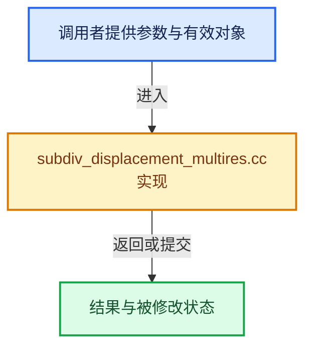

# 实现依赖专题：source/blender/blenkernel/intern/subdiv_displacement_multires.cc

[方向导航](README.md) · [符号索引](../%E7%AC%A6%E5%8F%B7%E4%BE%9D%E8%B5%96%E4%B8%8E%E5%AE%9E%E7%8E%B0%E7%B4%A2%E5%BC%95.md)

本专题从正文实际调用进入，集中保存共享实现。函数有稳定锚点，可从调用处直接跳到对应完整函数；递归与互相调用通过回链组织。

## 本文件的实现关系

```mermaid
flowchart LR
  F0["blender::bke::subdiv::count_num_ptex_faces"]:::abstraction
  F1["blender::bke::subdiv::displacement_data_init_mapping"]:::compute
  F2["blender::bke::subdiv::displacement_init_data"]:::compute
  F3["blender::bke::subdiv::displacement_init_functions"]:::compute
  F4["blender::bke::subdiv::displacement_attach_from_multires"]:::compute
  F1 -->|"显式调用"| F0
  F2 -->|"显式调用"| F1
  F4 -->|"显式调用"| F2
  F4 -->|"显式调用"| F3
  classDef input fill:#DBEAFE,stroke:#2563EB,color:#172554,stroke-width:2px;
  classDef data fill:#CFFAFE,stroke:#0891B2,color:#164E63,stroke-width:2px;
  classDef abstraction fill:#EDE9FE,stroke:#7C3AED,color:#3B0764,stroke-width:2px;
  classDef compute fill:#FEF3C7,stroke:#D97706,color:#78350F,stroke-width:2px;
  classDef result fill:#DCFCE7,stroke:#16A34A,color:#14532D,stroke-width:2px;
  classDef error fill:#FEE2E2,stroke:#DC2626,color:#7F1D1D,stroke-width:2px;
```






## 完整成员与函数实现

<a id="f-21d96f1f43761661"></a>

### `blender::bke::subdiv::count_num_ptex_faces`

实现位置：[source/blender/blenkernel/intern/subdiv_displacement_multires.cc](../../../../../source/blender/blenkernel/intern/subdiv_displacement_multires.cc) · L370—L378。

接口参数：

- `const Mesh &mesh`

**教学注释版**

<!-- annotated:7037b8ac39a2d2 -->

```cpp
static int count_num_ptex_faces(const Mesh &mesh)
{
  int num_ptex_faces = 0;
  const OffsetIndices faces = mesh.faces();
  for (int face_index = 0; face_index < mesh.faces_num; face_index++) {
    num_ptex_faces += (faces[face_index].size() == 4) ? 1 : faces[face_index].size();
  }
  return num_ptex_faces;
}
```

<details>
<summary>核对原始源码：source/blender/blenkernel/intern/subdiv_displacement_multires.cc · L370—L378</summary>

<!-- original:7037b8ac39a2d2:source/blender/blenkernel/intern/subdiv_displacement_multires.cc:370:378 -->

```cpp
static int count_num_ptex_faces(const Mesh &mesh)
{
  int num_ptex_faces = 0;
  const OffsetIndices faces = mesh.faces();
  for (int face_index = 0; face_index < mesh.faces_num; face_index++) {
    num_ptex_faces += (faces[face_index].size() == 4) ? 1 : faces[face_index].size();
  }
  return num_ptex_faces;
}
```

</details>

**沿实际写入检查状态**

- `num_ptex_faces += (faces[face_index].size() == 4) ? 1 : faces[face_index].size();`

**结果出口**

- `return num_ptex_faces;`

**继续追踪实现**

- `mesh.faces` → [Mesh::faces · L1217](03-MPoly%E8%BF%81%E7%A7%BB%E4%B8%8E%E5%85%BC%E5%AE%B9.md#f-ea444760154e17b2)。
- `faces[face_index].size` → [调用协议](../%E6%A8%A1%E6%9D%BF%E5%AE%8F%E4%B8%8E%E5%8A%A8%E6%80%81%E5%88%86%E6%B4%BE%E5%8D%8F%E8%AE%AE.md)：接收对象类型依赖auto、返回值或模板实例；不按同名猜测目标。调用位置L375。

<a id="f-76ec642312f7b2a2"></a>

### `blender::bke::subdiv::displacement_data_init_mapping`

实现位置：[source/blender/blenkernel/intern/subdiv_displacement_multires.cc](../../../../../source/blender/blenkernel/intern/subdiv_displacement_multires.cc) · L380—L405。

接口参数：

- `Displacement &displacement`
- `const Mesh &mesh`

**教学注释版**

<!-- annotated:b63882bae5bd2a -->

```cpp
static void displacement_data_init_mapping(Displacement &displacement, const Mesh &mesh)
{
  MultiresDisplacementData &data = *static_cast<MultiresDisplacementData *>(
      displacement.user_data);
  const OffsetIndices faces = mesh.faces();
  const int num_ptex_faces = count_num_ptex_faces(mesh);
  data.ptex_face_corner.reinitialize(num_ptex_faces);
  /* Fill in offsets. */
  int ptex_face_index = 0;
  MutableSpan<PolyCornerIndex> ptex_face_corner = data.ptex_face_corner.as_mutable_span();
  for (int face_index = 0; face_index < mesh.faces_num; face_index++) {
    const IndexRange face = faces[face_index];
    // [讲解] face.size：读取连续区间或分组的边界信息。
    if (face.size() == 4) {
      ptex_face_corner[ptex_face_index].face_index = face_index;
      ptex_face_corner[ptex_face_index].corner = 0;
      ptex_face_index++;
    }
    else {
      for (int corner = 0; corner < face.size(); corner++) {
        ptex_face_corner[ptex_face_index].face_index = face_index;
        ptex_face_corner[ptex_face_index].corner = corner;
        ptex_face_index++;
      }
    }
  }
}
```

<details>
<summary>核对原始源码：source/blender/blenkernel/intern/subdiv_displacement_multires.cc · L380—L405</summary>

<!-- original:b63882bae5bd2a:source/blender/blenkernel/intern/subdiv_displacement_multires.cc:380:405 -->

```cpp
static void displacement_data_init_mapping(Displacement &displacement, const Mesh &mesh)
{
  MultiresDisplacementData &data = *static_cast<MultiresDisplacementData *>(
      displacement.user_data);
  const OffsetIndices faces = mesh.faces();
  const int num_ptex_faces = count_num_ptex_faces(mesh);
  data.ptex_face_corner.reinitialize(num_ptex_faces);
  /* Fill in offsets. */
  int ptex_face_index = 0;
  MutableSpan<PolyCornerIndex> ptex_face_corner = data.ptex_face_corner.as_mutable_span();
  for (int face_index = 0; face_index < mesh.faces_num; face_index++) {
    const IndexRange face = faces[face_index];
    if (face.size() == 4) {
      ptex_face_corner[ptex_face_index].face_index = face_index;
      ptex_face_corner[ptex_face_index].corner = 0;
      ptex_face_index++;
    }
    else {
      for (int corner = 0; corner < face.size(); corner++) {
        ptex_face_corner[ptex_face_index].face_index = face_index;
        ptex_face_corner[ptex_face_index].corner = corner;
        ptex_face_index++;
      }
    }
  }
}
```

</details>

**沿实际写入检查状态**

- `ptex_face_corner[ptex_face_index].face_index = face_index;`
- `ptex_face_corner[ptex_face_index].corner = 0;`
- `ptex_face_corner[ptex_face_index].corner = corner;`

**继续追踪实现**

- `mesh.faces` → [Mesh::faces · L1217](03-MPoly%E8%BF%81%E7%A7%BB%E4%B8%8E%E5%85%BC%E5%AE%B9.md#f-ea444760154e17b2)。
- `count_num_ptex_faces` → [blender::bke::subdiv::count_num_ptex_faces · L370](%E4%BE%9D%E8%B5%96-subdiv_displacement_multires-353ac6.md#f-21d96f1f43761661)。
- `data.ptex_face_corner.reinitialize` → [调用协议](../%E6%A8%A1%E6%9D%BF%E5%AE%8F%E4%B8%8E%E5%8A%A8%E6%80%81%E5%88%86%E6%B4%BE%E5%8D%8F%E8%AE%AE.md)：接收对象类型依赖auto、返回值或模板实例；不按同名猜测目标。调用位置L386。
- `data.ptex_face_corner.as_mutable_span` → [调用协议](../%E6%A8%A1%E6%9D%BF%E5%AE%8F%E4%B8%8E%E5%8A%A8%E6%80%81%E5%88%86%E6%B4%BE%E5%8D%8F%E8%AE%AE.md)：接收对象类型依赖auto、返回值或模板实例；不按同名猜测目标。调用位置L389。
- `face.size` → [blender::IndexRange::size · L156](../01-%E5%9F%BA%E7%A1%80%E5%AE%B9%E5%99%A8%E4%B8%8E%E7%8E%B0%E4%BB%A3CPP/04-IndexRange%E8%BF%9E%E7%BB%AD%E6%95%B4%E6%95%B0%E5%8C%BA%E9%97%B4.md#f-05f66c3ebb2fdfec)。

<a id="f-a5bf724ca41f624d"></a>

### `blender::bke::subdiv::displacement_init_data`

实现位置：[source/blender/blenkernel/intern/subdiv_displacement_multires.cc](../../../../../source/blender/blenkernel/intern/subdiv_displacement_multires.cc) · L407—L423。

接口参数：

- `Displacement &displacement`
- `Subdiv &subdiv`
- `const Mesh &mesh`
- `const MultiresModifierData &mmd`

**教学注释版**

<!-- annotated:613b654559a213 -->

```cpp
static void displacement_init_data(Displacement &displacement,
                                   Subdiv &subdiv,
                                   const Mesh &mesh,
                                   const MultiresModifierData &mmd)
{
  MultiresDisplacementData &data = *static_cast<MultiresDisplacementData *>(
      displacement.user_data);
  data.subdiv = &subdiv;
  data.grid_size = grid_size_from_level(mmd.totlvl);
  data.mesh = &mesh;
  data.mmd = &mmd;
  data.faces = mesh.faces();
  data.mdisps = static_cast<const MDisps *>(CustomData_get_layer(&mesh.corner_data, CD_MDISPS));
  data.face_ptex_offset = face_ptex_offset_get(&subdiv);
  data.is_initialized = false;
  displacement_data_init_mapping(displacement, mesh);
}
```

<details>
<summary>核对原始源码：source/blender/blenkernel/intern/subdiv_displacement_multires.cc · L407—L423</summary>

<!-- original:613b654559a213:source/blender/blenkernel/intern/subdiv_displacement_multires.cc:407:423 -->

```cpp
static void displacement_init_data(Displacement &displacement,
                                   Subdiv &subdiv,
                                   const Mesh &mesh,
                                   const MultiresModifierData &mmd)
{
  MultiresDisplacementData &data = *static_cast<MultiresDisplacementData *>(
      displacement.user_data);
  data.subdiv = &subdiv;
  data.grid_size = grid_size_from_level(mmd.totlvl);
  data.mesh = &mesh;
  data.mmd = &mmd;
  data.faces = mesh.faces();
  data.mdisps = static_cast<const MDisps *>(CustomData_get_layer(&mesh.corner_data, CD_MDISPS));
  data.face_ptex_offset = face_ptex_offset_get(&subdiv);
  data.is_initialized = false;
  displacement_data_init_mapping(displacement, mesh);
}
```

</details>

**沿实际写入检查状态**

- `data.subdiv = &subdiv;`
- `data.grid_size = grid_size_from_level(mmd.totlvl);`
- `data.mesh = &mesh;`
- `data.mmd = &mmd;`
- `data.faces = mesh.faces();`
- `data.mdisps = static_cast<const MDisps *>(CustomData_get_layer(&mesh.corner_data, CD_MDISPS));`
- `data.face_ptex_offset = face_ptex_offset_get(&subdiv);`
- `data.is_initialized = false;`

**继续追踪实现**

- `grid_size_from_level` → [blender::bke::subdiv::grid_size_from_level · L43](%E4%BE%9D%E8%B5%96-subdiv_inline-5c22ff.md#f-b1d46bbf8975e481)。
- `mesh.faces` → [Mesh::faces · L1217](03-MPoly%E8%BF%81%E7%A7%BB%E4%B8%8E%E5%85%BC%E5%AE%B9.md#f-ea444760154e17b2)。
- `CustomData_get_layer` → [blender::CustomData_get_layer · L3308](%E4%BE%9D%E8%B5%96-customdata-2eef81.md#f-add1273f3ef3e57b)。
- `face_ptex_offset_get` → [blender::bke::subdiv::face_ptex_offset_get · L216](%E4%BE%9D%E8%B5%96-subdiv-6aa500.md#f-028aad6f12dcdad1)。
- `displacement_data_init_mapping` → [blender::bke::subdiv::displacement_data_init_mapping · L380](%E4%BE%9D%E8%B5%96-subdiv_displacement_multires-353ac6.md#f-76ec642312f7b2a2)。

<a id="f-48e8b2c5d7590223"></a>

### `blender::bke::subdiv::displacement_init_functions`

实现位置：[source/blender/blenkernel/intern/subdiv_displacement_multires.cc](../../../../../source/blender/blenkernel/intern/subdiv_displacement_multires.cc) · L425—L430。

接口参数：

- `Displacement *displacement`

**教学注释版**

<!-- annotated:7c46e0c577dc8a -->

```cpp
static void displacement_init_functions(Displacement *displacement)
{
  displacement->initialize = initialize;
  displacement->eval_displacement = eval_displacement;
  displacement->free = free_displacement;
}
```

<details>
<summary>核对原始源码：source/blender/blenkernel/intern/subdiv_displacement_multires.cc · L425—L430</summary>

<!-- original:7c46e0c577dc8a:source/blender/blenkernel/intern/subdiv_displacement_multires.cc:425:430 -->

```cpp
static void displacement_init_functions(Displacement *displacement)
{
  displacement->initialize = initialize;
  displacement->eval_displacement = eval_displacement;
  displacement->free = free_displacement;
}
```

</details>

**沿实际写入检查状态**

- `displacement->initialize = initialize;`
- `displacement->eval_displacement = eval_displacement;`
- `displacement->free = free_displacement;`

**继续追踪实现**

本实现没有需要继续展开的显式调用；检查返回表达式、对象转换和调用者前置条件。

<a id="f-567a024f86cf74b1"></a>

### `blender::bke::subdiv::displacement_attach_from_multires`

实现位置：[source/blender/blenkernel/intern/subdiv_displacement_multires.cc](../../../../../source/blender/blenkernel/intern/subdiv_displacement_multires.cc) · L432—L450。

接口参数：

- `Subdiv *subdiv`
- `const Mesh *mesh`
- `const MultiresModifierData *mmd`

**教学注释版**

<!-- annotated:5a7aa24658fc54 -->

```cpp
void displacement_attach_from_multires(Subdiv *subdiv,
                                       const Mesh *mesh,
                                       const MultiresModifierData *mmd)
{
  /* Make sure we don't have previously assigned displacement. */
  displacement_detach(subdiv);
  /* It is possible to have mesh without CD_MDISPS layer. Happens when using
   * dynamic topology. */
  if (!CustomData_has_layer(&mesh->corner_data, CD_MDISPS)) {
    return;
  }
  /* Allocate all required memory. */
  Displacement *displacement = MEM_new_zeroed<Displacement>("multires displacement");
  displacement->user_data = MEM_new<MultiresDisplacementData>("multires displacement data");
  displacement_init_data(*displacement, *subdiv, *mesh, *mmd);
  displacement_init_functions(displacement);
  /* Finish. */
  subdiv->displacement_evaluator = displacement;
}
```

<details>
<summary>核对原始源码：source/blender/blenkernel/intern/subdiv_displacement_multires.cc · L432—L450</summary>

<!-- original:5a7aa24658fc54:source/blender/blenkernel/intern/subdiv_displacement_multires.cc:432:450 -->

```cpp
void displacement_attach_from_multires(Subdiv *subdiv,
                                       const Mesh *mesh,
                                       const MultiresModifierData *mmd)
{
  /* Make sure we don't have previously assigned displacement. */
  displacement_detach(subdiv);
  /* It is possible to have mesh without CD_MDISPS layer. Happens when using
   * dynamic topology. */
  if (!CustomData_has_layer(&mesh->corner_data, CD_MDISPS)) {
    return;
  }
  /* Allocate all required memory. */
  Displacement *displacement = MEM_new_zeroed<Displacement>("multires displacement");
  displacement->user_data = MEM_new<MultiresDisplacementData>("multires displacement data");
  displacement_init_data(*displacement, *subdiv, *mesh, *mmd);
  displacement_init_functions(displacement);
  /* Finish. */
  subdiv->displacement_evaluator = displacement;
}
```

</details>

**沿实际写入检查状态**

- `displacement->user_data = MEM_new<MultiresDisplacementData>("multires displacement data");`
- `subdiv->displacement_evaluator = displacement;`

**继续追踪实现**

- `displacement_detach` → [blender::bke::subdiv::displacement_detach · L15](%E4%BE%9D%E8%B5%96-subdiv_displacement-776d84.md#f-b84ee8bde7d86248)。
- `CustomData_has_layer` → [blender::CustomData_has_layer · L3005](%E4%BE%9D%E8%B5%96-customdata-2eef81.md#f-7333340531d48ea3)。
- `MEM_new_zeroed<Displacement>` → [MEM_new_zeroed · L550](../03-%E5%86%85%E5%AD%98%E5%88%86%E9%85%8D%E4%B8%8E%E8%BF%90%E8%A1%8C%E6%97%B6%E7%B1%BB%E5%9E%8B/%E4%BE%9D%E8%B5%96-MEM_guardedalloc-b54eca.md#f-eeb1e2a7f57dd231)；[MEM_new_zeroed · L114](../03-%E5%86%85%E5%AD%98%E5%88%86%E9%85%8D%E4%B8%8E%E8%BF%90%E8%A1%8C%E6%97%B6%E7%B1%BB%E5%9E%8B/%E4%BE%9D%E8%B5%96-mallocn-afdcd4.md#f-e04cf01c64c8b180)。同名重载需按实参类型选择。
- `MEM_new<MultiresDisplacementData>` → [MEM_new · L351](../03-%E5%86%85%E5%AD%98%E5%88%86%E9%85%8D%E4%B8%8E%E8%BF%90%E8%A1%8C%E6%97%B6%E7%B1%BB%E5%9E%8B/%E4%BE%9D%E8%B5%96-MEM_guardedalloc-b54eca.md#f-115f9b6784f89912)。
- `displacement_init_data` → [blender::bke::subdiv::displacement_init_data · L407](%E4%BE%9D%E8%B5%96-subdiv_displacement_multires-353ac6.md#f-a5bf724ca41f624d)。
- `displacement_init_functions` → [blender::bke::subdiv::displacement_init_functions · L425](%E4%BE%9D%E8%B5%96-subdiv_displacement_multires-353ac6.md#f-48e8b2c5d7590223)。
