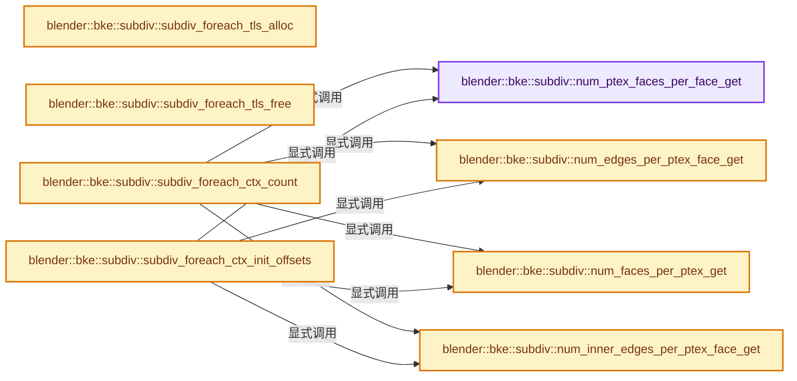
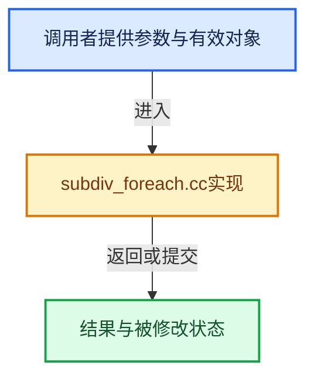

# 实现依赖专题：source/blender/blenkernel/intern/subdiv_foreach.cc

[方向导航](README.md) · [符号索引](../%E7%AC%A6%E5%8F%B7%E4%BE%9D%E8%B5%96%E4%B8%8E%E5%AE%9E%E7%8E%B0%E7%B4%A2%E5%BC%95.md)

本专题从正文实际调用进入，集中保存共享实现。函数有稳定锚点，可从调用处直接跳到对应完整函数；递归与互相调用通过回链组织。

## 本文件的实现关系






## 完整成员与函数实现

<a id="f-553ad15be623aaf8"></a>

### `blender::bke::subdiv::num_ptex_faces_per_face_get`

实现位置：[source/blender/blenkernel/intern/subdiv_foreach.cc](../../../../../source/blender/blenkernel/intern/subdiv_foreach.cc) · L29—L32。

接口参数：

- `const IndexRange face`

**教学注释版**

<!-- annotated:10768bbd495026 -->

```cpp
BLI_INLINE int num_ptex_faces_per_face_get(const IndexRange face)
{
  // [讲解] face.size：读取连续区间或分组的边界信息。
  return (face.size() == 4) ? 1 : face.size();
}
```

<details>
<summary>核对原始源码：source/blender/blenkernel/intern/subdiv_foreach.cc · L29—L32</summary>

<!-- original:10768bbd495026:source/blender/blenkernel/intern/subdiv_foreach.cc:29:32 -->

```cpp
BLI_INLINE int num_ptex_faces_per_face_get(const IndexRange face)
{
  return (face.size() == 4) ? 1 : face.size();
}
```

</details>

**结果出口**

- `return (face.size() == 4) ? 1 : face.size();`

**继续追踪实现**

- `face.size` → [blender::IndexRange::size · L156](../01-%E5%9F%BA%E7%A1%80%E5%AE%B9%E5%99%A8%E4%B8%8E%E7%8E%B0%E4%BB%A3CPP/04-IndexRange%E8%BF%9E%E7%BB%AD%E6%95%B4%E6%95%B0%E5%8C%BA%E9%97%B4.md#f-05f66c3ebb2fdfec)。

<a id="f-e61aecf1a23d0e5c"></a>

### `blender::bke::subdiv::num_edges_per_ptex_face_get`

实现位置：[source/blender/blenkernel/intern/subdiv_foreach.cc](../../../../../source/blender/blenkernel/intern/subdiv_foreach.cc) · L34—L37。

接口参数：

- `const int resolution`

**教学注释版**

<!-- annotated:625c41dfb6e54d -->

```cpp
BLI_INLINE int num_edges_per_ptex_face_get(const int resolution)
{
  return 2 * (resolution - 1) * resolution;
}
```

<details>
<summary>核对原始源码：source/blender/blenkernel/intern/subdiv_foreach.cc · L34—L37</summary>

<!-- original:625c41dfb6e54d:source/blender/blenkernel/intern/subdiv_foreach.cc:34:37 -->

```cpp
BLI_INLINE int num_edges_per_ptex_face_get(const int resolution)
{
  return 2 * (resolution - 1) * resolution;
}
```

</details>

**结果出口**

- `return 2 * (resolution - 1) * resolution;`

**继续追踪实现**

本实现没有需要继续展开的显式调用；检查返回表达式、对象转换和调用者前置条件。

<a id="f-10c5dc6cb2331500"></a>

### `blender::bke::subdiv::num_inner_edges_per_ptex_face_get`

实现位置：[source/blender/blenkernel/intern/subdiv_foreach.cc](../../../../../source/blender/blenkernel/intern/subdiv_foreach.cc) · L39—L45。

接口参数：

- `const int resolution`

**教学注释版**

<!-- annotated:a4c1f14b5b27f8 -->

```cpp
BLI_INLINE int num_inner_edges_per_ptex_face_get(const int resolution)
{
  if (resolution < 2) {
    return 0;
  }
  return (resolution - 2) * resolution + (resolution - 1) * (resolution - 1);
}
```

<details>
<summary>核对原始源码：source/blender/blenkernel/intern/subdiv_foreach.cc · L39—L45</summary>

<!-- original:a4c1f14b5b27f8:source/blender/blenkernel/intern/subdiv_foreach.cc:39:45 -->

```cpp
BLI_INLINE int num_inner_edges_per_ptex_face_get(const int resolution)
{
  if (resolution < 2) {
    return 0;
  }
  return (resolution - 2) * resolution + (resolution - 1) * (resolution - 1);
}
```

</details>

**结果出口**

- `return 0;`
- `return (resolution - 2) * resolution + (resolution - 1) * (resolution - 1);`

**继续追踪实现**

本实现没有需要继续展开的显式调用；检查返回表达式、对象转换和调用者前置条件。

<a id="f-c53f6dbba1770213"></a>

### `blender::bke::subdiv::num_faces_per_ptex_get`

实现位置：[source/blender/blenkernel/intern/subdiv_foreach.cc](../../../../../source/blender/blenkernel/intern/subdiv_foreach.cc) · L48—L51。

接口参数：

- `const int resolution`

**教学注释版**

<!-- annotated:a6d11185c5271d -->

```cpp
BLI_INLINE int num_faces_per_ptex_get(const int resolution)
{
  return (resolution - 1) * (resolution - 1);
}
```

<details>
<summary>核对原始源码：source/blender/blenkernel/intern/subdiv_foreach.cc · L48—L51</summary>

<!-- original:a6d11185c5271d:source/blender/blenkernel/intern/subdiv_foreach.cc:48:51 -->

```cpp
BLI_INLINE int num_faces_per_ptex_get(const int resolution)
{
  return (resolution - 1) * (resolution - 1);
}
```

</details>

**结果出口**

- `return (resolution - 1) * (resolution - 1);`

**继续追踪实现**

本实现没有需要继续展开的显式调用；检查返回表达式、对象转换和调用者前置条件。

<a id="f-3fc26a3f474ed7e1"></a>

### `blender::bke::subdiv::subdiv_foreach_tls_alloc`

实现位置：[source/blender/blenkernel/intern/subdiv_foreach.cc](../../../../../source/blender/blenkernel/intern/subdiv_foreach.cc) · L118—L127。

接口参数：

- `ForeachTaskContext *ctx`

**教学注释版**

<!-- annotated:4bb7a9d2a2dce5 -->

```cpp
static void *subdiv_foreach_tls_alloc(ForeachTaskContext *ctx)
{
  const ForeachContext *foreach_context = ctx->foreach_context;
  void *tls = nullptr;
  if (foreach_context->user_data_tls_size != 0) {
    tls = MEM_new_uninitialized(foreach_context->user_data_tls_size, "tls");
    // [讲解] memcpy：复制字节，源与目标不应重叠。类型生命周期、对齐和可复制表示须由调用者证明，不是任意对象的复制构造。
    memcpy(tls, foreach_context->user_data_tls, foreach_context->user_data_tls_size);
  }
  return tls;
}
```

<details>
<summary>核对原始源码：source/blender/blenkernel/intern/subdiv_foreach.cc · L118—L127</summary>

<!-- original:4bb7a9d2a2dce5:source/blender/blenkernel/intern/subdiv_foreach.cc:118:127 -->

```cpp
static void *subdiv_foreach_tls_alloc(ForeachTaskContext *ctx)
{
  const ForeachContext *foreach_context = ctx->foreach_context;
  void *tls = nullptr;
  if (foreach_context->user_data_tls_size != 0) {
    tls = MEM_new_uninitialized(foreach_context->user_data_tls_size, "tls");
    memcpy(tls, foreach_context->user_data_tls, foreach_context->user_data_tls_size);
  }
  return tls;
}
```

</details>

**沿实际写入检查状态**

- `tls = MEM_new_uninitialized(foreach_context->user_data_tls_size, "tls");`

**结果出口**

- `return tls;`

**继续追踪实现**

- `MEM_new_uninitialized` → [MEM_new_uninitialized · L590](../03-%E5%86%85%E5%AD%98%E5%88%86%E9%85%8D%E4%B8%8E%E8%BF%90%E8%A1%8C%E6%97%B6%E7%B1%BB%E5%9E%8B/%E4%BE%9D%E8%B5%96-MEM_guardedalloc-b54eca.md#f-c773b2e5b8fe70e4)；[MEM_new_uninitialized · L124](../03-%E5%86%85%E5%AD%98%E5%88%86%E9%85%8D%E4%B8%8E%E8%BF%90%E8%A1%8C%E6%97%B6%E7%B1%BB%E5%9E%8B/%E4%BE%9D%E8%B5%96-mallocn-afdcd4.md#f-28a7e00a1e67f699)。同名重载需按实参类型选择。
- `memcpy` → [外部契约](https://eel.is/c++draft/cstring.syn)：复制字节，源与目标不应重叠。类型生命周期、对齐和可复制表示须由调用者证明，不是任意对象的复制构造。

<a id="f-12cc9f950f2482f3"></a>

### `blender::bke::subdiv::subdiv_foreach_tls_free`

实现位置：[source/blender/blenkernel/intern/subdiv_foreach.cc](../../../../../source/blender/blenkernel/intern/subdiv_foreach.cc) · L129—L138。

接口参数：

- `ForeachTaskContext *ctx`
- `void *tls`

**教学注释版**

<!-- annotated:c554eada2643c4 -->

```cpp
static void subdiv_foreach_tls_free(ForeachTaskContext *ctx, void *tls)
{
  if (tls == nullptr) {
    return;
  }
  if (ctx->foreach_context != nullptr) {
    ctx->foreach_context->user_data_tls_free(tls);
  }
  // [讲解] MEM_delete_void：以原始存储释放约定调用当前后端。
  MEM_delete_void(tls);
}
```

<details>
<summary>核对原始源码：source/blender/blenkernel/intern/subdiv_foreach.cc · L129—L138</summary>

<!-- original:c554eada2643c4:source/blender/blenkernel/intern/subdiv_foreach.cc:129:138 -->

```cpp
static void subdiv_foreach_tls_free(ForeachTaskContext *ctx, void *tls)
{
  if (tls == nullptr) {
    return;
  }
  if (ctx->foreach_context != nullptr) {
    ctx->foreach_context->user_data_tls_free(tls);
  }
  MEM_delete_void(tls);
}
```

</details>

**继续追踪实现**

- `ctx->foreach_context->user_data_tls_free` → [调用协议](../%E6%A8%A1%E6%9D%BF%E5%AE%8F%E4%B8%8E%E5%8A%A8%E6%80%81%E5%88%86%E6%B4%BE%E5%8D%8F%E8%AE%AE.md)：接收对象类型依赖auto、返回值或模板实例；不按同名猜测目标。调用位置L135。
- `MEM_delete_void` → [MEM_delete_void · L647](../03-%E5%86%85%E5%AD%98%E5%88%86%E9%85%8D%E4%B8%8E%E8%BF%90%E8%A1%8C%E6%97%B6%E7%B1%BB%E5%9E%8B/%E4%BE%9D%E8%B5%96-MEM_guardedalloc-b54eca.md#f-642896c7c62ff8b9)；[MEM_delete_void · L109](../03-%E5%86%85%E5%AD%98%E5%88%86%E9%85%8D%E4%B8%8E%E8%BF%90%E8%A1%8C%E6%97%B6%E7%B1%BB%E5%9E%8B/%E4%BE%9D%E8%B5%96-mallocn-afdcd4.md#f-9a07b26421f2bee6)。同名重载需按实参类型选择。

<a id="f-2da5833f310f5969"></a>

### `blender::bke::subdiv::subdiv_foreach_ctx_count`

实现位置：[source/blender/blenkernel/intern/subdiv_foreach.cc](../../../../../source/blender/blenkernel/intern/subdiv_foreach.cc) · L147—L194。

接口参数：

- `ForeachTaskContext *ctx`

**教学注释版**

<!-- annotated:4086cb53d7da78 -->

```cpp
static void subdiv_foreach_ctx_count(ForeachTaskContext *ctx)
{
  /* Reset counters. */
  ctx->num_subdiv_vertices = 0;
  ctx->num_subdiv_edges = 0;
  ctx->num_subdiv_loops = 0;
  ctx->num_subdiv_faces = 0;
  /* Static geometry counters. */
  const int resolution = ctx->settings->resolution;
  const int no_quad_patch_resolution = ((resolution >> 1) + 1);
  const int num_subdiv_vertices_per_coarse_edge = resolution - 2;
  const int num_inner_vertices_per_quad = (resolution - 2) * (resolution - 2);
  const int num_inner_vertices_per_noquad_patch = (no_quad_patch_resolution - 2) *
                                                  (no_quad_patch_resolution - 2);
  const Mesh *coarse_mesh = ctx->coarse_mesh;
  ctx->num_subdiv_vertices = coarse_mesh->verts_num;
  ctx->num_subdiv_edges = coarse_mesh->edges_num * (num_subdiv_vertices_per_coarse_edge + 1);
  /* Calculate extra vertices and edges created by non-loose geometry. */
  for (int face_index = 0; face_index < coarse_mesh->faces_num; face_index++) {
    const IndexRange coarse_face = ctx->coarse_faces[face_index];
    const int num_ptex_faces_per_face = num_ptex_faces_per_face_get(coarse_face);
    /* Inner vertices of face. */
    if (num_ptex_faces_per_face == 1) {
      ctx->num_subdiv_vertices += num_inner_vertices_per_quad;
      ctx->num_subdiv_edges += num_edges_per_ptex_face_get(resolution - 2) +
                               4 * num_subdiv_vertices_per_coarse_edge;
      ctx->num_subdiv_faces += num_faces_per_ptex_get(resolution);
    }
    else {
      ctx->num_subdiv_vertices += 1 + num_ptex_faces_per_face * (no_quad_patch_resolution - 2) +
                                  num_ptex_faces_per_face * num_inner_vertices_per_noquad_patch;
      ctx->num_subdiv_edges += num_ptex_faces_per_face *
                               (num_inner_edges_per_ptex_face_get(no_quad_patch_resolution - 1) +
                                (no_quad_patch_resolution - 2) +
                                num_subdiv_vertices_per_coarse_edge);
      if (no_quad_patch_resolution >= 3) {
        // [讲解] coarse_face.size：读取连续区间或分组的边界信息。
        ctx->num_subdiv_edges += coarse_face.size();
      }
      ctx->num_subdiv_faces += num_ptex_faces_per_face *
                               num_faces_per_ptex_get(no_quad_patch_resolution);
    }
  }

  /* Add vertices used by outer edges on subdivided faces and loose edges. */
  ctx->num_subdiv_vertices += num_subdiv_vertices_per_coarse_edge * coarse_mesh->edges_num;

  ctx->num_subdiv_loops = ctx->num_subdiv_faces * 4;
}
```

<details>
<summary>核对原始源码：source/blender/blenkernel/intern/subdiv_foreach.cc · L147—L194</summary>

<!-- original:4086cb53d7da78:source/blender/blenkernel/intern/subdiv_foreach.cc:147:194 -->

```cpp
static void subdiv_foreach_ctx_count(ForeachTaskContext *ctx)
{
  /* Reset counters. */
  ctx->num_subdiv_vertices = 0;
  ctx->num_subdiv_edges = 0;
  ctx->num_subdiv_loops = 0;
  ctx->num_subdiv_faces = 0;
  /* Static geometry counters. */
  const int resolution = ctx->settings->resolution;
  const int no_quad_patch_resolution = ((resolution >> 1) + 1);
  const int num_subdiv_vertices_per_coarse_edge = resolution - 2;
  const int num_inner_vertices_per_quad = (resolution - 2) * (resolution - 2);
  const int num_inner_vertices_per_noquad_patch = (no_quad_patch_resolution - 2) *
                                                  (no_quad_patch_resolution - 2);
  const Mesh *coarse_mesh = ctx->coarse_mesh;
  ctx->num_subdiv_vertices = coarse_mesh->verts_num;
  ctx->num_subdiv_edges = coarse_mesh->edges_num * (num_subdiv_vertices_per_coarse_edge + 1);
  /* Calculate extra vertices and edges created by non-loose geometry. */
  for (int face_index = 0; face_index < coarse_mesh->faces_num; face_index++) {
    const IndexRange coarse_face = ctx->coarse_faces[face_index];
    const int num_ptex_faces_per_face = num_ptex_faces_per_face_get(coarse_face);
    /* Inner vertices of face. */
    if (num_ptex_faces_per_face == 1) {
      ctx->num_subdiv_vertices += num_inner_vertices_per_quad;
      ctx->num_subdiv_edges += num_edges_per_ptex_face_get(resolution - 2) +
                               4 * num_subdiv_vertices_per_coarse_edge;
      ctx->num_subdiv_faces += num_faces_per_ptex_get(resolution);
    }
    else {
      ctx->num_subdiv_vertices += 1 + num_ptex_faces_per_face * (no_quad_patch_resolution - 2) +
                                  num_ptex_faces_per_face * num_inner_vertices_per_noquad_patch;
      ctx->num_subdiv_edges += num_ptex_faces_per_face *
                               (num_inner_edges_per_ptex_face_get(no_quad_patch_resolution - 1) +
                                (no_quad_patch_resolution - 2) +
                                num_subdiv_vertices_per_coarse_edge);
      if (no_quad_patch_resolution >= 3) {
        ctx->num_subdiv_edges += coarse_face.size();
      }
      ctx->num_subdiv_faces += num_ptex_faces_per_face *
                               num_faces_per_ptex_get(no_quad_patch_resolution);
    }
  }

  /* Add vertices used by outer edges on subdivided faces and loose edges. */
  ctx->num_subdiv_vertices += num_subdiv_vertices_per_coarse_edge * coarse_mesh->edges_num;

  ctx->num_subdiv_loops = ctx->num_subdiv_faces * 4;
}
```

</details>

**沿实际写入检查状态**

- `ctx->num_subdiv_vertices = 0;`
- `ctx->num_subdiv_edges = 0;`
- `ctx->num_subdiv_loops = 0;`
- `ctx->num_subdiv_faces = 0;`
- `ctx->num_subdiv_vertices = coarse_mesh->verts_num;`
- `ctx->num_subdiv_edges = coarse_mesh->edges_num * (num_subdiv_vertices_per_coarse_edge + 1);`
- `ctx->num_subdiv_vertices += num_inner_vertices_per_quad;`
- `ctx->num_subdiv_edges += num_edges_per_ptex_face_get(resolution - 2) +`
- `ctx->num_subdiv_faces += num_faces_per_ptex_get(resolution);`
- `ctx->num_subdiv_vertices += 1 + num_ptex_faces_per_face * (no_quad_patch_resolution - 2) +`
- `ctx->num_subdiv_edges += num_ptex_faces_per_face *`
- `ctx->num_subdiv_edges += coarse_face.size();`
- `ctx->num_subdiv_faces += num_ptex_faces_per_face *`
- `ctx->num_subdiv_vertices += num_subdiv_vertices_per_coarse_edge * coarse_mesh->edges_num;`
- `ctx->num_subdiv_loops = ctx->num_subdiv_faces * 4;`

**继续追踪实现**

- `num_ptex_faces_per_face_get` → [blender::bke::subdiv::num_ptex_faces_per_face_get · L29](%E4%BE%9D%E8%B5%96-subdiv_foreach-1abd36.md#f-553ad15be623aaf8)。
- `num_edges_per_ptex_face_get` → [blender::bke::subdiv::num_edges_per_ptex_face_get · L34](%E4%BE%9D%E8%B5%96-subdiv_foreach-1abd36.md#f-e61aecf1a23d0e5c)。
- `num_faces_per_ptex_get` → [blender::bke::subdiv::num_faces_per_ptex_get · L48](%E4%BE%9D%E8%B5%96-subdiv_foreach-1abd36.md#f-c53f6dbba1770213)。
- `num_inner_edges_per_ptex_face_get` → [blender::bke::subdiv::num_inner_edges_per_ptex_face_get · L39](%E4%BE%9D%E8%B5%96-subdiv_foreach-1abd36.md#f-10c5dc6cb2331500)。
- `coarse_face.size` → [blender::IndexRange::size · L156](../01-%E5%9F%BA%E7%A1%80%E5%AE%B9%E5%99%A8%E4%B8%8E%E7%8E%B0%E4%BB%A3CPP/04-IndexRange%E8%BF%9E%E7%BB%AD%E6%95%B4%E6%95%B0%E5%8C%BA%E9%97%B4.md#f-05f66c3ebb2fdfec)。

<a id="f-99ab3b8961291bac"></a>

### `blender::bke::subdiv::subdiv_foreach_ctx_init_offsets`

实现位置：[source/blender/blenkernel/intern/subdiv_foreach.cc](../../../../../source/blender/blenkernel/intern/subdiv_foreach.cc) · L196—L243。

接口参数：

- `ForeachTaskContext *ctx`

**教学注释版**

<!-- annotated:55b4eace56cc26 -->

```cpp
static void subdiv_foreach_ctx_init_offsets(ForeachTaskContext *ctx)
{
  const Mesh *coarse_mesh = ctx->coarse_mesh;
  const int resolution = ctx->settings->resolution;
  const int resolution_2 = resolution - 2;
  const int resolution_2_squared = resolution_2 * resolution_2;
  const int no_quad_patch_resolution = ((resolution >> 1) + 1);
  const int num_irregular_vertices_per_patch = (no_quad_patch_resolution - 2) *
                                               (no_quad_patch_resolution - 1);
  const int num_subdiv_vertices_per_coarse_edge = resolution - 2;
  const int num_subdiv_edges_per_coarse_edge = resolution - 1;
  /* Constant offsets in arrays. */
  ctx->vertices_corner_offset = 0;
  ctx->vertices_edge_offset = coarse_mesh->verts_num;
  ctx->vertices_inner_offset = ctx->vertices_edge_offset +
                               coarse_mesh->edges_num * num_subdiv_vertices_per_coarse_edge;
  ctx->edge_boundary_offset = 0;
  ctx->edge_inner_offset = ctx->edge_boundary_offset +
                           coarse_mesh->edges_num * num_subdiv_edges_per_coarse_edge;
  /* "Indexed" offsets. */
  int vert_offset = 0;
  int edge_offset = 0;
  int face_offset = 0;
  for (int face_index = 0; face_index < coarse_mesh->faces_num; face_index++) {
    const IndexRange coarse_face = ctx->coarse_faces[face_index];
    const int num_ptex_faces_per_face = num_ptex_faces_per_face_get(coarse_face);
    ctx->subdiv_vert_offset[face_index] = vert_offset;
    ctx->subdiv_edge_offset[face_index] = edge_offset;
    ctx->subdiv_face_offset[face_index] = face_offset;
    if (num_ptex_faces_per_face == 1) {
      vert_offset += resolution_2_squared;
      edge_offset += num_edges_per_ptex_face_get(resolution - 2) +
                     4 * num_subdiv_vertices_per_coarse_edge;
      face_offset += num_faces_per_ptex_get(resolution);
    }
    else {
      vert_offset += 1 + num_ptex_faces_per_face * num_irregular_vertices_per_patch;
      edge_offset += num_ptex_faces_per_face *
                     (num_inner_edges_per_ptex_face_get(no_quad_patch_resolution - 1) +
                      (no_quad_patch_resolution - 2) + num_subdiv_vertices_per_coarse_edge);
      if (no_quad_patch_resolution >= 3) {
        // [讲解] coarse_face.size：读取连续区间或分组的边界信息。
        edge_offset += coarse_face.size();
      }
      face_offset += num_ptex_faces_per_face * num_faces_per_ptex_get(no_quad_patch_resolution);
    }
  }
  ctx->subdiv_face_offset.last() = face_offset;
}
```

<details>
<summary>核对原始源码：source/blender/blenkernel/intern/subdiv_foreach.cc · L196—L243</summary>

<!-- original:55b4eace56cc26:source/blender/blenkernel/intern/subdiv_foreach.cc:196:243 -->

```cpp
static void subdiv_foreach_ctx_init_offsets(ForeachTaskContext *ctx)
{
  const Mesh *coarse_mesh = ctx->coarse_mesh;
  const int resolution = ctx->settings->resolution;
  const int resolution_2 = resolution - 2;
  const int resolution_2_squared = resolution_2 * resolution_2;
  const int no_quad_patch_resolution = ((resolution >> 1) + 1);
  const int num_irregular_vertices_per_patch = (no_quad_patch_resolution - 2) *
                                               (no_quad_patch_resolution - 1);
  const int num_subdiv_vertices_per_coarse_edge = resolution - 2;
  const int num_subdiv_edges_per_coarse_edge = resolution - 1;
  /* Constant offsets in arrays. */
  ctx->vertices_corner_offset = 0;
  ctx->vertices_edge_offset = coarse_mesh->verts_num;
  ctx->vertices_inner_offset = ctx->vertices_edge_offset +
                               coarse_mesh->edges_num * num_subdiv_vertices_per_coarse_edge;
  ctx->edge_boundary_offset = 0;
  ctx->edge_inner_offset = ctx->edge_boundary_offset +
                           coarse_mesh->edges_num * num_subdiv_edges_per_coarse_edge;
  /* "Indexed" offsets. */
  int vert_offset = 0;
  int edge_offset = 0;
  int face_offset = 0;
  for (int face_index = 0; face_index < coarse_mesh->faces_num; face_index++) {
    const IndexRange coarse_face = ctx->coarse_faces[face_index];
    const int num_ptex_faces_per_face = num_ptex_faces_per_face_get(coarse_face);
    ctx->subdiv_vert_offset[face_index] = vert_offset;
    ctx->subdiv_edge_offset[face_index] = edge_offset;
    ctx->subdiv_face_offset[face_index] = face_offset;
    if (num_ptex_faces_per_face == 1) {
      vert_offset += resolution_2_squared;
      edge_offset += num_edges_per_ptex_face_get(resolution - 2) +
                     4 * num_subdiv_vertices_per_coarse_edge;
      face_offset += num_faces_per_ptex_get(resolution);
    }
    else {
      vert_offset += 1 + num_ptex_faces_per_face * num_irregular_vertices_per_patch;
      edge_offset += num_ptex_faces_per_face *
                     (num_inner_edges_per_ptex_face_get(no_quad_patch_resolution - 1) +
                      (no_quad_patch_resolution - 2) + num_subdiv_vertices_per_coarse_edge);
      if (no_quad_patch_resolution >= 3) {
        edge_offset += coarse_face.size();
      }
      face_offset += num_ptex_faces_per_face * num_faces_per_ptex_get(no_quad_patch_resolution);
    }
  }
  ctx->subdiv_face_offset.last() = face_offset;
}
```

</details>

**沿实际写入检查状态**

- `ctx->vertices_corner_offset = 0;`
- `ctx->vertices_edge_offset = coarse_mesh->verts_num;`
- `ctx->vertices_inner_offset = ctx->vertices_edge_offset +`
- `ctx->edge_boundary_offset = 0;`
- `ctx->edge_inner_offset = ctx->edge_boundary_offset +`
- `ctx->subdiv_vert_offset[face_index] = vert_offset;`
- `ctx->subdiv_edge_offset[face_index] = edge_offset;`
- `ctx->subdiv_face_offset[face_index] = face_offset;`
- `vert_offset += resolution_2_squared;`
- `edge_offset += num_edges_per_ptex_face_get(resolution - 2) +`
- `face_offset += num_faces_per_ptex_get(resolution);`
- `vert_offset += 1 + num_ptex_faces_per_face * num_irregular_vertices_per_patch;`
- `edge_offset += num_ptex_faces_per_face *`
- `edge_offset += coarse_face.size();`
- `face_offset += num_ptex_faces_per_face * num_faces_per_ptex_get(no_quad_patch_resolution);`

**继续追踪实现**

- `num_ptex_faces_per_face_get` → [blender::bke::subdiv::num_ptex_faces_per_face_get · L29](%E4%BE%9D%E8%B5%96-subdiv_foreach-1abd36.md#f-553ad15be623aaf8)。
- `num_edges_per_ptex_face_get` → [blender::bke::subdiv::num_edges_per_ptex_face_get · L34](%E4%BE%9D%E8%B5%96-subdiv_foreach-1abd36.md#f-e61aecf1a23d0e5c)。
- `num_faces_per_ptex_get` → [blender::bke::subdiv::num_faces_per_ptex_get · L48](%E4%BE%9D%E8%B5%96-subdiv_foreach-1abd36.md#f-c53f6dbba1770213)。
- `num_inner_edges_per_ptex_face_get` → [blender::bke::subdiv::num_inner_edges_per_ptex_face_get · L39](%E4%BE%9D%E8%B5%96-subdiv_foreach-1abd36.md#f-10c5dc6cb2331500)。
- `coarse_face.size` → [blender::IndexRange::size · L156](../01-%E5%9F%BA%E7%A1%80%E5%AE%B9%E5%99%A8%E4%B8%8E%E7%8E%B0%E4%BB%A3CPP/04-IndexRange%E8%BF%9E%E7%BB%AD%E6%95%B4%E6%95%B0%E5%8C%BA%E9%97%B4.md#f-05f66c3ebb2fdfec)。
- `ctx->subdiv_face_offset.last` → [调用协议](../%E6%A8%A1%E6%9D%BF%E5%AE%8F%E4%B8%8E%E5%8A%A8%E6%80%81%E5%88%86%E6%B4%BE%E5%8D%8F%E8%AE%AE.md)：接收对象类型依赖auto、返回值或模板实例；不按同名猜测目标。调用位置L242。

<a id="f-132f91e581c742f0"></a>

### `blender::bke::subdiv::subdiv_foreach_ctx_init`

实现位置：[source/blender/blenkernel/intern/subdiv_foreach.cc](../../../../../source/blender/blenkernel/intern/subdiv_foreach.cc) · L245—L260。

接口参数：

- `Subdiv *subdiv`
- `ForeachTaskContext *ctx`

**教学注释版**

<!-- annotated:9c141c887b3854 -->

```cpp
static void subdiv_foreach_ctx_init(Subdiv *subdiv, ForeachTaskContext *ctx)
{
  const Mesh *coarse_mesh = ctx->coarse_mesh;
  /* Allocate maps and offsets. */
  ctx->coarse_vertices_used_map = BLI_BITMAP_NEW(coarse_mesh->verts_num, "vertices used map");
  ctx->coarse_edges_used_map = BLI_BITMAP_NEW(coarse_mesh->edges_num, "edges used map");
  ctx->subdiv_vert_offset.reinitialize(coarse_mesh->faces_num);
  ctx->subdiv_edge_offset.reinitialize(coarse_mesh->faces_num);
  /* One extra element for #OffsetIndices encoding. */
  ctx->subdiv_face_offset.reinitialize(coarse_mesh->faces_num + 1);
  /* Initialize all offsets. */
  subdiv_foreach_ctx_init_offsets(ctx);
  /* Calculate number of geometry in the result subdivision mesh. */
  subdiv_foreach_ctx_count(ctx);
  ctx->face_ptex_offset = face_ptex_offset_get(subdiv);
}
```

<details>
<summary>核对原始源码：source/blender/blenkernel/intern/subdiv_foreach.cc · L245—L260</summary>

<!-- original:9c141c887b3854:source/blender/blenkernel/intern/subdiv_foreach.cc:245:260 -->

```cpp
static void subdiv_foreach_ctx_init(Subdiv *subdiv, ForeachTaskContext *ctx)
{
  const Mesh *coarse_mesh = ctx->coarse_mesh;
  /* Allocate maps and offsets. */
  ctx->coarse_vertices_used_map = BLI_BITMAP_NEW(coarse_mesh->verts_num, "vertices used map");
  ctx->coarse_edges_used_map = BLI_BITMAP_NEW(coarse_mesh->edges_num, "edges used map");
  ctx->subdiv_vert_offset.reinitialize(coarse_mesh->faces_num);
  ctx->subdiv_edge_offset.reinitialize(coarse_mesh->faces_num);
  /* One extra element for #OffsetIndices encoding. */
  ctx->subdiv_face_offset.reinitialize(coarse_mesh->faces_num + 1);
  /* Initialize all offsets. */
  subdiv_foreach_ctx_init_offsets(ctx);
  /* Calculate number of geometry in the result subdivision mesh. */
  subdiv_foreach_ctx_count(ctx);
  ctx->face_ptex_offset = face_ptex_offset_get(subdiv);
}
```

</details>

**沿实际写入检查状态**

- `ctx->coarse_vertices_used_map = BLI_BITMAP_NEW(coarse_mesh->verts_num, "vertices used map");`
- `ctx->coarse_edges_used_map = BLI_BITMAP_NEW(coarse_mesh->edges_num, "edges used map");`
- `ctx->face_ptex_offset = face_ptex_offset_get(subdiv);`

**继续追踪实现**

- `BLI_BITMAP_NEW` → [BLI_BITMAP_NEW · L39](../02-%E5%93%88%E5%B8%8C%E8%A1%A8%E4%B8%8E%E5%85%B3%E8%81%94%E6%95%B0%E6%8D%AE%E7%BB%93%E6%9E%84/%E4%BE%9D%E8%B5%96-BLI_bitmap-693b86.md#m-77dce9cd8859)。宏定义由构建条件选择。
- `ctx->subdiv_vert_offset.reinitialize` → [调用协议](../%E6%A8%A1%E6%9D%BF%E5%AE%8F%E4%B8%8E%E5%8A%A8%E6%80%81%E5%88%86%E6%B4%BE%E5%8D%8F%E8%AE%AE.md)：接收对象类型依赖auto、返回值或模板实例；不按同名猜测目标。调用位置L251。
- `ctx->subdiv_edge_offset.reinitialize` → [调用协议](../%E6%A8%A1%E6%9D%BF%E5%AE%8F%E4%B8%8E%E5%8A%A8%E6%80%81%E5%88%86%E6%B4%BE%E5%8D%8F%E8%AE%AE.md)：接收对象类型依赖auto、返回值或模板实例；不按同名猜测目标。调用位置L252。
- `ctx->subdiv_face_offset.reinitialize` → [调用协议](../%E6%A8%A1%E6%9D%BF%E5%AE%8F%E4%B8%8E%E5%8A%A8%E6%80%81%E5%88%86%E6%B4%BE%E5%8D%8F%E8%AE%AE.md)：接收对象类型依赖auto、返回值或模板实例；不按同名猜测目标。调用位置L254。
- `subdiv_foreach_ctx_init_offsets` → [blender::bke::subdiv::subdiv_foreach_ctx_init_offsets · L196](%E4%BE%9D%E8%B5%96-subdiv_foreach-1abd36.md#f-99ab3b8961291bac)。
- `subdiv_foreach_ctx_count` → [blender::bke::subdiv::subdiv_foreach_ctx_count · L147](%E4%BE%9D%E8%B5%96-subdiv_foreach-1abd36.md#f-2da5833f310f5969)。
- `face_ptex_offset_get` → [blender::bke::subdiv::face_ptex_offset_get · L216](%E4%BE%9D%E8%B5%96-subdiv-6aa500.md#f-028aad6f12dcdad1)。

<a id="f-ef89117750a54a71"></a>

### `blender::bke::subdiv::subdiv_foreach_ctx_free`

实现位置：[source/blender/blenkernel/intern/subdiv_foreach.cc](../../../../../source/blender/blenkernel/intern/subdiv_foreach.cc) · L262—L266。

接口参数：

- `ForeachTaskContext *ctx`

**教学注释版**

<!-- annotated:a37e8f797ca7ed -->

```cpp
static void subdiv_foreach_ctx_free(ForeachTaskContext *ctx)
{
  MEM_delete(ctx->coarse_vertices_used_map);
  MEM_delete(ctx->coarse_edges_used_map);
}
```

<details>
<summary>核对原始源码：source/blender/blenkernel/intern/subdiv_foreach.cc · L262—L266</summary>

<!-- original:a37e8f797ca7ed:source/blender/blenkernel/intern/subdiv_foreach.cc:262:266 -->

```cpp
static void subdiv_foreach_ctx_free(ForeachTaskContext *ctx)
{
  MEM_delete(ctx->coarse_vertices_used_map);
  MEM_delete(ctx->coarse_edges_used_map);
}
```

</details>

**继续追踪实现**

- `MEM_delete` → [MEM_delete · L400](../03-%E5%86%85%E5%AD%98%E5%88%86%E9%85%8D%E4%B8%8E%E8%BF%90%E8%A1%8C%E6%97%B6%E7%B1%BB%E5%9E%8B/%E4%BE%9D%E8%B5%96-MEM_guardedalloc-b54eca.md#f-9049ffdd1682887c)。

<a id="f-69853a967a5d93ed"></a>

### `blender::bke::subdiv::subdiv_foreach_corner_vertices_regular_do`

实现位置：[source/blender/blenkernel/intern/subdiv_foreach.cc](../../../../../source/blender/blenkernel/intern/subdiv_foreach.cc) · L276—L305。

接口参数：

- `ForeachTaskContext *ctx`
- `void *tls`
- `const int coarse_face_index`
- `ForeachVertFromCornerCb vert_corner`
- `bool check_usage`

**教学注释版**

<!-- annotated:8f22b967d9194a -->

```cpp
static void subdiv_foreach_corner_vertices_regular_do(ForeachTaskContext *ctx,
                                                      void *tls,
                                                      const int coarse_face_index,
                                                      ForeachVertFromCornerCb vert_corner,
                                                      bool check_usage)
{
  const float weights[4][2] = {{0.0f, 0.0f}, {1.0f, 0.0f}, {1.0f, 1.0f}, {0.0f, 1.0f}};
  const IndexRange coarse_face = ctx->coarse_faces[coarse_face_index];
  const int ptex_face_index = ctx->face_ptex_offset[coarse_face_index];
  // [讲解] coarse_face.size：读取连续区间或分组的边界信息。
  for (int corner = 0; corner < coarse_face.size(); corner++) {
    const int coarse_vert = ctx->coarse_corner_verts[coarse_face[corner]];
    if (check_usage && BLI_BITMAP_TEST_AND_SET_ATOMIC(ctx->coarse_vertices_used_map, coarse_vert))
    {
      continue;
    }
    const int coarse_vert_index = coarse_vert;
    const int subdiv_vert_index = ctx->vertices_corner_offset + coarse_vert_index;
    const float u = weights[corner][0];
    const float v = weights[corner][1];
    vert_corner(ctx->foreach_context,
                tls,
                ptex_face_index,
                u,
                v,
                coarse_vert_index,
                coarse_face_index,
                0,
                subdiv_vert_index);
  }
}
```

<details>
<summary>核对原始源码：source/blender/blenkernel/intern/subdiv_foreach.cc · L276—L305</summary>

<!-- original:8f22b967d9194a:source/blender/blenkernel/intern/subdiv_foreach.cc:276:305 -->

```cpp
static void subdiv_foreach_corner_vertices_regular_do(ForeachTaskContext *ctx,
                                                      void *tls,
                                                      const int coarse_face_index,
                                                      ForeachVertFromCornerCb vert_corner,
                                                      bool check_usage)
{
  const float weights[4][2] = {{0.0f, 0.0f}, {1.0f, 0.0f}, {1.0f, 1.0f}, {0.0f, 1.0f}};
  const IndexRange coarse_face = ctx->coarse_faces[coarse_face_index];
  const int ptex_face_index = ctx->face_ptex_offset[coarse_face_index];
  for (int corner = 0; corner < coarse_face.size(); corner++) {
    const int coarse_vert = ctx->coarse_corner_verts[coarse_face[corner]];
    if (check_usage && BLI_BITMAP_TEST_AND_SET_ATOMIC(ctx->coarse_vertices_used_map, coarse_vert))
    {
      continue;
    }
    const int coarse_vert_index = coarse_vert;
    const int subdiv_vert_index = ctx->vertices_corner_offset + coarse_vert_index;
    const float u = weights[corner][0];
    const float v = weights[corner][1];
    vert_corner(ctx->foreach_context,
                tls,
                ptex_face_index,
                u,
                v,
                coarse_vert_index,
                coarse_face_index,
                0,
                subdiv_vert_index);
  }
}
```

</details>

**继续追踪实现**

- `coarse_face.size` → [blender::IndexRange::size · L156](../01-%E5%9F%BA%E7%A1%80%E5%AE%B9%E5%99%A8%E4%B8%8E%E7%8E%B0%E4%BB%A3CPP/04-IndexRange%E8%BF%9E%E7%BB%AD%E6%95%B4%E6%95%B0%E5%8C%BA%E9%97%B4.md#f-05f66c3ebb2fdfec)。
- `BLI_BITMAP_TEST_AND_SET_ATOMIC` → [BLI_BITMAP_TEST_AND_SET_ATOMIC · L67](../02-%E5%93%88%E5%B8%8C%E8%A1%A8%E4%B8%8E%E5%85%B3%E8%81%94%E6%95%B0%E6%8D%AE%E7%BB%93%E6%9E%84/%E4%BE%9D%E8%B5%96-BLI_bitmap-693b86.md#m-c7ffdd0cf0e7)。宏定义由构建条件选择。
- `vert_corner` → [调用协议](../%E6%A8%A1%E6%9D%BF%E5%AE%8F%E4%B8%8E%E5%8A%A8%E6%80%81%E5%88%86%E6%B4%BE%E5%8D%8F%E8%AE%AE.md)：局部可调用对象，须结合其初始化与捕获环境。调用位置L295。

<a id="f-8ff0da67bc6eb9e2"></a>

### `blender::bke::subdiv::subdiv_foreach_corner_vertices_regular`

实现位置：[source/blender/blenkernel/intern/subdiv_foreach.cc](../../../../../source/blender/blenkernel/intern/subdiv_foreach.cc) · L307—L313。

接口参数：

- `ForeachTaskContext *ctx`
- `void *tls`
- `const int coarse_face_index`

**教学注释版**

<!-- annotated:c5ea323fe64260 -->

```cpp
static void subdiv_foreach_corner_vertices_regular(ForeachTaskContext *ctx,
                                                   void *tls,
                                                   const int coarse_face_index)
{
  subdiv_foreach_corner_vertices_regular_do(
      ctx, tls, coarse_face_index, ctx->foreach_context->vert_corner, true);
}
```

<details>
<summary>核对原始源码：source/blender/blenkernel/intern/subdiv_foreach.cc · L307—L313</summary>

<!-- original:c5ea323fe64260:source/blender/blenkernel/intern/subdiv_foreach.cc:307:313 -->

```cpp
static void subdiv_foreach_corner_vertices_regular(ForeachTaskContext *ctx,
                                                   void *tls,
                                                   const int coarse_face_index)
{
  subdiv_foreach_corner_vertices_regular_do(
      ctx, tls, coarse_face_index, ctx->foreach_context->vert_corner, true);
}
```

</details>

**继续追踪实现**

- `subdiv_foreach_corner_vertices_regular_do` → [blender::bke::subdiv::subdiv_foreach_corner_vertices_regular_do · L276](%E4%BE%9D%E8%B5%96-subdiv_foreach-1abd36.md#f-69853a967a5d93ed)。

<a id="f-45b2513cce6110aa"></a>

### `blender::bke::subdiv::subdiv_foreach_corner_vertices_special_do`

实现位置：[source/blender/blenkernel/intern/subdiv_foreach.cc](../../../../../source/blender/blenkernel/intern/subdiv_foreach.cc) · L315—L341。

接口参数：

- `ForeachTaskContext *ctx`
- `void *tls`
- `const int coarse_face_index`
- `ForeachVertFromCornerCb vert_corner`
- `bool check_usage`

**教学注释版**

<!-- annotated:7bb0c0eeb6a86e -->

```cpp
static void subdiv_foreach_corner_vertices_special_do(ForeachTaskContext *ctx,
                                                      void *tls,
                                                      const int coarse_face_index,
                                                      ForeachVertFromCornerCb vert_corner,
                                                      bool check_usage)
{
  const IndexRange coarse_face = ctx->coarse_faces[coarse_face_index];
  int ptex_face_index = ctx->face_ptex_offset[coarse_face_index];
  // [讲解] coarse_face.size：读取连续区间或分组的边界信息。
  for (int corner = 0; corner < coarse_face.size(); corner++, ptex_face_index++) {
    const int coarse_vert = ctx->coarse_corner_verts[coarse_face[corner]];
    if (check_usage && BLI_BITMAP_TEST_AND_SET_ATOMIC(ctx->coarse_vertices_used_map, coarse_vert))
    {
      continue;
    }
    const int coarse_vert_index = coarse_vert;
    const int subdiv_vert_index = ctx->vertices_corner_offset + coarse_vert_index;
    vert_corner(ctx->foreach_context,
                tls,
                ptex_face_index,
                0.0f,
                0.0f,
                coarse_vert_index,
                coarse_face_index,
                corner,
                subdiv_vert_index);
  }
}
```

<details>
<summary>核对原始源码：source/blender/blenkernel/intern/subdiv_foreach.cc · L315—L341</summary>

<!-- original:7bb0c0eeb6a86e:source/blender/blenkernel/intern/subdiv_foreach.cc:315:341 -->

```cpp
static void subdiv_foreach_corner_vertices_special_do(ForeachTaskContext *ctx,
                                                      void *tls,
                                                      const int coarse_face_index,
                                                      ForeachVertFromCornerCb vert_corner,
                                                      bool check_usage)
{
  const IndexRange coarse_face = ctx->coarse_faces[coarse_face_index];
  int ptex_face_index = ctx->face_ptex_offset[coarse_face_index];
  for (int corner = 0; corner < coarse_face.size(); corner++, ptex_face_index++) {
    const int coarse_vert = ctx->coarse_corner_verts[coarse_face[corner]];
    if (check_usage && BLI_BITMAP_TEST_AND_SET_ATOMIC(ctx->coarse_vertices_used_map, coarse_vert))
    {
      continue;
    }
    const int coarse_vert_index = coarse_vert;
    const int subdiv_vert_index = ctx->vertices_corner_offset + coarse_vert_index;
    vert_corner(ctx->foreach_context,
                tls,
                ptex_face_index,
                0.0f,
                0.0f,
                coarse_vert_index,
                coarse_face_index,
                corner,
                subdiv_vert_index);
  }
}
```

</details>

**继续追踪实现**

- `coarse_face.size` → [blender::IndexRange::size · L156](../01-%E5%9F%BA%E7%A1%80%E5%AE%B9%E5%99%A8%E4%B8%8E%E7%8E%B0%E4%BB%A3CPP/04-IndexRange%E8%BF%9E%E7%BB%AD%E6%95%B4%E6%95%B0%E5%8C%BA%E9%97%B4.md#f-05f66c3ebb2fdfec)。
- `BLI_BITMAP_TEST_AND_SET_ATOMIC` → [BLI_BITMAP_TEST_AND_SET_ATOMIC · L67](../02-%E5%93%88%E5%B8%8C%E8%A1%A8%E4%B8%8E%E5%85%B3%E8%81%94%E6%95%B0%E6%8D%AE%E7%BB%93%E6%9E%84/%E4%BE%9D%E8%B5%96-BLI_bitmap-693b86.md#m-c7ffdd0cf0e7)。宏定义由构建条件选择。
- `vert_corner` → [调用协议](../%E6%A8%A1%E6%9D%BF%E5%AE%8F%E4%B8%8E%E5%8A%A8%E6%80%81%E5%88%86%E6%B4%BE%E5%8D%8F%E8%AE%AE.md)：局部可调用对象，须结合其初始化与捕获环境。调用位置L331。

<a id="f-49e53a171801f144"></a>

### `blender::bke::subdiv::subdiv_foreach_corner_vertices_special`

实现位置：[source/blender/blenkernel/intern/subdiv_foreach.cc](../../../../../source/blender/blenkernel/intern/subdiv_foreach.cc) · L343—L349。

接口参数：

- `ForeachTaskContext *ctx`
- `void *tls`
- `const int coarse_face_index`

**教学注释版**

<!-- annotated:cba164b1daea62 -->

```cpp
static void subdiv_foreach_corner_vertices_special(ForeachTaskContext *ctx,
                                                   void *tls,
                                                   const int coarse_face_index)
{
  subdiv_foreach_corner_vertices_special_do(
      ctx, tls, coarse_face_index, ctx->foreach_context->vert_corner, true);
}
```

<details>
<summary>核对原始源码：source/blender/blenkernel/intern/subdiv_foreach.cc · L343—L349</summary>

<!-- original:cba164b1daea62:source/blender/blenkernel/intern/subdiv_foreach.cc:343:349 -->

```cpp
static void subdiv_foreach_corner_vertices_special(ForeachTaskContext *ctx,
                                                   void *tls,
                                                   const int coarse_face_index)
{
  subdiv_foreach_corner_vertices_special_do(
      ctx, tls, coarse_face_index, ctx->foreach_context->vert_corner, true);
}
```

</details>

**继续追踪实现**

- `subdiv_foreach_corner_vertices_special_do` → [blender::bke::subdiv::subdiv_foreach_corner_vertices_special_do · L315](%E4%BE%9D%E8%B5%96-subdiv_foreach-1abd36.md#f-45b2513cce6110aa)。

<a id="f-450b2850b8a95a09"></a>

### `blender::bke::subdiv::subdiv_foreach_corner_vertices`

实现位置：[source/blender/blenkernel/intern/subdiv_foreach.cc](../../../../../source/blender/blenkernel/intern/subdiv_foreach.cc) · L351—L361。

接口参数：

- `ForeachTaskContext *ctx`
- `void *tls`
- `const int coarse_face_index`

**教学注释版**

<!-- annotated:526315791f5cae -->

```cpp
static void subdiv_foreach_corner_vertices(ForeachTaskContext *ctx,
                                           void *tls,
                                           const int coarse_face_index)
{
  if (ctx->coarse_faces[coarse_face_index].size() == 4) {
    subdiv_foreach_corner_vertices_regular(ctx, tls, coarse_face_index);
  }
  else {
    subdiv_foreach_corner_vertices_special(ctx, tls, coarse_face_index);
  }
}
```

<details>
<summary>核对原始源码：source/blender/blenkernel/intern/subdiv_foreach.cc · L351—L361</summary>

<!-- original:526315791f5cae:source/blender/blenkernel/intern/subdiv_foreach.cc:351:361 -->

```cpp
static void subdiv_foreach_corner_vertices(ForeachTaskContext *ctx,
                                           void *tls,
                                           const int coarse_face_index)
{
  if (ctx->coarse_faces[coarse_face_index].size() == 4) {
    subdiv_foreach_corner_vertices_regular(ctx, tls, coarse_face_index);
  }
  else {
    subdiv_foreach_corner_vertices_special(ctx, tls, coarse_face_index);
  }
}
```

</details>

**继续追踪实现**

- `ctx->coarse_faces[coarse_face_index].size` → [调用协议](../%E6%A8%A1%E6%9D%BF%E5%AE%8F%E4%B8%8E%E5%8A%A8%E6%80%81%E5%88%86%E6%B4%BE%E5%8D%8F%E8%AE%AE.md)：接收对象类型依赖auto、返回值或模板实例；不按同名猜测目标。调用位置L355。
- `subdiv_foreach_corner_vertices_regular` → [blender::bke::subdiv::subdiv_foreach_corner_vertices_regular · L307](%E4%BE%9D%E8%B5%96-subdiv_foreach-1abd36.md#f-8ff0da67bc6eb9e2)。
- `subdiv_foreach_corner_vertices_special` → [blender::bke::subdiv::subdiv_foreach_corner_vertices_special · L343](%E4%BE%9D%E8%B5%96-subdiv_foreach-1abd36.md#f-49e53a171801f144)。

<a id="f-347601200adab131"></a>

### `blender::bke::subdiv::subdiv_foreach_every_corner_vertices_regular`

实现位置：[source/blender/blenkernel/intern/subdiv_foreach.cc](../../../../../source/blender/blenkernel/intern/subdiv_foreach.cc) · L363—L369。

接口参数：

- `ForeachTaskContext *ctx`
- `void *tls`
- `const int coarse_face_index`

**教学注释版**

<!-- annotated:4e2c7d39de40bc -->

```cpp
static void subdiv_foreach_every_corner_vertices_regular(ForeachTaskContext *ctx,
                                                         void *tls,
                                                         const int coarse_face_index)
{
  subdiv_foreach_corner_vertices_regular_do(
      ctx, tls, coarse_face_index, ctx->foreach_context->vert_every_corner, false);
}
```

<details>
<summary>核对原始源码：source/blender/blenkernel/intern/subdiv_foreach.cc · L363—L369</summary>

<!-- original:4e2c7d39de40bc:source/blender/blenkernel/intern/subdiv_foreach.cc:363:369 -->

```cpp
static void subdiv_foreach_every_corner_vertices_regular(ForeachTaskContext *ctx,
                                                         void *tls,
                                                         const int coarse_face_index)
{
  subdiv_foreach_corner_vertices_regular_do(
      ctx, tls, coarse_face_index, ctx->foreach_context->vert_every_corner, false);
}
```

</details>

**继续追踪实现**

- `subdiv_foreach_corner_vertices_regular_do` → [blender::bke::subdiv::subdiv_foreach_corner_vertices_regular_do · L276](%E4%BE%9D%E8%B5%96-subdiv_foreach-1abd36.md#f-69853a967a5d93ed)。

<a id="f-ae7c9150cc79175a"></a>

### `blender::bke::subdiv::subdiv_foreach_every_corner_vertices_special`

实现位置：[source/blender/blenkernel/intern/subdiv_foreach.cc](../../../../../source/blender/blenkernel/intern/subdiv_foreach.cc) · L371—L377。

接口参数：

- `ForeachTaskContext *ctx`
- `void *tls`
- `const int coarse_face_index`

**教学注释版**

<!-- annotated:802a69076d5ce4 -->

```cpp
static void subdiv_foreach_every_corner_vertices_special(ForeachTaskContext *ctx,
                                                         void *tls,
                                                         const int coarse_face_index)
{
  subdiv_foreach_corner_vertices_special_do(
      ctx, tls, coarse_face_index, ctx->foreach_context->vert_every_corner, false);
}
```

<details>
<summary>核对原始源码：source/blender/blenkernel/intern/subdiv_foreach.cc · L371—L377</summary>

<!-- original:802a69076d5ce4:source/blender/blenkernel/intern/subdiv_foreach.cc:371:377 -->

```cpp
static void subdiv_foreach_every_corner_vertices_special(ForeachTaskContext *ctx,
                                                         void *tls,
                                                         const int coarse_face_index)
{
  subdiv_foreach_corner_vertices_special_do(
      ctx, tls, coarse_face_index, ctx->foreach_context->vert_every_corner, false);
}
```

</details>

**继续追踪实现**

- `subdiv_foreach_corner_vertices_special_do` → [blender::bke::subdiv::subdiv_foreach_corner_vertices_special_do · L315](%E4%BE%9D%E8%B5%96-subdiv_foreach-1abd36.md#f-45b2513cce6110aa)。

<a id="f-b41415337f14be35"></a>

### `blender::bke::subdiv::subdiv_foreach_every_corner_vertices`

实现位置：[source/blender/blenkernel/intern/subdiv_foreach.cc](../../../../../source/blender/blenkernel/intern/subdiv_foreach.cc) · L379—L393。

接口参数：

- `ForeachTaskContext *ctx`
- `void *tls`

**教学注释版**

<!-- annotated:bfe2dd4cdea1af -->

```cpp
static void subdiv_foreach_every_corner_vertices(ForeachTaskContext *ctx, void *tls)
{
  if (ctx->foreach_context->vert_every_corner == nullptr) {
    return;
  }
  const Mesh *coarse_mesh = ctx->coarse_mesh;
  for (int face_index = 0; face_index < coarse_mesh->faces_num; face_index++) {
    if (ctx->coarse_faces[face_index].size() == 4) {
      subdiv_foreach_every_corner_vertices_regular(ctx, tls, face_index);
    }
    else {
      subdiv_foreach_every_corner_vertices_special(ctx, tls, face_index);
    }
  }
}
```

<details>
<summary>核对原始源码：source/blender/blenkernel/intern/subdiv_foreach.cc · L379—L393</summary>

<!-- original:bfe2dd4cdea1af:source/blender/blenkernel/intern/subdiv_foreach.cc:379:393 -->

```cpp
static void subdiv_foreach_every_corner_vertices(ForeachTaskContext *ctx, void *tls)
{
  if (ctx->foreach_context->vert_every_corner == nullptr) {
    return;
  }
  const Mesh *coarse_mesh = ctx->coarse_mesh;
  for (int face_index = 0; face_index < coarse_mesh->faces_num; face_index++) {
    if (ctx->coarse_faces[face_index].size() == 4) {
      subdiv_foreach_every_corner_vertices_regular(ctx, tls, face_index);
    }
    else {
      subdiv_foreach_every_corner_vertices_special(ctx, tls, face_index);
    }
  }
}
```

</details>

**继续追踪实现**

- `ctx->coarse_faces[face_index].size` → [调用协议](../%E6%A8%A1%E6%9D%BF%E5%AE%8F%E4%B8%8E%E5%8A%A8%E6%80%81%E5%88%86%E6%B4%BE%E5%8D%8F%E8%AE%AE.md)：接收对象类型依赖auto、返回值或模板实例；不按同名猜测目标。调用位置L386。
- `subdiv_foreach_every_corner_vertices_regular` → [blender::bke::subdiv::subdiv_foreach_every_corner_vertices_regular · L363](%E4%BE%9D%E8%B5%96-subdiv_foreach-1abd36.md#f-347601200adab131)。
- `subdiv_foreach_every_corner_vertices_special` → [blender::bke::subdiv::subdiv_foreach_every_corner_vertices_special · L371](%E4%BE%9D%E8%B5%96-subdiv_foreach-1abd36.md#f-ae7c9150cc79175a)。

<a id="f-a6e23dda1be32c83"></a>

### `blender::bke::subdiv::subdiv_foreach_edge_vertices_regular_do`

实现位置：[source/blender/blenkernel/intern/subdiv_foreach.cc](../../../../../source/blender/blenkernel/intern/subdiv_foreach.cc) · L397—L451。

接口参数：

- `ForeachTaskContext *ctx`
- `void *tls`
- `const int coarse_face_index`
- `ForeachVertFromEdgeCb vert_edge`
- `bool check_usage`

**教学注释版**

<!-- annotated:a2518464cab438 -->

```cpp
static void subdiv_foreach_edge_vertices_regular_do(ForeachTaskContext *ctx,
                                                    void *tls,
                                                    const int coarse_face_index,
                                                    ForeachVertFromEdgeCb vert_edge,
                                                    bool check_usage)
{
  const IndexRange coarse_face = ctx->coarse_faces[coarse_face_index];
  const int resolution = ctx->settings->resolution;
  const int resolution_1 = resolution - 1;
  const float inv_resolution_1 = 1.0f / float(resolution_1);
  const int num_subdiv_vertices_per_coarse_edge = resolution - 2;
  const int ptex_face_index = ctx->face_ptex_offset[coarse_face_index];
  // [讲解] coarse_face.size：读取连续区间或分组的边界信息。
  for (int corner = 0; corner < coarse_face.size(); corner++) {
    const int coarse_vert = ctx->coarse_corner_verts[coarse_face[corner]];
    const int coarse_edge_index = ctx->coarse_corner_edges[coarse_face[corner]];
    if (check_usage &&
        BLI_BITMAP_TEST_AND_SET_ATOMIC(ctx->coarse_edges_used_map, coarse_edge_index))
    {
      continue;
    }
    const int2 &coarse_edge = ctx->coarse_edges[coarse_edge_index];
    const bool flip = (coarse_edge[1] == coarse_vert);
    int subdiv_vert_index = ctx->vertices_edge_offset +
                            coarse_edge_index * num_subdiv_vertices_per_coarse_edge;
    for (int vert_index = 0; vert_index < num_subdiv_vertices_per_coarse_edge;
         vert_index++, subdiv_vert_index++)
    {
      float fac = (vert_index + 1) * inv_resolution_1;
      if (flip) {
        fac = 1.0f - fac;
      }
      if (corner >= 2) {
        fac = 1.0f - fac;
      }
      float u, v;
      if ((corner & 1) == 0) {
        u = fac;
        v = (corner == 2) ? 1.0f : 0.0f;
      }
      else {
        u = (corner == 1) ? 1.0f : 0.0f;
        v = fac;
      }
      vert_edge(ctx->foreach_context,
                tls,
                ptex_face_index,
                u,
                v,
                coarse_edge_index,
                coarse_face_index,
                0,
                subdiv_vert_index);
    }
  }
}
```

<details>
<summary>核对原始源码：source/blender/blenkernel/intern/subdiv_foreach.cc · L397—L451</summary>

<!-- original:a2518464cab438:source/blender/blenkernel/intern/subdiv_foreach.cc:397:451 -->

```cpp
static void subdiv_foreach_edge_vertices_regular_do(ForeachTaskContext *ctx,
                                                    void *tls,
                                                    const int coarse_face_index,
                                                    ForeachVertFromEdgeCb vert_edge,
                                                    bool check_usage)
{
  const IndexRange coarse_face = ctx->coarse_faces[coarse_face_index];
  const int resolution = ctx->settings->resolution;
  const int resolution_1 = resolution - 1;
  const float inv_resolution_1 = 1.0f / float(resolution_1);
  const int num_subdiv_vertices_per_coarse_edge = resolution - 2;
  const int ptex_face_index = ctx->face_ptex_offset[coarse_face_index];
  for (int corner = 0; corner < coarse_face.size(); corner++) {
    const int coarse_vert = ctx->coarse_corner_verts[coarse_face[corner]];
    const int coarse_edge_index = ctx->coarse_corner_edges[coarse_face[corner]];
    if (check_usage &&
        BLI_BITMAP_TEST_AND_SET_ATOMIC(ctx->coarse_edges_used_map, coarse_edge_index))
    {
      continue;
    }
    const int2 &coarse_edge = ctx->coarse_edges[coarse_edge_index];
    const bool flip = (coarse_edge[1] == coarse_vert);
    int subdiv_vert_index = ctx->vertices_edge_offset +
                            coarse_edge_index * num_subdiv_vertices_per_coarse_edge;
    for (int vert_index = 0; vert_index < num_subdiv_vertices_per_coarse_edge;
         vert_index++, subdiv_vert_index++)
    {
      float fac = (vert_index + 1) * inv_resolution_1;
      if (flip) {
        fac = 1.0f - fac;
      }
      if (corner >= 2) {
        fac = 1.0f - fac;
      }
      float u, v;
      if ((corner & 1) == 0) {
        u = fac;
        v = (corner == 2) ? 1.0f : 0.0f;
      }
      else {
        u = (corner == 1) ? 1.0f : 0.0f;
        v = fac;
      }
      vert_edge(ctx->foreach_context,
                tls,
                ptex_face_index,
                u,
                v,
                coarse_edge_index,
                coarse_face_index,
                0,
                subdiv_vert_index);
    }
  }
}
```

</details>

**沿实际写入检查状态**

- `fac = 1.0f - fac;`
- `u = fac;`
- `v = (corner == 2) ? 1.0f : 0.0f;`
- `u = (corner == 1) ? 1.0f : 0.0f;`
- `v = fac;`

**继续追踪实现**

- `coarse_face.size` → [blender::IndexRange::size · L156](../01-%E5%9F%BA%E7%A1%80%E5%AE%B9%E5%99%A8%E4%B8%8E%E7%8E%B0%E4%BB%A3CPP/04-IndexRange%E8%BF%9E%E7%BB%AD%E6%95%B4%E6%95%B0%E5%8C%BA%E9%97%B4.md#f-05f66c3ebb2fdfec)。
- `BLI_BITMAP_TEST_AND_SET_ATOMIC` → [BLI_BITMAP_TEST_AND_SET_ATOMIC · L67](../02-%E5%93%88%E5%B8%8C%E8%A1%A8%E4%B8%8E%E5%85%B3%E8%81%94%E6%95%B0%E6%8D%AE%E7%BB%93%E6%9E%84/%E4%BE%9D%E8%B5%96-BLI_bitmap-693b86.md#m-c7ffdd0cf0e7)。宏定义由构建条件选择。
- `vert_edge` → [调用协议](../%E6%A8%A1%E6%9D%BF%E5%AE%8F%E4%B8%8E%E5%8A%A8%E6%80%81%E5%88%86%E6%B4%BE%E5%8D%8F%E8%AE%AE.md)：局部可调用对象，须结合其初始化与捕获环境。调用位置L440。

<a id="f-26fa6ac2616b795e"></a>

### `blender::bke::subdiv::subdiv_foreach_edge_vertices_regular`

实现位置：[source/blender/blenkernel/intern/subdiv_foreach.cc](../../../../../source/blender/blenkernel/intern/subdiv_foreach.cc) · L453—L459。

接口参数：

- `ForeachTaskContext *ctx`
- `void *tls`
- `const int coarse_face_index`

**教学注释版**

<!-- annotated:7112a2df9810b6 -->

```cpp
static void subdiv_foreach_edge_vertices_regular(ForeachTaskContext *ctx,
                                                 void *tls,
                                                 const int coarse_face_index)
{
  subdiv_foreach_edge_vertices_regular_do(
      ctx, tls, coarse_face_index, ctx->foreach_context->vert_edge, true);
}
```

<details>
<summary>核对原始源码：source/blender/blenkernel/intern/subdiv_foreach.cc · L453—L459</summary>

<!-- original:7112a2df9810b6:source/blender/blenkernel/intern/subdiv_foreach.cc:453:459 -->

```cpp
static void subdiv_foreach_edge_vertices_regular(ForeachTaskContext *ctx,
                                                 void *tls,
                                                 const int coarse_face_index)
{
  subdiv_foreach_edge_vertices_regular_do(
      ctx, tls, coarse_face_index, ctx->foreach_context->vert_edge, true);
}
```

</details>

**继续追踪实现**

- `subdiv_foreach_edge_vertices_regular_do` → [blender::bke::subdiv::subdiv_foreach_edge_vertices_regular_do · L397](%E4%BE%9D%E8%B5%96-subdiv_foreach-1abd36.md#f-a6e23dda1be32c83)。

<a id="f-ac686467daaa1154"></a>

### `blender::bke::subdiv::subdiv_foreach_edge_vertices_special_do`

实现位置：[source/blender/blenkernel/intern/subdiv_foreach.cc](../../../../../source/blender/blenkernel/intern/subdiv_foreach.cc) · L461—L522。

接口参数：

- `ForeachTaskContext *ctx`
- `void *tls`
- `const int coarse_face_index`
- `ForeachVertFromEdgeCb vert_edge`
- `bool check_usage`

**教学注释版**

<!-- annotated:63ce8d942e4757 -->

```cpp
static void subdiv_foreach_edge_vertices_special_do(ForeachTaskContext *ctx,
                                                    void *tls,
                                                    const int coarse_face_index,
                                                    ForeachVertFromEdgeCb vert_edge,
                                                    bool check_usage)
{
  const IndexRange coarse_face = ctx->coarse_faces[coarse_face_index];
  const int resolution = ctx->settings->resolution;
  const int num_subdiv_vertices_per_coarse_edge = resolution - 2;
  const int num_vertices_per_ptex_edge = ((resolution >> 1) + 1);
  const float inv_ptex_resolution_1 = 1.0f / float(num_vertices_per_ptex_edge - 1);
  const int ptex_face_start_index = ctx->face_ptex_offset[coarse_face_index];
  int ptex_face_index = ptex_face_start_index;
  // [讲解] coarse_face.size：读取连续区间或分组的边界信息。
  for (int corner = 0; corner < coarse_face.size(); corner++, ptex_face_index++) {
    const int coarse_vert = ctx->coarse_corner_verts[coarse_face[corner]];
    const int coarse_edge_index = ctx->coarse_corner_edges[coarse_face[corner]];
    if (check_usage &&
        BLI_BITMAP_TEST_AND_SET_ATOMIC(ctx->coarse_edges_used_map, coarse_edge_index))
    {
      continue;
    }
    const int2 &coarse_edge = ctx->coarse_edges[coarse_edge_index];
    const bool flip = (coarse_edge[1] == coarse_vert);
    int subdiv_vert_index = ctx->vertices_edge_offset +
                            coarse_edge_index * num_subdiv_vertices_per_coarse_edge;
    int vert_delta = 1;
    if (flip) {
      subdiv_vert_index += num_subdiv_vertices_per_coarse_edge - 1;
      vert_delta = -1;
    }
    for (int vert_index = 1; vert_index < num_vertices_per_ptex_edge;
         vert_index++, subdiv_vert_index += vert_delta)
    {
      const float u = vert_index * inv_ptex_resolution_1;
      vert_edge(ctx->foreach_context,
                tls,
                ptex_face_index,
                u,
                0.0f,
                coarse_edge_index,
                coarse_face_index,
                corner,
                subdiv_vert_index);
    }
    const int next_corner = (corner + 1) % coarse_face.size();
    const int next_ptex_face_index = ptex_face_start_index + next_corner;
    for (int vert_index = 1; vert_index < num_vertices_per_ptex_edge - 1;
         vert_index++, subdiv_vert_index += vert_delta)
    {
      const float v = 1.0f - vert_index * inv_ptex_resolution_1;
      vert_edge(ctx->foreach_context,
                tls,
                next_ptex_face_index,
                0.0f,
                v,
                coarse_edge_index,
                coarse_face_index,
                next_corner,
                subdiv_vert_index);
    }
  }
}
```

<details>
<summary>核对原始源码：source/blender/blenkernel/intern/subdiv_foreach.cc · L461—L522</summary>

<!-- original:63ce8d942e4757:source/blender/blenkernel/intern/subdiv_foreach.cc:461:522 -->

```cpp
static void subdiv_foreach_edge_vertices_special_do(ForeachTaskContext *ctx,
                                                    void *tls,
                                                    const int coarse_face_index,
                                                    ForeachVertFromEdgeCb vert_edge,
                                                    bool check_usage)
{
  const IndexRange coarse_face = ctx->coarse_faces[coarse_face_index];
  const int resolution = ctx->settings->resolution;
  const int num_subdiv_vertices_per_coarse_edge = resolution - 2;
  const int num_vertices_per_ptex_edge = ((resolution >> 1) + 1);
  const float inv_ptex_resolution_1 = 1.0f / float(num_vertices_per_ptex_edge - 1);
  const int ptex_face_start_index = ctx->face_ptex_offset[coarse_face_index];
  int ptex_face_index = ptex_face_start_index;
  for (int corner = 0; corner < coarse_face.size(); corner++, ptex_face_index++) {
    const int coarse_vert = ctx->coarse_corner_verts[coarse_face[corner]];
    const int coarse_edge_index = ctx->coarse_corner_edges[coarse_face[corner]];
    if (check_usage &&
        BLI_BITMAP_TEST_AND_SET_ATOMIC(ctx->coarse_edges_used_map, coarse_edge_index))
    {
      continue;
    }
    const int2 &coarse_edge = ctx->coarse_edges[coarse_edge_index];
    const bool flip = (coarse_edge[1] == coarse_vert);
    int subdiv_vert_index = ctx->vertices_edge_offset +
                            coarse_edge_index * num_subdiv_vertices_per_coarse_edge;
    int vert_delta = 1;
    if (flip) {
      subdiv_vert_index += num_subdiv_vertices_per_coarse_edge - 1;
      vert_delta = -1;
    }
    for (int vert_index = 1; vert_index < num_vertices_per_ptex_edge;
         vert_index++, subdiv_vert_index += vert_delta)
    {
      const float u = vert_index * inv_ptex_resolution_1;
      vert_edge(ctx->foreach_context,
                tls,
                ptex_face_index,
                u,
                0.0f,
                coarse_edge_index,
                coarse_face_index,
                corner,
                subdiv_vert_index);
    }
    const int next_corner = (corner + 1) % coarse_face.size();
    const int next_ptex_face_index = ptex_face_start_index + next_corner;
    for (int vert_index = 1; vert_index < num_vertices_per_ptex_edge - 1;
         vert_index++, subdiv_vert_index += vert_delta)
    {
      const float v = 1.0f - vert_index * inv_ptex_resolution_1;
      vert_edge(ctx->foreach_context,
                tls,
                next_ptex_face_index,
                0.0f,
                v,
                coarse_edge_index,
                coarse_face_index,
                next_corner,
                subdiv_vert_index);
    }
  }
}
```

</details>

**沿实际写入检查状态**

- `subdiv_vert_index += num_subdiv_vertices_per_coarse_edge - 1;`
- `vert_delta = -1;`

**继续追踪实现**

- `coarse_face.size` → [blender::IndexRange::size · L156](../01-%E5%9F%BA%E7%A1%80%E5%AE%B9%E5%99%A8%E4%B8%8E%E7%8E%B0%E4%BB%A3CPP/04-IndexRange%E8%BF%9E%E7%BB%AD%E6%95%B4%E6%95%B0%E5%8C%BA%E9%97%B4.md#f-05f66c3ebb2fdfec)。
- `BLI_BITMAP_TEST_AND_SET_ATOMIC` → [BLI_BITMAP_TEST_AND_SET_ATOMIC · L67](../02-%E5%93%88%E5%B8%8C%E8%A1%A8%E4%B8%8E%E5%85%B3%E8%81%94%E6%95%B0%E6%8D%AE%E7%BB%93%E6%9E%84/%E4%BE%9D%E8%B5%96-BLI_bitmap-693b86.md#m-c7ffdd0cf0e7)。宏定义由构建条件选择。
- `vert_edge` → [调用协议](../%E6%A8%A1%E6%9D%BF%E5%AE%8F%E4%B8%8E%E5%8A%A8%E6%80%81%E5%88%86%E6%B4%BE%E5%8D%8F%E8%AE%AE.md)：局部可调用对象，须结合其初始化与捕获环境。调用位置L495。

<a id="f-74fadfac7a339d4a"></a>

### `blender::bke::subdiv::subdiv_foreach_edge_vertices_special`

实现位置：[source/blender/blenkernel/intern/subdiv_foreach.cc](../../../../../source/blender/blenkernel/intern/subdiv_foreach.cc) · L524—L530。

接口参数：

- `ForeachTaskContext *ctx`
- `void *tls`
- `const int coarse_face_index`

**教学注释版**

<!-- annotated:2a5fd1de0f4d0f -->

```cpp
static void subdiv_foreach_edge_vertices_special(ForeachTaskContext *ctx,
                                                 void *tls,
                                                 const int coarse_face_index)
{
  subdiv_foreach_edge_vertices_special_do(
      ctx, tls, coarse_face_index, ctx->foreach_context->vert_edge, true);
}
```

<details>
<summary>核对原始源码：source/blender/blenkernel/intern/subdiv_foreach.cc · L524—L530</summary>

<!-- original:2a5fd1de0f4d0f:source/blender/blenkernel/intern/subdiv_foreach.cc:524:530 -->

```cpp
static void subdiv_foreach_edge_vertices_special(ForeachTaskContext *ctx,
                                                 void *tls,
                                                 const int coarse_face_index)
{
  subdiv_foreach_edge_vertices_special_do(
      ctx, tls, coarse_face_index, ctx->foreach_context->vert_edge, true);
}
```

</details>

**继续追踪实现**

- `subdiv_foreach_edge_vertices_special_do` → [blender::bke::subdiv::subdiv_foreach_edge_vertices_special_do · L461](%E4%BE%9D%E8%B5%96-subdiv_foreach-1abd36.md#f-ac686467daaa1154)。

<a id="f-0cae1474a7d6e6ec"></a>

### `blender::bke::subdiv::subdiv_foreach_edge_vertices`

实现位置：[source/blender/blenkernel/intern/subdiv_foreach.cc](../../../../../source/blender/blenkernel/intern/subdiv_foreach.cc) · L532—L542。

接口参数：

- `ForeachTaskContext *ctx`
- `void *tls`
- `const int coarse_face_index`

**教学注释版**

<!-- annotated:4fea65f4a1f6d1 -->

```cpp
static void subdiv_foreach_edge_vertices(ForeachTaskContext *ctx,
                                         void *tls,
                                         const int coarse_face_index)
{
  if (ctx->coarse_faces[coarse_face_index].size() == 4) {
    subdiv_foreach_edge_vertices_regular(ctx, tls, coarse_face_index);
  }
  else {
    subdiv_foreach_edge_vertices_special(ctx, tls, coarse_face_index);
  }
}
```

<details>
<summary>核对原始源码：source/blender/blenkernel/intern/subdiv_foreach.cc · L532—L542</summary>

<!-- original:4fea65f4a1f6d1:source/blender/blenkernel/intern/subdiv_foreach.cc:532:542 -->

```cpp
static void subdiv_foreach_edge_vertices(ForeachTaskContext *ctx,
                                         void *tls,
                                         const int coarse_face_index)
{
  if (ctx->coarse_faces[coarse_face_index].size() == 4) {
    subdiv_foreach_edge_vertices_regular(ctx, tls, coarse_face_index);
  }
  else {
    subdiv_foreach_edge_vertices_special(ctx, tls, coarse_face_index);
  }
}
```

</details>

**继续追踪实现**

- `ctx->coarse_faces[coarse_face_index].size` → [调用协议](../%E6%A8%A1%E6%9D%BF%E5%AE%8F%E4%B8%8E%E5%8A%A8%E6%80%81%E5%88%86%E6%B4%BE%E5%8D%8F%E8%AE%AE.md)：接收对象类型依赖auto、返回值或模板实例；不按同名猜测目标。调用位置L536。
- `subdiv_foreach_edge_vertices_regular` → [blender::bke::subdiv::subdiv_foreach_edge_vertices_regular · L453](%E4%BE%9D%E8%B5%96-subdiv_foreach-1abd36.md#f-26fa6ac2616b795e)。
- `subdiv_foreach_edge_vertices_special` → [blender::bke::subdiv::subdiv_foreach_edge_vertices_special · L524](%E4%BE%9D%E8%B5%96-subdiv_foreach-1abd36.md#f-74fadfac7a339d4a)。

<a id="f-eabdfcab9208d61b"></a>

### `blender::bke::subdiv::subdiv_foreach_every_edge_vertices_regular`

实现位置：[source/blender/blenkernel/intern/subdiv_foreach.cc](../../../../../source/blender/blenkernel/intern/subdiv_foreach.cc) · L544—L550。

接口参数：

- `ForeachTaskContext *ctx`
- `void *tls`
- `const int coarse_face_index`

**教学注释版**

<!-- annotated:2cea2871cf6198 -->

```cpp
static void subdiv_foreach_every_edge_vertices_regular(ForeachTaskContext *ctx,
                                                       void *tls,
                                                       const int coarse_face_index)
{
  subdiv_foreach_edge_vertices_regular_do(
      ctx, tls, coarse_face_index, ctx->foreach_context->vert_every_edge, false);
}
```

<details>
<summary>核对原始源码：source/blender/blenkernel/intern/subdiv_foreach.cc · L544—L550</summary>

<!-- original:2cea2871cf6198:source/blender/blenkernel/intern/subdiv_foreach.cc:544:550 -->

```cpp
static void subdiv_foreach_every_edge_vertices_regular(ForeachTaskContext *ctx,
                                                       void *tls,
                                                       const int coarse_face_index)
{
  subdiv_foreach_edge_vertices_regular_do(
      ctx, tls, coarse_face_index, ctx->foreach_context->vert_every_edge, false);
}
```

</details>

**继续追踪实现**

- `subdiv_foreach_edge_vertices_regular_do` → [blender::bke::subdiv::subdiv_foreach_edge_vertices_regular_do · L397](%E4%BE%9D%E8%B5%96-subdiv_foreach-1abd36.md#f-a6e23dda1be32c83)。

<a id="f-759ad1f05ecca49a"></a>

### `blender::bke::subdiv::subdiv_foreach_every_edge_vertices_special`

实现位置：[source/blender/blenkernel/intern/subdiv_foreach.cc](../../../../../source/blender/blenkernel/intern/subdiv_foreach.cc) · L552—L558。

接口参数：

- `ForeachTaskContext *ctx`
- `void *tls`
- `const int coarse_face_index`

**教学注释版**

<!-- annotated:fbc0b2d35aa247 -->

```cpp
static void subdiv_foreach_every_edge_vertices_special(ForeachTaskContext *ctx,
                                                       void *tls,
                                                       const int coarse_face_index)
{
  subdiv_foreach_edge_vertices_special_do(
      ctx, tls, coarse_face_index, ctx->foreach_context->vert_every_edge, false);
}
```

<details>
<summary>核对原始源码：source/blender/blenkernel/intern/subdiv_foreach.cc · L552—L558</summary>

<!-- original:fbc0b2d35aa247:source/blender/blenkernel/intern/subdiv_foreach.cc:552:558 -->

```cpp
static void subdiv_foreach_every_edge_vertices_special(ForeachTaskContext *ctx,
                                                       void *tls,
                                                       const int coarse_face_index)
{
  subdiv_foreach_edge_vertices_special_do(
      ctx, tls, coarse_face_index, ctx->foreach_context->vert_every_edge, false);
}
```

</details>

**继续追踪实现**

- `subdiv_foreach_edge_vertices_special_do` → [blender::bke::subdiv::subdiv_foreach_edge_vertices_special_do · L461](%E4%BE%9D%E8%B5%96-subdiv_foreach-1abd36.md#f-ac686467daaa1154)。

<a id="f-77d2607b210fc995"></a>

### `blender::bke::subdiv::subdiv_foreach_every_edge_vertices`

实现位置：[source/blender/blenkernel/intern/subdiv_foreach.cc](../../../../../source/blender/blenkernel/intern/subdiv_foreach.cc) · L560—L574。

接口参数：

- `ForeachTaskContext *ctx`
- `void *tls`

**教学注释版**

<!-- annotated:4e6fcf7dafaa12 -->

```cpp
static void subdiv_foreach_every_edge_vertices(ForeachTaskContext *ctx, void *tls)
{
  if (ctx->foreach_context->vert_every_edge == nullptr) {
    return;
  }
  const Mesh *coarse_mesh = ctx->coarse_mesh;
  for (int face_index = 0; face_index < coarse_mesh->faces_num; face_index++) {
    if (ctx->coarse_faces[face_index].size() == 4) {
      subdiv_foreach_every_edge_vertices_regular(ctx, tls, face_index);
    }
    else {
      subdiv_foreach_every_edge_vertices_special(ctx, tls, face_index);
    }
  }
}
```

<details>
<summary>核对原始源码：source/blender/blenkernel/intern/subdiv_foreach.cc · L560—L574</summary>

<!-- original:4e6fcf7dafaa12:source/blender/blenkernel/intern/subdiv_foreach.cc:560:574 -->

```cpp
static void subdiv_foreach_every_edge_vertices(ForeachTaskContext *ctx, void *tls)
{
  if (ctx->foreach_context->vert_every_edge == nullptr) {
    return;
  }
  const Mesh *coarse_mesh = ctx->coarse_mesh;
  for (int face_index = 0; face_index < coarse_mesh->faces_num; face_index++) {
    if (ctx->coarse_faces[face_index].size() == 4) {
      subdiv_foreach_every_edge_vertices_regular(ctx, tls, face_index);
    }
    else {
      subdiv_foreach_every_edge_vertices_special(ctx, tls, face_index);
    }
  }
}
```

</details>

**继续追踪实现**

- `ctx->coarse_faces[face_index].size` → [调用协议](../%E6%A8%A1%E6%9D%BF%E5%AE%8F%E4%B8%8E%E5%8A%A8%E6%80%81%E5%88%86%E6%B4%BE%E5%8D%8F%E8%AE%AE.md)：接收对象类型依赖auto、返回值或模板实例；不按同名猜测目标。调用位置L567。
- `subdiv_foreach_every_edge_vertices_regular` → [blender::bke::subdiv::subdiv_foreach_every_edge_vertices_regular · L544](%E4%BE%9D%E8%B5%96-subdiv_foreach-1abd36.md#f-eabdfcab9208d61b)。
- `subdiv_foreach_every_edge_vertices_special` → [blender::bke::subdiv::subdiv_foreach_every_edge_vertices_special · L552](%E4%BE%9D%E8%B5%96-subdiv_foreach-1abd36.md#f-759ad1f05ecca49a)。

<a id="f-90603916f78e34e3"></a>

### `blender::bke::subdiv::subdiv_foreach_single_geometry_vertices`

实现位置：[source/blender/blenkernel/intern/subdiv_foreach.cc](../../../../../source/blender/blenkernel/intern/subdiv_foreach.cc) · L1672—L1682。

接口参数：

- `ForeachTaskContext *ctx`
- `void *tls`

**教学注释版**

<!-- annotated:fcf4f216c1d39a -->

```cpp
static void subdiv_foreach_single_geometry_vertices(ForeachTaskContext *ctx, void *tls)
{
  if (ctx->foreach_context->vert_corner == nullptr) {
    return;
  }
  const Mesh *coarse_mesh = ctx->coarse_mesh;
  for (int face_index = 0; face_index < coarse_mesh->faces_num; face_index++) {
    subdiv_foreach_corner_vertices(ctx, tls, face_index);
    subdiv_foreach_edge_vertices(ctx, tls, face_index);
  }
}
```

<details>
<summary>核对原始源码：source/blender/blenkernel/intern/subdiv_foreach.cc · L1672—L1682</summary>

<!-- original:fcf4f216c1d39a:source/blender/blenkernel/intern/subdiv_foreach.cc:1672:1682 -->

```cpp
static void subdiv_foreach_single_geometry_vertices(ForeachTaskContext *ctx, void *tls)
{
  if (ctx->foreach_context->vert_corner == nullptr) {
    return;
  }
  const Mesh *coarse_mesh = ctx->coarse_mesh;
  for (int face_index = 0; face_index < coarse_mesh->faces_num; face_index++) {
    subdiv_foreach_corner_vertices(ctx, tls, face_index);
    subdiv_foreach_edge_vertices(ctx, tls, face_index);
  }
}
```

</details>

**继续追踪实现**

- `subdiv_foreach_corner_vertices` → [blender::bke::subdiv::subdiv_foreach_corner_vertices · L351](%E4%BE%9D%E8%B5%96-subdiv_foreach-1abd36.md#f-450b2850b8a95a09)。
- `subdiv_foreach_edge_vertices` → [blender::bke::subdiv::subdiv_foreach_edge_vertices · L532](%E4%BE%9D%E8%B5%96-subdiv_foreach-1abd36.md#f-0cae1474a7d6e6ec)。

<a id="f-65a05db9458f80bc"></a>

### `blender::bke::subdiv::subdiv_foreach_mark_non_loose_geometry`

实现位置：[source/blender/blenkernel/intern/subdiv_foreach.cc](../../../../../source/blender/blenkernel/intern/subdiv_foreach.cc) · L1684—L1692。

接口参数：

- `ForeachTaskContext *ctx`

**教学注释版**

<!-- annotated:d1e38beb5c430e -->

```cpp
static void subdiv_foreach_mark_non_loose_geometry(ForeachTaskContext *ctx)
{
  for (const int face_index : ctx->coarse_faces.index_range()) {
    for (const int corner : ctx->coarse_faces[face_index]) {
      BLI_BITMAP_ENABLE(ctx->coarse_vertices_used_map, ctx->coarse_corner_verts[corner]);
      BLI_BITMAP_ENABLE(ctx->coarse_edges_used_map, ctx->coarse_corner_edges[corner]);
    }
  }
}
```

<details>
<summary>核对原始源码：source/blender/blenkernel/intern/subdiv_foreach.cc · L1684—L1692</summary>

<!-- original:d1e38beb5c430e:source/blender/blenkernel/intern/subdiv_foreach.cc:1684:1692 -->

```cpp
static void subdiv_foreach_mark_non_loose_geometry(ForeachTaskContext *ctx)
{
  for (const int face_index : ctx->coarse_faces.index_range()) {
    for (const int corner : ctx->coarse_faces[face_index]) {
      BLI_BITMAP_ENABLE(ctx->coarse_vertices_used_map, ctx->coarse_corner_verts[corner]);
      BLI_BITMAP_ENABLE(ctx->coarse_edges_used_map, ctx->coarse_corner_edges[corner]);
    }
  }
}
```

</details>

**继续追踪实现**

- `ctx->coarse_faces.index_range` → [调用协议](../%E6%A8%A1%E6%9D%BF%E5%AE%8F%E4%B8%8E%E5%8A%A8%E6%80%81%E5%88%86%E6%B4%BE%E5%8D%8F%E8%AE%AE.md)：接收对象类型依赖auto、返回值或模板实例；不按同名猜测目标。调用位置L1686。
- `BLI_BITMAP_ENABLE` → [BLI_BITMAP_ENABLE · L80](../02-%E5%93%88%E5%B8%8C%E8%A1%A8%E4%B8%8E%E5%85%B3%E8%81%94%E6%95%B0%E6%8D%AE%E7%BB%93%E6%9E%84/%E4%BE%9D%E8%B5%96-BLI_bitmap-693b86.md#m-6b0abc936749)。宏定义由构建条件选择。

<a id="f-567053acc27a4bfc"></a>

### `blender::bke::subdiv::subdiv_foreach_single_thread_tasks`

实现位置：[source/blender/blenkernel/intern/subdiv_foreach.cc](../../../../../source/blender/blenkernel/intern/subdiv_foreach.cc) · L1694—L1716。

接口参数：

- `ForeachTaskContext *ctx`

**教学注释版**

<!-- annotated:e0c9d92255672c -->

```cpp
static void subdiv_foreach_single_thread_tasks(ForeachTaskContext *ctx)
{
  /* NOTE: In theory, we can try to skip allocation of TLS here, but in
   * practice if the callbacks used here are not specified then TLS will not
   * be requested anyway. */
  void *tls = subdiv_foreach_tls_alloc(ctx);
  /* Passes to average displacement on the corner vertices
   * and boundary edges. */
  subdiv_foreach_every_corner_vertices(ctx, tls);
  subdiv_foreach_every_edge_vertices(ctx, tls);
  /* Run callbacks which are supposed to be run once per shared geometry. */
  subdiv_foreach_single_geometry_vertices(ctx, tls);
  subdiv_foreach_tls_free(ctx, tls);

  const ForeachContext *foreach_context = ctx->foreach_context;
  const bool is_loose_geometry_tagged = (foreach_context->vert_every_edge != nullptr &&
                                         foreach_context->vert_every_corner != nullptr);
  const bool is_loose_geometry_tags_needed = (foreach_context->vert_loose != nullptr ||
                                              foreach_context->vert_of_loose_edge != nullptr);
  if (is_loose_geometry_tagged && is_loose_geometry_tags_needed) {
    subdiv_foreach_mark_non_loose_geometry(ctx);
  }
}
```

<details>
<summary>核对原始源码：source/blender/blenkernel/intern/subdiv_foreach.cc · L1694—L1716</summary>

<!-- original:e0c9d92255672c:source/blender/blenkernel/intern/subdiv_foreach.cc:1694:1716 -->

```cpp
static void subdiv_foreach_single_thread_tasks(ForeachTaskContext *ctx)
{
  /* NOTE: In theory, we can try to skip allocation of TLS here, but in
   * practice if the callbacks used here are not specified then TLS will not
   * be requested anyway. */
  void *tls = subdiv_foreach_tls_alloc(ctx);
  /* Passes to average displacement on the corner vertices
   * and boundary edges. */
  subdiv_foreach_every_corner_vertices(ctx, tls);
  subdiv_foreach_every_edge_vertices(ctx, tls);
  /* Run callbacks which are supposed to be run once per shared geometry. */
  subdiv_foreach_single_geometry_vertices(ctx, tls);
  subdiv_foreach_tls_free(ctx, tls);

  const ForeachContext *foreach_context = ctx->foreach_context;
  const bool is_loose_geometry_tagged = (foreach_context->vert_every_edge != nullptr &&
                                         foreach_context->vert_every_corner != nullptr);
  const bool is_loose_geometry_tags_needed = (foreach_context->vert_loose != nullptr ||
                                              foreach_context->vert_of_loose_edge != nullptr);
  if (is_loose_geometry_tagged && is_loose_geometry_tags_needed) {
    subdiv_foreach_mark_non_loose_geometry(ctx);
  }
}
```

</details>

**继续追踪实现**

- `subdiv_foreach_tls_alloc` → [blender::bke::subdiv::subdiv_foreach_tls_alloc · L118](%E4%BE%9D%E8%B5%96-subdiv_foreach-1abd36.md#f-3fc26a3f474ed7e1)。
- `subdiv_foreach_every_corner_vertices` → [blender::bke::subdiv::subdiv_foreach_every_corner_vertices · L379](%E4%BE%9D%E8%B5%96-subdiv_foreach-1abd36.md#f-b41415337f14be35)。
- `subdiv_foreach_every_edge_vertices` → [blender::bke::subdiv::subdiv_foreach_every_edge_vertices · L560](%E4%BE%9D%E8%B5%96-subdiv_foreach-1abd36.md#f-77d2607b210fc995)。
- `subdiv_foreach_single_geometry_vertices` → [blender::bke::subdiv::subdiv_foreach_single_geometry_vertices · L1672](%E4%BE%9D%E8%B5%96-subdiv_foreach-1abd36.md#f-90603916f78e34e3)。
- `subdiv_foreach_tls_free` → [blender::bke::subdiv::subdiv_foreach_tls_free · L129](%E4%BE%9D%E8%B5%96-subdiv_foreach-1abd36.md#f-12cc9f950f2482f3)。
- `subdiv_foreach_mark_non_loose_geometry` → [blender::bke::subdiv::subdiv_foreach_mark_non_loose_geometry · L1684](%E4%BE%9D%E8%B5%96-subdiv_foreach-1abd36.md#f-65a05db9458f80bc)。

<a id="f-d3b417f57c73475c"></a>

### `blender::bke::subdiv::foreach_subdiv_geometry`

实现位置：[source/blender/blenkernel/intern/subdiv_foreach.cc](../../../../../source/blender/blenkernel/intern/subdiv_foreach.cc) · L1748—L1823。

接口参数：

- `Subdiv *subdiv`
- `const ForeachContext *context`
- `const ToMeshSettings *mesh_settings`
- `const Mesh *coarse_mesh`

**教学注释版**

<!-- annotated:e7b266d702c3bf -->

```cpp
bool foreach_subdiv_geometry(Subdiv *subdiv,
                             const ForeachContext *context,
                             const ToMeshSettings *mesh_settings,
                             const Mesh *coarse_mesh)
{
  ForeachTaskContext ctx = {nullptr};
  ctx.coarse_mesh = coarse_mesh;
  ctx.coarse_edges = coarse_mesh->edges();
  ctx.coarse_faces = coarse_mesh->faces();
  ctx.coarse_corner_verts = coarse_mesh->corner_verts();
  ctx.coarse_corner_edges = coarse_mesh->corner_edges();
  ctx.settings = mesh_settings;
  ctx.foreach_context = context;
  subdiv_foreach_ctx_init(subdiv, &ctx);
  if (context->topology_info != nullptr) {
    /* Skip the last sentinel element so that the callback "sees" offsets of actual faces. */
    const Span<int> subdiv_face_offset_no_sentinel = ctx.subdiv_face_offset.as_span().drop_back(1);
    if (!context->topology_info(context,
                                ctx.num_subdiv_vertices,
                                ctx.num_subdiv_edges,
                                ctx.num_subdiv_loops,
                                ctx.num_subdiv_faces,
                                subdiv_face_offset_no_sentinel))
    {
      subdiv_foreach_ctx_free(&ctx);
      return false;
    }
  }
  /* Run all the code which is not supposed to be run from threads. */
  subdiv_foreach_single_thread_tasks(&ctx);
  /* Threaded traversal of the rest of topology. */
  TaskParallelSettings parallel_range_settings;
  BLI_parallel_range_settings_defaults(&parallel_range_settings);
  parallel_range_settings.userdata_chunk = context->user_data_tls;
  parallel_range_settings.userdata_chunk_size = context->user_data_tls_size;
  parallel_range_settings.min_iter_per_thread = 1;
  if (context->user_data_tls_free != nullptr) {
    parallel_range_settings.func_free = subdiv_foreach_free;
  }

  if (context->faces) {
    context->faces(context, OffsetIndices<int>(ctx.subdiv_face_offset));
  }

  /* TODO(sergey): Possible optimization is to have a single pool and push all
   * the tasks into it.
   * NOTE: Watch out for callbacks which needs to run for loose geometry as they
   * currently are relying on the fact that face/grid callbacks will tag non-
   * loose geometry. */

  BLI_task_parallel_range(
      0, coarse_mesh->faces_num, &ctx, subdiv_foreach_task, &parallel_range_settings);
  if (context->vert_loose != nullptr) {
    BLI_task_parallel_range(0,
                            coarse_mesh->verts_num,
                            &ctx,
                            subdiv_foreach_loose_vertices_task,
                            &parallel_range_settings);
  }
  if (context->vert_of_loose_edge != nullptr) {
    BLI_task_parallel_range(0,
                            coarse_mesh->edges_num,
                            &ctx,
                            subdiv_foreach_vertices_of_loose_edges_task,
                            &parallel_range_settings);
  }
  if (context->edge != nullptr) {
    BLI_task_parallel_range(0,
                            coarse_mesh->edges_num,
                            &ctx,
                            subdiv_foreach_boundary_edges_task,
                            &parallel_range_settings);
  }
  subdiv_foreach_ctx_free(&ctx);
  return true;
}
```

<details>
<summary>核对原始源码：source/blender/blenkernel/intern/subdiv_foreach.cc · L1748—L1823</summary>

<!-- original:e7b266d702c3bf:source/blender/blenkernel/intern/subdiv_foreach.cc:1748:1823 -->

```cpp
bool foreach_subdiv_geometry(Subdiv *subdiv,
                             const ForeachContext *context,
                             const ToMeshSettings *mesh_settings,
                             const Mesh *coarse_mesh)
{
  ForeachTaskContext ctx = {nullptr};
  ctx.coarse_mesh = coarse_mesh;
  ctx.coarse_edges = coarse_mesh->edges();
  ctx.coarse_faces = coarse_mesh->faces();
  ctx.coarse_corner_verts = coarse_mesh->corner_verts();
  ctx.coarse_corner_edges = coarse_mesh->corner_edges();
  ctx.settings = mesh_settings;
  ctx.foreach_context = context;
  subdiv_foreach_ctx_init(subdiv, &ctx);
  if (context->topology_info != nullptr) {
    /* Skip the last sentinel element so that the callback "sees" offsets of actual faces. */
    const Span<int> subdiv_face_offset_no_sentinel = ctx.subdiv_face_offset.as_span().drop_back(1);
    if (!context->topology_info(context,
                                ctx.num_subdiv_vertices,
                                ctx.num_subdiv_edges,
                                ctx.num_subdiv_loops,
                                ctx.num_subdiv_faces,
                                subdiv_face_offset_no_sentinel))
    {
      subdiv_foreach_ctx_free(&ctx);
      return false;
    }
  }
  /* Run all the code which is not supposed to be run from threads. */
  subdiv_foreach_single_thread_tasks(&ctx);
  /* Threaded traversal of the rest of topology. */
  TaskParallelSettings parallel_range_settings;
  BLI_parallel_range_settings_defaults(&parallel_range_settings);
  parallel_range_settings.userdata_chunk = context->user_data_tls;
  parallel_range_settings.userdata_chunk_size = context->user_data_tls_size;
  parallel_range_settings.min_iter_per_thread = 1;
  if (context->user_data_tls_free != nullptr) {
    parallel_range_settings.func_free = subdiv_foreach_free;
  }

  if (context->faces) {
    context->faces(context, OffsetIndices<int>(ctx.subdiv_face_offset));
  }

  /* TODO(sergey): Possible optimization is to have a single pool and push all
   * the tasks into it.
   * NOTE: Watch out for callbacks which needs to run for loose geometry as they
   * currently are relying on the fact that face/grid callbacks will tag non-
   * loose geometry. */

  BLI_task_parallel_range(
      0, coarse_mesh->faces_num, &ctx, subdiv_foreach_task, &parallel_range_settings);
  if (context->vert_loose != nullptr) {
    BLI_task_parallel_range(0,
                            coarse_mesh->verts_num,
                            &ctx,
                            subdiv_foreach_loose_vertices_task,
                            &parallel_range_settings);
  }
  if (context->vert_of_loose_edge != nullptr) {
    BLI_task_parallel_range(0,
                            coarse_mesh->edges_num,
                            &ctx,
                            subdiv_foreach_vertices_of_loose_edges_task,
                            &parallel_range_settings);
  }
  if (context->edge != nullptr) {
    BLI_task_parallel_range(0,
                            coarse_mesh->edges_num,
                            &ctx,
                            subdiv_foreach_boundary_edges_task,
                            &parallel_range_settings);
  }
  subdiv_foreach_ctx_free(&ctx);
  return true;
}
```

</details>

**沿实际写入检查状态**

- `ctx.coarse_mesh = coarse_mesh;`
- `ctx.coarse_edges = coarse_mesh->edges();`
- `ctx.coarse_faces = coarse_mesh->faces();`
- `ctx.coarse_corner_verts = coarse_mesh->corner_verts();`
- `ctx.coarse_corner_edges = coarse_mesh->corner_edges();`
- `ctx.settings = mesh_settings;`
- `ctx.foreach_context = context;`
- `parallel_range_settings.userdata_chunk = context->user_data_tls;`
- `parallel_range_settings.userdata_chunk_size = context->user_data_tls_size;`
- `parallel_range_settings.min_iter_per_thread = 1;`
- `parallel_range_settings.func_free = subdiv_foreach_free;`

**结果出口**

- `return false;`
- `return true;`

**继续追踪实现**

- `coarse_mesh->edges` → [Mesh::edges · L1205](03-MPoly%E8%BF%81%E7%A7%BB%E4%B8%8E%E5%85%BC%E5%AE%B9.md#f-7232f6756b674d12)。
- `coarse_mesh->faces` → [Mesh::faces · L1217](03-MPoly%E8%BF%81%E7%A7%BB%E4%B8%8E%E5%85%BC%E5%AE%B9.md#f-ea444760154e17b2)。
- `coarse_mesh->corner_verts` → [Mesh::corner_verts · L1238](03-MPoly%E8%BF%81%E7%A7%BB%E4%B8%8E%E5%85%BC%E5%AE%B9.md#f-a59c61f583b64bc4)。
- `coarse_mesh->corner_edges` → [Mesh::corner_edges · L1252](03-MPoly%E8%BF%81%E7%A7%BB%E4%B8%8E%E5%85%BC%E5%AE%B9.md#f-687b790868e7f257)。
- `subdiv_foreach_ctx_init` → [blender::bke::subdiv::subdiv_foreach_ctx_init · L245](%E4%BE%9D%E8%B5%96-subdiv_foreach-1abd36.md#f-132f91e581c742f0)。
- `ctx.subdiv_face_offset.as_span().drop_back` → [调用协议](../%E6%A8%A1%E6%9D%BF%E5%AE%8F%E4%B8%8E%E5%8A%A8%E6%80%81%E5%88%86%E6%B4%BE%E5%8D%8F%E8%AE%AE.md)：接收对象类型依赖auto、返回值或模板实例；不按同名猜测目标。调用位置L1764。
- `ctx.subdiv_face_offset.as_span` → [调用协议](../%E6%A8%A1%E6%9D%BF%E5%AE%8F%E4%B8%8E%E5%8A%A8%E6%80%81%E5%88%86%E6%B4%BE%E5%8D%8F%E8%AE%AE.md)：接收对象类型依赖auto、返回值或模板实例；不按同名猜测目标。调用位置L1764。
- `context->topology_info` → [调用协议](../%E6%A8%A1%E6%9D%BF%E5%AE%8F%E4%B8%8E%E5%8A%A8%E6%80%81%E5%88%86%E6%B4%BE%E5%8D%8F%E8%AE%AE.md)：由接收对象具体类型或运行时策略提供实现。调用位置L1765。
- `subdiv_foreach_ctx_free` → [blender::bke::subdiv::subdiv_foreach_ctx_free · L262](%E4%BE%9D%E8%B5%96-subdiv_foreach-1abd36.md#f-ef89117750a54a71)。
- `subdiv_foreach_single_thread_tasks` → [blender::bke::subdiv::subdiv_foreach_single_thread_tasks · L1694](%E4%BE%9D%E8%B5%96-subdiv_foreach-1abd36.md#f-567053acc27a4bfc)。
- `BLI_parallel_range_settings_defaults` → [blender::BLI_parallel_range_settings_defaults · L218](../01-%E5%9F%BA%E7%A1%80%E5%AE%B9%E5%99%A8%E4%B8%8E%E7%8E%B0%E4%BB%A3CPP/%E4%BE%9D%E8%B5%96-BLI_task_c-917a71.md#f-3858ad801a98e123)。
- `context->faces` → [调用协议](../%E6%A8%A1%E6%9D%BF%E5%AE%8F%E4%B8%8E%E5%8A%A8%E6%80%81%E5%88%86%E6%B4%BE%E5%8D%8F%E8%AE%AE.md)：由接收对象具体类型或运行时策略提供实现。调用位置L1789。
- `OffsetIndices<int>` → [blender::offset_indices::OffsetIndices::OffsetIndices · L44](02-OffsetIndices%E5%AE%8C%E6%95%B4%E6%8E%A5%E5%8F%A3.md#f-52a26009810ef8ec)；[blender::offset_indices::OffsetIndices::OffsetIndices · L45](02-OffsetIndices%E5%AE%8C%E6%95%B4%E6%8E%A5%E5%8F%A3.md#f-7be713f9489f3dd7)；[blender::offset_indices::OffsetIndices::OffsetIndices · L55](02-OffsetIndices%E5%AE%8C%E6%95%B4%E6%8E%A5%E5%8F%A3.md#f-db7e81a5ec2dfb8d)。同名重载需按实参类型选择。
- `BLI_task_parallel_range` → [blender::BLI_task_parallel_range · L101](../11-Depsgraph%E4%B8%8E%E5%B9%B6%E8%A1%8C%E4%BB%BB%E5%8A%A1%E7%B3%BB%E7%BB%9F/08-%E4%BB%BB%E5%8A%A1%E9%9A%94%E7%A6%BB%E6%AD%BB%E9%94%81%E4%B8%8E%E5%AE%9E%E6%88%98.md#f-9d237d7e4e78d7e2)。
