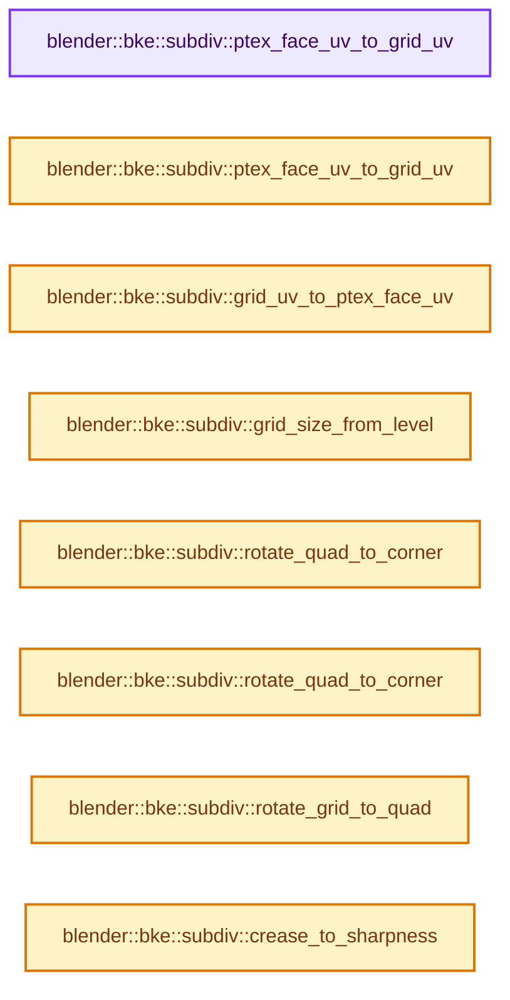
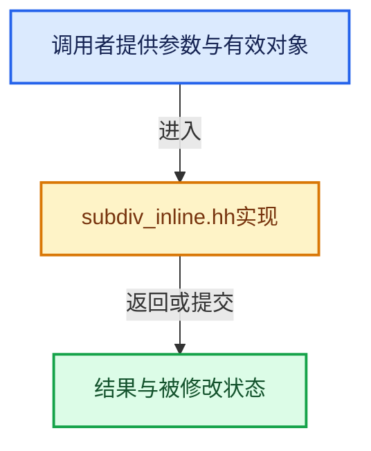

# 实现依赖专题：source/blender/blenkernel/intern/subdiv_inline.hh

[方向导航](README.md) · [符号索引](../%E7%AC%A6%E5%8F%B7%E4%BE%9D%E8%B5%96%E4%B8%8E%E5%AE%9E%E7%8E%B0%E7%B4%A2%E5%BC%95.md)

本专题从正文实际调用进入，集中保存共享实现。函数有稳定锚点，可从调用处直接跳到对应完整函数；递归与互相调用通过回链组织。

## 本文件的实现关系






## 完整成员与函数实现

<a id="f-a032e356af3209ac"></a>

### `blender::bke::subdiv::ptex_face_uv_to_grid_uv`

实现位置：[source/blender/blenkernel/intern/subdiv_inline.hh](../../../../../source/blender/blenkernel/intern/subdiv_inline.hh) · L20—L27。

接口参数：

- `const float ptex_u`
- `const float ptex_v`
- `float *r_grid_u`
- `float *r_grid_v`

**教学注释版**

<!-- annotated:001cf1693f34d6 -->

```cpp
BLI_INLINE void ptex_face_uv_to_grid_uv(const float ptex_u,
                                        const float ptex_v,
                                        float *r_grid_u,
                                        float *r_grid_v)
{
  *r_grid_u = 1.0f - ptex_v;
  *r_grid_v = 1.0f - ptex_u;
}
```

<details>
<summary>核对原始源码：source/blender/blenkernel/intern/subdiv_inline.hh · L20—L27</summary>

<!-- original:001cf1693f34d6:source/blender/blenkernel/intern/subdiv_inline.hh:20:27 -->

```cpp
BLI_INLINE void ptex_face_uv_to_grid_uv(const float ptex_u,
                                        const float ptex_v,
                                        float *r_grid_u,
                                        float *r_grid_v)
{
  *r_grid_u = 1.0f - ptex_v;
  *r_grid_v = 1.0f - ptex_u;
}
```

</details>

**继续追踪实现**

本实现没有需要继续展开的显式调用；检查返回表达式、对象转换和调用者前置条件。

<a id="f-0dab4f54d87c18ed"></a>

### `blender::bke::subdiv::ptex_face_uv_to_grid_uv`

实现位置：[source/blender/blenkernel/intern/subdiv_inline.hh](../../../../../source/blender/blenkernel/intern/subdiv_inline.hh) · L29—L32。

接口参数：

- `const float2 &ptex_uv`

**教学注释版**

<!-- annotated:e6c6973a5ecf97 -->

```cpp
BLI_INLINE float2 ptex_face_uv_to_grid_uv(const float2 &ptex_uv)
{
  return float2(1.0f - ptex_uv.y, 1.0f - ptex_uv.x);
}
```

<details>
<summary>核对原始源码：source/blender/blenkernel/intern/subdiv_inline.hh · L29—L32</summary>

<!-- original:e6c6973a5ecf97:source/blender/blenkernel/intern/subdiv_inline.hh:29:32 -->

```cpp
BLI_INLINE float2 ptex_face_uv_to_grid_uv(const float2 &ptex_uv)
{
  return float2(1.0f - ptex_uv.y, 1.0f - ptex_uv.x);
}
```

</details>

**结果出口**

- `return float2(1.0f - ptex_uv.y, 1.0f - ptex_uv.x);`

**继续追踪实现**

- `float2` → [float2::float2 · L45](%E4%BE%9D%E8%B5%96-sky_math-8091a6.md#f-04c2783f21f996aa)；[float2::float2 · L47](%E4%BE%9D%E8%B5%96-sky_math-8091a6.md#f-dba79c4c10e5ea46)；[float2::float2 · L49](%E4%BE%9D%E8%B5%96-sky_math-8091a6.md#f-920ca90efa37bf0b)；[float2::float2 · L51](%E4%BE%9D%E8%B5%96-sky_math-8091a6.md#f-4b3fbf848d719a63)；[float2::float2 · L53](%E4%BE%9D%E8%B5%96-sky_math-8091a6.md#f-9b2acd8475cc2843)；[float2::float2 · L55](%E4%BE%9D%E8%B5%96-sky_math-8091a6.md#f-1e9233a9a231be51)。同名重载需按实参类型选择。

<a id="f-9f091991c3505c31"></a>

### `blender::bke::subdiv::grid_uv_to_ptex_face_uv`

实现位置：[source/blender/blenkernel/intern/subdiv_inline.hh](../../../../../source/blender/blenkernel/intern/subdiv_inline.hh) · L34—L41。

接口参数：

- `const float grid_u`
- `const float grid_v`
- `float *r_ptex_u`
- `float *r_ptex_v`

**教学注释版**

<!-- annotated:680aa4c2d00d74 -->

```cpp
BLI_INLINE void grid_uv_to_ptex_face_uv(const float grid_u,
                                        const float grid_v,
                                        float *r_ptex_u,
                                        float *r_ptex_v)
{
  *r_ptex_u = 1.0f - grid_v;
  *r_ptex_v = 1.0f - grid_u;
}
```

<details>
<summary>核对原始源码：source/blender/blenkernel/intern/subdiv_inline.hh · L34—L41</summary>

<!-- original:680aa4c2d00d74:source/blender/blenkernel/intern/subdiv_inline.hh:34:41 -->

```cpp
BLI_INLINE void grid_uv_to_ptex_face_uv(const float grid_u,
                                        const float grid_v,
                                        float *r_ptex_u,
                                        float *r_ptex_v)
{
  *r_ptex_u = 1.0f - grid_v;
  *r_ptex_v = 1.0f - grid_u;
}
```

</details>

**继续追踪实现**

本实现没有需要继续展开的显式调用；检查返回表达式、对象转换和调用者前置条件。

<a id="f-b1d46bbf8975e481"></a>

### `blender::bke::subdiv::grid_size_from_level`

实现位置：[source/blender/blenkernel/intern/subdiv_inline.hh](../../../../../source/blender/blenkernel/intern/subdiv_inline.hh) · L43—L46。

接口参数：

- `const int level`

**教学注释版**

<!-- annotated:af04d6056b3b6e -->

```cpp
BLI_INLINE int grid_size_from_level(const int level)
{
  return (1 << (level - 1)) + 1;
}
```

<details>
<summary>核对原始源码：source/blender/blenkernel/intern/subdiv_inline.hh · L43—L46</summary>

<!-- original:af04d6056b3b6e:source/blender/blenkernel/intern/subdiv_inline.hh:43:46 -->

```cpp
BLI_INLINE int grid_size_from_level(const int level)
{
  return (1 << (level - 1)) + 1;
}
```

</details>

**结果出口**

- `return (1 << (level - 1)) + 1;`

**继续追踪实现**

本实现没有需要继续展开的显式调用；检查返回表达式、对象转换和调用者前置条件。

<a id="f-31cf4c6ec139b3c4"></a>

### `blender::bke::subdiv::rotate_quad_to_corner`

实现位置：[source/blender/blenkernel/intern/subdiv_inline.hh](../../../../../source/blender/blenkernel/intern/subdiv_inline.hh) · L48—L76。

接口参数：

- `const float quad_u`
- `const float quad_v`
- `float *r_corner_u`
- `float *r_corner_v`

**教学注释版**

<!-- annotated:ffb4f7cb205a59 -->

```cpp
BLI_INLINE int rotate_quad_to_corner(const float quad_u,
                                     const float quad_v,
                                     float *r_corner_u,
                                     float *r_corner_v)
{
  int corner;
  if (quad_u <= 0.5f && quad_v <= 0.5f) {
    corner = 0;
    *r_corner_u = 2.0f * quad_u;
    *r_corner_v = 2.0f * quad_v;
  }
  else if (quad_u > 0.5f && quad_v <= 0.5f) {
    corner = 1;
    *r_corner_u = 2.0f * quad_v;
    *r_corner_v = 2.0f * (1.0f - quad_u);
  }
  else if (quad_u > 0.5f && quad_v > 0.5f) {
    corner = 2;
    *r_corner_u = 2.0f * (1.0f - quad_u);
    *r_corner_v = 2.0f * (1.0f - quad_v);
  }
  else {
    BLI_assert(quad_u <= 0.5f && quad_v >= 0.5f);
    corner = 3;
    *r_corner_u = 2.0f * (1.0f - quad_v);
    *r_corner_v = 2.0f * quad_u;
  }
  return corner;
}
```

<details>
<summary>核对原始源码：source/blender/blenkernel/intern/subdiv_inline.hh · L48—L76</summary>

<!-- original:ffb4f7cb205a59:source/blender/blenkernel/intern/subdiv_inline.hh:48:76 -->

```cpp
BLI_INLINE int rotate_quad_to_corner(const float quad_u,
                                     const float quad_v,
                                     float *r_corner_u,
                                     float *r_corner_v)
{
  int corner;
  if (quad_u <= 0.5f && quad_v <= 0.5f) {
    corner = 0;
    *r_corner_u = 2.0f * quad_u;
    *r_corner_v = 2.0f * quad_v;
  }
  else if (quad_u > 0.5f && quad_v <= 0.5f) {
    corner = 1;
    *r_corner_u = 2.0f * quad_v;
    *r_corner_v = 2.0f * (1.0f - quad_u);
  }
  else if (quad_u > 0.5f && quad_v > 0.5f) {
    corner = 2;
    *r_corner_u = 2.0f * (1.0f - quad_u);
    *r_corner_v = 2.0f * (1.0f - quad_v);
  }
  else {
    BLI_assert(quad_u <= 0.5f && quad_v >= 0.5f);
    corner = 3;
    *r_corner_u = 2.0f * (1.0f - quad_v);
    *r_corner_v = 2.0f * quad_u;
  }
  return corner;
}
```

</details>

**沿实际写入检查状态**

- `corner = 0;`
- `corner = 1;`
- `corner = 2;`
- `corner = 3;`

**结果出口**

- `return corner;`

**继续追踪实现**

- `BLI_assert` → [BLI_assert · L48](../01-%E5%9F%BA%E7%A1%80%E5%AE%B9%E5%99%A8%E4%B8%8E%E7%8E%B0%E4%BB%A3CPP/%E4%BE%9D%E8%B5%96-BLI_assert-cc98e8.md#m-57a88495704d)；[BLI_assert · L63](../01-%E5%9F%BA%E7%A1%80%E5%AE%B9%E5%99%A8%E4%B8%8E%E7%8E%B0%E4%BB%A3CPP/%E4%BE%9D%E8%B5%96-BLI_assert-cc98e8.md#m-d07050020cb5)。宏定义由构建条件选择。

<a id="f-58cee820add1c06a"></a>

### `blender::bke::subdiv::rotate_quad_to_corner`

实现位置：[source/blender/blenkernel/intern/subdiv_inline.hh](../../../../../source/blender/blenkernel/intern/subdiv_inline.hh) · L78—L92。

接口参数：

- `const int corner`
- `const float2 &quad`

**教学注释版**

<!-- annotated:168668b42588ce -->

```cpp
BLI_INLINE float2 rotate_quad_to_corner(const int corner, const float2 &quad)
{
  switch (corner) {
    case 0:
      return 2.0f * quad;
    case 1:
      return {2.0f * quad.y, 2.0f * (1.0f - quad.x)};
    case 2:
      return 2.0f * (1.0f - quad);
    case 3:
    default:
      BLI_assert(corner == 3);
      return {2.0f * (1.0f - quad.y), 2.0f * quad.x};
  }
}
```

<details>
<summary>核对原始源码：source/blender/blenkernel/intern/subdiv_inline.hh · L78—L92</summary>

<!-- original:168668b42588ce:source/blender/blenkernel/intern/subdiv_inline.hh:78:92 -->

```cpp
BLI_INLINE float2 rotate_quad_to_corner(const int corner, const float2 &quad)
{
  switch (corner) {
    case 0:
      return 2.0f * quad;
    case 1:
      return {2.0f * quad.y, 2.0f * (1.0f - quad.x)};
    case 2:
      return 2.0f * (1.0f - quad);
    case 3:
    default:
      BLI_assert(corner == 3);
      return {2.0f * (1.0f - quad.y), 2.0f * quad.x};
  }
}
```

</details>

**结果出口**

- `return 2.0f * quad;`
- `return {2.0f * quad.y, 2.0f * (1.0f - quad.x)};`
- `return 2.0f * (1.0f - quad);`
- `return {2.0f * (1.0f - quad.y), 2.0f * quad.x};`

**继续追踪实现**

- `BLI_assert` → [BLI_assert · L48](../01-%E5%9F%BA%E7%A1%80%E5%AE%B9%E5%99%A8%E4%B8%8E%E7%8E%B0%E4%BB%A3CPP/%E4%BE%9D%E8%B5%96-BLI_assert-cc98e8.md#m-57a88495704d)；[BLI_assert · L63](../01-%E5%9F%BA%E7%A1%80%E5%AE%B9%E5%99%A8%E4%B8%8E%E7%8E%B0%E4%BB%A3CPP/%E4%BE%9D%E8%B5%96-BLI_assert-cc98e8.md#m-d07050020cb5)。宏定义由构建条件选择。

<a id="f-3f989276798d0773"></a>

### `blender::bke::subdiv::rotate_grid_to_quad`

实现位置：[source/blender/blenkernel/intern/subdiv_inline.hh](../../../../../source/blender/blenkernel/intern/subdiv_inline.hh) · L94—L114。

接口参数：

- `const int corner`
- `const float grid_u`
- `const float grid_v`
- `float *r_quad_u`
- `float *r_quad_v`

**教学注释版**

<!-- annotated:8e3ef6084f128b -->

```cpp
BLI_INLINE void rotate_grid_to_quad(
    const int corner, const float grid_u, const float grid_v, float *r_quad_u, float *r_quad_v)
{
  if (corner == 0) {
    *r_quad_u = 0.5f - grid_v * 0.5f;
    *r_quad_v = 0.5f - grid_u * 0.5f;
  }
  else if (corner == 1) {
    *r_quad_u = 0.5f + grid_u * 0.5f;
    *r_quad_v = 0.5f - grid_v * 0.5f;
  }
  else if (corner == 2) {
    *r_quad_u = 0.5f + grid_v * 0.5f;
    *r_quad_v = 0.5f + grid_u * 0.5f;
  }
  else {
    BLI_assert(corner == 3);
    *r_quad_u = 0.5f - grid_u * 0.5f;
    *r_quad_v = 0.5f + grid_v * 0.5f;
  }
}
```

<details>
<summary>核对原始源码：source/blender/blenkernel/intern/subdiv_inline.hh · L94—L114</summary>

<!-- original:8e3ef6084f128b:source/blender/blenkernel/intern/subdiv_inline.hh:94:114 -->

```cpp
BLI_INLINE void rotate_grid_to_quad(
    const int corner, const float grid_u, const float grid_v, float *r_quad_u, float *r_quad_v)
{
  if (corner == 0) {
    *r_quad_u = 0.5f - grid_v * 0.5f;
    *r_quad_v = 0.5f - grid_u * 0.5f;
  }
  else if (corner == 1) {
    *r_quad_u = 0.5f + grid_u * 0.5f;
    *r_quad_v = 0.5f - grid_v * 0.5f;
  }
  else if (corner == 2) {
    *r_quad_u = 0.5f + grid_v * 0.5f;
    *r_quad_v = 0.5f + grid_u * 0.5f;
  }
  else {
    BLI_assert(corner == 3);
    *r_quad_u = 0.5f - grid_u * 0.5f;
    *r_quad_v = 0.5f + grid_v * 0.5f;
  }
}
```

</details>

**继续追踪实现**

- `BLI_assert` → [BLI_assert · L48](../01-%E5%9F%BA%E7%A1%80%E5%AE%B9%E5%99%A8%E4%B8%8E%E7%8E%B0%E4%BB%A3CPP/%E4%BE%9D%E8%B5%96-BLI_assert-cc98e8.md#m-57a88495704d)；[BLI_assert · L63](../01-%E5%9F%BA%E7%A1%80%E5%AE%B9%E5%99%A8%E4%B8%8E%E7%8E%B0%E4%BB%A3CPP/%E4%BE%9D%E8%B5%96-BLI_assert-cc98e8.md#m-d07050020cb5)。宏定义由构建条件选择。

<a id="f-869399627b052e22"></a>

### `blender::bke::subdiv::crease_to_sharpness`

实现位置：[source/blender/blenkernel/intern/subdiv_inline.hh](../../../../../source/blender/blenkernel/intern/subdiv_inline.hh) · L116—L119。

接口参数：

- `float crease`

**教学注释版**

<!-- annotated:3163224b749880 -->

```cpp
BLI_INLINE float crease_to_sharpness(float crease)
{
  return crease * crease * 10.0f;
}
```

<details>
<summary>核对原始源码：source/blender/blenkernel/intern/subdiv_inline.hh · L116—L119</summary>

<!-- original:3163224b749880:source/blender/blenkernel/intern/subdiv_inline.hh:116:119 -->

```cpp
BLI_INLINE float crease_to_sharpness(float crease)
{
  return crease * crease * 10.0f;
}
```

</details>

**结果出口**

- `return crease * crease * 10.0f;`

**继续追踪实现**

本实现没有需要继续展开的显式调用；检查返回表达式、对象转换和调用者前置条件。

<a id="f-79c06ce190ca4cbe"></a>

### `blender::bke::subdiv::sharpness_to_crease`

实现位置：[source/blender/blenkernel/intern/subdiv_inline.hh](../../../../../source/blender/blenkernel/intern/subdiv_inline.hh) · L121—L124。

接口参数：

- `float sharpness`

**教学注释版**

<!-- annotated:4d8a6624bea0c9 -->

```cpp
BLI_INLINE float sharpness_to_crease(float sharpness)
{
  return sqrt(sharpness * 0.1f);
}
```

<details>
<summary>核对原始源码：source/blender/blenkernel/intern/subdiv_inline.hh · L121—L124</summary>

<!-- original:4d8a6624bea0c9:source/blender/blenkernel/intern/subdiv_inline.hh:121:124 -->

```cpp
BLI_INLINE float sharpness_to_crease(float sharpness)
{
  return sqrt(sharpness * 0.1f);
}
```

</details>

**结果出口**

- `return sqrt(sharpness * 0.1f);`

**继续追踪实现**

- `sqrt` → [外部契约](https://eel.is/c++draft/)：这个边界按实际表达式及所属类型核对参数、返回值、寿命与失败行为。这里提供接口入口，不声称已解释该第三方版本的内部实现。
