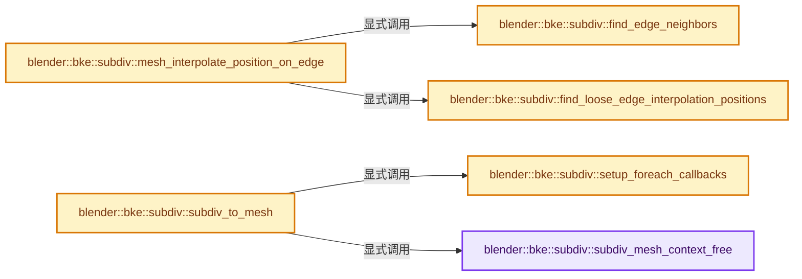
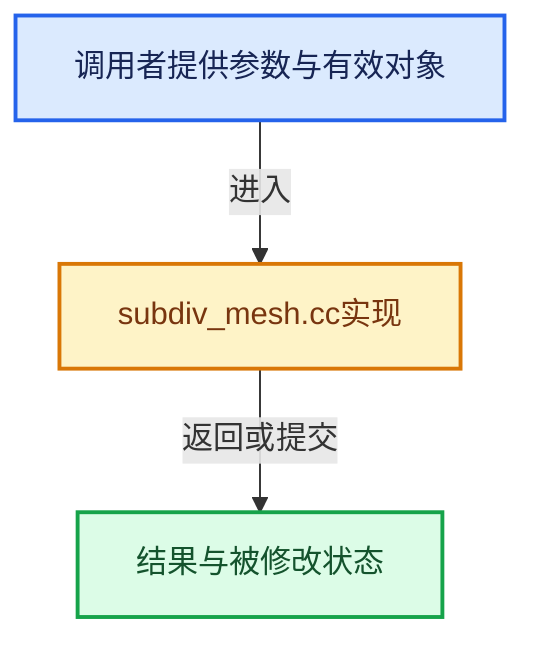

# 实现依赖专题：source/blender/blenkernel/intern/subdiv_mesh.cc

[方向导航](README.md) · [符号索引](../%E7%AC%A6%E5%8F%B7%E4%BE%9D%E8%B5%96%E4%B8%8E%E5%AE%9E%E7%8E%B0%E7%B4%A2%E5%BC%95.md)

本专题从正文实际调用进入，集中保存共享实现。函数有稳定锚点，可从调用处直接跳到对应完整函数；递归与互相调用通过回链组织。

## 本文件的实现关系






## 完整成员与函数实现

<a id="f-a6cc1ddbcf61ad8f"></a>

### `blender::bke::subdiv::subdiv_mesh_context_free`

实现位置：[source/blender/blenkernel/intern/subdiv_mesh.cc](../../../../../source/blender/blenkernel/intern/subdiv_mesh.cc) · L222—L225。

接口参数：

- `SubdivMeshContext *ctx`

**教学注释版**

<!-- annotated:ccd5098dabec5e -->

```cpp
static void subdiv_mesh_context_free(SubdivMeshContext *ctx)
{
  MEM_SAFE_DELETE(ctx->accumulated_counters);
}
```

<details>
<summary>核对原始源码：source/blender/blenkernel/intern/subdiv_mesh.cc · L222—L225</summary>

<!-- original:ccd5098dabec5e:source/blender/blenkernel/intern/subdiv_mesh.cc:222:225 -->

```cpp
static void subdiv_mesh_context_free(SubdivMeshContext *ctx)
{
  MEM_SAFE_DELETE(ctx->accumulated_counters);
}
```

</details>

**继续追踪实现**

- `MEM_SAFE_DELETE` → [MEM_SAFE_DELETE · L436](../03-%E5%86%85%E5%AD%98%E5%88%86%E9%85%8D%E4%B8%8E%E8%BF%90%E8%A1%8C%E6%97%B6%E7%B1%BB%E5%9E%8B/%E4%BE%9D%E8%B5%96-MEM_guardedalloc-b54eca.md#m-eadb3bc5b902)。宏定义由构建条件选择。

<a id="f-23e79089c96bbcee"></a>

### `blender::bke::subdiv::find_edge_neighbors`

实现位置：[source/blender/blenkernel/intern/subdiv_mesh.cc](../../../../../source/blender/blenkernel/intern/subdiv_mesh.cc) · L1311—L1326。

接口参数：

- `const Span<int2> coarse_edges`
- `const GroupedSpan<int> vert_to_edge_map`
- `const int edge_index`

**教学注释版**

<!-- annotated:14075f8a4721a5 -->

```cpp
static std::array<std::optional<int2>, 2> find_edge_neighbors(
    const Span<int2> coarse_edges, const GroupedSpan<int> vert_to_edge_map, const int edge_index)
{
  /* Vertices which has more than one neighbor are considered infinitely
   * sharp. This is also how topology factory treats vertices of a surface
   * which are adjacent to a loose edge. */
  const auto neighbor_edge_if_single = [&](const int vert) -> std::optional<int2> {
    const Span<int> neighbors = vert_to_edge_map[vert];
    // [讲解] neighbors.size：查询视图长度或生成对应有效索引区间。
    if (neighbors.size() != 2) {
      return std::nullopt;
    }
    return neighbors[0] == edge_index ? coarse_edges[neighbors[1]] : coarse_edges[neighbors[0]];
  };
  const int2 edge = coarse_edges[edge_index];
  return {neighbor_edge_if_single(edge[0]), neighbor_edge_if_single(edge[1])};
}
```

<details>
<summary>核对原始源码：source/blender/blenkernel/intern/subdiv_mesh.cc · L1311—L1326</summary>

<!-- original:14075f8a4721a5:source/blender/blenkernel/intern/subdiv_mesh.cc:1311:1326 -->

```cpp
static std::array<std::optional<int2>, 2> find_edge_neighbors(
    const Span<int2> coarse_edges, const GroupedSpan<int> vert_to_edge_map, const int edge_index)
{
  /* Vertices which has more than one neighbor are considered infinitely
   * sharp. This is also how topology factory treats vertices of a surface
   * which are adjacent to a loose edge. */
  const auto neighbor_edge_if_single = [&](const int vert) -> std::optional<int2> {
    const Span<int> neighbors = vert_to_edge_map[vert];
    if (neighbors.size() != 2) {
      return std::nullopt;
    }
    return neighbors[0] == edge_index ? coarse_edges[neighbors[1]] : coarse_edges[neighbors[0]];
  };
  const int2 edge = coarse_edges[edge_index];
  return {neighbor_edge_if_single(edge[0]), neighbor_edge_if_single(edge[1])};
}
```

</details>

**结果出口**

- `return std::nullopt;`
- `return neighbors[0] == edge_index ? coarse_edges[neighbors[1]] : coarse_edges[neighbors[0]];`
- `return {neighbor_edge_if_single(edge[0]), neighbor_edge_if_single(edge[1])};`

**继续追踪实现**

- `neighbors.size` → [blender::Span::size · L256](../01-%E5%9F%BA%E7%A1%80%E5%AE%B9%E5%99%A8%E4%B8%8E%E7%8E%B0%E4%BB%A3CPP/05-Span%E5%8F%AA%E8%AF%BB%E8%BF%9E%E7%BB%AD%E8%A7%86%E5%9B%BE.md#f-5f80fa006089c998)。
- `neighbor_edge_if_single` → [调用协议](../%E6%A8%A1%E6%9D%BF%E5%AE%8F%E4%B8%8E%E5%8A%A8%E6%80%81%E5%88%86%E6%B4%BE%E5%8D%8F%E8%AE%AE.md)：局部可调用对象，须结合其初始化与捕获环境。调用位置L1325。

<a id="f-1c3f72471a30f8f3"></a>

### `blender::bke::subdiv::find_loose_edge_interpolation_positions`

实现位置：[source/blender/blenkernel/intern/subdiv_mesh.cc](../../../../../source/blender/blenkernel/intern/subdiv_mesh.cc) · L1328—L1352。

接口参数：

- `const Span<float3> coarse_positions`
- `const int2 &coarse_edge`
- `const std::array<std::optional<int2>, 2> &neighbors`

**教学注释版**

<!-- annotated:208e3b330c4da0 -->

```cpp
static std::array<float3, 4> find_loose_edge_interpolation_positions(
    const Span<float3> coarse_positions,
    const int2 &coarse_edge,
    const std::array<std::optional<int2>, 2> &neighbors)
{
  std::array<float3, 4> result;
  /* Middle points corresponds to the edge. */
  result[1] = coarse_positions[coarse_edge[0]];
  result[2] = coarse_positions[coarse_edge[1]];
  /* Start point, duplicate from edge start if no neighbor. */
  if (const std::optional<int2> &other = neighbors[0]) {
    result[0] = coarse_positions[mesh::edge_other_vert(*other, coarse_edge[0])];
  }
  else {
    result[0] = result[1] * 2.0f - result[2];
  }
  /* End point, duplicate from edge end if no neighbor. */
  if (const std::optional<int2> &other = neighbors[1]) {
    result[3] = coarse_positions[mesh::edge_other_vert(*other, coarse_edge[1])];
  }
  else {
    result[3] = result[2] * 2.0f - result[1];
  }
  return result;
}
```

<details>
<summary>核对原始源码：source/blender/blenkernel/intern/subdiv_mesh.cc · L1328—L1352</summary>

<!-- original:208e3b330c4da0:source/blender/blenkernel/intern/subdiv_mesh.cc:1328:1352 -->

```cpp
static std::array<float3, 4> find_loose_edge_interpolation_positions(
    const Span<float3> coarse_positions,
    const int2 &coarse_edge,
    const std::array<std::optional<int2>, 2> &neighbors)
{
  std::array<float3, 4> result;
  /* Middle points corresponds to the edge. */
  result[1] = coarse_positions[coarse_edge[0]];
  result[2] = coarse_positions[coarse_edge[1]];
  /* Start point, duplicate from edge start if no neighbor. */
  if (const std::optional<int2> &other = neighbors[0]) {
    result[0] = coarse_positions[mesh::edge_other_vert(*other, coarse_edge[0])];
  }
  else {
    result[0] = result[1] * 2.0f - result[2];
  }
  /* End point, duplicate from edge end if no neighbor. */
  if (const std::optional<int2> &other = neighbors[1]) {
    result[3] = coarse_positions[mesh::edge_other_vert(*other, coarse_edge[1])];
  }
  else {
    result[3] = result[2] * 2.0f - result[1];
  }
  return result;
}
```

</details>

**沿实际写入检查状态**

- `result[1] = coarse_positions[coarse_edge[0]];`
- `result[2] = coarse_positions[coarse_edge[1]];`
- `result[0] = coarse_positions[mesh::edge_other_vert(*other, coarse_edge[0])];`
- `result[0] = result[1] * 2.0f - result[2];`
- `result[3] = coarse_positions[mesh::edge_other_vert(*other, coarse_edge[1])];`
- `result[3] = result[2] * 2.0f - result[1];`

**结果出口**

- `return result;`

**继续追踪实现**

- `mesh::edge_other_vert` → [blender::bke::mesh::edge_other_vert · L370](01-Mesh%E9%A1%B6%E7%82%B9%E8%BE%B9%E9%9D%A2%E8%A7%92%E7%82%B9.md#f-1490bc33956b55a1)。

<a id="f-9256a5bdc551c34e"></a>

### `blender::bke::subdiv::mesh_interpolate_position_on_edge`

实现位置：[source/blender/blenkernel/intern/subdiv_mesh.cc](../../../../../source/blender/blenkernel/intern/subdiv_mesh.cc) · L1354—L1373。

接口参数：

- `const Span<float3> coarse_positions`
- `const Span<int2> coarse_edges`
- `const GroupedSpan<int> vert_to_edge_map`
- `const int coarse_edge_index`
- `const bool is_simple`
- `const float u`

**教学注释版**

<!-- annotated:e38a4a1f599869 -->

```cpp
float3 mesh_interpolate_position_on_edge(const Span<float3> coarse_positions,
                                         const Span<int2> coarse_edges,
                                         const GroupedSpan<int> vert_to_edge_map,
                                         const int coarse_edge_index,
                                         const bool is_simple,
                                         const float u)
{
  const int2 edge = coarse_edges[coarse_edge_index];
  if (is_simple) {
    return math::interpolate(coarse_positions[edge[0]], coarse_positions[edge[1]], u);
  }
  /* Find neighbors of the coarse edge. */
  const std::array<std::optional<int2>, 2> neighbors = find_edge_neighbors(
      coarse_edges, vert_to_edge_map, coarse_edge_index);
  const std::array<float3, 4> points = find_loose_edge_interpolation_positions(
      coarse_positions, edge, neighbors);
  float4 weights;
  key_curve_position_weights(u, weights, KEY_BSPLINE);
  return bke::attribute_math::mix4(weights, points[0], points[1], points[2], points[3]);
}
```

<details>
<summary>核对原始源码：source/blender/blenkernel/intern/subdiv_mesh.cc · L1354—L1373</summary>

<!-- original:e38a4a1f599869:source/blender/blenkernel/intern/subdiv_mesh.cc:1354:1373 -->

```cpp
float3 mesh_interpolate_position_on_edge(const Span<float3> coarse_positions,
                                         const Span<int2> coarse_edges,
                                         const GroupedSpan<int> vert_to_edge_map,
                                         const int coarse_edge_index,
                                         const bool is_simple,
                                         const float u)
{
  const int2 edge = coarse_edges[coarse_edge_index];
  if (is_simple) {
    return math::interpolate(coarse_positions[edge[0]], coarse_positions[edge[1]], u);
  }
  /* Find neighbors of the coarse edge. */
  const std::array<std::optional<int2>, 2> neighbors = find_edge_neighbors(
      coarse_edges, vert_to_edge_map, coarse_edge_index);
  const std::array<float3, 4> points = find_loose_edge_interpolation_positions(
      coarse_positions, edge, neighbors);
  float4 weights;
  key_curve_position_weights(u, weights, KEY_BSPLINE);
  return bke::attribute_math::mix4(weights, points[0], points[1], points[2], points[3]);
}
```

</details>

**结果出口**

- `return math::interpolate(coarse_positions[edge[0]], coarse_positions[edge[1]], u);`
- `return bke::attribute_math::mix4(weights, points[0], points[1], points[2], points[3]);`

**继续追踪实现**

- `math::interpolate` → [blender::math::interpolate · L335](../12-%E7%A9%BA%E9%97%B4%E6%95%B0%E6%8D%AE%E7%BB%93%E6%9E%84%E4%B8%8E%E5%87%A0%E4%BD%95%E7%AE%97%E6%B3%95/%E4%BE%9D%E8%B5%96-math_matrix-d7d8ee.md#f-91e7f517ebd72fb5)；[blender::math::interpolate · L379](../12-%E7%A9%BA%E9%97%B4%E6%95%B0%E6%8D%AE%E7%BB%93%E6%9E%84%E4%B8%8E%E5%87%A0%E4%BD%95%E7%AE%97%E6%B3%95/%E4%BE%9D%E8%B5%96-math_matrix-d7d8ee.md#f-a1be14e86ce595c2)；[blender::math::interpolate · L636](../12-%E7%A9%BA%E9%97%B4%E6%95%B0%E6%8D%AE%E7%BB%93%E6%9E%84%E4%B8%8E%E5%87%A0%E4%BD%95%E7%AE%97%E6%B3%95/%E4%BE%9D%E8%B5%96-BLI_math_vector-906a87.md#f-d612b6d6ab1b6e7c)；[blender::math::interpolate · L303](../12-%E7%A9%BA%E9%97%B4%E6%95%B0%E6%8D%AE%E7%BB%93%E6%9E%84%E4%B8%8E%E5%87%A0%E4%BD%95%E7%AE%97%E6%B3%95/%E4%BE%9D%E8%B5%96-BLI_math_quaternion-cf105d.md#f-48b9ace2a9c6185c)；[blender::math::interpolate · L17](../12-%E7%A9%BA%E9%97%B4%E6%95%B0%E6%8D%AE%E7%BB%93%E6%9E%84%E4%B8%8E%E5%87%A0%E4%BD%95%E7%AE%97%E6%B3%95/%E4%BE%9D%E8%B5%96-BLI_math_color-f3a6ea.md#f-eb5ef92b0f8c0926)；[blender::math::interpolate · L28](../12-%E7%A9%BA%E9%97%B4%E6%95%B0%E6%8D%AE%E7%BB%93%E6%9E%84%E4%B8%8E%E5%87%A0%E4%BD%95%E7%AE%97%E6%B3%95/%E4%BE%9D%E8%B5%96-BLI_math_color-f3a6ea.md#f-2a9e33ec55979ab6)；[blender::math::interpolate · L278](../12-%E7%A9%BA%E9%97%B4%E6%95%B0%E6%8D%AE%E7%BB%93%E6%9E%84%E4%B8%8E%E5%87%A0%E4%BD%95%E7%AE%97%E6%B3%95/%E4%BE%9D%E8%B5%96-BLI_math_base-0728eb.md#f-2629b871528f6528)。同名重载需按实参类型选择。
- `find_edge_neighbors` → [blender::bke::subdiv::find_edge_neighbors · L1311](%E4%BE%9D%E8%B5%96-subdiv_mesh-062851.md#f-23e79089c96bbcee)。
- `find_loose_edge_interpolation_positions` → [blender::bke::subdiv::find_loose_edge_interpolation_positions · L1328](%E4%BE%9D%E8%B5%96-subdiv_mesh-062851.md#f-1c3f72471a30f8f3)。
- `key_curve_position_weights` → [blender::key_curve_position_weights · L310](%E4%BE%9D%E8%B5%96-key-2b3be3.md#f-afb0f795e30f80db)。
- `bke::attribute_math::mix4` → [blender::bke::attribute_math::mix4 · L38](%E4%BE%9D%E8%B5%96-attribute_math-ecaf96.md#f-13453bec65a9c9e6)；[blender::bke::attribute_math::mix4 · L67](%E4%BE%9D%E8%B5%96-attribute_math-ecaf96.md#f-10d75be822f5ff6d)。同名重载需按实参类型选择。

<a id="f-2845079a2247efd4"></a>

### `blender::bke::subdiv::setup_foreach_callbacks`

实现位置：[source/blender/blenkernel/intern/subdiv_mesh.cc](../../../../../source/blender/blenkernel/intern/subdiv_mesh.cc) · L1430—L1450。

接口参数：

- `const SubdivMeshContext *subdiv_context`
- `ForeachContext *foreach_context`

**教学注释版**

<!-- annotated:741548ee8742ee -->

```cpp
static void setup_foreach_callbacks(const SubdivMeshContext *subdiv_context,
                                    ForeachContext *foreach_context)
{
  *foreach_context = {};
  /* General information. */
  foreach_context->topology_info = subdiv_mesh_topology_info;
  /* Every boundary geometry. Used for displacement averaging. */
  if (subdiv_context->have_displacement) {
    foreach_context->vert_every_corner = subdiv_mesh_vert_displacement_every_corner;
    foreach_context->vert_every_edge = subdiv_mesh_vert_displacement_every_edge;
  }
  foreach_context->vert_corner = subdiv_mesh_vert_corner;
  foreach_context->vert_edge = subdiv_mesh_vert_edge;
  foreach_context->vert_inner = subdiv_mesh_vert_inner;
  foreach_context->edge = subdiv_mesh_edge;
  foreach_context->loop = subdiv_mesh_loop;
  foreach_context->faces = subdiv_mesh_face;
  foreach_context->vert_loose = subdiv_mesh_vert_loose;
  foreach_context->vert_of_loose_edge = subdiv_mesh_vert_of_loose_edge;
  foreach_context->user_data_tls_free = subdiv_mesh_tls_free;
}
```

<details>
<summary>核对原始源码：source/blender/blenkernel/intern/subdiv_mesh.cc · L1430—L1450</summary>

<!-- original:741548ee8742ee:source/blender/blenkernel/intern/subdiv_mesh.cc:1430:1450 -->

```cpp
static void setup_foreach_callbacks(const SubdivMeshContext *subdiv_context,
                                    ForeachContext *foreach_context)
{
  *foreach_context = {};
  /* General information. */
  foreach_context->topology_info = subdiv_mesh_topology_info;
  /* Every boundary geometry. Used for displacement averaging. */
  if (subdiv_context->have_displacement) {
    foreach_context->vert_every_corner = subdiv_mesh_vert_displacement_every_corner;
    foreach_context->vert_every_edge = subdiv_mesh_vert_displacement_every_edge;
  }
  foreach_context->vert_corner = subdiv_mesh_vert_corner;
  foreach_context->vert_edge = subdiv_mesh_vert_edge;
  foreach_context->vert_inner = subdiv_mesh_vert_inner;
  foreach_context->edge = subdiv_mesh_edge;
  foreach_context->loop = subdiv_mesh_loop;
  foreach_context->faces = subdiv_mesh_face;
  foreach_context->vert_loose = subdiv_mesh_vert_loose;
  foreach_context->vert_of_loose_edge = subdiv_mesh_vert_of_loose_edge;
  foreach_context->user_data_tls_free = subdiv_mesh_tls_free;
}
```

</details>

**沿实际写入检查状态**

- `foreach_context->topology_info = subdiv_mesh_topology_info;`
- `foreach_context->vert_every_corner = subdiv_mesh_vert_displacement_every_corner;`
- `foreach_context->vert_every_edge = subdiv_mesh_vert_displacement_every_edge;`
- `foreach_context->vert_corner = subdiv_mesh_vert_corner;`
- `foreach_context->vert_edge = subdiv_mesh_vert_edge;`
- `foreach_context->vert_inner = subdiv_mesh_vert_inner;`
- `foreach_context->edge = subdiv_mesh_edge;`
- `foreach_context->loop = subdiv_mesh_loop;`
- `foreach_context->faces = subdiv_mesh_face;`
- `foreach_context->vert_loose = subdiv_mesh_vert_loose;`
- `foreach_context->vert_of_loose_edge = subdiv_mesh_vert_of_loose_edge;`
- `foreach_context->user_data_tls_free = subdiv_mesh_tls_free;`

**继续追踪实现**

本实现没有需要继续展开的显式调用；检查返回表达式、对象转换和调用者前置条件。

<a id="f-fb2d00a1de7732e7"></a>

### `blender::bke::subdiv::subdiv_to_mesh`

实现位置：[source/blender/blenkernel/intern/subdiv_mesh.cc](../../../../../source/blender/blenkernel/intern/subdiv_mesh.cc) · L1458—L1548。

接口参数：

- `Subdiv *subdiv`
- `const ToMeshSettings *settings`
- `const Mesh *coarse_mesh`

**教学注释版**

<!-- annotated:eecebaba641baf -->

```cpp
Mesh *subdiv_to_mesh(Subdiv *subdiv, const ToMeshSettings *settings, const Mesh *coarse_mesh)
{

  stats_begin(&subdiv->stats, SUBDIV_STATS_SUBDIV_TO_MESH);
  /* Make sure evaluator is up to date with possible new topology, and that
   * it is refined for the new positions of coarse vertices. */
  if (!eval_begin_from_mesh(subdiv, coarse_mesh, SUBDIV_EVALUATOR_TYPE_CPU)) {
    /* This could happen in two situations:
     * - OpenSubdiv is disabled.
     * - Something totally bad happened, and OpenSubdiv rejected our topology.
     * In either way, we can't safely continue. */
    if (coarse_mesh->faces_num) {
      stats_end(&subdiv->stats, SUBDIV_STATS_SUBDIV_TO_MESH);
      return nullptr;
    }
  }
  /* Initialize subdivision mesh creation context. */
  SubdivMeshContext subdiv_context{};
  subdiv_context.settings = settings;

  subdiv_context.coarse_mesh = coarse_mesh;
  subdiv_context.coarse_positions = coarse_mesh->vert_positions();
  subdiv_context.coarse_edges = coarse_mesh->edges();
  subdiv_context.coarse_faces = coarse_mesh->faces();
  subdiv_context.coarse_corner_verts = coarse_mesh->corner_verts();
  if (!coarse_mesh->loose_edges().is_empty()) {
    subdiv_context.vert_to_edge_map = mesh::build_vert_to_edge_map(
        subdiv_context.coarse_edges,
        coarse_mesh->verts_num,
        subdiv_context.vert_to_edge_offsets,
        subdiv_context.vert_to_edge_indices);
  }

  subdiv_context.subdiv = subdiv;
  subdiv_context.have_displacement = (subdiv->displacement_evaluator != nullptr);
  /* Multi-threaded traversal/evaluation. */
  stats_begin(&subdiv->stats, SUBDIV_STATS_SUBDIV_TO_MESH_GEOMETRY);
  ForeachContext foreach_context;
  setup_foreach_callbacks(&subdiv_context, &foreach_context);
  SubdivMeshTLS tls{};
  foreach_context.user_data = &subdiv_context;
  foreach_context.user_data_tls_size = sizeof(SubdivMeshTLS);
  foreach_context.user_data_tls = &tls;
  foreach_subdiv_geometry(subdiv, &foreach_context, settings, coarse_mesh);
  stats_end(&subdiv->stats, SUBDIV_STATS_SUBDIV_TO_MESH_GEOMETRY);
  Mesh *result = subdiv_context.subdiv_mesh;

  /* NOTE: Using normals from the limit surface gives different results than Blender's vertex
   * normal calculation. Since vertex normals are supposed to be a consistent cache, don't bother
   * calculating them here. The work may have been pointless anyway if the mesh is deformed or
   * changed afterwards. */

  /* Move the optimal display edge array to the final bit vector. */
  if (!subdiv_context.subdiv_display_edges.is_empty()) {
    result->runtime->subsurf_optimal_display_edges = BitVector<>(
        subdiv_context.subdiv_display_edges);
  }

  if (coarse_mesh->verts_no_face().is_empty()) {
    result->tag_loose_verts_none();
  }
  if (coarse_mesh->loose_edges().is_empty()) {
    result->tag_loose_edges_none();
  }
  result->tag_overlapping_none();

  if (subdiv->settings.is_simple) {
    /* In simple subdivision, min and max positions are not changed, avoid recomputing bounds. */
    result->runtime->bounds_cache = coarse_mesh->runtime->bounds_cache;
  }

  for (bke::SpanAttributeWriter<float2> &attr : subdiv_context.uv_maps) {
    attr.finish();
  }
  for (bke::GSpanAttributeWriter &attr : subdiv_context.subdiv_vert_attrs) {
    attr.finish();
  }
  for (bke::GSpanAttributeWriter &attr : subdiv_context.subdiv_edge_attrs) {
    attr.finish();
  }
  for (bke::GSpanAttributeWriter &attr : subdiv_context.subdiv_face_attrs) {
    attr.finish();
  }
  for (bke::GSpanAttributeWriter &attr : subdiv_context.subdiv_corner_attrs) {
    attr.finish();
  }

  stats_end(&subdiv->stats, SUBDIV_STATS_SUBDIV_TO_MESH);
  subdiv_mesh_context_free(&subdiv_context);
  return result;
}
```

<details>
<summary>核对原始源码：source/blender/blenkernel/intern/subdiv_mesh.cc · L1458—L1548</summary>

<!-- original:eecebaba641baf:source/blender/blenkernel/intern/subdiv_mesh.cc:1458:1548 -->

```cpp
Mesh *subdiv_to_mesh(Subdiv *subdiv, const ToMeshSettings *settings, const Mesh *coarse_mesh)
{

  stats_begin(&subdiv->stats, SUBDIV_STATS_SUBDIV_TO_MESH);
  /* Make sure evaluator is up to date with possible new topology, and that
   * it is refined for the new positions of coarse vertices. */
  if (!eval_begin_from_mesh(subdiv, coarse_mesh, SUBDIV_EVALUATOR_TYPE_CPU)) {
    /* This could happen in two situations:
     * - OpenSubdiv is disabled.
     * - Something totally bad happened, and OpenSubdiv rejected our topology.
     * In either way, we can't safely continue. */
    if (coarse_mesh->faces_num) {
      stats_end(&subdiv->stats, SUBDIV_STATS_SUBDIV_TO_MESH);
      return nullptr;
    }
  }
  /* Initialize subdivision mesh creation context. */
  SubdivMeshContext subdiv_context{};
  subdiv_context.settings = settings;

  subdiv_context.coarse_mesh = coarse_mesh;
  subdiv_context.coarse_positions = coarse_mesh->vert_positions();
  subdiv_context.coarse_edges = coarse_mesh->edges();
  subdiv_context.coarse_faces = coarse_mesh->faces();
  subdiv_context.coarse_corner_verts = coarse_mesh->corner_verts();
  if (!coarse_mesh->loose_edges().is_empty()) {
    subdiv_context.vert_to_edge_map = mesh::build_vert_to_edge_map(
        subdiv_context.coarse_edges,
        coarse_mesh->verts_num,
        subdiv_context.vert_to_edge_offsets,
        subdiv_context.vert_to_edge_indices);
  }

  subdiv_context.subdiv = subdiv;
  subdiv_context.have_displacement = (subdiv->displacement_evaluator != nullptr);
  /* Multi-threaded traversal/evaluation. */
  stats_begin(&subdiv->stats, SUBDIV_STATS_SUBDIV_TO_MESH_GEOMETRY);
  ForeachContext foreach_context;
  setup_foreach_callbacks(&subdiv_context, &foreach_context);
  SubdivMeshTLS tls{};
  foreach_context.user_data = &subdiv_context;
  foreach_context.user_data_tls_size = sizeof(SubdivMeshTLS);
  foreach_context.user_data_tls = &tls;
  foreach_subdiv_geometry(subdiv, &foreach_context, settings, coarse_mesh);
  stats_end(&subdiv->stats, SUBDIV_STATS_SUBDIV_TO_MESH_GEOMETRY);
  Mesh *result = subdiv_context.subdiv_mesh;

  /* NOTE: Using normals from the limit surface gives different results than Blender's vertex
   * normal calculation. Since vertex normals are supposed to be a consistent cache, don't bother
   * calculating them here. The work may have been pointless anyway if the mesh is deformed or
   * changed afterwards. */

  /* Move the optimal display edge array to the final bit vector. */
  if (!subdiv_context.subdiv_display_edges.is_empty()) {
    result->runtime->subsurf_optimal_display_edges = BitVector<>(
        subdiv_context.subdiv_display_edges);
  }

  if (coarse_mesh->verts_no_face().is_empty()) {
    result->tag_loose_verts_none();
  }
  if (coarse_mesh->loose_edges().is_empty()) {
    result->tag_loose_edges_none();
  }
  result->tag_overlapping_none();

  if (subdiv->settings.is_simple) {
    /* In simple subdivision, min and max positions are not changed, avoid recomputing bounds. */
    result->runtime->bounds_cache = coarse_mesh->runtime->bounds_cache;
  }

  for (bke::SpanAttributeWriter<float2> &attr : subdiv_context.uv_maps) {
    attr.finish();
  }
  for (bke::GSpanAttributeWriter &attr : subdiv_context.subdiv_vert_attrs) {
    attr.finish();
  }
  for (bke::GSpanAttributeWriter &attr : subdiv_context.subdiv_edge_attrs) {
    attr.finish();
  }
  for (bke::GSpanAttributeWriter &attr : subdiv_context.subdiv_face_attrs) {
    attr.finish();
  }
  for (bke::GSpanAttributeWriter &attr : subdiv_context.subdiv_corner_attrs) {
    attr.finish();
  }

  stats_end(&subdiv->stats, SUBDIV_STATS_SUBDIV_TO_MESH);
  subdiv_mesh_context_free(&subdiv_context);
  return result;
}
```

</details>

**沿实际写入检查状态**

- `subdiv_context.settings = settings;`
- `subdiv_context.coarse_mesh = coarse_mesh;`
- `subdiv_context.coarse_positions = coarse_mesh->vert_positions();`
- `subdiv_context.coarse_edges = coarse_mesh->edges();`
- `subdiv_context.coarse_faces = coarse_mesh->faces();`
- `subdiv_context.coarse_corner_verts = coarse_mesh->corner_verts();`
- `subdiv_context.vert_to_edge_map = mesh::build_vert_to_edge_map(`
- `subdiv_context.subdiv = subdiv;`
- `subdiv_context.have_displacement = (subdiv->displacement_evaluator != nullptr);`
- `foreach_context.user_data = &subdiv_context;`
- `foreach_context.user_data_tls_size = sizeof(SubdivMeshTLS);`
- `foreach_context.user_data_tls = &tls;`
- `result->runtime->subsurf_optimal_display_edges = BitVector<>(`
- `result->runtime->bounds_cache = coarse_mesh->runtime->bounds_cache;`

**结果出口**

- `return nullptr;`
- `return result;`

**继续追踪实现**

- `stats_begin` → [blender::bke::subdiv::stats_begin · L29](%E4%BE%9D%E8%B5%96-subdiv_stats-17e8f0.md#f-46e30181ec51de7f)。
- `eval_begin_from_mesh` → [blender::bke::subdiv::eval_begin_from_mesh · L216](%E4%BE%9D%E8%B5%96-subdiv_eval-8a9c8f.md#f-88372aa7a8ab8f7e)。
- `stats_end` → [blender::bke::subdiv::stats_end · L34](%E4%BE%9D%E8%B5%96-subdiv_stats-17e8f0.md#f-f613b2e2856775cb)。
- `coarse_mesh->vert_positions` → [Mesh::vert_positions · L1193](03-MPoly%E8%BF%81%E7%A7%BB%E4%B8%8E%E5%85%BC%E5%AE%B9.md#f-ae4177e5c5f2b371)。
- `coarse_mesh->edges` → [Mesh::edges · L1205](03-MPoly%E8%BF%81%E7%A7%BB%E4%B8%8E%E5%85%BC%E5%AE%B9.md#f-7232f6756b674d12)。
- `coarse_mesh->faces` → [Mesh::faces · L1217](03-MPoly%E8%BF%81%E7%A7%BB%E4%B8%8E%E5%85%BC%E5%AE%B9.md#f-ea444760154e17b2)。
- `coarse_mesh->corner_verts` → [Mesh::corner_verts · L1238](03-MPoly%E8%BF%81%E7%A7%BB%E4%B8%8E%E5%85%BC%E5%AE%B9.md#f-a59c61f583b64bc4)。
- `coarse_mesh->loose_edges().is_empty` → [调用协议](../%E6%A8%A1%E6%9D%BF%E5%AE%8F%E4%B8%8E%E5%8A%A8%E6%80%81%E5%88%86%E6%B4%BE%E5%8D%8F%E8%AE%AE.md)：接收对象类型依赖auto、返回值或模板实例；不按同名猜测目标。调用位置L1483。
- `coarse_mesh->loose_edges` → [blender::Mesh::loose_edges · L194](../06-%E9%9A%90%E5%BC%8F%E5%85%B1%E4%BA%AB%E4%B8%8E%E7%BC%93%E5%AD%98%E7%B3%BB%E7%BB%9F/10-%E5%B1%80%E9%83%A8%E6%9B%B4%E6%96%B0%E4%B8%8E%E5%A4%B1%E6%95%88%E4%BF%AE%E5%A4%8D.md#f-80e2cb4f8c0f449d)。
- `mesh::build_vert_to_edge_map` → [blender::bke::mesh::build_vert_to_edge_map · L278](06-%E6%8B%93%E6%89%91%E6%98%A0%E5%B0%84%E6%9E%84%E5%BB%BA.md#f-066f7f6eb05684e1)。
- `setup_foreach_callbacks` → [blender::bke::subdiv::setup_foreach_callbacks · L1430](%E4%BE%9D%E8%B5%96-subdiv_mesh-062851.md#f-2845079a2247efd4)。
- `foreach_subdiv_geometry` → [blender::bke::subdiv::foreach_subdiv_geometry · L1748](%E4%BE%9D%E8%B5%96-subdiv_foreach-1abd36.md#f-d3b417f57c73475c)。
- `subdiv_context.subdiv_display_edges.is_empty` → [调用协议](../%E6%A8%A1%E6%9D%BF%E5%AE%8F%E4%B8%8E%E5%8A%A8%E6%80%81%E5%88%86%E6%B4%BE%E5%8D%8F%E8%AE%AE.md)：接收对象类型依赖auto、返回值或模板实例；不按同名猜测目标。调用位置L1511。
- `BitVector<>` → [blender::bits::BitVector::BitVector · L89](../01-%E5%9F%BA%E7%A1%80%E5%AE%B9%E5%99%A8%E4%B8%8E%E7%8E%B0%E4%BB%A3CPP/19-BitSpan%E4%B8%8EBitVector.md#f-90975b5628d14a10)；[blender::bits::BitVector::BitVector · L97](../01-%E5%9F%BA%E7%A1%80%E5%AE%B9%E5%99%A8%E4%B8%8E%E7%8E%B0%E4%BB%A3CPP/19-BitSpan%E4%B8%8EBitVector.md#f-9f2d13628c1fd34c)；[blender::bits::BitVector::BitVector · L99](../01-%E5%9F%BA%E7%A1%80%E5%AE%B9%E5%99%A8%E4%B8%8E%E7%8E%B0%E4%BB%A3CPP/19-BitSpan%E4%B8%8EBitVector.md#f-6370d12fe2a8e1a6)；[blender::bits::BitVector::BitVector · L117](../01-%E5%9F%BA%E7%A1%80%E5%AE%B9%E5%99%A8%E4%B8%8E%E7%8E%B0%E4%BB%A3CPP/19-BitSpan%E4%B8%8EBitVector.md#f-1775d911682b513c)；[blender::bits::BitVector::BitVector · L122](../01-%E5%9F%BA%E7%A1%80%E5%AE%B9%E5%99%A8%E4%B8%8E%E7%8E%B0%E4%BB%A3CPP/19-BitSpan%E4%B8%8EBitVector.md#f-dfea00b77bfa0a09)；[blender::bits::BitVector::BitVector · L152](../01-%E5%9F%BA%E7%A1%80%E5%AE%B9%E5%99%A8%E4%B8%8E%E7%8E%B0%E4%BB%A3CPP/19-BitSpan%E4%B8%8EBitVector.md#f-2504a5a062cfd92b)；[blender::bits::BitVector::BitVector · L161](../01-%E5%9F%BA%E7%A1%80%E5%AE%B9%E5%99%A8%E4%B8%8E%E7%8E%B0%E4%BB%A3CPP/19-BitSpan%E4%B8%8EBitVector.md#f-bde2d7db9a78cc54)。同名重载需按实参类型选择。
- `coarse_mesh->verts_no_face().is_empty` → [调用协议](../%E6%A8%A1%E6%9D%BF%E5%AE%8F%E4%B8%8E%E5%8A%A8%E6%80%81%E5%88%86%E6%B4%BE%E5%8D%8F%E8%AE%AE.md)：接收对象类型依赖auto、返回值或模板实例；不按同名猜测目标。调用位置L1516。
- `coarse_mesh->verts_no_face` → [blender::Mesh::verts_no_face · L176](../06-%E9%9A%90%E5%BC%8F%E5%85%B1%E4%BA%AB%E4%B8%8E%E7%BC%93%E5%AD%98%E7%B3%BB%E7%BB%9F/10-%E5%B1%80%E9%83%A8%E6%9B%B4%E6%96%B0%E4%B8%8E%E5%A4%B1%E6%95%88%E4%BF%AE%E5%A4%8D.md#f-11b9bed425be6cbf)。
- `result->tag_loose_verts_none` → [blender::Mesh::tag_loose_verts_none · L207](../06-%E9%9A%90%E5%BC%8F%E5%85%B1%E4%BA%AB%E4%B8%8E%E7%BC%93%E5%AD%98%E7%B3%BB%E7%BB%9F/10-%E5%B1%80%E9%83%A8%E6%9B%B4%E6%96%B0%E4%B8%8E%E5%A4%B1%E6%95%88%E4%BF%AE%E5%A4%8D.md#f-496bb182c3efc1ed)。
- `result->tag_loose_edges_none` → [blender::Mesh::tag_loose_edges_none · L218](../06-%E9%9A%90%E5%BC%8F%E5%85%B1%E4%BA%AB%E4%B8%8E%E7%BC%93%E5%AD%98%E7%B3%BB%E7%BB%9F/10-%E5%B1%80%E9%83%A8%E6%9B%B4%E6%96%B0%E4%B8%8E%E5%A4%B1%E6%95%88%E4%BF%AE%E5%A4%8D.md#f-ce3d1779ee275444)。
- `result->tag_overlapping_none` → [blender::Mesh::tag_overlapping_none · L229](../06-%E9%9A%90%E5%BC%8F%E5%85%B1%E4%BA%AB%E4%B8%8E%E7%BC%93%E5%AD%98%E7%B3%BB%E7%BB%9F/10-%E5%B1%80%E9%83%A8%E6%9B%B4%E6%96%B0%E4%B8%8E%E5%A4%B1%E6%95%88%E4%BF%AE%E5%A4%8D.md#f-23199a5a728fd0dc)。
- `attr.finish` → [调用协议](../%E6%A8%A1%E6%9D%BF%E5%AE%8F%E4%B8%8E%E5%8A%A8%E6%80%81%E5%88%86%E6%B4%BE%E5%8D%8F%E8%AE%AE.md)：接收对象类型依赖auto、返回值或模板实例；不按同名猜测目标。调用位置L1530。
- `subdiv_mesh_context_free` → [blender::bke::subdiv::subdiv_mesh_context_free · L222](%E4%BE%9D%E8%B5%96-subdiv_mesh-062851.md#f-a6cc1ddbcf61ad8f)。
