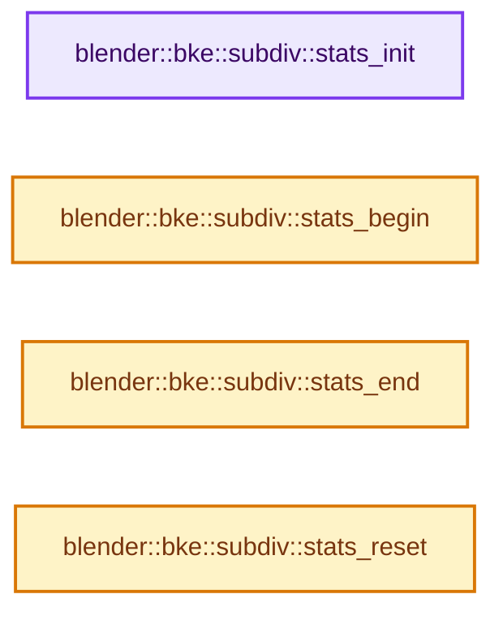
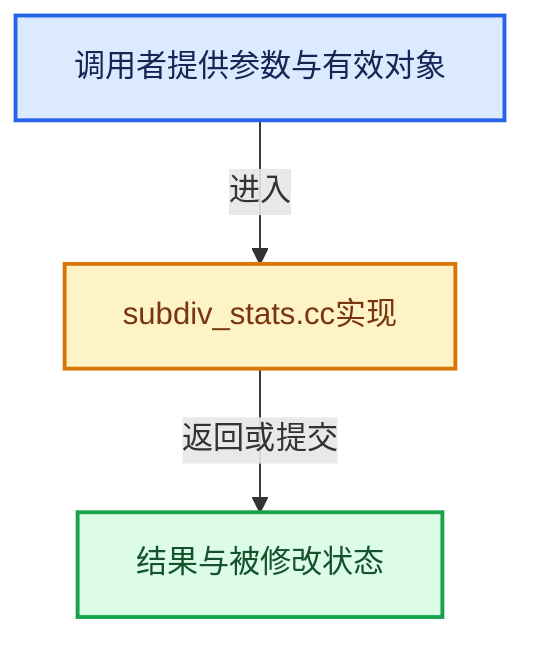

# 实现依赖专题：source/blender/blenkernel/intern/subdiv_stats.cc

[方向导航](README.md) · [符号索引](../%E7%AC%A6%E5%8F%B7%E4%BE%9D%E8%B5%96%E4%B8%8E%E5%AE%9E%E7%8E%B0%E7%B4%A2%E5%BC%95.md)

本专题从正文实际调用进入，集中保存共享实现。函数有稳定锚点，可从调用处直接跳到对应完整函数；递归与互相调用通过回链组织。

## 本文件的实现关系






## 完整成员与函数实现

<a id="f-e319b4c12c925550"></a>

### `blender::bke::subdiv::stats_init`

实现位置：[source/blender/blenkernel/intern/subdiv_stats.cc](../../../../../source/blender/blenkernel/intern/subdiv_stats.cc) · L17—L27。

接口参数：

- `SubdivStats *stats`

**教学注释版**

<!-- annotated:b80fc58f38c6bd -->

```cpp
void stats_init(SubdivStats *stats)
{
  stats->topology_refiner_creation_time = 0.0;
  stats->subdiv_to_mesh_time = 0.0;
  stats->subdiv_to_mesh_geometry_time = 0.0;
  stats->evaluator_creation_time = 0.0;
  stats->evaluator_refine_time = 0.0;
  stats->subdiv_to_ccg_time = 0.0;
  stats->subdiv_to_ccg_elements_time = 0.0;
  stats->topology_compare_time = 0.0;
}
```

<details>
<summary>核对原始源码：source/blender/blenkernel/intern/subdiv_stats.cc · L17—L27</summary>

<!-- original:b80fc58f38c6bd:source/blender/blenkernel/intern/subdiv_stats.cc:17:27 -->

```cpp
void stats_init(SubdivStats *stats)
{
  stats->topology_refiner_creation_time = 0.0;
  stats->subdiv_to_mesh_time = 0.0;
  stats->subdiv_to_mesh_geometry_time = 0.0;
  stats->evaluator_creation_time = 0.0;
  stats->evaluator_refine_time = 0.0;
  stats->subdiv_to_ccg_time = 0.0;
  stats->subdiv_to_ccg_elements_time = 0.0;
  stats->topology_compare_time = 0.0;
}
```

</details>

**沿实际写入检查状态**

- `stats->topology_refiner_creation_time = 0.0;`
- `stats->subdiv_to_mesh_time = 0.0;`
- `stats->subdiv_to_mesh_geometry_time = 0.0;`
- `stats->evaluator_creation_time = 0.0;`
- `stats->evaluator_refine_time = 0.0;`
- `stats->subdiv_to_ccg_time = 0.0;`
- `stats->subdiv_to_ccg_elements_time = 0.0;`
- `stats->topology_compare_time = 0.0;`

**继续追踪实现**

本实现没有需要继续展开的显式调用；检查返回表达式、对象转换和调用者前置条件。

<a id="f-46e30181ec51de7f"></a>

### `blender::bke::subdiv::stats_begin`

实现位置：[source/blender/blenkernel/intern/subdiv_stats.cc](../../../../../source/blender/blenkernel/intern/subdiv_stats.cc) · L29—L32。

接口参数：

- `SubdivStats *stats`
- `StatsValue value`

**教学注释版**

<!-- annotated:6b74f84a72a094 -->

```cpp
void stats_begin(SubdivStats *stats, StatsValue value)
{
  stats->begin_timestamp_[value] = BLI_time_now_seconds();
}
```

<details>
<summary>核对原始源码：source/blender/blenkernel/intern/subdiv_stats.cc · L29—L32</summary>

<!-- original:6b74f84a72a094:source/blender/blenkernel/intern/subdiv_stats.cc:29:32 -->

```cpp
void stats_begin(SubdivStats *stats, StatsValue value)
{
  stats->begin_timestamp_[value] = BLI_time_now_seconds();
}
```

</details>

**沿实际写入检查状态**

- `stats->begin_timestamp_[value] = BLI_time_now_seconds();`

**继续追踪实现**

- `BLI_time_now_seconds` → [blender::BLI_time_now_seconds · L30](../01-%E5%9F%BA%E7%A1%80%E5%AE%B9%E5%99%A8%E4%B8%8E%E7%8E%B0%E4%BB%A3CPP/%E4%BE%9D%E8%B5%96-time-be4317.md#f-78479f031bcc3c53)。

<a id="f-f613b2e2856775cb"></a>

### `blender::bke::subdiv::stats_end`

实现位置：[source/blender/blenkernel/intern/subdiv_stats.cc](../../../../../source/blender/blenkernel/intern/subdiv_stats.cc) · L34—L37。

接口参数：

- `SubdivStats *stats`
- `StatsValue value`

**教学注释版**

<!-- annotated:5868ba3d21ae1d -->

```cpp
void stats_end(SubdivStats *stats, StatsValue value)
{
  stats->values_[value] = BLI_time_now_seconds() - stats->begin_timestamp_[value];
}
```

<details>
<summary>核对原始源码：source/blender/blenkernel/intern/subdiv_stats.cc · L34—L37</summary>

<!-- original:5868ba3d21ae1d:source/blender/blenkernel/intern/subdiv_stats.cc:34:37 -->

```cpp
void stats_end(SubdivStats *stats, StatsValue value)
{
  stats->values_[value] = BLI_time_now_seconds() - stats->begin_timestamp_[value];
}
```

</details>

**沿实际写入检查状态**

- `stats->values_[value] = BLI_time_now_seconds() - stats->begin_timestamp_[value];`

**继续追踪实现**

- `BLI_time_now_seconds` → [blender::BLI_time_now_seconds · L30](../01-%E5%9F%BA%E7%A1%80%E5%AE%B9%E5%99%A8%E4%B8%8E%E7%8E%B0%E4%BB%A3CPP/%E4%BE%9D%E8%B5%96-time-be4317.md#f-78479f031bcc3c53)。

<a id="f-a2102e73187ac82f"></a>

### `blender::bke::subdiv::stats_reset`

实现位置：[source/blender/blenkernel/intern/subdiv_stats.cc](../../../../../source/blender/blenkernel/intern/subdiv_stats.cc) · L39—L42。

接口参数：

- `SubdivStats *stats`
- `StatsValue value`

**教学注释版**

<!-- annotated:33af5e77e55bc7 -->

```cpp
void stats_reset(SubdivStats *stats, StatsValue value)
{
  stats->values_[value] = 0.0;
}
```

<details>
<summary>核对原始源码：source/blender/blenkernel/intern/subdiv_stats.cc · L39—L42</summary>

<!-- original:33af5e77e55bc7:source/blender/blenkernel/intern/subdiv_stats.cc:39:42 -->

```cpp
void stats_reset(SubdivStats *stats, StatsValue value)
{
  stats->values_[value] = 0.0;
}
```

</details>

**沿实际写入检查状态**

- `stats->values_[value] = 0.0;`

**继续追踪实现**

本实现没有需要继续展开的显式调用；检查返回表达式、对象转换和调用者前置条件。
