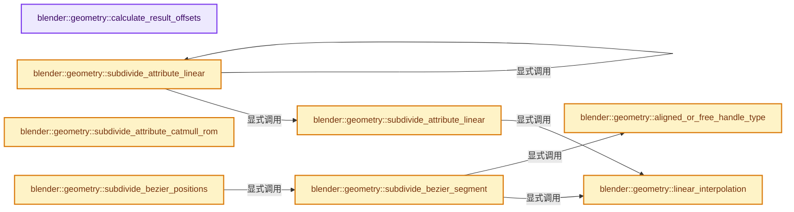

# 实现依赖专题：source/blender/geometry/intern/subdivide_curves.cc

[方向导航](README.md) · [符号索引](../%E7%AC%A6%E5%8F%B7%E4%BE%9D%E8%B5%96%E4%B8%8E%E5%AE%9E%E7%8E%B0%E7%B4%A2%E5%BC%95.md)

本专题从正文实际调用进入，集中保存共享实现。函数有稳定锚点，可从调用处直接跳到对应完整函数；递归与互相调用通过回链组织。

## 本文件的实现关系




## 完整成员与函数实现

<a id="f-05154f718bda8acc"></a>

### `blender::geometry::calculate_result_offsets`

实现位置：[source/blender/geometry/intern/subdivide_curves.cc](../../../../../source/blender/geometry/intern/subdivide_curves.cc) · L21—L61。

接口参数：

- `const bke::CurvesGeometry &src_curves`
- `const IndexMask &selection`
- `const IndexMask &unselected`
- `const VArray<int> &cuts`
- `const Span<bool> cyclic`
- `MutableSpan<int> dst_curve_offsets`
- `MutableSpan<int> dst_point_offsets`

**教学注释版**

<!-- annotated:06ba8e2d8f3939 -->

```cpp
static void calculate_result_offsets(const bke::CurvesGeometry &src_curves,
                                     const IndexMask &selection,
                                     const IndexMask &unselected,
                                     const VArray<int> &cuts,
                                     const Span<bool> cyclic,
                                     MutableSpan<int> dst_curve_offsets,
                                     MutableSpan<int> dst_point_offsets)
{
  /* Fill the array with each curve's point count, then accumulate them to the offsets. */
  const OffsetIndices src_points_by_curve = src_curves.points_by_curve();
  offset_indices::copy_group_sizes(src_points_by_curve, unselected, dst_curve_offsets);
  selection.foreach_index(
      [&](const int curve_i) {
        const IndexRange src_points = src_points_by_curve[curve_i];
        const IndexRange src_segments = bke::curves::per_curve_point_offsets_range(src_points,
                                                                                   curve_i);

        // [讲解] dst_point_offsets.slice：建立原连续范围的子视图。
        MutableSpan<int> point_offsets = dst_point_offsets.slice(src_segments);
        // [讲解] point_offsets.drop_back：从两端裁去或选取一定数量元素形成新视图。
        MutableSpan<int> point_counts = point_offsets.drop_back(1);

        // [讲解] src_points.size：读取连续区间或分组的边界信息。
        if (src_points.size() == 1) {
          // [讲解] point_counts.first：按视图边界访问元素。
          point_counts.first() = 1;
        }
        else {
          cuts.materialize_compressed(src_points, point_counts);
          for (int &count : point_counts) {
            /* Make sure there at least one cut, and add one for the existing point. */
            // [讲解] std::max：按比较关系选取较大值。本讲解中的增长公式同时满足最低请求和几何增长；若保存返回引用，还需注意实参寿命。
            count = std::max(count, 0) + 1;
          }
          if (!cyclic[curve_i]) {
            /* The last point only has a segment to be subdivided if the curve isn't cyclic. */
            // [讲解] point_counts.last：按视图边界访问元素。
            point_counts.last() = 1;
          }
        }

        offset_indices::accumulate_counts_to_offsets(point_offsets);
        dst_curve_offsets[curve_i] = point_offsets.last();
      },
      exec_mode::grain_size(1024));
  offset_indices::accumulate_counts_to_offsets(dst_curve_offsets);
}
```

<details>
<summary>核对原始源码：source/blender/geometry/intern/subdivide_curves.cc · L21—L61</summary>

<!-- original:06ba8e2d8f3939:source/blender/geometry/intern/subdivide_curves.cc:21:61 -->

```cpp
static void calculate_result_offsets(const bke::CurvesGeometry &src_curves,
                                     const IndexMask &selection,
                                     const IndexMask &unselected,
                                     const VArray<int> &cuts,
                                     const Span<bool> cyclic,
                                     MutableSpan<int> dst_curve_offsets,
                                     MutableSpan<int> dst_point_offsets)
{
  /* Fill the array with each curve's point count, then accumulate them to the offsets. */
  const OffsetIndices src_points_by_curve = src_curves.points_by_curve();
  offset_indices::copy_group_sizes(src_points_by_curve, unselected, dst_curve_offsets);
  selection.foreach_index(
      [&](const int curve_i) {
        const IndexRange src_points = src_points_by_curve[curve_i];
        const IndexRange src_segments = bke::curves::per_curve_point_offsets_range(src_points,
                                                                                   curve_i);

        MutableSpan<int> point_offsets = dst_point_offsets.slice(src_segments);
        MutableSpan<int> point_counts = point_offsets.drop_back(1);

        if (src_points.size() == 1) {
          point_counts.first() = 1;
        }
        else {
          cuts.materialize_compressed(src_points, point_counts);
          for (int &count : point_counts) {
            /* Make sure there at least one cut, and add one for the existing point. */
            count = std::max(count, 0) + 1;
          }
          if (!cyclic[curve_i]) {
            /* The last point only has a segment to be subdivided if the curve isn't cyclic. */
            point_counts.last() = 1;
          }
        }

        offset_indices::accumulate_counts_to_offsets(point_offsets);
        dst_curve_offsets[curve_i] = point_offsets.last();
      },
      exec_mode::grain_size(1024));
  offset_indices::accumulate_counts_to_offsets(dst_curve_offsets);
}
```

</details>

**沿实际写入检查状态**

- `count = std::max(count, 0) + 1;`
- `dst_curve_offsets[curve_i] = point_offsets.last();`

**继续追踪实现**

- `src_curves.points_by_curve` → [blender::bke::CurvesGeometry::points_by_curve · L1058](04-CurvesGeometry%E5%AD%98%E5%82%A8.md#f-a0416697e10ec205)。
- `offset_indices::copy_group_sizes` → [blender::offset_indices::copy_group_sizes · L79](05-%E9%82%BB%E6%8E%A5%E5%85%B3%E7%B3%BB%E4%B8%8E%E5%89%8D%E7%BC%80%E5%92%8C.md#f-5727ee5259519dfa)。
- `selection.foreach_index` → [blender::index_mask::IndexMask::foreach_index · L855](../04-%E8%99%9A%E6%8B%9F%E6%95%B0%E7%BB%84%E4%B8%8E%E7%B4%A2%E5%BC%95%E9%80%89%E6%8B%A9/09-%E5%88%86%E6%AE%B5%E5%AD%98%E5%82%A8%E4%B8%8E%E9%81%8D%E5%8E%86.md#f-cd6cd317e2e2812c)。
- `bke::curves::per_curve_point_offsets_range` → [blender::bke::curves::per_curve_point_offsets_range · L597](04-CurvesGeometry%E5%AD%98%E5%82%A8.md#f-92c59782b4fd056e)。
- `dst_point_offsets.slice` → [blender::MutableSpan::slice · L579](../01-%E5%9F%BA%E7%A1%80%E5%AE%B9%E5%99%A8%E4%B8%8E%E7%8E%B0%E4%BB%A3CPP/06-MutableSpan%E5%8F%AF%E5%86%99%E8%A7%86%E5%9B%BE.md#f-6808b4aefbf58808)；[blender::MutableSpan::slice · L587](../01-%E5%9F%BA%E7%A1%80%E5%AE%B9%E5%99%A8%E4%B8%8E%E7%8E%B0%E4%BB%A3CPP/06-MutableSpan%E5%8F%AF%E5%86%99%E8%A7%86%E5%9B%BE.md#f-c05b010821861e4f)。同名重载需按实参类型选择。
- `point_offsets.drop_back` → [blender::MutableSpan::drop_back · L624](../01-%E5%9F%BA%E7%A1%80%E5%AE%B9%E5%99%A8%E4%B8%8E%E7%8E%B0%E4%BB%A3CPP/06-MutableSpan%E5%8F%AF%E5%86%99%E8%A7%86%E5%9B%BE.md#f-d675bc737c0ae11c)。
- `src_points.size` → [blender::IndexRange::size · L156](../01-%E5%9F%BA%E7%A1%80%E5%AE%B9%E5%99%A8%E4%B8%8E%E7%8E%B0%E4%BB%A3CPP/04-IndexRange%E8%BF%9E%E7%BB%AD%E6%95%B4%E6%95%B0%E5%8C%BA%E9%97%B4.md#f-05f66c3ebb2fdfec)。
- `point_counts.first` → [blender::MutableSpan::first · L685](../01-%E5%9F%BA%E7%A1%80%E5%AE%B9%E5%99%A8%E4%B8%8E%E7%8E%B0%E4%BB%A3CPP/06-MutableSpan%E5%8F%AF%E5%86%99%E8%A7%86%E5%9B%BE.md#f-3126bab9f43cee1c)。
- `cuts.materialize_compressed` → [调用协议](../%E6%A8%A1%E6%9D%BF%E5%AE%8F%E4%B8%8E%E5%8A%A8%E6%80%81%E5%88%86%E6%B4%BE%E5%8D%8F%E8%AE%AE.md)：由接收对象具体类型或运行时策略提供实现。调用位置L45。
- `std::max` → [外部契约](https://eel.is/c++draft/alg.min.max)：按比较关系选取较大值。本讲解中的增长公式同时满足最低请求和几何增长；若保存返回引用，还需注意实参寿命。
- `point_counts.last` → [blender::MutableSpan::last · L695](../01-%E5%9F%BA%E7%A1%80%E5%AE%B9%E5%99%A8%E4%B8%8E%E7%8E%B0%E4%BB%A3CPP/06-MutableSpan%E5%8F%AF%E5%86%99%E8%A7%86%E5%9B%BE.md#f-73191eeabe29aab7)。
- `offset_indices::accumulate_counts_to_offsets` → [blender::offset_indices::accumulate_counts_to_offsets · L24](05-%E9%82%BB%E6%8E%A5%E5%85%B3%E7%B3%BB%E4%B8%8E%E5%89%8D%E7%BC%80%E5%92%8C.md#f-cfa9fbd186afcdd5)。
- `point_offsets.last` → [blender::MutableSpan::last · L695](../01-%E5%9F%BA%E7%A1%80%E5%AE%B9%E5%99%A8%E4%B8%8E%E7%8E%B0%E4%BB%A3CPP/06-MutableSpan%E5%8F%AF%E5%86%99%E8%A7%86%E5%9B%BE.md#f-73191eeabe29aab7)。
- `exec_mode::grain_size` → [blender::exec_mode::grain_size · L79](../01-%E5%9F%BA%E7%A1%80%E5%AE%B9%E5%99%A8%E4%B8%8E%E7%8E%B0%E4%BB%A3CPP/%E4%BE%9D%E8%B5%96-BLI_execution_mode-1528fb.md#f-0b4fc2f9fa6e66e7)。

<a id="f-b0cc56cd09fe22bf"></a>

### `blender::geometry::linear_interpolation`

实现位置：[source/blender/geometry/intern/subdivide_curves.cc](../../../../../source/blender/geometry/intern/subdivide_curves.cc) · L63—L71。

接口参数：

- `const T &a`
- `const T &b`
- `MutableSpan<T> dst`

**教学注释版**

<!-- annotated:f096bed0a0c273 -->

```cpp
template<typename T>
static inline void linear_interpolation(const T &a, const T &b, MutableSpan<T> dst)
{
  // [讲解] dst.first：按视图边界访问元素。
  dst.first() = a;
  // [讲解] dst.size：查询视图长度或生成对应有效索引区间。
  const float step = 1.0f / dst.size();
  // [讲解] dst.index_range：查询视图长度或生成对应有效索引区间。
  for (const int i : dst.index_range().drop_front(1)) {
    dst[i] = bke::attribute_math::mix2(i * step, a, b);
  }
}
```

<details>
<summary>核对原始源码：source/blender/geometry/intern/subdivide_curves.cc · L63—L71</summary>

<!-- original:f096bed0a0c273:source/blender/geometry/intern/subdivide_curves.cc:63:71 -->

```cpp
template<typename T>
static inline void linear_interpolation(const T &a, const T &b, MutableSpan<T> dst)
{
  dst.first() = a;
  const float step = 1.0f / dst.size();
  for (const int i : dst.index_range().drop_front(1)) {
    dst[i] = bke::attribute_math::mix2(i * step, a, b);
  }
}
```

</details>

**沿实际写入检查状态**

- `dst[i] = bke::attribute_math::mix2(i * step, a, b);`

**继续追踪实现**

- `dst.first` → [blender::MutableSpan::first · L685](../01-%E5%9F%BA%E7%A1%80%E5%AE%B9%E5%99%A8%E4%B8%8E%E7%8E%B0%E4%BB%A3CPP/06-MutableSpan%E5%8F%AF%E5%86%99%E8%A7%86%E5%9B%BE.md#f-3126bab9f43cee1c)。
- `dst.size` → [blender::MutableSpan::size · L499](../01-%E5%9F%BA%E7%A1%80%E5%AE%B9%E5%99%A8%E4%B8%8E%E7%8E%B0%E4%BB%A3CPP/06-MutableSpan%E5%8F%AF%E5%86%99%E8%A7%86%E5%9B%BE.md#f-1de6a66839c304a8)；[blender::gpu::shader::parser::MutableSpan::size · L87](%E4%BE%9D%E8%B5%96-utils-06433d.md#f-5e684af6ee7990e9)。同名重载需按实参类型选择。
- `dst.index_range().drop_front` → [调用协议](../%E6%A8%A1%E6%9D%BF%E5%AE%8F%E4%B8%8E%E5%8A%A8%E6%80%81%E5%88%86%E6%B4%BE%E5%8D%8F%E8%AE%AE.md)：接收对象类型依赖auto、返回值或模板实例；不按同名猜测目标。调用位置L68。
- `dst.index_range` → [blender::MutableSpan::index_range · L676](../01-%E5%9F%BA%E7%A1%80%E5%AE%B9%E5%99%A8%E4%B8%8E%E7%8E%B0%E4%BB%A3CPP/06-MutableSpan%E5%8F%AF%E5%86%99%E8%A7%86%E5%9B%BE.md#f-f9a9d59a69ca64b5)。
- `bke::attribute_math::mix2` → [blender::bke::attribute_math::mix2 · L22](%E4%BE%9D%E8%B5%96-attribute_math-ecaf96.md#f-c2b7b4b88dd0f972)；[blender::bke::attribute_math::mix2 · L49](%E4%BE%9D%E8%B5%96-attribute_math-ecaf96.md#f-14302ad73c537ec9)；[blender::bke::attribute_math::mix2 · L66](%E4%BE%9D%E8%B5%96-BKE_attribute_math-ac7998.md#f-8b99af960eb48e28)；[blender::bke::attribute_math::mix2 · L71](%E4%BE%9D%E8%B5%96-BKE_attribute_math-ac7998.md#f-9ef790651fef779c)；[blender::bke::attribute_math::mix2 · L76](%E4%BE%9D%E8%B5%96-BKE_attribute_math-ac7998.md#f-cff51a3353ed28a9)；[blender::bke::attribute_math::mix2 · L81](%E4%BE%9D%E8%B5%96-BKE_attribute_math-ac7998.md#f-222deb3f0b06c022)；[blender::bke::attribute_math::mix2 · L86](%E4%BE%9D%E8%B5%96-BKE_attribute_math-ac7998.md#f-842669f14eaf15e9)；[blender::bke::attribute_math::mix2 · L91](%E4%BE%9D%E8%B5%96-BKE_attribute_math-ac7998.md#f-f0253aed0458d320)；[blender::bke::attribute_math::mix2 · L96](%E4%BE%9D%E8%B5%96-BKE_attribute_math-ac7998.md#f-fd2eb7495a3d5ca0)；[blender::bke::attribute_math::mix2 · L101](%E4%BE%9D%E8%B5%96-BKE_attribute_math-ac7998.md#f-c9dbb4763cfd2cf9)；[blender::bke::attribute_math::mix2 · L106](%E4%BE%9D%E8%B5%96-BKE_attribute_math-ac7998.md#f-455bd7e9fa141103)；[blender::bke::attribute_math::mix2 · L111](%E4%BE%9D%E8%B5%96-BKE_attribute_math-ac7998.md#f-7246e4b5a45d9f1b)；[blender::bke::attribute_math::mix2 · L117](%E4%BE%9D%E8%B5%96-BKE_attribute_math-ac7998.md#f-1088551b894e068a)。同名重载需按实参类型选择。

<a id="f-35603eb4cc8322db"></a>

### `blender::geometry::subdivide_attribute_linear`

实现位置：[source/blender/geometry/intern/subdivide_curves.cc](../../../../../source/blender/geometry/intern/subdivide_curves.cc) · L73—L102。

接口参数：

- `const OffsetIndices<int> src_points_by_curve`
- `const OffsetIndices<int> dst_points_by_curve`
- `const IndexMask &selection`
- `const Span<int> all_point_offsets`
- `const Span<T> src`
- `MutableSpan<T> dst`

**教学注释版**

<!-- annotated:47a1479683f83b -->

```cpp
template<typename T>
static void subdivide_attribute_linear(const OffsetIndices<int> src_points_by_curve,
                                       const OffsetIndices<int> dst_points_by_curve,
                                       const IndexMask &selection,
                                       const Span<int> all_point_offsets,
                                       const Span<T> src,
                                       MutableSpan<T> dst)
{
  selection.foreach_index(
      [&](const int curve_i) {
        const IndexRange src_points = src_points_by_curve[curve_i];
        const IndexRange src_segments = bke::curves::per_curve_point_offsets_range(src_points,
                                                                                   curve_i);
        // [讲解] all_point_offsets.slice：建立原连续范围的子视图。
        const OffsetIndices<int> curve_offsets = all_point_offsets.slice(src_segments);
        const IndexRange dst_points = dst_points_by_curve[curve_i];
        const Span<T> curve_src = src.slice(src_points);
        MutableSpan<T> curve_dst = dst.slice(dst_points);

        // [讲解] curve_src.index_range：查询视图长度或生成对应有效索引区间。
        threading::parallel_for(curve_src.index_range().drop_back(1), 1024, [&](IndexRange range) {
          for (const int i : range) {
            const IndexRange segment_points = curve_offsets[i];
            linear_interpolation(curve_src[i], curve_src[i + 1], curve_dst.slice(segment_points));
          }
        });

        // [讲解] src_points.size：读取连续区间或分组的边界信息。
        const IndexRange dst_last_segment = dst_points.slice(curve_offsets[src_points.size() - 1]);
        // [讲解] curve_src.last：按视图边界访问元素。
        linear_interpolation(curve_src.last(), curve_src.first(), dst.slice(dst_last_segment));
      },
      exec_mode::grain_size(512));
}
```

<details>
<summary>核对原始源码：source/blender/geometry/intern/subdivide_curves.cc · L73—L102</summary>

<!-- original:47a1479683f83b:source/blender/geometry/intern/subdivide_curves.cc:73:102 -->

```cpp
template<typename T>
static void subdivide_attribute_linear(const OffsetIndices<int> src_points_by_curve,
                                       const OffsetIndices<int> dst_points_by_curve,
                                       const IndexMask &selection,
                                       const Span<int> all_point_offsets,
                                       const Span<T> src,
                                       MutableSpan<T> dst)
{
  selection.foreach_index(
      [&](const int curve_i) {
        const IndexRange src_points = src_points_by_curve[curve_i];
        const IndexRange src_segments = bke::curves::per_curve_point_offsets_range(src_points,
                                                                                   curve_i);
        const OffsetIndices<int> curve_offsets = all_point_offsets.slice(src_segments);
        const IndexRange dst_points = dst_points_by_curve[curve_i];
        const Span<T> curve_src = src.slice(src_points);
        MutableSpan<T> curve_dst = dst.slice(dst_points);

        threading::parallel_for(curve_src.index_range().drop_back(1), 1024, [&](IndexRange range) {
          for (const int i : range) {
            const IndexRange segment_points = curve_offsets[i];
            linear_interpolation(curve_src[i], curve_src[i + 1], curve_dst.slice(segment_points));
          }
        });

        const IndexRange dst_last_segment = dst_points.slice(curve_offsets[src_points.size() - 1]);
        linear_interpolation(curve_src.last(), curve_src.first(), dst.slice(dst_last_segment));
      },
      exec_mode::grain_size(512));
}
```

</details>

**继续追踪实现**

- `selection.foreach_index` → [blender::index_mask::IndexMask::foreach_index · L855](../04-%E8%99%9A%E6%8B%9F%E6%95%B0%E7%BB%84%E4%B8%8E%E7%B4%A2%E5%BC%95%E9%80%89%E6%8B%A9/09-%E5%88%86%E6%AE%B5%E5%AD%98%E5%82%A8%E4%B8%8E%E9%81%8D%E5%8E%86.md#f-cd6cd317e2e2812c)。
- `bke::curves::per_curve_point_offsets_range` → [blender::bke::curves::per_curve_point_offsets_range · L597](04-CurvesGeometry%E5%AD%98%E5%82%A8.md#f-92c59782b4fd056e)。
- `all_point_offsets.slice` → [blender::Span::slice · L141](../01-%E5%9F%BA%E7%A1%80%E5%AE%B9%E5%99%A8%E4%B8%8E%E7%8E%B0%E4%BB%A3CPP/05-Span%E5%8F%AA%E8%AF%BB%E8%BF%9E%E7%BB%AD%E8%A7%86%E5%9B%BE.md#f-380a0e8fdcbd53cc)；[blender::Span::slice · L149](../01-%E5%9F%BA%E7%A1%80%E5%AE%B9%E5%99%A8%E4%B8%8E%E7%8E%B0%E4%BB%A3CPP/05-Span%E5%8F%AA%E8%AF%BB%E8%BF%9E%E7%BB%AD%E8%A7%86%E5%9B%BE.md#f-9b9c15e78dd54eec)。同名重载需按实参类型选择。
- `src.slice` → [blender::Span::slice · L141](../01-%E5%9F%BA%E7%A1%80%E5%AE%B9%E5%99%A8%E4%B8%8E%E7%8E%B0%E4%BB%A3CPP/05-Span%E5%8F%AA%E8%AF%BB%E8%BF%9E%E7%BB%AD%E8%A7%86%E5%9B%BE.md#f-380a0e8fdcbd53cc)；[blender::Span::slice · L149](../01-%E5%9F%BA%E7%A1%80%E5%AE%B9%E5%99%A8%E4%B8%8E%E7%8E%B0%E4%BB%A3CPP/05-Span%E5%8F%AA%E8%AF%BB%E8%BF%9E%E7%BB%AD%E8%A7%86%E5%9B%BE.md#f-9b9c15e78dd54eec)。同名重载需按实参类型选择。
- `dst.slice` → [blender::MutableSpan::slice · L579](../01-%E5%9F%BA%E7%A1%80%E5%AE%B9%E5%99%A8%E4%B8%8E%E7%8E%B0%E4%BB%A3CPP/06-MutableSpan%E5%8F%AF%E5%86%99%E8%A7%86%E5%9B%BE.md#f-6808b4aefbf58808)；[blender::MutableSpan::slice · L587](../01-%E5%9F%BA%E7%A1%80%E5%AE%B9%E5%99%A8%E4%B8%8E%E7%8E%B0%E4%BB%A3CPP/06-MutableSpan%E5%8F%AF%E5%86%99%E8%A7%86%E5%9B%BE.md#f-c05b010821861e4f)。同名重载需按实参类型选择。
- `threading::parallel_for` → [blender::threading::parallel_for · L68](../11-Depsgraph%E4%B8%8E%E5%B9%B6%E8%A1%8C%E4%BB%BB%E5%8A%A1%E7%B3%BB%E7%BB%9F/07-%E4%BB%BB%E5%8A%A1%E6%B1%A0%E4%B8%8ETBB%E6%8E%A5%E5%85%A5.md#f-838294754c24426c)。
- `curve_src.index_range().drop_back` → [调用协议](../%E6%A8%A1%E6%9D%BF%E5%AE%8F%E4%B8%8E%E5%8A%A8%E6%80%81%E5%88%86%E6%B4%BE%E5%8D%8F%E8%AE%AE.md)：接收对象类型依赖auto、返回值或模板实例；不按同名猜测目标。调用位置L91。
- `curve_src.index_range` → [blender::Span::index_range · L405](../01-%E5%9F%BA%E7%A1%80%E5%AE%B9%E5%99%A8%E4%B8%8E%E7%8E%B0%E4%BB%A3CPP/05-Span%E5%8F%AA%E8%AF%BB%E8%BF%9E%E7%BB%AD%E8%A7%86%E5%9B%BE.md#f-caaa9b06e13e53e0)。
- `linear_interpolation` → [blender::geometry::linear_interpolation · L63](%E4%BE%9D%E8%B5%96-subdivide_curves-525912.md#f-b0cc56cd09fe22bf)。
- `curve_dst.slice` → [blender::MutableSpan::slice · L579](../01-%E5%9F%BA%E7%A1%80%E5%AE%B9%E5%99%A8%E4%B8%8E%E7%8E%B0%E4%BB%A3CPP/06-MutableSpan%E5%8F%AF%E5%86%99%E8%A7%86%E5%9B%BE.md#f-6808b4aefbf58808)；[blender::MutableSpan::slice · L587](../01-%E5%9F%BA%E7%A1%80%E5%AE%B9%E5%99%A8%E4%B8%8E%E7%8E%B0%E4%BB%A3CPP/06-MutableSpan%E5%8F%AF%E5%86%99%E8%A7%86%E5%9B%BE.md#f-c05b010821861e4f)。同名重载需按实参类型选择。
- `dst_points.slice` → [blender::IndexRange::slice · L276](../01-%E5%9F%BA%E7%A1%80%E5%AE%B9%E5%99%A8%E4%B8%8E%E7%8E%B0%E4%BB%A3CPP/04-IndexRange%E8%BF%9E%E7%BB%AD%E6%95%B4%E6%95%B0%E5%8C%BA%E9%97%B4.md#f-6249bf624e38d609)；[blender::IndexRange::slice · L284](../01-%E5%9F%BA%E7%A1%80%E5%AE%B9%E5%99%A8%E4%B8%8E%E7%8E%B0%E4%BB%A3CPP/04-IndexRange%E8%BF%9E%E7%BB%AD%E6%95%B4%E6%95%B0%E5%8C%BA%E9%97%B4.md#f-eb80885fefc31b6f)。同名重载需按实参类型选择。
- `src_points.size` → [blender::IndexRange::size · L156](../01-%E5%9F%BA%E7%A1%80%E5%AE%B9%E5%99%A8%E4%B8%8E%E7%8E%B0%E4%BB%A3CPP/04-IndexRange%E8%BF%9E%E7%BB%AD%E6%95%B4%E6%95%B0%E5%8C%BA%E9%97%B4.md#f-05f66c3ebb2fdfec)。
- `curve_src.last` → [blender::Span::last · L329](../01-%E5%9F%BA%E7%A1%80%E5%AE%B9%E5%99%A8%E4%B8%8E%E7%8E%B0%E4%BB%A3CPP/05-Span%E5%8F%AA%E8%AF%BB%E8%BF%9E%E7%BB%AD%E8%A7%86%E5%9B%BE.md#f-a92146c285596891)。
- `curve_src.first` → [blender::Span::first · L319](../01-%E5%9F%BA%E7%A1%80%E5%AE%B9%E5%99%A8%E4%B8%8E%E7%8E%B0%E4%BB%A3CPP/05-Span%E5%8F%AA%E8%AF%BB%E8%BF%9E%E7%BB%AD%E8%A7%86%E5%9B%BE.md#f-d8c9bcc3e9757248)。
- `exec_mode::grain_size` → [blender::exec_mode::grain_size · L79](../01-%E5%9F%BA%E7%A1%80%E5%AE%B9%E5%99%A8%E4%B8%8E%E7%8E%B0%E4%BB%A3CPP/%E4%BE%9D%E8%B5%96-BLI_execution_mode-1528fb.md#f-0b4fc2f9fa6e66e7)。

<a id="f-a2aefcab91950ff9"></a>

### `blender::geometry::subdivide_attribute_linear`

实现位置：[source/blender/geometry/intern/subdivide_curves.cc](../../../../../source/blender/geometry/intern/subdivide_curves.cc) · L104—L121。

接口参数：

- `const OffsetIndices<int> src_points_by_curve`
- `const OffsetIndices<int> dst_points_by_curve`
- `const IndexMask &selection`
- `const Span<int> all_point_offsets`
- `const GSpan src`
- `GMutableSpan dst`

**教学注释版**

<!-- annotated:8af40e79b50b73 -->

```cpp
static void subdivide_attribute_linear(const OffsetIndices<int> src_points_by_curve,
                                       const OffsetIndices<int> dst_points_by_curve,
                                       const IndexMask &selection,
                                       const Span<int> all_point_offsets,
                                       const GSpan src,
                                       GMutableSpan dst)
{
  bke::attribute_math::to_static_type(dst.type(), [&]<typename T>() {
    if constexpr (!std::is_same_v<T, std::string>) {
      subdivide_attribute_linear(src_points_by_curve,
                                 dst_points_by_curve,
                                 selection,
                                 all_point_offsets,
                                 src.typed<T>(),
                                 dst.typed<T>());
    }
  });
}
```

<details>
<summary>核对原始源码：source/blender/geometry/intern/subdivide_curves.cc · L104—L121</summary>

<!-- original:8af40e79b50b73:source/blender/geometry/intern/subdivide_curves.cc:104:121 -->

```cpp
static void subdivide_attribute_linear(const OffsetIndices<int> src_points_by_curve,
                                       const OffsetIndices<int> dst_points_by_curve,
                                       const IndexMask &selection,
                                       const Span<int> all_point_offsets,
                                       const GSpan src,
                                       GMutableSpan dst)
{
  bke::attribute_math::to_static_type(dst.type(), [&]<typename T>() {
    if constexpr (!std::is_same_v<T, std::string>) {
      subdivide_attribute_linear(src_points_by_curve,
                                 dst_points_by_curve,
                                 selection,
                                 all_point_offsets,
                                 src.typed<T>(),
                                 dst.typed<T>());
    }
  });
}
```

</details>

**继续追踪实现**

- `bke::attribute_math::to_static_type` → [blender::bke::attribute_math::to_static_type · L35](%E4%BE%9D%E8%B5%96-BKE_attribute_math-ac7998.md#f-fdfaf0b86a24f278)；[blender::bke::attribute_math::to_static_type · L52](%E4%BE%9D%E8%B5%96-BKE_attribute_math-ac7998.md#f-5346ade4e816ebd6)。同名重载需按实参类型选择。
- `dst.type` → [blender::GMutableSpan::type · L182](../03-%E5%86%85%E5%AD%98%E5%88%86%E9%85%8D%E4%B8%8E%E8%BF%90%E8%A1%8C%E6%97%B6%E7%B1%BB%E5%9E%8B/11-GSpan%E4%B8%8EGArray.md#f-74385040046c86d5)。
- `subdivide_attribute_linear` → [blender::geometry::subdivide_attribute_linear · L73](%E4%BE%9D%E8%B5%96-subdivide_curves-525912.md#f-35603eb4cc8322db)；[blender::geometry::subdivide_attribute_linear · L104](%E4%BE%9D%E8%B5%96-subdivide_curves-525912.md#f-a2aefcab91950ff9)。同名重载需按实参类型选择。
- `src.typed<T>` → [blender::GSpan::typed · L92](../03-%E5%86%85%E5%AD%98%E5%88%86%E9%85%8D%E4%B8%8E%E8%BF%90%E8%A1%8C%E6%97%B6%E7%B1%BB%E5%9E%8B/11-GSpan%E4%B8%8EGArray.md#f-aa54cf0d7a8dae2b)。
- `dst.typed<T>` → [blender::GMutableSpan::typed · L220](../03-%E5%86%85%E5%AD%98%E5%88%86%E9%85%8D%E4%B8%8E%E8%BF%90%E8%A1%8C%E6%97%B6%E7%B1%BB%E5%9E%8B/11-GSpan%E4%B8%8EGArray.md#f-d66e288b393f6545)。

<a id="f-cd7c35c876c73405"></a>

### `blender::geometry::subdivide_attribute_catmull_rom`

实现位置：[source/blender/geometry/intern/subdivide_curves.cc](../../../../../source/blender/geometry/intern/subdivide_curves.cc) · L123—L143。

接口参数：

- `const OffsetIndices<int> src_points_by_curve`
- `const OffsetIndices<int> dst_points_by_curve`
- `const IndexMask &selection`
- `const Span<int> all_point_offsets`
- `const Span<bool> cyclic`
- `const GSpan src`
- `GMutableSpan dst`

**教学注释版**

<!-- annotated:f0b8f54db65dd9 -->

```cpp
static void subdivide_attribute_catmull_rom(const OffsetIndices<int> src_points_by_curve,
                                            const OffsetIndices<int> dst_points_by_curve,
                                            const IndexMask &selection,
                                            const Span<int> all_point_offsets,
                                            const Span<bool> cyclic,
                                            const GSpan src,
                                            GMutableSpan dst)
{
  selection.foreach_index(
      [&](const int curve_i) {
        const IndexRange src_points = src_points_by_curve[curve_i];
        const IndexRange src_segments = bke::curves::per_curve_point_offsets_range(src_points,
                                                                                   curve_i);
        const IndexRange dst_points = dst_points_by_curve[curve_i];
        bke::curves::catmull_rom::interpolate_to_evaluated(src.slice(src_points),
                                                           cyclic[curve_i],
                                                           // [讲解] all_point_offsets.slice：建立原连续范围的子视图。
                                                           all_point_offsets.slice(src_segments),
                                                           dst.slice(dst_points));
      },
      exec_mode::grain_size(512));
}
```

<details>
<summary>核对原始源码：source/blender/geometry/intern/subdivide_curves.cc · L123—L143</summary>

<!-- original:f0b8f54db65dd9:source/blender/geometry/intern/subdivide_curves.cc:123:143 -->

```cpp
static void subdivide_attribute_catmull_rom(const OffsetIndices<int> src_points_by_curve,
                                            const OffsetIndices<int> dst_points_by_curve,
                                            const IndexMask &selection,
                                            const Span<int> all_point_offsets,
                                            const Span<bool> cyclic,
                                            const GSpan src,
                                            GMutableSpan dst)
{
  selection.foreach_index(
      [&](const int curve_i) {
        const IndexRange src_points = src_points_by_curve[curve_i];
        const IndexRange src_segments = bke::curves::per_curve_point_offsets_range(src_points,
                                                                                   curve_i);
        const IndexRange dst_points = dst_points_by_curve[curve_i];
        bke::curves::catmull_rom::interpolate_to_evaluated(src.slice(src_points),
                                                           cyclic[curve_i],
                                                           all_point_offsets.slice(src_segments),
                                                           dst.slice(dst_points));
      },
      exec_mode::grain_size(512));
}
```

</details>

**继续追踪实现**

- `selection.foreach_index` → [blender::index_mask::IndexMask::foreach_index · L855](../04-%E8%99%9A%E6%8B%9F%E6%95%B0%E7%BB%84%E4%B8%8E%E7%B4%A2%E5%BC%95%E9%80%89%E6%8B%A9/09-%E5%88%86%E6%AE%B5%E5%AD%98%E5%82%A8%E4%B8%8E%E9%81%8D%E5%8E%86.md#f-cd6cd317e2e2812c)。
- `bke::curves::per_curve_point_offsets_range` → [blender::bke::curves::per_curve_point_offsets_range · L597](04-CurvesGeometry%E5%AD%98%E5%82%A8.md#f-92c59782b4fd056e)。
- `bke::curves::catmull_rom::interpolate_to_evaluated` → [blender::bke::curves::catmull_rom::interpolate_to_evaluated · L56](%E4%BE%9D%E8%B5%96-curve_catmull_rom-e9ebc0.md#f-d07ecc0f84d089c5)；[blender::bke::curves::catmull_rom::interpolate_to_evaluated · L113](%E4%BE%9D%E8%B5%96-curve_catmull_rom-e9ebc0.md#f-cf2213e968548ef8)；[blender::bke::curves::catmull_rom::interpolate_to_evaluated · L131](%E4%BE%9D%E8%B5%96-curve_catmull_rom-e9ebc0.md#f-1e2b64d09d8923a7)；[blender::bke::curves::catmull_rom::interpolate_to_evaluated · L147](%E4%BE%9D%E8%B5%96-curve_catmull_rom-e9ebc0.md#f-7185bb8789ba3429)；[blender::bke::curves::catmull_rom::interpolate_to_evaluated · L159](%E4%BE%9D%E8%B5%96-curve_catmull_rom-e9ebc0.md#f-3fc5f9dc177d77b9)。同名重载需按实参类型选择。
- `src.slice` → [blender::GSpan::slice · L99](../03-%E5%86%85%E5%AD%98%E5%88%86%E9%85%8D%E4%B8%8E%E8%BF%90%E8%A1%8C%E6%97%B6%E7%B1%BB%E5%9E%8B/11-GSpan%E4%B8%8EGArray.md#f-c7f535c5dacdc816)；[blender::GSpan::slice · L107](../03-%E5%86%85%E5%AD%98%E5%88%86%E9%85%8D%E4%B8%8E%E8%BF%90%E8%A1%8C%E6%97%B6%E7%B1%BB%E5%9E%8B/11-GSpan%E4%B8%8EGArray.md#f-13774c4cd5408fa2)。同名重载需按实参类型选择。
- `all_point_offsets.slice` → [blender::Span::slice · L141](../01-%E5%9F%BA%E7%A1%80%E5%AE%B9%E5%99%A8%E4%B8%8E%E7%8E%B0%E4%BB%A3CPP/05-Span%E5%8F%AA%E8%AF%BB%E8%BF%9E%E7%BB%AD%E8%A7%86%E5%9B%BE.md#f-380a0e8fdcbd53cc)；[blender::Span::slice · L149](../01-%E5%9F%BA%E7%A1%80%E5%AE%B9%E5%99%A8%E4%B8%8E%E7%8E%B0%E4%BB%A3CPP/05-Span%E5%8F%AA%E8%AF%BB%E8%BF%9E%E7%BB%AD%E8%A7%86%E5%9B%BE.md#f-9b9c15e78dd54eec)。同名重载需按实参类型选择。
- `dst.slice` → [blender::GMutableSpan::slice · L227](../03-%E5%86%85%E5%AD%98%E5%88%86%E9%85%8D%E4%B8%8E%E8%BF%90%E8%A1%8C%E6%97%B6%E7%B1%BB%E5%9E%8B/11-GSpan%E4%B8%8EGArray.md#f-d7f8e350bc3a5156)；[blender::GMutableSpan::slice · L235](../03-%E5%86%85%E5%AD%98%E5%88%86%E9%85%8D%E4%B8%8E%E8%BF%90%E8%A1%8C%E6%97%B6%E7%B1%BB%E5%9E%8B/11-GSpan%E4%B8%8EGArray.md#f-b1101d4d9009fa75)。同名重载需按实参类型选择。
- `exec_mode::grain_size` → [blender::exec_mode::grain_size · L79](../01-%E5%9F%BA%E7%A1%80%E5%AE%B9%E5%99%A8%E4%B8%8E%E7%8E%B0%E4%BB%A3CPP/%E4%BE%9D%E8%B5%96-BLI_execution_mode-1528fb.md#f-0b4fc2f9fa6e66e7)。

<a id="f-a06ccee5cea5f6e8"></a>

### `blender::geometry::aligned_or_free_handle_type`

实现位置：[source/blender/geometry/intern/subdivide_curves.cc](../../../../../source/blender/geometry/intern/subdivide_curves.cc) · L145—L159。

接口参数：

- `const HandleType type`

**教学注释版**

<!-- annotated:9a857db2153326 -->

```cpp
static HandleType aligned_or_free_handle_type(const HandleType type)
{
  switch (type) {
    case BEZIER_HANDLE_FREE:
      return BEZIER_HANDLE_FREE;
    case BEZIER_HANDLE_AUTO:
      return BEZIER_HANDLE_ALIGN;
    case BEZIER_HANDLE_VECTOR:
      return BEZIER_HANDLE_FREE;
    case BEZIER_HANDLE_ALIGN:
      return BEZIER_HANDLE_ALIGN;
  }
  BLI_assert_unreachable();
  return BEZIER_HANDLE_FREE;
}
```

<details>
<summary>核对原始源码：source/blender/geometry/intern/subdivide_curves.cc · L145—L159</summary>

<!-- original:9a857db2153326:source/blender/geometry/intern/subdivide_curves.cc:145:159 -->

```cpp
static HandleType aligned_or_free_handle_type(const HandleType type)
{
  switch (type) {
    case BEZIER_HANDLE_FREE:
      return BEZIER_HANDLE_FREE;
    case BEZIER_HANDLE_AUTO:
      return BEZIER_HANDLE_ALIGN;
    case BEZIER_HANDLE_VECTOR:
      return BEZIER_HANDLE_FREE;
    case BEZIER_HANDLE_ALIGN:
      return BEZIER_HANDLE_ALIGN;
  }
  BLI_assert_unreachable();
  return BEZIER_HANDLE_FREE;
}
```

</details>

**结果出口**

- `return BEZIER_HANDLE_FREE;`
- `return BEZIER_HANDLE_ALIGN;`

**继续追踪实现**

- `BLI_assert_unreachable` → [BLI_assert_unreachable · L77](../01-%E5%9F%BA%E7%A1%80%E5%AE%B9%E5%99%A8%E4%B8%8E%E7%8E%B0%E4%BB%A3CPP/%E4%BE%9D%E8%B5%96-BLI_assert-cc98e8.md#m-7a2d91a67d8e)。宏定义由构建条件选择。

<a id="f-2724257e11299a8c"></a>

### `blender::geometry::subdivide_bezier_segment`

实现位置：[source/blender/geometry/intern/subdivide_curves.cc](../../../../../source/blender/geometry/intern/subdivide_curves.cc) · L161—L224。

接口参数：

- `const float3 &position_prev`
- `const float3 &handle_prev`
- `const float3 &handle_next`
- `const float3 &position_next`
- `const HandleType type_prev`
- `const HandleType type_next`
- `const IndexRange segment_points`
- `const int dst_next_segment_start`
- `MutableSpan<float3> dst_positions`
- `MutableSpan<float3> dst_handles_l`
- `MutableSpan<float3> dst_handles_r`
- `MutableSpan<int8_t> dst_types_l`
- `MutableSpan<int8_t> dst_types_r`

**教学注释版**

<!-- annotated:d89882f5052ac4 -->

```cpp
static void subdivide_bezier_segment(const float3 &position_prev,
                                     const float3 &handle_prev,
                                     const float3 &handle_next,
                                     const float3 &position_next,
                                     const HandleType type_prev,
                                     const HandleType type_next,
                                     const IndexRange segment_points,
                                     const int dst_next_segment_start,
                                     MutableSpan<float3> dst_positions,
                                     MutableSpan<float3> dst_handles_l,
                                     MutableSpan<float3> dst_handles_r,
                                     MutableSpan<int8_t> dst_types_l,
                                     MutableSpan<int8_t> dst_types_r)
{
  if (bke::curves::bezier::segment_is_vector(type_prev, type_next)) {
    // [讲解] dst_positions.slice：建立原连续范围的子视图。
    linear_interpolation(position_prev, position_next, dst_positions.slice(segment_points));
    /* All of the segment handles should be vector handles. */
    // [讲解] segment_points.first：读取范围两端的有效索引或值。
    dst_types_r[segment_points.first()] = BEZIER_HANDLE_VECTOR;
    dst_types_l[dst_next_segment_start] = BEZIER_HANDLE_VECTOR;
    dst_types_l.slice(segment_points.drop_front(1)).fill(BEZIER_HANDLE_VECTOR);
    dst_types_r.slice(segment_points.drop_front(1)).fill(BEZIER_HANDLE_VECTOR);
  }
  else {
    /* The first point in the segment is always copied. */
    dst_positions[segment_points.first()] = position_prev;

    /* In order to generate a Bezier curve with the same shape as the input curve, apply the
     * De Casteljau algorithm iteratively for the provided number of cuts, constantly updating the
     * previous result point's right handle and the left handle at the end of the segment. */
    float3 segment_start = position_prev;
    float3 segment_handle_prev = handle_prev;
    float3 segment_handle_next = handle_next;
    const float3 segment_end = position_next;

    // [讲解] segment_points.size：读取连续区间或分组的边界信息。
    for (const int i : IndexRange(segment_points.size() - 1)) {
      const float parameter = 1.0f / (segment_points.size() - i);
      const int point_i = segment_points[i];
      bke::curves::bezier::Insertion insert = bke::curves::bezier::insert(
          segment_start, segment_handle_prev, segment_handle_next, segment_end, parameter);

      /* Copy relevant temporary data to the result. */
      dst_handles_r[point_i] = insert.handle_prev;
      dst_handles_l[point_i + 1] = insert.left_handle;
      dst_positions[point_i + 1] = insert.position;

      /* Update the segment to prepare it for the next subdivision. */
      segment_start = insert.position;
      segment_handle_prev = insert.right_handle;
      segment_handle_next = insert.handle_next;
    }

    /* Copy the handles for the last segment from the working variables. */
    // [讲解] segment_points.last：读取范围两端的有效索引或值。
    dst_handles_r[segment_points.last()] = segment_handle_prev;
    dst_handles_l[dst_next_segment_start] = segment_handle_next;

    /* First and last handles at the ends of the segment are aligned if possible. */
    dst_types_r[segment_points.first()] = aligned_or_free_handle_type(type_prev);
    dst_types_l[dst_next_segment_start] = aligned_or_free_handle_type(type_next);

    /* Handles inside the segment are aligned. */
    dst_types_l.slice(segment_points.drop_front(1)).fill(BEZIER_HANDLE_ALIGN);
    dst_types_r.slice(segment_points.drop_front(1)).fill(BEZIER_HANDLE_ALIGN);
  }
}
```

<details>
<summary>核对原始源码：source/blender/geometry/intern/subdivide_curves.cc · L161—L224</summary>

<!-- original:d89882f5052ac4:source/blender/geometry/intern/subdivide_curves.cc:161:224 -->

```cpp
static void subdivide_bezier_segment(const float3 &position_prev,
                                     const float3 &handle_prev,
                                     const float3 &handle_next,
                                     const float3 &position_next,
                                     const HandleType type_prev,
                                     const HandleType type_next,
                                     const IndexRange segment_points,
                                     const int dst_next_segment_start,
                                     MutableSpan<float3> dst_positions,
                                     MutableSpan<float3> dst_handles_l,
                                     MutableSpan<float3> dst_handles_r,
                                     MutableSpan<int8_t> dst_types_l,
                                     MutableSpan<int8_t> dst_types_r)
{
  if (bke::curves::bezier::segment_is_vector(type_prev, type_next)) {
    linear_interpolation(position_prev, position_next, dst_positions.slice(segment_points));
    /* All of the segment handles should be vector handles. */
    dst_types_r[segment_points.first()] = BEZIER_HANDLE_VECTOR;
    dst_types_l[dst_next_segment_start] = BEZIER_HANDLE_VECTOR;
    dst_types_l.slice(segment_points.drop_front(1)).fill(BEZIER_HANDLE_VECTOR);
    dst_types_r.slice(segment_points.drop_front(1)).fill(BEZIER_HANDLE_VECTOR);
  }
  else {
    /* The first point in the segment is always copied. */
    dst_positions[segment_points.first()] = position_prev;

    /* In order to generate a Bezier curve with the same shape as the input curve, apply the
     * De Casteljau algorithm iteratively for the provided number of cuts, constantly updating the
     * previous result point's right handle and the left handle at the end of the segment. */
    float3 segment_start = position_prev;
    float3 segment_handle_prev = handle_prev;
    float3 segment_handle_next = handle_next;
    const float3 segment_end = position_next;

    for (const int i : IndexRange(segment_points.size() - 1)) {
      const float parameter = 1.0f / (segment_points.size() - i);
      const int point_i = segment_points[i];
      bke::curves::bezier::Insertion insert = bke::curves::bezier::insert(
          segment_start, segment_handle_prev, segment_handle_next, segment_end, parameter);

      /* Copy relevant temporary data to the result. */
      dst_handles_r[point_i] = insert.handle_prev;
      dst_handles_l[point_i + 1] = insert.left_handle;
      dst_positions[point_i + 1] = insert.position;

      /* Update the segment to prepare it for the next subdivision. */
      segment_start = insert.position;
      segment_handle_prev = insert.right_handle;
      segment_handle_next = insert.handle_next;
    }

    /* Copy the handles for the last segment from the working variables. */
    dst_handles_r[segment_points.last()] = segment_handle_prev;
    dst_handles_l[dst_next_segment_start] = segment_handle_next;

    /* First and last handles at the ends of the segment are aligned if possible. */
    dst_types_r[segment_points.first()] = aligned_or_free_handle_type(type_prev);
    dst_types_l[dst_next_segment_start] = aligned_or_free_handle_type(type_next);

    /* Handles inside the segment are aligned. */
    dst_types_l.slice(segment_points.drop_front(1)).fill(BEZIER_HANDLE_ALIGN);
    dst_types_r.slice(segment_points.drop_front(1)).fill(BEZIER_HANDLE_ALIGN);
  }
}
```

</details>

**沿实际写入检查状态**

- `dst_types_l[dst_next_segment_start] = BEZIER_HANDLE_VECTOR;`
- `dst_handles_r[point_i] = insert.handle_prev;`
- `segment_start = insert.position;`
- `segment_handle_prev = insert.right_handle;`
- `segment_handle_next = insert.handle_next;`
- `dst_handles_l[dst_next_segment_start] = segment_handle_next;`
- `dst_types_l[dst_next_segment_start] = aligned_or_free_handle_type(type_next);`

**继续追踪实现**

- `bke::curves::bezier::segment_is_vector` → [blender::bke::curves::bezier::segment_is_vector · L18](%E4%BE%9D%E8%B5%96-curve_bezier-e098bb.md#f-9bcee099d538029c)；[blender::bke::curves::bezier::segment_is_vector · L1123](04-CurvesGeometry%E5%AD%98%E5%82%A8.md#f-54be6c52a3cd4fb2)；[blender::bke::curves::bezier::segment_is_vector · L1128](04-CurvesGeometry%E5%AD%98%E5%82%A8.md#f-c7eda14849965cee)。同名重载需按实参类型选择。
- `linear_interpolation` → [blender::geometry::linear_interpolation · L63](%E4%BE%9D%E8%B5%96-subdivide_curves-525912.md#f-b0cc56cd09fe22bf)。
- `dst_positions.slice` → [blender::MutableSpan::slice · L579](../01-%E5%9F%BA%E7%A1%80%E5%AE%B9%E5%99%A8%E4%B8%8E%E7%8E%B0%E4%BB%A3CPP/06-MutableSpan%E5%8F%AF%E5%86%99%E8%A7%86%E5%9B%BE.md#f-6808b4aefbf58808)；[blender::MutableSpan::slice · L587](../01-%E5%9F%BA%E7%A1%80%E5%AE%B9%E5%99%A8%E4%B8%8E%E7%8E%B0%E4%BB%A3CPP/06-MutableSpan%E5%8F%AF%E5%86%99%E8%A7%86%E5%9B%BE.md#f-c05b010821861e4f)。同名重载需按实参类型选择。
- `segment_points.first` → [blender::IndexRange::first · L204](../01-%E5%9F%BA%E7%A1%80%E5%AE%B9%E5%99%A8%E4%B8%8E%E7%8E%B0%E4%BB%A3CPP/04-IndexRange%E8%BF%9E%E7%BB%AD%E6%95%B4%E6%95%B0%E5%8C%BA%E9%97%B4.md#f-ab443c94e531befa)。
- `dst_types_l.slice(segment_points.drop_front(1)).fill` → [调用协议](../%E6%A8%A1%E6%9D%BF%E5%AE%8F%E4%B8%8E%E5%8A%A8%E6%80%81%E5%88%86%E6%B4%BE%E5%8D%8F%E8%AE%AE.md)：接收对象类型依赖auto、返回值或模板实例；不按同名猜测目标。调用位置L180。
- `dst_types_l.slice` → [blender::MutableSpan::slice · L579](../01-%E5%9F%BA%E7%A1%80%E5%AE%B9%E5%99%A8%E4%B8%8E%E7%8E%B0%E4%BB%A3CPP/06-MutableSpan%E5%8F%AF%E5%86%99%E8%A7%86%E5%9B%BE.md#f-6808b4aefbf58808)；[blender::MutableSpan::slice · L587](../01-%E5%9F%BA%E7%A1%80%E5%AE%B9%E5%99%A8%E4%B8%8E%E7%8E%B0%E4%BB%A3CPP/06-MutableSpan%E5%8F%AF%E5%86%99%E8%A7%86%E5%9B%BE.md#f-c05b010821861e4f)。同名重载需按实参类型选择。
- `segment_points.drop_front` → [blender::IndexRange::drop_front · L306](../01-%E5%9F%BA%E7%A1%80%E5%AE%B9%E5%99%A8%E4%B8%8E%E7%8E%B0%E4%BB%A3CPP/04-IndexRange%E8%BF%9E%E7%BB%AD%E6%95%B4%E6%95%B0%E5%8C%BA%E9%97%B4.md#f-ef3101407d982c90)。
- `dst_types_r.slice(segment_points.drop_front(1)).fill` → [调用协议](../%E6%A8%A1%E6%9D%BF%E5%AE%8F%E4%B8%8E%E5%8A%A8%E6%80%81%E5%88%86%E6%B4%BE%E5%8D%8F%E8%AE%AE.md)：接收对象类型依赖auto、返回值或模板实例；不按同名猜测目标。调用位置L181。
- `dst_types_r.slice` → [blender::MutableSpan::slice · L579](../01-%E5%9F%BA%E7%A1%80%E5%AE%B9%E5%99%A8%E4%B8%8E%E7%8E%B0%E4%BB%A3CPP/06-MutableSpan%E5%8F%AF%E5%86%99%E8%A7%86%E5%9B%BE.md#f-6808b4aefbf58808)；[blender::MutableSpan::slice · L587](../01-%E5%9F%BA%E7%A1%80%E5%AE%B9%E5%99%A8%E4%B8%8E%E7%8E%B0%E4%BB%A3CPP/06-MutableSpan%E5%8F%AF%E5%86%99%E8%A7%86%E5%9B%BE.md#f-c05b010821861e4f)。同名重载需按实参类型选择。
- `IndexRange` → [blender::IndexRange](../01-%E5%9F%BA%E7%A1%80%E5%AE%B9%E5%99%A8%E4%B8%8E%E7%8E%B0%E4%BB%A3CPP/%E4%BE%9D%E8%B5%96-BLI_index_range-7d7cc5.md#t-caa3466d6776)；[blender::gpu::shader::parser::IndexRange](%E4%BE%9D%E8%B5%96-utils-06433d.md#t-82d2bd4ea71c)；[blender::IndexRange](%E4%BE%9D%E8%B5%96-DNA_node_types-6708b9.md#t-0448cc889d39)。
- `segment_points.size` → [blender::IndexRange::size · L156](../01-%E5%9F%BA%E7%A1%80%E5%AE%B9%E5%99%A8%E4%B8%8E%E7%8E%B0%E4%BB%A3CPP/04-IndexRange%E8%BF%9E%E7%BB%AD%E6%95%B4%E6%95%B0%E5%8C%BA%E9%97%B4.md#f-05f66c3ebb2fdfec)。
- `bke::curves::bezier::insert` → [调用协议](../%E6%A8%A1%E6%9D%BF%E5%AE%8F%E4%B8%8E%E5%8A%A8%E6%80%81%E5%88%86%E6%B4%BE%E5%8D%8F%E8%AE%AE.md)：局部可调用对象，须结合其初始化与捕获环境。调用位置L198。
- `segment_points.last` → [blender::IndexRange::last · L214](../01-%E5%9F%BA%E7%A1%80%E5%AE%B9%E5%99%A8%E4%B8%8E%E7%8E%B0%E4%BB%A3CPP/04-IndexRange%E8%BF%9E%E7%BB%AD%E6%95%B4%E6%95%B0%E5%8C%BA%E9%97%B4.md#f-66896c6351a40de1)；[blender::gpu::shader::parser::IndexRange::last · L62](%E4%BE%9D%E8%B5%96-utils-06433d.md#f-373501206569c3b3)。同名重载需按实参类型选择。
- `aligned_or_free_handle_type` → [blender::geometry::aligned_or_free_handle_type · L145](%E4%BE%9D%E8%B5%96-subdivide_curves-525912.md#f-a06ccee5cea5f6e8)。

<a id="f-686407174a372632"></a>

### `blender::geometry::subdivide_bezier_positions`

实现位置：[source/blender/geometry/intern/subdivide_curves.cc](../../../../../source/blender/geometry/intern/subdivide_curves.cc) · L226—L286。

接口参数：

- `const Span<float3> src_positions`
- `const Span<int8_t> src_types_l`
- `const Span<int8_t> src_types_r`
- `const Span<float3> src_handles_l`
- `const Span<float3> src_handles_r`
- `const OffsetIndices<int> evaluated_offsets`
- `const bool cyclic`
- `MutableSpan<float3> dst_positions`
- `MutableSpan<int8_t> dst_types_l`
- `MutableSpan<int8_t> dst_types_r`
- `MutableSpan<float3> dst_handles_l`
- `MutableSpan<float3> dst_handles_r`

**教学注释版**

<!-- annotated:9f76d495843261 -->

```cpp
static void subdivide_bezier_positions(const Span<float3> src_positions,
                                       const Span<int8_t> src_types_l,
                                       const Span<int8_t> src_types_r,
                                       const Span<float3> src_handles_l,
                                       const Span<float3> src_handles_r,
                                       const OffsetIndices<int> evaluated_offsets,
                                       const bool cyclic,
                                       MutableSpan<float3> dst_positions,
                                       MutableSpan<int8_t> dst_types_l,
                                       MutableSpan<int8_t> dst_types_r,
                                       MutableSpan<float3> dst_handles_l,
                                       MutableSpan<float3> dst_handles_r)
{
  // [讲解] src_positions.index_range：查询视图长度或生成对应有效索引区间。
  threading::parallel_for(src_positions.index_range().drop_back(1), 512, [&](IndexRange range) {
    for (const int segment_i : range) {
      const IndexRange segment = evaluated_offsets[segment_i];
      subdivide_bezier_segment(src_positions[segment_i],
                               src_handles_r[segment_i],
                               src_handles_l[segment_i + 1],
                               src_positions[segment_i + 1],
                               HandleType(src_types_r[segment_i]),
                               HandleType(src_types_l[segment_i + 1]),
                               segment,
                               // [讲解] segment.one_after_last：读取连续区间或分组的边界信息。
                               segment.one_after_last(),
                               dst_positions,
                               dst_handles_l,
                               dst_handles_r,
                               dst_types_l,
                               dst_types_r);
    }
  });

  if (cyclic) {
    const int last_index = src_positions.index_range().last();
    const IndexRange segment = evaluated_offsets[last_index];
    // [讲解] src_positions.last：按视图边界访问元素。
    subdivide_bezier_segment(src_positions.last(),
                             src_handles_r.last(),
                             // [讲解] src_handles_l.first：按视图边界访问元素。
                             src_handles_l.first(),
                             src_positions.first(),
                             HandleType(src_types_r.last()),
                             HandleType(src_types_l.first()),
                             segment,
                             0,
                             dst_positions,
                             dst_handles_l,
                             dst_handles_r,
                             dst_types_l,
                             dst_types_r);
  }
  else {
    dst_positions.last() = src_positions.last();
    dst_types_l.first() = src_types_l.first();
    dst_types_r.last() = src_types_r.last();
    dst_handles_l.first() = src_handles_l.first();
    dst_handles_r.last() = src_handles_r.last();
  }

  /* TODO: It would be possible to avoid calling this for all segments besides vector segments. */
  bke::curves::bezier::calculate_auto_handles(
      cyclic, dst_types_l, dst_types_r, dst_positions, dst_handles_l, dst_handles_r);
}
```

<details>
<summary>核对原始源码：source/blender/geometry/intern/subdivide_curves.cc · L226—L286</summary>

<!-- original:9f76d495843261:source/blender/geometry/intern/subdivide_curves.cc:226:286 -->

```cpp
static void subdivide_bezier_positions(const Span<float3> src_positions,
                                       const Span<int8_t> src_types_l,
                                       const Span<int8_t> src_types_r,
                                       const Span<float3> src_handles_l,
                                       const Span<float3> src_handles_r,
                                       const OffsetIndices<int> evaluated_offsets,
                                       const bool cyclic,
                                       MutableSpan<float3> dst_positions,
                                       MutableSpan<int8_t> dst_types_l,
                                       MutableSpan<int8_t> dst_types_r,
                                       MutableSpan<float3> dst_handles_l,
                                       MutableSpan<float3> dst_handles_r)
{
  threading::parallel_for(src_positions.index_range().drop_back(1), 512, [&](IndexRange range) {
    for (const int segment_i : range) {
      const IndexRange segment = evaluated_offsets[segment_i];
      subdivide_bezier_segment(src_positions[segment_i],
                               src_handles_r[segment_i],
                               src_handles_l[segment_i + 1],
                               src_positions[segment_i + 1],
                               HandleType(src_types_r[segment_i]),
                               HandleType(src_types_l[segment_i + 1]),
                               segment,
                               segment.one_after_last(),
                               dst_positions,
                               dst_handles_l,
                               dst_handles_r,
                               dst_types_l,
                               dst_types_r);
    }
  });

  if (cyclic) {
    const int last_index = src_positions.index_range().last();
    const IndexRange segment = evaluated_offsets[last_index];
    subdivide_bezier_segment(src_positions.last(),
                             src_handles_r.last(),
                             src_handles_l.first(),
                             src_positions.first(),
                             HandleType(src_types_r.last()),
                             HandleType(src_types_l.first()),
                             segment,
                             0,
                             dst_positions,
                             dst_handles_l,
                             dst_handles_r,
                             dst_types_l,
                             dst_types_r);
  }
  else {
    dst_positions.last() = src_positions.last();
    dst_types_l.first() = src_types_l.first();
    dst_types_r.last() = src_types_r.last();
    dst_handles_l.first() = src_handles_l.first();
    dst_handles_r.last() = src_handles_r.last();
  }

  /* TODO: It would be possible to avoid calling this for all segments besides vector segments. */
  bke::curves::bezier::calculate_auto_handles(
      cyclic, dst_types_l, dst_types_r, dst_positions, dst_handles_l, dst_handles_r);
}
```

</details>

**继续追踪实现**

- `threading::parallel_for` → [blender::threading::parallel_for · L68](../11-Depsgraph%E4%B8%8E%E5%B9%B6%E8%A1%8C%E4%BB%BB%E5%8A%A1%E7%B3%BB%E7%BB%9F/07-%E4%BB%BB%E5%8A%A1%E6%B1%A0%E4%B8%8ETBB%E6%8E%A5%E5%85%A5.md#f-838294754c24426c)。
- `src_positions.index_range().drop_back` → [调用协议](../%E6%A8%A1%E6%9D%BF%E5%AE%8F%E4%B8%8E%E5%8A%A8%E6%80%81%E5%88%86%E6%B4%BE%E5%8D%8F%E8%AE%AE.md)：接收对象类型依赖auto、返回值或模板实例；不按同名猜测目标。调用位置L239。
- `src_positions.index_range` → [blender::Span::index_range · L405](../01-%E5%9F%BA%E7%A1%80%E5%AE%B9%E5%99%A8%E4%B8%8E%E7%8E%B0%E4%BB%A3CPP/05-Span%E5%8F%AA%E8%AF%BB%E8%BF%9E%E7%BB%AD%E8%A7%86%E5%9B%BE.md#f-caaa9b06e13e53e0)。
- `subdivide_bezier_segment` → [blender::geometry::subdivide_bezier_segment · L161](%E4%BE%9D%E8%B5%96-subdivide_curves-525912.md#f-2724257e11299a8c)。
- `HandleType` → [blender::HandleType](%E4%BE%9D%E8%B5%96-DNA_curves_types-3af677.md#t-daf7799cb5ba)。
- `segment.one_after_last` → [blender::IndexRange::one_after_last · L235](../01-%E5%9F%BA%E7%A1%80%E5%AE%B9%E5%99%A8%E4%B8%8E%E7%8E%B0%E4%BB%A3CPP/04-IndexRange%E8%BF%9E%E7%BB%AD%E6%95%B4%E6%95%B0%E5%8C%BA%E9%97%B4.md#f-ed04bec9c731fc86)。
- `src_positions.index_range().last` → [调用协议](../%E6%A8%A1%E6%9D%BF%E5%AE%8F%E4%B8%8E%E5%8A%A8%E6%80%81%E5%88%86%E6%B4%BE%E5%8D%8F%E8%AE%AE.md)：接收对象类型依赖auto、返回值或模板实例；不按同名猜测目标。调用位置L259。
- `src_positions.last` → [blender::Span::last · L329](../01-%E5%9F%BA%E7%A1%80%E5%AE%B9%E5%99%A8%E4%B8%8E%E7%8E%B0%E4%BB%A3CPP/05-Span%E5%8F%AA%E8%AF%BB%E8%BF%9E%E7%BB%AD%E8%A7%86%E5%9B%BE.md#f-a92146c285596891)。
- `src_handles_r.last` → [blender::Span::last · L329](../01-%E5%9F%BA%E7%A1%80%E5%AE%B9%E5%99%A8%E4%B8%8E%E7%8E%B0%E4%BB%A3CPP/05-Span%E5%8F%AA%E8%AF%BB%E8%BF%9E%E7%BB%AD%E8%A7%86%E5%9B%BE.md#f-a92146c285596891)。
- `src_handles_l.first` → [blender::Span::first · L319](../01-%E5%9F%BA%E7%A1%80%E5%AE%B9%E5%99%A8%E4%B8%8E%E7%8E%B0%E4%BB%A3CPP/05-Span%E5%8F%AA%E8%AF%BB%E8%BF%9E%E7%BB%AD%E8%A7%86%E5%9B%BE.md#f-d8c9bcc3e9757248)。
- `src_positions.first` → [blender::Span::first · L319](../01-%E5%9F%BA%E7%A1%80%E5%AE%B9%E5%99%A8%E4%B8%8E%E7%8E%B0%E4%BB%A3CPP/05-Span%E5%8F%AA%E8%AF%BB%E8%BF%9E%E7%BB%AD%E8%A7%86%E5%9B%BE.md#f-d8c9bcc3e9757248)。
- `src_types_r.last` → [blender::Span::last · L329](../01-%E5%9F%BA%E7%A1%80%E5%AE%B9%E5%99%A8%E4%B8%8E%E7%8E%B0%E4%BB%A3CPP/05-Span%E5%8F%AA%E8%AF%BB%E8%BF%9E%E7%BB%AD%E8%A7%86%E5%9B%BE.md#f-a92146c285596891)。
- `src_types_l.first` → [blender::Span::first · L319](../01-%E5%9F%BA%E7%A1%80%E5%AE%B9%E5%99%A8%E4%B8%8E%E7%8E%B0%E4%BB%A3CPP/05-Span%E5%8F%AA%E8%AF%BB%E8%BF%9E%E7%BB%AD%E8%A7%86%E5%9B%BE.md#f-d8c9bcc3e9757248)。
- `dst_positions.last` → [blender::MutableSpan::last · L695](../01-%E5%9F%BA%E7%A1%80%E5%AE%B9%E5%99%A8%E4%B8%8E%E7%8E%B0%E4%BB%A3CPP/06-MutableSpan%E5%8F%AF%E5%86%99%E8%A7%86%E5%9B%BE.md#f-73191eeabe29aab7)。
- `dst_types_l.first` → [blender::MutableSpan::first · L685](../01-%E5%9F%BA%E7%A1%80%E5%AE%B9%E5%99%A8%E4%B8%8E%E7%8E%B0%E4%BB%A3CPP/06-MutableSpan%E5%8F%AF%E5%86%99%E8%A7%86%E5%9B%BE.md#f-3126bab9f43cee1c)。
- `dst_types_r.last` → [blender::MutableSpan::last · L695](../01-%E5%9F%BA%E7%A1%80%E5%AE%B9%E5%99%A8%E4%B8%8E%E7%8E%B0%E4%BB%A3CPP/06-MutableSpan%E5%8F%AF%E5%86%99%E8%A7%86%E5%9B%BE.md#f-73191eeabe29aab7)。
- `dst_handles_l.first` → [blender::MutableSpan::first · L685](../01-%E5%9F%BA%E7%A1%80%E5%AE%B9%E5%99%A8%E4%B8%8E%E7%8E%B0%E4%BB%A3CPP/06-MutableSpan%E5%8F%AF%E5%86%99%E8%A7%86%E5%9B%BE.md#f-3126bab9f43cee1c)。
- `dst_handles_r.last` → [blender::MutableSpan::last · L695](../01-%E5%9F%BA%E7%A1%80%E5%AE%B9%E5%99%A8%E4%B8%8E%E7%8E%B0%E4%BB%A3CPP/06-MutableSpan%E5%8F%AF%E5%86%99%E8%A7%86%E5%9B%BE.md#f-73191eeabe29aab7)。
- `bke::curves::bezier::calculate_auto_handles` → [blender::bke::curves::bezier::calculate_auto_handles · L268](%E4%BE%9D%E8%B5%96-curve_bezier-e098bb.md#f-b922bbd0e96e613a)。

<a id="f-6a0571db82a84e3c"></a>

### `blender::geometry::subdivide_curves`

实现位置：[source/blender/geometry/intern/subdivide_curves.cc](../../../../../source/blender/geometry/intern/subdivide_curves.cc) · L288—L437。

接口参数：

- `const bke::CurvesGeometry &src_curves`
- `const IndexMask &selection`
- `const VArray<int> &cuts`
- `const bke::AttributeFilter &attribute_filter`

**教学注释版**

<!-- annotated:fd83e72d532f5b -->

```cpp
bke::CurvesGeometry subdivide_curves(const bke::CurvesGeometry &src_curves,
                                     const IndexMask &selection,
                                     const VArray<int> &cuts,
                                     const bke::AttributeFilter &attribute_filter)
{
  if (src_curves.is_empty()) {
    return src_curves;
  }

  const OffsetIndices src_points_by_curve = src_curves.points_by_curve();
  /* Cyclic is accessed a lot, it's probably worth it to make sure it's a span. */
  const VArraySpan<bool> cyclic{src_curves.cyclic()};
  IndexMaskMemory memory;
  const IndexMask unselected = selection.complement(src_curves.curves_range(), memory);

  bke::CurvesGeometry dst_curves = bke::curves::copy_only_curve_domain(src_curves);
  /* Copy vertex groups from source curves to allow copying vertex group attributes. */
  BKE_defgroup_copy_list(&dst_curves.vertex_group_names, &src_curves.vertex_group_names);

  /* For each point, this contains the point offset in the corresponding result curve,
   * starting at zero. For example for two curves with four points each, the values might
   * look like this:
   *
   * |                     | Curve 0           | Curve 1            |
   * | ------------------- |---|---|---|---|---|---|---|---|---|----|
   * | Cuts                | 0 | 3 | 0 | 0 | - | 2 | 0 | 0 | 4 | -  |
   * | New Point Count     | 1 | 4 | 1 | 1 | - | 3 | 1 | 1 | 5 | -  |
   * | Accumulated Offsets | 0 | 1 | 5 | 6 | 7 | 0 | 3 | 4 | 5 | 10 |
   *
   * Storing the leading zero is unnecessary but makes the array a bit simpler to use by avoiding
   * a check for the first segment, and because some existing utilities also use leading zeros. */
  Array<int> all_point_offset_data(src_curves.points_num() + src_curves.curves_num());
#ifndef NDEBUG
  // [讲解] all_point_offset_data.fill：对现有元素赋同一个值。
  all_point_offset_data.fill(-1);
#endif
  calculate_result_offsets(src_curves,
                           selection,
                           unselected,
                           cuts,
                           cyclic,
                           dst_curves.offsets_for_write(),
                           all_point_offset_data);
  const OffsetIndices dst_points_by_curve = dst_curves.points_by_curve();

  const Span<int> all_point_offsets(all_point_offset_data);

  dst_curves.resize(dst_curves.offsets().last(), dst_curves.curves_num());

  const bke::AttributeAccessor src_attributes = src_curves.attributes();
  bke::MutableAttributeAccessor dst_attributes = dst_curves.attributes_for_write();

  Vector<bke::AttributeTransferData> attributes_to_transfer =
      bke::retrieve_attributes_for_transfer(
          src_attributes, dst_attributes, {bke::AttrDomain::Point}, attribute_filter);

  auto subdivide_catmull_rom = [&](const IndexMask &selection) {
    for (auto &attribute : attributes_to_transfer) {
      subdivide_attribute_catmull_rom(src_points_by_curve,
                                      dst_points_by_curve,
                                      selection,
                                      all_point_offsets,
                                      cyclic,
                                      attribute.src,
                                      attribute.dst.span);
    }
  };

  auto subdivide_poly = [&](const IndexMask &selection) {
    for (auto &attribute : attributes_to_transfer) {
      subdivide_attribute_linear(src_points_by_curve,
                                 dst_points_by_curve,
                                 selection,
                                 all_point_offsets,
                                 attribute.src,
                                 attribute.dst.span);
    }
  };

  auto subdivide_bezier = [&](const IndexMask &selection) {
    const Span<float3> src_positions = src_curves.positions();
    const VArraySpan<int8_t> src_types_l{src_curves.handle_types_left()};
    const VArraySpan<int8_t> src_types_r{src_curves.handle_types_right()};
    const Span<float3> src_handles_l = *src_curves.handle_positions_left();
    const Span<float3> src_handles_r = *src_curves.handle_positions_right();

    MutableSpan<float3> dst_positions = dst_curves.positions_for_write();
    MutableSpan<int8_t> dst_types_l = dst_curves.handle_types_left_for_write();
    MutableSpan<int8_t> dst_types_r = dst_curves.handle_types_right_for_write();
    MutableSpan<float3> dst_handles_l = dst_curves.handle_positions_left_for_write();
    MutableSpan<float3> dst_handles_r = dst_curves.handle_positions_right_for_write();
    const OffsetIndices<int> dst_points_by_curve = dst_curves.points_by_curve();

    selection.foreach_index(
        [&](const int curve_i) {
          const IndexRange src_points = src_points_by_curve[curve_i];
          const IndexRange src_segments = bke::curves::per_curve_point_offsets_range(src_points,
                                                                                     curve_i);
          const IndexRange dst_points = dst_points_by_curve[curve_i];
          // [讲解] src_positions.slice：建立原连续范围的子视图。
          subdivide_bezier_positions(src_positions.slice(src_points),
                                     src_types_l.slice(src_points),
                                     src_types_r.slice(src_points),
                                     src_handles_l.slice(src_points),
                                     src_handles_r.slice(src_points),
                                     all_point_offsets.slice(src_segments),
                                     cyclic[curve_i],
                                     dst_positions.slice(dst_points),
                                     dst_types_l.slice(dst_points),
                                     dst_types_r.slice(dst_points),
                                     dst_handles_l.slice(dst_points),
                                     dst_handles_r.slice(dst_points));
        },
        exec_mode::grain_size(512));

    /* Filter out positions and handles that are already interpolated. */
    const Set<StringRef> attributes_to_skip = {
        "position", "handle_type_left", "handle_type_right", "handle_right", "handle_left"};
    for (auto &attribute : attributes_to_transfer) {
      // [讲解] attributes_to_skip.contains：查询活项数量或键是否存在。
      if (attributes_to_skip.contains(attribute.name)) {
        continue;
      }
      subdivide_attribute_linear(src_points_by_curve,
                                 dst_points_by_curve,
                                 selection,
                                 all_point_offsets,
                                 attribute.src,
                                 attribute.dst.span);
    }
  };

  /* NURBS curves are just treated as poly curves. NURBS subdivision that maintains
   * their shape may be possible, but probably wouldn't work with the "cuts" input. */
  auto subdivide_nurbs = subdivide_poly;

  bke::curves::foreach_curve_by_type(src_curves.curve_types(),
                                     src_curves.curve_type_counts(),
                                     selection,
                                     subdivide_catmull_rom,
                                     subdivide_poly,
                                     subdivide_bezier,
                                     subdivide_nurbs);

  for (auto &attribute : attributes_to_transfer) {
    array_utils::copy_group_to_group(
        src_points_by_curve, dst_points_by_curve, unselected, attribute.src, attribute.dst.span);
    attribute.dst.finish();
  }

  bke::curves::nurbs::copy_custom_knots(src_curves, selection, dst_curves);
  return dst_curves;
}
```

<details>
<summary>核对原始源码：source/blender/geometry/intern/subdivide_curves.cc · L288—L437</summary>

<!-- original:fd83e72d532f5b:source/blender/geometry/intern/subdivide_curves.cc:288:437 -->

```cpp
bke::CurvesGeometry subdivide_curves(const bke::CurvesGeometry &src_curves,
                                     const IndexMask &selection,
                                     const VArray<int> &cuts,
                                     const bke::AttributeFilter &attribute_filter)
{
  if (src_curves.is_empty()) {
    return src_curves;
  }

  const OffsetIndices src_points_by_curve = src_curves.points_by_curve();
  /* Cyclic is accessed a lot, it's probably worth it to make sure it's a span. */
  const VArraySpan<bool> cyclic{src_curves.cyclic()};
  IndexMaskMemory memory;
  const IndexMask unselected = selection.complement(src_curves.curves_range(), memory);

  bke::CurvesGeometry dst_curves = bke::curves::copy_only_curve_domain(src_curves);
  /* Copy vertex groups from source curves to allow copying vertex group attributes. */
  BKE_defgroup_copy_list(&dst_curves.vertex_group_names, &src_curves.vertex_group_names);

  /* For each point, this contains the point offset in the corresponding result curve,
   * starting at zero. For example for two curves with four points each, the values might
   * look like this:
   *
   * |                     | Curve 0           | Curve 1            |
   * | ------------------- |---|---|---|---|---|---|---|---|---|----|
   * | Cuts                | 0 | 3 | 0 | 0 | - | 2 | 0 | 0 | 4 | -  |
   * | New Point Count     | 1 | 4 | 1 | 1 | - | 3 | 1 | 1 | 5 | -  |
   * | Accumulated Offsets | 0 | 1 | 5 | 6 | 7 | 0 | 3 | 4 | 5 | 10 |
   *
   * Storing the leading zero is unnecessary but makes the array a bit simpler to use by avoiding
   * a check for the first segment, and because some existing utilities also use leading zeros. */
  Array<int> all_point_offset_data(src_curves.points_num() + src_curves.curves_num());
#ifndef NDEBUG
  all_point_offset_data.fill(-1);
#endif
  calculate_result_offsets(src_curves,
                           selection,
                           unselected,
                           cuts,
                           cyclic,
                           dst_curves.offsets_for_write(),
                           all_point_offset_data);
  const OffsetIndices dst_points_by_curve = dst_curves.points_by_curve();

  const Span<int> all_point_offsets(all_point_offset_data);

  dst_curves.resize(dst_curves.offsets().last(), dst_curves.curves_num());

  const bke::AttributeAccessor src_attributes = src_curves.attributes();
  bke::MutableAttributeAccessor dst_attributes = dst_curves.attributes_for_write();

  Vector<bke::AttributeTransferData> attributes_to_transfer =
      bke::retrieve_attributes_for_transfer(
          src_attributes, dst_attributes, {bke::AttrDomain::Point}, attribute_filter);

  auto subdivide_catmull_rom = [&](const IndexMask &selection) {
    for (auto &attribute : attributes_to_transfer) {
      subdivide_attribute_catmull_rom(src_points_by_curve,
                                      dst_points_by_curve,
                                      selection,
                                      all_point_offsets,
                                      cyclic,
                                      attribute.src,
                                      attribute.dst.span);
    }
  };

  auto subdivide_poly = [&](const IndexMask &selection) {
    for (auto &attribute : attributes_to_transfer) {
      subdivide_attribute_linear(src_points_by_curve,
                                 dst_points_by_curve,
                                 selection,
                                 all_point_offsets,
                                 attribute.src,
                                 attribute.dst.span);
    }
  };

  auto subdivide_bezier = [&](const IndexMask &selection) {
    const Span<float3> src_positions = src_curves.positions();
    const VArraySpan<int8_t> src_types_l{src_curves.handle_types_left()};
    const VArraySpan<int8_t> src_types_r{src_curves.handle_types_right()};
    const Span<float3> src_handles_l = *src_curves.handle_positions_left();
    const Span<float3> src_handles_r = *src_curves.handle_positions_right();

    MutableSpan<float3> dst_positions = dst_curves.positions_for_write();
    MutableSpan<int8_t> dst_types_l = dst_curves.handle_types_left_for_write();
    MutableSpan<int8_t> dst_types_r = dst_curves.handle_types_right_for_write();
    MutableSpan<float3> dst_handles_l = dst_curves.handle_positions_left_for_write();
    MutableSpan<float3> dst_handles_r = dst_curves.handle_positions_right_for_write();
    const OffsetIndices<int> dst_points_by_curve = dst_curves.points_by_curve();

    selection.foreach_index(
        [&](const int curve_i) {
          const IndexRange src_points = src_points_by_curve[curve_i];
          const IndexRange src_segments = bke::curves::per_curve_point_offsets_range(src_points,
                                                                                     curve_i);
          const IndexRange dst_points = dst_points_by_curve[curve_i];
          subdivide_bezier_positions(src_positions.slice(src_points),
                                     src_types_l.slice(src_points),
                                     src_types_r.slice(src_points),
                                     src_handles_l.slice(src_points),
                                     src_handles_r.slice(src_points),
                                     all_point_offsets.slice(src_segments),
                                     cyclic[curve_i],
                                     dst_positions.slice(dst_points),
                                     dst_types_l.slice(dst_points),
                                     dst_types_r.slice(dst_points),
                                     dst_handles_l.slice(dst_points),
                                     dst_handles_r.slice(dst_points));
        },
        exec_mode::grain_size(512));

    /* Filter out positions and handles that are already interpolated. */
    const Set<StringRef> attributes_to_skip = {
        "position", "handle_type_left", "handle_type_right", "handle_right", "handle_left"};
    for (auto &attribute : attributes_to_transfer) {
      if (attributes_to_skip.contains(attribute.name)) {
        continue;
      }
      subdivide_attribute_linear(src_points_by_curve,
                                 dst_points_by_curve,
                                 selection,
                                 all_point_offsets,
                                 attribute.src,
                                 attribute.dst.span);
    }
  };

  /* NURBS curves are just treated as poly curves. NURBS subdivision that maintains
   * their shape may be possible, but probably wouldn't work with the "cuts" input. */
  auto subdivide_nurbs = subdivide_poly;

  bke::curves::foreach_curve_by_type(src_curves.curve_types(),
                                     src_curves.curve_type_counts(),
                                     selection,
                                     subdivide_catmull_rom,
                                     subdivide_poly,
                                     subdivide_bezier,
                                     subdivide_nurbs);

  for (auto &attribute : attributes_to_transfer) {
    array_utils::copy_group_to_group(
        src_points_by_curve, dst_points_by_curve, unselected, attribute.src, attribute.dst.span);
    attribute.dst.finish();
  }

  bke::curves::nurbs::copy_custom_knots(src_curves, selection, dst_curves);
  return dst_curves;
}
```

</details>

**结果出口**

- `return src_curves;`
- `return dst_curves;`

**继续追踪实现**

- `src_curves.is_empty` → [blender::bke::CurvesGeometry::is_empty · L1013](04-CurvesGeometry%E5%AD%98%E5%82%A8.md#f-4c323ef62c4b64ab)。
- `src_curves.points_by_curve` → [blender::bke::CurvesGeometry::points_by_curve · L1058](04-CurvesGeometry%E5%AD%98%E5%82%A8.md#f-a0416697e10ec205)。
- `src_curves.cyclic` → [blender::bke::CurvesGeometry::cyclic · L362](%E4%BE%9D%E8%B5%96-curves_geometry-ad7f9f.md#f-ec08c2a1d6f3bfea)。
- `selection.complement` → [blender::index_mask::IndexMask::complement · L407](../04-%E8%99%9A%E6%8B%9F%E6%95%B0%E7%BB%84%E4%B8%8E%E7%B4%A2%E5%BC%95%E9%80%89%E6%8B%A9/10-IndexMask%E6%9E%84%E5%BB%BA%E4%B8%8E%E5%B9%B6%E8%A1%8C.md#f-1e9932d5baa6f719)。
- `src_curves.curves_range` → [blender::bke::CurvesGeometry::curves_range · L1023](04-CurvesGeometry%E5%AD%98%E5%82%A8.md#f-9aedfb1afc5ebcfb)。
- `bke::curves::copy_only_curve_domain` → [blender::bke::curves::copy_only_curve_domain · L71](%E4%BE%9D%E8%B5%96-curves_utils-29d2f5.md#f-84cdd2c91f50ea76)。
- `BKE_defgroup_copy_list` → [blender::BKE_defgroup_copy_list · L75](%E4%BE%9D%E8%B5%96-deform-6949f4.md#f-abb39694bedcca18)。
- `src_curves.points_num` → [blender::bke::CurvesGeometry::points_num · L1001](04-CurvesGeometry%E5%AD%98%E5%82%A8.md#f-049421b1f643c700)。
- `src_curves.curves_num` → [blender::bke::CurvesGeometry::curves_num · L1005](04-CurvesGeometry%E5%AD%98%E5%82%A8.md#f-eabb3f0e5d3c57be)。
- `all_point_offset_data.fill` → [blender::Array::fill · L283](../01-%E5%9F%BA%E7%A1%80%E5%AE%B9%E5%99%A8%E4%B8%8E%E7%8E%B0%E4%BB%A3CPP/08-Array%E5%A4%8D%E5%88%B6%E7%A7%BB%E5%8A%A8%E4%B8%8E%E9%94%80%E6%AF%81.md#f-7c4a16a0c445ca41)。
- `calculate_result_offsets` → [blender::geometry::calculate_result_offsets · L21](%E4%BE%9D%E8%B5%96-subdivide_curves-525912.md#f-05154f718bda8acc)。
- `dst_curves.offsets_for_write` → [blender::bke::CurvesGeometry::offsets_for_write · L352](%E4%BE%9D%E8%B5%96-curves_geometry-ad7f9f.md#f-9ea1e4f36b216dd0)。
- `dst_curves.points_by_curve` → [blender::bke::CurvesGeometry::points_by_curve · L1058](04-CurvesGeometry%E5%AD%98%E5%82%A8.md#f-a0416697e10ec205)。
- `dst_curves.resize` → [blender::bke::CurvesGeometry::resize · L1223](%E4%BE%9D%E8%B5%96-curves_geometry-ad7f9f.md#f-3075a8d29a1332c0)。
- `dst_curves.offsets().last` → [调用协议](../%E6%A8%A1%E6%9D%BF%E5%AE%8F%E4%B8%8E%E5%8A%A8%E6%80%81%E5%88%86%E6%B4%BE%E5%8D%8F%E8%AE%AE.md)：接收对象类型依赖auto、返回值或模板实例；不按同名猜测目标。调用位置L334。
- `dst_curves.offsets` → [blender::bke::CurvesGeometry::offsets · L345](%E4%BE%9D%E8%B5%96-curves_geometry-ad7f9f.md#f-933ebcc46965545e)。
- `dst_curves.curves_num` → [blender::bke::CurvesGeometry::curves_num · L1005](04-CurvesGeometry%E5%AD%98%E5%82%A8.md#f-eabb3f0e5d3c57be)。
- `src_curves.attributes` → [blender::bke::CurvesGeometry::attributes · L1908](%E4%BE%9D%E8%B5%96-curves_geometry-ad7f9f.md#f-8e24fbf758862a22)。
- `dst_curves.attributes_for_write` → [blender::bke::CurvesGeometry::attributes_for_write · L1913](%E4%BE%9D%E8%B5%96-curves_geometry-ad7f9f.md#f-4930091b34fa9663)。
- `bke::retrieve_attributes_for_transfer` → [blender::bke::retrieve_attributes_for_transfer · L656](%E4%BE%9D%E8%B5%96-attribute_access-bceef3.md#f-99c3e31e42bdc4e7)。
- `subdivide_attribute_catmull_rom` → [blender::geometry::subdivide_attribute_catmull_rom · L123](%E4%BE%9D%E8%B5%96-subdivide_curves-525912.md#f-cd7c35c876c73405)。
- `subdivide_attribute_linear` → [blender::geometry::subdivide_attribute_linear · L73](%E4%BE%9D%E8%B5%96-subdivide_curves-525912.md#f-35603eb4cc8322db)；[blender::geometry::subdivide_attribute_linear · L104](%E4%BE%9D%E8%B5%96-subdivide_curves-525912.md#f-a2aefcab91950ff9)。同名重载需按实参类型选择。
- `src_curves.positions` → [blender::bke::CurvesGeometry::positions · L323](%E4%BE%9D%E8%B5%96-curves_geometry-ad7f9f.md#f-42ba586557e8ff18)。
- `src_curves.handle_types_left` → [blender::bke::CurvesGeometry::handle_types_left · L406](%E4%BE%9D%E8%B5%96-curves_geometry-ad7f9f.md#f-5fdabc807d199185)。
- `src_curves.handle_types_right` → [blender::bke::CurvesGeometry::handle_types_right · L423](%E4%BE%9D%E8%B5%96-curves_geometry-ad7f9f.md#f-b61401c7d920d8b5)。
- `src_curves.handle_positions_left` → [blender::bke::CurvesGeometry::handle_positions_left · L440](%E4%BE%9D%E8%B5%96-curves_geometry-ad7f9f.md#f-a510a652d2fffb85)。
- `src_curves.handle_positions_right` → [blender::bke::CurvesGeometry::handle_positions_right · L455](%E4%BE%9D%E8%B5%96-curves_geometry-ad7f9f.md#f-31f9c100753c9a94)。
- `dst_curves.positions_for_write` → [blender::bke::CurvesGeometry::positions_for_write · L328](%E4%BE%9D%E8%B5%96-curves_geometry-ad7f9f.md#f-30e013e651e830c3)。
- `dst_curves.handle_types_left_for_write` → [blender::bke::CurvesGeometry::handle_types_left_for_write · L414](%E4%BE%9D%E8%B5%96-curves_geometry-ad7f9f.md#f-5e3c653e29ab9122)。
- `dst_curves.handle_types_right_for_write` → [blender::bke::CurvesGeometry::handle_types_right_for_write · L431](%E4%BE%9D%E8%B5%96-curves_geometry-ad7f9f.md#f-c587ab7b7778d52c)。
- `dst_curves.handle_positions_left_for_write` → [blender::bke::CurvesGeometry::handle_positions_left_for_write · L447](%E4%BE%9D%E8%B5%96-curves_geometry-ad7f9f.md#f-4d7ff017617d8d81)。
- `dst_curves.handle_positions_right_for_write` → [blender::bke::CurvesGeometry::handle_positions_right_for_write · L462](%E4%BE%9D%E8%B5%96-curves_geometry-ad7f9f.md#f-4e6c5f5a56ef86ec)。
- `selection.foreach_index` → [blender::index_mask::IndexMask::foreach_index · L855](../04-%E8%99%9A%E6%8B%9F%E6%95%B0%E7%BB%84%E4%B8%8E%E7%B4%A2%E5%BC%95%E9%80%89%E6%8B%A9/09-%E5%88%86%E6%AE%B5%E5%AD%98%E5%82%A8%E4%B8%8E%E9%81%8D%E5%8E%86.md#f-cd6cd317e2e2812c)。
- `bke::curves::per_curve_point_offsets_range` → [blender::bke::curves::per_curve_point_offsets_range · L597](04-CurvesGeometry%E5%AD%98%E5%82%A8.md#f-92c59782b4fd056e)。
- `subdivide_bezier_positions` → [blender::geometry::subdivide_bezier_positions · L226](%E4%BE%9D%E8%B5%96-subdivide_curves-525912.md#f-686407174a372632)。
- `src_positions.slice` → [blender::Span::slice · L141](../01-%E5%9F%BA%E7%A1%80%E5%AE%B9%E5%99%A8%E4%B8%8E%E7%8E%B0%E4%BB%A3CPP/05-Span%E5%8F%AA%E8%AF%BB%E8%BF%9E%E7%BB%AD%E8%A7%86%E5%9B%BE.md#f-380a0e8fdcbd53cc)；[blender::Span::slice · L149](../01-%E5%9F%BA%E7%A1%80%E5%AE%B9%E5%99%A8%E4%B8%8E%E7%8E%B0%E4%BB%A3CPP/05-Span%E5%8F%AA%E8%AF%BB%E8%BF%9E%E7%BB%AD%E8%A7%86%E5%9B%BE.md#f-9b9c15e78dd54eec)。同名重载需按实参类型选择。
- `src_types_l.slice` → [调用协议](../%E6%A8%A1%E6%9D%BF%E5%AE%8F%E4%B8%8E%E5%8A%A8%E6%80%81%E5%88%86%E6%B4%BE%E5%8D%8F%E8%AE%AE.md)：由接收对象具体类型或运行时策略提供实现。调用位置L387。
- `src_types_r.slice` → [调用协议](../%E6%A8%A1%E6%9D%BF%E5%AE%8F%E4%B8%8E%E5%8A%A8%E6%80%81%E5%88%86%E6%B4%BE%E5%8D%8F%E8%AE%AE.md)：由接收对象具体类型或运行时策略提供实现。调用位置L388。
- `src_handles_l.slice` → [blender::Span::slice · L141](../01-%E5%9F%BA%E7%A1%80%E5%AE%B9%E5%99%A8%E4%B8%8E%E7%8E%B0%E4%BB%A3CPP/05-Span%E5%8F%AA%E8%AF%BB%E8%BF%9E%E7%BB%AD%E8%A7%86%E5%9B%BE.md#f-380a0e8fdcbd53cc)；[blender::Span::slice · L149](../01-%E5%9F%BA%E7%A1%80%E5%AE%B9%E5%99%A8%E4%B8%8E%E7%8E%B0%E4%BB%A3CPP/05-Span%E5%8F%AA%E8%AF%BB%E8%BF%9E%E7%BB%AD%E8%A7%86%E5%9B%BE.md#f-9b9c15e78dd54eec)。同名重载需按实参类型选择。
- `src_handles_r.slice` → [blender::Span::slice · L141](../01-%E5%9F%BA%E7%A1%80%E5%AE%B9%E5%99%A8%E4%B8%8E%E7%8E%B0%E4%BB%A3CPP/05-Span%E5%8F%AA%E8%AF%BB%E8%BF%9E%E7%BB%AD%E8%A7%86%E5%9B%BE.md#f-380a0e8fdcbd53cc)；[blender::Span::slice · L149](../01-%E5%9F%BA%E7%A1%80%E5%AE%B9%E5%99%A8%E4%B8%8E%E7%8E%B0%E4%BB%A3CPP/05-Span%E5%8F%AA%E8%AF%BB%E8%BF%9E%E7%BB%AD%E8%A7%86%E5%9B%BE.md#f-9b9c15e78dd54eec)。同名重载需按实参类型选择。
- `all_point_offsets.slice` → [blender::Span::slice · L141](../01-%E5%9F%BA%E7%A1%80%E5%AE%B9%E5%99%A8%E4%B8%8E%E7%8E%B0%E4%BB%A3CPP/05-Span%E5%8F%AA%E8%AF%BB%E8%BF%9E%E7%BB%AD%E8%A7%86%E5%9B%BE.md#f-380a0e8fdcbd53cc)；[blender::Span::slice · L149](../01-%E5%9F%BA%E7%A1%80%E5%AE%B9%E5%99%A8%E4%B8%8E%E7%8E%B0%E4%BB%A3CPP/05-Span%E5%8F%AA%E8%AF%BB%E8%BF%9E%E7%BB%AD%E8%A7%86%E5%9B%BE.md#f-9b9c15e78dd54eec)。同名重载需按实参类型选择。
- `dst_positions.slice` → [blender::MutableSpan::slice · L579](../01-%E5%9F%BA%E7%A1%80%E5%AE%B9%E5%99%A8%E4%B8%8E%E7%8E%B0%E4%BB%A3CPP/06-MutableSpan%E5%8F%AF%E5%86%99%E8%A7%86%E5%9B%BE.md#f-6808b4aefbf58808)；[blender::MutableSpan::slice · L587](../01-%E5%9F%BA%E7%A1%80%E5%AE%B9%E5%99%A8%E4%B8%8E%E7%8E%B0%E4%BB%A3CPP/06-MutableSpan%E5%8F%AF%E5%86%99%E8%A7%86%E5%9B%BE.md#f-c05b010821861e4f)。同名重载需按实参类型选择。
- `dst_types_l.slice` → [blender::MutableSpan::slice · L579](../01-%E5%9F%BA%E7%A1%80%E5%AE%B9%E5%99%A8%E4%B8%8E%E7%8E%B0%E4%BB%A3CPP/06-MutableSpan%E5%8F%AF%E5%86%99%E8%A7%86%E5%9B%BE.md#f-6808b4aefbf58808)；[blender::MutableSpan::slice · L587](../01-%E5%9F%BA%E7%A1%80%E5%AE%B9%E5%99%A8%E4%B8%8E%E7%8E%B0%E4%BB%A3CPP/06-MutableSpan%E5%8F%AF%E5%86%99%E8%A7%86%E5%9B%BE.md#f-c05b010821861e4f)。同名重载需按实参类型选择。
- `dst_types_r.slice` → [blender::MutableSpan::slice · L579](../01-%E5%9F%BA%E7%A1%80%E5%AE%B9%E5%99%A8%E4%B8%8E%E7%8E%B0%E4%BB%A3CPP/06-MutableSpan%E5%8F%AF%E5%86%99%E8%A7%86%E5%9B%BE.md#f-6808b4aefbf58808)；[blender::MutableSpan::slice · L587](../01-%E5%9F%BA%E7%A1%80%E5%AE%B9%E5%99%A8%E4%B8%8E%E7%8E%B0%E4%BB%A3CPP/06-MutableSpan%E5%8F%AF%E5%86%99%E8%A7%86%E5%9B%BE.md#f-c05b010821861e4f)。同名重载需按实参类型选择。
- `dst_handles_l.slice` → [blender::MutableSpan::slice · L579](../01-%E5%9F%BA%E7%A1%80%E5%AE%B9%E5%99%A8%E4%B8%8E%E7%8E%B0%E4%BB%A3CPP/06-MutableSpan%E5%8F%AF%E5%86%99%E8%A7%86%E5%9B%BE.md#f-6808b4aefbf58808)；[blender::MutableSpan::slice · L587](../01-%E5%9F%BA%E7%A1%80%E5%AE%B9%E5%99%A8%E4%B8%8E%E7%8E%B0%E4%BB%A3CPP/06-MutableSpan%E5%8F%AF%E5%86%99%E8%A7%86%E5%9B%BE.md#f-c05b010821861e4f)。同名重载需按实参类型选择。
- `dst_handles_r.slice` → [blender::MutableSpan::slice · L579](../01-%E5%9F%BA%E7%A1%80%E5%AE%B9%E5%99%A8%E4%B8%8E%E7%8E%B0%E4%BB%A3CPP/06-MutableSpan%E5%8F%AF%E5%86%99%E8%A7%86%E5%9B%BE.md#f-6808b4aefbf58808)；[blender::MutableSpan::slice · L587](../01-%E5%9F%BA%E7%A1%80%E5%AE%B9%E5%99%A8%E4%B8%8E%E7%8E%B0%E4%BB%A3CPP/06-MutableSpan%E5%8F%AF%E5%86%99%E8%A7%86%E5%9B%BE.md#f-c05b010821861e4f)。同名重载需按实参类型选择。
- `exec_mode::grain_size` → [blender::exec_mode::grain_size · L79](../01-%E5%9F%BA%E7%A1%80%E5%AE%B9%E5%99%A8%E4%B8%8E%E7%8E%B0%E4%BB%A3CPP/%E4%BE%9D%E8%B5%96-BLI_execution_mode-1528fb.md#f-0b4fc2f9fa6e66e7)。
- `attributes_to_skip.contains` → [blender::Set::contains · L310](../02-%E5%93%88%E5%B8%8C%E8%A1%A8%E4%B8%8E%E5%85%B3%E8%81%94%E6%95%B0%E6%8D%AE%E7%BB%93%E6%9E%84/08-Set%E4%B8%8E%E9%9B%86%E5%90%88%E8%AF%AD%E4%B9%89.md#f-af7099799494350e)。
- `bke::curves::foreach_curve_by_type` → [blender::bke::curves::foreach_curve_by_type · L100](%E4%BE%9D%E8%B5%96-curves_utils-29d2f5.md#f-8ac12f9090c8c231)。
- `src_curves.curve_types` → [blender::bke::CurvesGeometry::curve_types · L229](%E4%BE%9D%E8%B5%96-curves_geometry-ad7f9f.md#f-e3847cb390c85e93)。
- `src_curves.curve_type_counts` → [blender::bke::CurvesGeometry::curve_type_counts · L1044](04-CurvesGeometry%E5%AD%98%E5%82%A8.md#f-c350479811891ffd)。
- `array_utils::copy_group_to_group` → [blender::array_utils::copy_group_to_group · L340](07-%E5%88%86%E7%BB%84%E8%AE%BF%E9%97%AE%E4%B8%8E%E5%8F%8D%E5%90%91%E7%B4%A2%E5%BC%95.md#f-0e7685e7fb20237e)；[blender::array_utils::copy_group_to_group · L90](../01-%E5%9F%BA%E7%A1%80%E5%AE%B9%E5%99%A8%E4%B8%8E%E7%8E%B0%E4%BB%A3CPP/%E4%BE%9D%E8%B5%96-array_utils-cbb70f.md#f-dba9d4fdfd9985a4)。同名重载需按实参类型选择。
- `attribute.dst.finish` → [调用协议](../%E6%A8%A1%E6%9D%BF%E5%AE%8F%E4%B8%8E%E5%8A%A8%E6%80%81%E5%88%86%E6%B4%BE%E5%8D%8F%E8%AE%AE.md)：接收对象类型依赖auto、返回值或模板实例；不按同名猜测目标。调用位置L432。
- `bke::curves::nurbs::copy_custom_knots` → [blender::bke::curves::nurbs::copy_custom_knots · L105](%E4%BE%9D%E8%B5%96-curve_nurbs-fced28.md#f-a3c24e8497d51e48)；[blender::bke::curves::nurbs::copy_custom_knots · L297](%E4%BE%9D%E8%B5%96-curves_utils-29d2f5.md#f-30dd40b46714a0fd)。同名重载需按实参类型选择。
