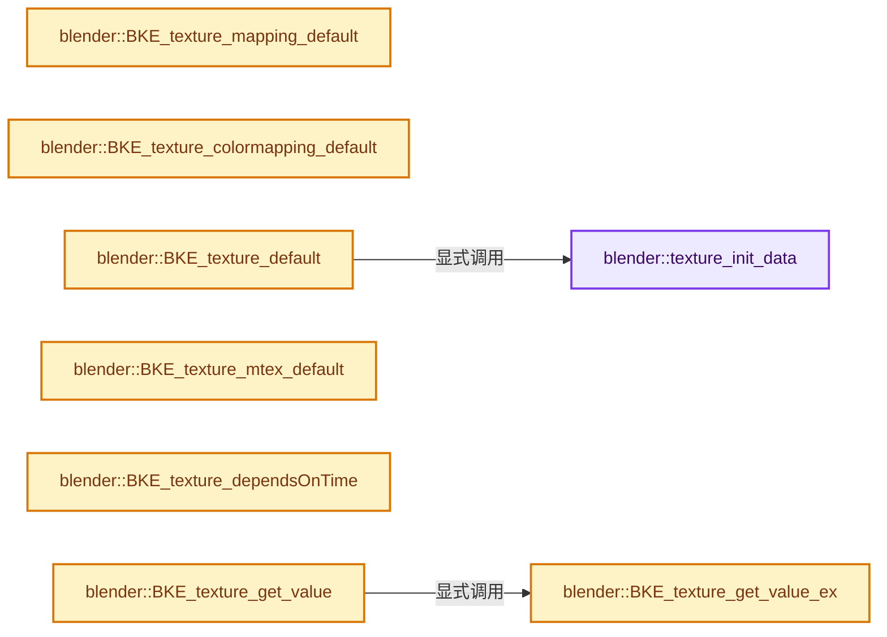
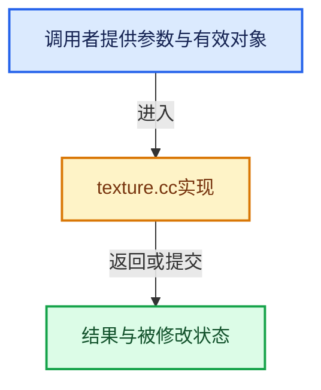

# 实现依赖专题：source/blender/blenkernel/intern/texture.cc

[方向导航](README.md) · [符号索引](../%E7%AC%A6%E5%8F%B7%E4%BE%9D%E8%B5%96%E4%B8%8E%E5%AE%9E%E7%8E%B0%E7%B4%A2%E5%BC%95.md)

本专题从正文实际调用进入，集中保存共享实现。函数有稳定锚点，可从调用处直接跳到对应完整函数；递归与互相调用通过回链组织。

## 本文件的实现关系






## 完整成员与函数实现

<a id="f-3d4d8d633ebf386f"></a>

### `blender::texture_init_data`

实现位置：[source/blender/blenkernel/intern/texture.cc](../../../../../source/blender/blenkernel/intern/texture.cc) · L60—L66。

接口参数：

- `ID *id`

**教学注释版**

<!-- annotated:3f4d8d4ec1d5ed -->

```cpp
static void texture_init_data(ID *id)
{
  Tex *texture = id_cast<Tex *>(id);
  INIT_DEFAULT_STRUCT_AFTER(texture, id);

  BKE_imageuser_default(&texture->iuser);
}
```

<details>
<summary>核对原始源码：source/blender/blenkernel/intern/texture.cc · L60—L66</summary>

<!-- original:3f4d8d4ec1d5ed:source/blender/blenkernel/intern/texture.cc:60:66 -->

```cpp
static void texture_init_data(ID *id)
{
  Tex *texture = id_cast<Tex *>(id);
  INIT_DEFAULT_STRUCT_AFTER(texture, id);

  BKE_imageuser_default(&texture->iuser);
}
```

</details>

**继续追踪实现**

- `id_cast<Tex *>` → [blender::id_cast · L1417](%E4%BE%9D%E8%B5%96-DNA_ID-3eb091.md#f-6c8ac6412850ac5a)。
- `INIT_DEFAULT_STRUCT_AFTER` → [INIT_DEFAULT_STRUCT_AFTER · L422](../01-%E5%9F%BA%E7%A1%80%E5%AE%B9%E5%99%A8%E4%B8%8E%E7%8E%B0%E4%BB%A3CPP/%E4%BE%9D%E8%B5%96-BLI_utildefines-293a0a.md#m-30b1f74075b1)。宏定义由构建条件选择。
- `BKE_imageuser_default` → [blender::BKE_imageuser_default · L3282](%E4%BE%9D%E8%B5%96-image-4859ac.md#f-9cec85c3722069ed)。

<a id="f-d9f5ed2618ba2ce3"></a>

### `blender::BKE_texture_mapping_default`

实现位置：[source/blender/blenkernel/intern/texture.cc](../../../../../source/blender/blenkernel/intern/texture.cc) · L234—L247。

接口参数：

- `TexMapping *texmap`
- `int type`

**教学注释版**

<!-- annotated:714a5835f58106 -->

```cpp
void BKE_texture_mapping_default(TexMapping *texmap, int type)
{
  *texmap = TexMapping{};

  texmap->size[0] = texmap->size[1] = texmap->size[2] = 1.0f;
  texmap->max[0] = texmap->max[1] = texmap->max[2] = 1.0f;
  unit_m4(texmap->mat);

  texmap->projx = PROJ_X;
  texmap->projy = PROJ_Y;
  texmap->projz = PROJ_Z;
  texmap->mapping = MTEX_FLAT;
  texmap->type = eTexMapping_Type(type);
}
```

<details>
<summary>核对原始源码：source/blender/blenkernel/intern/texture.cc · L234—L247</summary>

<!-- original:714a5835f58106:source/blender/blenkernel/intern/texture.cc:234:247 -->

```cpp
void BKE_texture_mapping_default(TexMapping *texmap, int type)
{
  *texmap = TexMapping{};

  texmap->size[0] = texmap->size[1] = texmap->size[2] = 1.0f;
  texmap->max[0] = texmap->max[1] = texmap->max[2] = 1.0f;
  unit_m4(texmap->mat);

  texmap->projx = PROJ_X;
  texmap->projy = PROJ_Y;
  texmap->projz = PROJ_Z;
  texmap->mapping = MTEX_FLAT;
  texmap->type = eTexMapping_Type(type);
}
```

</details>

**沿实际写入检查状态**

- `texmap->size[0] = texmap->size[1] = texmap->size[2] = 1.0f;`
- `texmap->max[0] = texmap->max[1] = texmap->max[2] = 1.0f;`
- `texmap->projx = PROJ_X;`
- `texmap->projy = PROJ_Y;`
- `texmap->projz = PROJ_Z;`
- `texmap->mapping = MTEX_FLAT;`
- `texmap->type = eTexMapping_Type(type);`

**继续追踪实现**

- `unit_m4` → [blender::unit_m4 · L55](../12-%E7%A9%BA%E9%97%B4%E6%95%B0%E6%8D%AE%E7%BB%93%E6%9E%84%E4%B8%8E%E5%87%A0%E4%BD%95%E7%AE%97%E6%B3%95/%E4%BE%9D%E8%B5%96-math_matrix_c-004123.md#f-e6cd812aae119176)。
- `eTexMapping_Type` → [blender::eTexMapping_Type](%E4%BE%9D%E8%B5%96-DNA_texture_types-37c064.md#t-67d858adbf16)。

<a id="f-8659f29a51a5ab4b"></a>

### `blender::BKE_texture_colormapping_default`

实现位置：[source/blender/blenkernel/intern/texture.cc](../../../../../source/blender/blenkernel/intern/texture.cc) · L337—L352。

接口参数：

- `ColorMapping *colormap`

**教学注释版**

<!-- annotated:83a7eeb611adde -->

```cpp
void BKE_texture_colormapping_default(ColorMapping *colormap)
{
  *colormap = ColorMapping{};

  BKE_colorband_init(&colormap->coba, true);

  colormap->bright = 1.0;
  colormap->contrast = 1.0;
  colormap->saturation = 1.0;

  colormap->blend_color[0] = 0.8f;
  colormap->blend_color[1] = 0.8f;
  colormap->blend_color[2] = 0.8f;
  colormap->blend_type = MA_RAMP_BLEND;
  colormap->blend_factor = 0.0f;
}
```

<details>
<summary>核对原始源码：source/blender/blenkernel/intern/texture.cc · L337—L352</summary>

<!-- original:83a7eeb611adde:source/blender/blenkernel/intern/texture.cc:337:352 -->

```cpp
void BKE_texture_colormapping_default(ColorMapping *colormap)
{
  *colormap = ColorMapping{};

  BKE_colorband_init(&colormap->coba, true);

  colormap->bright = 1.0;
  colormap->contrast = 1.0;
  colormap->saturation = 1.0;

  colormap->blend_color[0] = 0.8f;
  colormap->blend_color[1] = 0.8f;
  colormap->blend_color[2] = 0.8f;
  colormap->blend_type = MA_RAMP_BLEND;
  colormap->blend_factor = 0.0f;
}
```

</details>

**沿实际写入检查状态**

- `colormap->bright = 1.0;`
- `colormap->contrast = 1.0;`
- `colormap->saturation = 1.0;`
- `colormap->blend_color[0] = 0.8f;`
- `colormap->blend_color[1] = 0.8f;`
- `colormap->blend_color[2] = 0.8f;`
- `colormap->blend_type = MA_RAMP_BLEND;`
- `colormap->blend_factor = 0.0f;`

**继续追踪实现**

- `BKE_colorband_init` → [blender::BKE_colorband_init · L25](%E4%BE%9D%E8%B5%96-colorband-8196f8.md#f-8163eb6f92abdc50)。

<a id="f-b46a3f0df2acabf0"></a>

### `blender::BKE_texture_default`

实现位置：[source/blender/blenkernel/intern/texture.cc](../../../../../source/blender/blenkernel/intern/texture.cc) · L358—L361。

接口参数：

- `Tex *tex`

**教学注释版**

<!-- annotated:42b2168dacebdd -->

```cpp
void BKE_texture_default(Tex *tex)
{
  texture_init_data(&tex->id);
}
```

<details>
<summary>核对原始源码：source/blender/blenkernel/intern/texture.cc · L358—L361</summary>

<!-- original:42b2168dacebdd:source/blender/blenkernel/intern/texture.cc:358:361 -->

```cpp
void BKE_texture_default(Tex *tex)
{
  texture_init_data(&tex->id);
}
```

</details>

**继续追踪实现**

- `texture_init_data` → [blender::texture_init_data · L60](%E4%BE%9D%E8%B5%96-texture-60b86b.md#f-3d4d8d633ebf386f)。

<a id="f-3f5d6de83048c7aa"></a>

### `blender::BKE_texture_mtex_default`

实现位置：[source/blender/blenkernel/intern/texture.cc](../../../../../source/blender/blenkernel/intern/texture.cc) · L381—L384。

接口参数：

- `MTex *mtex`

**教学注释版**

<!-- annotated:529d90da5597a6 -->

```cpp
void BKE_texture_mtex_default(MTex *mtex)
{
  *mtex = dna::shallow_copy(MTex());
}
```

<details>
<summary>核对原始源码：source/blender/blenkernel/intern/texture.cc · L381—L384</summary>

<!-- original:529d90da5597a6:source/blender/blenkernel/intern/texture.cc:381:384 -->

```cpp
void BKE_texture_mtex_default(MTex *mtex)
{
  *mtex = dna::shallow_copy(MTex());
}
```

</details>

**继续追踪实现**

- `dna::shallow_copy` → [blender::dna::shallow_copy · L146](%E4%BE%9D%E8%B5%96-DNA_defs-ed47fd.md#f-84b6eda95a1c994c)。
- `MTex` → [blender::MTex](%E4%BE%9D%E8%B5%96-RE_texture-3b7486.md#t-462007ac7fbc)；[blender::MTex](%E4%BE%9D%E8%B5%96-RE_texture-3b7486.md#t-ae46bce00d93)；[blender::MTex](%E4%BE%9D%E8%B5%96-RE_texture-3b7486.md#t-c69f34763c39)；[blender::MTex](%E4%BE%9D%E8%B5%96-BKE_texture-748fde.md#t-7cc95d58c84e)；[blender::MTex](%E4%BE%9D%E8%B5%96-BKE_texture-748fde.md#t-5d3e3c151a5e)；[blender::MTex](%E4%BE%9D%E8%B5%96-BKE_texture-748fde.md#t-523efeb6b3ba)；[blender::MTex](%E4%BE%9D%E8%B5%96-BKE_texture-748fde.md#t-ed10784d9b3c)；[blender::MTex](%E4%BE%9D%E8%B5%96-BKE_texture-748fde.md#t-a724aef12d49)；[blender::MTex](%E4%BE%9D%E8%B5%96-BKE_texture-748fde.md#t-09c33176094b)；[blender::MTex](%E4%BE%9D%E8%B5%96-BKE_brush-637f8e.md#t-cb9dc91c9de6)；[blender::MTex](../09-LazyFunction%E4%B8%8E%E8%8A%82%E7%82%B9%E6%89%A7%E8%A1%8C%E6%9E%B6%E6%9E%84/%E4%BE%9D%E8%B5%96-NOD_texture-9001b0.md#t-85d437389b14)；[blender::MTex](%E4%BE%9D%E8%B5%96-UI_interface_c-54f196.md#t-abde657606f4)；[blender::MTex](%E4%BE%9D%E8%B5%96-ED_render-f6ef47.md#t-0447e7897520)；[blender::MTex](%E4%BE%9D%E8%B5%96-DNA_texture_types-37c064.md#t-0425d4cfed1b)；[blender::ParticleSettings::MTex](%E4%BE%9D%E8%B5%96-DNA_particle_types-f1f7ef.md#t-411f197933f3)；[blender::MTex](%E4%BE%9D%E8%B5%96-DNA_linestyle_types-479887.md#t-716a1d57a638)；[blender::FreestyleLineStyle::MTex](%E4%BE%9D%E8%B5%96-DNA_linestyle_types-479887.md#t-b43fec5a9dcf)；[blender::MTex](%E4%BE%9D%E8%B5%96-DNA_brush_types-dfd2ad.md#t-2bd1f5826e79)；[blender::Brush::MTex](%E4%BE%9D%E8%B5%96-DNA_brush_types-dfd2ad.md#t-e0f1f6d02a85)；[blender::Brush::MTex](%E4%BE%9D%E8%B5%96-DNA_brush_types-dfd2ad.md#t-abae5ec2663f)；[blender::MTex](%E4%BE%9D%E8%B5%96-paint_intern-0eb4be.md#t-ca8c1477749a)；[blender::MTex](%E4%BE%9D%E8%B5%96-rna_internal-949e15.md#t-63a97c877356)；[blender::MTex](%E4%BE%9D%E8%B5%96-StrokeRep-dfc6d7.md#t-e1c917b8f731)；[blender::MTex](%E4%BE%9D%E8%B5%96-Stroke-8e150c.md#t-a1a6ddcef134)；[blender::MTex](%E4%BE%9D%E8%B5%96-BasicStrokeShaders-04af06.md#t-280dc30faaa5)。

<a id="f-d94d173f823e5f13"></a>

### `blender::BKE_texture_dependsOnTime`

实现位置：[source/blender/blenkernel/intern/texture.cc](../../../../../source/blender/blenkernel/intern/texture.cc) · L600—L614。

接口参数：

- `const Tex *texture`

**教学注释版**

<!-- annotated:4fd87ecd9d2eac -->

```cpp
bool BKE_texture_dependsOnTime(const Tex *texture)
{
  if (texture->ima && BKE_image_is_animated(texture->ima)) {
    return true;
  }
  if (texture->adt) {
    /* assume anything in adt means the texture is animated */
    return true;
  }
  if (texture->type == TEX_NOISE) {
    /* noise always varies with time */
    return true;
  }
  return false;
}
```

<details>
<summary>核对原始源码：source/blender/blenkernel/intern/texture.cc · L600—L614</summary>

<!-- original:4fd87ecd9d2eac:source/blender/blenkernel/intern/texture.cc:600:614 -->

```cpp
bool BKE_texture_dependsOnTime(const Tex *texture)
{
  if (texture->ima && BKE_image_is_animated(texture->ima)) {
    return true;
  }
  if (texture->adt) {
    /* assume anything in adt means the texture is animated */
    return true;
  }
  if (texture->type == TEX_NOISE) {
    /* noise always varies with time */
    return true;
  }
  return false;
}
```

</details>

**结果出口**

- `return true;`
- `return false;`

**继续追踪实现**

- `BKE_image_is_animated` → [blender::BKE_image_is_animated · L5671](%E4%BE%9D%E8%B5%96-image-4859ac.md#f-18fa289262d42bc0)。

<a id="f-d2558851246ffaf9"></a>

### `blender::BKE_texture_get_value_ex`

实现位置：[source/blender/blenkernel/intern/texture.cc](../../../../../source/blender/blenkernel/intern/texture.cc) · L618—L638。

接口参数：

- `Tex *texture`
- `const float *tex_co`
- `TexResult *texres`
- `ImagePool *pool`
- `bool use_color_management`

**教学注释版**

<!-- annotated:21726c0a9230a9 -->

```cpp
void BKE_texture_get_value_ex(Tex *texture,
                              const float *tex_co,
                              TexResult *texres,
                              ImagePool *pool,
                              bool use_color_management)
{
  /* no node textures for now */
  const int result_type = multitex_ext_safe(
      texture, tex_co, texres, pool, use_color_management, false);

  /* if the texture gave an RGB value, we assume it didn't give a valid
   * intensity, since this is in the context of modifiers don't use perceptual color conversion.
   * if the texture didn't give an RGB value, copy the intensity across
   */
  if (result_type & TEX_RGB) {
    texres->tin = (1.0f / 3.0f) * (texres->trgba[0] + texres->trgba[1] + texres->trgba[2]);
  }
  else {
    copy_v3_fl(texres->trgba, texres->tin);
  }
}
```

<details>
<summary>核对原始源码：source/blender/blenkernel/intern/texture.cc · L618—L638</summary>

<!-- original:21726c0a9230a9:source/blender/blenkernel/intern/texture.cc:618:638 -->

```cpp
void BKE_texture_get_value_ex(Tex *texture,
                              const float *tex_co,
                              TexResult *texres,
                              ImagePool *pool,
                              bool use_color_management)
{
  /* no node textures for now */
  const int result_type = multitex_ext_safe(
      texture, tex_co, texres, pool, use_color_management, false);

  /* if the texture gave an RGB value, we assume it didn't give a valid
   * intensity, since this is in the context of modifiers don't use perceptual color conversion.
   * if the texture didn't give an RGB value, copy the intensity across
   */
  if (result_type & TEX_RGB) {
    texres->tin = (1.0f / 3.0f) * (texres->trgba[0] + texres->trgba[1] + texres->trgba[2]);
  }
  else {
    copy_v3_fl(texres->trgba, texres->tin);
  }
}
```

</details>

**沿实际写入检查状态**

- `texres->tin = (1.0f / 3.0f) * (texres->trgba[0] + texres->trgba[1] + texres->trgba[2]);`

**继续追踪实现**

- `multitex_ext_safe` → [blender::multitex_ext_safe · L944](%E4%BE%9D%E8%B5%96-texture_procedural-1a5538.md#f-62e212e4daef4f99)。
- `copy_v3_fl` → [blender::copy_v3_fl · L68](../12-%E7%A9%BA%E9%97%B4%E6%95%B0%E6%8D%AE%E7%BB%93%E6%9E%84%E4%B8%8E%E5%87%A0%E4%BD%95%E7%AE%97%E6%B3%95/%E4%BE%9D%E8%B5%96-math_vector_inline-0c8541.md#f-18676f3d43803485)。

<a id="f-39c033faea8bb059"></a>

### `blender::BKE_texture_get_value`

实现位置：[source/blender/blenkernel/intern/texture.cc](../../../../../source/blender/blenkernel/intern/texture.cc) · L640—L646。

接口参数：

- `Tex *texture`
- `const float *tex_co`
- `TexResult *texres`
- `bool use_color_management`

**教学注释版**

<!-- annotated:8689f56c9ffb3f -->

```cpp
void BKE_texture_get_value(Tex *texture,
                           const float *tex_co,
                           TexResult *texres,
                           bool use_color_management)
{
  BKE_texture_get_value_ex(texture, tex_co, texres, nullptr, use_color_management);
}
```

<details>
<summary>核对原始源码：source/blender/blenkernel/intern/texture.cc · L640—L646</summary>

<!-- original:8689f56c9ffb3f:source/blender/blenkernel/intern/texture.cc:640:646 -->

```cpp
void BKE_texture_get_value(Tex *texture,
                           const float *tex_co,
                           TexResult *texres,
                           bool use_color_management)
{
  BKE_texture_get_value_ex(texture, tex_co, texres, nullptr, use_color_management);
}
```

</details>

**继续追踪实现**

- `BKE_texture_get_value_ex` → [blender::BKE_texture_get_value_ex · L618](%E4%BE%9D%E8%B5%96-texture-60b86b.md#f-d2558851246ffaf9)。

<a id="f-7dcab72ed53885cb"></a>

### `blender::texture_nodes_fetch_images_for_pool`

实现位置：[source/blender/blenkernel/intern/texture.cc](../../../../../source/blender/blenkernel/intern/texture.cc) · L648—L661。

接口参数：

- `Tex *texture`
- `bNodeTree *ntree`
- `ImagePool *pool`

**教学注释版**

<!-- annotated:f2957479c81913 -->

```cpp
static void texture_nodes_fetch_images_for_pool(Tex *texture, bNodeTree *ntree, ImagePool *pool)
{
  for (bNode *node : ntree->all_nodes()) {
    if (node->type_legacy == SH_NODE_TEX_IMAGE && node->id != nullptr) {
      Image *image = id_cast<Image *>(node->id);
      BKE_image_pool_acquire_ibuf(image, &texture->iuser, pool);
    }
    else if (node->is_group() && node->id != nullptr) {
      /* TODO(sergey): Do we need to control recursion here? */
      bNodeTree *nested_tree = id_cast<bNodeTree *>(node->id);
      texture_nodes_fetch_images_for_pool(texture, nested_tree, pool);
    }
  }
}
```

<details>
<summary>核对原始源码：source/blender/blenkernel/intern/texture.cc · L648—L661</summary>

<!-- original:f2957479c81913:source/blender/blenkernel/intern/texture.cc:648:661 -->

```cpp
static void texture_nodes_fetch_images_for_pool(Tex *texture, bNodeTree *ntree, ImagePool *pool)
{
  for (bNode *node : ntree->all_nodes()) {
    if (node->type_legacy == SH_NODE_TEX_IMAGE && node->id != nullptr) {
      Image *image = id_cast<Image *>(node->id);
      BKE_image_pool_acquire_ibuf(image, &texture->iuser, pool);
    }
    else if (node->is_group() && node->id != nullptr) {
      /* TODO(sergey): Do we need to control recursion here? */
      bNodeTree *nested_tree = id_cast<bNodeTree *>(node->id);
      texture_nodes_fetch_images_for_pool(texture, nested_tree, pool);
    }
  }
}
```

</details>

**继续追踪实现**

- `ntree->all_nodes` → [blender::bNodeTree::all_nodes · L500](%E4%BE%9D%E8%B5%96-BKE_node_runtime-ee561b.md#f-cda455cbcc6c7f36)；[blender::bNodeTree::all_nodes · L505](%E4%BE%9D%E8%B5%96-BKE_node_runtime-ee561b.md#f-358b65e5678f8a32)。同名重载需按实参类型选择。
- `id_cast<Image *>` → [blender::id_cast · L1417](%E4%BE%9D%E8%B5%96-DNA_ID-3eb091.md#f-6c8ac6412850ac5a)。
- `BKE_image_pool_acquire_ibuf` → [blender::BKE_image_pool_acquire_ibuf · L5247](%E4%BE%9D%E8%B5%96-image-4859ac.md#f-9e0e17fe49f5c333)。
- `node->is_group` → [调用协议](../%E6%A8%A1%E6%9D%BF%E5%AE%8F%E4%B8%8E%E5%8A%A8%E6%80%81%E5%88%86%E6%B4%BE%E5%8D%8F%E8%AE%AE.md)：接收对象类型依赖auto、返回值或模板实例；不按同名猜测目标。调用位置L655。
- `id_cast<bNodeTree *>` → [blender::id_cast · L1417](%E4%BE%9D%E8%B5%96-DNA_ID-3eb091.md#f-6c8ac6412850ac5a)。
- `texture_nodes_fetch_images_for_pool` → [blender::texture_nodes_fetch_images_for_pool · L648](%E4%BE%9D%E8%B5%96-texture-60b86b.md#f-7dcab72ed53885cb)。

<a id="f-fe00d4ccaaf52128"></a>

### `blender::BKE_texture_fetch_images_for_pool`

实现位置：[source/blender/blenkernel/intern/texture.cc](../../../../../source/blender/blenkernel/intern/texture.cc) · L663—L675。

接口参数：

- `Tex *texture`
- `ImagePool *pool`

**教学注释版**

<!-- annotated:40d9818d23c09a -->

```cpp
void BKE_texture_fetch_images_for_pool(Tex *texture, ImagePool *pool)
{
  if (texture->nodetree != nullptr) {
    texture_nodes_fetch_images_for_pool(texture, texture->nodetree, pool);
  }
  else {
    if (texture->type == TEX_IMAGE) {
      if (texture->ima != nullptr) {
        BKE_image_pool_acquire_ibuf(texture->ima, &texture->iuser, pool);
      }
    }
  }
}
```

<details>
<summary>核对原始源码：source/blender/blenkernel/intern/texture.cc · L663—L675</summary>

<!-- original:40d9818d23c09a:source/blender/blenkernel/intern/texture.cc:663:675 -->

```cpp
void BKE_texture_fetch_images_for_pool(Tex *texture, ImagePool *pool)
{
  if (texture->nodetree != nullptr) {
    texture_nodes_fetch_images_for_pool(texture, texture->nodetree, pool);
  }
  else {
    if (texture->type == TEX_IMAGE) {
      if (texture->ima != nullptr) {
        BKE_image_pool_acquire_ibuf(texture->ima, &texture->iuser, pool);
      }
    }
  }
}
```

</details>

**继续追踪实现**

- `texture_nodes_fetch_images_for_pool` → [blender::texture_nodes_fetch_images_for_pool · L648](%E4%BE%9D%E8%B5%96-texture-60b86b.md#f-7dcab72ed53885cb)。
- `BKE_image_pool_acquire_ibuf` → [blender::BKE_image_pool_acquire_ibuf · L5247](%E4%BE%9D%E8%B5%96-image-4859ac.md#f-9e0e17fe49f5c333)。
