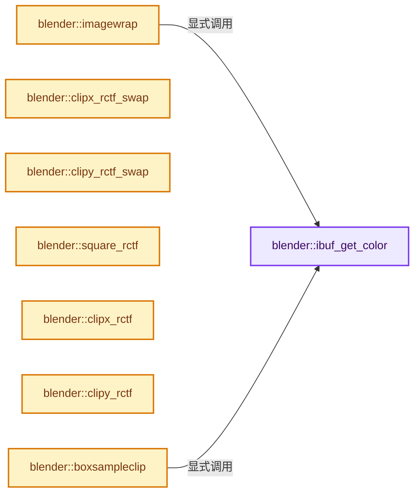
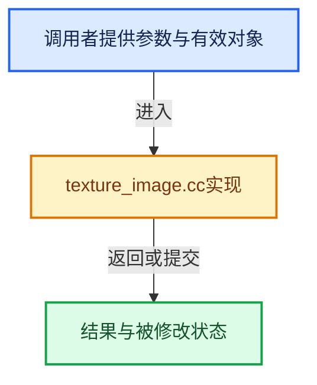

# 实现依赖专题：source/blender/render/intern/texture_image.cc

[方向导航](README.md) · [符号索引](../%E7%AC%A6%E5%8F%B7%E4%BE%9D%E8%B5%96%E4%B8%8E%E5%AE%9E%E7%8E%B0%E7%B4%A2%E5%BC%95.md)

本专题从正文实际调用进入，集中保存共享实现。函数有稳定锚点，可从调用处直接跳到对应完整函数；递归与互相调用通过回链组织。

## 本文件的实现关系






## 完整成员与函数实现

<a id="f-104c785229a07297"></a>

### `blender::ibuf_get_color`

实现位置：[source/blender/render/intern/texture_image.cc](../../../../../source/blender/render/intern/texture_image.cc) · L51—L83。

接口参数：

- `float col[4]`
- `const ImBuf *ibuf`
- `int x`
- `int y`

**教学注释版**

<!-- annotated:2c47208ddb2259 -->

```cpp
static void ibuf_get_color(float col[4], const ImBuf *ibuf, int x, int y)
{
  const int64_t ofs = int64_t(y) * ibuf->x + x;

  if (ibuf->float_data()) {
    if (ibuf->channels == 4) {
      const float *fp = ibuf->float_data() + 4 * ofs;
      copy_v4_v4(col, fp);
    }
    else if (ibuf->channels == 3) {
      const float *fp = ibuf->float_data() + 3 * ofs;
      copy_v3_v3(col, fp);
      col[3] = 1.0f;
    }
    else {
      const float *fp = ibuf->float_data() + ofs;
      col[0] = col[1] = col[2] = col[3] = *fp;
    }
  }
  else {
    const uchar *rect = ibuf->byte_data() + 4 * ofs;

    col[0] = float(rect[0]) * (1.0f / 255.0f);
    col[1] = float(rect[1]) * (1.0f / 255.0f);
    col[2] = float(rect[2]) * (1.0f / 255.0f);
    col[3] = float(rect[3]) * (1.0f / 255.0f);

    /* Bytes are internally straight, however render pipeline seems to expect pre-multiplied. */
    col[0] *= col[3];
    col[1] *= col[3];
    col[2] *= col[3];
  }
}
```

<details>
<summary>核对原始源码：source/blender/render/intern/texture_image.cc · L51—L83</summary>

<!-- original:2c47208ddb2259:source/blender/render/intern/texture_image.cc:51:83 -->

```cpp
static void ibuf_get_color(float col[4], const ImBuf *ibuf, int x, int y)
{
  const int64_t ofs = int64_t(y) * ibuf->x + x;

  if (ibuf->float_data()) {
    if (ibuf->channels == 4) {
      const float *fp = ibuf->float_data() + 4 * ofs;
      copy_v4_v4(col, fp);
    }
    else if (ibuf->channels == 3) {
      const float *fp = ibuf->float_data() + 3 * ofs;
      copy_v3_v3(col, fp);
      col[3] = 1.0f;
    }
    else {
      const float *fp = ibuf->float_data() + ofs;
      col[0] = col[1] = col[2] = col[3] = *fp;
    }
  }
  else {
    const uchar *rect = ibuf->byte_data() + 4 * ofs;

    col[0] = float(rect[0]) * (1.0f / 255.0f);
    col[1] = float(rect[1]) * (1.0f / 255.0f);
    col[2] = float(rect[2]) * (1.0f / 255.0f);
    col[3] = float(rect[3]) * (1.0f / 255.0f);

    /* Bytes are internally straight, however render pipeline seems to expect pre-multiplied. */
    col[0] *= col[3];
    col[1] *= col[3];
    col[2] *= col[3];
  }
}
```

</details>

**沿实际写入检查状态**

- `col[3] = 1.0f;`
- `col[0] = col[1] = col[2] = col[3] = *fp;`
- `col[0] = float(rect[0]) * (1.0f / 255.0f);`
- `col[1] = float(rect[1]) * (1.0f / 255.0f);`
- `col[2] = float(rect[2]) * (1.0f / 255.0f);`
- `col[3] = float(rect[3]) * (1.0f / 255.0f);`
- `col[0] *= col[3];`
- `col[1] *= col[3];`
- `col[2] *= col[3];`

**继续追踪实现**

- `ibuf->float_data` → [blender::ImBuf::float_data · L358](%E4%BE%9D%E8%B5%96-IMB_imbuf_types-f69e60.md#f-2e52aa77544ffaee)。
- `copy_v4_v4` → [blender::copy_v4_v4 · L54](../12-%E7%A9%BA%E9%97%B4%E6%95%B0%E6%8D%AE%E7%BB%93%E6%9E%84%E4%B8%8E%E5%87%A0%E4%BD%95%E7%AE%97%E6%B3%95/%E4%BE%9D%E8%B5%96-math_vector_inline-0c8541.md#f-0cf225fc326edf4a)。
- `copy_v3_v3` → [blender::copy_v3_v3 · L47](../12-%E7%A9%BA%E9%97%B4%E6%95%B0%E6%8D%AE%E7%BB%93%E6%9E%84%E4%B8%8E%E5%87%A0%E4%BD%95%E7%AE%97%E6%B3%95/%E4%BE%9D%E8%B5%96-math_vector_inline-0c8541.md#f-037a0d5fa5060bd6)。
- `ibuf->byte_data` → [blender::ImBuf::byte_data · L353](%E4%BE%9D%E8%B5%96-IMB_imbuf_types-f69e60.md#f-2cdfc552156643fa)。

<a id="f-dfab1db9a68b49eb"></a>

### `blender::imagewrap`

实现位置：[source/blender/render/intern/texture_image.cc](../../../../../source/blender/render/intern/texture_image.cc) · L85—L295。

接口参数：

- `Tex *tex`
- `Image *ima`
- `const float texvec[3]`
- `TexResult *texres`
- `ImagePool *pool`
- `const bool skip_load_image`

**教学注释版**

<!-- annotated:341d92db5b87ca -->

```cpp
int imagewrap(Tex *tex,
              Image *ima,
              const float texvec[3],
              TexResult *texres,
              ImagePool *pool,
              const bool skip_load_image)
{
  float fx, fy;
  int x, y, retval;
  int xi, yi; /* original values */

  texres->tin = texres->trgba[3] = texres->trgba[0] = texres->trgba[1] = texres->trgba[2] = 0.0f;

  retval = TEX_RGB;

  /* quick tests */
  if (ima == nullptr) {
    return retval;
  }

  /* hack for icon render */
  if (skip_load_image && !BKE_image_has_loaded_ibuf(ima)) {
    return retval;
  }

  ImageUser *iuser = &tex->iuser;
  ImageUser local_iuser;
  if (ima->source == IMA_SRC_TILED) {
    /* tex->iuser might be shared by threads, so create a local copy. */
    local_iuser = tex->iuser;
    iuser = &local_iuser;

    float new_uv[2];
    iuser->tile = BKE_image_get_tile_from_pos(ima, texvec, new_uv, nullptr);
    fx = new_uv[0];
    fy = new_uv[1];
  }
  else {
    fx = texvec[0];
    fy = texvec[1];
  }

  ImBuf *ibuf = BKE_image_pool_acquire_ibuf(ima, iuser, pool);

  ima->flag |= IMA_USED_FOR_RENDER;

  if (ibuf == nullptr || (ibuf->byte_data() == nullptr && ibuf->float_data() == nullptr)) {
    BKE_image_pool_release_ibuf(ima, ibuf, pool);
    return retval;
  }

  /* setup mapping */
  if (tex->imaflag & TEX_IMAROT) {
    std::swap(fx, fy);
  }

  if (tex->extend == TEX_CHECKER) {
    int xs, ys;

    xs = int(floor(fx));
    ys = int(floor(fy));
    fx -= xs;
    fy -= ys;

    if ((tex->flag & TEX_CHECKER_ODD) == 0) {
      if ((xs + ys) & 1) {
        /* pass */
      }
      else {
        if (ima) {
          BKE_image_pool_release_ibuf(ima, ibuf, pool);
        }
        return retval;
      }
    }
    if ((tex->flag & TEX_CHECKER_EVEN) == 0) {
      if ((xs + ys) & 1) {
        if (ima) {
          BKE_image_pool_release_ibuf(ima, ibuf, pool);
        }
        return retval;
      }
    }
    /* scale around center, (0.5, 0.5) */
    if (tex->checkerdist < 1.0f) {
      fx = (fx - 0.5f) / (1.0f - tex->checkerdist) + 0.5f;
      fy = (fy - 0.5f) / (1.0f - tex->checkerdist) + 0.5f;
    }
  }

  x = xi = int(floorf(fx * ibuf->x));
  y = yi = int(floorf(fy * ibuf->y));

  if (tex->extend == TEX_CLIPCUBE) {
    if (x < 0 || y < 0 || x >= ibuf->x || y >= ibuf->y || texvec[2] < -1.0f || texvec[2] > 1.0f) {
      if (ima) {
        BKE_image_pool_release_ibuf(ima, ibuf, pool);
      }
      return retval;
    }
  }
  else if (ELEM(tex->extend, TEX_CLIP, TEX_CHECKER)) {
    if (x < 0 || y < 0 || x >= ibuf->x || y >= ibuf->y) {
      if (ima) {
        BKE_image_pool_release_ibuf(ima, ibuf, pool);
      }
      return retval;
    }
  }
  else {
    if (tex->extend == TEX_EXTEND) {
      if (x >= ibuf->x) {
        x = ibuf->x - 1;
      }
      else if (x < 0) {
        x = 0;
      }
    }
    else {
      x = x % ibuf->x;
      if (x < 0) {
        x += ibuf->x;
      }
    }
    if (tex->extend == TEX_EXTEND) {
      if (y >= ibuf->y) {
        y = ibuf->y - 1;
      }
      else if (y < 0) {
        y = 0;
      }
    }
    else {
      y = y % ibuf->y;
      if (y < 0) {
        y += ibuf->y;
      }
    }
  }

  /* Keep this before interpolation #29761. */
  if (ima) {
    if ((tex->imaflag & TEX_USEALPHA) && (ima->alpha_mode != IMA_ALPHA_IGNORE)) {
      if ((tex->imaflag & TEX_CALCALPHA) == 0) {
        texres->talpha = true;
      }
    }
  }

  /* interpolate */
  if (tex->imaflag & TEX_INTERPOL) {
    float filterx, filtery;
    filterx = (0.5f * tex->filtersize) / ibuf->x;
    filtery = (0.5f * tex->filtersize) / ibuf->y;

    /* Important that this value is wrapped #27782. */
    if (tex->extend == TEX_EXTEND) {
      CLAMP(fx, 0.0f, 1.0f);
      CLAMP(fy, 0.0f, 1.0f);
    }
    else {
      /* this applies the modifications made by the checks above,
       * back to the floating point values */
      fx -= float(xi - x) / float(ibuf->x);
      fy -= float(yi - y) / float(ibuf->y);
    }
    boxsample(ibuf,
              fx - filterx,
              fy - filtery,
              fx + filterx,
              fy + filtery,
              texres,
              (tex->extend == TEX_REPEAT),
              (tex->extend == TEX_EXTEND));
  }
  else { /* no filtering */
    ibuf_get_color(texres->trgba, ibuf, x, y);
  }

  if (texres->talpha) {
    texres->tin = texres->trgba[3];
  }
  else if (tex->imaflag & TEX_CALCALPHA) {
    // [讲解] std::max：按比较关系选取较大值。本讲解中的增长公式同时满足最低请求和几何增长；若保存返回引用，还需注意实参寿命。
    texres->trgba[3] = texres->tin = std::max(
        {texres->trgba[0], texres->trgba[1], texres->trgba[2]});
  }
  else {
    texres->trgba[3] = texres->tin = 1.0;
  }

  if (tex->flag & TEX_NEGALPHA) {
    texres->trgba[3] = 1.0f - texres->trgba[3];
  }

  /* De-pre-multiply, this is being pre-multiplied in #shade_input_do_shade()
   * do not de-pre-multiply for generated alpha, it is already in straight. */
  if (texres->trgba[3] != 1.0f && texres->trgba[3] > 1e-4f && !(tex->imaflag & TEX_CALCALPHA)) {
    fx = 1.0f / texres->trgba[3];
    texres->trgba[0] *= fx;
    texres->trgba[1] *= fx;
    texres->trgba[2] *= fx;
  }

  if (ima) {
    BKE_image_pool_release_ibuf(ima, ibuf, pool);
  }

  BRICONTRGB;

  return retval;
}
```

<details>
<summary>核对原始源码：source/blender/render/intern/texture_image.cc · L85—L295</summary>

<!-- original:341d92db5b87ca:source/blender/render/intern/texture_image.cc:85:295 -->

```cpp
int imagewrap(Tex *tex,
              Image *ima,
              const float texvec[3],
              TexResult *texres,
              ImagePool *pool,
              const bool skip_load_image)
{
  float fx, fy;
  int x, y, retval;
  int xi, yi; /* original values */

  texres->tin = texres->trgba[3] = texres->trgba[0] = texres->trgba[1] = texres->trgba[2] = 0.0f;

  retval = TEX_RGB;

  /* quick tests */
  if (ima == nullptr) {
    return retval;
  }

  /* hack for icon render */
  if (skip_load_image && !BKE_image_has_loaded_ibuf(ima)) {
    return retval;
  }

  ImageUser *iuser = &tex->iuser;
  ImageUser local_iuser;
  if (ima->source == IMA_SRC_TILED) {
    /* tex->iuser might be shared by threads, so create a local copy. */
    local_iuser = tex->iuser;
    iuser = &local_iuser;

    float new_uv[2];
    iuser->tile = BKE_image_get_tile_from_pos(ima, texvec, new_uv, nullptr);
    fx = new_uv[0];
    fy = new_uv[1];
  }
  else {
    fx = texvec[0];
    fy = texvec[1];
  }

  ImBuf *ibuf = BKE_image_pool_acquire_ibuf(ima, iuser, pool);

  ima->flag |= IMA_USED_FOR_RENDER;

  if (ibuf == nullptr || (ibuf->byte_data() == nullptr && ibuf->float_data() == nullptr)) {
    BKE_image_pool_release_ibuf(ima, ibuf, pool);
    return retval;
  }

  /* setup mapping */
  if (tex->imaflag & TEX_IMAROT) {
    std::swap(fx, fy);
  }

  if (tex->extend == TEX_CHECKER) {
    int xs, ys;

    xs = int(floor(fx));
    ys = int(floor(fy));
    fx -= xs;
    fy -= ys;

    if ((tex->flag & TEX_CHECKER_ODD) == 0) {
      if ((xs + ys) & 1) {
        /* pass */
      }
      else {
        if (ima) {
          BKE_image_pool_release_ibuf(ima, ibuf, pool);
        }
        return retval;
      }
    }
    if ((tex->flag & TEX_CHECKER_EVEN) == 0) {
      if ((xs + ys) & 1) {
        if (ima) {
          BKE_image_pool_release_ibuf(ima, ibuf, pool);
        }
        return retval;
      }
    }
    /* scale around center, (0.5, 0.5) */
    if (tex->checkerdist < 1.0f) {
      fx = (fx - 0.5f) / (1.0f - tex->checkerdist) + 0.5f;
      fy = (fy - 0.5f) / (1.0f - tex->checkerdist) + 0.5f;
    }
  }

  x = xi = int(floorf(fx * ibuf->x));
  y = yi = int(floorf(fy * ibuf->y));

  if (tex->extend == TEX_CLIPCUBE) {
    if (x < 0 || y < 0 || x >= ibuf->x || y >= ibuf->y || texvec[2] < -1.0f || texvec[2] > 1.0f) {
      if (ima) {
        BKE_image_pool_release_ibuf(ima, ibuf, pool);
      }
      return retval;
    }
  }
  else if (ELEM(tex->extend, TEX_CLIP, TEX_CHECKER)) {
    if (x < 0 || y < 0 || x >= ibuf->x || y >= ibuf->y) {
      if (ima) {
        BKE_image_pool_release_ibuf(ima, ibuf, pool);
      }
      return retval;
    }
  }
  else {
    if (tex->extend == TEX_EXTEND) {
      if (x >= ibuf->x) {
        x = ibuf->x - 1;
      }
      else if (x < 0) {
        x = 0;
      }
    }
    else {
      x = x % ibuf->x;
      if (x < 0) {
        x += ibuf->x;
      }
    }
    if (tex->extend == TEX_EXTEND) {
      if (y >= ibuf->y) {
        y = ibuf->y - 1;
      }
      else if (y < 0) {
        y = 0;
      }
    }
    else {
      y = y % ibuf->y;
      if (y < 0) {
        y += ibuf->y;
      }
    }
  }

  /* Keep this before interpolation #29761. */
  if (ima) {
    if ((tex->imaflag & TEX_USEALPHA) && (ima->alpha_mode != IMA_ALPHA_IGNORE)) {
      if ((tex->imaflag & TEX_CALCALPHA) == 0) {
        texres->talpha = true;
      }
    }
  }

  /* interpolate */
  if (tex->imaflag & TEX_INTERPOL) {
    float filterx, filtery;
    filterx = (0.5f * tex->filtersize) / ibuf->x;
    filtery = (0.5f * tex->filtersize) / ibuf->y;

    /* Important that this value is wrapped #27782. */
    if (tex->extend == TEX_EXTEND) {
      CLAMP(fx, 0.0f, 1.0f);
      CLAMP(fy, 0.0f, 1.0f);
    }
    else {
      /* this applies the modifications made by the checks above,
       * back to the floating point values */
      fx -= float(xi - x) / float(ibuf->x);
      fy -= float(yi - y) / float(ibuf->y);
    }
    boxsample(ibuf,
              fx - filterx,
              fy - filtery,
              fx + filterx,
              fy + filtery,
              texres,
              (tex->extend == TEX_REPEAT),
              (tex->extend == TEX_EXTEND));
  }
  else { /* no filtering */
    ibuf_get_color(texres->trgba, ibuf, x, y);
  }

  if (texres->talpha) {
    texres->tin = texres->trgba[3];
  }
  else if (tex->imaflag & TEX_CALCALPHA) {
    texres->trgba[3] = texres->tin = std::max(
        {texres->trgba[0], texres->trgba[1], texres->trgba[2]});
  }
  else {
    texres->trgba[3] = texres->tin = 1.0;
  }

  if (tex->flag & TEX_NEGALPHA) {
    texres->trgba[3] = 1.0f - texres->trgba[3];
  }

  /* De-pre-multiply, this is being pre-multiplied in #shade_input_do_shade()
   * do not de-pre-multiply for generated alpha, it is already in straight. */
  if (texres->trgba[3] != 1.0f && texres->trgba[3] > 1e-4f && !(tex->imaflag & TEX_CALCALPHA)) {
    fx = 1.0f / texres->trgba[3];
    texres->trgba[0] *= fx;
    texres->trgba[1] *= fx;
    texres->trgba[2] *= fx;
  }

  if (ima) {
    BKE_image_pool_release_ibuf(ima, ibuf, pool);
  }

  BRICONTRGB;

  return retval;
}
```

</details>

**沿实际写入检查状态**

- `texres->tin = texres->trgba[3] = texres->trgba[0] = texres->trgba[1] = texres->trgba[2] = 0.0f;`
- `retval = TEX_RGB;`
- `local_iuser = tex->iuser;`
- `iuser = &local_iuser;`
- `iuser->tile = BKE_image_get_tile_from_pos(ima, texvec, new_uv, nullptr);`
- `fx = new_uv[0];`
- `fy = new_uv[1];`
- `fx = texvec[0];`
- `fy = texvec[1];`
- `ima->flag |= IMA_USED_FOR_RENDER;`
- `xs = int(floor(fx));`
- `ys = int(floor(fy));`
- `fx -= xs;`
- `fy -= ys;`
- `fx = (fx - 0.5f) / (1.0f - tex->checkerdist) + 0.5f;`
- `fy = (fy - 0.5f) / (1.0f - tex->checkerdist) + 0.5f;`
- `x = xi = int(floorf(fx * ibuf->x));`
- `y = yi = int(floorf(fy * ibuf->y));`
- `x = ibuf->x - 1;`
- `x = 0;`
- `x = x % ibuf->x;`
- `x += ibuf->x;`
- `y = ibuf->y - 1;`
- `y = 0;`
- `y = y % ibuf->y;`
- `y += ibuf->y;`
- `texres->talpha = true;`
- `filterx = (0.5f * tex->filtersize) / ibuf->x;`
- `filtery = (0.5f * tex->filtersize) / ibuf->y;`
- `fx -= float(xi - x) / float(ibuf->x);`
- `fy -= float(yi - y) / float(ibuf->y);`
- `texres->tin = texres->trgba[3];`
- `texres->trgba[3] = texres->tin = std::max(`
- `texres->trgba[3] = texres->tin = 1.0;`
- `texres->trgba[3] = 1.0f - texres->trgba[3];`
- `fx = 1.0f / texres->trgba[3];`
- `texres->trgba[0] *= fx;`
- `texres->trgba[1] *= fx;`
- `texres->trgba[2] *= fx;`

**结果出口**

- `return retval;`

**继续追踪实现**

- `BKE_image_has_loaded_ibuf` → [blender::BKE_image_has_loaded_ibuf · L5740](%E4%BE%9D%E8%B5%96-image-4859ac.md#f-ec943fc31c4bf914)。
- `BKE_image_get_tile_from_pos` → [blender::BKE_image_get_tile_from_pos · L1010](%E4%BE%9D%E8%B5%96-image-4859ac.md#f-d2141833aadbe121)。
- `BKE_image_pool_acquire_ibuf` → [blender::BKE_image_pool_acquire_ibuf · L5247](%E4%BE%9D%E8%B5%96-image-4859ac.md#f-9e0e17fe49f5c333)。
- `ibuf->byte_data` → [blender::ImBuf::byte_data · L353](%E4%BE%9D%E8%B5%96-IMB_imbuf_types-f69e60.md#f-2cdfc552156643fa)。
- `ibuf->float_data` → [blender::ImBuf::float_data · L358](%E4%BE%9D%E8%B5%96-IMB_imbuf_types-f69e60.md#f-2e52aa77544ffaee)。
- `BKE_image_pool_release_ibuf` → [blender::BKE_image_pool_release_ibuf · L5299](%E4%BE%9D%E8%B5%96-image-4859ac.md#f-747d87db7ccd9178)。
- `std::swap` → [外部契约](https://eel.is/c++draft/)：这个边界按实际表达式及所属类型核对参数、返回值、寿命与失败行为。这里提供接口入口，不声称已解释该第三方版本的内部实现。
- `floor` → [外部契约](https://eel.is/c++draft/)：这个边界按实际表达式及所属类型核对参数、返回值、寿命与失败行为。这里提供接口入口，不声称已解释该第三方版本的内部实现。
- `floorf` → [floorf · L22](%E4%BE%9D%E8%B5%96-radial_tiling_shared-98abf9.md#m-fb64dda1b0f0)；[floorf · L44](%E4%BE%9D%E8%B5%96-radial_tiling_shared-98abf9.md#m-25e4a157b53d)；[floorf · L75](%E4%BE%9D%E8%B5%96-radial_tiling_shared-98abf9.md#m-e128f662cbe8)；[floorf · L26](../01-%E5%9F%BA%E7%A1%80%E5%AE%B9%E5%99%A8%E4%B8%8E%E7%8E%B0%E4%BB%A3CPP/%E4%BE%9D%E8%B5%96-radial_tiling_shared-7989a4.md#m-ebadf845d492)；[floorf · L48](../01-%E5%9F%BA%E7%A1%80%E5%AE%B9%E5%99%A8%E4%B8%8E%E7%8E%B0%E4%BB%A3CPP/%E4%BE%9D%E8%B5%96-radial_tiling_shared-7989a4.md#m-efe0b148573a)；[floorf · L79](../01-%E5%9F%BA%E7%A1%80%E5%AE%B9%E5%99%A8%E4%B8%8E%E7%8E%B0%E4%BB%A3CPP/%E4%BE%9D%E8%B5%96-radial_tiling_shared-7989a4.md#m-9df2f26758e8)；[floorf · L22](%E4%BE%9D%E8%B5%96-node_radial_tiling_shared-b14bc2.md#m-6b2e29ad4b19)；[floorf · L44](%E4%BE%9D%E8%B5%96-node_radial_tiling_shared-b14bc2.md#m-f90222d9b445)；[floorf · L75](%E4%BE%9D%E8%B5%96-node_radial_tiling_shared-b14bc2.md#m-938380992bb5)；[floorf · L172](%E4%BE%9D%E8%B5%96-compat-56205c.md#m-176475a253a6)；[floorf · L270](%E4%BE%9D%E8%B5%96-compat-efe0e9.md#m-fb37dbc77698)；[floorf · L49](%E4%BE%9D%E8%B5%96-GPU_shader_shared_utils-0adda3.md#m-e7115fdd7560)；[floorf · L70](%E4%BE%9D%E8%B5%96-GPU_shader_shared_utils-0adda3.md#m-aee5f6a438e4)。宏定义由构建条件选择。
- `ELEM` → [ELEM · L88](%E4%BE%9D%E8%B5%96-GHOST_utildefines-34b996.md#m-d28724a15928)；[ELEM · L135](../01-%E5%9F%BA%E7%A1%80%E5%AE%B9%E5%99%A8%E4%B8%8E%E7%8E%B0%E4%BB%A3CPP/%E4%BE%9D%E8%B5%96-BLI_utildefines-293a0a.md#m-d6572de7cae0)。宏定义由构建条件选择。
- `CLAMP` → [CLAMP · L200](../01-%E5%9F%BA%E7%A1%80%E5%AE%B9%E5%99%A8%E4%B8%8E%E7%8E%B0%E4%BB%A3CPP/%E4%BE%9D%E8%B5%96-BLI_utildefines-293a0a.md#m-69703e497120)。宏定义由构建条件选择。
- `boxsample` → [blender::boxsample · L540](%E4%BE%9D%E8%B5%96-texture_image-d08c42.md#f-8ba0725a5bf950a2)。
- `ibuf_get_color` → [blender::ibuf_get_color · L51](%E4%BE%9D%E8%B5%96-texture_image-d08c42.md#f-104c785229a07297)。
- `std::max` → [外部契约](https://eel.is/c++draft/alg.min.max)：按比较关系选取较大值。本讲解中的增长公式同时满足最低请求和几何增长；若保存返回引用，还需注意实参寿命。

<a id="f-d8982d4030916a89"></a>

### `blender::clipx_rctf_swap`

实现位置：[source/blender/render/intern/texture_image.cc](../../../../../source/blender/render/intern/texture_image.cc) · L297—L351。

接口参数：

- `rctf *stack`
- `short *count`
- `float x1`
- `float x2`

**教学注释版**

<!-- annotated:0dc3d439d0e382 -->

```cpp
static void clipx_rctf_swap(rctf *stack, short *count, float x1, float x2)
{
  rctf *rf, *newrct;
  short a;

  a = *count;
  rf = stack;
  for (; a > 0; a--) {
    if (rf->xmin < x1) {
      if (rf->xmax < x1) {
        rf->xmin += (x2 - x1);
        rf->xmax += (x2 - x1);
      }
      else {
        // [讲解] std::min：按比较关系选取较小值；截断范围时还需先满足非负和可表示范围，min本身不会证明边界安全。
        rf->xmax = std::min(rf->xmax, x2);
        newrct = stack + *count;
        (*count)++;

        newrct->xmax = x2;
        newrct->xmin = rf->xmin + (x2 - x1);
        newrct->ymin = rf->ymin;
        newrct->ymax = rf->ymax;

        if (newrct->xmin == newrct->xmax) {
          (*count)--;
        }

        rf->xmin = x1;
      }
    }
    else if (rf->xmax > x2) {
      if (rf->xmin > x2) {
        rf->xmin -= (x2 - x1);
        rf->xmax -= (x2 - x1);
      }
      else {
        // [讲解] std::max：按比较关系选取较大值。本讲解中的增长公式同时满足最低请求和几何增长；若保存返回引用，还需注意实参寿命。
        rf->xmin = std::max(rf->xmin, x1);
        newrct = stack + *count;
        (*count)++;

        newrct->xmin = x1;
        newrct->xmax = rf->xmax - (x2 - x1);
        newrct->ymin = rf->ymin;
        newrct->ymax = rf->ymax;

        if (newrct->xmin == newrct->xmax) {
          (*count)--;
        }

        rf->xmax = x2;
      }
    }
    rf++;
  }
}
```

<details>
<summary>核对原始源码：source/blender/render/intern/texture_image.cc · L297—L351</summary>

<!-- original:0dc3d439d0e382:source/blender/render/intern/texture_image.cc:297:351 -->

```cpp
static void clipx_rctf_swap(rctf *stack, short *count, float x1, float x2)
{
  rctf *rf, *newrct;
  short a;

  a = *count;
  rf = stack;
  for (; a > 0; a--) {
    if (rf->xmin < x1) {
      if (rf->xmax < x1) {
        rf->xmin += (x2 - x1);
        rf->xmax += (x2 - x1);
      }
      else {
        rf->xmax = std::min(rf->xmax, x2);
        newrct = stack + *count;
        (*count)++;

        newrct->xmax = x2;
        newrct->xmin = rf->xmin + (x2 - x1);
        newrct->ymin = rf->ymin;
        newrct->ymax = rf->ymax;

        if (newrct->xmin == newrct->xmax) {
          (*count)--;
        }

        rf->xmin = x1;
      }
    }
    else if (rf->xmax > x2) {
      if (rf->xmin > x2) {
        rf->xmin -= (x2 - x1);
        rf->xmax -= (x2 - x1);
      }
      else {
        rf->xmin = std::max(rf->xmin, x1);
        newrct = stack + *count;
        (*count)++;

        newrct->xmin = x1;
        newrct->xmax = rf->xmax - (x2 - x1);
        newrct->ymin = rf->ymin;
        newrct->ymax = rf->ymax;

        if (newrct->xmin == newrct->xmax) {
          (*count)--;
        }

        rf->xmax = x2;
      }
    }
    rf++;
  }
}
```

</details>

**沿实际写入检查状态**

- `a = *count;`
- `rf = stack;`
- `rf->xmin += (x2 - x1);`
- `rf->xmax += (x2 - x1);`
- `rf->xmax = std::min(rf->xmax, x2);`
- `newrct = stack + *count;`
- `newrct->xmax = x2;`
- `newrct->xmin = rf->xmin + (x2 - x1);`
- `newrct->ymin = rf->ymin;`
- `newrct->ymax = rf->ymax;`
- `rf->xmin = x1;`
- `rf->xmin -= (x2 - x1);`
- `rf->xmax -= (x2 - x1);`
- `rf->xmin = std::max(rf->xmin, x1);`
- `newrct->xmin = x1;`
- `newrct->xmax = rf->xmax - (x2 - x1);`
- `rf->xmax = x2;`

**继续追踪实现**

- `std::min` → [外部契约](https://eel.is/c++draft/alg.min.max)：按比较关系选取较小值；截断范围时还需先满足非负和可表示范围，min本身不会证明边界安全。
- `std::max` → [外部契约](https://eel.is/c++draft/alg.min.max)：按比较关系选取较大值。本讲解中的增长公式同时满足最低请求和几何增长；若保存返回引用，还需注意实参寿命。

<a id="f-bb7b59806033a10b"></a>

### `blender::clipy_rctf_swap`

实现位置：[source/blender/render/intern/texture_image.cc](../../../../../source/blender/render/intern/texture_image.cc) · L353—L407。

接口参数：

- `rctf *stack`
- `short *count`
- `float y1`
- `float y2`

**教学注释版**

<!-- annotated:9dd98f0c1ac3db -->

```cpp
static void clipy_rctf_swap(rctf *stack, short *count, float y1, float y2)
{
  rctf *rf, *newrct;
  short a;

  a = *count;
  rf = stack;
  for (; a > 0; a--) {
    if (rf->ymin < y1) {
      if (rf->ymax < y1) {
        rf->ymin += (y2 - y1);
        rf->ymax += (y2 - y1);
      }
      else {
        // [讲解] std::min：按比较关系选取较小值；截断范围时还需先满足非负和可表示范围，min本身不会证明边界安全。
        rf->ymax = std::min(rf->ymax, y2);
        newrct = stack + *count;
        (*count)++;

        newrct->ymax = y2;
        newrct->ymin = rf->ymin + (y2 - y1);
        newrct->xmin = rf->xmin;
        newrct->xmax = rf->xmax;

        if (newrct->ymin == newrct->ymax) {
          (*count)--;
        }

        rf->ymin = y1;
      }
    }
    else if (rf->ymax > y2) {
      if (rf->ymin > y2) {
        rf->ymin -= (y2 - y1);
        rf->ymax -= (y2 - y1);
      }
      else {
        // [讲解] std::max：按比较关系选取较大值。本讲解中的增长公式同时满足最低请求和几何增长；若保存返回引用，还需注意实参寿命。
        rf->ymin = std::max(rf->ymin, y1);
        newrct = stack + *count;
        (*count)++;

        newrct->ymin = y1;
        newrct->ymax = rf->ymax - (y2 - y1);
        newrct->xmin = rf->xmin;
        newrct->xmax = rf->xmax;

        if (newrct->ymin == newrct->ymax) {
          (*count)--;
        }

        rf->ymax = y2;
      }
    }
    rf++;
  }
}
```

<details>
<summary>核对原始源码：source/blender/render/intern/texture_image.cc · L353—L407</summary>

<!-- original:9dd98f0c1ac3db:source/blender/render/intern/texture_image.cc:353:407 -->

```cpp
static void clipy_rctf_swap(rctf *stack, short *count, float y1, float y2)
{
  rctf *rf, *newrct;
  short a;

  a = *count;
  rf = stack;
  for (; a > 0; a--) {
    if (rf->ymin < y1) {
      if (rf->ymax < y1) {
        rf->ymin += (y2 - y1);
        rf->ymax += (y2 - y1);
      }
      else {
        rf->ymax = std::min(rf->ymax, y2);
        newrct = stack + *count;
        (*count)++;

        newrct->ymax = y2;
        newrct->ymin = rf->ymin + (y2 - y1);
        newrct->xmin = rf->xmin;
        newrct->xmax = rf->xmax;

        if (newrct->ymin == newrct->ymax) {
          (*count)--;
        }

        rf->ymin = y1;
      }
    }
    else if (rf->ymax > y2) {
      if (rf->ymin > y2) {
        rf->ymin -= (y2 - y1);
        rf->ymax -= (y2 - y1);
      }
      else {
        rf->ymin = std::max(rf->ymin, y1);
        newrct = stack + *count;
        (*count)++;

        newrct->ymin = y1;
        newrct->ymax = rf->ymax - (y2 - y1);
        newrct->xmin = rf->xmin;
        newrct->xmax = rf->xmax;

        if (newrct->ymin == newrct->ymax) {
          (*count)--;
        }

        rf->ymax = y2;
      }
    }
    rf++;
  }
}
```

</details>

**沿实际写入检查状态**

- `a = *count;`
- `rf = stack;`
- `rf->ymin += (y2 - y1);`
- `rf->ymax += (y2 - y1);`
- `rf->ymax = std::min(rf->ymax, y2);`
- `newrct = stack + *count;`
- `newrct->ymax = y2;`
- `newrct->ymin = rf->ymin + (y2 - y1);`
- `newrct->xmin = rf->xmin;`
- `newrct->xmax = rf->xmax;`
- `rf->ymin = y1;`
- `rf->ymin -= (y2 - y1);`
- `rf->ymax -= (y2 - y1);`
- `rf->ymin = std::max(rf->ymin, y1);`
- `newrct->ymin = y1;`
- `newrct->ymax = rf->ymax - (y2 - y1);`
- `rf->ymax = y2;`

**继续追踪实现**

- `std::min` → [外部契约](https://eel.is/c++draft/alg.min.max)：按比较关系选取较小值；截断范围时还需先满足非负和可表示范围，min本身不会证明边界安全。
- `std::max` → [外部契约](https://eel.is/c++draft/alg.min.max)：按比较关系选取较大值。本讲解中的增长公式同时满足最低请求和几何增长；若保存返回引用，还需注意实参寿命。

<a id="f-fe10b99981438cda"></a>

### `blender::square_rctf`

实现位置：[source/blender/render/intern/texture_image.cc](../../../../../source/blender/render/intern/texture_image.cc) · L409—L416。

接口参数：

- `const rctf *rf`

**教学注释版**

<!-- annotated:9392083f7cb84f -->

```cpp
static float square_rctf(const rctf *rf)
{
  float x, y;

  x = BLI_rctf_size_x(rf);
  y = BLI_rctf_size_y(rf);
  return x * y;
}
```

<details>
<summary>核对原始源码：source/blender/render/intern/texture_image.cc · L409—L416</summary>

<!-- original:9392083f7cb84f:source/blender/render/intern/texture_image.cc:409:416 -->

```cpp
static float square_rctf(const rctf *rf)
{
  float x, y;

  x = BLI_rctf_size_x(rf);
  y = BLI_rctf_size_y(rf);
  return x * y;
}
```

</details>

**沿实际写入检查状态**

- `x = BLI_rctf_size_x(rf);`
- `y = BLI_rctf_size_y(rf);`

**结果出口**

- `return x * y;`

**继续追踪实现**

- `BLI_rctf_size_x` → [blender::BLI_rctf_size_x · L211](../01-%E5%9F%BA%E7%A1%80%E5%AE%B9%E5%99%A8%E4%B8%8E%E7%8E%B0%E4%BB%A3CPP/%E4%BE%9D%E8%B5%96-BLI_rect-2996c6.md#f-017b86a9d189e3ba)。
- `BLI_rctf_size_y` → [blender::BLI_rctf_size_y · L215](../01-%E5%9F%BA%E7%A1%80%E5%AE%B9%E5%99%A8%E4%B8%8E%E7%8E%B0%E4%BB%A3CPP/%E4%BE%9D%E8%B5%96-BLI_rect-2996c6.md#f-6d179bc3c1b71b0e)。

<a id="f-f9efca9980f2204a"></a>

### `blender::clipx_rctf`

实现位置：[source/blender/render/intern/texture_image.cc](../../../../../source/blender/render/intern/texture_image.cc) · L418—L434。

接口参数：

- `rctf *rf`
- `float x1`
- `float x2`

**教学注释版**

<!-- annotated:9bb13b1dd1fd21 -->

```cpp
static float clipx_rctf(rctf *rf, float x1, float x2)
{
  float size;

  size = BLI_rctf_size_x(rf);

  // [讲解] std::max：按比较关系选取较大值。本讲解中的增长公式同时满足最低请求和几何增长；若保存返回引用，还需注意实参寿命。
  rf->xmin = std::max(rf->xmin, x1);
  // [讲解] std::min：按比较关系选取较小值；截断范围时还需先满足非负和可表示范围，min本身不会证明边界安全。
  rf->xmax = std::min(rf->xmax, x2);
  if (rf->xmin > rf->xmax) {
    rf->xmin = rf->xmax;
    return 0.0;
  }
  if (size != 0.0f) {
    return BLI_rctf_size_x(rf) / size;
  }
  return 1.0;
}
```

<details>
<summary>核对原始源码：source/blender/render/intern/texture_image.cc · L418—L434</summary>

<!-- original:9bb13b1dd1fd21:source/blender/render/intern/texture_image.cc:418:434 -->

```cpp
static float clipx_rctf(rctf *rf, float x1, float x2)
{
  float size;

  size = BLI_rctf_size_x(rf);

  rf->xmin = std::max(rf->xmin, x1);
  rf->xmax = std::min(rf->xmax, x2);
  if (rf->xmin > rf->xmax) {
    rf->xmin = rf->xmax;
    return 0.0;
  }
  if (size != 0.0f) {
    return BLI_rctf_size_x(rf) / size;
  }
  return 1.0;
}
```

</details>

**沿实际写入检查状态**

- `size = BLI_rctf_size_x(rf);`
- `rf->xmin = std::max(rf->xmin, x1);`
- `rf->xmax = std::min(rf->xmax, x2);`
- `rf->xmin = rf->xmax;`

**结果出口**

- `return 0.0;`
- `return BLI_rctf_size_x(rf) / size;`
- `return 1.0;`

**继续追踪实现**

- `BLI_rctf_size_x` → [blender::BLI_rctf_size_x · L211](../01-%E5%9F%BA%E7%A1%80%E5%AE%B9%E5%99%A8%E4%B8%8E%E7%8E%B0%E4%BB%A3CPP/%E4%BE%9D%E8%B5%96-BLI_rect-2996c6.md#f-017b86a9d189e3ba)。
- `std::max` → [外部契约](https://eel.is/c++draft/alg.min.max)：按比较关系选取较大值。本讲解中的增长公式同时满足最低请求和几何增长；若保存返回引用，还需注意实参寿命。
- `std::min` → [外部契约](https://eel.is/c++draft/alg.min.max)：按比较关系选取较小值；截断范围时还需先满足非负和可表示范围，min本身不会证明边界安全。

<a id="f-fafbb186bc2957d5"></a>

### `blender::clipy_rctf`

实现位置：[source/blender/render/intern/texture_image.cc](../../../../../source/blender/render/intern/texture_image.cc) · L436—L453。

接口参数：

- `rctf *rf`
- `float y1`
- `float y2`

**教学注释版**

<!-- annotated:7b67cc0568eff8 -->

```cpp
static float clipy_rctf(rctf *rf, float y1, float y2)
{
  float size;

  size = BLI_rctf_size_y(rf);

  // [讲解] std::max：按比较关系选取较大值。本讲解中的增长公式同时满足最低请求和几何增长；若保存返回引用，还需注意实参寿命。
  rf->ymin = std::max(rf->ymin, y1);
  // [讲解] std::min：按比较关系选取较小值；截断范围时还需先满足非负和可表示范围，min本身不会证明边界安全。
  rf->ymax = std::min(rf->ymax, y2);

  if (rf->ymin > rf->ymax) {
    rf->ymin = rf->ymax;
    return 0.0;
  }
  if (size != 0.0f) {
    return BLI_rctf_size_y(rf) / size;
  }
  return 1.0;
}
```

<details>
<summary>核对原始源码：source/blender/render/intern/texture_image.cc · L436—L453</summary>

<!-- original:7b67cc0568eff8:source/blender/render/intern/texture_image.cc:436:453 -->

```cpp
static float clipy_rctf(rctf *rf, float y1, float y2)
{
  float size;

  size = BLI_rctf_size_y(rf);

  rf->ymin = std::max(rf->ymin, y1);
  rf->ymax = std::min(rf->ymax, y2);

  if (rf->ymin > rf->ymax) {
    rf->ymin = rf->ymax;
    return 0.0;
  }
  if (size != 0.0f) {
    return BLI_rctf_size_y(rf) / size;
  }
  return 1.0;
}
```

</details>

**沿实际写入检查状态**

- `size = BLI_rctf_size_y(rf);`
- `rf->ymin = std::max(rf->ymin, y1);`
- `rf->ymax = std::min(rf->ymax, y2);`
- `rf->ymin = rf->ymax;`

**结果出口**

- `return 0.0;`
- `return BLI_rctf_size_y(rf) / size;`
- `return 1.0;`

**继续追踪实现**

- `BLI_rctf_size_y` → [blender::BLI_rctf_size_y · L215](../01-%E5%9F%BA%E7%A1%80%E5%AE%B9%E5%99%A8%E4%B8%8E%E7%8E%B0%E4%BB%A3CPP/%E4%BE%9D%E8%B5%96-BLI_rect-2996c6.md#f-6d179bc3c1b71b0e)。
- `std::max` → [外部契约](https://eel.is/c++draft/alg.min.max)：按比较关系选取较大值。本讲解中的增长公式同时满足最低请求和几何增长；若保存返回引用，还需注意实参寿命。
- `std::min` → [外部契约](https://eel.is/c++draft/alg.min.max)：按比较关系选取较小值；截断范围时还需先满足非负和可表示范围，min本身不会证明边界安全。

<a id="f-f1be4899b4ceedc0"></a>

### `blender::boxsampleclip`

实现位置：[source/blender/render/intern/texture_image.cc](../../../../../source/blender/render/intern/texture_image.cc) · L455—L538。

接口参数：

- `ImBuf *ibuf`
- `const rctf *rf`
- `TexResult *texres`

**教学注释版**

<!-- annotated:07b0d9b5598c5c -->

```cpp
static void boxsampleclip(ImBuf *ibuf, const rctf *rf, TexResult *texres)
{
  /* Sample box, is clipped already, and minx etc. have been set at ibuf size.
   * Enlarge with anti-aliased edges of the pixels. */

  float muly, mulx, div, col[4];
  int x, y, startx, endx, starty, endy;

  startx = int(floor(rf->xmin));
  endx = int(floor(rf->xmax));
  starty = int(floor(rf->ymin));
  endy = int(floor(rf->ymax));

  // [讲解] std::max：按比较关系选取较大值。本讲解中的增长公式同时满足最低请求和几何增长；若保存返回引用，还需注意实参寿命。
  startx = std::max(startx, 0);
  starty = std::max(starty, 0);
  if (endx >= ibuf->x) {
    endx = ibuf->x - 1;
  }
  if (endy >= ibuf->y) {
    endy = ibuf->y - 1;
  }

  if (starty == endy && startx == endx) {
    ibuf_get_color(texres->trgba, ibuf, startx, starty);
  }
  else {
    div = texres->trgba[0] = texres->trgba[1] = texres->trgba[2] = texres->trgba[3] = 0.0;
    for (y = starty; y <= endy; y++) {

      muly = 1.0;

      if (starty == endy) {
        /* pass */
      }
      else {
        if (y == starty) {
          muly = 1.0f - (rf->ymin - y);
        }
        if (y == endy) {
          muly = (rf->ymax - y);
        }
      }

      if (startx == endx) {
        mulx = muly;

        ibuf_get_color(col, ibuf, startx, y);
        madd_v4_v4fl(texres->trgba, col, mulx);
        div += mulx;
      }
      else {
        for (x = startx; x <= endx; x++) {
          mulx = muly;
          if (x == startx) {
            mulx *= 1.0f - (rf->xmin - x);
          }
          if (x == endx) {
            mulx *= (rf->xmax - x);
          }

          ibuf_get_color(col, ibuf, x, y);
          /* TODO(jbakker): No need to do manual optimization. Branching is slower than multiplying
           * with 1. */
          if (mulx == 1.0f) {
            add_v4_v4(texres->trgba, col);
            div += 1.0f;
          }
          else {
            madd_v4_v4fl(texres->trgba, col, mulx);
            div += mulx;
          }
        }
      }
    }

    if (div != 0.0f) {
      div = 1.0f / div;
      mul_v4_fl(texres->trgba, div);
    }
    else {
      zero_v4(texres->trgba);
    }
  }
}
```

<details>
<summary>核对原始源码：source/blender/render/intern/texture_image.cc · L455—L538</summary>

<!-- original:07b0d9b5598c5c:source/blender/render/intern/texture_image.cc:455:538 -->

```cpp
static void boxsampleclip(ImBuf *ibuf, const rctf *rf, TexResult *texres)
{
  /* Sample box, is clipped already, and minx etc. have been set at ibuf size.
   * Enlarge with anti-aliased edges of the pixels. */

  float muly, mulx, div, col[4];
  int x, y, startx, endx, starty, endy;

  startx = int(floor(rf->xmin));
  endx = int(floor(rf->xmax));
  starty = int(floor(rf->ymin));
  endy = int(floor(rf->ymax));

  startx = std::max(startx, 0);
  starty = std::max(starty, 0);
  if (endx >= ibuf->x) {
    endx = ibuf->x - 1;
  }
  if (endy >= ibuf->y) {
    endy = ibuf->y - 1;
  }

  if (starty == endy && startx == endx) {
    ibuf_get_color(texres->trgba, ibuf, startx, starty);
  }
  else {
    div = texres->trgba[0] = texres->trgba[1] = texres->trgba[2] = texres->trgba[3] = 0.0;
    for (y = starty; y <= endy; y++) {

      muly = 1.0;

      if (starty == endy) {
        /* pass */
      }
      else {
        if (y == starty) {
          muly = 1.0f - (rf->ymin - y);
        }
        if (y == endy) {
          muly = (rf->ymax - y);
        }
      }

      if (startx == endx) {
        mulx = muly;

        ibuf_get_color(col, ibuf, startx, y);
        madd_v4_v4fl(texres->trgba, col, mulx);
        div += mulx;
      }
      else {
        for (x = startx; x <= endx; x++) {
          mulx = muly;
          if (x == startx) {
            mulx *= 1.0f - (rf->xmin - x);
          }
          if (x == endx) {
            mulx *= (rf->xmax - x);
          }

          ibuf_get_color(col, ibuf, x, y);
          /* TODO(jbakker): No need to do manual optimization. Branching is slower than multiplying
           * with 1. */
          if (mulx == 1.0f) {
            add_v4_v4(texres->trgba, col);
            div += 1.0f;
          }
          else {
            madd_v4_v4fl(texres->trgba, col, mulx);
            div += mulx;
          }
        }
      }
    }

    if (div != 0.0f) {
      div = 1.0f / div;
      mul_v4_fl(texres->trgba, div);
    }
    else {
      zero_v4(texres->trgba);
    }
  }
}
```

</details>

**沿实际写入检查状态**

- `startx = int(floor(rf->xmin));`
- `endx = int(floor(rf->xmax));`
- `starty = int(floor(rf->ymin));`
- `endy = int(floor(rf->ymax));`
- `startx = std::max(startx, 0);`
- `starty = std::max(starty, 0);`
- `endx = ibuf->x - 1;`
- `endy = ibuf->y - 1;`
- `div = texres->trgba[0] = texres->trgba[1] = texres->trgba[2] = texres->trgba[3] = 0.0;`
- `muly = 1.0;`
- `muly = 1.0f - (rf->ymin - y);`
- `muly = (rf->ymax - y);`
- `mulx = muly;`
- `div += mulx;`
- `mulx *= 1.0f - (rf->xmin - x);`
- `mulx *= (rf->xmax - x);`
- `div += 1.0f;`
- `div = 1.0f / div;`

**继续追踪实现**

- `floor` → [外部契约](https://eel.is/c++draft/)：这个边界按实际表达式及所属类型核对参数、返回值、寿命与失败行为。这里提供接口入口，不声称已解释该第三方版本的内部实现。
- `std::max` → [外部契约](https://eel.is/c++draft/alg.min.max)：按比较关系选取较大值。本讲解中的增长公式同时满足最低请求和几何增长；若保存返回引用，还需注意实参寿命。
- `ibuf_get_color` → [blender::ibuf_get_color · L51](%E4%BE%9D%E8%B5%96-texture_image-d08c42.md#f-104c785229a07297)。
- `madd_v4_v4fl` → [blender::madd_v4_v4fl · L538](../12-%E7%A9%BA%E9%97%B4%E6%95%B0%E6%8D%AE%E7%BB%93%E6%9E%84%E4%B8%8E%E5%87%A0%E4%BD%95%E7%AE%97%E6%B3%95/%E4%BE%9D%E8%B5%96-math_vector_inline-0c8541.md#f-055e703c27a85b00)。
- `add_v4_v4` → [blender::add_v4_v4 · L314](../12-%E7%A9%BA%E9%97%B4%E6%95%B0%E6%8D%AE%E7%BB%93%E6%9E%84%E4%B8%8E%E5%87%A0%E4%BD%95%E7%AE%97%E6%B3%95/%E4%BE%9D%E8%B5%96-math_vector_inline-0c8541.md#f-354126f530a694d8)。
- `mul_v4_fl` → [blender::mul_v4_fl · L448](../12-%E7%A9%BA%E9%97%B4%E6%95%B0%E6%8D%AE%E7%BB%93%E6%9E%84%E4%B8%8E%E5%87%A0%E4%BD%95%E7%AE%97%E6%B3%95/%E4%BE%9D%E8%B5%96-math_vector_inline-0c8541.md#f-b93ae8731efc7e31)。
- `zero_v4` → [blender::zero_v4 · L33](../12-%E7%A9%BA%E9%97%B4%E6%95%B0%E6%8D%AE%E7%BB%93%E6%9E%84%E4%B8%8E%E5%87%A0%E4%BD%95%E7%AE%97%E6%B3%95/%E4%BE%9D%E8%B5%96-math_vector_inline-0c8541.md#f-ebb683697baa0431)。

<a id="f-8ba0725a5bf950a2"></a>

### `blender::boxsample`

实现位置：[source/blender/render/intern/texture_image.cc](../../../../../source/blender/render/intern/texture_image.cc) · L540—L644。

接口参数：

- `ImBuf *ibuf`
- `float minx`
- `float miny`
- `float maxx`
- `float maxy`
- `TexResult *texres`
- `const short imaprepeat`
- `const short imapextend`

**教学注释版**

<!-- annotated:fa449f1b461332 -->

```cpp
static void boxsample(ImBuf *ibuf,
                      float minx,
                      float miny,
                      float maxx,
                      float maxy,
                      TexResult *texres,
                      const short imaprepeat,
                      const short imapextend)
{
  /* Sample box, performs clip. minx etc are in range 0.0 - 1.0 .
   * Enlarge with anti-aliased edges of pixels.
   * If variable 'imaprepeat' has been set, the
   * clipped-away parts are sampled as well.
   */
  /* NOTE: actually minx etc isn't in the proper range...
   *       this due to filter size and offset vectors for bump. */
  /* NOTE: talpha must be initialized. */
  /* NOTE: even when 'imaprepeat' is set, this can only repeat once in any direction.
   * the point which min/max is derived from is assumed to be wrapped. */
  TexResult texr;
  rctf *rf, stack[8];
  float opp, tot, alphaclip = 1.0;
  short count = 1;

  rf = stack;
  rf->xmin = minx * (ibuf->x);
  rf->xmax = maxx * (ibuf->x);
  rf->ymin = miny * (ibuf->y);
  rf->ymax = maxy * (ibuf->y);

  texr.talpha = texres->talpha; /* is read by boxsample_clip */

  if (imapextend) {
    CLAMP(rf->xmin, 0.0f, ibuf->x - 1);
    CLAMP(rf->xmax, 0.0f, ibuf->x - 1);
  }
  else if (imaprepeat) {
    clipx_rctf_swap(stack, &count, 0.0, float(ibuf->x));
  }
  else {
    alphaclip = clipx_rctf(rf, 0.0, float(ibuf->x));

    if (alphaclip <= 0.0f) {
      texres->trgba[0] = texres->trgba[2] = texres->trgba[1] = texres->trgba[3] = 0.0;
      return;
    }
  }

  if (imapextend) {
    CLAMP(rf->ymin, 0.0f, ibuf->y - 1);
    CLAMP(rf->ymax, 0.0f, ibuf->y - 1);
  }
  else if (imaprepeat) {
    clipy_rctf_swap(stack, &count, 0.0, float(ibuf->y));
  }
  else {
    alphaclip *= clipy_rctf(rf, 0.0, float(ibuf->y));

    if (alphaclip <= 0.0f) {
      texres->trgba[0] = texres->trgba[2] = texres->trgba[1] = texres->trgba[3] = 0.0;
      return;
    }
  }

  if (count > 1) {
    tot = texres->trgba[0] = texres->trgba[2] = texres->trgba[1] = texres->trgba[3] = 0.0;
    while (count--) {
      boxsampleclip(ibuf, rf, &texr);

      opp = square_rctf(rf);
      tot += opp;

      texres->trgba[0] += opp * texr.trgba[0];
      texres->trgba[1] += opp * texr.trgba[1];
      texres->trgba[2] += opp * texr.trgba[2];
      if (texres->talpha) {
        texres->trgba[3] += opp * texr.trgba[3];
      }
      rf++;
    }
    if (tot != 0.0f) {
      texres->trgba[0] /= tot;
      texres->trgba[1] /= tot;
      texres->trgba[2] /= tot;
      if (texres->talpha) {
        texres->trgba[3] /= tot;
      }
    }
  }
  else {
    boxsampleclip(ibuf, rf, texres);
  }

  if (texres->talpha == 0) {
    texres->trgba[3] = 1.0;
  }

  if (alphaclip != 1.0f) {
    /* Pre-multiply it all. */
    texres->trgba[0] *= alphaclip;
    texres->trgba[1] *= alphaclip;
    texres->trgba[2] *= alphaclip;
    texres->trgba[3] *= alphaclip;
  }
}
```

<details>
<summary>核对原始源码：source/blender/render/intern/texture_image.cc · L540—L644</summary>

<!-- original:fa449f1b461332:source/blender/render/intern/texture_image.cc:540:644 -->

```cpp
static void boxsample(ImBuf *ibuf,
                      float minx,
                      float miny,
                      float maxx,
                      float maxy,
                      TexResult *texres,
                      const short imaprepeat,
                      const short imapextend)
{
  /* Sample box, performs clip. minx etc are in range 0.0 - 1.0 .
   * Enlarge with anti-aliased edges of pixels.
   * If variable 'imaprepeat' has been set, the
   * clipped-away parts are sampled as well.
   */
  /* NOTE: actually minx etc isn't in the proper range...
   *       this due to filter size and offset vectors for bump. */
  /* NOTE: talpha must be initialized. */
  /* NOTE: even when 'imaprepeat' is set, this can only repeat once in any direction.
   * the point which min/max is derived from is assumed to be wrapped. */
  TexResult texr;
  rctf *rf, stack[8];
  float opp, tot, alphaclip = 1.0;
  short count = 1;

  rf = stack;
  rf->xmin = minx * (ibuf->x);
  rf->xmax = maxx * (ibuf->x);
  rf->ymin = miny * (ibuf->y);
  rf->ymax = maxy * (ibuf->y);

  texr.talpha = texres->talpha; /* is read by boxsample_clip */

  if (imapextend) {
    CLAMP(rf->xmin, 0.0f, ibuf->x - 1);
    CLAMP(rf->xmax, 0.0f, ibuf->x - 1);
  }
  else if (imaprepeat) {
    clipx_rctf_swap(stack, &count, 0.0, float(ibuf->x));
  }
  else {
    alphaclip = clipx_rctf(rf, 0.0, float(ibuf->x));

    if (alphaclip <= 0.0f) {
      texres->trgba[0] = texres->trgba[2] = texres->trgba[1] = texres->trgba[3] = 0.0;
      return;
    }
  }

  if (imapextend) {
    CLAMP(rf->ymin, 0.0f, ibuf->y - 1);
    CLAMP(rf->ymax, 0.0f, ibuf->y - 1);
  }
  else if (imaprepeat) {
    clipy_rctf_swap(stack, &count, 0.0, float(ibuf->y));
  }
  else {
    alphaclip *= clipy_rctf(rf, 0.0, float(ibuf->y));

    if (alphaclip <= 0.0f) {
      texres->trgba[0] = texres->trgba[2] = texres->trgba[1] = texres->trgba[3] = 0.0;
      return;
    }
  }

  if (count > 1) {
    tot = texres->trgba[0] = texres->trgba[2] = texres->trgba[1] = texres->trgba[3] = 0.0;
    while (count--) {
      boxsampleclip(ibuf, rf, &texr);

      opp = square_rctf(rf);
      tot += opp;

      texres->trgba[0] += opp * texr.trgba[0];
      texres->trgba[1] += opp * texr.trgba[1];
      texres->trgba[2] += opp * texr.trgba[2];
      if (texres->talpha) {
        texres->trgba[3] += opp * texr.trgba[3];
      }
      rf++;
    }
    if (tot != 0.0f) {
      texres->trgba[0] /= tot;
      texres->trgba[1] /= tot;
      texres->trgba[2] /= tot;
      if (texres->talpha) {
        texres->trgba[3] /= tot;
      }
    }
  }
  else {
    boxsampleclip(ibuf, rf, texres);
  }

  if (texres->talpha == 0) {
    texres->trgba[3] = 1.0;
  }

  if (alphaclip != 1.0f) {
    /* Pre-multiply it all. */
    texres->trgba[0] *= alphaclip;
    texres->trgba[1] *= alphaclip;
    texres->trgba[2] *= alphaclip;
    texres->trgba[3] *= alphaclip;
  }
}
```

</details>

**沿实际写入检查状态**

- `rf = stack;`
- `rf->xmin = minx * (ibuf->x);`
- `rf->xmax = maxx * (ibuf->x);`
- `rf->ymin = miny * (ibuf->y);`
- `rf->ymax = maxy * (ibuf->y);`
- `texr.talpha = texres->talpha; /* is read by boxsample_clip */`
- `alphaclip = clipx_rctf(rf, 0.0, float(ibuf->x));`
- `texres->trgba[0] = texres->trgba[2] = texres->trgba[1] = texres->trgba[3] = 0.0;`
- `alphaclip *= clipy_rctf(rf, 0.0, float(ibuf->y));`
- `tot = texres->trgba[0] = texres->trgba[2] = texres->trgba[1] = texres->trgba[3] = 0.0;`
- `opp = square_rctf(rf);`
- `tot += opp;`
- `texres->trgba[0] += opp * texr.trgba[0];`
- `texres->trgba[1] += opp * texr.trgba[1];`
- `texres->trgba[2] += opp * texr.trgba[2];`
- `texres->trgba[3] += opp * texr.trgba[3];`
- `texres->trgba[3] = 1.0;`
- `texres->trgba[0] *= alphaclip;`
- `texres->trgba[1] *= alphaclip;`
- `texres->trgba[2] *= alphaclip;`
- `texres->trgba[3] *= alphaclip;`

**继续追踪实现**

- `CLAMP` → [CLAMP · L200](../01-%E5%9F%BA%E7%A1%80%E5%AE%B9%E5%99%A8%E4%B8%8E%E7%8E%B0%E4%BB%A3CPP/%E4%BE%9D%E8%B5%96-BLI_utildefines-293a0a.md#m-69703e497120)。宏定义由构建条件选择。
- `clipx_rctf_swap` → [blender::clipx_rctf_swap · L297](%E4%BE%9D%E8%B5%96-texture_image-d08c42.md#f-d8982d4030916a89)。
- `clipx_rctf` → [blender::clipx_rctf · L418](%E4%BE%9D%E8%B5%96-texture_image-d08c42.md#f-f9efca9980f2204a)。
- `clipy_rctf_swap` → [blender::clipy_rctf_swap · L353](%E4%BE%9D%E8%B5%96-texture_image-d08c42.md#f-bb7b59806033a10b)。
- `clipy_rctf` → [blender::clipy_rctf · L436](%E4%BE%9D%E8%B5%96-texture_image-d08c42.md#f-fafbb186bc2957d5)。
- `boxsampleclip` → [blender::boxsampleclip · L455](%E4%BE%9D%E8%B5%96-texture_image-d08c42.md#f-f1be4899b4ceedc0)。
- `square_rctf` → [blender::square_rctf · L409](%E4%BE%9D%E8%B5%96-texture_image-d08c42.md#f-fe10b99981438cda)。
