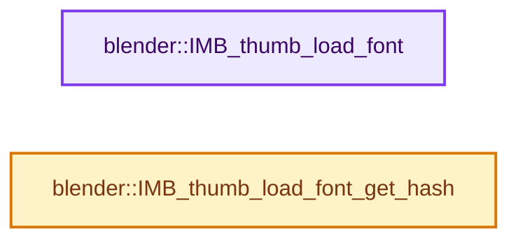
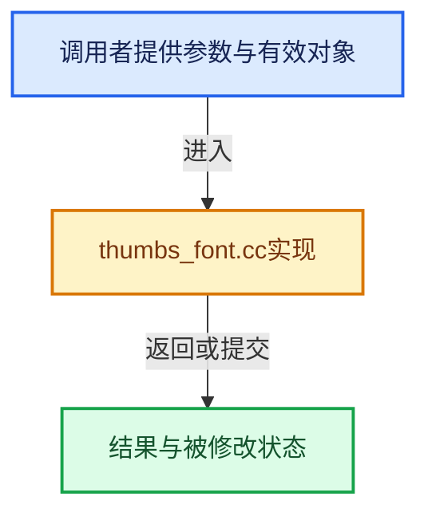

# 实现依赖专题：source/blender/imbuf/intern/thumbs_font.cc

[方向导航](README.md) · [符号索引](../%E7%AC%A6%E5%8F%B7%E4%BE%9D%E8%B5%96%E4%B8%8E%E5%AE%9E%E7%8E%B0%E7%B4%A2%E5%BC%95.md)

本专题从正文实际调用进入，集中保存共享实现。函数有稳定锚点，可从调用处直接跳到对应完整函数；递归与互相调用通过回链组织。

## 本文件的实现关系






## 完整成员与函数实现

<a id="f-13562e95a0abab93"></a>

### `blender::IMB_thumb_load_font`

实现位置：[source/blender/imbuf/intern/thumbs_font.cc](../../../../../source/blender/imbuf/intern/thumbs_font.cc) · L24—L39。

接口参数：

- `const char *filepath`
- `uint x`
- `uint y`

**教学注释版**

<!-- annotated:ce66af0950d872 -->

```cpp
ImBuf *IMB_thumb_load_font(const char *filepath, uint x, uint y)
{
  ImBuf *ibuf = IMB_allocImBuf(x, y, ImBufFlags::ByteData | ImBufFlags::Metadata);

  /* fill with white and zero alpha */
  const float col[4] = {1.0f, 1.0f, 1.0f, 0.0f};
  IMB_rectfill(ibuf, col);

  if (!BLF_thumb_preview(filepath, ibuf->byte_data_for_write(), ibuf->x, ibuf->y, ibuf->channels))
  {
    IMB_freeImBuf(ibuf);
    ibuf = nullptr;
  }

  return ibuf;
}
```

<details>
<summary>核对原始源码：source/blender/imbuf/intern/thumbs_font.cc · L24—L39</summary>

<!-- original:ce66af0950d872:source/blender/imbuf/intern/thumbs_font.cc:24:39 -->

```cpp
ImBuf *IMB_thumb_load_font(const char *filepath, uint x, uint y)
{
  ImBuf *ibuf = IMB_allocImBuf(x, y, ImBufFlags::ByteData | ImBufFlags::Metadata);

  /* fill with white and zero alpha */
  const float col[4] = {1.0f, 1.0f, 1.0f, 0.0f};
  IMB_rectfill(ibuf, col);

  if (!BLF_thumb_preview(filepath, ibuf->byte_data_for_write(), ibuf->x, ibuf->y, ibuf->channels))
  {
    IMB_freeImBuf(ibuf);
    ibuf = nullptr;
  }

  return ibuf;
}
```

</details>

**沿实际写入检查状态**

- `ibuf = nullptr;`

**结果出口**

- `return ibuf;`

**继续追踪实现**

- `IMB_allocImBuf` → [blender::IMB_allocImBuf · L367](%E4%BE%9D%E8%B5%96-allocimbuf-bc68dd.md#f-971d0005c46aad53)。
- `IMB_rectfill` → [blender::IMB_rectfill · L1165](%E4%BE%9D%E8%B5%96-rectop-1e2a15.md#f-ddc808c2ef224637)。
- `BLF_thumb_preview` → [blender::BLF_thumb_preview · L302](%E4%BE%9D%E8%B5%96-blf_thumbs-6adab2.md#f-2e0c147a09695f54)。
- `ibuf->byte_data_for_write` → [blender::ImBuf::byte_data_for_write · L60](%E4%BE%9D%E8%B5%96-allocimbuf-bc68dd.md#f-9ae201bd1c52aa87)。
- `IMB_freeImBuf` → [blender::IMB_freeImBuf · L144](%E4%BE%9D%E8%B5%96-allocimbuf-bc68dd.md#f-c830f56ede6f345b)。

<a id="f-841929fa327aff4b"></a>

### `blender::IMB_thumb_load_font_get_hash`

实现位置：[source/blender/imbuf/intern/thumbs_font.cc](../../../../../source/blender/imbuf/intern/thumbs_font.cc) · L41—L49。

接口参数：

- `char *r_hash`

**教学注释版**

<!-- annotated:0938bee7b18cbe -->

```cpp
bool IMB_thumb_load_font_get_hash(char *r_hash)
{
  uchar digest[16];
  BLI_hash_md5_buffer(FONT_THUMB_VERSION, sizeof(FONT_THUMB_VERSION), digest);
  r_hash[0] = '\0';
  BLI_hash_md5_to_hexdigest(digest, r_hash);

  return true;
}
```

<details>
<summary>核对原始源码：source/blender/imbuf/intern/thumbs_font.cc · L41—L49</summary>

<!-- original:0938bee7b18cbe:source/blender/imbuf/intern/thumbs_font.cc:41:49 -->

```cpp
bool IMB_thumb_load_font_get_hash(char *r_hash)
{
  uchar digest[16];
  BLI_hash_md5_buffer(FONT_THUMB_VERSION, sizeof(FONT_THUMB_VERSION), digest);
  r_hash[0] = '\0';
  BLI_hash_md5_to_hexdigest(digest, r_hash);

  return true;
}
```

</details>

**沿实际写入检查状态**

- `r_hash[0] = '\0';`

**结果出口**

- `return true;`

**继续追踪实现**

- `BLI_hash_md5_buffer` → [blender::BLI_hash_md5_buffer · L345](../02-%E5%93%88%E5%B8%8C%E8%A1%A8%E4%B8%8E%E5%85%B3%E8%81%94%E6%95%B0%E6%8D%AE%E7%BB%93%E6%9E%84/%E4%BE%9D%E8%B5%96-hash_md5-d0adfd.md#f-8d7841e60ae0e060)。
- `BLI_hash_md5_to_hexdigest` → [blender::BLI_hash_md5_to_hexdigest · L381](../02-%E5%93%88%E5%B8%8C%E8%A1%A8%E4%B8%8E%E5%85%B3%E8%81%94%E6%95%B0%E6%8D%AE%E7%BB%93%E6%9E%84/%E4%BE%9D%E8%B5%96-hash_md5-d0adfd.md#f-f58bf9ed51cfe1c7)。
