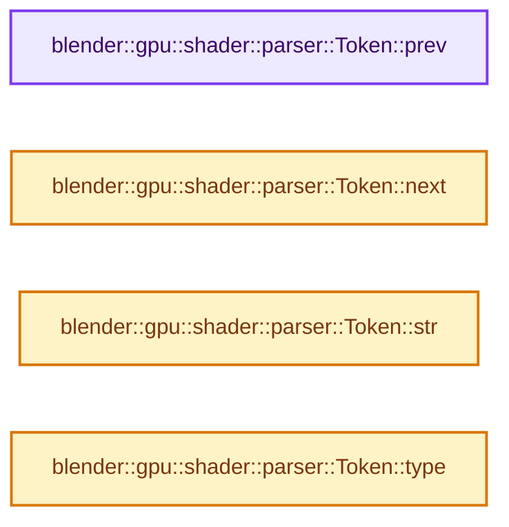
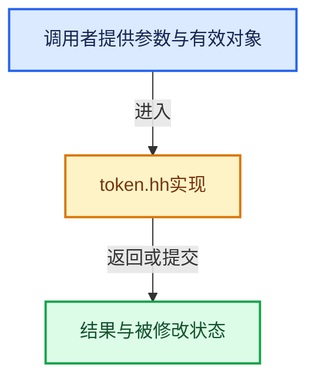

# 实现依赖专题：source/blender/gpu/shader_tool/token.hh

[方向导航](README.md) · [符号索引](../%E7%AC%A6%E5%8F%B7%E4%BE%9D%E8%B5%96%E4%B8%8E%E5%AE%9E%E7%8E%B0%E7%B4%A2%E5%BC%95.md)

本专题从正文实际调用进入，集中保存共享实现。函数有稳定锚点，可从调用处直接跳到对应完整函数；递归与互相调用通过回链组织。

## 本文件的实现关系






## 相关类型布局与成员入口

<a id="t-d3ab878b577f"></a>

### `blender::gpu::shader::parser::Token`

原始声明：[source/blender/gpu/shader_tool/token.hh](../../../../../source/blender/gpu/shader_tool/token.hh) · L22—L188。

成员布局：

- `Scope scope`
- `Scope attribute_before`
- `Scope attribute_after`

以下保留类的数据声明与编译条件，成员函数实现通过后面的精确链接阅读。

<!-- annotated:50ac656ae96292 -->

```cpp
struct Token : lexit::Token {
```

<details>
<summary>核对原始源码：source/blender/gpu/shader_tool/token.hh · L22—L22</summary>

<!-- original:50ac656ae96292:source/blender/gpu/shader_tool/token.hh:22:22 -->

```cpp
struct Token : lexit::Token {
```

</details>

<!-- annotated:5a73b1cc7c15a9 -->

```cpp

```

<details>
<summary>核对原始源码：source/blender/gpu/shader_tool/token.hh · L24—L24</summary>

<!-- original:5a73b1cc7c15a9:source/blender/gpu/shader_tool/token.hh:24:24 -->

```cpp

```

</details>

<!-- annotated:590bae16139c2c -->

```cpp
  /* Create an invalid token. */
```

<details>
<summary>核对原始源码：source/blender/gpu/shader_tool/token.hh · L26—L26</summary>

<!-- original:590bae16139c2c:source/blender/gpu/shader_tool/token.hh:26:26 -->

```cpp
  /* Create an invalid token. */
```

</details>

<!-- annotated:1727def1d113cc -->

```cpp

```

<details>
<summary>核对原始源码：source/blender/gpu/shader_tool/token.hh · L28—L28</summary>

<!-- original:1727def1d113cc:source/blender/gpu/shader_tool/token.hh:28:28 -->

```cpp

```

</details>

<!-- annotated:3a100c174c8a8e -->

```cpp

```

<details>
<summary>核对原始源码：source/blender/gpu/shader_tool/token.hh · L37—L37</summary>

<!-- original:3a100c174c8a8e:source/blender/gpu/shader_tool/token.hh:37:37 -->

```cpp

```

</details>

<!-- annotated:27894cd730ce98 -->

```cpp

  /* Return start of namespace identifier if the token is part of one. */
```

<details>
<summary>核对原始源码：source/blender/gpu/shader_tool/token.hh · L46—L47</summary>

<!-- original:27894cd730ce98:source/blender/gpu/shader_tool/token.hh:46:47 -->

```cpp

  /* Return start of namespace identifier if the token is part of one. */
```

</details>

<!-- annotated:09b4f657d4463d -->

```cpp

  /* For a word, return the name containing the prefix namespaces if present. */
```

<details>
<summary>核对原始源码：source/blender/gpu/shader_tool/token.hh · L65—L66</summary>

<!-- original:09b4f657d4463d:source/blender/gpu/shader_tool/token.hh:65:66 -->

```cpp

  /* For a word, return the name containing the prefix namespaces if present. */
```

</details>

<!-- annotated:db209e56903c2d -->

```cpp

  /* Returns the scope that contains this token. */
  Scope scope() const;

```

<details>
<summary>核对原始源码：source/blender/gpu/shader_tool/token.hh · L73—L76</summary>

<!-- original:db209e56903c2d:source/blender/gpu/shader_tool/token.hh:73:76 -->

```cpp

  /* Returns the scope that contains this token. */
  Scope scope() const;

```

</details>

<!-- annotated:957a5faefaf6a2 -->

```cpp

```

<details>
<summary>核对原始源码：source/blender/gpu/shader_tool/token.hh · L81—L81</summary>

<!-- original:957a5faefaf6a2:source/blender/gpu/shader_tool/token.hh:81:81 -->

```cpp

```

</details>

<!-- annotated:3772a74efb8dc9 -->

```cpp

```

<details>
<summary>核对原始源码：source/blender/gpu/shader_tool/token.hh · L86—L86</summary>

<!-- original:3772a74efb8dc9:source/blender/gpu/shader_tool/token.hh:86:86 -->

```cpp

```

</details>

<!-- annotated:805f106e1b277d -->

```cpp

  /* Index of the first character of the line this token is. */
```

<details>
<summary>核对原始源码：source/blender/gpu/shader_tool/token.hh · L91—L92</summary>

<!-- original:805f106e1b277d:source/blender/gpu/shader_tool/token.hh:91:92 -->

```cpp

  /* Index of the first character of the line this token is. */
```

</details>

<!-- annotated:3ded41c796ca43 -->

```cpp

  /* Index of the last character of the line this token is, excluding `\n`. */
```

<details>
<summary>核对原始源码：source/blender/gpu/shader_tool/token.hh · L98—L99</summary>

<!-- original:3ded41c796ca43:source/blender/gpu/shader_tool/token.hh:98:99 -->

```cpp

  /* Index of the last character of the line this token is, excluding `\n`. */
```

</details>

<!-- annotated:c233500fd567fb -->

```cpp

```

<details>
<summary>核对原始源码：source/blender/gpu/shader_tool/token.hh · L105—L105</summary>

<!-- original:c233500fd567fb:source/blender/gpu/shader_tool/token.hh:105:105 -->

```cpp

```

</details>

<!-- annotated:4abe70c9a45cba -->

```cpp

```

<details>
<summary>核对原始源码：source/blender/gpu/shader_tool/token.hh · L113—L113</summary>

<!-- original:4abe70c9a45cba:source/blender/gpu/shader_tool/token.hh:113:113 -->

```cpp

```

</details>

<!-- annotated:3c70696dea9cb0 -->

```cpp

  /* Return the line number this token is found at. Take into account the #line directives.
   * If `at_end` is true, return the line number after this token. */
```

<details>
<summary>核对原始源码：source/blender/gpu/shader_tool/token.hh · L121—L123</summary>

<!-- original:3c70696dea9cb0:source/blender/gpu/shader_tool/token.hh:121:123 -->

```cpp

  /* Return the line number this token is found at. Take into account the #line directives.
   * If `at_end` is true, return the line number after this token. */
```

</details>

<!-- annotated:afcbe2ba076fb6 -->

```cpp

  /* Return the offset to the start of the line. */
```

<details>
<summary>核对原始源码：source/blender/gpu/shader_tool/token.hh · L134—L135</summary>

<!-- original:afcbe2ba076fb6:source/blender/gpu/shader_tool/token.hh:134:135 -->

```cpp

  /* Return the offset to the start of the line. */
```

</details>

<!-- annotated:33019c973511cc -->

```cpp

  /* Return the name of the file containing the token. */
```

<details>
<summary>核对原始源码：source/blender/gpu/shader_tool/token.hh · L143—L144</summary>

<!-- original:33019c973511cc:source/blender/gpu/shader_tool/token.hh:143:144 -->

```cpp

  /* Return the name of the file containing the token. */
```

</details>

<!-- annotated:66071157f77237 -->

```cpp

  /* Return the line the token is at. */
```

<details>
<summary>核对原始源码：source/blender/gpu/shader_tool/token.hh · L152—L153</summary>

<!-- original:66071157f77237:source/blender/gpu/shader_tool/token.hh:152:153 -->

```cpp

  /* Return the line the token is at. */
```

</details>

<!-- annotated:e9a1621807a702 -->

```cpp

```

<details>
<summary>核对原始源码：source/blender/gpu/shader_tool/token.hh · L158—L158</summary>

<!-- original:e9a1621807a702:source/blender/gpu/shader_tool/token.hh:158:158 -->

```cpp

```

</details>

<!-- annotated:c10643fa13aa61 -->

```cpp

  /* Return the attribute scope before this token if it exists. */
  Scope attribute_before() const;
  /* Return the attribute scope after this token if it exists. */
  Scope attribute_after() const;

```

<details>
<summary>核对原始源码：source/blender/gpu/shader_tool/token.hh · L166—L171</summary>

<!-- original:c10643fa13aa61:source/blender/gpu/shader_tool/token.hh:166:171 -->

```cpp

  /* Return the attribute scope before this token if it exists. */
  Scope attribute_before() const;
  /* Return the attribute scope after this token if it exists. */
  Scope attribute_after() const;

```

</details>

<!-- annotated:5dd453d254feca -->

```cpp
};
```

<details>
<summary>核对原始源码：source/blender/gpu/shader_tool/token.hh · L188—L188</summary>

<!-- original:5dd453d254feca:source/blender/gpu/shader_tool/token.hh:188:188 -->

```cpp
};
```

</details>

- [prev](%E4%BE%9D%E8%B5%96-token-e86ff5.md#f-f36216e3c1b1d6ec)
- [next](%E4%BE%9D%E8%B5%96-token-e86ff5.md#f-6c97bb2a10e7f32a)
- [str](%E4%BE%9D%E8%B5%96-token-e86ff5.md#f-c6a6f51e9c75c68a)
- [type](%E4%BE%9D%E8%B5%96-token-e86ff5.md#f-2e7ce1ce5f396d1b)

## 完整成员与函数实现

<a id="f-f36216e3c1b1d6ec"></a>

### `blender::gpu::shader::parser::Token::prev`

实现位置：[source/blender/gpu/shader_tool/token.hh](../../../../../source/blender/gpu/shader_tool/token.hh) · L29—L32。

接口参数：

- `int i = 1`

**教学注释版**

<!-- annotated:31be4825652587 -->

```cpp
  Token prev(int i = 1) const
  {
    return static_cast<const lexit::Token *>(this)->prev(i);
  }
```

<details>
<summary>核对原始源码：source/blender/gpu/shader_tool/token.hh · L29—L32</summary>

<!-- original:31be4825652587:source/blender/gpu/shader_tool/token.hh:29:32 -->

```cpp
  Token prev(int i = 1) const
  {
    return static_cast<const lexit::Token *>(this)->prev(i);
  }
```

</details>

**结果出口**

- `return static_cast<const lexit::Token *>(this)->prev(i);`

**继续追踪实现**

- `static_cast<const lexit::Token *>(this)->prev` → [调用协议](../%E6%A8%A1%E6%9D%BF%E5%AE%8F%E4%B8%8E%E5%8A%A8%E6%80%81%E5%88%86%E6%B4%BE%E5%8D%8F%E8%AE%AE.md)：接收对象类型依赖auto、返回值或模板实例；不按同名猜测目标。调用位置L31。

<a id="f-6c97bb2a10e7f32a"></a>

### `blender::gpu::shader::parser::Token::next`

实现位置：[source/blender/gpu/shader_tool/token.hh](../../../../../source/blender/gpu/shader_tool/token.hh) · L33—L36。

接口参数：

- `int i = 1`

**教学注释版**

<!-- annotated:592f0032b50840 -->

```cpp
  Token next(int i = 1) const
  {
    return static_cast<const lexit::Token *>(this)->next(i);
  }
```

<details>
<summary>核对原始源码：source/blender/gpu/shader_tool/token.hh · L33—L36</summary>

<!-- original:592f0032b50840:source/blender/gpu/shader_tool/token.hh:33:36 -->

```cpp
  Token next(int i = 1) const
  {
    return static_cast<const lexit::Token *>(this)->next(i);
  }
```

</details>

**结果出口**

- `return static_cast<const lexit::Token *>(this)->next(i);`

**继续追踪实现**

- `static_cast<const lexit::Token *>(this)->next` → [调用协议](../%E6%A8%A1%E6%9D%BF%E5%AE%8F%E4%B8%8E%E5%8A%A8%E6%80%81%E5%88%86%E6%B4%BE%E5%8D%8F%E8%AE%AE.md)：接收对象类型依赖auto、返回值或模板实例；不按同名猜测目标。调用位置L35。

<a id="f-c6a6f51e9c75c68a"></a>

### `blender::gpu::shader::parser::Token::str`

实现位置：[source/blender/gpu/shader_tool/token.hh](../../../../../source/blender/gpu/shader_tool/token.hh) · L114—L120。

**教学注释版**

<!-- annotated:d0953503546ce5 -->

```cpp
  std::string_view str() const
  {
    if (is_invalid()) {
      return "";
    }
    return static_cast<const lexit::Token *>(this)->str();
  }
```

<details>
<summary>核对原始源码：source/blender/gpu/shader_tool/token.hh · L114—L120</summary>

<!-- original:d0953503546ce5:source/blender/gpu/shader_tool/token.hh:114:120 -->

```cpp
  std::string_view str() const
  {
    if (is_invalid()) {
      return "";
    }
    return static_cast<const lexit::Token *>(this)->str();
  }
```

</details>

**结果出口**

- `return "";`
- `return static_cast<const lexit::Token *>(this)->str();`

**继续追踪实现**

- `is_invalid` → [调用协议](../%E6%A8%A1%E6%9D%BF%E5%AE%8F%E4%B8%8E%E5%8A%A8%E6%80%81%E5%88%86%E6%B4%BE%E5%8D%8F%E8%AE%AE.md)：函数指针、局部可调用对象或未展开的宏；必须结合调用者环境。调用位置L116。
- `static_cast<const lexit::Token *>(this)->str` → [调用协议](../%E6%A8%A1%E6%9D%BF%E5%AE%8F%E4%B8%8E%E5%8A%A8%E6%80%81%E5%88%86%E6%B4%BE%E5%8D%8F%E8%AE%AE.md)：接收对象类型依赖auto、返回值或模板实例；不按同名猜测目标。调用位置L119。

<a id="f-2e7ce1ce5f396d1b"></a>

### `blender::gpu::shader::parser::Token::type`

实现位置：[source/blender/gpu/shader_tool/token.hh](../../../../../source/blender/gpu/shader_tool/token.hh) · L159—L165。

**教学注释版**

<!-- annotated:a8f946d35a7c13 -->

```cpp
  TokenType type() const
  {
    if (is_invalid()) {
      return Invalid;
    }
    return TokenType(buf_->types_[index_]);
  }
```

<details>
<summary>核对原始源码：source/blender/gpu/shader_tool/token.hh · L159—L165</summary>

<!-- original:a8f946d35a7c13:source/blender/gpu/shader_tool/token.hh:159:165 -->

```cpp
  TokenType type() const
  {
    if (is_invalid()) {
      return Invalid;
    }
    return TokenType(buf_->types_[index_]);
  }
```

</details>

**结果出口**

- `return Invalid;`
- `return TokenType(buf_->types_[index_]);`

**继续追踪实现**

- `is_invalid` → [调用协议](../%E6%A8%A1%E6%9D%BF%E5%AE%8F%E4%B8%8E%E5%8A%A8%E6%80%81%E5%88%86%E6%B4%BE%E5%8D%8F%E8%AE%AE.md)：函数指针、局部可调用对象或未展开的宏；必须结合调用者环境。调用位置L161。
- `TokenType` → [blender::TokenType](%E4%BE%9D%E8%B5%96-path_templates-3ebbe3.md#t-6c16bd9637da)；[lexit::TokenType](%E4%BE%9D%E8%B5%96-types-448b16.md#t-942a40d99bc5)。
