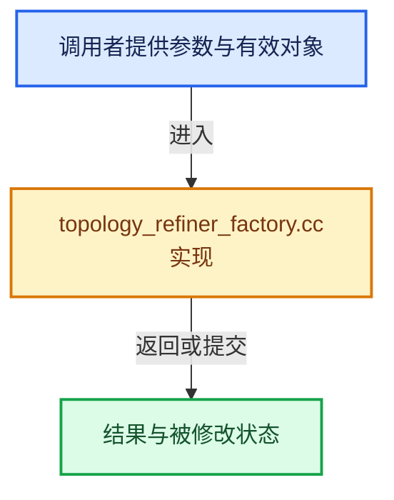

# 实现依赖专题：intern/opensubdiv/internal/topology/topology_refiner_factory.cc

[方向导航](README.md) · [符号索引](../%E7%AC%A6%E5%8F%B7%E4%BE%9D%E8%B5%96%E4%B8%8E%E5%AE%9E%E7%8E%B0%E7%B4%A2%E5%BC%95.md)

本专题从正文实际调用进入，集中保存共享实现。函数有稳定锚点，可从调用处直接跳到对应完整函数；递归与互相调用通过回链组织。

## 本文件的实现关系





## 完整成员与函数实现

<a id="f-17f89ff177508b44"></a>

### `total_size_from_offsets`

实现位置：[intern/opensubdiv/internal/topology/topology_refiner_factory.cc](../../../../../intern/opensubdiv/internal/topology/topology_refiner_factory.cc) · L34—L37。

接口参数：

- `const std::span<const int> face_offsets`

**教学注释版**

<!-- annotated:13ec1682634e6e -->

```cpp
[[maybe_unused]] static int total_size_from_offsets(const std::span<const int> face_offsets)
{
  return face_offsets.empty() ? 0 : face_offsets.back() - face_offsets.front();
}
```

<details>
<summary>核对原始源码：intern/opensubdiv/internal/topology/topology_refiner_factory.cc · L34—L37</summary>

<!-- original:13ec1682634e6e:intern/opensubdiv/internal/topology/topology_refiner_factory.cc:34:37 -->

```cpp
[[maybe_unused]] static int total_size_from_offsets(const std::span<const int> face_offsets)
{
  return face_offsets.empty() ? 0 : face_offsets.back() - face_offsets.front();
}
```

</details>

**结果出口**

- `return face_offsets.empty() ? 0 : face_offsets.back() - face_offsets.front();`

**继续追踪实现**

- `face_offsets.empty` → [外部契约](https://eel.is/c++draft/)：这个边界按实际表达式及所属类型核对参数、返回值、寿命与失败行为。这里提供接口入口，不声称已解释该第三方版本的内部实现。
- `face_offsets.back` → [外部契约](https://eel.is/c++draft/)：这个边界按实际表达式及所属类型核对参数、返回值、寿命与失败行为。这里提供接口入口，不声称已解释该第三方版本的内部实现。
- `face_offsets.front` → [外部契约](https://eel.is/c++draft/)：这个边界按实际表达式及所属类型核对参数、返回值、寿命与失败行为。这里提供接口入口，不声称已解释该第三方版本的内部实现。

<a id="f-76199b2cdabdf576"></a>

### `blender::opensubdiv::getSDCOptions`

实现位置：[intern/opensubdiv/internal/topology/topology_refiner_factory.cc](../../../../../intern/opensubdiv/internal/topology/topology_refiner_factory.cc) · L271—L285。

接口参数：

- `OpenSubdiv_Converter *converter`

**教学注释版**

<!-- annotated:eb55000f9a6b04 -->

```cpp
static OpenSubdiv::Sdc::Options getSDCOptions(OpenSubdiv_Converter *converter)
{
  using OpenSubdiv::Sdc::Options;

  const Options::FVarLinearInterpolation linear_interpolation = getFVarLinearInterpolationFromCAPI(
      converter->fvar_linear_interpolation);

  Options options;
  options.SetVtxBoundaryInterpolation(
      getVtxBoundaryInterpolationFromCAPI(converter->vtx_boundary_interpolation));
  options.SetCreasingMethod(Options::CREASE_UNIFORM);
  options.SetFVarLinearInterpolation(linear_interpolation);

  return options;
}
```

<details>
<summary>核对原始源码：intern/opensubdiv/internal/topology/topology_refiner_factory.cc · L271—L285</summary>

<!-- original:eb55000f9a6b04:intern/opensubdiv/internal/topology/topology_refiner_factory.cc:271:285 -->

```cpp
static OpenSubdiv::Sdc::Options getSDCOptions(OpenSubdiv_Converter *converter)
{
  using OpenSubdiv::Sdc::Options;

  const Options::FVarLinearInterpolation linear_interpolation = getFVarLinearInterpolationFromCAPI(
      converter->fvar_linear_interpolation);

  Options options;
  options.SetVtxBoundaryInterpolation(
      getVtxBoundaryInterpolationFromCAPI(converter->vtx_boundary_interpolation));
  options.SetCreasingMethod(Options::CREASE_UNIFORM);
  options.SetFVarLinearInterpolation(linear_interpolation);

  return options;
}
```

</details>

**结果出口**

- `return options;`

**继续追踪实现**

- `getFVarLinearInterpolationFromCAPI` → [blender::opensubdiv::getFVarLinearInterpolationFromCAPI · L32](%E4%BE%9D%E8%B5%96-type_convert-a4989a.md#f-12b06acfaee7c8fd)。
- `options.SetVtxBoundaryInterpolation` → [调用协议](../%E6%A8%A1%E6%9D%BF%E5%AE%8F%E4%B8%8E%E5%8A%A8%E6%80%81%E5%88%86%E6%B4%BE%E5%8D%8F%E8%AE%AE.md)：由接收对象具体类型或运行时策略提供实现。调用位置L279。
- `getVtxBoundaryInterpolationFromCAPI` → [blender::opensubdiv::getVtxBoundaryInterpolationFromCAPI · L76](%E4%BE%9D%E8%B5%96-type_convert-a4989a.md#f-f7660925d2b7a9c4)。
- `options.SetCreasingMethod` → [调用协议](../%E6%A8%A1%E6%9D%BF%E5%AE%8F%E4%B8%8E%E5%8A%A8%E6%80%81%E5%88%86%E6%B4%BE%E5%8D%8F%E8%AE%AE.md)：由接收对象具体类型或运行时策略提供实现。调用位置L281。
- `options.SetFVarLinearInterpolation` → [调用协议](../%E6%A8%A1%E6%9D%BF%E5%AE%8F%E4%B8%8E%E5%8A%A8%E6%80%81%E5%88%86%E6%B4%BE%E5%8D%8F%E8%AE%AE.md)：由接收对象具体类型或运行时策略提供实现。调用位置L282。

<a id="f-5259af9521c78bff"></a>

### `blender::opensubdiv::getTopologyRefinerOptions`

实现位置：[intern/opensubdiv/internal/topology/topology_refiner_factory.cc](../../../../../intern/opensubdiv/internal/topology/topology_refiner_factory.cc) · L287—L303。

接口参数：

- `OpenSubdiv_Converter *converter`

**教学注释版**

<!-- annotated:c390a88c1d2127 -->

```cpp
static TopologyRefinerFactoryType::Options getTopologyRefinerOptions(
    OpenSubdiv_Converter *converter)
{
  using OpenSubdiv::Sdc::SchemeType;

  OpenSubdiv::Sdc::Options sdc_options = getSDCOptions(converter);

  const SchemeType scheme_type = getSchemeTypeFromCAPI(converter->scheme_type);
  TopologyRefinerFactoryType::Options topology_options(scheme_type, sdc_options);

  // NOTE: When debugging topology conversion related functionality it is helpful to set this
  // to truth. In all other cases leave it at false. so debugging of other areas is not affected
  // by performance penalty happening in this module.
  topology_options.validateFullTopology = false;

  return topology_options;
}
```

<details>
<summary>核对原始源码：intern/opensubdiv/internal/topology/topology_refiner_factory.cc · L287—L303</summary>

<!-- original:c390a88c1d2127:intern/opensubdiv/internal/topology/topology_refiner_factory.cc:287:303 -->

```cpp
static TopologyRefinerFactoryType::Options getTopologyRefinerOptions(
    OpenSubdiv_Converter *converter)
{
  using OpenSubdiv::Sdc::SchemeType;

  OpenSubdiv::Sdc::Options sdc_options = getSDCOptions(converter);

  const SchemeType scheme_type = getSchemeTypeFromCAPI(converter->scheme_type);
  TopologyRefinerFactoryType::Options topology_options(scheme_type, sdc_options);

  // NOTE: When debugging topology conversion related functionality it is helpful to set this
  // to truth. In all other cases leave it at false. so debugging of other areas is not affected
  // by performance penalty happening in this module.
  topology_options.validateFullTopology = false;

  return topology_options;
}
```

</details>

**沿实际写入检查状态**

- `topology_options.validateFullTopology = false;`

**结果出口**

- `return topology_options;`

**继续追踪实现**

- `getSDCOptions` → [blender::opensubdiv::getSDCOptions · L271](%E4%BE%9D%E8%B5%96-topology_refiner_factory-02f84a.md#f-76199b2cdabdf576)。
- `getSchemeTypeFromCAPI` → [blender::opensubdiv::getSchemeTypeFromCAPI · L18](%E4%BE%9D%E8%B5%96-type_convert-a4989a.md#f-28f96f0a4bfaabac)。

<a id="f-1adb6e334f17924e"></a>

### `blender::opensubdiv::storeBaseMeshTopology`

实现位置：[intern/opensubdiv/internal/topology/topology_refiner_factory.cc](../../../../../intern/opensubdiv/internal/topology/topology_refiner_factory.cc) · L307—L336。

接口参数：

- `const OpenSubdiv_Converter *converter`
- `TopologyRefinerImpl &refiner_impl`

**教学注释版**

<!-- annotated:bfb78afef48b73 -->

```cpp
static void storeBaseMeshTopology(const OpenSubdiv_Converter *converter,
                                  TopologyRefinerImpl &refiner_impl)
{
  refiner_impl.base_verts_num = converter->verts_num;
  refiner_impl.base_face_offsets.assign(converter->face_offsets.begin(),
                                        converter->face_offsets.end());
  // [讲解] assert：检查开发者预期条件，配置可能关闭；不承担完整输入处理或自动修复。
  assert(converter->corner_verts.size() == total_size_from_offsets(converter->face_offsets));
  refiner_impl.base_corner_verts.assign(converter->corner_verts.begin(),
                                        converter->corner_verts.end());
  assert(converter->edge_sharpness.empty() ||
         converter->edge_sharpness.size() == converter->edges.size());
  refiner_impl.base_edge_sharpness.assign(converter->edge_sharpness.begin(),
                                          converter->edge_sharpness.end());
  assert(converter->vert_sharpness.empty() ||
         int(converter->vert_sharpness.size()) == refiner_impl.base_verts_num);
  refiner_impl.base_vert_sharpness.assign(converter->vert_sharpness.begin(),
                                          converter->vert_sharpness.end());

  // Only up to the last sharp one is stored, see #TopologyRefinerImpl::base_edges_sparse.
  const std::span<const float> sharpness = converter->edge_sharpness;
  int stored_edges_num = 0;
  for (int edge_index = int(sharpness.size()) - 1; edge_index >= 0; edge_index--) {
    if (sharpness[edge_index] >= 1e-6f) {
      stored_edges_num = edge_index + 1;
      break;
    }
  }
  const std::span<const std::pair<int, int>> edges = converter->edges.first(stored_edges_num);
  refiner_impl.base_edges_sparse.assign(edges.begin(), edges.end());
}
```

<details>
<summary>核对原始源码：intern/opensubdiv/internal/topology/topology_refiner_factory.cc · L307—L336</summary>

<!-- original:bfb78afef48b73:intern/opensubdiv/internal/topology/topology_refiner_factory.cc:307:336 -->

```cpp
static void storeBaseMeshTopology(const OpenSubdiv_Converter *converter,
                                  TopologyRefinerImpl &refiner_impl)
{
  refiner_impl.base_verts_num = converter->verts_num;
  refiner_impl.base_face_offsets.assign(converter->face_offsets.begin(),
                                        converter->face_offsets.end());
  assert(converter->corner_verts.size() == total_size_from_offsets(converter->face_offsets));
  refiner_impl.base_corner_verts.assign(converter->corner_verts.begin(),
                                        converter->corner_verts.end());
  assert(converter->edge_sharpness.empty() ||
         converter->edge_sharpness.size() == converter->edges.size());
  refiner_impl.base_edge_sharpness.assign(converter->edge_sharpness.begin(),
                                          converter->edge_sharpness.end());
  assert(converter->vert_sharpness.empty() ||
         int(converter->vert_sharpness.size()) == refiner_impl.base_verts_num);
  refiner_impl.base_vert_sharpness.assign(converter->vert_sharpness.begin(),
                                          converter->vert_sharpness.end());

  // Only up to the last sharp one is stored, see #TopologyRefinerImpl::base_edges_sparse.
  const std::span<const float> sharpness = converter->edge_sharpness;
  int stored_edges_num = 0;
  for (int edge_index = int(sharpness.size()) - 1; edge_index >= 0; edge_index--) {
    if (sharpness[edge_index] >= 1e-6f) {
      stored_edges_num = edge_index + 1;
      break;
    }
  }
  const std::span<const std::pair<int, int>> edges = converter->edges.first(stored_edges_num);
  refiner_impl.base_edges_sparse.assign(edges.begin(), edges.end());
}
```

</details>

**沿实际写入检查状态**

- `refiner_impl.base_verts_num = converter->verts_num;`
- `stored_edges_num = edge_index + 1;`

**继续追踪实现**

- `refiner_impl.base_face_offsets.assign` → [调用协议](../%E6%A8%A1%E6%9D%BF%E5%AE%8F%E4%B8%8E%E5%8A%A8%E6%80%81%E5%88%86%E6%B4%BE%E5%8D%8F%E8%AE%AE.md)：接收对象类型依赖auto、返回值或模板实例；不按同名猜测目标。调用位置L311。
- `converter->face_offsets.begin` → [调用协议](../%E6%A8%A1%E6%9D%BF%E5%AE%8F%E4%B8%8E%E5%8A%A8%E6%80%81%E5%88%86%E6%B4%BE%E5%8D%8F%E8%AE%AE.md)：接收对象类型依赖auto、返回值或模板实例；不按同名猜测目标。调用位置L311。
- `converter->face_offsets.end` → [调用协议](../%E6%A8%A1%E6%9D%BF%E5%AE%8F%E4%B8%8E%E5%8A%A8%E6%80%81%E5%88%86%E6%B4%BE%E5%8D%8F%E8%AE%AE.md)：接收对象类型依赖auto、返回值或模板实例；不按同名猜测目标。调用位置L312。
- `assert` → [外部契约](https://eel.is/c++draft/assertions)：检查开发者预期条件，配置可能关闭；不承担完整输入处理或自动修复。
- `converter->corner_verts.size` → [调用协议](../%E6%A8%A1%E6%9D%BF%E5%AE%8F%E4%B8%8E%E5%8A%A8%E6%80%81%E5%88%86%E6%B4%BE%E5%8D%8F%E8%AE%AE.md)：接收对象类型依赖auto、返回值或模板实例；不按同名猜测目标。调用位置L313。
- `total_size_from_offsets` → [total_size_from_offsets · L34](%E4%BE%9D%E8%B5%96-topology_refiner_factory-02f84a.md#f-17f89ff177508b44)。
- `refiner_impl.base_corner_verts.assign` → [调用协议](../%E6%A8%A1%E6%9D%BF%E5%AE%8F%E4%B8%8E%E5%8A%A8%E6%80%81%E5%88%86%E6%B4%BE%E5%8D%8F%E8%AE%AE.md)：接收对象类型依赖auto、返回值或模板实例；不按同名猜测目标。调用位置L314。
- `converter->corner_verts.begin` → [调用协议](../%E6%A8%A1%E6%9D%BF%E5%AE%8F%E4%B8%8E%E5%8A%A8%E6%80%81%E5%88%86%E6%B4%BE%E5%8D%8F%E8%AE%AE.md)：接收对象类型依赖auto、返回值或模板实例；不按同名猜测目标。调用位置L314。
- `converter->corner_verts.end` → [调用协议](../%E6%A8%A1%E6%9D%BF%E5%AE%8F%E4%B8%8E%E5%8A%A8%E6%80%81%E5%88%86%E6%B4%BE%E5%8D%8F%E8%AE%AE.md)：接收对象类型依赖auto、返回值或模板实例；不按同名猜测目标。调用位置L315。
- `converter->edge_sharpness.empty` → [调用协议](../%E6%A8%A1%E6%9D%BF%E5%AE%8F%E4%B8%8E%E5%8A%A8%E6%80%81%E5%88%86%E6%B4%BE%E5%8D%8F%E8%AE%AE.md)：接收对象类型依赖auto、返回值或模板实例；不按同名猜测目标。调用位置L316。
- `converter->edge_sharpness.size` → [调用协议](../%E6%A8%A1%E6%9D%BF%E5%AE%8F%E4%B8%8E%E5%8A%A8%E6%80%81%E5%88%86%E6%B4%BE%E5%8D%8F%E8%AE%AE.md)：接收对象类型依赖auto、返回值或模板实例；不按同名猜测目标。调用位置L317。
- `converter->edges.size` → [调用协议](../%E6%A8%A1%E6%9D%BF%E5%AE%8F%E4%B8%8E%E5%8A%A8%E6%80%81%E5%88%86%E6%B4%BE%E5%8D%8F%E8%AE%AE.md)：接收对象类型依赖auto、返回值或模板实例；不按同名猜测目标。调用位置L317。
- `refiner_impl.base_edge_sharpness.assign` → [调用协议](../%E6%A8%A1%E6%9D%BF%E5%AE%8F%E4%B8%8E%E5%8A%A8%E6%80%81%E5%88%86%E6%B4%BE%E5%8D%8F%E8%AE%AE.md)：接收对象类型依赖auto、返回值或模板实例；不按同名猜测目标。调用位置L318。
- `converter->edge_sharpness.begin` → [调用协议](../%E6%A8%A1%E6%9D%BF%E5%AE%8F%E4%B8%8E%E5%8A%A8%E6%80%81%E5%88%86%E6%B4%BE%E5%8D%8F%E8%AE%AE.md)：接收对象类型依赖auto、返回值或模板实例；不按同名猜测目标。调用位置L318。
- `converter->edge_sharpness.end` → [调用协议](../%E6%A8%A1%E6%9D%BF%E5%AE%8F%E4%B8%8E%E5%8A%A8%E6%80%81%E5%88%86%E6%B4%BE%E5%8D%8F%E8%AE%AE.md)：接收对象类型依赖auto、返回值或模板实例；不按同名猜测目标。调用位置L319。
- `converter->vert_sharpness.empty` → [调用协议](../%E6%A8%A1%E6%9D%BF%E5%AE%8F%E4%B8%8E%E5%8A%A8%E6%80%81%E5%88%86%E6%B4%BE%E5%8D%8F%E8%AE%AE.md)：接收对象类型依赖auto、返回值或模板实例；不按同名猜测目标。调用位置L320。
- `converter->vert_sharpness.size` → [调用协议](../%E6%A8%A1%E6%9D%BF%E5%AE%8F%E4%B8%8E%E5%8A%A8%E6%80%81%E5%88%86%E6%B4%BE%E5%8D%8F%E8%AE%AE.md)：接收对象类型依赖auto、返回值或模板实例；不按同名猜测目标。调用位置L321。
- `refiner_impl.base_vert_sharpness.assign` → [调用协议](../%E6%A8%A1%E6%9D%BF%E5%AE%8F%E4%B8%8E%E5%8A%A8%E6%80%81%E5%88%86%E6%B4%BE%E5%8D%8F%E8%AE%AE.md)：接收对象类型依赖auto、返回值或模板实例；不按同名猜测目标。调用位置L322。
- `converter->vert_sharpness.begin` → [调用协议](../%E6%A8%A1%E6%9D%BF%E5%AE%8F%E4%B8%8E%E5%8A%A8%E6%80%81%E5%88%86%E6%B4%BE%E5%8D%8F%E8%AE%AE.md)：接收对象类型依赖auto、返回值或模板实例；不按同名猜测目标。调用位置L322。
- `converter->vert_sharpness.end` → [调用协议](../%E6%A8%A1%E6%9D%BF%E5%AE%8F%E4%B8%8E%E5%8A%A8%E6%80%81%E5%88%86%E6%B4%BE%E5%8D%8F%E8%AE%AE.md)：接收对象类型依赖auto、返回值或模板实例；不按同名猜测目标。调用位置L323。
- `sharpness.size` → [外部契约](https://eel.is/c++draft/)：这个边界按实际表达式及所属类型核对参数、返回值、寿命与失败行为。这里提供接口入口，不声称已解释该第三方版本的内部实现。
- `converter->edges.first` → [调用协议](../%E6%A8%A1%E6%9D%BF%E5%AE%8F%E4%B8%8E%E5%8A%A8%E6%80%81%E5%88%86%E6%B4%BE%E5%8D%8F%E8%AE%AE.md)：接收对象类型依赖auto、返回值或模板实例；不按同名猜测目标。调用位置L334。
- `refiner_impl.base_edges_sparse.assign` → [调用协议](../%E6%A8%A1%E6%9D%BF%E5%AE%8F%E4%B8%8E%E5%8A%A8%E6%80%81%E5%88%86%E6%B4%BE%E5%8D%8F%E8%AE%AE.md)：接收对象类型依赖auto、返回值或模板实例；不按同名猜测目标。调用位置L335。
- `edges.begin` → [外部契约](https://eel.is/c++draft/)：这个边界按实际表达式及所属类型核对参数、返回值、寿命与失败行为。这里提供接口入口，不声称已解释该第三方版本的内部实现。
- `edges.end` → [外部契约](https://eel.is/c++draft/)：这个边界按实际表达式及所属类型核对参数、返回值、寿命与失败行为。这里提供接口入口，不声称已解释该第三方版本的内部实现。

<a id="f-8053e22756186663"></a>

### `blender::opensubdiv::TopologyRefinerImpl::createFromConverter`

实现位置：[intern/opensubdiv/internal/topology/topology_refiner_factory.cc](../../../../../intern/opensubdiv/internal/topology/topology_refiner_factory.cc) · L338—L361。

接口参数：

- `OpenSubdiv_Converter *converter`
- `const OpenSubdiv_TopologyRefinerSettings &settings`

**教学注释版**

<!-- annotated:ed79f3659b2058 -->

```cpp
TopologyRefinerImpl *TopologyRefinerImpl::createFromConverter(
    OpenSubdiv_Converter *converter, const OpenSubdiv_TopologyRefinerSettings &settings)
{
  using OpenSubdiv::Far::TopologyRefiner;

  // [讲解] std::make_unique<TopologyRefinerImpl>：创建独占拥有的对象，拥有关系可移动，get返回的借用指针不自动延长寿命。
  auto topology_refiner_impl = std::make_unique<TopologyRefinerImpl>();
  topology_refiner_impl->settings = settings;
  storeBaseMeshTopology(converter, *topology_refiner_impl);

  TopologyRefinerData cb_data;
  cb_data.converter = converter;

  // Create OpenSubdiv descriptor for the topology refiner.
  TopologyRefinerFactoryType::Options topology_refiner_options = getTopologyRefinerOptions(
      converter);
  TopologyRefiner *topology_refiner = TopologyRefinerFactoryType::Create(cb_data,
                                                                         topology_refiner_options);
  if (topology_refiner == nullptr) {
    return nullptr;
  }
  topology_refiner_impl->topology_refiner = topology_refiner;

  return topology_refiner_impl.release();
}
```

<details>
<summary>核对原始源码：intern/opensubdiv/internal/topology/topology_refiner_factory.cc · L338—L361</summary>

<!-- original:ed79f3659b2058:intern/opensubdiv/internal/topology/topology_refiner_factory.cc:338:361 -->

```cpp
TopologyRefinerImpl *TopologyRefinerImpl::createFromConverter(
    OpenSubdiv_Converter *converter, const OpenSubdiv_TopologyRefinerSettings &settings)
{
  using OpenSubdiv::Far::TopologyRefiner;

  auto topology_refiner_impl = std::make_unique<TopologyRefinerImpl>();
  topology_refiner_impl->settings = settings;
  storeBaseMeshTopology(converter, *topology_refiner_impl);

  TopologyRefinerData cb_data;
  cb_data.converter = converter;

  // Create OpenSubdiv descriptor for the topology refiner.
  TopologyRefinerFactoryType::Options topology_refiner_options = getTopologyRefinerOptions(
      converter);
  TopologyRefiner *topology_refiner = TopologyRefinerFactoryType::Create(cb_data,
                                                                         topology_refiner_options);
  if (topology_refiner == nullptr) {
    return nullptr;
  }
  topology_refiner_impl->topology_refiner = topology_refiner;

  return topology_refiner_impl.release();
}
```

</details>

**沿实际写入检查状态**

- `topology_refiner_impl->settings = settings;`
- `cb_data.converter = converter;`
- `topology_refiner_impl->topology_refiner = topology_refiner;`

**结果出口**

- `return nullptr;`
- `return topology_refiner_impl.release();`

**继续追踪实现**

- `std::make_unique<TopologyRefinerImpl>` → [外部契约](https://eel.is/c++draft/unique.ptr.create)：创建独占拥有的对象，拥有关系可移动，get返回的借用指针不自动延长寿命。
- `storeBaseMeshTopology` → [blender::opensubdiv::storeBaseMeshTopology · L307](%E4%BE%9D%E8%B5%96-topology_refiner_factory-02f84a.md#f-1adb6e334f17924e)。
- `getTopologyRefinerOptions` → [blender::opensubdiv::getTopologyRefinerOptions · L287](%E4%BE%9D%E8%B5%96-topology_refiner_factory-02f84a.md#f-5259af9521c78bff)。
- `TopologyRefinerFactoryType::Create` → [blender::opensubdiv::GPUPatchTable::Create · L14](%E4%BE%9D%E8%B5%96-gpu_patch_table-b5a6f3.md#f-7577968ff4e0de67)。
- `topology_refiner_impl.release` → [调用协议](../%E6%A8%A1%E6%9D%BF%E5%AE%8F%E4%B8%8E%E5%8A%A8%E6%80%81%E5%88%86%E6%B4%BE%E5%8D%8F%E8%AE%AE.md)：接收对象类型依赖auto、返回值或模板实例；不按同名猜测目标。调用位置L360。
