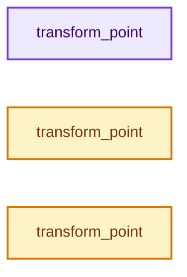
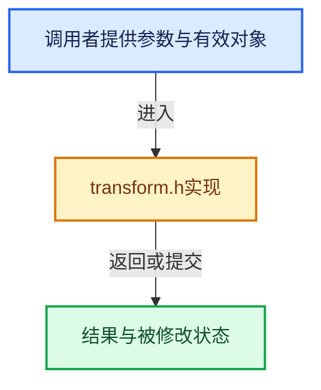

# 实现依赖专题：intern/cycles/util/transform.h

[方向导航](README.md) · [符号索引](../%E7%AC%A6%E5%8F%B7%E4%BE%9D%E8%B5%96%E4%B8%8E%E5%AE%9E%E7%8E%B0%E7%B4%A2%E5%BC%95.md)

本专题从正文实际调用进入，集中保存共享实现。函数有稳定锚点，可从调用处直接跳到对应完整函数；递归与互相调用通过回链组织。

## 本文件的实现关系






## 完整成员与函数实现

<a id="f-c54f558be16850d3"></a>

### `transform_point`

实现位置：[intern/cycles/util/transform.h](../../../../../intern/cycles/util/transform.h) · L79—L83。

接口参数：

- `const ccl_global Transform *t`
- `const float3 a`

**教学注释版**

<!-- annotated:a4f8069c62f936 -->

```cpp
ccl_device_inline float3 transform_point(const ccl_global Transform *t, const float3 a)
{
  const ccl_global metal::float3x3 &b(*(const ccl_global metal::float3x3 *)t);
  return (a * b).xyz + make_float3(t->x.w, t->y.w, t->z.w);
}
```

<details>
<summary>核对原始源码：intern/cycles/util/transform.h · L79—L83</summary>

<!-- original:a4f8069c62f936:intern/cycles/util/transform.h:79:83 -->

```cpp
ccl_device_inline float3 transform_point(const ccl_global Transform *t, const float3 a)
{
  const ccl_global metal::float3x3 &b(*(const ccl_global metal::float3x3 *)t);
  return (a * b).xyz + make_float3(t->x.w, t->y.w, t->z.w);
}
```

</details>

**结果出口**

- `return (a * b).xyz + make_float3(t->x.w, t->y.w, t->z.w);`

**继续追踪实现**

- `b` → [调用协议](../%E6%A8%A1%E6%9D%BF%E5%AE%8F%E4%B8%8E%E5%8A%A8%E6%80%81%E5%88%86%E6%B4%BE%E5%8D%8F%E8%AE%AE.md)：函数指针、局部可调用对象或未展开的宏；必须结合调用者环境。调用位置L81。
- `make_float3` → [make_float3 · L108](%E4%BE%9D%E8%B5%96-types_float4-fe598f.md#f-f432d3f8358c1253)；[make_float3 · L77](%E4%BE%9D%E8%B5%96-types_float3-48c65a.md#f-a4d1c171bbd08a48)；[make_float3 · L90](%E4%BE%9D%E8%B5%96-types_float3-48c65a.md#f-ed934d00b79bfb67)；[make_float3 · L101](%E4%BE%9D%E8%B5%96-types_float3-48c65a.md#f-809d35d4555a4889)；[make_float3 · L106](%E4%BE%9D%E8%B5%96-types_float3-48c65a.md#f-5e61500b5e24e806)；[make_float3 · L111](%E4%BE%9D%E8%B5%96-types_float3-48c65a.md#f-a032cc39a6db84a8)；[make_float3 · L120](%E4%BE%9D%E8%B5%96-types_float3-48c65a.md#f-894b0e42a98a9c25)；[make_float3 · L153](%E4%BE%9D%E8%B5%96-types_dual-2ddd2c.md#f-f1b4dcf796f629d2)；[make_float3 · L160](%E4%BE%9D%E8%B5%96-types_dual-2ddd2c.md#f-bd8866e955c896b4)；[make_float3 · L80](%E4%BE%9D%E8%B5%96-math_quaternion-957b27.md#f-c614570b864bdc58)。同名重载需按实参类型选择。

<a id="f-40fff362e774b7f3"></a>

### `transform_point`

实现位置：[intern/cycles/util/transform.h](../../../../../intern/cycles/util/transform.h) · L86—L104。

接口参数：

- `const ccl_private Transform *t`
- `const float3 a`

**教学注释版**

<!-- annotated:639c9209bf396a -->

```cpp
ccl_device_inline float3 transform_point(const ccl_private Transform *t, const float3 a)
{
#if defined(__KERNEL_SSE__) && defined(__KERNEL_SSE2__)
  const float4 aa(a.m128);
  float4 x = t->x;
  float4 y = t->y;
  float4 z = t->z;
  float4 w(_mm_set_ps(1.0f, 0.0f, 0.0f, 0.0f));
  _MM_TRANSPOSE4_PS(x.m128, y.m128, z.m128, w.m128);
  float4 tmp = w;
  tmp = madd(shuffle<2>(aa), z, tmp);
  tmp = madd(shuffle<1>(aa), y, tmp);
  tmp = madd(shuffle<0>(aa), x, tmp);
  return float3(tmp.m128);
#else
  const float4 a_ = make_homogeneous(a);
  return make_float3(dot(a_, t->x), dot(a_, t->y), dot(a_, t->z));
#endif
}
```

<details>
<summary>核对原始源码：intern/cycles/util/transform.h · L86—L104</summary>

<!-- original:639c9209bf396a:intern/cycles/util/transform.h:86:104 -->

```cpp
ccl_device_inline float3 transform_point(const ccl_private Transform *t, const float3 a)
{
#if defined(__KERNEL_SSE__) && defined(__KERNEL_SSE2__)
  const float4 aa(a.m128);
  float4 x = t->x;
  float4 y = t->y;
  float4 z = t->z;
  float4 w(_mm_set_ps(1.0f, 0.0f, 0.0f, 0.0f));
  _MM_TRANSPOSE4_PS(x.m128, y.m128, z.m128, w.m128);
  float4 tmp = w;
  tmp = madd(shuffle<2>(aa), z, tmp);
  tmp = madd(shuffle<1>(aa), y, tmp);
  tmp = madd(shuffle<0>(aa), x, tmp);
  return float3(tmp.m128);
#else
  const float4 a_ = make_homogeneous(a);
  return make_float3(dot(a_, t->x), dot(a_, t->y), dot(a_, t->z));
#endif
}
```

</details>

**沿实际写入检查状态**

- `tmp = madd(shuffle<2>(aa), z, tmp);`
- `tmp = madd(shuffle<1>(aa), y, tmp);`
- `tmp = madd(shuffle<0>(aa), x, tmp);`

**结果出口**

- `return float3(tmp.m128);`
- `return make_float3(dot(a_, t->x), dot(a_, t->y), dot(a_, t->z));`

**继续追踪实现**

- `_mm_set_ps` → [调用协议](../%E6%A8%A1%E6%9D%BF%E5%AE%8F%E4%B8%8E%E5%8A%A8%E6%80%81%E5%88%86%E6%B4%BE%E5%8D%8F%E8%AE%AE.md)：函数指针、局部可调用对象或未展开的宏；必须结合调用者环境。调用位置L93。
- `_MM_TRANSPOSE4_PS` → [调用协议](../%E6%A8%A1%E6%9D%BF%E5%AE%8F%E4%B8%8E%E5%8A%A8%E6%80%81%E5%88%86%E6%B4%BE%E5%8D%8F%E8%AE%AE.md)：函数指针、局部可调用对象或未展开的宏；必须结合调用者环境。调用位置L94。
- `madd` → [madd · L238](%E4%BE%9D%E8%B5%96-math_float4-2d91ea.md#f-1c60d87464696174)；[madd · L33](%E4%BE%9D%E8%B5%96-math_fast-146819.md#f-453559fdffbc91ec)。同名重载需按实参类型选择。
- `shuffle<2>` → [shuffle · L307](%E4%BE%9D%E8%B5%96-math_int8-80ce43.md#f-4e96e4a5bb775d9d)；[shuffle · L313](%E4%BE%9D%E8%B5%96-math_int8-80ce43.md#f-1494d2d2828a50ea)；[shuffle · L318](%E4%BE%9D%E8%B5%96-math_int8-80ce43.md#f-dfdd2ebc1f3110d2)；[shuffle · L324](%E4%BE%9D%E8%B5%96-math_int8-80ce43.md#f-307e12847ba5ab8e)；[shuffle · L331](%E4%BE%9D%E8%B5%96-math_int8-80ce43.md#f-435867ee373d570b)；[shuffle · L338](%E4%BE%9D%E8%B5%96-math_int8-80ce43.md#f-826dec998cc2dddb)；[shuffle · L342](%E4%BE%9D%E8%B5%96-math_int8-80ce43.md#f-1e3d1a67200101b1)；[shuffle · L346](%E4%BE%9D%E8%B5%96-math_int8-80ce43.md#f-520189eab29f5c61)；[shuffle · L273](%E4%BE%9D%E8%B5%96-math_int4-34bf39.md#f-5ad20144a94229f8)；[shuffle · L284](%E4%BE%9D%E8%B5%96-math_int4-34bf39.md#f-f72024a6e1e087d9)；[shuffle · L297](%E4%BE%9D%E8%B5%96-math_int4-34bf39.md#f-cad30e076ef9298e)；[shuffle · L418](%E4%BE%9D%E8%B5%96-math_float8-4760ed.md#f-c95fe02d9c11d075)；[shuffle · L435](%E4%BE%9D%E8%B5%96-math_float8-4760ed.md#f-8574912256a80638)；[shuffle · L446](%E4%BE%9D%E8%B5%96-math_float8-4760ed.md#f-567df4545ea6c89d)；[shuffle · L451](%E4%BE%9D%E8%B5%96-math_float8-4760ed.md#f-5a727a570cd96ca6)；[shuffle · L455](%E4%BE%9D%E8%B5%96-math_float8-4760ed.md#f-28e2fda8f470f5f6)；[shuffle · L269](%E4%BE%9D%E8%B5%96-math_float4-2d91ea.md#f-482643c1a13b2404)；[shuffle · L280](%E4%BE%9D%E8%B5%96-math_float4-2d91ea.md#f-72f031d0b6ec9db3)；[shuffle · L285](%E4%BE%9D%E8%B5%96-math_float4-2d91ea.md#f-ce6e8c861185b553)；[shuffle · L291](%E4%BE%9D%E8%B5%96-math_float4-2d91ea.md#f-f08ebe2fe109dbb3)；[shuffle · L296](%E4%BE%9D%E8%B5%96-math_float4-2d91ea.md#f-841d8c4ce3a0c76d)；[shuffle · L302](%E4%BE%9D%E8%B5%96-math_float4-2d91ea.md#f-af5a97263fd9728c)；[shuffle · L312](%E4%BE%9D%E8%B5%96-math_float4-2d91ea.md#f-ff1cf2799e9bfd34)；[shuffle · L316](%E4%BE%9D%E8%B5%96-math_float4-2d91ea.md#f-2ff695fd13d1a966)；[shuffle · L325](%E4%BE%9D%E8%B5%96-math_float4-2d91ea.md#f-7e1c91bb33798733)；[shuffle · L330](%E4%BE%9D%E8%B5%96-math_float4-2d91ea.md#f-cc16bc1baed46033)。同名重载需按实参类型选择。
- `shuffle<1>` → [shuffle · L307](%E4%BE%9D%E8%B5%96-math_int8-80ce43.md#f-4e96e4a5bb775d9d)；[shuffle · L313](%E4%BE%9D%E8%B5%96-math_int8-80ce43.md#f-1494d2d2828a50ea)；[shuffle · L318](%E4%BE%9D%E8%B5%96-math_int8-80ce43.md#f-dfdd2ebc1f3110d2)；[shuffle · L324](%E4%BE%9D%E8%B5%96-math_int8-80ce43.md#f-307e12847ba5ab8e)；[shuffle · L331](%E4%BE%9D%E8%B5%96-math_int8-80ce43.md#f-435867ee373d570b)；[shuffle · L338](%E4%BE%9D%E8%B5%96-math_int8-80ce43.md#f-826dec998cc2dddb)；[shuffle · L342](%E4%BE%9D%E8%B5%96-math_int8-80ce43.md#f-1e3d1a67200101b1)；[shuffle · L346](%E4%BE%9D%E8%B5%96-math_int8-80ce43.md#f-520189eab29f5c61)；[shuffle · L273](%E4%BE%9D%E8%B5%96-math_int4-34bf39.md#f-5ad20144a94229f8)；[shuffle · L284](%E4%BE%9D%E8%B5%96-math_int4-34bf39.md#f-f72024a6e1e087d9)；[shuffle · L297](%E4%BE%9D%E8%B5%96-math_int4-34bf39.md#f-cad30e076ef9298e)；[shuffle · L418](%E4%BE%9D%E8%B5%96-math_float8-4760ed.md#f-c95fe02d9c11d075)；[shuffle · L435](%E4%BE%9D%E8%B5%96-math_float8-4760ed.md#f-8574912256a80638)；[shuffle · L446](%E4%BE%9D%E8%B5%96-math_float8-4760ed.md#f-567df4545ea6c89d)；[shuffle · L451](%E4%BE%9D%E8%B5%96-math_float8-4760ed.md#f-5a727a570cd96ca6)；[shuffle · L455](%E4%BE%9D%E8%B5%96-math_float8-4760ed.md#f-28e2fda8f470f5f6)；[shuffle · L269](%E4%BE%9D%E8%B5%96-math_float4-2d91ea.md#f-482643c1a13b2404)；[shuffle · L280](%E4%BE%9D%E8%B5%96-math_float4-2d91ea.md#f-72f031d0b6ec9db3)；[shuffle · L285](%E4%BE%9D%E8%B5%96-math_float4-2d91ea.md#f-ce6e8c861185b553)；[shuffle · L291](%E4%BE%9D%E8%B5%96-math_float4-2d91ea.md#f-f08ebe2fe109dbb3)；[shuffle · L296](%E4%BE%9D%E8%B5%96-math_float4-2d91ea.md#f-841d8c4ce3a0c76d)；[shuffle · L302](%E4%BE%9D%E8%B5%96-math_float4-2d91ea.md#f-af5a97263fd9728c)；[shuffle · L312](%E4%BE%9D%E8%B5%96-math_float4-2d91ea.md#f-ff1cf2799e9bfd34)；[shuffle · L316](%E4%BE%9D%E8%B5%96-math_float4-2d91ea.md#f-2ff695fd13d1a966)；[shuffle · L325](%E4%BE%9D%E8%B5%96-math_float4-2d91ea.md#f-7e1c91bb33798733)；[shuffle · L330](%E4%BE%9D%E8%B5%96-math_float4-2d91ea.md#f-cc16bc1baed46033)。同名重载需按实参类型选择。
- `shuffle<0>` → [shuffle · L307](%E4%BE%9D%E8%B5%96-math_int8-80ce43.md#f-4e96e4a5bb775d9d)；[shuffle · L313](%E4%BE%9D%E8%B5%96-math_int8-80ce43.md#f-1494d2d2828a50ea)；[shuffle · L318](%E4%BE%9D%E8%B5%96-math_int8-80ce43.md#f-dfdd2ebc1f3110d2)；[shuffle · L324](%E4%BE%9D%E8%B5%96-math_int8-80ce43.md#f-307e12847ba5ab8e)；[shuffle · L331](%E4%BE%9D%E8%B5%96-math_int8-80ce43.md#f-435867ee373d570b)；[shuffle · L338](%E4%BE%9D%E8%B5%96-math_int8-80ce43.md#f-826dec998cc2dddb)；[shuffle · L342](%E4%BE%9D%E8%B5%96-math_int8-80ce43.md#f-1e3d1a67200101b1)；[shuffle · L346](%E4%BE%9D%E8%B5%96-math_int8-80ce43.md#f-520189eab29f5c61)；[shuffle · L273](%E4%BE%9D%E8%B5%96-math_int4-34bf39.md#f-5ad20144a94229f8)；[shuffle · L284](%E4%BE%9D%E8%B5%96-math_int4-34bf39.md#f-f72024a6e1e087d9)；[shuffle · L297](%E4%BE%9D%E8%B5%96-math_int4-34bf39.md#f-cad30e076ef9298e)；[shuffle · L418](%E4%BE%9D%E8%B5%96-math_float8-4760ed.md#f-c95fe02d9c11d075)；[shuffle · L435](%E4%BE%9D%E8%B5%96-math_float8-4760ed.md#f-8574912256a80638)；[shuffle · L446](%E4%BE%9D%E8%B5%96-math_float8-4760ed.md#f-567df4545ea6c89d)；[shuffle · L451](%E4%BE%9D%E8%B5%96-math_float8-4760ed.md#f-5a727a570cd96ca6)；[shuffle · L455](%E4%BE%9D%E8%B5%96-math_float8-4760ed.md#f-28e2fda8f470f5f6)；[shuffle · L269](%E4%BE%9D%E8%B5%96-math_float4-2d91ea.md#f-482643c1a13b2404)；[shuffle · L280](%E4%BE%9D%E8%B5%96-math_float4-2d91ea.md#f-72f031d0b6ec9db3)；[shuffle · L285](%E4%BE%9D%E8%B5%96-math_float4-2d91ea.md#f-ce6e8c861185b553)；[shuffle · L291](%E4%BE%9D%E8%B5%96-math_float4-2d91ea.md#f-f08ebe2fe109dbb3)；[shuffle · L296](%E4%BE%9D%E8%B5%96-math_float4-2d91ea.md#f-841d8c4ce3a0c76d)；[shuffle · L302](%E4%BE%9D%E8%B5%96-math_float4-2d91ea.md#f-af5a97263fd9728c)；[shuffle · L312](%E4%BE%9D%E8%B5%96-math_float4-2d91ea.md#f-ff1cf2799e9bfd34)；[shuffle · L316](%E4%BE%9D%E8%B5%96-math_float4-2d91ea.md#f-2ff695fd13d1a966)；[shuffle · L325](%E4%BE%9D%E8%B5%96-math_float4-2d91ea.md#f-7e1c91bb33798733)；[shuffle · L330](%E4%BE%9D%E8%B5%96-math_float4-2d91ea.md#f-cc16bc1baed46033)。同名重载需按实参类型选择。
- `float3` → [float3 · L41](%E4%BE%9D%E8%B5%96-types_float3-48c65a.md#f-7da2e52c0fb766ec)；[float3 · L42](%E4%BE%9D%E8%B5%96-types_float3-48c65a.md#f-4c476b25be347939)；[float3 · L43](%E4%BE%9D%E8%B5%96-types_float3-48c65a.md#f-776e8df31bde8162)。同名重载需按实参类型选择。
- `make_homogeneous` → [make_homogeneous · L94](%E4%BE%9D%E8%B5%96-types_float4-fe598f.md#f-eb74ad80a2945077)；[make_homogeneous · L177](%E4%BE%9D%E8%B5%96-types_dual-2ddd2c.md#f-4bcc90cf8a3c0fa2)。同名重载需按实参类型选择。
- `make_float3` → [make_float3 · L108](%E4%BE%9D%E8%B5%96-types_float4-fe598f.md#f-f432d3f8358c1253)；[make_float3 · L77](%E4%BE%9D%E8%B5%96-types_float3-48c65a.md#f-a4d1c171bbd08a48)；[make_float3 · L90](%E4%BE%9D%E8%B5%96-types_float3-48c65a.md#f-ed934d00b79bfb67)；[make_float3 · L101](%E4%BE%9D%E8%B5%96-types_float3-48c65a.md#f-809d35d4555a4889)；[make_float3 · L106](%E4%BE%9D%E8%B5%96-types_float3-48c65a.md#f-5e61500b5e24e806)；[make_float3 · L111](%E4%BE%9D%E8%B5%96-types_float3-48c65a.md#f-a032cc39a6db84a8)；[make_float3 · L120](%E4%BE%9D%E8%B5%96-types_float3-48c65a.md#f-894b0e42a98a9c25)；[make_float3 · L153](%E4%BE%9D%E8%B5%96-types_dual-2ddd2c.md#f-f1b4dcf796f629d2)；[make_float3 · L160](%E4%BE%9D%E8%B5%96-types_dual-2ddd2c.md#f-bd8866e955c896b4)；[make_float3 · L80](%E4%BE%9D%E8%B5%96-math_quaternion-957b27.md#f-c614570b864bdc58)。同名重载需按实参类型选择。
- `dot` → [dot · L50](%E4%BE%9D%E8%B5%96-math_quaternion-957b27.md#f-e434705e781b49d6)；[dot · L309](%E4%BE%9D%E8%B5%96-math_float8-4760ed.md#f-c00ff533ac3dcbbb)；[dot · L391](%E4%BE%9D%E8%B5%96-math_float4-2d91ea.md#f-66bab7788a88350d)；[dot · L254](%E4%BE%9D%E8%B5%96-math_float3-eb3e6f.md#f-1345479cbb5c64a8)；[dot · L131](%E4%BE%9D%E8%B5%96-math_float2-be3c03.md#f-c6c5b4937f8c1456)；[dot · L268](%E4%BE%9D%E8%B5%96-math_dual-a0f3ee.md#f-e1745c95ae876efd)。同名重载需按实参类型选择。

<a id="f-683ef34ad3e9026d"></a>

### `transform_point`

实现位置：[intern/cycles/util/transform.h](../../../../../intern/cycles/util/transform.h) · L106—L149。

接口参数：

- `const ccl_private Transform *t`
- `const dual3 a`

**教学注释版**

<!-- annotated:4ae2bb03eabc10 -->

```cpp
ccl_device_inline dual3 transform_point(const ccl_private Transform *t, const dual3 a)
{
#if defined(__KERNEL_SSE__) && defined(__KERNEL_SSE2__)
  /* NOTE: `dot()` has large latency on Intel platforms, the following method of transpose + madd
   * is faster. However, we did not measure on Neon platforms, it might be that `dot()` is fine
   * there, and we can use the simpler implementation at the end of the function. */
  float4 x = t->x;
  float4 y = t->y;
  float4 z = t->z;
  float4 w(_mm_set_ps(1.0f, 0.0f, 0.0f, 0.0f));
  _MM_TRANSPOSE4_PS(x.m128, y.m128, z.m128, w.m128);

  float4 tmp = w;
  dual3 result;
  {
    const float4 aa(a.val.m128);
    tmp = madd(shuffle<2>(aa), z, tmp);
    tmp = madd(shuffle<1>(aa), y, tmp);
    tmp = madd(shuffle<0>(aa), x, tmp);
    result.val = float3(tmp.m128);
  }

  {
    const float4 dx(a.dx.m128);
    tmp = shuffle<2>(dx) * z;
    tmp = madd(shuffle<1>(dx), y, tmp);
    tmp = madd(shuffle<0>(dx), x, tmp);
    result.dx = float3(tmp.m128);
  }

  {
    const float4 dy(a.dy.m128);
    tmp = shuffle<2>(dy) * z;
    tmp = madd(shuffle<1>(dy), y, tmp);
    tmp = madd(shuffle<0>(dy), x, tmp);
    result.dy = float3(tmp.m128);
  }

  return result;
#else
  const dual4 a_ = make_homogeneous(a);
  return make_float3(dot(a_, t->x), dot(a_, t->y), dot(a_, t->z));
#endif
}
```

<details>
<summary>核对原始源码：intern/cycles/util/transform.h · L106—L149</summary>

<!-- original:4ae2bb03eabc10:intern/cycles/util/transform.h:106:149 -->

```cpp
ccl_device_inline dual3 transform_point(const ccl_private Transform *t, const dual3 a)
{
#if defined(__KERNEL_SSE__) && defined(__KERNEL_SSE2__)
  /* NOTE: `dot()` has large latency on Intel platforms, the following method of transpose + madd
   * is faster. However, we did not measure on Neon platforms, it might be that `dot()` is fine
   * there, and we can use the simpler implementation at the end of the function. */
  float4 x = t->x;
  float4 y = t->y;
  float4 z = t->z;
  float4 w(_mm_set_ps(1.0f, 0.0f, 0.0f, 0.0f));
  _MM_TRANSPOSE4_PS(x.m128, y.m128, z.m128, w.m128);

  float4 tmp = w;
  dual3 result;
  {
    const float4 aa(a.val.m128);
    tmp = madd(shuffle<2>(aa), z, tmp);
    tmp = madd(shuffle<1>(aa), y, tmp);
    tmp = madd(shuffle<0>(aa), x, tmp);
    result.val = float3(tmp.m128);
  }

  {
    const float4 dx(a.dx.m128);
    tmp = shuffle<2>(dx) * z;
    tmp = madd(shuffle<1>(dx), y, tmp);
    tmp = madd(shuffle<0>(dx), x, tmp);
    result.dx = float3(tmp.m128);
  }

  {
    const float4 dy(a.dy.m128);
    tmp = shuffle<2>(dy) * z;
    tmp = madd(shuffle<1>(dy), y, tmp);
    tmp = madd(shuffle<0>(dy), x, tmp);
    result.dy = float3(tmp.m128);
  }

  return result;
#else
  const dual4 a_ = make_homogeneous(a);
  return make_float3(dot(a_, t->x), dot(a_, t->y), dot(a_, t->z));
#endif
}
```

</details>

**沿实际写入检查状态**

- `tmp = madd(shuffle<2>(aa), z, tmp);`
- `tmp = madd(shuffle<1>(aa), y, tmp);`
- `tmp = madd(shuffle<0>(aa), x, tmp);`
- `result.val = float3(tmp.m128);`
- `tmp = shuffle<2>(dx) * z;`
- `tmp = madd(shuffle<1>(dx), y, tmp);`
- `tmp = madd(shuffle<0>(dx), x, tmp);`
- `result.dx = float3(tmp.m128);`
- `tmp = shuffle<2>(dy) * z;`
- `tmp = madd(shuffle<1>(dy), y, tmp);`
- `tmp = madd(shuffle<0>(dy), x, tmp);`
- `result.dy = float3(tmp.m128);`

**结果出口**

- `return result;`
- `return make_float3(dot(a_, t->x), dot(a_, t->y), dot(a_, t->z));`

**继续追踪实现**

- `_mm_set_ps` → [调用协议](../%E6%A8%A1%E6%9D%BF%E5%AE%8F%E4%B8%8E%E5%8A%A8%E6%80%81%E5%88%86%E6%B4%BE%E5%8D%8F%E8%AE%AE.md)：函数指针、局部可调用对象或未展开的宏；必须结合调用者环境。调用位置L115。
- `_MM_TRANSPOSE4_PS` → [调用协议](../%E6%A8%A1%E6%9D%BF%E5%AE%8F%E4%B8%8E%E5%8A%A8%E6%80%81%E5%88%86%E6%B4%BE%E5%8D%8F%E8%AE%AE.md)：函数指针、局部可调用对象或未展开的宏；必须结合调用者环境。调用位置L116。
- `madd` → [madd · L238](%E4%BE%9D%E8%B5%96-math_float4-2d91ea.md#f-1c60d87464696174)；[madd · L33](%E4%BE%9D%E8%B5%96-math_fast-146819.md#f-453559fdffbc91ec)。同名重载需按实参类型选择。
- `shuffle<2>` → [shuffle · L307](%E4%BE%9D%E8%B5%96-math_int8-80ce43.md#f-4e96e4a5bb775d9d)；[shuffle · L313](%E4%BE%9D%E8%B5%96-math_int8-80ce43.md#f-1494d2d2828a50ea)；[shuffle · L318](%E4%BE%9D%E8%B5%96-math_int8-80ce43.md#f-dfdd2ebc1f3110d2)；[shuffle · L324](%E4%BE%9D%E8%B5%96-math_int8-80ce43.md#f-307e12847ba5ab8e)；[shuffle · L331](%E4%BE%9D%E8%B5%96-math_int8-80ce43.md#f-435867ee373d570b)；[shuffle · L338](%E4%BE%9D%E8%B5%96-math_int8-80ce43.md#f-826dec998cc2dddb)；[shuffle · L342](%E4%BE%9D%E8%B5%96-math_int8-80ce43.md#f-1e3d1a67200101b1)；[shuffle · L346](%E4%BE%9D%E8%B5%96-math_int8-80ce43.md#f-520189eab29f5c61)；[shuffle · L273](%E4%BE%9D%E8%B5%96-math_int4-34bf39.md#f-5ad20144a94229f8)；[shuffle · L284](%E4%BE%9D%E8%B5%96-math_int4-34bf39.md#f-f72024a6e1e087d9)；[shuffle · L297](%E4%BE%9D%E8%B5%96-math_int4-34bf39.md#f-cad30e076ef9298e)；[shuffle · L418](%E4%BE%9D%E8%B5%96-math_float8-4760ed.md#f-c95fe02d9c11d075)；[shuffle · L435](%E4%BE%9D%E8%B5%96-math_float8-4760ed.md#f-8574912256a80638)；[shuffle · L446](%E4%BE%9D%E8%B5%96-math_float8-4760ed.md#f-567df4545ea6c89d)；[shuffle · L451](%E4%BE%9D%E8%B5%96-math_float8-4760ed.md#f-5a727a570cd96ca6)；[shuffle · L455](%E4%BE%9D%E8%B5%96-math_float8-4760ed.md#f-28e2fda8f470f5f6)；[shuffle · L269](%E4%BE%9D%E8%B5%96-math_float4-2d91ea.md#f-482643c1a13b2404)；[shuffle · L280](%E4%BE%9D%E8%B5%96-math_float4-2d91ea.md#f-72f031d0b6ec9db3)；[shuffle · L285](%E4%BE%9D%E8%B5%96-math_float4-2d91ea.md#f-ce6e8c861185b553)；[shuffle · L291](%E4%BE%9D%E8%B5%96-math_float4-2d91ea.md#f-f08ebe2fe109dbb3)；[shuffle · L296](%E4%BE%9D%E8%B5%96-math_float4-2d91ea.md#f-841d8c4ce3a0c76d)；[shuffle · L302](%E4%BE%9D%E8%B5%96-math_float4-2d91ea.md#f-af5a97263fd9728c)；[shuffle · L312](%E4%BE%9D%E8%B5%96-math_float4-2d91ea.md#f-ff1cf2799e9bfd34)；[shuffle · L316](%E4%BE%9D%E8%B5%96-math_float4-2d91ea.md#f-2ff695fd13d1a966)；[shuffle · L325](%E4%BE%9D%E8%B5%96-math_float4-2d91ea.md#f-7e1c91bb33798733)；[shuffle · L330](%E4%BE%9D%E8%B5%96-math_float4-2d91ea.md#f-cc16bc1baed46033)。同名重载需按实参类型选择。
- `shuffle<1>` → [shuffle · L307](%E4%BE%9D%E8%B5%96-math_int8-80ce43.md#f-4e96e4a5bb775d9d)；[shuffle · L313](%E4%BE%9D%E8%B5%96-math_int8-80ce43.md#f-1494d2d2828a50ea)；[shuffle · L318](%E4%BE%9D%E8%B5%96-math_int8-80ce43.md#f-dfdd2ebc1f3110d2)；[shuffle · L324](%E4%BE%9D%E8%B5%96-math_int8-80ce43.md#f-307e12847ba5ab8e)；[shuffle · L331](%E4%BE%9D%E8%B5%96-math_int8-80ce43.md#f-435867ee373d570b)；[shuffle · L338](%E4%BE%9D%E8%B5%96-math_int8-80ce43.md#f-826dec998cc2dddb)；[shuffle · L342](%E4%BE%9D%E8%B5%96-math_int8-80ce43.md#f-1e3d1a67200101b1)；[shuffle · L346](%E4%BE%9D%E8%B5%96-math_int8-80ce43.md#f-520189eab29f5c61)；[shuffle · L273](%E4%BE%9D%E8%B5%96-math_int4-34bf39.md#f-5ad20144a94229f8)；[shuffle · L284](%E4%BE%9D%E8%B5%96-math_int4-34bf39.md#f-f72024a6e1e087d9)；[shuffle · L297](%E4%BE%9D%E8%B5%96-math_int4-34bf39.md#f-cad30e076ef9298e)；[shuffle · L418](%E4%BE%9D%E8%B5%96-math_float8-4760ed.md#f-c95fe02d9c11d075)；[shuffle · L435](%E4%BE%9D%E8%B5%96-math_float8-4760ed.md#f-8574912256a80638)；[shuffle · L446](%E4%BE%9D%E8%B5%96-math_float8-4760ed.md#f-567df4545ea6c89d)；[shuffle · L451](%E4%BE%9D%E8%B5%96-math_float8-4760ed.md#f-5a727a570cd96ca6)；[shuffle · L455](%E4%BE%9D%E8%B5%96-math_float8-4760ed.md#f-28e2fda8f470f5f6)；[shuffle · L269](%E4%BE%9D%E8%B5%96-math_float4-2d91ea.md#f-482643c1a13b2404)；[shuffle · L280](%E4%BE%9D%E8%B5%96-math_float4-2d91ea.md#f-72f031d0b6ec9db3)；[shuffle · L285](%E4%BE%9D%E8%B5%96-math_float4-2d91ea.md#f-ce6e8c861185b553)；[shuffle · L291](%E4%BE%9D%E8%B5%96-math_float4-2d91ea.md#f-f08ebe2fe109dbb3)；[shuffle · L296](%E4%BE%9D%E8%B5%96-math_float4-2d91ea.md#f-841d8c4ce3a0c76d)；[shuffle · L302](%E4%BE%9D%E8%B5%96-math_float4-2d91ea.md#f-af5a97263fd9728c)；[shuffle · L312](%E4%BE%9D%E8%B5%96-math_float4-2d91ea.md#f-ff1cf2799e9bfd34)；[shuffle · L316](%E4%BE%9D%E8%B5%96-math_float4-2d91ea.md#f-2ff695fd13d1a966)；[shuffle · L325](%E4%BE%9D%E8%B5%96-math_float4-2d91ea.md#f-7e1c91bb33798733)；[shuffle · L330](%E4%BE%9D%E8%B5%96-math_float4-2d91ea.md#f-cc16bc1baed46033)。同名重载需按实参类型选择。
- `shuffle<0>` → [shuffle · L307](%E4%BE%9D%E8%B5%96-math_int8-80ce43.md#f-4e96e4a5bb775d9d)；[shuffle · L313](%E4%BE%9D%E8%B5%96-math_int8-80ce43.md#f-1494d2d2828a50ea)；[shuffle · L318](%E4%BE%9D%E8%B5%96-math_int8-80ce43.md#f-dfdd2ebc1f3110d2)；[shuffle · L324](%E4%BE%9D%E8%B5%96-math_int8-80ce43.md#f-307e12847ba5ab8e)；[shuffle · L331](%E4%BE%9D%E8%B5%96-math_int8-80ce43.md#f-435867ee373d570b)；[shuffle · L338](%E4%BE%9D%E8%B5%96-math_int8-80ce43.md#f-826dec998cc2dddb)；[shuffle · L342](%E4%BE%9D%E8%B5%96-math_int8-80ce43.md#f-1e3d1a67200101b1)；[shuffle · L346](%E4%BE%9D%E8%B5%96-math_int8-80ce43.md#f-520189eab29f5c61)；[shuffle · L273](%E4%BE%9D%E8%B5%96-math_int4-34bf39.md#f-5ad20144a94229f8)；[shuffle · L284](%E4%BE%9D%E8%B5%96-math_int4-34bf39.md#f-f72024a6e1e087d9)；[shuffle · L297](%E4%BE%9D%E8%B5%96-math_int4-34bf39.md#f-cad30e076ef9298e)；[shuffle · L418](%E4%BE%9D%E8%B5%96-math_float8-4760ed.md#f-c95fe02d9c11d075)；[shuffle · L435](%E4%BE%9D%E8%B5%96-math_float8-4760ed.md#f-8574912256a80638)；[shuffle · L446](%E4%BE%9D%E8%B5%96-math_float8-4760ed.md#f-567df4545ea6c89d)；[shuffle · L451](%E4%BE%9D%E8%B5%96-math_float8-4760ed.md#f-5a727a570cd96ca6)；[shuffle · L455](%E4%BE%9D%E8%B5%96-math_float8-4760ed.md#f-28e2fda8f470f5f6)；[shuffle · L269](%E4%BE%9D%E8%B5%96-math_float4-2d91ea.md#f-482643c1a13b2404)；[shuffle · L280](%E4%BE%9D%E8%B5%96-math_float4-2d91ea.md#f-72f031d0b6ec9db3)；[shuffle · L285](%E4%BE%9D%E8%B5%96-math_float4-2d91ea.md#f-ce6e8c861185b553)；[shuffle · L291](%E4%BE%9D%E8%B5%96-math_float4-2d91ea.md#f-f08ebe2fe109dbb3)；[shuffle · L296](%E4%BE%9D%E8%B5%96-math_float4-2d91ea.md#f-841d8c4ce3a0c76d)；[shuffle · L302](%E4%BE%9D%E8%B5%96-math_float4-2d91ea.md#f-af5a97263fd9728c)；[shuffle · L312](%E4%BE%9D%E8%B5%96-math_float4-2d91ea.md#f-ff1cf2799e9bfd34)；[shuffle · L316](%E4%BE%9D%E8%B5%96-math_float4-2d91ea.md#f-2ff695fd13d1a966)；[shuffle · L325](%E4%BE%9D%E8%B5%96-math_float4-2d91ea.md#f-7e1c91bb33798733)；[shuffle · L330](%E4%BE%9D%E8%B5%96-math_float4-2d91ea.md#f-cc16bc1baed46033)。同名重载需按实参类型选择。
- `float3` → [float3 · L41](%E4%BE%9D%E8%B5%96-types_float3-48c65a.md#f-7da2e52c0fb766ec)；[float3 · L42](%E4%BE%9D%E8%B5%96-types_float3-48c65a.md#f-4c476b25be347939)；[float3 · L43](%E4%BE%9D%E8%B5%96-types_float3-48c65a.md#f-776e8df31bde8162)。同名重载需按实参类型选择。
- `make_homogeneous` → [make_homogeneous · L94](%E4%BE%9D%E8%B5%96-types_float4-fe598f.md#f-eb74ad80a2945077)；[make_homogeneous · L177](%E4%BE%9D%E8%B5%96-types_dual-2ddd2c.md#f-4bcc90cf8a3c0fa2)。同名重载需按实参类型选择。
- `make_float3` → [make_float3 · L108](%E4%BE%9D%E8%B5%96-types_float4-fe598f.md#f-f432d3f8358c1253)；[make_float3 · L77](%E4%BE%9D%E8%B5%96-types_float3-48c65a.md#f-a4d1c171bbd08a48)；[make_float3 · L90](%E4%BE%9D%E8%B5%96-types_float3-48c65a.md#f-ed934d00b79bfb67)；[make_float3 · L101](%E4%BE%9D%E8%B5%96-types_float3-48c65a.md#f-809d35d4555a4889)；[make_float3 · L106](%E4%BE%9D%E8%B5%96-types_float3-48c65a.md#f-5e61500b5e24e806)；[make_float3 · L111](%E4%BE%9D%E8%B5%96-types_float3-48c65a.md#f-a032cc39a6db84a8)；[make_float3 · L120](%E4%BE%9D%E8%B5%96-types_float3-48c65a.md#f-894b0e42a98a9c25)；[make_float3 · L153](%E4%BE%9D%E8%B5%96-types_dual-2ddd2c.md#f-f1b4dcf796f629d2)；[make_float3 · L160](%E4%BE%9D%E8%B5%96-types_dual-2ddd2c.md#f-bd8866e955c896b4)；[make_float3 · L80](%E4%BE%9D%E8%B5%96-math_quaternion-957b27.md#f-c614570b864bdc58)。同名重载需按实参类型选择。
- `dot` → [dot · L50](%E4%BE%9D%E8%B5%96-math_quaternion-957b27.md#f-e434705e781b49d6)；[dot · L309](%E4%BE%9D%E8%B5%96-math_float8-4760ed.md#f-c00ff533ac3dcbbb)；[dot · L391](%E4%BE%9D%E8%B5%96-math_float4-2d91ea.md#f-66bab7788a88350d)；[dot · L254](%E4%BE%9D%E8%B5%96-math_float3-eb3e6f.md#f-1345479cbb5c64a8)；[dot · L131](%E4%BE%9D%E8%B5%96-math_float2-be3c03.md#f-c6c5b4937f8c1456)；[dot · L268](%E4%BE%9D%E8%B5%96-math_dual-a0f3ee.md#f-e1745c95ae876efd)。同名重载需按实参类型选择。
