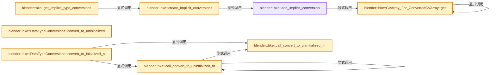

# 实现依赖专题：source/blender/blenkernel/intern/type_conversions.cc

[方向导航](README.md) · [符号索引](../%E7%AC%A6%E5%8F%B7%E4%BE%9D%E8%B5%96%E4%B8%8E%E5%AE%9E%E7%8E%B0%E7%B4%A2%E5%BC%95.md)

本专题从正文实际调用进入，集中保存共享实现。函数有稳定锚点，可从调用处直接跳到对应完整函数；递归与互相调用通过回链组织。

## 本文件的实现关系




## 完整成员与函数实现

<a id="f-edbae242da04fc9d"></a>

### `blender::bke::add_implicit_conversion`

实现位置：[source/blender/blenkernel/intern/type_conversions.cc](../../../../../source/blender/blenkernel/intern/type_conversions.cc) · L24—L48。

接口参数：

- `DataTypeConversions &conversions`

**教学注释版**

<!-- annotated:af3fe8835c9fdf -->

```cpp
template<typename From, typename To, To (*ConversionF)(const From &)>
static void add_implicit_conversion(DataTypeConversions &conversions)
{
  static const CPPType &from_type = CPPType::get<From>();
  static const CPPType &to_type = CPPType::get<To>();
  static const std::string conversion_name = from_type.name() + " to " + to_type.name();

  static auto multi_function = mf::build::SI1_SO<From, To>(
      conversion_name.c_str(),
      /* Use lambda instead of passing #ConversionF directly, because otherwise the compiler won't
       * inline the function. */
      [](const From &a) { return ConversionF(a); },
      mf::build::exec_presets::AllSpanOrSingle());
  static auto convert_single_to_initialized = [](const void *src, void *dst) {
    *static_cast<To *>(dst) = ConversionF(*static_cast<const From *>(src));
  };
  static auto convert_single_to_uninitialized = [](const void *src, void *dst) {
    new (dst) To(ConversionF(*static_cast<const From *>(src)));
  };
  conversions.add(mf::DataType::ForSingle<From>(),
                  mf::DataType::ForSingle<To>(),
                  multi_function,
                  convert_single_to_initialized,
                  convert_single_to_uninitialized);
}
```

<details>
<summary>核对原始源码：source/blender/blenkernel/intern/type_conversions.cc · L24—L48</summary>

<!-- original:af3fe8835c9fdf:source/blender/blenkernel/intern/type_conversions.cc:24:48 -->

```cpp
template<typename From, typename To, To (*ConversionF)(const From &)>
static void add_implicit_conversion(DataTypeConversions &conversions)
{
  static const CPPType &from_type = CPPType::get<From>();
  static const CPPType &to_type = CPPType::get<To>();
  static const std::string conversion_name = from_type.name() + " to " + to_type.name();

  static auto multi_function = mf::build::SI1_SO<From, To>(
      conversion_name.c_str(),
      /* Use lambda instead of passing #ConversionF directly, because otherwise the compiler won't
       * inline the function. */
      [](const From &a) { return ConversionF(a); },
      mf::build::exec_presets::AllSpanOrSingle());
  static auto convert_single_to_initialized = [](const void *src, void *dst) {
    *static_cast<To *>(dst) = ConversionF(*static_cast<const From *>(src));
  };
  static auto convert_single_to_uninitialized = [](const void *src, void *dst) {
    new (dst) To(ConversionF(*static_cast<const From *>(src)));
  };
  conversions.add(mf::DataType::ForSingle<From>(),
                  mf::DataType::ForSingle<To>(),
                  multi_function,
                  convert_single_to_initialized,
                  convert_single_to_uninitialized);
}
```

</details>

**继续追踪实现**

- `CPPType::get<From>` → [blender::bke::GVArray_For_ConvertedGVArray::get · L865](%E4%BE%9D%E8%B5%96-type_conversions-3b750b.md#f-770dbefd3b1de984)；[blender::bke::GVMutableArray_For_ConvertedGVMutableArray::get · L932](%E4%BE%9D%E8%B5%96-type_conversions-3b750b.md#f-af5943d096725eba)。同名重载需按实参类型选择。
- `CPPType::get<To>` → [blender::bke::GVArray_For_ConvertedGVArray::get · L865](%E4%BE%9D%E8%B5%96-type_conversions-3b750b.md#f-770dbefd3b1de984)；[blender::bke::GVMutableArray_For_ConvertedGVMutableArray::get · L932](%E4%BE%9D%E8%B5%96-type_conversions-3b750b.md#f-af5943d096725eba)。同名重载需按实参类型选择。
- `from_type.name` → [blender::CPPType::name · L497](../03-%E5%86%85%E5%AD%98%E5%88%86%E9%85%8D%E4%B8%8E%E8%BF%90%E8%A1%8C%E6%97%B6%E7%B1%BB%E5%9E%8B/08-CPPType%E6%9E%84%E9%80%A0%E4%B8%8E%E6%9E%90%E6%9E%84.md#f-e5ab6239f7e97c8e)。
- `to_type.name` → [blender::CPPType::name · L497](../03-%E5%86%85%E5%AD%98%E5%88%86%E9%85%8D%E4%B8%8E%E8%BF%90%E8%A1%8C%E6%97%B6%E7%B1%BB%E5%9E%8B/08-CPPType%E6%9E%84%E9%80%A0%E4%B8%8E%E6%9E%90%E6%9E%84.md#f-e5ab6239f7e97c8e)。
- `mf::build::SI1_SO<From, To>` → [blender::fn::multi_function::build::SI1_SO · L552](../07-MultiFunction%E4%B8%8E%E6%89%B9%E9%87%8F%E6%89%A7%E8%A1%8C/06-%E5%87%BD%E6%95%B0%E6%9E%84%E5%BB%BA%E5%99%A8.md#f-436db9c1ae3c5c8f)。
- `conversion_name.c_str` → [外部契约](https://eel.is/c++draft/)：这个边界按实际表达式及所属类型核对参数、返回值、寿命与失败行为。这里提供接口入口，不声称已解释该第三方版本的内部实现。
- `ConversionF` → [调用协议](../%E6%A8%A1%E6%9D%BF%E5%AE%8F%E4%B8%8E%E5%8A%A8%E6%80%81%E5%88%86%E6%B4%BE%E5%8D%8F%E8%AE%AE.md)：函数指针、局部可调用对象或未展开的宏；必须结合调用者环境。调用位置L35。
- `mf::build::exec_presets::AllSpanOrSingle` → [blender::fn::multi_function::build::exec_presets::AllSpanOrSingle](../07-MultiFunction%E4%B8%8E%E6%89%B9%E9%87%8F%E6%89%A7%E8%A1%8C/%E4%BE%9D%E8%B5%96-FN_multi_function_builder-404df7.md#t-270ed26a4400)。
- `conversions.add` → [blender::bke::DataTypeConversions::add · L27](%E4%BE%9D%E8%B5%96-BKE_type_conversions-74e976.md#f-9c167a3f5a254c6f)。
- `mf::DataType::ForSingle<From>` → [blender::fn::multi_function::DataType::ForSingle · L65](../07-MultiFunction%E4%B8%8E%E6%89%B9%E9%87%8F%E6%89%A7%E8%A1%8C/03-%E5%8F%82%E6%95%B0%E7%B1%BB%E5%9E%8B%E4%B8%8E%E8%A7%92%E8%89%B2.md#f-e041e357ea765818)；[blender::fn::multi_function::DataType::ForSingle · L75](../07-MultiFunction%E4%B8%8E%E6%89%B9%E9%87%8F%E6%89%A7%E8%A1%8C/03-%E5%8F%82%E6%95%B0%E7%B1%BB%E5%9E%8B%E4%B8%8E%E8%A7%92%E8%89%B2.md#f-ffb4bc870ea750f6)。同名重载需按实参类型选择。
- `mf::DataType::ForSingle<To>` → [blender::fn::multi_function::DataType::ForSingle · L65](../07-MultiFunction%E4%B8%8E%E6%89%B9%E9%87%8F%E6%89%A7%E8%A1%8C/03-%E5%8F%82%E6%95%B0%E7%B1%BB%E5%9E%8B%E4%B8%8E%E8%A7%92%E8%89%B2.md#f-e041e357ea765818)；[blender::fn::multi_function::DataType::ForSingle · L75](../07-MultiFunction%E4%B8%8E%E6%89%B9%E9%87%8F%E6%89%A7%E8%A1%8C/03-%E5%8F%82%E6%95%B0%E7%B1%BB%E5%9E%8B%E4%B8%8E%E8%A7%92%E8%89%B2.md#f-ffb4bc870ea750f6)。同名重载需按实参类型选择。

<a id="f-7254569d6d9c5a7f"></a>

### `blender::bke::create_implicit_conversions`

实现位置：[source/blender/blenkernel/intern/type_conversions.cc](../../../../../source/blender/blenkernel/intern/type_conversions.cc) · L630—L790。

**教学注释版**

<!-- annotated:07243dec154aad -->

```cpp
static DataTypeConversions create_implicit_conversions()
{
  DataTypeConversions conversions;

  add_implicit_conversion<float, float2, float_to_float2>(conversions);
  add_implicit_conversion<float, float3, float_to_float3>(conversions);
  add_implicit_conversion<float, float4, float_to_float4>(conversions);
  add_implicit_conversion<float, int32_t, float_to_int>(conversions);
  add_implicit_conversion<float, short2, float_to_short2>(conversions);
  add_implicit_conversion<float, int2, float_to_int2>(conversions);
  add_implicit_conversion<float, int3, float_to_int3>(conversions);
  add_implicit_conversion<float, bool, float_to_bool>(conversions);
  add_implicit_conversion<float, int8_t, float_to_int8>(conversions);
  add_implicit_conversion<float, ColorGeometry4f, float_to_color>(conversions);
  add_implicit_conversion<float, ColorGeometry4b, float_to_byte_color>(conversions);
  add_implicit_conversion<float, math::Quaternion, float_to_quaternion>(conversions);

  add_implicit_conversion<float2, float3, float2_to_float3>(conversions);
  add_implicit_conversion<float2, float4, float2_to_float4>(conversions);
  add_implicit_conversion<float2, float, float2_to_float>(conversions);
  add_implicit_conversion<float2, int32_t, float2_to_int>(conversions);
  add_implicit_conversion<float2, short2, float2_to_short2>(conversions);
  add_implicit_conversion<float2, int2, float2_to_int2>(conversions);
  add_implicit_conversion<float2, int3, float2_to_int3>(conversions);
  add_implicit_conversion<float2, bool, float2_to_bool>(conversions);
  add_implicit_conversion<float2, int8_t, float2_to_int8>(conversions);
  add_implicit_conversion<float2, ColorGeometry4f, float2_to_color>(conversions);
  add_implicit_conversion<float2, ColorGeometry4b, float2_to_byte_color>(conversions);
  add_implicit_conversion<float2, math::Quaternion, float2_to_quaternion>(conversions);

  add_implicit_conversion<float3, bool, float3_to_bool>(conversions);
  add_implicit_conversion<float3, int8_t, float3_to_int8>(conversions);
  add_implicit_conversion<float3, float, float3_to_float>(conversions);
  add_implicit_conversion<float3, int32_t, float3_to_int>(conversions);
  add_implicit_conversion<float3, short2, float3_to_short2>(conversions);
  add_implicit_conversion<float3, int2, float3_to_int2>(conversions);
  add_implicit_conversion<float3, int3, float3_to_int3>(conversions);
  add_implicit_conversion<float3, float2, float3_to_float2>(conversions);
  add_implicit_conversion<float3, float4, float3_to_float4>(conversions);
  add_implicit_conversion<float3, ColorGeometry4f, float3_to_color>(conversions);
  add_implicit_conversion<float3, ColorGeometry4b, float3_to_byte_color>(conversions);
  add_implicit_conversion<float3, math::Quaternion, float3_to_quaternion>(conversions);

  add_implicit_conversion<float4, bool, float4_to_bool>(conversions);
  add_implicit_conversion<float4, int8_t, float4_to_int8>(conversions);
  add_implicit_conversion<float4, float, float4_to_float>(conversions);
  add_implicit_conversion<float4, int32_t, float4_to_int>(conversions);
  add_implicit_conversion<float4, short2, float4_to_short2>(conversions);
  add_implicit_conversion<float4, int2, float4_to_int2>(conversions);
  add_implicit_conversion<float4, int3, float4_to_int3>(conversions);
  add_implicit_conversion<float4, float2, float4_to_float2>(conversions);
  add_implicit_conversion<float4, float3, float4_to_float3>(conversions);
  add_implicit_conversion<float4, ColorGeometry4f, float4_to_color>(conversions);
  add_implicit_conversion<float4, ColorGeometry4b, float4_to_byte_color>(conversions);
  add_implicit_conversion<float4, math::Quaternion, float4_to_quaternion>(conversions);

  add_implicit_conversion<int32_t, bool, int_to_bool>(conversions);
  add_implicit_conversion<int32_t, int8_t, int_to_int8>(conversions);
  add_implicit_conversion<int32_t, short2, int_to_short2>(conversions);
  add_implicit_conversion<int32_t, int2, int_to_int2>(conversions);
  add_implicit_conversion<int32_t, int3, int_to_int3>(conversions);
  add_implicit_conversion<int32_t, float, int_to_float>(conversions);
  add_implicit_conversion<int32_t, float2, int_to_float2>(conversions);
  add_implicit_conversion<int32_t, float3, int_to_float3>(conversions);
  add_implicit_conversion<int32_t, float4, int_to_float4>(conversions);
  add_implicit_conversion<int32_t, ColorGeometry4f, int_to_color>(conversions);
  add_implicit_conversion<int32_t, ColorGeometry4b, int_to_byte_color>(conversions);

  add_implicit_conversion<short2, bool, short2_to_bool>(conversions);
  add_implicit_conversion<short2, int8_t, short2_to_int8>(conversions);
  add_implicit_conversion<short2, int, short2_to_int>(conversions);
  add_implicit_conversion<short2, int2, short2_to_int2>(conversions);
  add_implicit_conversion<short2, int3, short2_to_int3>(conversions);
  add_implicit_conversion<short2, float, short2_to_float>(conversions);
  add_implicit_conversion<short2, float2, short2_to_float2>(conversions);
  add_implicit_conversion<short2, float3, short2_to_float3>(conversions);
  add_implicit_conversion<short2, float4, short2_to_float4>(conversions);
  add_implicit_conversion<short2, ColorGeometry4f, short2_to_color>(conversions);
  add_implicit_conversion<short2, ColorGeometry4b, short2_to_byte_color>(conversions);

  add_implicit_conversion<int2, bool, int2_to_bool>(conversions);
  add_implicit_conversion<int2, int8_t, int2_to_int8>(conversions);
  add_implicit_conversion<int2, int, int2_to_int>(conversions);
  add_implicit_conversion<int2, int3, int2_to_int3>(conversions);
  add_implicit_conversion<int2, short2, int2_to_short2>(conversions);
  add_implicit_conversion<int2, float, int2_to_float>(conversions);
  add_implicit_conversion<int2, float2, int2_to_float2>(conversions);
  add_implicit_conversion<int2, float3, int2_to_float3>(conversions);
  add_implicit_conversion<int2, float4, int2_to_float4>(conversions);
  add_implicit_conversion<int2, ColorGeometry4f, int2_to_color>(conversions);
  add_implicit_conversion<int2, ColorGeometry4b, int2_to_byte_color>(conversions);

  add_implicit_conversion<int3, bool, int3_to_bool>(conversions);
  add_implicit_conversion<int3, int8_t, int3_to_int8>(conversions);
  add_implicit_conversion<int3, int, int3_to_int>(conversions);
  add_implicit_conversion<int3, int2, int3_to_int2>(conversions);
  add_implicit_conversion<int3, short2, int3_to_short2>(conversions);
  add_implicit_conversion<int3, float, int3_to_float>(conversions);
  add_implicit_conversion<int3, float2, int3_to_float2>(conversions);
  add_implicit_conversion<int3, float3, int3_to_float3>(conversions);
  add_implicit_conversion<int3, float4, int3_to_float4>(conversions);
  add_implicit_conversion<int3, ColorGeometry4f, int3_to_color>(conversions);
  add_implicit_conversion<int3, ColorGeometry4b, int3_to_byte_color>(conversions);

  add_implicit_conversion<int8_t, bool, int8_to_bool>(conversions);
  add_implicit_conversion<int8_t, int32_t, int8_to_int>(conversions);
  add_implicit_conversion<int8_t, short2, int8_to_short2>(conversions);
  add_implicit_conversion<int8_t, int2, int8_to_int2>(conversions);
  add_implicit_conversion<int8_t, int3, int8_to_int3>(conversions);
  add_implicit_conversion<int8_t, float, int8_to_float>(conversions);
  add_implicit_conversion<int8_t, float2, int8_to_float2>(conversions);
  add_implicit_conversion<int8_t, float3, int8_to_float3>(conversions);
  add_implicit_conversion<int8_t, float4, int8_to_float4>(conversions);
  add_implicit_conversion<int8_t, ColorGeometry4f, int8_to_color>(conversions);
  add_implicit_conversion<int8_t, ColorGeometry4b, int8_to_byte_color>(conversions);

  add_implicit_conversion<bool, float, bool_to_float>(conversions);
  add_implicit_conversion<bool, int8_t, bool_to_int8>(conversions);
  add_implicit_conversion<bool, int32_t, bool_to_int>(conversions);
  add_implicit_conversion<bool, short2, bool_to_short2>(conversions);
  add_implicit_conversion<bool, int2, bool_to_int2>(conversions);
  add_implicit_conversion<bool, int3, bool_to_int3>(conversions);
  add_implicit_conversion<bool, float2, bool_to_float2>(conversions);
  add_implicit_conversion<bool, float3, bool_to_float3>(conversions);
  add_implicit_conversion<bool, float4, bool_to_float4>(conversions);
  add_implicit_conversion<bool, ColorGeometry4f, bool_to_color>(conversions);
  add_implicit_conversion<bool, ColorGeometry4b, bool_to_byte_color>(conversions);

  add_implicit_conversion<ColorGeometry4f, bool, color_to_bool>(conversions);
  add_implicit_conversion<ColorGeometry4f, int8_t, color_to_int8>(conversions);
  add_implicit_conversion<ColorGeometry4f, float, color_to_float>(conversions);
  add_implicit_conversion<ColorGeometry4f, int32_t, color_to_int>(conversions);
  add_implicit_conversion<ColorGeometry4f, short2, color_to_short2>(conversions);
  add_implicit_conversion<ColorGeometry4f, int2, color_to_int2>(conversions);
  add_implicit_conversion<ColorGeometry4f, int3, color_to_int3>(conversions);
  add_implicit_conversion<ColorGeometry4f, float2, color_to_float2>(conversions);
  add_implicit_conversion<ColorGeometry4f, float3, color_to_float3>(conversions);
  add_implicit_conversion<ColorGeometry4f, float4, color_to_float4>(conversions);
  add_implicit_conversion<ColorGeometry4f, ColorGeometry4b, color_to_byte_color>(conversions);

  add_implicit_conversion<ColorGeometry4b, bool, byte_color_to_bool>(conversions);
  add_implicit_conversion<ColorGeometry4b, int8_t, byte_color_to_int8>(conversions);
  add_implicit_conversion<ColorGeometry4b, float, byte_color_to_float>(conversions);
  add_implicit_conversion<ColorGeometry4b, int32_t, byte_color_to_int>(conversions);
  add_implicit_conversion<ColorGeometry4b, short2, byte_color_to_short2>(conversions);
  add_implicit_conversion<ColorGeometry4b, int2, byte_color_to_int2>(conversions);
  add_implicit_conversion<ColorGeometry4b, int3, byte_color_to_int3>(conversions);
  add_implicit_conversion<ColorGeometry4b, float2, byte_color_to_float2>(conversions);
  add_implicit_conversion<ColorGeometry4b, float3, byte_color_to_float3>(conversions);
  add_implicit_conversion<ColorGeometry4b, float4, byte_color_to_float4>(conversions);
  add_implicit_conversion<ColorGeometry4b, ColorGeometry4f, byte_color_to_color>(conversions);

  add_implicit_conversion<float4x4, math::Quaternion, float4x4_to_quaternion>(conversions);

  add_implicit_conversion<math::Quaternion, float2, quaternion_to_float2>(conversions);
  add_implicit_conversion<math::Quaternion, float3, quaternion_to_float3>(conversions);
  add_implicit_conversion<math::Quaternion, float4, quaternion_to_float4>(conversions);
  add_implicit_conversion<math::Quaternion, float4x4, quaternion_to_float4x4>(conversions);

  return conversions;
}
```

<details>
<summary>核对原始源码：source/blender/blenkernel/intern/type_conversions.cc · L630—L790</summary>

<!-- original:07243dec154aad:source/blender/blenkernel/intern/type_conversions.cc:630:790 -->

```cpp
static DataTypeConversions create_implicit_conversions()
{
  DataTypeConversions conversions;

  add_implicit_conversion<float, float2, float_to_float2>(conversions);
  add_implicit_conversion<float, float3, float_to_float3>(conversions);
  add_implicit_conversion<float, float4, float_to_float4>(conversions);
  add_implicit_conversion<float, int32_t, float_to_int>(conversions);
  add_implicit_conversion<float, short2, float_to_short2>(conversions);
  add_implicit_conversion<float, int2, float_to_int2>(conversions);
  add_implicit_conversion<float, int3, float_to_int3>(conversions);
  add_implicit_conversion<float, bool, float_to_bool>(conversions);
  add_implicit_conversion<float, int8_t, float_to_int8>(conversions);
  add_implicit_conversion<float, ColorGeometry4f, float_to_color>(conversions);
  add_implicit_conversion<float, ColorGeometry4b, float_to_byte_color>(conversions);
  add_implicit_conversion<float, math::Quaternion, float_to_quaternion>(conversions);

  add_implicit_conversion<float2, float3, float2_to_float3>(conversions);
  add_implicit_conversion<float2, float4, float2_to_float4>(conversions);
  add_implicit_conversion<float2, float, float2_to_float>(conversions);
  add_implicit_conversion<float2, int32_t, float2_to_int>(conversions);
  add_implicit_conversion<float2, short2, float2_to_short2>(conversions);
  add_implicit_conversion<float2, int2, float2_to_int2>(conversions);
  add_implicit_conversion<float2, int3, float2_to_int3>(conversions);
  add_implicit_conversion<float2, bool, float2_to_bool>(conversions);
  add_implicit_conversion<float2, int8_t, float2_to_int8>(conversions);
  add_implicit_conversion<float2, ColorGeometry4f, float2_to_color>(conversions);
  add_implicit_conversion<float2, ColorGeometry4b, float2_to_byte_color>(conversions);
  add_implicit_conversion<float2, math::Quaternion, float2_to_quaternion>(conversions);

  add_implicit_conversion<float3, bool, float3_to_bool>(conversions);
  add_implicit_conversion<float3, int8_t, float3_to_int8>(conversions);
  add_implicit_conversion<float3, float, float3_to_float>(conversions);
  add_implicit_conversion<float3, int32_t, float3_to_int>(conversions);
  add_implicit_conversion<float3, short2, float3_to_short2>(conversions);
  add_implicit_conversion<float3, int2, float3_to_int2>(conversions);
  add_implicit_conversion<float3, int3, float3_to_int3>(conversions);
  add_implicit_conversion<float3, float2, float3_to_float2>(conversions);
  add_implicit_conversion<float3, float4, float3_to_float4>(conversions);
  add_implicit_conversion<float3, ColorGeometry4f, float3_to_color>(conversions);
  add_implicit_conversion<float3, ColorGeometry4b, float3_to_byte_color>(conversions);
  add_implicit_conversion<float3, math::Quaternion, float3_to_quaternion>(conversions);

  add_implicit_conversion<float4, bool, float4_to_bool>(conversions);
  add_implicit_conversion<float4, int8_t, float4_to_int8>(conversions);
  add_implicit_conversion<float4, float, float4_to_float>(conversions);
  add_implicit_conversion<float4, int32_t, float4_to_int>(conversions);
  add_implicit_conversion<float4, short2, float4_to_short2>(conversions);
  add_implicit_conversion<float4, int2, float4_to_int2>(conversions);
  add_implicit_conversion<float4, int3, float4_to_int3>(conversions);
  add_implicit_conversion<float4, float2, float4_to_float2>(conversions);
  add_implicit_conversion<float4, float3, float4_to_float3>(conversions);
  add_implicit_conversion<float4, ColorGeometry4f, float4_to_color>(conversions);
  add_implicit_conversion<float4, ColorGeometry4b, float4_to_byte_color>(conversions);
  add_implicit_conversion<float4, math::Quaternion, float4_to_quaternion>(conversions);

  add_implicit_conversion<int32_t, bool, int_to_bool>(conversions);
  add_implicit_conversion<int32_t, int8_t, int_to_int8>(conversions);
  add_implicit_conversion<int32_t, short2, int_to_short2>(conversions);
  add_implicit_conversion<int32_t, int2, int_to_int2>(conversions);
  add_implicit_conversion<int32_t, int3, int_to_int3>(conversions);
  add_implicit_conversion<int32_t, float, int_to_float>(conversions);
  add_implicit_conversion<int32_t, float2, int_to_float2>(conversions);
  add_implicit_conversion<int32_t, float3, int_to_float3>(conversions);
  add_implicit_conversion<int32_t, float4, int_to_float4>(conversions);
  add_implicit_conversion<int32_t, ColorGeometry4f, int_to_color>(conversions);
  add_implicit_conversion<int32_t, ColorGeometry4b, int_to_byte_color>(conversions);

  add_implicit_conversion<short2, bool, short2_to_bool>(conversions);
  add_implicit_conversion<short2, int8_t, short2_to_int8>(conversions);
  add_implicit_conversion<short2, int, short2_to_int>(conversions);
  add_implicit_conversion<short2, int2, short2_to_int2>(conversions);
  add_implicit_conversion<short2, int3, short2_to_int3>(conversions);
  add_implicit_conversion<short2, float, short2_to_float>(conversions);
  add_implicit_conversion<short2, float2, short2_to_float2>(conversions);
  add_implicit_conversion<short2, float3, short2_to_float3>(conversions);
  add_implicit_conversion<short2, float4, short2_to_float4>(conversions);
  add_implicit_conversion<short2, ColorGeometry4f, short2_to_color>(conversions);
  add_implicit_conversion<short2, ColorGeometry4b, short2_to_byte_color>(conversions);

  add_implicit_conversion<int2, bool, int2_to_bool>(conversions);
  add_implicit_conversion<int2, int8_t, int2_to_int8>(conversions);
  add_implicit_conversion<int2, int, int2_to_int>(conversions);
  add_implicit_conversion<int2, int3, int2_to_int3>(conversions);
  add_implicit_conversion<int2, short2, int2_to_short2>(conversions);
  add_implicit_conversion<int2, float, int2_to_float>(conversions);
  add_implicit_conversion<int2, float2, int2_to_float2>(conversions);
  add_implicit_conversion<int2, float3, int2_to_float3>(conversions);
  add_implicit_conversion<int2, float4, int2_to_float4>(conversions);
  add_implicit_conversion<int2, ColorGeometry4f, int2_to_color>(conversions);
  add_implicit_conversion<int2, ColorGeometry4b, int2_to_byte_color>(conversions);

  add_implicit_conversion<int3, bool, int3_to_bool>(conversions);
  add_implicit_conversion<int3, int8_t, int3_to_int8>(conversions);
  add_implicit_conversion<int3, int, int3_to_int>(conversions);
  add_implicit_conversion<int3, int2, int3_to_int2>(conversions);
  add_implicit_conversion<int3, short2, int3_to_short2>(conversions);
  add_implicit_conversion<int3, float, int3_to_float>(conversions);
  add_implicit_conversion<int3, float2, int3_to_float2>(conversions);
  add_implicit_conversion<int3, float3, int3_to_float3>(conversions);
  add_implicit_conversion<int3, float4, int3_to_float4>(conversions);
  add_implicit_conversion<int3, ColorGeometry4f, int3_to_color>(conversions);
  add_implicit_conversion<int3, ColorGeometry4b, int3_to_byte_color>(conversions);

  add_implicit_conversion<int8_t, bool, int8_to_bool>(conversions);
  add_implicit_conversion<int8_t, int32_t, int8_to_int>(conversions);
  add_implicit_conversion<int8_t, short2, int8_to_short2>(conversions);
  add_implicit_conversion<int8_t, int2, int8_to_int2>(conversions);
  add_implicit_conversion<int8_t, int3, int8_to_int3>(conversions);
  add_implicit_conversion<int8_t, float, int8_to_float>(conversions);
  add_implicit_conversion<int8_t, float2, int8_to_float2>(conversions);
  add_implicit_conversion<int8_t, float3, int8_to_float3>(conversions);
  add_implicit_conversion<int8_t, float4, int8_to_float4>(conversions);
  add_implicit_conversion<int8_t, ColorGeometry4f, int8_to_color>(conversions);
  add_implicit_conversion<int8_t, ColorGeometry4b, int8_to_byte_color>(conversions);

  add_implicit_conversion<bool, float, bool_to_float>(conversions);
  add_implicit_conversion<bool, int8_t, bool_to_int8>(conversions);
  add_implicit_conversion<bool, int32_t, bool_to_int>(conversions);
  add_implicit_conversion<bool, short2, bool_to_short2>(conversions);
  add_implicit_conversion<bool, int2, bool_to_int2>(conversions);
  add_implicit_conversion<bool, int3, bool_to_int3>(conversions);
  add_implicit_conversion<bool, float2, bool_to_float2>(conversions);
  add_implicit_conversion<bool, float3, bool_to_float3>(conversions);
  add_implicit_conversion<bool, float4, bool_to_float4>(conversions);
  add_implicit_conversion<bool, ColorGeometry4f, bool_to_color>(conversions);
  add_implicit_conversion<bool, ColorGeometry4b, bool_to_byte_color>(conversions);

  add_implicit_conversion<ColorGeometry4f, bool, color_to_bool>(conversions);
  add_implicit_conversion<ColorGeometry4f, int8_t, color_to_int8>(conversions);
  add_implicit_conversion<ColorGeometry4f, float, color_to_float>(conversions);
  add_implicit_conversion<ColorGeometry4f, int32_t, color_to_int>(conversions);
  add_implicit_conversion<ColorGeometry4f, short2, color_to_short2>(conversions);
  add_implicit_conversion<ColorGeometry4f, int2, color_to_int2>(conversions);
  add_implicit_conversion<ColorGeometry4f, int3, color_to_int3>(conversions);
  add_implicit_conversion<ColorGeometry4f, float2, color_to_float2>(conversions);
  add_implicit_conversion<ColorGeometry4f, float3, color_to_float3>(conversions);
  add_implicit_conversion<ColorGeometry4f, float4, color_to_float4>(conversions);
  add_implicit_conversion<ColorGeometry4f, ColorGeometry4b, color_to_byte_color>(conversions);

  add_implicit_conversion<ColorGeometry4b, bool, byte_color_to_bool>(conversions);
  add_implicit_conversion<ColorGeometry4b, int8_t, byte_color_to_int8>(conversions);
  add_implicit_conversion<ColorGeometry4b, float, byte_color_to_float>(conversions);
  add_implicit_conversion<ColorGeometry4b, int32_t, byte_color_to_int>(conversions);
  add_implicit_conversion<ColorGeometry4b, short2, byte_color_to_short2>(conversions);
  add_implicit_conversion<ColorGeometry4b, int2, byte_color_to_int2>(conversions);
  add_implicit_conversion<ColorGeometry4b, int3, byte_color_to_int3>(conversions);
  add_implicit_conversion<ColorGeometry4b, float2, byte_color_to_float2>(conversions);
  add_implicit_conversion<ColorGeometry4b, float3, byte_color_to_float3>(conversions);
  add_implicit_conversion<ColorGeometry4b, float4, byte_color_to_float4>(conversions);
  add_implicit_conversion<ColorGeometry4b, ColorGeometry4f, byte_color_to_color>(conversions);

  add_implicit_conversion<float4x4, math::Quaternion, float4x4_to_quaternion>(conversions);

  add_implicit_conversion<math::Quaternion, float2, quaternion_to_float2>(conversions);
  add_implicit_conversion<math::Quaternion, float3, quaternion_to_float3>(conversions);
  add_implicit_conversion<math::Quaternion, float4, quaternion_to_float4>(conversions);
  add_implicit_conversion<math::Quaternion, float4x4, quaternion_to_float4x4>(conversions);

  return conversions;
}
```

</details>

**结果出口**

- `return conversions;`

**继续追踪实现**

- `add_implicit_conversion<float, float2, float_to_float2>` → [blender::bke::add_implicit_conversion · L24](%E4%BE%9D%E8%B5%96-type_conversions-3b750b.md#f-edbae242da04fc9d)。
- `add_implicit_conversion<float, float3, float_to_float3>` → [blender::bke::add_implicit_conversion · L24](%E4%BE%9D%E8%B5%96-type_conversions-3b750b.md#f-edbae242da04fc9d)。
- `add_implicit_conversion<float, float4, float_to_float4>` → [blender::bke::add_implicit_conversion · L24](%E4%BE%9D%E8%B5%96-type_conversions-3b750b.md#f-edbae242da04fc9d)。
- `add_implicit_conversion<float, int32_t, float_to_int>` → [blender::bke::add_implicit_conversion · L24](%E4%BE%9D%E8%B5%96-type_conversions-3b750b.md#f-edbae242da04fc9d)。
- `add_implicit_conversion<float, short2, float_to_short2>` → [blender::bke::add_implicit_conversion · L24](%E4%BE%9D%E8%B5%96-type_conversions-3b750b.md#f-edbae242da04fc9d)。
- `add_implicit_conversion<float, int2, float_to_int2>` → [blender::bke::add_implicit_conversion · L24](%E4%BE%9D%E8%B5%96-type_conversions-3b750b.md#f-edbae242da04fc9d)。
- `add_implicit_conversion<float, int3, float_to_int3>` → [blender::bke::add_implicit_conversion · L24](%E4%BE%9D%E8%B5%96-type_conversions-3b750b.md#f-edbae242da04fc9d)。
- `add_implicit_conversion<float, bool, float_to_bool>` → [blender::bke::add_implicit_conversion · L24](%E4%BE%9D%E8%B5%96-type_conversions-3b750b.md#f-edbae242da04fc9d)。
- `add_implicit_conversion<float, int8_t, float_to_int8>` → [blender::bke::add_implicit_conversion · L24](%E4%BE%9D%E8%B5%96-type_conversions-3b750b.md#f-edbae242da04fc9d)。
- `add_implicit_conversion<float, ColorGeometry4f, float_to_color>` → [blender::bke::add_implicit_conversion · L24](%E4%BE%9D%E8%B5%96-type_conversions-3b750b.md#f-edbae242da04fc9d)。
- `add_implicit_conversion<float, ColorGeometry4b, float_to_byte_color>` → [blender::bke::add_implicit_conversion · L24](%E4%BE%9D%E8%B5%96-type_conversions-3b750b.md#f-edbae242da04fc9d)。
- `add_implicit_conversion<float, math::Quaternion, float_to_quaternion>` → [blender::bke::add_implicit_conversion · L24](%E4%BE%9D%E8%B5%96-type_conversions-3b750b.md#f-edbae242da04fc9d)。
- `add_implicit_conversion<float2, float3, float2_to_float3>` → [blender::bke::add_implicit_conversion · L24](%E4%BE%9D%E8%B5%96-type_conversions-3b750b.md#f-edbae242da04fc9d)。
- `add_implicit_conversion<float2, float4, float2_to_float4>` → [blender::bke::add_implicit_conversion · L24](%E4%BE%9D%E8%B5%96-type_conversions-3b750b.md#f-edbae242da04fc9d)。
- `add_implicit_conversion<float2, float, float2_to_float>` → [blender::bke::add_implicit_conversion · L24](%E4%BE%9D%E8%B5%96-type_conversions-3b750b.md#f-edbae242da04fc9d)。
- `add_implicit_conversion<float2, int32_t, float2_to_int>` → [blender::bke::add_implicit_conversion · L24](%E4%BE%9D%E8%B5%96-type_conversions-3b750b.md#f-edbae242da04fc9d)。
- `add_implicit_conversion<float2, short2, float2_to_short2>` → [blender::bke::add_implicit_conversion · L24](%E4%BE%9D%E8%B5%96-type_conversions-3b750b.md#f-edbae242da04fc9d)。
- `add_implicit_conversion<float2, int2, float2_to_int2>` → [blender::bke::add_implicit_conversion · L24](%E4%BE%9D%E8%B5%96-type_conversions-3b750b.md#f-edbae242da04fc9d)。
- `add_implicit_conversion<float2, int3, float2_to_int3>` → [blender::bke::add_implicit_conversion · L24](%E4%BE%9D%E8%B5%96-type_conversions-3b750b.md#f-edbae242da04fc9d)。
- `add_implicit_conversion<float2, bool, float2_to_bool>` → [blender::bke::add_implicit_conversion · L24](%E4%BE%9D%E8%B5%96-type_conversions-3b750b.md#f-edbae242da04fc9d)。
- `add_implicit_conversion<float2, int8_t, float2_to_int8>` → [blender::bke::add_implicit_conversion · L24](%E4%BE%9D%E8%B5%96-type_conversions-3b750b.md#f-edbae242da04fc9d)。
- `add_implicit_conversion<float2, ColorGeometry4f, float2_to_color>` → [blender::bke::add_implicit_conversion · L24](%E4%BE%9D%E8%B5%96-type_conversions-3b750b.md#f-edbae242da04fc9d)。
- `add_implicit_conversion<float2, ColorGeometry4b, float2_to_byte_color>` → [blender::bke::add_implicit_conversion · L24](%E4%BE%9D%E8%B5%96-type_conversions-3b750b.md#f-edbae242da04fc9d)。
- `add_implicit_conversion<float2, math::Quaternion, float2_to_quaternion>` → [blender::bke::add_implicit_conversion · L24](%E4%BE%9D%E8%B5%96-type_conversions-3b750b.md#f-edbae242da04fc9d)。
- `add_implicit_conversion<float3, bool, float3_to_bool>` → [blender::bke::add_implicit_conversion · L24](%E4%BE%9D%E8%B5%96-type_conversions-3b750b.md#f-edbae242da04fc9d)。
- `add_implicit_conversion<float3, int8_t, float3_to_int8>` → [blender::bke::add_implicit_conversion · L24](%E4%BE%9D%E8%B5%96-type_conversions-3b750b.md#f-edbae242da04fc9d)。
- `add_implicit_conversion<float3, float, float3_to_float>` → [blender::bke::add_implicit_conversion · L24](%E4%BE%9D%E8%B5%96-type_conversions-3b750b.md#f-edbae242da04fc9d)。
- `add_implicit_conversion<float3, int32_t, float3_to_int>` → [blender::bke::add_implicit_conversion · L24](%E4%BE%9D%E8%B5%96-type_conversions-3b750b.md#f-edbae242da04fc9d)。
- `add_implicit_conversion<float3, short2, float3_to_short2>` → [blender::bke::add_implicit_conversion · L24](%E4%BE%9D%E8%B5%96-type_conversions-3b750b.md#f-edbae242da04fc9d)。
- `add_implicit_conversion<float3, int2, float3_to_int2>` → [blender::bke::add_implicit_conversion · L24](%E4%BE%9D%E8%B5%96-type_conversions-3b750b.md#f-edbae242da04fc9d)。
- `add_implicit_conversion<float3, int3, float3_to_int3>` → [blender::bke::add_implicit_conversion · L24](%E4%BE%9D%E8%B5%96-type_conversions-3b750b.md#f-edbae242da04fc9d)。
- `add_implicit_conversion<float3, float2, float3_to_float2>` → [blender::bke::add_implicit_conversion · L24](%E4%BE%9D%E8%B5%96-type_conversions-3b750b.md#f-edbae242da04fc9d)。
- `add_implicit_conversion<float3, float4, float3_to_float4>` → [blender::bke::add_implicit_conversion · L24](%E4%BE%9D%E8%B5%96-type_conversions-3b750b.md#f-edbae242da04fc9d)。
- `add_implicit_conversion<float3, ColorGeometry4f, float3_to_color>` → [blender::bke::add_implicit_conversion · L24](%E4%BE%9D%E8%B5%96-type_conversions-3b750b.md#f-edbae242da04fc9d)。
- `add_implicit_conversion<float3, ColorGeometry4b, float3_to_byte_color>` → [blender::bke::add_implicit_conversion · L24](%E4%BE%9D%E8%B5%96-type_conversions-3b750b.md#f-edbae242da04fc9d)。
- `add_implicit_conversion<float3, math::Quaternion, float3_to_quaternion>` → [blender::bke::add_implicit_conversion · L24](%E4%BE%9D%E8%B5%96-type_conversions-3b750b.md#f-edbae242da04fc9d)。
- `add_implicit_conversion<float4, bool, float4_to_bool>` → [blender::bke::add_implicit_conversion · L24](%E4%BE%9D%E8%B5%96-type_conversions-3b750b.md#f-edbae242da04fc9d)。
- `add_implicit_conversion<float4, int8_t, float4_to_int8>` → [blender::bke::add_implicit_conversion · L24](%E4%BE%9D%E8%B5%96-type_conversions-3b750b.md#f-edbae242da04fc9d)。
- `add_implicit_conversion<float4, float, float4_to_float>` → [blender::bke::add_implicit_conversion · L24](%E4%BE%9D%E8%B5%96-type_conversions-3b750b.md#f-edbae242da04fc9d)。
- `add_implicit_conversion<float4, int32_t, float4_to_int>` → [blender::bke::add_implicit_conversion · L24](%E4%BE%9D%E8%B5%96-type_conversions-3b750b.md#f-edbae242da04fc9d)。
- `add_implicit_conversion<float4, short2, float4_to_short2>` → [blender::bke::add_implicit_conversion · L24](%E4%BE%9D%E8%B5%96-type_conversions-3b750b.md#f-edbae242da04fc9d)。
- `add_implicit_conversion<float4, int2, float4_to_int2>` → [blender::bke::add_implicit_conversion · L24](%E4%BE%9D%E8%B5%96-type_conversions-3b750b.md#f-edbae242da04fc9d)。
- `add_implicit_conversion<float4, int3, float4_to_int3>` → [blender::bke::add_implicit_conversion · L24](%E4%BE%9D%E8%B5%96-type_conversions-3b750b.md#f-edbae242da04fc9d)。
- `add_implicit_conversion<float4, float2, float4_to_float2>` → [blender::bke::add_implicit_conversion · L24](%E4%BE%9D%E8%B5%96-type_conversions-3b750b.md#f-edbae242da04fc9d)。
- `add_implicit_conversion<float4, float3, float4_to_float3>` → [blender::bke::add_implicit_conversion · L24](%E4%BE%9D%E8%B5%96-type_conversions-3b750b.md#f-edbae242da04fc9d)。
- `add_implicit_conversion<float4, ColorGeometry4f, float4_to_color>` → [blender::bke::add_implicit_conversion · L24](%E4%BE%9D%E8%B5%96-type_conversions-3b750b.md#f-edbae242da04fc9d)。
- `add_implicit_conversion<float4, ColorGeometry4b, float4_to_byte_color>` → [blender::bke::add_implicit_conversion · L24](%E4%BE%9D%E8%B5%96-type_conversions-3b750b.md#f-edbae242da04fc9d)。
- `add_implicit_conversion<float4, math::Quaternion, float4_to_quaternion>` → [blender::bke::add_implicit_conversion · L24](%E4%BE%9D%E8%B5%96-type_conversions-3b750b.md#f-edbae242da04fc9d)。
- `add_implicit_conversion<int32_t, bool, int_to_bool>` → [blender::bke::add_implicit_conversion · L24](%E4%BE%9D%E8%B5%96-type_conversions-3b750b.md#f-edbae242da04fc9d)。
- `add_implicit_conversion<int32_t, int8_t, int_to_int8>` → [blender::bke::add_implicit_conversion · L24](%E4%BE%9D%E8%B5%96-type_conversions-3b750b.md#f-edbae242da04fc9d)。
- `add_implicit_conversion<int32_t, short2, int_to_short2>` → [blender::bke::add_implicit_conversion · L24](%E4%BE%9D%E8%B5%96-type_conversions-3b750b.md#f-edbae242da04fc9d)。
- `add_implicit_conversion<int32_t, int2, int_to_int2>` → [blender::bke::add_implicit_conversion · L24](%E4%BE%9D%E8%B5%96-type_conversions-3b750b.md#f-edbae242da04fc9d)。
- `add_implicit_conversion<int32_t, int3, int_to_int3>` → [blender::bke::add_implicit_conversion · L24](%E4%BE%9D%E8%B5%96-type_conversions-3b750b.md#f-edbae242da04fc9d)。
- `add_implicit_conversion<int32_t, float, int_to_float>` → [blender::bke::add_implicit_conversion · L24](%E4%BE%9D%E8%B5%96-type_conversions-3b750b.md#f-edbae242da04fc9d)。
- `add_implicit_conversion<int32_t, float2, int_to_float2>` → [blender::bke::add_implicit_conversion · L24](%E4%BE%9D%E8%B5%96-type_conversions-3b750b.md#f-edbae242da04fc9d)。
- `add_implicit_conversion<int32_t, float3, int_to_float3>` → [blender::bke::add_implicit_conversion · L24](%E4%BE%9D%E8%B5%96-type_conversions-3b750b.md#f-edbae242da04fc9d)。
- `add_implicit_conversion<int32_t, float4, int_to_float4>` → [blender::bke::add_implicit_conversion · L24](%E4%BE%9D%E8%B5%96-type_conversions-3b750b.md#f-edbae242da04fc9d)。
- `add_implicit_conversion<int32_t, ColorGeometry4f, int_to_color>` → [blender::bke::add_implicit_conversion · L24](%E4%BE%9D%E8%B5%96-type_conversions-3b750b.md#f-edbae242da04fc9d)。
- `add_implicit_conversion<int32_t, ColorGeometry4b, int_to_byte_color>` → [blender::bke::add_implicit_conversion · L24](%E4%BE%9D%E8%B5%96-type_conversions-3b750b.md#f-edbae242da04fc9d)。
- `add_implicit_conversion<short2, bool, short2_to_bool>` → [blender::bke::add_implicit_conversion · L24](%E4%BE%9D%E8%B5%96-type_conversions-3b750b.md#f-edbae242da04fc9d)。
- `add_implicit_conversion<short2, int8_t, short2_to_int8>` → [blender::bke::add_implicit_conversion · L24](%E4%BE%9D%E8%B5%96-type_conversions-3b750b.md#f-edbae242da04fc9d)。
- `add_implicit_conversion<short2, int, short2_to_int>` → [blender::bke::add_implicit_conversion · L24](%E4%BE%9D%E8%B5%96-type_conversions-3b750b.md#f-edbae242da04fc9d)。
- `add_implicit_conversion<short2, int2, short2_to_int2>` → [blender::bke::add_implicit_conversion · L24](%E4%BE%9D%E8%B5%96-type_conversions-3b750b.md#f-edbae242da04fc9d)。
- `add_implicit_conversion<short2, int3, short2_to_int3>` → [blender::bke::add_implicit_conversion · L24](%E4%BE%9D%E8%B5%96-type_conversions-3b750b.md#f-edbae242da04fc9d)。
- `add_implicit_conversion<short2, float, short2_to_float>` → [blender::bke::add_implicit_conversion · L24](%E4%BE%9D%E8%B5%96-type_conversions-3b750b.md#f-edbae242da04fc9d)。
- `add_implicit_conversion<short2, float2, short2_to_float2>` → [blender::bke::add_implicit_conversion · L24](%E4%BE%9D%E8%B5%96-type_conversions-3b750b.md#f-edbae242da04fc9d)。
- `add_implicit_conversion<short2, float3, short2_to_float3>` → [blender::bke::add_implicit_conversion · L24](%E4%BE%9D%E8%B5%96-type_conversions-3b750b.md#f-edbae242da04fc9d)。
- `add_implicit_conversion<short2, float4, short2_to_float4>` → [blender::bke::add_implicit_conversion · L24](%E4%BE%9D%E8%B5%96-type_conversions-3b750b.md#f-edbae242da04fc9d)。
- `add_implicit_conversion<short2, ColorGeometry4f, short2_to_color>` → [blender::bke::add_implicit_conversion · L24](%E4%BE%9D%E8%B5%96-type_conversions-3b750b.md#f-edbae242da04fc9d)。
- `add_implicit_conversion<short2, ColorGeometry4b, short2_to_byte_color>` → [blender::bke::add_implicit_conversion · L24](%E4%BE%9D%E8%B5%96-type_conversions-3b750b.md#f-edbae242da04fc9d)。
- `add_implicit_conversion<int2, bool, int2_to_bool>` → [blender::bke::add_implicit_conversion · L24](%E4%BE%9D%E8%B5%96-type_conversions-3b750b.md#f-edbae242da04fc9d)。
- `add_implicit_conversion<int2, int8_t, int2_to_int8>` → [blender::bke::add_implicit_conversion · L24](%E4%BE%9D%E8%B5%96-type_conversions-3b750b.md#f-edbae242da04fc9d)。
- `add_implicit_conversion<int2, int, int2_to_int>` → [blender::bke::add_implicit_conversion · L24](%E4%BE%9D%E8%B5%96-type_conversions-3b750b.md#f-edbae242da04fc9d)。
- `add_implicit_conversion<int2, int3, int2_to_int3>` → [blender::bke::add_implicit_conversion · L24](%E4%BE%9D%E8%B5%96-type_conversions-3b750b.md#f-edbae242da04fc9d)。
- `add_implicit_conversion<int2, short2, int2_to_short2>` → [blender::bke::add_implicit_conversion · L24](%E4%BE%9D%E8%B5%96-type_conversions-3b750b.md#f-edbae242da04fc9d)。
- `add_implicit_conversion<int2, float, int2_to_float>` → [blender::bke::add_implicit_conversion · L24](%E4%BE%9D%E8%B5%96-type_conversions-3b750b.md#f-edbae242da04fc9d)。
- `add_implicit_conversion<int2, float2, int2_to_float2>` → [blender::bke::add_implicit_conversion · L24](%E4%BE%9D%E8%B5%96-type_conversions-3b750b.md#f-edbae242da04fc9d)。
- `add_implicit_conversion<int2, float3, int2_to_float3>` → [blender::bke::add_implicit_conversion · L24](%E4%BE%9D%E8%B5%96-type_conversions-3b750b.md#f-edbae242da04fc9d)。
- `add_implicit_conversion<int2, float4, int2_to_float4>` → [blender::bke::add_implicit_conversion · L24](%E4%BE%9D%E8%B5%96-type_conversions-3b750b.md#f-edbae242da04fc9d)。
- `add_implicit_conversion<int2, ColorGeometry4f, int2_to_color>` → [blender::bke::add_implicit_conversion · L24](%E4%BE%9D%E8%B5%96-type_conversions-3b750b.md#f-edbae242da04fc9d)。
- `add_implicit_conversion<int2, ColorGeometry4b, int2_to_byte_color>` → [blender::bke::add_implicit_conversion · L24](%E4%BE%9D%E8%B5%96-type_conversions-3b750b.md#f-edbae242da04fc9d)。
- `add_implicit_conversion<int3, bool, int3_to_bool>` → [blender::bke::add_implicit_conversion · L24](%E4%BE%9D%E8%B5%96-type_conversions-3b750b.md#f-edbae242da04fc9d)。
- `add_implicit_conversion<int3, int8_t, int3_to_int8>` → [blender::bke::add_implicit_conversion · L24](%E4%BE%9D%E8%B5%96-type_conversions-3b750b.md#f-edbae242da04fc9d)。
- `add_implicit_conversion<int3, int, int3_to_int>` → [blender::bke::add_implicit_conversion · L24](%E4%BE%9D%E8%B5%96-type_conversions-3b750b.md#f-edbae242da04fc9d)。
- `add_implicit_conversion<int3, int2, int3_to_int2>` → [blender::bke::add_implicit_conversion · L24](%E4%BE%9D%E8%B5%96-type_conversions-3b750b.md#f-edbae242da04fc9d)。
- `add_implicit_conversion<int3, short2, int3_to_short2>` → [blender::bke::add_implicit_conversion · L24](%E4%BE%9D%E8%B5%96-type_conversions-3b750b.md#f-edbae242da04fc9d)。
- `add_implicit_conversion<int3, float, int3_to_float>` → [blender::bke::add_implicit_conversion · L24](%E4%BE%9D%E8%B5%96-type_conversions-3b750b.md#f-edbae242da04fc9d)。
- `add_implicit_conversion<int3, float2, int3_to_float2>` → [blender::bke::add_implicit_conversion · L24](%E4%BE%9D%E8%B5%96-type_conversions-3b750b.md#f-edbae242da04fc9d)。
- `add_implicit_conversion<int3, float3, int3_to_float3>` → [blender::bke::add_implicit_conversion · L24](%E4%BE%9D%E8%B5%96-type_conversions-3b750b.md#f-edbae242da04fc9d)。
- `add_implicit_conversion<int3, float4, int3_to_float4>` → [blender::bke::add_implicit_conversion · L24](%E4%BE%9D%E8%B5%96-type_conversions-3b750b.md#f-edbae242da04fc9d)。
- `add_implicit_conversion<int3, ColorGeometry4f, int3_to_color>` → [blender::bke::add_implicit_conversion · L24](%E4%BE%9D%E8%B5%96-type_conversions-3b750b.md#f-edbae242da04fc9d)。
- `add_implicit_conversion<int3, ColorGeometry4b, int3_to_byte_color>` → [blender::bke::add_implicit_conversion · L24](%E4%BE%9D%E8%B5%96-type_conversions-3b750b.md#f-edbae242da04fc9d)。
- `add_implicit_conversion<int8_t, bool, int8_to_bool>` → [blender::bke::add_implicit_conversion · L24](%E4%BE%9D%E8%B5%96-type_conversions-3b750b.md#f-edbae242da04fc9d)。
- `add_implicit_conversion<int8_t, int32_t, int8_to_int>` → [blender::bke::add_implicit_conversion · L24](%E4%BE%9D%E8%B5%96-type_conversions-3b750b.md#f-edbae242da04fc9d)。
- `add_implicit_conversion<int8_t, short2, int8_to_short2>` → [blender::bke::add_implicit_conversion · L24](%E4%BE%9D%E8%B5%96-type_conversions-3b750b.md#f-edbae242da04fc9d)。
- `add_implicit_conversion<int8_t, int2, int8_to_int2>` → [blender::bke::add_implicit_conversion · L24](%E4%BE%9D%E8%B5%96-type_conversions-3b750b.md#f-edbae242da04fc9d)。
- `add_implicit_conversion<int8_t, int3, int8_to_int3>` → [blender::bke::add_implicit_conversion · L24](%E4%BE%9D%E8%B5%96-type_conversions-3b750b.md#f-edbae242da04fc9d)。
- `add_implicit_conversion<int8_t, float, int8_to_float>` → [blender::bke::add_implicit_conversion · L24](%E4%BE%9D%E8%B5%96-type_conversions-3b750b.md#f-edbae242da04fc9d)。
- `add_implicit_conversion<int8_t, float2, int8_to_float2>` → [blender::bke::add_implicit_conversion · L24](%E4%BE%9D%E8%B5%96-type_conversions-3b750b.md#f-edbae242da04fc9d)。
- `add_implicit_conversion<int8_t, float3, int8_to_float3>` → [blender::bke::add_implicit_conversion · L24](%E4%BE%9D%E8%B5%96-type_conversions-3b750b.md#f-edbae242da04fc9d)。
- `add_implicit_conversion<int8_t, float4, int8_to_float4>` → [blender::bke::add_implicit_conversion · L24](%E4%BE%9D%E8%B5%96-type_conversions-3b750b.md#f-edbae242da04fc9d)。
- `add_implicit_conversion<int8_t, ColorGeometry4f, int8_to_color>` → [blender::bke::add_implicit_conversion · L24](%E4%BE%9D%E8%B5%96-type_conversions-3b750b.md#f-edbae242da04fc9d)。
- `add_implicit_conversion<int8_t, ColorGeometry4b, int8_to_byte_color>` → [blender::bke::add_implicit_conversion · L24](%E4%BE%9D%E8%B5%96-type_conversions-3b750b.md#f-edbae242da04fc9d)。
- `add_implicit_conversion<bool, float, bool_to_float>` → [blender::bke::add_implicit_conversion · L24](%E4%BE%9D%E8%B5%96-type_conversions-3b750b.md#f-edbae242da04fc9d)。
- `add_implicit_conversion<bool, int8_t, bool_to_int8>` → [blender::bke::add_implicit_conversion · L24](%E4%BE%9D%E8%B5%96-type_conversions-3b750b.md#f-edbae242da04fc9d)。
- `add_implicit_conversion<bool, int32_t, bool_to_int>` → [blender::bke::add_implicit_conversion · L24](%E4%BE%9D%E8%B5%96-type_conversions-3b750b.md#f-edbae242da04fc9d)。
- `add_implicit_conversion<bool, short2, bool_to_short2>` → [blender::bke::add_implicit_conversion · L24](%E4%BE%9D%E8%B5%96-type_conversions-3b750b.md#f-edbae242da04fc9d)。
- `add_implicit_conversion<bool, int2, bool_to_int2>` → [blender::bke::add_implicit_conversion · L24](%E4%BE%9D%E8%B5%96-type_conversions-3b750b.md#f-edbae242da04fc9d)。
- `add_implicit_conversion<bool, int3, bool_to_int3>` → [blender::bke::add_implicit_conversion · L24](%E4%BE%9D%E8%B5%96-type_conversions-3b750b.md#f-edbae242da04fc9d)。
- `add_implicit_conversion<bool, float2, bool_to_float2>` → [blender::bke::add_implicit_conversion · L24](%E4%BE%9D%E8%B5%96-type_conversions-3b750b.md#f-edbae242da04fc9d)。
- `add_implicit_conversion<bool, float3, bool_to_float3>` → [blender::bke::add_implicit_conversion · L24](%E4%BE%9D%E8%B5%96-type_conversions-3b750b.md#f-edbae242da04fc9d)。
- `add_implicit_conversion<bool, float4, bool_to_float4>` → [blender::bke::add_implicit_conversion · L24](%E4%BE%9D%E8%B5%96-type_conversions-3b750b.md#f-edbae242da04fc9d)。
- `add_implicit_conversion<bool, ColorGeometry4f, bool_to_color>` → [blender::bke::add_implicit_conversion · L24](%E4%BE%9D%E8%B5%96-type_conversions-3b750b.md#f-edbae242da04fc9d)。
- `add_implicit_conversion<bool, ColorGeometry4b, bool_to_byte_color>` → [blender::bke::add_implicit_conversion · L24](%E4%BE%9D%E8%B5%96-type_conversions-3b750b.md#f-edbae242da04fc9d)。
- `add_implicit_conversion<ColorGeometry4f, bool, color_to_bool>` → [blender::bke::add_implicit_conversion · L24](%E4%BE%9D%E8%B5%96-type_conversions-3b750b.md#f-edbae242da04fc9d)。
- `add_implicit_conversion<ColorGeometry4f, int8_t, color_to_int8>` → [blender::bke::add_implicit_conversion · L24](%E4%BE%9D%E8%B5%96-type_conversions-3b750b.md#f-edbae242da04fc9d)。
- `add_implicit_conversion<ColorGeometry4f, float, color_to_float>` → [blender::bke::add_implicit_conversion · L24](%E4%BE%9D%E8%B5%96-type_conversions-3b750b.md#f-edbae242da04fc9d)。
- `add_implicit_conversion<ColorGeometry4f, int32_t, color_to_int>` → [blender::bke::add_implicit_conversion · L24](%E4%BE%9D%E8%B5%96-type_conversions-3b750b.md#f-edbae242da04fc9d)。
- `add_implicit_conversion<ColorGeometry4f, short2, color_to_short2>` → [blender::bke::add_implicit_conversion · L24](%E4%BE%9D%E8%B5%96-type_conversions-3b750b.md#f-edbae242da04fc9d)。
- `add_implicit_conversion<ColorGeometry4f, int2, color_to_int2>` → [blender::bke::add_implicit_conversion · L24](%E4%BE%9D%E8%B5%96-type_conversions-3b750b.md#f-edbae242da04fc9d)。
- `add_implicit_conversion<ColorGeometry4f, int3, color_to_int3>` → [blender::bke::add_implicit_conversion · L24](%E4%BE%9D%E8%B5%96-type_conversions-3b750b.md#f-edbae242da04fc9d)。
- `add_implicit_conversion<ColorGeometry4f, float2, color_to_float2>` → [blender::bke::add_implicit_conversion · L24](%E4%BE%9D%E8%B5%96-type_conversions-3b750b.md#f-edbae242da04fc9d)。
- `add_implicit_conversion<ColorGeometry4f, float3, color_to_float3>` → [blender::bke::add_implicit_conversion · L24](%E4%BE%9D%E8%B5%96-type_conversions-3b750b.md#f-edbae242da04fc9d)。
- `add_implicit_conversion<ColorGeometry4f, float4, color_to_float4>` → [blender::bke::add_implicit_conversion · L24](%E4%BE%9D%E8%B5%96-type_conversions-3b750b.md#f-edbae242da04fc9d)。
- `add_implicit_conversion<ColorGeometry4f, ColorGeometry4b, color_to_byte_color>` → [blender::bke::add_implicit_conversion · L24](%E4%BE%9D%E8%B5%96-type_conversions-3b750b.md#f-edbae242da04fc9d)。
- `add_implicit_conversion<ColorGeometry4b, bool, byte_color_to_bool>` → [blender::bke::add_implicit_conversion · L24](%E4%BE%9D%E8%B5%96-type_conversions-3b750b.md#f-edbae242da04fc9d)。
- `add_implicit_conversion<ColorGeometry4b, int8_t, byte_color_to_int8>` → [blender::bke::add_implicit_conversion · L24](%E4%BE%9D%E8%B5%96-type_conversions-3b750b.md#f-edbae242da04fc9d)。
- `add_implicit_conversion<ColorGeometry4b, float, byte_color_to_float>` → [blender::bke::add_implicit_conversion · L24](%E4%BE%9D%E8%B5%96-type_conversions-3b750b.md#f-edbae242da04fc9d)。
- `add_implicit_conversion<ColorGeometry4b, int32_t, byte_color_to_int>` → [blender::bke::add_implicit_conversion · L24](%E4%BE%9D%E8%B5%96-type_conversions-3b750b.md#f-edbae242da04fc9d)。
- `add_implicit_conversion<ColorGeometry4b, short2, byte_color_to_short2>` → [blender::bke::add_implicit_conversion · L24](%E4%BE%9D%E8%B5%96-type_conversions-3b750b.md#f-edbae242da04fc9d)。
- `add_implicit_conversion<ColorGeometry4b, int2, byte_color_to_int2>` → [blender::bke::add_implicit_conversion · L24](%E4%BE%9D%E8%B5%96-type_conversions-3b750b.md#f-edbae242da04fc9d)。
- `add_implicit_conversion<ColorGeometry4b, int3, byte_color_to_int3>` → [blender::bke::add_implicit_conversion · L24](%E4%BE%9D%E8%B5%96-type_conversions-3b750b.md#f-edbae242da04fc9d)。
- `add_implicit_conversion<ColorGeometry4b, float2, byte_color_to_float2>` → [blender::bke::add_implicit_conversion · L24](%E4%BE%9D%E8%B5%96-type_conversions-3b750b.md#f-edbae242da04fc9d)。
- `add_implicit_conversion<ColorGeometry4b, float3, byte_color_to_float3>` → [blender::bke::add_implicit_conversion · L24](%E4%BE%9D%E8%B5%96-type_conversions-3b750b.md#f-edbae242da04fc9d)。
- `add_implicit_conversion<ColorGeometry4b, float4, byte_color_to_float4>` → [blender::bke::add_implicit_conversion · L24](%E4%BE%9D%E8%B5%96-type_conversions-3b750b.md#f-edbae242da04fc9d)。
- `add_implicit_conversion<ColorGeometry4b, ColorGeometry4f, byte_color_to_color>` → [blender::bke::add_implicit_conversion · L24](%E4%BE%9D%E8%B5%96-type_conversions-3b750b.md#f-edbae242da04fc9d)。
- `add_implicit_conversion<float4x4, math::Quaternion, float4x4_to_quaternion>` → [blender::bke::add_implicit_conversion · L24](%E4%BE%9D%E8%B5%96-type_conversions-3b750b.md#f-edbae242da04fc9d)。
- `add_implicit_conversion<math::Quaternion, float2, quaternion_to_float2>` → [blender::bke::add_implicit_conversion · L24](%E4%BE%9D%E8%B5%96-type_conversions-3b750b.md#f-edbae242da04fc9d)。
- `add_implicit_conversion<math::Quaternion, float3, quaternion_to_float3>` → [blender::bke::add_implicit_conversion · L24](%E4%BE%9D%E8%B5%96-type_conversions-3b750b.md#f-edbae242da04fc9d)。
- `add_implicit_conversion<math::Quaternion, float4, quaternion_to_float4>` → [blender::bke::add_implicit_conversion · L24](%E4%BE%9D%E8%B5%96-type_conversions-3b750b.md#f-edbae242da04fc9d)。
- `add_implicit_conversion<math::Quaternion, float4x4, quaternion_to_float4x4>` → [blender::bke::add_implicit_conversion · L24](%E4%BE%9D%E8%B5%96-type_conversions-3b750b.md#f-edbae242da04fc9d)。

<a id="f-d51bbc626389d24e"></a>

### `blender::bke::get_implicit_type_conversions`

实现位置：[source/blender/blenkernel/intern/type_conversions.cc](../../../../../source/blender/blenkernel/intern/type_conversions.cc) · L792—L796。

**教学注释版**

<!-- annotated:aeea7c2601638c -->

```cpp
const DataTypeConversions &get_implicit_type_conversions()
{
  static const DataTypeConversions conversions = create_implicit_conversions();
  return conversions;
}
```

<details>
<summary>核对原始源码：source/blender/blenkernel/intern/type_conversions.cc · L792—L796</summary>

<!-- original:aeea7c2601638c:source/blender/blenkernel/intern/type_conversions.cc:792:796 -->

```cpp
const DataTypeConversions &get_implicit_type_conversions()
{
  static const DataTypeConversions conversions = create_implicit_conversions();
  return conversions;
}
```

</details>

**结果出口**

- `return conversions;`

**继续追踪实现**

- `create_implicit_conversions` → [blender::bke::create_implicit_conversions · L630](%E4%BE%9D%E8%B5%96-type_conversions-3b750b.md#f-7254569d6d9c5a7f)。

<a id="f-57aa3b8ef8173fe0"></a>

### `blender::bke::DataTypeConversions::convert_to_uninitialized`

实现位置：[source/blender/blenkernel/intern/type_conversions.cc](../../../../../source/blender/blenkernel/intern/type_conversions.cc) · L798—L813。

接口参数：

- `const CPPType &from_type`
- `const CPPType &to_type`
- `const void *from_value`
- `void *to_value`

**教学注释版**

<!-- annotated:8fc9c90d85d623 -->

```cpp
void DataTypeConversions::convert_to_uninitialized(const CPPType &from_type,
                                                   const CPPType &to_type,
                                                   const void *from_value,
                                                   void *to_value) const
{
  if (from_type == to_type) {
    from_type.copy_construct(from_value, to_value);
    return;
  }

  const ConversionFunctions *functions = this->get_conversion_functions(
      DataType::ForSingle(from_type), DataType::ForSingle(to_type));
  BLI_assert(functions != nullptr);

  functions->convert_single_to_uninitialized(from_value, to_value);
}
```

<details>
<summary>核对原始源码：source/blender/blenkernel/intern/type_conversions.cc · L798—L813</summary>

<!-- original:8fc9c90d85d623:source/blender/blenkernel/intern/type_conversions.cc:798:813 -->

```cpp
void DataTypeConversions::convert_to_uninitialized(const CPPType &from_type,
                                                   const CPPType &to_type,
                                                   const void *from_value,
                                                   void *to_value) const
{
  if (from_type == to_type) {
    from_type.copy_construct(from_value, to_value);
    return;
  }

  const ConversionFunctions *functions = this->get_conversion_functions(
      DataType::ForSingle(from_type), DataType::ForSingle(to_type));
  BLI_assert(functions != nullptr);

  functions->convert_single_to_uninitialized(from_value, to_value);
}
```

</details>

**继续追踪实现**

- `from_type.copy_construct` → [blender::CPPType::copy_construct · L594](../03-%E5%86%85%E5%AD%98%E5%88%86%E9%85%8D%E4%B8%8E%E8%BF%90%E8%A1%8C%E6%97%B6%E7%B1%BB%E5%9E%8B/09-CPPType%E5%A4%8D%E5%88%B6%E7%A7%BB%E5%8A%A8%E9%87%8D%E5%AE%9A%E4%BD%8D.md#f-cfda413a9784073e)。
- `this->get_conversion_functions` → [blender::bke::DataTypeConversions::get_conversion_functions · L37](%E4%BE%9D%E8%B5%96-BKE_type_conversions-74e976.md#f-af0aa2b66c3d54b7)；[blender::bke::DataTypeConversions::get_conversion_functions · L42](%E4%BE%9D%E8%B5%96-BKE_type_conversions-74e976.md#f-efd8b468baf4902a)。同名重载需按实参类型选择。
- `DataType::ForSingle` → [blender::fn::multi_function::DataType::ForSingle · L65](../07-MultiFunction%E4%B8%8E%E6%89%B9%E9%87%8F%E6%89%A7%E8%A1%8C/03-%E5%8F%82%E6%95%B0%E7%B1%BB%E5%9E%8B%E4%B8%8E%E8%A7%92%E8%89%B2.md#f-e041e357ea765818)；[blender::fn::multi_function::DataType::ForSingle · L75](../07-MultiFunction%E4%B8%8E%E6%89%B9%E9%87%8F%E6%89%A7%E8%A1%8C/03-%E5%8F%82%E6%95%B0%E7%B1%BB%E5%9E%8B%E4%B8%8E%E8%A7%92%E8%89%B2.md#f-ffb4bc870ea750f6)。同名重载需按实参类型选择。
- `BLI_assert` → [BLI_assert · L48](../01-%E5%9F%BA%E7%A1%80%E5%AE%B9%E5%99%A8%E4%B8%8E%E7%8E%B0%E4%BB%A3CPP/%E4%BE%9D%E8%B5%96-BLI_assert-cc98e8.md#m-57a88495704d)；[BLI_assert · L63](../01-%E5%9F%BA%E7%A1%80%E5%AE%B9%E5%99%A8%E4%B8%8E%E7%8E%B0%E4%BB%A3CPP/%E4%BE%9D%E8%B5%96-BLI_assert-cc98e8.md#m-d07050020cb5)。宏定义由构建条件选择。
- `functions->convert_single_to_uninitialized` → [调用协议](../%E6%A8%A1%E6%9D%BF%E5%AE%8F%E4%B8%8E%E5%8A%A8%E6%80%81%E5%88%86%E6%B4%BE%E5%8D%8F%E8%AE%AE.md)：由接收对象具体类型或运行时策略提供实现。调用位置L812。

<a id="f-a701f61990c8a961"></a>

### `blender::bke::call_convert_to_uninitialized_fn`

实现位置：[source/blender/blenkernel/intern/type_conversions.cc](../../../../../source/blender/blenkernel/intern/type_conversions.cc) · L815—L825。

接口参数：

- `const GVArray &from`
- `const mf::MultiFunction &fn`
- `const IndexMask &mask`
- `GMutableSpan to`

**教学注释版**

<!-- annotated:9166bb373a4c0f -->

```cpp
static void call_convert_to_uninitialized_fn(const GVArray &from,
                                             const mf::MultiFunction &fn,
                                             const IndexMask &mask,
                                             GMutableSpan to)
{
  mf::ParamsBuilder params{fn, &mask};
  params.add_readonly_single_input(from);
  params.add_uninitialized_single_output(to);
  mf::ContextBuilder context;
  fn.call_auto(mask, params, context);
}
```

<details>
<summary>核对原始源码：source/blender/blenkernel/intern/type_conversions.cc · L815—L825</summary>

<!-- original:9166bb373a4c0f:source/blender/blenkernel/intern/type_conversions.cc:815:825 -->

```cpp
static void call_convert_to_uninitialized_fn(const GVArray &from,
                                             const mf::MultiFunction &fn,
                                             const IndexMask &mask,
                                             GMutableSpan to)
{
  mf::ParamsBuilder params{fn, &mask};
  params.add_readonly_single_input(from);
  params.add_uninitialized_single_output(to);
  mf::ContextBuilder context;
  fn.call_auto(mask, params, context);
}
```

</details>

**继续追踪实现**

- `params.add_readonly_single_input` → [blender::fn::multi_function::ParamsBuilder::add_readonly_single_input · L156](../07-MultiFunction%E4%B8%8E%E6%89%B9%E9%87%8F%E6%89%A7%E8%A1%8C/04-%E5%8F%82%E6%95%B0%E8%AE%BF%E9%97%AE%E4%B8%8E%E8%BE%93%E5%87%BA%E6%9E%84%E9%80%A0.md#f-5ef65d99e991c3f8)；[blender::fn::multi_function::ParamsBuilder::add_readonly_single_input · L167](../07-MultiFunction%E4%B8%8E%E6%89%B9%E9%87%8F%E6%89%A7%E8%A1%8C/04-%E5%8F%82%E6%95%B0%E8%AE%BF%E9%97%AE%E4%B8%8E%E8%BE%93%E5%87%BA%E6%9E%84%E9%80%A0.md#f-39d85bcf8f1eb606)；[blender::fn::multi_function::ParamsBuilder::add_readonly_single_input · L174](../07-MultiFunction%E4%B8%8E%E6%89%B9%E9%87%8F%E6%89%A7%E8%A1%8C/04-%E5%8F%82%E6%95%B0%E8%AE%BF%E9%97%AE%E4%B8%8E%E8%BE%93%E5%87%BA%E6%9E%84%E9%80%A0.md#f-b4224f26d95311ed)；[blender::fn::multi_function::ParamsBuilder::add_readonly_single_input · L184](../07-MultiFunction%E4%B8%8E%E6%89%B9%E9%87%8F%E6%89%A7%E8%A1%8C/04-%E5%8F%82%E6%95%B0%E8%AE%BF%E9%97%AE%E4%B8%8E%E8%BE%93%E5%87%BA%E6%9E%84%E9%80%A0.md#f-c9ee081fd1fae167)。同名重载需按实参类型选择。
- `params.add_uninitialized_single_output` → [blender::fn::multi_function::ParamsBuilder::add_uninitialized_single_output · L215](../07-MultiFunction%E4%B8%8E%E6%89%B9%E9%87%8F%E6%89%A7%E8%A1%8C/04-%E5%8F%82%E6%95%B0%E8%AE%BF%E9%97%AE%E4%B8%8E%E8%BE%93%E5%87%BA%E6%9E%84%E9%80%A0.md#f-1faa1a496d7da36b)；[blender::fn::multi_function::ParamsBuilder::add_uninitialized_single_output · L221](../07-MultiFunction%E4%B8%8E%E6%89%B9%E9%87%8F%E6%89%A7%E8%A1%8C/04-%E5%8F%82%E6%95%B0%E8%AE%BF%E9%97%AE%E4%B8%8E%E8%BE%93%E5%87%BA%E6%9E%84%E9%80%A0.md#f-1466d69a4fff0159)。同名重载需按实参类型选择。
- `fn.call_auto` → [blender::fn::multi_function::MultiFunction::call_auto · L130](../07-MultiFunction%E4%B8%8E%E6%89%B9%E9%87%8F%E6%89%A7%E8%A1%8C/01-%E6%89%B9%E9%87%8F%E8%AE%A1%E7%AE%97%E6%A8%A1%E5%9E%8B.md#f-003a5b189ca0aabc)。

<a id="f-acb45de51c800b6e"></a>

### `blender::bke::call_convert_to_uninitialized_fn`

实现位置：[source/blender/blenkernel/intern/type_conversions.cc](../../../../../source/blender/blenkernel/intern/type_conversions.cc) · L827—L832。

接口参数：

- `const GVArray &from`
- `const mf::MultiFunction &fn`
- `GMutableSpan to`

**教学注释版**

<!-- annotated:89f465d8778431 -->

```cpp
static void call_convert_to_uninitialized_fn(const GVArray &from,
                                             const mf::MultiFunction &fn,
                                             GMutableSpan to)
{
  call_convert_to_uninitialized_fn(from, fn, IndexMask(from.size()), to);
}
```

<details>
<summary>核对原始源码：source/blender/blenkernel/intern/type_conversions.cc · L827—L832</summary>

<!-- original:89f465d8778431:source/blender/blenkernel/intern/type_conversions.cc:827:832 -->

```cpp
static void call_convert_to_uninitialized_fn(const GVArray &from,
                                             const mf::MultiFunction &fn,
                                             GMutableSpan to)
{
  call_convert_to_uninitialized_fn(from, fn, IndexMask(from.size()), to);
}
```

</details>

**继续追踪实现**

- `call_convert_to_uninitialized_fn` → [blender::bke::call_convert_to_uninitialized_fn · L815](%E4%BE%9D%E8%B5%96-type_conversions-3b750b.md#f-a701f61990c8a961)；[blender::bke::call_convert_to_uninitialized_fn · L827](%E4%BE%9D%E8%B5%96-type_conversions-3b750b.md#f-acb45de51c800b6e)。同名重载需按实参类型选择。
- `IndexMask` → [blender::index_mask::IndexMask::IndexMask · L704](../04-%E8%99%9A%E6%8B%9F%E6%95%B0%E7%BB%84%E4%B8%8E%E7%B4%A2%E5%BC%95%E9%80%89%E6%8B%A9/09-%E5%88%86%E6%AE%B5%E5%AD%98%E5%82%A8%E4%B8%8E%E9%81%8D%E5%8E%86.md#f-8c95440e4c5fec78)；[blender::index_mask::IndexMask::IndexMask · L709](../04-%E8%99%9A%E6%8B%9F%E6%95%B0%E7%BB%84%E4%B8%8E%E7%B4%A2%E5%BC%95%E9%80%89%E6%8B%A9/09-%E5%88%86%E6%AE%B5%E5%AD%98%E5%82%A8%E4%B8%8E%E9%81%8D%E5%8E%86.md#f-fdd9dc18868bc0cd)；[blender::index_mask::IndexMask::IndexMask · L722](../04-%E8%99%9A%E6%8B%9F%E6%95%B0%E7%BB%84%E4%B8%8E%E7%B4%A2%E5%BC%95%E9%80%89%E6%8B%A9/09-%E5%88%86%E6%AE%B5%E5%AD%98%E5%82%A8%E4%B8%8E%E9%81%8D%E5%8E%86.md#f-4b32f3ba3de66d05)。同名重载需按实参类型选择。
- `from.size` → [调用协议](../%E6%A8%A1%E6%9D%BF%E5%AE%8F%E4%B8%8E%E5%8A%A8%E6%80%81%E5%88%86%E6%B4%BE%E5%8D%8F%E8%AE%AE.md)：由接收对象具体类型或运行时策略提供实现。调用位置L831。

<a id="f-b8dd303088a9ea91"></a>

### `blender::bke::DataTypeConversions::convert_to_initialized_n`

实现位置：[source/blender/blenkernel/intern/type_conversions.cc](../../../../../source/blender/blenkernel/intern/type_conversions.cc) · L834—L847。

接口参数：

- `GSpan from_span`
- `GMutableSpan to_span`

**教学注释版**

<!-- annotated:c6e6777636cd16 -->

```cpp
void DataTypeConversions::convert_to_initialized_n(GSpan from_span, GMutableSpan to_span) const
{
  const CPPType &from_type = from_span.type();
  const CPPType &to_type = to_span.type();

  BLI_assert(from_span.size() == to_span.size());
  BLI_assert(this->is_convertible(from_type, to_type));

  const mf::MultiFunction *fn = this->get_conversion_multi_function(DataType::ForSingle(from_type),
                                                                    DataType::ForSingle(to_type));

  to_type.destruct_n(to_span.data(), to_span.size());
  call_convert_to_uninitialized_fn(GVArray::from_span(from_span), *fn, to_span);
}
```

<details>
<summary>核对原始源码：source/blender/blenkernel/intern/type_conversions.cc · L834—L847</summary>

<!-- original:c6e6777636cd16:source/blender/blenkernel/intern/type_conversions.cc:834:847 -->

```cpp
void DataTypeConversions::convert_to_initialized_n(GSpan from_span, GMutableSpan to_span) const
{
  const CPPType &from_type = from_span.type();
  const CPPType &to_type = to_span.type();

  BLI_assert(from_span.size() == to_span.size());
  BLI_assert(this->is_convertible(from_type, to_type));

  const mf::MultiFunction *fn = this->get_conversion_multi_function(DataType::ForSingle(from_type),
                                                                    DataType::ForSingle(to_type));

  to_type.destruct_n(to_span.data(), to_span.size());
  call_convert_to_uninitialized_fn(GVArray::from_span(from_span), *fn, to_span);
}
```

</details>

**继续追踪实现**

- `from_span.type` → [blender::GSpan::type · L55](../03-%E5%86%85%E5%AD%98%E5%88%86%E9%85%8D%E4%B8%8E%E8%BF%90%E8%A1%8C%E6%97%B6%E7%B1%BB%E5%9E%8B/11-GSpan%E4%B8%8EGArray.md#f-4c44cc0364dcf191)。
- `to_span.type` → [blender::GMutableSpan::type · L182](../03-%E5%86%85%E5%AD%98%E5%88%86%E9%85%8D%E4%B8%8E%E8%BF%90%E8%A1%8C%E6%97%B6%E7%B1%BB%E5%9E%8B/11-GSpan%E4%B8%8EGArray.md#f-74385040046c86d5)。
- `BLI_assert` → [BLI_assert · L48](../01-%E5%9F%BA%E7%A1%80%E5%AE%B9%E5%99%A8%E4%B8%8E%E7%8E%B0%E4%BB%A3CPP/%E4%BE%9D%E8%B5%96-BLI_assert-cc98e8.md#m-57a88495704d)；[BLI_assert · L63](../01-%E5%9F%BA%E7%A1%80%E5%AE%B9%E5%99%A8%E4%B8%8E%E7%8E%B0%E4%BB%A3CPP/%E4%BE%9D%E8%B5%96-BLI_assert-cc98e8.md#m-d07050020cb5)。宏定义由构建条件选择。
- `from_span.size` → [blender::GSpan::size · L71](../03-%E5%86%85%E5%AD%98%E5%88%86%E9%85%8D%E4%B8%8E%E8%BF%90%E8%A1%8C%E6%97%B6%E7%B1%BB%E5%9E%8B/11-GSpan%E4%B8%8EGArray.md#f-c942a700d5d93de1)。
- `to_span.size` → [blender::GMutableSpan::size · L198](../03-%E5%86%85%E5%AD%98%E5%88%86%E9%85%8D%E4%B8%8E%E8%BF%90%E8%A1%8C%E6%97%B6%E7%B1%BB%E5%9E%8B/11-GSpan%E4%B8%8EGArray.md#f-ecf8873167fb66c8)。
- `this->is_convertible` → [blender::bke::DataTypeConversions::is_convertible · L54](%E4%BE%9D%E8%B5%96-BKE_type_conversions-74e976.md#f-7c23c7ee8ac47fd2)。
- `this->get_conversion_multi_function` → [blender::bke::DataTypeConversions::get_conversion_multi_function · L48](%E4%BE%9D%E8%B5%96-BKE_type_conversions-74e976.md#f-e1caf0bd2be1605a)。
- `DataType::ForSingle` → [blender::fn::multi_function::DataType::ForSingle · L65](../07-MultiFunction%E4%B8%8E%E6%89%B9%E9%87%8F%E6%89%A7%E8%A1%8C/03-%E5%8F%82%E6%95%B0%E7%B1%BB%E5%9E%8B%E4%B8%8E%E8%A7%92%E8%89%B2.md#f-e041e357ea765818)；[blender::fn::multi_function::DataType::ForSingle · L75](../07-MultiFunction%E4%B8%8E%E6%89%B9%E9%87%8F%E6%89%A7%E8%A1%8C/03-%E5%8F%82%E6%95%B0%E7%B1%BB%E5%9E%8B%E4%B8%8E%E8%A7%92%E8%89%B2.md#f-ffb4bc870ea750f6)。同名重载需按实参类型选择。
- `to_type.destruct_n` → [blender::CPPType::destruct_n · L562](../03-%E5%86%85%E5%AD%98%E5%88%86%E9%85%8D%E4%B8%8E%E8%BF%90%E8%A1%8C%E6%97%B6%E7%B1%BB%E5%9E%8B/09-CPPType%E5%A4%8D%E5%88%B6%E7%A7%BB%E5%8A%A8%E9%87%8D%E5%AE%9A%E4%BD%8D.md#f-1858ea1d7f707a74)。
- `to_span.data` → [blender::GMutableSpan::data · L208](../03-%E5%86%85%E5%AD%98%E5%88%86%E9%85%8D%E4%B8%8E%E8%BF%90%E8%A1%8C%E6%97%B6%E7%B1%BB%E5%9E%8B/11-GSpan%E4%B8%8EGArray.md#f-f951536a0bdbb159)。
- `call_convert_to_uninitialized_fn` → [blender::bke::call_convert_to_uninitialized_fn · L815](%E4%BE%9D%E8%B5%96-type_conversions-3b750b.md#f-a701f61990c8a961)；[blender::bke::call_convert_to_uninitialized_fn · L827](%E4%BE%9D%E8%B5%96-type_conversions-3b750b.md#f-acb45de51c800b6e)。同名重载需按实参类型选择。
- `GVArray::from_span` → [调用协议](../%E6%A8%A1%E6%9D%BF%E5%AE%8F%E4%B8%8E%E5%8A%A8%E6%80%81%E5%88%86%E6%B4%BE%E5%8D%8F%E8%AE%AE.md)：局部可调用对象，须结合其初始化与捕获环境。调用位置L846。

<a id="f-770dbefd3b1de984"></a>

### `blender::bke::GVArray_For_ConvertedGVArray::get`

实现位置：[source/blender/blenkernel/intern/type_conversions.cc](../../../../../source/blender/blenkernel/intern/type_conversions.cc) · L865—L871。

接口参数：

- `const int64_t index`
- `void *r_value`

**教学注释版**

<!-- annotated:e0fc695c0edaea -->

```cpp
  void get(const int64_t index, void *r_value) const override
  {
    BUFFER_FOR_CPP_TYPE_VALUE(from_type_, buffer);
    varray_.get(index, buffer);
    old_to_new_conversions_.convert_single_to_initialized(buffer, r_value);
    from_type_.destruct(buffer);
  }
```

<details>
<summary>核对原始源码：source/blender/blenkernel/intern/type_conversions.cc · L865—L871</summary>

<!-- original:e0fc695c0edaea:source/blender/blenkernel/intern/type_conversions.cc:865:871 -->

```cpp
  void get(const int64_t index, void *r_value) const override
  {
    BUFFER_FOR_CPP_TYPE_VALUE(from_type_, buffer);
    varray_.get(index, buffer);
    old_to_new_conversions_.convert_single_to_initialized(buffer, r_value);
    from_type_.destruct(buffer);
  }
```

</details>

**继续追踪实现**

- `BUFFER_FOR_CPP_TYPE_VALUE` → [BUFFER_FOR_CPP_TYPE_VALUE · L460](../03-%E5%86%85%E5%AD%98%E5%88%86%E9%85%8D%E4%B8%8E%E8%BF%90%E8%A1%8C%E6%97%B6%E7%B1%BB%E5%9E%8B/%E4%BE%9D%E8%B5%96-BLI_cpp_type-7649cc.md#m-ef0157733591)。宏定义由构建条件选择。
- `varray_.get` → [blender::bke::GVArray_For_ConvertedGVArray::get · L865](%E4%BE%9D%E8%B5%96-type_conversions-3b750b.md#f-770dbefd3b1de984)。
- `old_to_new_conversions_.convert_single_to_initialized` → [调用协议](../%E6%A8%A1%E6%9D%BF%E5%AE%8F%E4%B8%8E%E5%8A%A8%E6%80%81%E5%88%86%E6%B4%BE%E5%8D%8F%E8%AE%AE.md)：由接收对象具体类型或运行时策略提供实现。调用位置L869。
- `from_type_.destruct` → [blender::CPPType::destruct · L557](../03-%E5%86%85%E5%AD%98%E5%88%86%E9%85%8D%E4%B8%8E%E8%BF%90%E8%A1%8C%E6%97%B6%E7%B1%BB%E5%9E%8B/09-CPPType%E5%A4%8D%E5%88%B6%E7%A7%BB%E5%8A%A8%E9%87%8D%E5%AE%9A%E4%BD%8D.md#f-85f4f006e822b3c7)。

<a id="f-af5943d096725eba"></a>

### `blender::bke::GVMutableArray_For_ConvertedGVMutableArray::get`

实现位置：[source/blender/blenkernel/intern/type_conversions.cc](../../../../../source/blender/blenkernel/intern/type_conversions.cc) · L932—L938。

接口参数：

- `const int64_t index`
- `void *r_value`

**教学注释版**

<!-- annotated:6bcb327bdc1f04 -->

```cpp
  void get(const int64_t index, void *r_value) const override
  {
    BUFFER_FOR_CPP_TYPE_VALUE(from_type_, buffer);
    varray_.get(index, buffer);
    old_to_new_conversions_.convert_single_to_initialized(buffer, r_value);
    from_type_.destruct(buffer);
  }
```

<details>
<summary>核对原始源码：source/blender/blenkernel/intern/type_conversions.cc · L932—L938</summary>

<!-- original:6bcb327bdc1f04:source/blender/blenkernel/intern/type_conversions.cc:932:938 -->

```cpp
  void get(const int64_t index, void *r_value) const override
  {
    BUFFER_FOR_CPP_TYPE_VALUE(from_type_, buffer);
    varray_.get(index, buffer);
    old_to_new_conversions_.convert_single_to_initialized(buffer, r_value);
    from_type_.destruct(buffer);
  }
```

</details>

**继续追踪实现**

- `BUFFER_FOR_CPP_TYPE_VALUE` → [BUFFER_FOR_CPP_TYPE_VALUE · L460](../03-%E5%86%85%E5%AD%98%E5%88%86%E9%85%8D%E4%B8%8E%E8%BF%90%E8%A1%8C%E6%97%B6%E7%B1%BB%E5%9E%8B/%E4%BE%9D%E8%B5%96-BLI_cpp_type-7649cc.md#m-ef0157733591)。宏定义由构建条件选择。
- `varray_.get` → [blender::bke::GVMutableArray_For_ConvertedGVMutableArray::get · L932](%E4%BE%9D%E8%B5%96-type_conversions-3b750b.md#f-af5943d096725eba)。
- `old_to_new_conversions_.convert_single_to_initialized` → [调用协议](../%E6%A8%A1%E6%9D%BF%E5%AE%8F%E4%B8%8E%E5%8A%A8%E6%80%81%E5%88%86%E6%B4%BE%E5%8D%8F%E8%AE%AE.md)：由接收对象具体类型或运行时策略提供实现。调用位置L936。
- `from_type_.destruct` → [blender::CPPType::destruct · L557](../03-%E5%86%85%E5%AD%98%E5%88%86%E9%85%8D%E4%B8%8E%E8%BF%90%E8%A1%8C%E6%97%B6%E7%B1%BB%E5%9E%8B/09-CPPType%E5%A4%8D%E5%88%B6%E7%A7%BB%E5%8A%A8%E9%87%8D%E5%AE%9A%E4%BD%8D.md#f-85f4f006e822b3c7)。

<a id="f-b1866b9d16faa1f0"></a>

### `blender::bke::DataTypeConversions::try_convert`

实现位置：[source/blender/blenkernel/intern/type_conversions.cc](../../../../../source/blender/blenkernel/intern/type_conversions.cc) · L969—L979。

接口参数：

- `GVArray varray`
- `const CPPType &to_type`

**教学注释版**

<!-- annotated:5bf3294fd6cbc3 -->

```cpp
GVArray DataTypeConversions::try_convert(GVArray varray, const CPPType &to_type) const
{
  const CPPType &from_type = varray.type();
  if (from_type == to_type) {
    return varray;
  }
  if (!this->is_convertible(from_type, to_type)) {
    return {};
  }
  // [讲解] std::move：把表达式转换成可供移动重载选择的值类别；不保证真的移动，不结束源对象寿命，对const值可能选择复制。
  return GVArray::from<GVArray_For_ConvertedGVArray>(std::move(varray), to_type, *this);
}
```

<details>
<summary>核对原始源码：source/blender/blenkernel/intern/type_conversions.cc · L969—L979</summary>

<!-- original:5bf3294fd6cbc3:source/blender/blenkernel/intern/type_conversions.cc:969:979 -->

```cpp
GVArray DataTypeConversions::try_convert(GVArray varray, const CPPType &to_type) const
{
  const CPPType &from_type = varray.type();
  if (from_type == to_type) {
    return varray;
  }
  if (!this->is_convertible(from_type, to_type)) {
    return {};
  }
  return GVArray::from<GVArray_For_ConvertedGVArray>(std::move(varray), to_type, *this);
}
```

</details>

**结果出口**

- `return varray;`
- `return {};`
- `return GVArray::from<GVArray_For_ConvertedGVArray>(std::move(varray), to_type, *this);`

**继续追踪实现**

- `varray.type` → [blender::bke::GeometryComponent::type · L86](../06-%E9%9A%90%E5%BC%8F%E5%85%B1%E4%BA%AB%E4%B8%8E%E7%BC%93%E5%AD%98%E7%B3%BB%E7%BB%9F/05-GeometrySet%E8%AF%BB%E5%86%99%E4%B8%8E%E5%A4%8D%E5%88%B6.md#f-f73336c224943890)。
- `this->is_convertible` → [blender::bke::DataTypeConversions::is_convertible · L54](%E4%BE%9D%E8%B5%96-BKE_type_conversions-74e976.md#f-7c23c7ee8ac47fd2)。
- `GVArray::from<GVArray_For_ConvertedGVArray>` → [blender::GVArray::from · L840](../04-%E8%99%9A%E6%8B%9F%E6%95%B0%E7%BB%84%E4%B8%8E%E7%B4%A2%E5%BC%95%E9%80%89%E6%8B%A9/05-GVArray%E8%BF%90%E8%A1%8C%E6%97%B6%E7%B1%BB%E5%9E%8B.md#f-6cde33ece049b395)。
- `std::move` → [外部契约](https://eel.is/c++draft/utility.forward)：把表达式转换成可供移动重载选择的值类别；不保证真的移动，不结束源对象寿命，对const值可能选择复制。

<a id="f-448aa5c73d3c08cc"></a>

### `blender::bke::DataTypeConversions::try_convert`

实现位置：[source/blender/blenkernel/intern/type_conversions.cc](../../../../../source/blender/blenkernel/intern/type_conversions.cc) · L981—L993。

接口参数：

- `GVMutableArray varray`
- `const CPPType &to_type`

**教学注释版**

<!-- annotated:bc549c1986ec06 -->

```cpp
GVMutableArray DataTypeConversions::try_convert(GVMutableArray varray,
                                                const CPPType &to_type) const
{
  const CPPType &from_type = varray.type();
  if (from_type == to_type) {
    return varray;
  }
  if (!this->is_convertible(from_type, to_type)) {
    return {};
  }
  return GVMutableArray::from<GVMutableArray_For_ConvertedGVMutableArray>(
      // [讲解] std::move：把表达式转换成可供移动重载选择的值类别；不保证真的移动，不结束源对象寿命，对const值可能选择复制。
      std::move(varray), to_type, *this);
}
```

<details>
<summary>核对原始源码：source/blender/blenkernel/intern/type_conversions.cc · L981—L993</summary>

<!-- original:bc549c1986ec06:source/blender/blenkernel/intern/type_conversions.cc:981:993 -->

```cpp
GVMutableArray DataTypeConversions::try_convert(GVMutableArray varray,
                                                const CPPType &to_type) const
{
  const CPPType &from_type = varray.type();
  if (from_type == to_type) {
    return varray;
  }
  if (!this->is_convertible(from_type, to_type)) {
    return {};
  }
  return GVMutableArray::from<GVMutableArray_For_ConvertedGVMutableArray>(
      std::move(varray), to_type, *this);
}
```

</details>

**结果出口**

- `return varray;`
- `return {};`
- `return GVMutableArray::from<GVMutableArray_For_ConvertedGVMutableArray>(`

**继续追踪实现**

- `varray.type` → [blender::bke::GeometryComponent::type · L86](../06-%E9%9A%90%E5%BC%8F%E5%85%B1%E4%BA%AB%E4%B8%8E%E7%BC%93%E5%AD%98%E7%B3%BB%E7%BB%9F/05-GeometrySet%E8%AF%BB%E5%86%99%E4%B8%8E%E5%A4%8D%E5%88%B6.md#f-f73336c224943890)。
- `this->is_convertible` → [blender::bke::DataTypeConversions::is_convertible · L54](%E4%BE%9D%E8%B5%96-BKE_type_conversions-74e976.md#f-7c23c7ee8ac47fd2)。
- `GVMutableArray::from<GVMutableArray_For_ConvertedGVMutableArray>` → [blender::GVMutableArray::from · L948](../04-%E8%99%9A%E6%8B%9F%E6%95%B0%E7%BB%84%E4%B8%8E%E7%B4%A2%E5%BC%95%E9%80%89%E6%8B%A9/05-GVArray%E8%BF%90%E8%A1%8C%E6%97%B6%E7%B1%BB%E5%9E%8B.md#f-50ec35cb9127911e)。
- `std::move` → [外部契约](https://eel.is/c++draft/utility.forward)：把表达式转换成可供移动重载选择的值类别；不保证真的移动，不结束源对象寿命，对const值可能选择复制。

<a id="f-b91295fed7404196"></a>

### `blender::bke::DataTypeConversions::try_convert`

实现位置：[source/blender/blenkernel/intern/type_conversions.cc](../../../../../source/blender/blenkernel/intern/type_conversions.cc) · L995—L1008。

接口参数：

- `fn::GField field`
- `const CPPType &to_type`

**教学注释版**

<!-- annotated:a3ee08c82251bc -->

```cpp
std::optional<fn::GField> DataTypeConversions::try_convert(fn::GField field,
                                                           const CPPType &to_type) const
{
  // [讲解] field.cpp_type：取得表达式结果的类型信息。
  const CPPType &from_type = field.cpp_type();
  if (from_type == to_type) {
    return field;
  }
  if (!this->is_convertible(from_type, to_type)) {
    return std::nullopt;
  }
  const mf::MultiFunction &fn = *this->get_conversion_multi_function(
      mf::DataType::ForSingle(from_type), mf::DataType::ForSingle(to_type));
  // [讲解] fn::FieldOperation::from：建立运算、常量或借用表示。
  return fn::GField{fn::FieldOperation::from(fn, {std::move(field)})};
}
```

<details>
<summary>核对原始源码：source/blender/blenkernel/intern/type_conversions.cc · L995—L1008</summary>

<!-- original:a3ee08c82251bc:source/blender/blenkernel/intern/type_conversions.cc:995:1008 -->

```cpp
std::optional<fn::GField> DataTypeConversions::try_convert(fn::GField field,
                                                           const CPPType &to_type) const
{
  const CPPType &from_type = field.cpp_type();
  if (from_type == to_type) {
    return field;
  }
  if (!this->is_convertible(from_type, to_type)) {
    return std::nullopt;
  }
  const mf::MultiFunction &fn = *this->get_conversion_multi_function(
      mf::DataType::ForSingle(from_type), mf::DataType::ForSingle(to_type));
  return fn::GField{fn::FieldOperation::from(fn, {std::move(field)})};
}
```

</details>

**结果出口**

- `return field;`
- `return std::nullopt;`
- `return fn::GField{fn::FieldOperation::from(fn, {std::move(field)})};`

**继续追踪实现**

- `field.cpp_type` → [blender::fn::GField::cpp_type · L518](../08-Field%E8%A1%A8%E8%BE%BE%E5%BC%8F%E4%B8%8E%E6%B1%82%E5%80%BC/05-FieldOperation%E8%BF%90%E7%AE%97%E8%8A%82%E7%82%B9.md#f-284e6a7a85c0110e)。
- `this->is_convertible` → [blender::bke::DataTypeConversions::is_convertible · L54](%E4%BE%9D%E8%B5%96-BKE_type_conversions-74e976.md#f-7c23c7ee8ac47fd2)。
- `this->get_conversion_multi_function` → [blender::bke::DataTypeConversions::get_conversion_multi_function · L48](%E4%BE%9D%E8%B5%96-BKE_type_conversions-74e976.md#f-e1caf0bd2be1605a)。
- `mf::DataType::ForSingle` → [blender::fn::multi_function::DataType::ForSingle · L65](../07-MultiFunction%E4%B8%8E%E6%89%B9%E9%87%8F%E6%89%A7%E8%A1%8C/03-%E5%8F%82%E6%95%B0%E7%B1%BB%E5%9E%8B%E4%B8%8E%E8%A7%92%E8%89%B2.md#f-e041e357ea765818)；[blender::fn::multi_function::DataType::ForSingle · L75](../07-MultiFunction%E4%B8%8E%E6%89%B9%E9%87%8F%E6%89%A7%E8%A1%8C/03-%E5%8F%82%E6%95%B0%E7%B1%BB%E5%9E%8B%E4%B8%8E%E8%A7%92%E8%89%B2.md#f-ffb4bc870ea750f6)。同名重载需按实参类型选择。
- `fn::FieldOperation::from` → [blender::fn::FieldOperation::from · L252](../08-Field%E8%A1%A8%E8%BE%BE%E5%BC%8F%E4%B8%8E%E6%B1%82%E5%80%BC/06-FieldContext%E4%B8%8A%E4%B8%8B%E6%96%87.md#f-d78060e8f5e1929f)；[blender::fn::FieldOperation::from · L258](../08-Field%E8%A1%A8%E8%BE%BE%E5%BC%8F%E4%B8%8E%E6%B1%82%E5%80%BC/06-FieldContext%E4%B8%8A%E4%B8%8B%E6%96%87.md#f-60a41b323ee8ceb7)。同名重载需按实参类型选择。
- `std::move` → [外部契约](https://eel.is/c++draft/utility.forward)：把表达式转换成可供移动重载选择的值类别；不保证真的移动，不结束源对象寿命，对const值可能选择复制。
