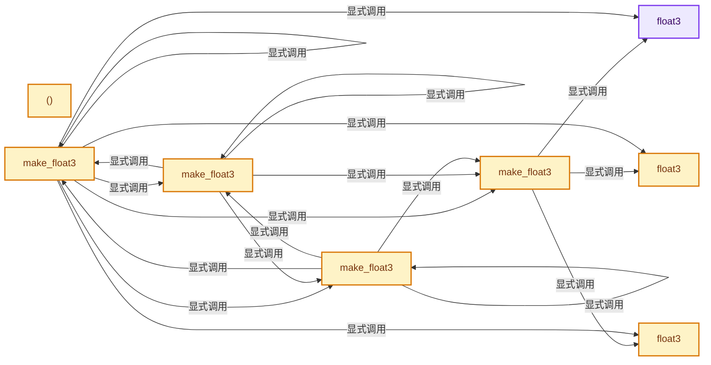
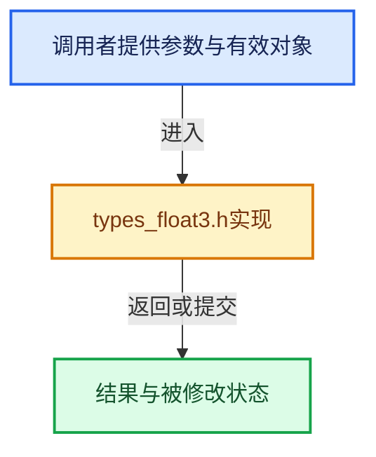

# 实现依赖专题：intern/cycles/util/types_float3.h

[方向导航](README.md) · [符号索引](../%E7%AC%A6%E5%8F%B7%E4%BE%9D%E8%B5%96%E4%B8%8E%E5%AE%9E%E7%8E%B0%E7%B4%A2%E5%BC%95.md)

本专题从正文实际调用进入，集中保存共享实现。函数有稳定锚点，可从调用处直接跳到对应完整函数；递归与互相调用通过回链组织。

## 本文件的实现关系






## 完整成员与函数实现

<a id="f-7da2e52c0fb766ec"></a>

### `float3`

实现位置：[intern/cycles/util/types_float3.h](../../../../../intern/cycles/util/types_float3.h) · L41—L41。

**教学注释版**

<!-- annotated:1f4fd7fae55623 -->

```cpp
  __forceinline float3() = default;
```

<details>
<summary>核对原始源码：intern/cycles/util/types_float3.h · L41—L41</summary>

<!-- original:1f4fd7fae55623:intern/cycles/util/types_float3.h:41:41 -->

```cpp
  __forceinline float3() = default;
```

</details>

**继续追踪实现**

本实现没有需要继续展开的显式调用；检查返回表达式、对象转换和调用者前置条件。

<a id="f-4c476b25be347939"></a>

### `float3`

实现位置：[intern/cycles/util/types_float3.h](../../../../../intern/cycles/util/types_float3.h) · L42—L42。

接口参数：

- `const float3 &a`

**教学注释版**

<!-- annotated:f1c215bcde89ea -->

```cpp
  __forceinline float3(const float3 &a) = default;
```

<details>
<summary>核对原始源码：intern/cycles/util/types_float3.h · L42—L42</summary>

<!-- original:f1c215bcde89ea:intern/cycles/util/types_float3.h:42:42 -->

```cpp
  __forceinline float3(const float3 &a) = default;
```

</details>

**继续追踪实现**

本实现没有需要继续展开的显式调用；检查返回表达式、对象转换和调用者前置条件。

<a id="f-776e8df31bde8162"></a>

### `float3`

实现位置：[intern/cycles/util/types_float3.h](../../../../../intern/cycles/util/types_float3.h) · L43—L43。

接口参数：

- `const __m128 &a`

**教学注释版**

<!-- annotated:18d75cf3a2f1b9 -->

```cpp
  __forceinline explicit float3(const __m128 &a) : m128(a) {}
```

<details>
<summary>核对原始源码：intern/cycles/util/types_float3.h · L43—L43</summary>

<!-- original:18d75cf3a2f1b9:intern/cycles/util/types_float3.h:43:43 -->

```cpp
  __forceinline explicit float3(const __m128 &a) : m128(a) {}
```

</details>

**继续追踪实现**

本实现没有需要继续展开的显式调用；检查返回表达式、对象转换和调用者前置条件。

<a id="f-65fa015938047fea"></a>

### `()`

实现位置：[intern/cycles/util/types_float3.h](../../../../../intern/cycles/util/types_float3.h) · L49—L52。

**教学注释版**

<!-- annotated:73061e6518e7bf -->

```cpp
  __forceinline operator __m128 &()
  {
    return m128;
  }
```

<details>
<summary>核对原始源码：intern/cycles/util/types_float3.h · L49—L52</summary>

<!-- original:73061e6518e7bf:intern/cycles/util/types_float3.h:49:52 -->

```cpp
  __forceinline operator __m128 &()
  {
    return m128;
  }
```

</details>

**结果出口**

- `return m128;`

**继续追踪实现**

本实现没有需要继续展开的显式调用；检查返回表达式、对象转换和调用者前置条件。

<a id="f-a4d1c171bbd08a48"></a>

### `make_float3`

实现位置：[intern/cycles/util/types_float3.h](../../../../../intern/cycles/util/types_float3.h) · L77—L86。

接口参数：

- `const float x`
- `const float y`
- `float z`

**教学注释版**

<!-- annotated:58ca2a3e29098d -->

```cpp
ccl_device_inline float3 make_float3(const float x, const float y, float z)
{
#  if defined(__KERNEL_GPU__)
  return {x, y, z};
#  elif defined(__KERNEL_SSE__)
  return float3(_mm_set_ps(0.0f, z, y, x));
#  else
  return {x, y, z, 0.0f};
#  endif
}
```

<details>
<summary>核对原始源码：intern/cycles/util/types_float3.h · L77—L86</summary>

<!-- original:58ca2a3e29098d:intern/cycles/util/types_float3.h:77:86 -->

```cpp
ccl_device_inline float3 make_float3(const float x, const float y, float z)
{
#  if defined(__KERNEL_GPU__)
  return {x, y, z};
#  elif defined(__KERNEL_SSE__)
  return float3(_mm_set_ps(0.0f, z, y, x));
#  else
  return {x, y, z, 0.0f};
#  endif
}
```

</details>

**结果出口**

- `return {x, y, z};`
- `return float3(_mm_set_ps(0.0f, z, y, x));`
- `return {x, y, z, 0.0f};`

**继续追踪实现**

- `float3` → [float3 · L41](%E4%BE%9D%E8%B5%96-types_float3-48c65a.md#f-7da2e52c0fb766ec)；[float3 · L42](%E4%BE%9D%E8%B5%96-types_float3-48c65a.md#f-4c476b25be347939)；[float3 · L43](%E4%BE%9D%E8%B5%96-types_float3-48c65a.md#f-776e8df31bde8162)。同名重载需按实参类型选择。
- `_mm_set_ps` → [调用协议](../%E6%A8%A1%E6%9D%BF%E5%AE%8F%E4%B8%8E%E5%8A%A8%E6%80%81%E5%88%86%E6%B4%BE%E5%8D%8F%E8%AE%AE.md)：函数指针、局部可调用对象或未展开的宏；必须结合调用者环境。调用位置L82。

<a id="f-ed934d00b79bfb67"></a>

### `make_float3`

实现位置：[intern/cycles/util/types_float3.h](../../../../../intern/cycles/util/types_float3.h) · L90—L99。

接口参数：

- `const float f`

**教学注释版**

<!-- annotated:ee40b6ffbe1ed8 -->

```cpp
ccl_device_inline float3 make_float3(const float f)
{
#if defined(__KERNEL_GPU__)
  return make_float3(f, f, f);
#elif defined(__KERNEL_SSE__)
  return float3(_mm_set1_ps(f));
#else
  return {f, f, f, f};
#endif
}
```

<details>
<summary>核对原始源码：intern/cycles/util/types_float3.h · L90—L99</summary>

<!-- original:ee40b6ffbe1ed8:intern/cycles/util/types_float3.h:90:99 -->

```cpp
ccl_device_inline float3 make_float3(const float f)
{
#if defined(__KERNEL_GPU__)
  return make_float3(f, f, f);
#elif defined(__KERNEL_SSE__)
  return float3(_mm_set1_ps(f));
#else
  return {f, f, f, f};
#endif
}
```

</details>

**结果出口**

- `return make_float3(f, f, f);`
- `return float3(_mm_set1_ps(f));`
- `return {f, f, f, f};`

**继续追踪实现**

- `make_float3` → [make_float3 · L77](%E4%BE%9D%E8%B5%96-types_float3-48c65a.md#f-a4d1c171bbd08a48)；[make_float3 · L90](%E4%BE%9D%E8%B5%96-types_float3-48c65a.md#f-ed934d00b79bfb67)；[make_float3 · L101](%E4%BE%9D%E8%B5%96-types_float3-48c65a.md#f-809d35d4555a4889)；[make_float3 · L106](%E4%BE%9D%E8%B5%96-types_float3-48c65a.md#f-5e61500b5e24e806)；[make_float3 · L111](%E4%BE%9D%E8%B5%96-types_float3-48c65a.md#f-a032cc39a6db84a8)；[make_float3 · L120](%E4%BE%9D%E8%B5%96-types_float3-48c65a.md#f-894b0e42a98a9c25)。同名重载需按实参类型选择。
- `float3` → [float3 · L41](%E4%BE%9D%E8%B5%96-types_float3-48c65a.md#f-7da2e52c0fb766ec)；[float3 · L42](%E4%BE%9D%E8%B5%96-types_float3-48c65a.md#f-4c476b25be347939)；[float3 · L43](%E4%BE%9D%E8%B5%96-types_float3-48c65a.md#f-776e8df31bde8162)。同名重载需按实参类型选择。
- `_mm_set1_ps` → [调用协议](../%E6%A8%A1%E6%9D%BF%E5%AE%8F%E4%B8%8E%E5%8A%A8%E6%80%81%E5%88%86%E6%B4%BE%E5%8D%8F%E8%AE%AE.md)：函数指针、局部可调用对象或未展开的宏；必须结合调用者环境。调用位置L95。

<a id="f-809d35d4555a4889"></a>

### `make_float3`

实现位置：[intern/cycles/util/types_float3.h](../../../../../intern/cycles/util/types_float3.h) · L101—L104。

接口参数：

- `const float2 a`

**教学注释版**

<!-- annotated:bc1a33c7c5316d -->

```cpp
ccl_device_inline float3 make_float3(const float2 a)
{
  return make_float3(a.x, a.y, 0.0f);
}
```

<details>
<summary>核对原始源码：intern/cycles/util/types_float3.h · L101—L104</summary>

<!-- original:bc1a33c7c5316d:intern/cycles/util/types_float3.h:101:104 -->

```cpp
ccl_device_inline float3 make_float3(const float2 a)
{
  return make_float3(a.x, a.y, 0.0f);
}
```

</details>

**结果出口**

- `return make_float3(a.x, a.y, 0.0f);`

**继续追踪实现**

- `make_float3` → [make_float3 · L77](%E4%BE%9D%E8%B5%96-types_float3-48c65a.md#f-a4d1c171bbd08a48)；[make_float3 · L90](%E4%BE%9D%E8%B5%96-types_float3-48c65a.md#f-ed934d00b79bfb67)；[make_float3 · L101](%E4%BE%9D%E8%B5%96-types_float3-48c65a.md#f-809d35d4555a4889)；[make_float3 · L106](%E4%BE%9D%E8%B5%96-types_float3-48c65a.md#f-5e61500b5e24e806)；[make_float3 · L111](%E4%BE%9D%E8%B5%96-types_float3-48c65a.md#f-a032cc39a6db84a8)；[make_float3 · L120](%E4%BE%9D%E8%B5%96-types_float3-48c65a.md#f-894b0e42a98a9c25)。同名重载需按实参类型选择。

<a id="f-5e61500b5e24e806"></a>

### `make_float3`

实现位置：[intern/cycles/util/types_float3.h](../../../../../intern/cycles/util/types_float3.h) · L106—L109。

接口参数：

- `const float2 a`
- `const float b`

**教学注释版**

<!-- annotated:22a0bee03c2a3e -->

```cpp
ccl_device_inline float3 make_float3(const float2 a, const float b)
{
  return make_float3(a.x, a.y, b);
}
```

<details>
<summary>核对原始源码：intern/cycles/util/types_float3.h · L106—L109</summary>

<!-- original:22a0bee03c2a3e:intern/cycles/util/types_float3.h:106:109 -->

```cpp
ccl_device_inline float3 make_float3(const float2 a, const float b)
{
  return make_float3(a.x, a.y, b);
}
```

</details>

**结果出口**

- `return make_float3(a.x, a.y, b);`

**继续追踪实现**

- `make_float3` → [make_float3 · L77](%E4%BE%9D%E8%B5%96-types_float3-48c65a.md#f-a4d1c171bbd08a48)；[make_float3 · L90](%E4%BE%9D%E8%B5%96-types_float3-48c65a.md#f-ed934d00b79bfb67)；[make_float3 · L101](%E4%BE%9D%E8%B5%96-types_float3-48c65a.md#f-809d35d4555a4889)；[make_float3 · L106](%E4%BE%9D%E8%B5%96-types_float3-48c65a.md#f-5e61500b5e24e806)；[make_float3 · L111](%E4%BE%9D%E8%B5%96-types_float3-48c65a.md#f-a032cc39a6db84a8)；[make_float3 · L120](%E4%BE%9D%E8%B5%96-types_float3-48c65a.md#f-894b0e42a98a9c25)。同名重载需按实参类型选择。

<a id="f-a032cc39a6db84a8"></a>

### `make_float3`

实现位置：[intern/cycles/util/types_float3.h](../../../../../intern/cycles/util/types_float3.h) · L111—L118。

接口参数：

- `const int3 i`

**教学注释版**

<!-- annotated:e43d5c5cdf22c0 -->

```cpp
ccl_device_inline float3 make_float3(const int3 i)
{
#ifdef __KERNEL_SSE__
  return float3(_mm_cvtepi32_ps(i.m128));
#else
  return make_float3((float)i.x, (float)i.y, (float)i.z);
#endif
}
```

<details>
<summary>核对原始源码：intern/cycles/util/types_float3.h · L111—L118</summary>

<!-- original:e43d5c5cdf22c0:intern/cycles/util/types_float3.h:111:118 -->

```cpp
ccl_device_inline float3 make_float3(const int3 i)
{
#ifdef __KERNEL_SSE__
  return float3(_mm_cvtepi32_ps(i.m128));
#else
  return make_float3((float)i.x, (float)i.y, (float)i.z);
#endif
}
```

</details>

**结果出口**

- `return float3(_mm_cvtepi32_ps(i.m128));`
- `return make_float3((float)i.x, (float)i.y, (float)i.z);`

**继续追踪实现**

- `float3` → [float3 · L41](%E4%BE%9D%E8%B5%96-types_float3-48c65a.md#f-7da2e52c0fb766ec)；[float3 · L42](%E4%BE%9D%E8%B5%96-types_float3-48c65a.md#f-4c476b25be347939)；[float3 · L43](%E4%BE%9D%E8%B5%96-types_float3-48c65a.md#f-776e8df31bde8162)。同名重载需按实参类型选择。
- `_mm_cvtepi32_ps` → [调用协议](../%E6%A8%A1%E6%9D%BF%E5%AE%8F%E4%B8%8E%E5%8A%A8%E6%80%81%E5%88%86%E6%B4%BE%E5%8D%8F%E8%AE%AE.md)：函数指针、局部可调用对象或未展开的宏；必须结合调用者环境。调用位置L114。
- `make_float3` → [make_float3 · L77](%E4%BE%9D%E8%B5%96-types_float3-48c65a.md#f-a4d1c171bbd08a48)；[make_float3 · L90](%E4%BE%9D%E8%B5%96-types_float3-48c65a.md#f-ed934d00b79bfb67)；[make_float3 · L101](%E4%BE%9D%E8%B5%96-types_float3-48c65a.md#f-809d35d4555a4889)；[make_float3 · L106](%E4%BE%9D%E8%B5%96-types_float3-48c65a.md#f-5e61500b5e24e806)；[make_float3 · L111](%E4%BE%9D%E8%B5%96-types_float3-48c65a.md#f-a032cc39a6db84a8)；[make_float3 · L120](%E4%BE%9D%E8%B5%96-types_float3-48c65a.md#f-894b0e42a98a9c25)。同名重载需按实参类型选择。

<a id="f-894b0e42a98a9c25"></a>

### `make_float3`

实现位置：[intern/cycles/util/types_float3.h](../../../../../intern/cycles/util/types_float3.h) · L120—L123。

接口参数：

- `const float3 a`

**教学注释版**

<!-- annotated:41bfaa85d9398b -->

```cpp
ccl_device_inline float3 make_float3(const float3 a)
{
  return a;
}
```

<details>
<summary>核对原始源码：intern/cycles/util/types_float3.h · L120—L123</summary>

<!-- original:41bfaa85d9398b:intern/cycles/util/types_float3.h:120:123 -->

```cpp
ccl_device_inline float3 make_float3(const float3 a)
{
  return a;
}
```

</details>

**结果出口**

- `return a;`

**继续追踪实现**

本实现没有需要继续展开的显式调用；检查返回表达式、对象转换和调用者前置条件。

<a id="f-77c167316af6fdba"></a>

### `make_float2`

实现位置：[intern/cycles/util/types_float3.h](../../../../../intern/cycles/util/types_float3.h) · L140—L143。

接口参数：

- `const float3 a`

**教学注释版**

<!-- annotated:4259609e892af2 -->

```cpp
ccl_device_inline float2 make_float2(const float3 a)
{
  return make_float2(a.x, a.y);
}
```

<details>
<summary>核对原始源码：intern/cycles/util/types_float3.h · L140—L143</summary>

<!-- original:4259609e892af2:intern/cycles/util/types_float3.h:140:143 -->

```cpp
ccl_device_inline float2 make_float2(const float3 a)
{
  return make_float2(a.x, a.y);
}
```

</details>

**结果出口**

- `return make_float2(a.x, a.y);`

**继续追踪实现**

- `make_float2` → [make_float2 · L140](%E4%BE%9D%E8%B5%96-types_float3-48c65a.md#f-77c167316af6fdba)。

<a id="f-c407afc205585b82"></a>

### `make_int4`

实现位置：[intern/cycles/util/types_float3.h](../../../../../intern/cycles/util/types_float3.h) · L145—L154。

接口参数：

- `const float3 f`

**教学注释版**

<!-- annotated:7e77b2e92db79c -->

```cpp
ccl_device_inline int4 make_int4(const float3 f)
{
#if defined(__KERNEL_GPU__)
  return make_int4((int)f.x, (int)f.y, (int)f.z, 0);
#elif defined(__KERNEL_SSE__)
  return int4(_mm_cvtps_epi32(f.m128));
#else
  return make_int4((int)f.x, (int)f.y, (int)f.z, (int)f.w);
#endif
}
```

<details>
<summary>核对原始源码：intern/cycles/util/types_float3.h · L145—L154</summary>

<!-- original:7e77b2e92db79c:intern/cycles/util/types_float3.h:145:154 -->

```cpp
ccl_device_inline int4 make_int4(const float3 f)
{
#if defined(__KERNEL_GPU__)
  return make_int4((int)f.x, (int)f.y, (int)f.z, 0);
#elif defined(__KERNEL_SSE__)
  return int4(_mm_cvtps_epi32(f.m128));
#else
  return make_int4((int)f.x, (int)f.y, (int)f.z, (int)f.w);
#endif
}
```

</details>

**结果出口**

- `return make_int4((int)f.x, (int)f.y, (int)f.z, 0);`
- `return int4(_mm_cvtps_epi32(f.m128));`
- `return make_int4((int)f.x, (int)f.y, (int)f.z, (int)f.w);`

**继续追踪实现**

- `make_int4` → [make_int4 · L145](%E4%BE%9D%E8%B5%96-types_float3-48c65a.md#f-c407afc205585b82)。
- `int4` → [int4 · L645](%E4%BE%9D%E8%B5%96-smaa-b67bc2.md#m-98b3207edab6)。宏定义由构建条件选择。
- `_mm_cvtps_epi32` → [调用协议](../%E6%A8%A1%E6%9D%BF%E5%AE%8F%E4%B8%8E%E5%8A%A8%E6%80%81%E5%88%86%E6%B4%BE%E5%8D%8F%E8%AE%AE.md)：函数指针、局部可调用对象或未展开的宏；必须结合调用者环境。调用位置L150。

<a id="f-1a317c8631823b1b"></a>

### `make_int3`

实现位置：[intern/cycles/util/types_float3.h](../../../../../intern/cycles/util/types_float3.h) · L156—L163。

接口参数：

- `const float3 f`

**教学注释版**

<!-- annotated:f0757db93eaf4b -->

```cpp
ccl_device_inline int3 make_int3(const float3 f)
{
#ifdef __KERNEL_SSE__
  return int3(_mm_cvtps_epi32(f.m128));
#else
  return make_int3((int)f.x, (int)f.y, (int)f.z);
#endif
}
```

<details>
<summary>核对原始源码：intern/cycles/util/types_float3.h · L156—L163</summary>

<!-- original:f0757db93eaf4b:intern/cycles/util/types_float3.h:156:163 -->

```cpp
ccl_device_inline int3 make_int3(const float3 f)
{
#ifdef __KERNEL_SSE__
  return int3(_mm_cvtps_epi32(f.m128));
#else
  return make_int3((int)f.x, (int)f.y, (int)f.z);
#endif
}
```

</details>

**结果出口**

- `return int3(_mm_cvtps_epi32(f.m128));`
- `return make_int3((int)f.x, (int)f.y, (int)f.z);`

**继续追踪实现**

- `int3` → [int3 · L32](%E4%BE%9D%E8%B5%96-types_int3-7d3986.md#f-251a7e4285c59ddb)；[int3 · L33](%E4%BE%9D%E8%B5%96-types_int3-7d3986.md#f-67f7fae256268a81)；[int3 · L34](%E4%BE%9D%E8%B5%96-types_int3-7d3986.md#f-82c16f3f0621f181)。同名重载需按实参类型选择。
- `_mm_cvtps_epi32` → [调用协议](../%E6%A8%A1%E6%9D%BF%E5%AE%8F%E4%B8%8E%E5%8A%A8%E6%80%81%E5%88%86%E6%B4%BE%E5%8D%8F%E8%AE%AE.md)：函数指针、局部可调用对象或未展开的宏；必须结合调用者环境。调用位置L159。
- `make_int3` → [make_int3 · L156](%E4%BE%9D%E8%B5%96-types_float3-48c65a.md#f-1a317c8631823b1b)。
