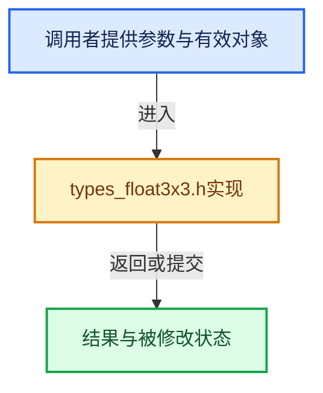

# 实现依赖专题：intern/cycles/util/types_float3x3.h

[方向导航](README.md) · [符号索引](../%E7%AC%A6%E5%8F%B7%E4%BE%9D%E8%B5%96%E4%B8%8E%E5%AE%9E%E7%8E%B0%E7%B4%A2%E5%BC%95.md)

本专题从正文实际调用进入，集中保存共享实现。函数有稳定锚点，可从调用处直接跳到对应完整函数；递归与互相调用通过回链组织。

## 本文件的实现关系





## 完整成员与函数实现

<a id="f-3027a1a52a465e4d"></a>

### `float3x3`

实现位置：[intern/cycles/util/types_float3x3.h](../../../../../intern/cycles/util/types_float3x3.h) · L18—L40。

**教学注释版**

<!-- annotated:6fdfa986deb02e -->

```cpp
CCL_NAMESPACE_BEGIN

/* NOTE: Elements might be padded to 16 bytes. */
struct float3x3 {
#if !defined(__KERNEL_GPU__)
  __forceinline const float3 &operator[](int i) const
  {
    util_assert(i >= 0);
    util_assert(i < 3);
    return *(&x + i);
  }
  __forceinline float3 &operator[](int i)
  {
    util_assert(i >= 0);
    util_assert(i < 3);
    return *(&x + i);
  }
#endif

  float3 x;
  float3 y;
  float3 z;
};
```

<details>
<summary>核对原始源码：intern/cycles/util/types_float3x3.h · L18—L40</summary>

<!-- original:6fdfa986deb02e:intern/cycles/util/types_float3x3.h:18:40 -->

```cpp
CCL_NAMESPACE_BEGIN

/* NOTE: Elements might be padded to 16 bytes. */
struct float3x3 {
#if !defined(__KERNEL_GPU__)
  __forceinline const float3 &operator[](int i) const
  {
    util_assert(i >= 0);
    util_assert(i < 3);
    return *(&x + i);
  }
  __forceinline float3 &operator[](int i)
  {
    util_assert(i >= 0);
    util_assert(i < 3);
    return *(&x + i);
  }
#endif

  float3 x;
  float3 y;
  float3 z;
};
```

</details>

**结果出口**

- `return *(&x + i);`

**继续追踪实现**

- `util_assert` → [util_assert · L116](%E4%BE%9D%E8%B5%96-defines-cd82f8.md#m-3b434de1883f)；[util_assert · L118](%E4%BE%9D%E8%B5%96-defines-cd82f8.md#m-069caed36461)。宏定义由构建条件选择。
