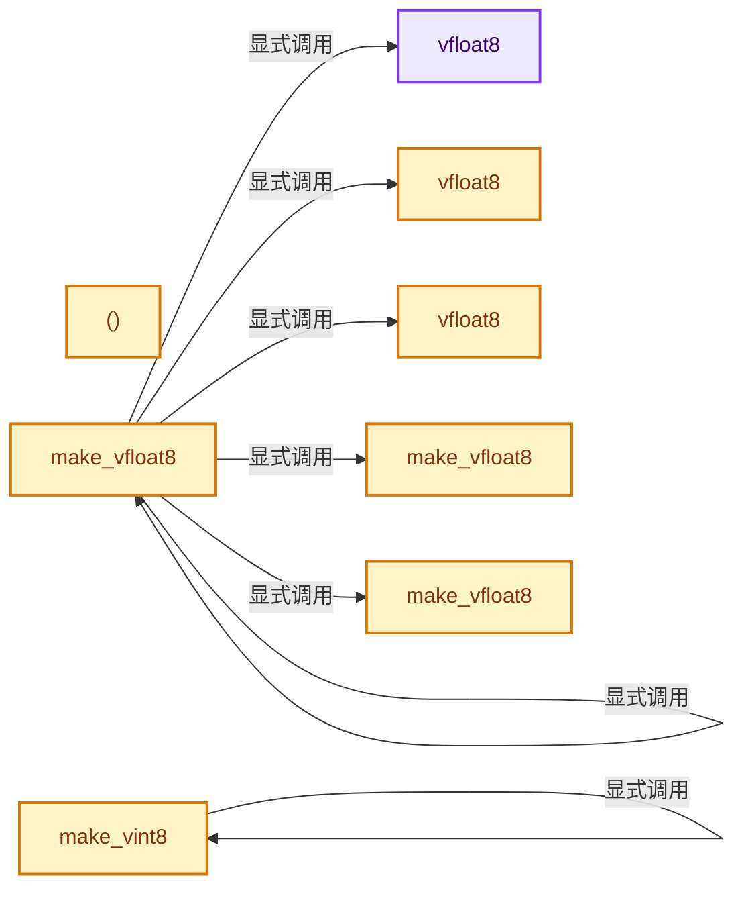
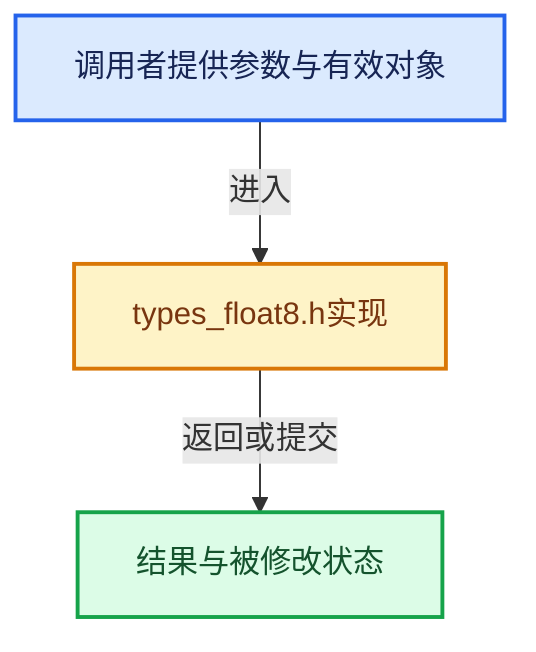

# 实现依赖专题：intern/cycles/util/types_float8.h

[方向导航](README.md) · [符号索引](../%E7%AC%A6%E5%8F%B7%E4%BE%9D%E8%B5%96%E4%B8%8E%E5%AE%9E%E7%8E%B0%E7%B4%A2%E5%BC%95.md)

本专题从正文实际调用进入，集中保存共享实现。函数有稳定锚点，可从调用处直接跳到对应完整函数；递归与互相调用通过回链组织。

## 本文件的实现关系






## 完整成员与函数实现

<a id="f-3da30cc74a545ced"></a>

### `vfloat8`

实现位置：[intern/cycles/util/types_float8.h](../../../../../intern/cycles/util/types_float8.h) · L33—L33。

**教学注释版**

<!-- annotated:9afad16b6e9cda -->

```cpp
  __forceinline vfloat8() = default;
```

<details>
<summary>核对原始源码：intern/cycles/util/types_float8.h · L33—L33</summary>

<!-- original:9afad16b6e9cda:intern/cycles/util/types_float8.h:33:33 -->

```cpp
  __forceinline vfloat8() = default;
```

</details>

**继续追踪实现**

本实现没有需要继续展开的显式调用；检查返回表达式、对象转换和调用者前置条件。

<a id="f-42fd7aa6ce019d5b"></a>

### `vfloat8`

实现位置：[intern/cycles/util/types_float8.h](../../../../../intern/cycles/util/types_float8.h) · L34—L34。

接口参数：

- `const vfloat8 &a`

**教学注释版**

<!-- annotated:4a9349d7e334e7 -->

```cpp
  __forceinline vfloat8(const vfloat8 &a) = default;
```

<details>
<summary>核对原始源码：intern/cycles/util/types_float8.h · L34—L34</summary>

<!-- original:4a9349d7e334e7:intern/cycles/util/types_float8.h:34:34 -->

```cpp
  __forceinline vfloat8(const vfloat8 &a) = default;
```

</details>

**继续追踪实现**

本实现没有需要继续展开的显式调用；检查返回表达式、对象转换和调用者前置条件。

<a id="f-0f7cb095834dd874"></a>

### `vfloat8`

实现位置：[intern/cycles/util/types_float8.h](../../../../../intern/cycles/util/types_float8.h) · L35—L35。

接口参数：

- `const __m256 &a`

**教学注释版**

<!-- annotated:40e37bcd468966 -->

```cpp
  __forceinline explicit vfloat8(const __m256 &a) : m256(a) {}
```

<details>
<summary>核对原始源码：intern/cycles/util/types_float8.h · L35—L35</summary>

<!-- original:40e37bcd468966:intern/cycles/util/types_float8.h:35:35 -->

```cpp
  __forceinline explicit vfloat8(const __m256 &a) : m256(a) {}
```

</details>

**继续追踪实现**

本实现没有需要继续展开的显式调用；检查返回表达式、对象转换和调用者前置条件。

<a id="f-13e176dd43b5ca83"></a>

### `()`

实现位置：[intern/cycles/util/types_float8.h](../../../../../intern/cycles/util/types_float8.h) · L41—L44。

**教学注释版**

<!-- annotated:706eb68273f51b -->

```cpp
  __forceinline operator __m256 &()
  {
    return m256;
  }
```

<details>
<summary>核对原始源码：intern/cycles/util/types_float8.h · L41—L44</summary>

<!-- original:706eb68273f51b:intern/cycles/util/types_float8.h:41:44 -->

```cpp
  __forceinline operator __m256 &()
  {
    return m256;
  }
```

</details>

**结果出口**

- `return m256;`

**继续追踪实现**

本实现没有需要继续展开的显式调用；检查返回表达式、对象转换和调用者前置条件。

<a id="f-e10a776cf4311797"></a>

### `make_vfloat8`

实现位置：[intern/cycles/util/types_float8.h](../../../../../intern/cycles/util/types_float8.h) · L72—L80。

接口参数：

- `const float f`

**教学注释版**

<!-- annotated:e582445e7cea88 -->

```cpp
ccl_device_inline vfloat8 make_vfloat8(const float f)
{
#ifdef __KERNEL_AVX__
  vfloat8 r(_mm256_set1_ps(f));
#else
  vfloat8 r = {f, f, f, f, f, f, f, f};
#endif
  return r;
}
```

<details>
<summary>核对原始源码：intern/cycles/util/types_float8.h · L72—L80</summary>

<!-- original:e582445e7cea88:intern/cycles/util/types_float8.h:72:80 -->

```cpp
ccl_device_inline vfloat8 make_vfloat8(const float f)
{
#ifdef __KERNEL_AVX__
  vfloat8 r(_mm256_set1_ps(f));
#else
  vfloat8 r = {f, f, f, f, f, f, f, f};
#endif
  return r;
}
```

</details>

**结果出口**

- `return r;`

**继续追踪实现**

本实现没有需要继续展开的显式调用；检查返回表达式、对象转换和调用者前置条件。

<a id="f-42d05535b6f6c8f7"></a>

### `make_vfloat8`

实现位置：[intern/cycles/util/types_float8.h](../../../../../intern/cycles/util/types_float8.h) · L82—L97。

接口参数：

- `const float a`
- `const float b`
- `float c`
- `const float d`
- `float e`
- `const float f`
- `float g`
- `const float h`

**教学注释版**

<!-- annotated:370192aa07adaa -->

```cpp
ccl_device_inline vfloat8 make_vfloat8(const float a,
                                       const float b,
                                       float c,
                                       const float d,
                                       float e,
                                       const float f,
                                       float g,
                                       const float h)
{
#ifdef __KERNEL_AVX__
  vfloat8 r(_mm256_setr_ps(a, b, c, d, e, f, g, h));
#else
  vfloat8 r = {a, b, c, d, e, f, g, h};
#endif
  return r;
}
```

<details>
<summary>核对原始源码：intern/cycles/util/types_float8.h · L82—L97</summary>

<!-- original:370192aa07adaa:intern/cycles/util/types_float8.h:82:97 -->

```cpp
ccl_device_inline vfloat8 make_vfloat8(const float a,
                                       const float b,
                                       float c,
                                       const float d,
                                       float e,
                                       const float f,
                                       float g,
                                       const float h)
{
#ifdef __KERNEL_AVX__
  vfloat8 r(_mm256_setr_ps(a, b, c, d, e, f, g, h));
#else
  vfloat8 r = {a, b, c, d, e, f, g, h};
#endif
  return r;
}
```

</details>

**结果出口**

- `return r;`

**继续追踪实现**

本实现没有需要继续展开的显式调用；检查返回表达式、对象转换和调用者前置条件。

<a id="f-facfa3ac1640ad20"></a>

### `make_vfloat8`

实现位置：[intern/cycles/util/types_float8.h](../../../../../intern/cycles/util/types_float8.h) · L99—L106。

接口参数：

- `const float4 a`
- `const float4 b`

**教学注释版**

<!-- annotated:1ed32101c258d1 -->

```cpp
ccl_device_inline vfloat8 make_vfloat8(const float4 a, const float4 b)
{
#ifdef __KERNEL_AVX__
  return vfloat8(_mm256_insertf128_ps(_mm256_castps128_ps256(a), b, 1));
#else
  return make_vfloat8(a.x, a.y, a.z, a.w, b.x, b.y, b.z, b.w);
#endif
}
```

<details>
<summary>核对原始源码：intern/cycles/util/types_float8.h · L99—L106</summary>

<!-- original:1ed32101c258d1:intern/cycles/util/types_float8.h:99:106 -->

```cpp
ccl_device_inline vfloat8 make_vfloat8(const float4 a, const float4 b)
{
#ifdef __KERNEL_AVX__
  return vfloat8(_mm256_insertf128_ps(_mm256_castps128_ps256(a), b, 1));
#else
  return make_vfloat8(a.x, a.y, a.z, a.w, b.x, b.y, b.z, b.w);
#endif
}
```

</details>

**结果出口**

- `return vfloat8(_mm256_insertf128_ps(_mm256_castps128_ps256(a), b, 1));`
- `return make_vfloat8(a.x, a.y, a.z, a.w, b.x, b.y, b.z, b.w);`

**继续追踪实现**

- `vfloat8` → [vfloat8 · L33](%E4%BE%9D%E8%B5%96-types_float8-8fe1c9.md#f-3da30cc74a545ced)；[vfloat8 · L34](%E4%BE%9D%E8%B5%96-types_float8-8fe1c9.md#f-42fd7aa6ce019d5b)；[vfloat8 · L35](%E4%BE%9D%E8%B5%96-types_float8-8fe1c9.md#f-0f7cb095834dd874)。同名重载需按实参类型选择。
- `_mm256_insertf128_ps` → [调用协议](../%E6%A8%A1%E6%9D%BF%E5%AE%8F%E4%B8%8E%E5%8A%A8%E6%80%81%E5%88%86%E6%B4%BE%E5%8D%8F%E8%AE%AE.md)：函数指针、局部可调用对象或未展开的宏；必须结合调用者环境。调用位置L102。
- `_mm256_castps128_ps256` → [调用协议](../%E6%A8%A1%E6%9D%BF%E5%AE%8F%E4%B8%8E%E5%8A%A8%E6%80%81%E5%88%86%E6%B4%BE%E5%8D%8F%E8%AE%AE.md)：函数指针、局部可调用对象或未展开的宏；必须结合调用者环境。调用位置L102。
- `make_vfloat8` → [make_vfloat8 · L72](%E4%BE%9D%E8%B5%96-types_float8-8fe1c9.md#f-e10a776cf4311797)；[make_vfloat8 · L82](%E4%BE%9D%E8%B5%96-types_float8-8fe1c9.md#f-42d05535b6f6c8f7)；[make_vfloat8 · L99](%E4%BE%9D%E8%B5%96-types_float8-8fe1c9.md#f-facfa3ac1640ad20)。同名重载需按实参类型选择。

<a id="f-35b4ba58a2246c63"></a>

### `make_vint8`

实现位置：[intern/cycles/util/types_float8.h](../../../../../intern/cycles/util/types_float8.h) · L124—L132。

接口参数：

- `const vfloat8 f`

**教学注释版**

<!-- annotated:a1907abd0e3a6b -->

```cpp
ccl_device_inline vint8 make_vint8(const vfloat8 f)
{
#ifdef __KERNEL_AVX__
  return vint8(_mm256_cvtps_epi32(f.m256));
#else
  return make_vint8(
      (int)f.a, (int)f.b, (int)f.c, (int)f.d, (int)f.e, (int)f.f, (int)f.g, (int)f.h);
#endif
}
```

<details>
<summary>核对原始源码：intern/cycles/util/types_float8.h · L124—L132</summary>

<!-- original:a1907abd0e3a6b:intern/cycles/util/types_float8.h:124:132 -->

```cpp
ccl_device_inline vint8 make_vint8(const vfloat8 f)
{
#ifdef __KERNEL_AVX__
  return vint8(_mm256_cvtps_epi32(f.m256));
#else
  return make_vint8(
      (int)f.a, (int)f.b, (int)f.c, (int)f.d, (int)f.e, (int)f.f, (int)f.g, (int)f.h);
#endif
}
```

</details>

**结果出口**

- `return vint8(_mm256_cvtps_epi32(f.m256));`
- `return make_vint8(`

**继续追踪实现**

- `vint8` → [vint8 · L28](%E4%BE%9D%E8%B5%96-types_int8-f5dcfc.md#f-759902d0720c104d)；[vint8 · L29](%E4%BE%9D%E8%B5%96-types_int8-f5dcfc.md#f-081c9716e2fec522)；[vint8 · L30](%E4%BE%9D%E8%B5%96-types_int8-f5dcfc.md#f-feb9d679504529e9)。同名重载需按实参类型选择。
- `_mm256_cvtps_epi32` → [调用协议](../%E6%A8%A1%E6%9D%BF%E5%AE%8F%E4%B8%8E%E5%8A%A8%E6%80%81%E5%88%86%E6%B4%BE%E5%8D%8F%E8%AE%AE.md)：函数指针、局部可调用对象或未展开的宏；必须结合调用者环境。调用位置L127。
- `make_vint8` → [make_vint8 · L124](%E4%BE%9D%E8%B5%96-types_float8-8fe1c9.md#f-35b4ba58a2246c63)。
