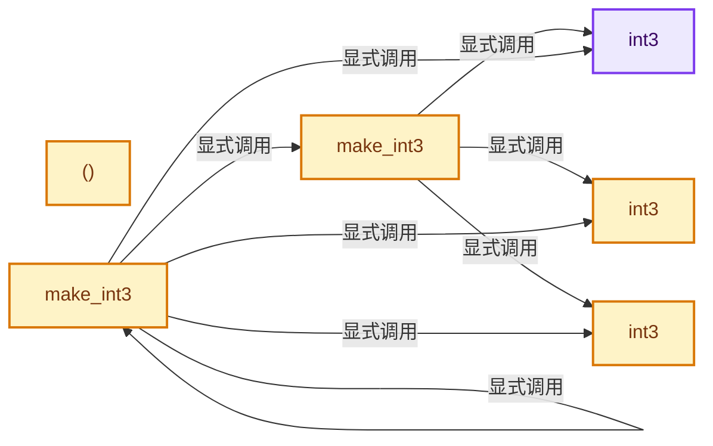
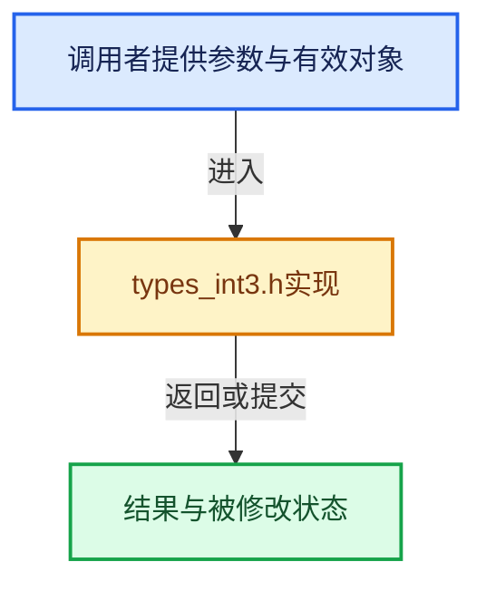

# 实现依赖专题：intern/cycles/util/types_int3.h

[方向导航](README.md) · [符号索引](../%E7%AC%A6%E5%8F%B7%E4%BE%9D%E8%B5%96%E4%B8%8E%E5%AE%9E%E7%8E%B0%E7%B4%A2%E5%BC%95.md)

本专题从正文实际调用进入，集中保存共享实现。函数有稳定锚点，可从调用处直接跳到对应完整函数；递归与互相调用通过回链组织。

## 本文件的实现关系






## 完整成员与函数实现

<a id="f-251a7e4285c59ddb"></a>

### `int3`

实现位置：[intern/cycles/util/types_int3.h](../../../../../intern/cycles/util/types_int3.h) · L32—L32。

**教学注释版**

<!-- annotated:f4c97eedff7f06 -->

```cpp
  __forceinline int3() = default;
```

<details>
<summary>核对原始源码：intern/cycles/util/types_int3.h · L32—L32</summary>

<!-- original:f4c97eedff7f06:intern/cycles/util/types_int3.h:32:32 -->

```cpp
  __forceinline int3() = default;
```

</details>

**继续追踪实现**

本实现没有需要继续展开的显式调用；检查返回表达式、对象转换和调用者前置条件。

<a id="f-67f7fae256268a81"></a>

### `int3`

实现位置：[intern/cycles/util/types_int3.h](../../../../../intern/cycles/util/types_int3.h) · L33—L33。

接口参数：

- `const int3 &a`

**教学注释版**

<!-- annotated:9f3684f67998d4 -->

```cpp
  __forceinline int3(const int3 &a) = default;
```

<details>
<summary>核对原始源码：intern/cycles/util/types_int3.h · L33—L33</summary>

<!-- original:9f3684f67998d4:intern/cycles/util/types_int3.h:33:33 -->

```cpp
  __forceinline int3(const int3 &a) = default;
```

</details>

**继续追踪实现**

本实现没有需要继续展开的显式调用；检查返回表达式、对象转换和调用者前置条件。

<a id="f-82c16f3f0621f181"></a>

### `int3`

实现位置：[intern/cycles/util/types_int3.h](../../../../../intern/cycles/util/types_int3.h) · L34—L34。

接口参数：

- `const __m128i &a`

**教学注释版**

<!-- annotated:bd62a71fb608f2 -->

```cpp
  __forceinline explicit int3(const __m128i &a) : m128(a) {}
```

<details>
<summary>核对原始源码：intern/cycles/util/types_int3.h · L34—L34</summary>

<!-- original:bd62a71fb608f2:intern/cycles/util/types_int3.h:34:34 -->

```cpp
  __forceinline explicit int3(const __m128i &a) : m128(a) {}
```

</details>

**继续追踪实现**

本实现没有需要继续展开的显式调用；检查返回表达式、对象转换和调用者前置条件。

<a id="f-d6eb8caa7c8b7b94"></a>

### `()`

实现位置：[intern/cycles/util/types_int3.h](../../../../../intern/cycles/util/types_int3.h) · L41—L44。

**教学注释版**

<!-- annotated:44ca724ae3c72f -->

```cpp
  __forceinline operator __m128i &()
  {
    return m128;
  }
```

<details>
<summary>核对原始源码：intern/cycles/util/types_int3.h · L41—L44</summary>

<!-- original:44ca724ae3c72f:intern/cycles/util/types_int3.h:41:44 -->

```cpp
  __forceinline operator __m128i &()
  {
    return m128;
  }
```

</details>

**结果出口**

- `return m128;`

**继续追踪实现**

本实现没有需要继续展开的显式调用；检查返回表达式、对象转换和调用者前置条件。

<a id="f-3f630390fae242e8"></a>

### `make_int3`

实现位置：[intern/cycles/util/types_int3.h](../../../../../intern/cycles/util/types_int3.h) · L73—L82。

接口参数：

- `const int x`
- `const int y`
- `int z`

**教学注释版**

<!-- annotated:416d8e71a9cc56 -->

```cpp
ccl_device_inline int3 make_int3(const int x, const int y, int z)
{
#  if defined(__KERNEL_GPU__)
  return {x, y, z};
#  elif defined(__KERNEL_SSE__)
  return int3(_mm_set_epi32(0, z, y, x));
#  else
  return {x, y, z, 0};
#  endif
}
```

<details>
<summary>核对原始源码：intern/cycles/util/types_int3.h · L73—L82</summary>

<!-- original:416d8e71a9cc56:intern/cycles/util/types_int3.h:73:82 -->

```cpp
ccl_device_inline int3 make_int3(const int x, const int y, int z)
{
#  if defined(__KERNEL_GPU__)
  return {x, y, z};
#  elif defined(__KERNEL_SSE__)
  return int3(_mm_set_epi32(0, z, y, x));
#  else
  return {x, y, z, 0};
#  endif
}
```

</details>

**结果出口**

- `return {x, y, z};`
- `return int3(_mm_set_epi32(0, z, y, x));`
- `return {x, y, z, 0};`

**继续追踪实现**

- `int3` → [int3 · L32](%E4%BE%9D%E8%B5%96-types_int3-7d3986.md#f-251a7e4285c59ddb)；[int3 · L33](%E4%BE%9D%E8%B5%96-types_int3-7d3986.md#f-67f7fae256268a81)；[int3 · L34](%E4%BE%9D%E8%B5%96-types_int3-7d3986.md#f-82c16f3f0621f181)。同名重载需按实参类型选择。
- `_mm_set_epi32` → [调用协议](../%E6%A8%A1%E6%9D%BF%E5%AE%8F%E4%B8%8E%E5%8A%A8%E6%80%81%E5%88%86%E6%B4%BE%E5%8D%8F%E8%AE%AE.md)：函数指针、局部可调用对象或未展开的宏；必须结合调用者环境。调用位置L78。

<a id="f-d25cc5037e7d8fdc"></a>

### `make_int3`

实现位置：[intern/cycles/util/types_int3.h](../../../../../intern/cycles/util/types_int3.h) · L86—L95。

接口参数：

- `const int i`

**教学注释版**

<!-- annotated:79ded3fd7b3be8 -->

```cpp
ccl_device_inline int3 make_int3(const int i)
{
#if defined(__KERNEL_GPU__)
  return make_int3(i, i, i);
#elif defined(__KERNEL_SSE__)
  return int3(_mm_set1_epi32(i));
#else
  return {i, i, i, i};
#endif
}
```

<details>
<summary>核对原始源码：intern/cycles/util/types_int3.h · L86—L95</summary>

<!-- original:79ded3fd7b3be8:intern/cycles/util/types_int3.h:86:95 -->

```cpp
ccl_device_inline int3 make_int3(const int i)
{
#if defined(__KERNEL_GPU__)
  return make_int3(i, i, i);
#elif defined(__KERNEL_SSE__)
  return int3(_mm_set1_epi32(i));
#else
  return {i, i, i, i};
#endif
}
```

</details>

**结果出口**

- `return make_int3(i, i, i);`
- `return int3(_mm_set1_epi32(i));`
- `return {i, i, i, i};`

**继续追踪实现**

- `make_int3` → [make_int3 · L73](%E4%BE%9D%E8%B5%96-types_int3-7d3986.md#f-3f630390fae242e8)；[make_int3 · L86](%E4%BE%9D%E8%B5%96-types_int3-7d3986.md#f-d25cc5037e7d8fdc)。同名重载需按实参类型选择。
- `int3` → [int3 · L32](%E4%BE%9D%E8%B5%96-types_int3-7d3986.md#f-251a7e4285c59ddb)；[int3 · L33](%E4%BE%9D%E8%B5%96-types_int3-7d3986.md#f-67f7fae256268a81)；[int3 · L34](%E4%BE%9D%E8%B5%96-types_int3-7d3986.md#f-82c16f3f0621f181)。同名重载需按实参类型选择。
- `_mm_set1_epi32` → [调用协议](../%E6%A8%A1%E6%9D%BF%E5%AE%8F%E4%B8%8E%E5%8A%A8%E6%80%81%E5%88%86%E6%B4%BE%E5%8D%8F%E8%AE%AE.md)：函数指针、局部可调用对象或未展开的宏；必须结合调用者环境。调用位置L91。
