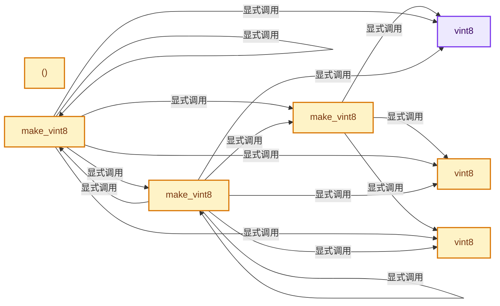
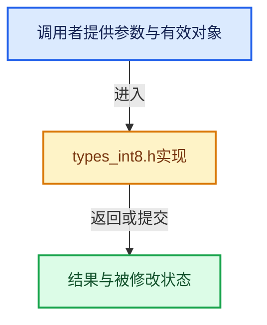

# 实现依赖专题：intern/cycles/util/types_int8.h

[方向导航](README.md) · [符号索引](../%E7%AC%A6%E5%8F%B7%E4%BE%9D%E8%B5%96%E4%B8%8E%E5%AE%9E%E7%8E%B0%E7%B4%A2%E5%BC%95.md)

本专题从正文实际调用进入，集中保存共享实现。函数有稳定锚点，可从调用处直接跳到对应完整函数；递归与互相调用通过回链组织。

## 本文件的实现关系






## 完整成员与函数实现

<a id="f-759902d0720c104d"></a>

### `vint8`

实现位置：[intern/cycles/util/types_int8.h](../../../../../intern/cycles/util/types_int8.h) · L28—L28。

**教学注释版**

<!-- annotated:dfddc5c912a325 -->

```cpp
  __forceinline vint8() = default;
```

<details>
<summary>核对原始源码：intern/cycles/util/types_int8.h · L28—L28</summary>

<!-- original:dfddc5c912a325:intern/cycles/util/types_int8.h:28:28 -->

```cpp
  __forceinline vint8() = default;
```

</details>

**继续追踪实现**

本实现没有需要继续展开的显式调用；检查返回表达式、对象转换和调用者前置条件。

<a id="f-081c9716e2fec522"></a>

### `vint8`

实现位置：[intern/cycles/util/types_int8.h](../../../../../intern/cycles/util/types_int8.h) · L29—L29。

接口参数：

- `const vint8 &a`

**教学注释版**

<!-- annotated:bc0fe98e9b9281 -->

```cpp
  __forceinline vint8(const vint8 &a) = default;
```

<details>
<summary>核对原始源码：intern/cycles/util/types_int8.h · L29—L29</summary>

<!-- original:bc0fe98e9b9281:intern/cycles/util/types_int8.h:29:29 -->

```cpp
  __forceinline vint8(const vint8 &a) = default;
```

</details>

**继续追踪实现**

本实现没有需要继续展开的显式调用；检查返回表达式、对象转换和调用者前置条件。

<a id="f-feb9d679504529e9"></a>

### `vint8`

实现位置：[intern/cycles/util/types_int8.h](../../../../../intern/cycles/util/types_int8.h) · L30—L30。

接口参数：

- `const __m256i &a`

**教学注释版**

<!-- annotated:37b65c398b6ece -->

```cpp
  __forceinline explicit vint8(const __m256i &a) : m256(a) {}
```

<details>
<summary>核对原始源码：intern/cycles/util/types_int8.h · L30—L30</summary>

<!-- original:37b65c398b6ece:intern/cycles/util/types_int8.h:30:30 -->

```cpp
  __forceinline explicit vint8(const __m256i &a) : m256(a) {}
```

</details>

**继续追踪实现**

本实现没有需要继续展开的显式调用；检查返回表达式、对象转换和调用者前置条件。

<a id="f-a098013a78cffef5"></a>

### `()`

实现位置：[intern/cycles/util/types_int8.h](../../../../../intern/cycles/util/types_int8.h) · L36—L39。

**教学注释版**

<!-- annotated:f4c2459a071304 -->

```cpp
  __forceinline operator __m256i &()
  {
    return m256;
  }
```

<details>
<summary>核对原始源码：intern/cycles/util/types_int8.h · L36—L39</summary>

<!-- original:f4c2459a071304:intern/cycles/util/types_int8.h:36:39 -->

```cpp
  __forceinline operator __m256i &()
  {
    return m256;
  }
```

</details>

**结果出口**

- `return m256;`

**继续追踪实现**

本实现没有需要继续展开的显式调用；检查返回表达式、对象转换和调用者前置条件。

<a id="f-90569d387963ae8e"></a>

### `make_vint8`

实现位置：[intern/cycles/util/types_int8.h](../../../../../intern/cycles/util/types_int8.h) · L66—L74。

接口参数：

- `const int a`
- `const int b`
- `int c`
- `const int d`
- `int e`
- `const int f`
- `int g`
- `const int h`

**教学注释版**

<!-- annotated:9539255f60f669 -->

```cpp
ccl_device_inline vint8
make_vint8(const int a, const int b, int c, const int d, int e, const int f, int g, const int h)
{
#ifdef __KERNEL_AVX__
  return vint8(_mm256_set_epi32(h, g, f, e, d, c, b, a));
#else
  return {a, b, c, d, e, f, g, h};
#endif
}
```

<details>
<summary>核对原始源码：intern/cycles/util/types_int8.h · L66—L74</summary>

<!-- original:9539255f60f669:intern/cycles/util/types_int8.h:66:74 -->

```cpp
ccl_device_inline vint8
make_vint8(const int a, const int b, int c, const int d, int e, const int f, int g, const int h)
{
#ifdef __KERNEL_AVX__
  return vint8(_mm256_set_epi32(h, g, f, e, d, c, b, a));
#else
  return {a, b, c, d, e, f, g, h};
#endif
}
```

</details>

**结果出口**

- `return vint8(_mm256_set_epi32(h, g, f, e, d, c, b, a));`
- `return {a, b, c, d, e, f, g, h};`

**继续追踪实现**

- `vint8` → [vint8 · L28](%E4%BE%9D%E8%B5%96-types_int8-f5dcfc.md#f-759902d0720c104d)；[vint8 · L29](%E4%BE%9D%E8%B5%96-types_int8-f5dcfc.md#f-081c9716e2fec522)；[vint8 · L30](%E4%BE%9D%E8%B5%96-types_int8-f5dcfc.md#f-feb9d679504529e9)。同名重载需按实参类型选择。
- `_mm256_set_epi32` → [调用协议](../%E6%A8%A1%E6%9D%BF%E5%AE%8F%E4%B8%8E%E5%8A%A8%E6%80%81%E5%88%86%E6%B4%BE%E5%8D%8F%E8%AE%AE.md)：函数指针、局部可调用对象或未展开的宏；必须结合调用者环境。调用位置L70。

<a id="f-8d871b1066a69f10"></a>

### `make_vint8`

实现位置：[intern/cycles/util/types_int8.h](../../../../../intern/cycles/util/types_int8.h) · L76—L83。

接口参数：

- `const int i`

**教学注释版**

<!-- annotated:9fbdcfac34834b -->

```cpp
ccl_device_inline vint8 make_vint8(const int i)
{
#ifdef __KERNEL_AVX__
  return vint8(_mm256_set1_epi32(i));
#else
  return make_vint8(i, i, i, i, i, i, i, i);
#endif
}
```

<details>
<summary>核对原始源码：intern/cycles/util/types_int8.h · L76—L83</summary>

<!-- original:9fbdcfac34834b:intern/cycles/util/types_int8.h:76:83 -->

```cpp
ccl_device_inline vint8 make_vint8(const int i)
{
#ifdef __KERNEL_AVX__
  return vint8(_mm256_set1_epi32(i));
#else
  return make_vint8(i, i, i, i, i, i, i, i);
#endif
}
```

</details>

**结果出口**

- `return vint8(_mm256_set1_epi32(i));`
- `return make_vint8(i, i, i, i, i, i, i, i);`

**继续追踪实现**

- `vint8` → [vint8 · L28](%E4%BE%9D%E8%B5%96-types_int8-f5dcfc.md#f-759902d0720c104d)；[vint8 · L29](%E4%BE%9D%E8%B5%96-types_int8-f5dcfc.md#f-081c9716e2fec522)；[vint8 · L30](%E4%BE%9D%E8%B5%96-types_int8-f5dcfc.md#f-feb9d679504529e9)。同名重载需按实参类型选择。
- `_mm256_set1_epi32` → [调用协议](../%E6%A8%A1%E6%9D%BF%E5%AE%8F%E4%B8%8E%E5%8A%A8%E6%80%81%E5%88%86%E6%B4%BE%E5%8D%8F%E8%AE%AE.md)：函数指针、局部可调用对象或未展开的宏；必须结合调用者环境。调用位置L79。
- `make_vint8` → [make_vint8 · L66](%E4%BE%9D%E8%B5%96-types_int8-f5dcfc.md#f-90569d387963ae8e)；[make_vint8 · L76](%E4%BE%9D%E8%B5%96-types_int8-f5dcfc.md#f-8d871b1066a69f10)；[make_vint8 · L85](%E4%BE%9D%E8%B5%96-types_int8-f5dcfc.md#f-bceeb0aa08937ec3)。同名重载需按实参类型选择。

<a id="f-bceeb0aa08937ec3"></a>

### `make_vint8`

实现位置：[intern/cycles/util/types_int8.h](../../../../../intern/cycles/util/types_int8.h) · L85—L92。

接口参数：

- `const int4 a`
- `const int4 b`

**教学注释版**

<!-- annotated:4ac0e159cff5c4 -->

```cpp
ccl_device_inline vint8 make_vint8(const int4 a, const int4 b)
{
#ifdef __KERNEL_AVX__
  return vint8(_mm256_insertf128_si256(_mm256_castsi128_si256(a.m128), b.m128, 1));
#else
  return make_vint8(a.x, a.y, a.z, a.w, b.x, b.y, b.z, b.w);
#endif
}
```

<details>
<summary>核对原始源码：intern/cycles/util/types_int8.h · L85—L92</summary>

<!-- original:4ac0e159cff5c4:intern/cycles/util/types_int8.h:85:92 -->

```cpp
ccl_device_inline vint8 make_vint8(const int4 a, const int4 b)
{
#ifdef __KERNEL_AVX__
  return vint8(_mm256_insertf128_si256(_mm256_castsi128_si256(a.m128), b.m128, 1));
#else
  return make_vint8(a.x, a.y, a.z, a.w, b.x, b.y, b.z, b.w);
#endif
}
```

</details>

**结果出口**

- `return vint8(_mm256_insertf128_si256(_mm256_castsi128_si256(a.m128), b.m128, 1));`
- `return make_vint8(a.x, a.y, a.z, a.w, b.x, b.y, b.z, b.w);`

**继续追踪实现**

- `vint8` → [vint8 · L28](%E4%BE%9D%E8%B5%96-types_int8-f5dcfc.md#f-759902d0720c104d)；[vint8 · L29](%E4%BE%9D%E8%B5%96-types_int8-f5dcfc.md#f-081c9716e2fec522)；[vint8 · L30](%E4%BE%9D%E8%B5%96-types_int8-f5dcfc.md#f-feb9d679504529e9)。同名重载需按实参类型选择。
- `_mm256_insertf128_si256` → [调用协议](../%E6%A8%A1%E6%9D%BF%E5%AE%8F%E4%B8%8E%E5%8A%A8%E6%80%81%E5%88%86%E6%B4%BE%E5%8D%8F%E8%AE%AE.md)：函数指针、局部可调用对象或未展开的宏；必须结合调用者环境。调用位置L88。
- `_mm256_castsi128_si256` → [调用协议](../%E6%A8%A1%E6%9D%BF%E5%AE%8F%E4%B8%8E%E5%8A%A8%E6%80%81%E5%88%86%E6%B4%BE%E5%8D%8F%E8%AE%AE.md)：函数指针、局部可调用对象或未展开的宏；必须结合调用者环境。调用位置L88。
- `make_vint8` → [make_vint8 · L66](%E4%BE%9D%E8%B5%96-types_int8-f5dcfc.md#f-90569d387963ae8e)；[make_vint8 · L76](%E4%BE%9D%E8%B5%96-types_int8-f5dcfc.md#f-8d871b1066a69f10)；[make_vint8 · L85](%E4%BE%9D%E8%B5%96-types_int8-f5dcfc.md#f-bceeb0aa08937ec3)。同名重载需按实参类型选择。
