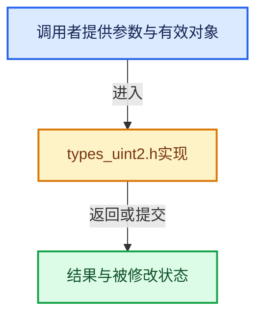

# 实现依赖专题：intern/cycles/util/types_uint2.h

[方向导航](README.md) · [符号索引](../%E7%AC%A6%E5%8F%B7%E4%BE%9D%E8%B5%96%E4%B8%8E%E5%AE%9E%E7%8E%B0%E7%B4%A2%E5%BC%95.md)

本专题从正文实际调用进入，集中保存共享实现。函数有稳定锚点，可从调用处直接跳到对应完整函数；递归与互相调用通过回链组织。

## 本文件的实现关系





## 相关类型布局与成员入口

<a id="t-acfae85419d8"></a>

### `uint2`

原始声明：[intern/cycles/util/types_uint2.h](../../../../../intern/cycles/util/types_uint2.h) · L12—L28。

成员布局：

- `uint x`

以下保留类的数据声明与编译条件，成员函数实现通过后面的精确链接阅读。

<!-- annotated:9571c341367a0b -->

```cpp
struct uint2 {
  uint x, y;

#  ifndef __KERNEL_GPU__
```

<details>
<summary>核对原始源码：intern/cycles/util/types_uint2.h · L12—L15</summary>

<!-- original:9571c341367a0b:intern/cycles/util/types_uint2.h:12:15 -->

```cpp
struct uint2 {
  uint x, y;

#  ifndef __KERNEL_GPU__
```

</details>

<!-- annotated:44db074ce6e553 -->

```cpp

```

<details>
<summary>核对原始源码：intern/cycles/util/types_uint2.h · L21—L21</summary>

<!-- original:44db074ce6e553:intern/cycles/util/types_uint2.h:21:21 -->

```cpp

```

</details>

<!-- annotated:473294c071706a -->

```cpp
#  endif
};
```

<details>
<summary>核对原始源码：intern/cycles/util/types_uint2.h · L27—L28</summary>

<!-- original:473294c071706a:intern/cycles/util/types_uint2.h:27:28 -->

```cpp
#  endif
};
```

</details>


## 完整成员与函数实现
