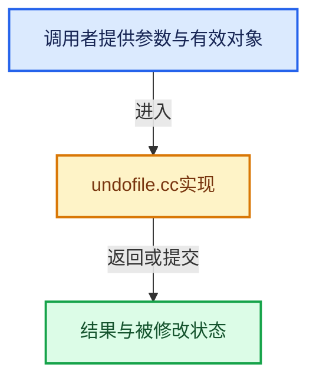

# 实现依赖专题：source/blender/blenloader/intern/undofile.cc

[方向导航](README.md) · [符号索引](../%E7%AC%A6%E5%8F%B7%E4%BE%9D%E8%B5%96%E4%B8%8E%E5%AE%9E%E7%8E%B0%E7%B4%A2%E5%BC%95.md)

本专题从正文实际调用进入，集中保存共享实现。函数有稳定锚点，可从调用处直接跳到对应完整函数；递归与互相调用通过回链组织。

## 本文件的实现关系





## 完整成员与函数实现

<a id="f-69214f2a3cf341ed"></a>

### `blender::BLO_memfile_chunk_add`

实现位置：[source/blender/blenloader/intern/undofile.cc](../../../../../source/blender/blenloader/intern/undofile.cc) · L135—L171。

接口参数：

- `MemFileWriteData *mem_data`
- `const char *buf`
- `size_t size`

**教学注释版**

<!-- annotated:ade6c0f26bb553 -->

```cpp
void BLO_memfile_chunk_add(MemFileWriteData *mem_data, const char *buf, size_t size)
{
  MemFile *memfile = mem_data->written_memfile;
  MemFileChunk **compchunk_step = &mem_data->reference_current_chunk;

  MemFileChunk *curchunk = MEM_new_uninitialized<MemFileChunk>("MemFileChunk");
  curchunk->size = size;
  curchunk->buf = nullptr;
  curchunk->is_identical = false;
  /* This is unsafe in the sense that an app handler or other code that does not
   * perform an undo push may make changes after the last undo push that
   * will then not be undo. Though it's not entirely clear that is wrong behavior. */
  curchunk->is_identical_future = true;
  curchunk->id_session_uid = mem_data->current_id_session_uid;
  BLI_addtail(&memfile->chunks, curchunk);

  /* we compare compchunk with buf */
  if (*compchunk_step != nullptr) {
    MemFileChunk *compchunk = *compchunk_step;
    if (compchunk->size == curchunk->size) {
      if (memcmp(compchunk->buf, buf, size) == 0) {
        curchunk->buf = compchunk->buf;
        curchunk->is_identical = true;
        compchunk->is_identical_future = true;
      }
    }
    *compchunk_step = static_cast<MemFileChunk *>(compchunk->next);
  }

  /* not equal... */
  if (curchunk->buf == nullptr) {
    char *buf_new = MEM_new_array_uninitialized<char>(size, "Chunk buffer");
    // [讲解] memcpy：复制字节，源与目标不应重叠。类型生命周期、对齐和可复制表示须由调用者证明，不是任意对象的复制构造。
    memcpy(buf_new, buf, size);
    curchunk->buf = buf_new;
    memfile->size += size;
  }
}
```

<details>
<summary>核对原始源码：source/blender/blenloader/intern/undofile.cc · L135—L171</summary>

<!-- original:ade6c0f26bb553:source/blender/blenloader/intern/undofile.cc:135:171 -->

```cpp
void BLO_memfile_chunk_add(MemFileWriteData *mem_data, const char *buf, size_t size)
{
  MemFile *memfile = mem_data->written_memfile;
  MemFileChunk **compchunk_step = &mem_data->reference_current_chunk;

  MemFileChunk *curchunk = MEM_new_uninitialized<MemFileChunk>("MemFileChunk");
  curchunk->size = size;
  curchunk->buf = nullptr;
  curchunk->is_identical = false;
  /* This is unsafe in the sense that an app handler or other code that does not
   * perform an undo push may make changes after the last undo push that
   * will then not be undo. Though it's not entirely clear that is wrong behavior. */
  curchunk->is_identical_future = true;
  curchunk->id_session_uid = mem_data->current_id_session_uid;
  BLI_addtail(&memfile->chunks, curchunk);

  /* we compare compchunk with buf */
  if (*compchunk_step != nullptr) {
    MemFileChunk *compchunk = *compchunk_step;
    if (compchunk->size == curchunk->size) {
      if (memcmp(compchunk->buf, buf, size) == 0) {
        curchunk->buf = compchunk->buf;
        curchunk->is_identical = true;
        compchunk->is_identical_future = true;
      }
    }
    *compchunk_step = static_cast<MemFileChunk *>(compchunk->next);
  }

  /* not equal... */
  if (curchunk->buf == nullptr) {
    char *buf_new = MEM_new_array_uninitialized<char>(size, "Chunk buffer");
    memcpy(buf_new, buf, size);
    curchunk->buf = buf_new;
    memfile->size += size;
  }
}
```

</details>

**沿实际写入检查状态**

- `curchunk->size = size;`
- `curchunk->buf = nullptr;`
- `curchunk->is_identical = false;`
- `curchunk->is_identical_future = true;`
- `curchunk->id_session_uid = mem_data->current_id_session_uid;`
- `curchunk->buf = compchunk->buf;`
- `curchunk->is_identical = true;`
- `compchunk->is_identical_future = true;`
- `curchunk->buf = buf_new;`
- `memfile->size += size;`

**继续追踪实现**

- `MEM_new_uninitialized<MemFileChunk>` → [MEM_new_uninitialized · L590](../03-%E5%86%85%E5%AD%98%E5%88%86%E9%85%8D%E4%B8%8E%E8%BF%90%E8%A1%8C%E6%97%B6%E7%B1%BB%E5%9E%8B/%E4%BE%9D%E8%B5%96-MEM_guardedalloc-b54eca.md#f-c773b2e5b8fe70e4)；[MEM_new_uninitialized · L124](../03-%E5%86%85%E5%AD%98%E5%88%86%E9%85%8D%E4%B8%8E%E8%BF%90%E8%A1%8C%E6%97%B6%E7%B1%BB%E5%9E%8B/%E4%BE%9D%E8%B5%96-mallocn-afdcd4.md#f-28a7e00a1e67f699)。同名重载需按实参类型选择。
- `BLI_addtail` → [blender::BLI_addtail · L118](../01-%E5%9F%BA%E7%A1%80%E5%AE%B9%E5%99%A8%E4%B8%8E%E7%8E%B0%E4%BB%A3CPP/%E4%BE%9D%E8%B5%96-listbase-2816d9.md#f-4fb027713fa3115b)。
- `memcmp` → [外部契约](https://eel.is/c++draft/)：这个边界按实际表达式及所属类型核对参数、返回值、寿命与失败行为。这里提供接口入口，不声称已解释该第三方版本的内部实现。
- `MEM_new_array_uninitialized<char>` → [MEM_new_array_uninitialized · L608](../03-%E5%86%85%E5%AD%98%E5%88%86%E9%85%8D%E4%B8%8E%E8%BF%90%E8%A1%8C%E6%97%B6%E7%B1%BB%E5%9E%8B/%E4%BE%9D%E8%B5%96-MEM_guardedalloc-b54eca.md#f-b7103eae8eb57b05)；[MEM_new_array_uninitialized · L129](../03-%E5%86%85%E5%AD%98%E5%88%86%E9%85%8D%E4%B8%8E%E8%BF%90%E8%A1%8C%E6%97%B6%E7%B1%BB%E5%9E%8B/%E4%BE%9D%E8%B5%96-mallocn-afdcd4.md#f-bf6ef4ddcfb6e5df)。同名重载需按实参类型选择。
- `memcpy` → [外部契约](https://eel.is/c++draft/cstring.syn)：复制字节，源与目标不应重叠。类型生命周期、对齐和可复制表示须由调用者证明，不是任意对象的复制构造。
