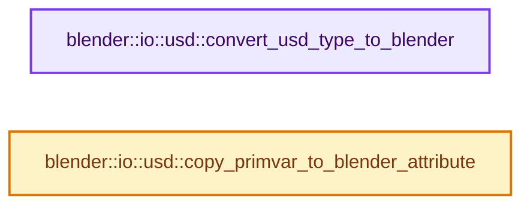

# 实现依赖专题：source/blender/io/usd/intern/usd_attribute_utils.cc

[方向导航](README.md) · [符号索引](../%E7%AC%A6%E5%8F%B7%E4%BE%9D%E8%B5%96%E4%B8%8E%E5%AE%9E%E7%8E%B0%E7%B4%A2%E5%BC%95.md)

本专题从正文实际调用进入，集中保存共享实现。函数有稳定锚点，可从调用处直接跳到对应完整函数；递归与互相调用通过回链组织。

## 本文件的实现关系




## 完整成员与函数实现

<a id="f-efdda91a1db0b399"></a>

### `blender::io::usd::convert_usd_type_to_blender`

实现位置：[source/blender/io/usd/intern/usd_attribute_utils.cc](../../../../../source/blender/io/usd/intern/usd_attribute_utils.cc) · L51—L96。

接口参数：

- `const pxr::SdfValueTypeName usd_type`

**教学注释版**

<!-- annotated:0981190d8188d5 -->

```cpp
std::optional<bke::AttrType> convert_usd_type_to_blender(const pxr::SdfValueTypeName usd_type)
{
  static const Map<pxr::SdfValueTypeName, bke::AttrType> type_map = []() {
    Map<pxr::SdfValueTypeName, bke::AttrType> map;
    // [讲解] map.add_new：按哈希与相等关系加入键或键值。
    map.add_new(pxr::SdfValueTypeNames->FloatArray, bke::AttrType::Float);
    map.add_new(pxr::SdfValueTypeNames->Double, bke::AttrType::Float);
    map.add_new(pxr::SdfValueTypeNames->UCharArray, bke::AttrType::Int8);
    map.add_new(pxr::SdfValueTypeNames->IntArray, bke::AttrType::Int32);
    map.add_new(pxr::SdfValueTypeNames->Float2Array, bke::AttrType::Float2);
    map.add_new(pxr::SdfValueTypeNames->TexCoord2dArray, bke::AttrType::Float2);
    map.add_new(pxr::SdfValueTypeNames->TexCoord2fArray, bke::AttrType::Float2);
    map.add_new(pxr::SdfValueTypeNames->TexCoord2hArray, bke::AttrType::Float2);
    map.add_new(pxr::SdfValueTypeNames->TexCoord3dArray, bke::AttrType::Float2);
    map.add_new(pxr::SdfValueTypeNames->TexCoord3fArray, bke::AttrType::Float2);
    map.add_new(pxr::SdfValueTypeNames->TexCoord3hArray, bke::AttrType::Float2);
    map.add_new(pxr::SdfValueTypeNames->Float3Array, bke::AttrType::Float3);
    map.add_new(pxr::SdfValueTypeNames->Point3fArray, bke::AttrType::Float3);
    map.add_new(pxr::SdfValueTypeNames->Point3dArray, bke::AttrType::Float3);
    map.add_new(pxr::SdfValueTypeNames->Point3hArray, bke::AttrType::Float3);
    map.add_new(pxr::SdfValueTypeNames->Normal3fArray, bke::AttrType::Float3);
    map.add_new(pxr::SdfValueTypeNames->Normal3dArray, bke::AttrType::Float3);
    map.add_new(pxr::SdfValueTypeNames->Normal3hArray, bke::AttrType::Float3);
    map.add_new(pxr::SdfValueTypeNames->Vector3fArray, bke::AttrType::Float3);
    map.add_new(pxr::SdfValueTypeNames->Vector3hArray, bke::AttrType::Float3);
    map.add_new(pxr::SdfValueTypeNames->Vector3dArray, bke::AttrType::Float3);
    map.add_new(pxr::SdfValueTypeNames->Color3fArray, bke::AttrType::ColorFloat);
    map.add_new(pxr::SdfValueTypeNames->Color3hArray, bke::AttrType::ColorFloat);
    map.add_new(pxr::SdfValueTypeNames->Color3dArray, bke::AttrType::ColorFloat);
    map.add_new(pxr::SdfValueTypeNames->Color4fArray, bke::AttrType::ColorFloat);
    map.add_new(pxr::SdfValueTypeNames->Color4hArray, bke::AttrType::ColorFloat);
    map.add_new(pxr::SdfValueTypeNames->Color4dArray, bke::AttrType::ColorFloat);
    map.add_new(pxr::SdfValueTypeNames->BoolArray, bke::AttrType::Bool);
    map.add_new(pxr::SdfValueTypeNames->QuatfArray, bke::AttrType::Quaternion);
    map.add_new(pxr::SdfValueTypeNames->QuatdArray, bke::AttrType::Quaternion);
    map.add_new(pxr::SdfValueTypeNames->QuathArray, bke::AttrType::Quaternion);
    map.add_new(pxr::SdfValueTypeNames->Matrix4dArray, bke::AttrType::Float4x4);
    return map;
  }();

  // [讲解] type_map.lookup_ptr：按键查找对应项。
  const bke::AttrType *value = type_map.lookup_ptr(usd_type);
  if (value == nullptr) {
    return std::nullopt;
  }

  return *value;
}
```

<details>
<summary>核对原始源码：source/blender/io/usd/intern/usd_attribute_utils.cc · L51—L96</summary>

<!-- original:0981190d8188d5:source/blender/io/usd/intern/usd_attribute_utils.cc:51:96 -->

```cpp
std::optional<bke::AttrType> convert_usd_type_to_blender(const pxr::SdfValueTypeName usd_type)
{
  static const Map<pxr::SdfValueTypeName, bke::AttrType> type_map = []() {
    Map<pxr::SdfValueTypeName, bke::AttrType> map;
    map.add_new(pxr::SdfValueTypeNames->FloatArray, bke::AttrType::Float);
    map.add_new(pxr::SdfValueTypeNames->Double, bke::AttrType::Float);
    map.add_new(pxr::SdfValueTypeNames->UCharArray, bke::AttrType::Int8);
    map.add_new(pxr::SdfValueTypeNames->IntArray, bke::AttrType::Int32);
    map.add_new(pxr::SdfValueTypeNames->Float2Array, bke::AttrType::Float2);
    map.add_new(pxr::SdfValueTypeNames->TexCoord2dArray, bke::AttrType::Float2);
    map.add_new(pxr::SdfValueTypeNames->TexCoord2fArray, bke::AttrType::Float2);
    map.add_new(pxr::SdfValueTypeNames->TexCoord2hArray, bke::AttrType::Float2);
    map.add_new(pxr::SdfValueTypeNames->TexCoord3dArray, bke::AttrType::Float2);
    map.add_new(pxr::SdfValueTypeNames->TexCoord3fArray, bke::AttrType::Float2);
    map.add_new(pxr::SdfValueTypeNames->TexCoord3hArray, bke::AttrType::Float2);
    map.add_new(pxr::SdfValueTypeNames->Float3Array, bke::AttrType::Float3);
    map.add_new(pxr::SdfValueTypeNames->Point3fArray, bke::AttrType::Float3);
    map.add_new(pxr::SdfValueTypeNames->Point3dArray, bke::AttrType::Float3);
    map.add_new(pxr::SdfValueTypeNames->Point3hArray, bke::AttrType::Float3);
    map.add_new(pxr::SdfValueTypeNames->Normal3fArray, bke::AttrType::Float3);
    map.add_new(pxr::SdfValueTypeNames->Normal3dArray, bke::AttrType::Float3);
    map.add_new(pxr::SdfValueTypeNames->Normal3hArray, bke::AttrType::Float3);
    map.add_new(pxr::SdfValueTypeNames->Vector3fArray, bke::AttrType::Float3);
    map.add_new(pxr::SdfValueTypeNames->Vector3hArray, bke::AttrType::Float3);
    map.add_new(pxr::SdfValueTypeNames->Vector3dArray, bke::AttrType::Float3);
    map.add_new(pxr::SdfValueTypeNames->Color3fArray, bke::AttrType::ColorFloat);
    map.add_new(pxr::SdfValueTypeNames->Color3hArray, bke::AttrType::ColorFloat);
    map.add_new(pxr::SdfValueTypeNames->Color3dArray, bke::AttrType::ColorFloat);
    map.add_new(pxr::SdfValueTypeNames->Color4fArray, bke::AttrType::ColorFloat);
    map.add_new(pxr::SdfValueTypeNames->Color4hArray, bke::AttrType::ColorFloat);
    map.add_new(pxr::SdfValueTypeNames->Color4dArray, bke::AttrType::ColorFloat);
    map.add_new(pxr::SdfValueTypeNames->BoolArray, bke::AttrType::Bool);
    map.add_new(pxr::SdfValueTypeNames->QuatfArray, bke::AttrType::Quaternion);
    map.add_new(pxr::SdfValueTypeNames->QuatdArray, bke::AttrType::Quaternion);
    map.add_new(pxr::SdfValueTypeNames->QuathArray, bke::AttrType::Quaternion);
    map.add_new(pxr::SdfValueTypeNames->Matrix4dArray, bke::AttrType::Float4x4);
    return map;
  }();

  const bke::AttrType *value = type_map.lookup_ptr(usd_type);
  if (value == nullptr) {
    return std::nullopt;
  }

  return *value;
}
```

</details>

**结果出口**

- `return map;`
- `return std::nullopt;`
- `return *value;`

**继续追踪实现**

- `[]() { Map<pxr::SdfValueTypeName, bke::AttrType> map; map.add_new(pxr::SdfValueTypeNames->FloatArray, bke::AttrType::Float); map.add_new(pxr::SdfValueTypeNames->Double, bke::AttrTy …（完整表达式见本函数源码）` → [调用协议](../%E6%A8%A1%E6%9D%BF%E5%AE%8F%E4%B8%8E%E5%8A%A8%E6%80%81%E5%88%86%E6%B4%BE%E5%8D%8F%E8%AE%AE.md)：函数指针、局部可调用对象或未展开的宏；必须结合调用者环境。调用位置L53。
- `map.add_new` → [blender::Map::add_new · L265](../02-%E5%93%88%E5%B8%8C%E8%A1%A8%E4%B8%8E%E5%85%B3%E8%81%94%E6%95%B0%E6%8D%AE%E7%BB%93%E6%9E%84/02-Map%E6%80%BB%E4%BD%93%E5%B8%83%E5%B1%80.md#f-521ff0865e8229d0)；[blender::Map::add_new · L269](../02-%E5%93%88%E5%B8%8C%E8%A1%A8%E4%B8%8E%E5%85%B3%E8%81%94%E6%95%B0%E6%8D%AE%E7%BB%93%E6%9E%84/02-Map%E6%80%BB%E4%BD%93%E5%B8%83%E5%B1%80.md#f-d89cee0e3d2848a0)；[blender::Map::add_new · L273](../02-%E5%93%88%E5%B8%8C%E8%A1%A8%E4%B8%8E%E5%85%B3%E8%81%94%E6%95%B0%E6%8D%AE%E7%BB%93%E6%9E%84/02-Map%E6%80%BB%E4%BD%93%E5%B8%83%E5%B1%80.md#f-c13142c32e703ebd)；[blender::Map::add_new · L277](../02-%E5%93%88%E5%B8%8C%E8%A1%A8%E4%B8%8E%E5%85%B3%E8%81%94%E6%95%B0%E6%8D%AE%E7%BB%93%E6%9E%84/04-Map%E6%9F%A5%E6%89%BE%E4%B8%8E%E9%94%AE%E8%AE%BF%E9%97%AE.md#f-da1e537f229db040)。同名重载需按实参类型选择。
- `type_map.lookup_ptr` → [blender::Map::lookup_ptr · L508](../02-%E5%93%88%E5%B8%8C%E8%A1%A8%E4%B8%8E%E5%85%B3%E8%81%94%E6%95%B0%E6%8D%AE%E7%BB%93%E6%9E%84/04-Map%E6%9F%A5%E6%89%BE%E4%B8%8E%E9%94%AE%E8%AE%BF%E9%97%AE.md#f-90844510a761dcb2)；[blender::Map::lookup_ptr · L512](../02-%E5%93%88%E5%B8%8C%E8%A1%A8%E4%B8%8E%E5%85%B3%E8%81%94%E6%95%B0%E6%8D%AE%E7%BB%93%E6%9E%84/04-Map%E6%9F%A5%E6%89%BE%E4%B8%8E%E9%94%AE%E8%AE%BF%E9%97%AE.md#f-ce017485b88f4b2c)。同名重载需按实参类型选择。

<a id="f-17c12e082c15637d"></a>

### `blender::io::usd::copy_primvar_to_blender_attribute`

实现位置：[source/blender/io/usd/intern/usd_attribute_utils.cc](../../../../../source/blender/io/usd/intern/usd_attribute_utils.cc) · L98—L157。

接口参数：

- `const pxr::UsdGeomPrimvar &primvar`
- `const pxr::UsdTimeCode time`
- `const bke::AttrType data_type`
- `const bke::AttrDomain domain`
- `const OffsetIndices<int> face_indices`
- `bke::MutableAttributeAccessor attributes`

**教学注释版**

<!-- annotated:b5726024e5eb76 -->

```cpp
void copy_primvar_to_blender_attribute(const pxr::UsdGeomPrimvar &primvar,
                                       const pxr::UsdTimeCode time,
                                       const bke::AttrType data_type,
                                       const bke::AttrDomain domain,
                                       const OffsetIndices<int> face_indices,
                                       bke::MutableAttributeAccessor attributes)
{
  switch (data_type) {
    case bke::AttrType::Float:
      copy_primvar_to_blender_buffer<float, float>(
          primvar, time, data_type, domain, face_indices, attributes);
      break;
    case bke::AttrType::Int8:
      copy_primvar_to_blender_buffer<uchar, int8_t>(
          primvar, time, data_type, domain, face_indices, attributes);
      break;
    case bke::AttrType::Int32:
      copy_primvar_to_blender_buffer<int32_t, int>(
          primvar, time, data_type, domain, face_indices, attributes);
      break;
    case bke::AttrType::Float2:
      copy_primvar_to_blender_buffer<pxr::GfVec2f, float2>(
          primvar, time, data_type, domain, face_indices, attributes);
      break;
    case bke::AttrType::Float3:
      copy_primvar_to_blender_buffer<pxr::GfVec3f, float3>(
          primvar, time, data_type, domain, face_indices, attributes);
      break;
    case bke::AttrType::ColorFloat: {
      const pxr::SdfValueTypeName pv_type = primvar.GetTypeName();
      if (ELEM(pv_type,
               pxr::SdfValueTypeNames->Color3fArray,
               pxr::SdfValueTypeNames->Color3hArray,
               pxr::SdfValueTypeNames->Color3dArray))
      {
        copy_primvar_to_blender_buffer<pxr::GfVec3f, ColorGeometry4f>(
            primvar, time, data_type, domain, face_indices, attributes);
      }
      else {
        copy_primvar_to_blender_buffer<pxr::GfVec4f, ColorGeometry4f>(
            primvar, time, data_type, domain, face_indices, attributes);
      }
    } break;
    case bke::AttrType::Bool:
      copy_primvar_to_blender_buffer<bool, bool>(
          primvar, time, data_type, domain, face_indices, attributes);
      break;
    case bke::AttrType::Quaternion:
      copy_primvar_to_blender_buffer<pxr::GfQuatf, math::Quaternion>(
          primvar, time, data_type, domain, face_indices, attributes);
      break;
    case bke::AttrType::Float4x4:
      copy_primvar_to_blender_buffer<pxr::GfMatrix4d, float4x4>(
          primvar, time, data_type, domain, face_indices, attributes);
      break;

    default:
      BLI_assert_unreachable();
  }
}
```

<details>
<summary>核对原始源码：source/blender/io/usd/intern/usd_attribute_utils.cc · L98—L157</summary>

<!-- original:b5726024e5eb76:source/blender/io/usd/intern/usd_attribute_utils.cc:98:157 -->

```cpp
void copy_primvar_to_blender_attribute(const pxr::UsdGeomPrimvar &primvar,
                                       const pxr::UsdTimeCode time,
                                       const bke::AttrType data_type,
                                       const bke::AttrDomain domain,
                                       const OffsetIndices<int> face_indices,
                                       bke::MutableAttributeAccessor attributes)
{
  switch (data_type) {
    case bke::AttrType::Float:
      copy_primvar_to_blender_buffer<float, float>(
          primvar, time, data_type, domain, face_indices, attributes);
      break;
    case bke::AttrType::Int8:
      copy_primvar_to_blender_buffer<uchar, int8_t>(
          primvar, time, data_type, domain, face_indices, attributes);
      break;
    case bke::AttrType::Int32:
      copy_primvar_to_blender_buffer<int32_t, int>(
          primvar, time, data_type, domain, face_indices, attributes);
      break;
    case bke::AttrType::Float2:
      copy_primvar_to_blender_buffer<pxr::GfVec2f, float2>(
          primvar, time, data_type, domain, face_indices, attributes);
      break;
    case bke::AttrType::Float3:
      copy_primvar_to_blender_buffer<pxr::GfVec3f, float3>(
          primvar, time, data_type, domain, face_indices, attributes);
      break;
    case bke::AttrType::ColorFloat: {
      const pxr::SdfValueTypeName pv_type = primvar.GetTypeName();
      if (ELEM(pv_type,
               pxr::SdfValueTypeNames->Color3fArray,
               pxr::SdfValueTypeNames->Color3hArray,
               pxr::SdfValueTypeNames->Color3dArray))
      {
        copy_primvar_to_blender_buffer<pxr::GfVec3f, ColorGeometry4f>(
            primvar, time, data_type, domain, face_indices, attributes);
      }
      else {
        copy_primvar_to_blender_buffer<pxr::GfVec4f, ColorGeometry4f>(
            primvar, time, data_type, domain, face_indices, attributes);
      }
    } break;
    case bke::AttrType::Bool:
      copy_primvar_to_blender_buffer<bool, bool>(
          primvar, time, data_type, domain, face_indices, attributes);
      break;
    case bke::AttrType::Quaternion:
      copy_primvar_to_blender_buffer<pxr::GfQuatf, math::Quaternion>(
          primvar, time, data_type, domain, face_indices, attributes);
      break;
    case bke::AttrType::Float4x4:
      copy_primvar_to_blender_buffer<pxr::GfMatrix4d, float4x4>(
          primvar, time, data_type, domain, face_indices, attributes);
      break;

    default:
      BLI_assert_unreachable();
  }
}
```

</details>

**继续追踪实现**

- `copy_primvar_to_blender_buffer<float, float>` → [blender::io::usd::copy_primvar_to_blender_buffer · L263](%E4%BE%9D%E8%B5%96-usd_attribute_utils-8f80d9.md#f-4726484510e802ca)。
- `copy_primvar_to_blender_buffer<uchar, int8_t>` → [blender::io::usd::copy_primvar_to_blender_buffer · L263](%E4%BE%9D%E8%B5%96-usd_attribute_utils-8f80d9.md#f-4726484510e802ca)。
- `copy_primvar_to_blender_buffer<int32_t, int>` → [blender::io::usd::copy_primvar_to_blender_buffer · L263](%E4%BE%9D%E8%B5%96-usd_attribute_utils-8f80d9.md#f-4726484510e802ca)。
- `copy_primvar_to_blender_buffer<pxr::GfVec2f, float2>` → [blender::io::usd::copy_primvar_to_blender_buffer · L263](%E4%BE%9D%E8%B5%96-usd_attribute_utils-8f80d9.md#f-4726484510e802ca)。
- `copy_primvar_to_blender_buffer<pxr::GfVec3f, float3>` → [blender::io::usd::copy_primvar_to_blender_buffer · L263](%E4%BE%9D%E8%B5%96-usd_attribute_utils-8f80d9.md#f-4726484510e802ca)。
- `primvar.GetTypeName` → [调用协议](../%E6%A8%A1%E6%9D%BF%E5%AE%8F%E4%B8%8E%E5%8A%A8%E6%80%81%E5%88%86%E6%B4%BE%E5%8D%8F%E8%AE%AE.md)：由接收对象具体类型或运行时策略提供实现。调用位置L127。
- `ELEM` → [ELEM · L88](%E4%BE%9D%E8%B5%96-GHOST_utildefines-34b996.md#m-d28724a15928)；[ELEM · L135](../01-%E5%9F%BA%E7%A1%80%E5%AE%B9%E5%99%A8%E4%B8%8E%E7%8E%B0%E4%BB%A3CPP/%E4%BE%9D%E8%B5%96-BLI_utildefines-293a0a.md#m-d6572de7cae0)。宏定义由构建条件选择。
- `copy_primvar_to_blender_buffer<pxr::GfVec3f, ColorGeometry4f>` → [blender::io::usd::copy_primvar_to_blender_buffer · L263](%E4%BE%9D%E8%B5%96-usd_attribute_utils-8f80d9.md#f-4726484510e802ca)。
- `copy_primvar_to_blender_buffer<pxr::GfVec4f, ColorGeometry4f>` → [blender::io::usd::copy_primvar_to_blender_buffer · L263](%E4%BE%9D%E8%B5%96-usd_attribute_utils-8f80d9.md#f-4726484510e802ca)。
- `copy_primvar_to_blender_buffer<bool, bool>` → [blender::io::usd::copy_primvar_to_blender_buffer · L263](%E4%BE%9D%E8%B5%96-usd_attribute_utils-8f80d9.md#f-4726484510e802ca)。
- `copy_primvar_to_blender_buffer<pxr::GfQuatf, math::Quaternion>` → [blender::io::usd::copy_primvar_to_blender_buffer · L263](%E4%BE%9D%E8%B5%96-usd_attribute_utils-8f80d9.md#f-4726484510e802ca)。
- `copy_primvar_to_blender_buffer<pxr::GfMatrix4d, float4x4>` → [blender::io::usd::copy_primvar_to_blender_buffer · L263](%E4%BE%9D%E8%B5%96-usd_attribute_utils-8f80d9.md#f-4726484510e802ca)。
- `BLI_assert_unreachable` → [BLI_assert_unreachable · L77](../01-%E5%9F%BA%E7%A1%80%E5%AE%B9%E5%99%A8%E4%B8%8E%E7%8E%B0%E4%BB%A3CPP/%E4%BE%9D%E8%B5%96-BLI_assert-cc98e8.md#m-7a2d91a67d8e)。宏定义由构建条件选择。
