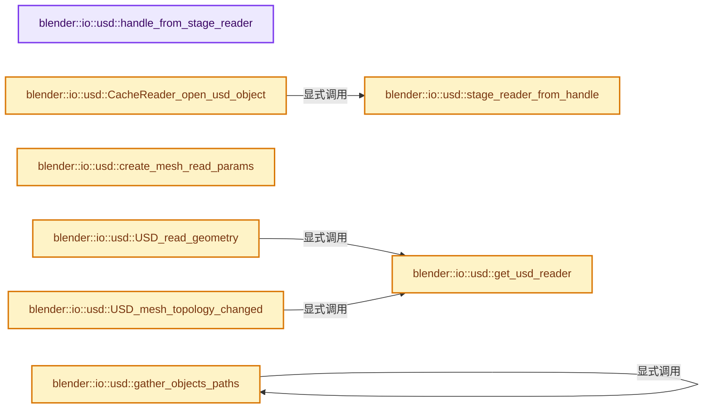

# 实现依赖专题：source/blender/io/usd/intern/usd_capi_import.cc

[方向导航](README.md) · [符号索引](../%E7%AC%A6%E5%8F%B7%E4%BE%9D%E8%B5%96%E4%B8%8E%E5%AE%9E%E7%8E%B0%E7%B4%A2%E5%BC%95.md)

本专题从正文实际调用进入，集中保存共享实现。函数有稳定锚点，可从调用处直接跳到对应完整函数；递归与互相调用通过回链组织。

## 本文件的实现关系




## 完整成员与函数实现

<a id="f-7df65aad20e9de07"></a>

### `blender::io::usd::handle_from_stage_reader`

实现位置：[source/blender/io/usd/intern/usd_capi_import.cc](../../../../../source/blender/io/usd/intern/usd_capi_import.cc) · L62—L65。

接口参数：

- `USDStageReader *reader`

**教学注释版**

<!-- annotated:d14c42634bc215 -->

```cpp
static CacheArchiveHandle *handle_from_stage_reader(USDStageReader *reader)
{
  return reinterpret_cast<CacheArchiveHandle *>(reader);
}
```

<details>
<summary>核对原始源码：source/blender/io/usd/intern/usd_capi_import.cc · L62—L65</summary>

<!-- original:d14c42634bc215:source/blender/io/usd/intern/usd_capi_import.cc:62:65 -->

```cpp
static CacheArchiveHandle *handle_from_stage_reader(USDStageReader *reader)
{
  return reinterpret_cast<CacheArchiveHandle *>(reader);
}
```

</details>

**结果出口**

- `return reinterpret_cast<CacheArchiveHandle *>(reader);`

**继续追踪实现**

本实现没有需要继续展开的显式调用；检查返回表达式、对象转换和调用者前置条件。

<a id="f-56c626b6579b2b38"></a>

### `blender::io::usd::stage_reader_from_handle`

实现位置：[source/blender/io/usd/intern/usd_capi_import.cc](../../../../../source/blender/io/usd/intern/usd_capi_import.cc) · L67—L70。

接口参数：

- `CacheArchiveHandle *handle`

**教学注释版**

<!-- annotated:bd7aa08825503f -->

```cpp
static USDStageReader *stage_reader_from_handle(CacheArchiveHandle *handle)
{
  return reinterpret_cast<USDStageReader *>(handle);
}
```

<details>
<summary>核对原始源码：source/blender/io/usd/intern/usd_capi_import.cc · L67—L70</summary>

<!-- original:bd7aa08825503f:source/blender/io/usd/intern/usd_capi_import.cc:67:70 -->

```cpp
static USDStageReader *stage_reader_from_handle(CacheArchiveHandle *handle)
{
  return reinterpret_cast<USDStageReader *>(handle);
}
```

</details>

**结果出口**

- `return reinterpret_cast<USDStageReader *>(handle);`

**继续追踪实现**

本实现没有需要继续展开的显式调用；检查返回表达式、对象转换和调用者前置条件。

<a id="f-be1871af7fb2f85f"></a>

### `blender::io::usd::gather_objects_paths`

实现位置：[source/blender/io/usd/intern/usd_capi_import.cc](../../../../../source/blender/io/usd/intern/usd_capi_import.cc) · L72—L89。

接口参数：

- `const pxr::UsdPrim &object`
- `ListBaseT<CacheObjectPath> *object_paths`

**教学注释版**

<!-- annotated:5990190349e9e0 -->

```cpp
static bool gather_objects_paths(const pxr::UsdPrim &object,
                                 ListBaseT<CacheObjectPath> *object_paths)
{
  if (!object.IsValid()) {
    return false;
  }

  for (const pxr::UsdPrim &childPrim : object.GetChildren()) {
    gather_objects_paths(childPrim, object_paths);
  }

  CacheObjectPath *usd_path = MEM_new<CacheObjectPath>("CacheObjectPath");

  STRNCPY(usd_path->path, object.GetPrimPath().GetString().c_str());
  BLI_addtail(object_paths, usd_path);

  return true;
}
```

<details>
<summary>核对原始源码：source/blender/io/usd/intern/usd_capi_import.cc · L72—L89</summary>

<!-- original:5990190349e9e0:source/blender/io/usd/intern/usd_capi_import.cc:72:89 -->

```cpp
static bool gather_objects_paths(const pxr::UsdPrim &object,
                                 ListBaseT<CacheObjectPath> *object_paths)
{
  if (!object.IsValid()) {
    return false;
  }

  for (const pxr::UsdPrim &childPrim : object.GetChildren()) {
    gather_objects_paths(childPrim, object_paths);
  }

  CacheObjectPath *usd_path = MEM_new<CacheObjectPath>("CacheObjectPath");

  STRNCPY(usd_path->path, object.GetPrimPath().GetString().c_str());
  BLI_addtail(object_paths, usd_path);

  return true;
}
```

</details>

**结果出口**

- `return false;`
- `return true;`

**继续追踪实现**

- `object.IsValid` → [调用协议](../%E6%A8%A1%E6%9D%BF%E5%AE%8F%E4%B8%8E%E5%8A%A8%E6%80%81%E5%88%86%E6%B4%BE%E5%8D%8F%E8%AE%AE.md)：由接收对象具体类型或运行时策略提供实现。调用位置L75。
- `object.GetChildren` → [调用协议](../%E6%A8%A1%E6%9D%BF%E5%AE%8F%E4%B8%8E%E5%8A%A8%E6%80%81%E5%88%86%E6%B4%BE%E5%8D%8F%E8%AE%AE.md)：由接收对象具体类型或运行时策略提供实现。调用位置L79。
- `gather_objects_paths` → [blender::io::usd::gather_objects_paths · L72](%E4%BE%9D%E8%B5%96-usd_capi_import-bd2588.md#f-be1871af7fb2f85f)。
- `MEM_new<CacheObjectPath>` → [MEM_new · L351](../03-%E5%86%85%E5%AD%98%E5%88%86%E9%85%8D%E4%B8%8E%E8%BF%90%E8%A1%8C%E6%97%B6%E7%B1%BB%E5%9E%8B/%E4%BE%9D%E8%B5%96-MEM_guardedalloc-b54eca.md#f-115f9b6784f89912)。
- `STRNCPY` → [blender::STRNCPY · L690](../01-%E5%9F%BA%E7%A1%80%E5%AE%B9%E5%99%A8%E4%B8%8E%E7%8E%B0%E4%BB%A3CPP/%E4%BE%9D%E8%B5%96-BLI_string-b43058.md#f-6b2d861724026be6)。
- `object.GetPrimPath().GetString().c_str` → [调用协议](../%E6%A8%A1%E6%9D%BF%E5%AE%8F%E4%B8%8E%E5%8A%A8%E6%80%81%E5%88%86%E6%B4%BE%E5%8D%8F%E8%AE%AE.md)：接收对象类型依赖auto、返回值或模板实例；不按同名猜测目标。调用位置L85。
- `object.GetPrimPath().GetString` → [调用协议](../%E6%A8%A1%E6%9D%BF%E5%AE%8F%E4%B8%8E%E5%8A%A8%E6%80%81%E5%88%86%E6%B4%BE%E5%8D%8F%E8%AE%AE.md)：接收对象类型依赖auto、返回值或模板实例；不按同名猜测目标。调用位置L85。
- `object.GetPrimPath` → [调用协议](../%E6%A8%A1%E6%9D%BF%E5%AE%8F%E4%B8%8E%E5%8A%A8%E6%80%81%E5%88%86%E6%B4%BE%E5%8D%8F%E8%AE%AE.md)：由接收对象具体类型或运行时策略提供实现。调用位置L85。
- `BLI_addtail` → [blender::BLI_addtail · L118](../01-%E5%9F%BA%E7%A1%80%E5%AE%B9%E5%99%A8%E4%B8%8E%E7%8E%B0%E4%BB%A3CPP/%E4%BE%9D%E8%B5%96-listbase-2816d9.md#f-4fb027713fa3115b)。

<a id="f-29cda79ff6eb8443"></a>

### `blender::io::usd::get_usd_reader`

实现位置：[source/blender/io/usd/intern/usd_capi_import.cc](../../../../../source/blender/io/usd/intern/usd_capi_import.cc) · L507—L520。

接口参数：

- `CacheReader *reader`
- `const Object *`
- `const char **r_err_str`

**教学注释版**

<!-- annotated:99ff282a04f292 -->

```cpp
static USDPrimReader *get_usd_reader(CacheReader *reader,
                                     const Object * /*ob*/,
                                     const char **r_err_str)
{
  USDPrimReader *usd_reader = reinterpret_cast<USDPrimReader *>(reader);
  pxr::UsdPrim iobject = usd_reader->prim();

  if (!iobject.IsValid()) {
    *r_err_str = RPT_("Invalid object: verify object path");
    return nullptr;
  }

  return usd_reader;
}
```

<details>
<summary>核对原始源码：source/blender/io/usd/intern/usd_capi_import.cc · L507—L520</summary>

<!-- original:99ff282a04f292:source/blender/io/usd/intern/usd_capi_import.cc:507:520 -->

```cpp
static USDPrimReader *get_usd_reader(CacheReader *reader,
                                     const Object * /*ob*/,
                                     const char **r_err_str)
{
  USDPrimReader *usd_reader = reinterpret_cast<USDPrimReader *>(reader);
  pxr::UsdPrim iobject = usd_reader->prim();

  if (!iobject.IsValid()) {
    *r_err_str = RPT_("Invalid object: verify object path");
    return nullptr;
  }

  return usd_reader;
}
```

</details>

**结果出口**

- `return nullptr;`
- `return usd_reader;`

**继续追踪实现**

- `usd_reader->prim` → [blender::io::usd::USDPrimReader::prim · L76](%E4%BE%9D%E8%B5%96-usd_reader_prim-f2253f.md#f-0362f73858a39a3d)。
- `iobject.IsValid` → [调用协议](../%E6%A8%A1%E6%9D%BF%E5%AE%8F%E4%B8%8E%E5%8A%A8%E6%80%81%E5%88%86%E6%B4%BE%E5%8D%8F%E8%AE%AE.md)：由接收对象具体类型或运行时策略提供实现。调用位置L514。
- `RPT_` → [RPT_ · L51](%E4%BE%9D%E8%B5%96-BLT_translation-c89e58.md#m-c13f94a1a934)。宏定义由构建条件选择。

<a id="f-3b4801d5b5e697dd"></a>

### `blender::io::usd::create_mesh_read_params`

实现位置：[source/blender/io/usd/intern/usd_capi_import.cc](../../../../../source/blender/io/usd/intern/usd_capi_import.cc) · L522—L528。

接口参数：

- `const double motion_sample_time`
- `const int read_flags`

**教学注释版**

<!-- annotated:4952e04e267640 -->

```cpp
USDMeshReadParams create_mesh_read_params(const double motion_sample_time, const int read_flags)
{
  USDMeshReadParams params = {};
  params.motion_sample_time = motion_sample_time;
  params.read_flags = read_flags;
  return params;
}
```

<details>
<summary>核对原始源码：source/blender/io/usd/intern/usd_capi_import.cc · L522—L528</summary>

<!-- original:4952e04e267640:source/blender/io/usd/intern/usd_capi_import.cc:522:528 -->

```cpp
USDMeshReadParams create_mesh_read_params(const double motion_sample_time, const int read_flags)
{
  USDMeshReadParams params = {};
  params.motion_sample_time = motion_sample_time;
  params.read_flags = read_flags;
  return params;
}
```

</details>

**沿实际写入检查状态**

- `params.motion_sample_time = motion_sample_time;`
- `params.read_flags = read_flags;`

**结果出口**

- `return params;`

**继续追踪实现**

本实现没有需要继续展开的显式调用；检查返回表达式、对象转换和调用者前置条件。

<a id="f-c64ce20f87a2d8c6"></a>

### `blender::io::usd::USD_read_geometry`

实现位置：[source/blender/io/usd/intern/usd_capi_import.cc](../../../../../source/blender/io/usd/intern/usd_capi_import.cc) · L530—L543。

接口参数：

- `CacheReader *reader`
- `const Object *ob`
- `bke::GeometrySet &geometry_set`
- `const USDMeshReadParams params`
- `const char **r_err_str`

**教学注释版**

<!-- annotated:a1ac90761df7ff -->

```cpp
void USD_read_geometry(CacheReader *reader,
                       const Object *ob,
                       bke::GeometrySet &geometry_set,
                       const USDMeshReadParams params,
                       const char **r_err_str)
{
  USDGeomReader *usd_reader = dynamic_cast<USDGeomReader *>(get_usd_reader(reader, ob, r_err_str));

  if (usd_reader == nullptr) {
    return;
  }

  usd_reader->read_geometry(geometry_set, params, r_err_str);
}
```

<details>
<summary>核对原始源码：source/blender/io/usd/intern/usd_capi_import.cc · L530—L543</summary>

<!-- original:a1ac90761df7ff:source/blender/io/usd/intern/usd_capi_import.cc:530:543 -->

```cpp
void USD_read_geometry(CacheReader *reader,
                       const Object *ob,
                       bke::GeometrySet &geometry_set,
                       const USDMeshReadParams params,
                       const char **r_err_str)
{
  USDGeomReader *usd_reader = dynamic_cast<USDGeomReader *>(get_usd_reader(reader, ob, r_err_str));

  if (usd_reader == nullptr) {
    return;
  }

  usd_reader->read_geometry(geometry_set, params, r_err_str);
}
```

</details>

**继续追踪实现**

- `get_usd_reader` → [blender::io::usd::get_usd_reader · L507](%E4%BE%9D%E8%B5%96-usd_capi_import-bd2588.md#f-29cda79ff6eb8443)。
- `usd_reader->read_geometry` → [blender::io::usd::USDShapeReader::read_geometry · L156](%E4%BE%9D%E8%B5%96-usd_reader_shape-f2a229.md#f-c666bc7695bd0436)；[blender::io::usd::USDPointsReader::read_geometry · L58](%E4%BE%9D%E8%B5%96-usd_reader_points-9db6c0.md#f-e1f3438d6c712657)；[blender::io::usd::USDPointInstancerReader::read_geometry · L49](%E4%BE%9D%E8%B5%96-usd_reader_pointinstancer-9c4ec9.md#f-d9e643c4f8504a40)；[blender::io::usd::USDParticleFieldReader::read_geometry · L144](%E4%BE%9D%E8%B5%96-usd_reader_particlefield-57460f.md#f-6e81e3c67c1f4c78)；[blender::io::usd::USDMeshReader::read_geometry · L1032](%E4%BE%9D%E8%B5%96-usd_reader_mesh-77c109.md#f-19f67b2f057cf36c)；[blender::io::usd::USDCurvesReader::read_geometry · L202](%E4%BE%9D%E8%B5%96-usd_reader_curve-411e4d.md#f-5f21622bd0144a89)。同名重载需按实参类型选择。

<a id="f-2a7a87b4aa39654b"></a>

### `blender::io::usd::USD_mesh_topology_changed`

实现位置：[source/blender/io/usd/intern/usd_capi_import.cc](../../../../../source/blender/io/usd/intern/usd_capi_import.cc) · L545—L558。

接口参数：

- `CacheReader *reader`
- `const Object *ob`
- `const Mesh *existing_mesh`
- `const double time`
- `const char **r_err_str`

**教学注释版**

<!-- annotated:5e16d84ca64d05 -->

```cpp
bool USD_mesh_topology_changed(CacheReader *reader,
                               const Object *ob,
                               const Mesh *existing_mesh,
                               const double time,
                               const char **r_err_str)
{
  USDGeomReader *usd_reader = dynamic_cast<USDGeomReader *>(get_usd_reader(reader, ob, r_err_str));

  if (usd_reader == nullptr) {
    return false;
  }

  return usd_reader->topology_changed(existing_mesh, time);
}
```

<details>
<summary>核对原始源码：source/blender/io/usd/intern/usd_capi_import.cc · L545—L558</summary>

<!-- original:5e16d84ca64d05:source/blender/io/usd/intern/usd_capi_import.cc:545:558 -->

```cpp
bool USD_mesh_topology_changed(CacheReader *reader,
                               const Object *ob,
                               const Mesh *existing_mesh,
                               const double time,
                               const char **r_err_str)
{
  USDGeomReader *usd_reader = dynamic_cast<USDGeomReader *>(get_usd_reader(reader, ob, r_err_str));

  if (usd_reader == nullptr) {
    return false;
  }

  return usd_reader->topology_changed(existing_mesh, time);
}
```

</details>

**结果出口**

- `return false;`
- `return usd_reader->topology_changed(existing_mesh, time);`

**继续追踪实现**

- `get_usd_reader` → [blender::io::usd::get_usd_reader · L507](%E4%BE%9D%E8%B5%96-usd_capi_import-bd2588.md#f-29cda79ff6eb8443)。
- `usd_reader->topology_changed` → [blender::io::usd::USDGeomReader::topology_changed · L34](%E4%BE%9D%E8%B5%96-usd_reader_geom-30bcc1.md#f-e6928fe4c30d8f91)。

<a id="f-c9e29d9a5ada4ad8"></a>

### `blender::io::usd::CacheReader_open_usd_object`

实现位置：[source/blender/io/usd/intern/usd_capi_import.cc](../../../../../source/blender/io/usd/intern/usd_capi_import.cc) · L560—L600。

接口参数：

- `CacheArchiveHandle *handle`
- `CacheReader *reader`
- `Object *object`
- `const char *object_path`

**教学注释版**

<!-- annotated:606a35160154a5 -->

```cpp
CacheReader *CacheReader_open_usd_object(CacheArchiveHandle *handle,
                                         CacheReader *reader,
                                         Object *object,
                                         const char *object_path)
{
  if (object_path[0] == '\0') {
    return reader;
  }

  USDStageReader *archive = stage_reader_from_handle(handle);

  if (!archive || !archive->valid()) {
    return reader;
  }

  if (reader) {
    USD_CacheReader_free(reader);
  }

  pxr::UsdPrim prim = archive->stage()->GetPrimAtPath(pxr::SdfPath(object_path));

  if (!prim) {
    return nullptr;
  }

  /* TODO(makowalski): The handle does not have the proper import params or settings. */
  USDPrimReader *usd_reader = archive->create_reader(prim);

  if (usd_reader == nullptr) {
    /* This object is not supported. */
    return nullptr;
  }
  if (!usd_reader->valid()) {
    /* This object is invalid for some reason. */
    return nullptr;
  }
  usd_reader->object(object);
  usd_reader->incref();

  return reinterpret_cast<CacheReader *>(usd_reader);
}
```

<details>
<summary>核对原始源码：source/blender/io/usd/intern/usd_capi_import.cc · L560—L600</summary>

<!-- original:606a35160154a5:source/blender/io/usd/intern/usd_capi_import.cc:560:600 -->

```cpp
CacheReader *CacheReader_open_usd_object(CacheArchiveHandle *handle,
                                         CacheReader *reader,
                                         Object *object,
                                         const char *object_path)
{
  if (object_path[0] == '\0') {
    return reader;
  }

  USDStageReader *archive = stage_reader_from_handle(handle);

  if (!archive || !archive->valid()) {
    return reader;
  }

  if (reader) {
    USD_CacheReader_free(reader);
  }

  pxr::UsdPrim prim = archive->stage()->GetPrimAtPath(pxr::SdfPath(object_path));

  if (!prim) {
    return nullptr;
  }

  /* TODO(makowalski): The handle does not have the proper import params or settings. */
  USDPrimReader *usd_reader = archive->create_reader(prim);

  if (usd_reader == nullptr) {
    /* This object is not supported. */
    return nullptr;
  }
  if (!usd_reader->valid()) {
    /* This object is invalid for some reason. */
    return nullptr;
  }
  usd_reader->object(object);
  usd_reader->incref();

  return reinterpret_cast<CacheReader *>(usd_reader);
}
```

</details>

**结果出口**

- `return reader;`
- `return nullptr;`
- `return reinterpret_cast<CacheReader *>(usd_reader);`

**继续追踪实现**

- `stage_reader_from_handle` → [blender::io::usd::stage_reader_from_handle · L67](%E4%BE%9D%E8%B5%96-usd_capi_import-bd2588.md#f-56c626b6579b2b38)。
- `archive->valid` → [blender::io::usd::USDStageReader::valid · L219](%E4%BE%9D%E8%B5%96-usd_reader_stage-cab0a7.md#f-e7dd60b8e865e523)。
- `USD_CacheReader_free` → [blender::io::usd::USD_CacheReader_free · L602](%E4%BE%9D%E8%B5%96-usd_capi_import-bd2588.md#f-198527c32004edf6)。
- `archive->stage()->GetPrimAtPath` → [调用协议](../%E6%A8%A1%E6%9D%BF%E5%AE%8F%E4%B8%8E%E5%8A%A8%E6%80%81%E5%88%86%E6%B4%BE%E5%8D%8F%E8%AE%AE.md)：接收对象类型依赖auto、返回值或模板实例；不按同名猜测目标。调用位置L579。
- `archive->stage` → [blender::io::usd::USDStageReader::stage · L103](%E4%BE%9D%E8%B5%96-usd_reader_stage-065657.md#f-0d3aaf0f491c61fc)。
- `pxr::SdfPath` → [外部契约](https://eel.is/c++draft/)：这个边界按实际表达式及所属类型核对参数、返回值、寿命与失败行为。这里提供接口入口，不声称已解释该第三方版本的内部实现。
- `archive->create_reader` → [blender::io::usd::USDStageReader::create_reader · L290](%E4%BE%9D%E8%B5%96-usd_reader_stage-cab0a7.md#f-f05d229c41503202)。
- `usd_reader->valid` → [blender::io::usd::USDPrimReader::valid · L91](%E4%BE%9D%E8%B5%96-usd_reader_prim-f2253f.md#f-82e93216887667d4)。
- `usd_reader->object` → [blender::io::usd::USDPrimReader::object · L81](%E4%BE%9D%E8%B5%96-usd_reader_prim-f2253f.md#f-abd1c9a1bc5cc83e)；[blender::io::usd::USDPrimReader::object · L86](%E4%BE%9D%E8%B5%96-usd_reader_prim-f2253f.md#f-3161c1724c5f6303)。同名重载需按实参类型选择。
- `usd_reader->incref` → [blender::io::usd::USDPrimReader::incref · L101](%E4%BE%9D%E8%B5%96-usd_reader_prim-f2253f.md#f-56f4312101ec254b)。

<a id="f-198527c32004edf6"></a>

### `blender::io::usd::USD_CacheReader_free`

实现位置：[source/blender/io/usd/intern/usd_capi_import.cc](../../../../../source/blender/io/usd/intern/usd_capi_import.cc) · L602—L610。

接口参数：

- `CacheReader *reader`

**教学注释版**

<!-- annotated:61cfe6aee54477 -->

```cpp
void USD_CacheReader_free(CacheReader *reader)
{
  USDPrimReader *usd_reader = reinterpret_cast<USDPrimReader *>(reader);
  usd_reader->decref();

  if (usd_reader->refcount() == 0) {
    delete usd_reader;
  }
}
```

<details>
<summary>核对原始源码：source/blender/io/usd/intern/usd_capi_import.cc · L602—L610</summary>

<!-- original:61cfe6aee54477:source/blender/io/usd/intern/usd_capi_import.cc:602:610 -->

```cpp
void USD_CacheReader_free(CacheReader *reader)
{
  USDPrimReader *usd_reader = reinterpret_cast<USDPrimReader *>(reader);
  usd_reader->decref();

  if (usd_reader->refcount() == 0) {
    delete usd_reader;
  }
}
```

</details>

**继续追踪实现**

- `usd_reader->decref` → [blender::io::usd::USDPrimReader::decref · L106](%E4%BE%9D%E8%B5%96-usd_reader_prim-f2253f.md#f-6f218f7013741a29)。
- `usd_reader->refcount` → [blender::io::usd::USDPrimReader::refcount · L96](%E4%BE%9D%E8%B5%96-usd_reader_prim-f2253f.md#f-a02d5e255d0a478b)。

<a id="f-0c6acbc29a773a34"></a>

### `blender::io::usd::USD_create_handle`

实现位置：[source/blender/io/usd/intern/usd_capi_import.cc](../../../../../source/blender/io/usd/intern/usd_capi_import.cc) · L612—L631。

接口参数：

- `Main *`
- `const char *filepath`
- `ListBaseT<CacheObjectPath> *object_paths`

**教学注释版**

<!-- annotated:c538727443c3c8 -->

```cpp
CacheArchiveHandle *USD_create_handle(Main * /*bmain*/,
                                      const char *filepath,
                                      ListBaseT<CacheObjectPath> *object_paths)
{
  pxr::UsdStageRefPtr stage = pxr::UsdStage::Open(filepath);

  if (!stage) {
    return nullptr;
  }

  USDImportParams params{};

  USDStageReader *stage_reader = new USDStageReader(stage, params);

  if (object_paths) {
    gather_objects_paths(stage->GetPseudoRoot(), object_paths);
  }

  return handle_from_stage_reader(stage_reader);
}
```

<details>
<summary>核对原始源码：source/blender/io/usd/intern/usd_capi_import.cc · L612—L631</summary>

<!-- original:c538727443c3c8:source/blender/io/usd/intern/usd_capi_import.cc:612:631 -->

```cpp
CacheArchiveHandle *USD_create_handle(Main * /*bmain*/,
                                      const char *filepath,
                                      ListBaseT<CacheObjectPath> *object_paths)
{
  pxr::UsdStageRefPtr stage = pxr::UsdStage::Open(filepath);

  if (!stage) {
    return nullptr;
  }

  USDImportParams params{};

  USDStageReader *stage_reader = new USDStageReader(stage, params);

  if (object_paths) {
    gather_objects_paths(stage->GetPseudoRoot(), object_paths);
  }

  return handle_from_stage_reader(stage_reader);
}
```

</details>

**结果出口**

- `return nullptr;`
- `return handle_from_stage_reader(stage_reader);`

**继续追踪实现**

- `pxr::UsdStage::Open` → [外部契约](https://eel.is/c++draft/)：这个边界按实际表达式及所属类型核对参数、返回值、寿命与失败行为。这里提供接口入口，不声称已解释该第三方版本的内部实现。
- `gather_objects_paths` → [blender::io::usd::gather_objects_paths · L72](%E4%BE%9D%E8%B5%96-usd_capi_import-bd2588.md#f-be1871af7fb2f85f)。
- `stage->GetPseudoRoot` → [调用协议](../%E6%A8%A1%E6%9D%BF%E5%AE%8F%E4%B8%8E%E5%8A%A8%E6%80%81%E5%88%86%E6%B4%BE%E5%8D%8F%E8%AE%AE.md)：由接收对象具体类型或运行时策略提供实现。调用位置L627。
- `handle_from_stage_reader` → [blender::io::usd::handle_from_stage_reader · L62](%E4%BE%9D%E8%B5%96-usd_capi_import-bd2588.md#f-7df65aad20e9de07)。

<a id="f-6951e83175e47135"></a>

### `blender::io::usd::USD_free_handle`

实现位置：[source/blender/io/usd/intern/usd_capi_import.cc](../../../../../source/blender/io/usd/intern/usd_capi_import.cc) · L633—L637。

接口参数：

- `CacheArchiveHandle *handle`

**教学注释版**

<!-- annotated:139ef50b5d5a2b -->

```cpp
void USD_free_handle(CacheArchiveHandle *handle)
{
  USDStageReader *stage_reader = stage_reader_from_handle(handle);
  delete stage_reader;
}
```

<details>
<summary>核对原始源码：source/blender/io/usd/intern/usd_capi_import.cc · L633—L637</summary>

<!-- original:139ef50b5d5a2b:source/blender/io/usd/intern/usd_capi_import.cc:633:637 -->

```cpp
void USD_free_handle(CacheArchiveHandle *handle)
{
  USDStageReader *stage_reader = stage_reader_from_handle(handle);
  delete stage_reader;
}
```

</details>

**继续追踪实现**

- `stage_reader_from_handle` → [blender::io::usd::stage_reader_from_handle · L67](%E4%BE%9D%E8%B5%96-usd_capi_import-bd2588.md#f-56c626b6579b2b38)。
