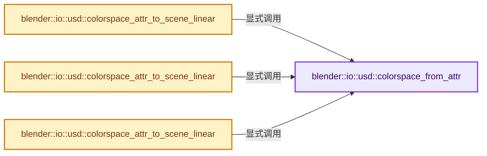
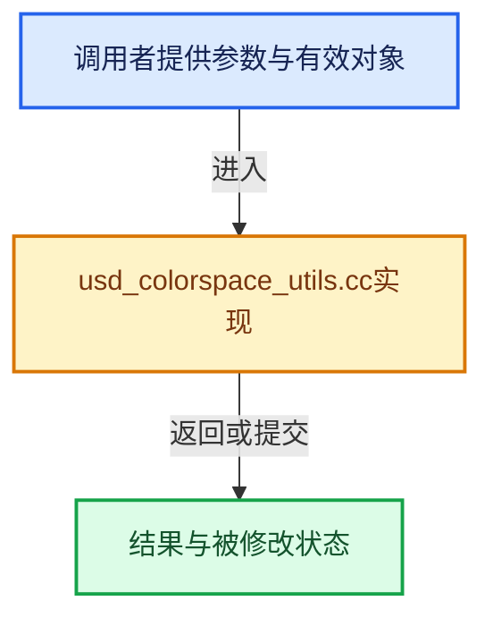

# 实现依赖专题：source/blender/io/usd/intern/usd_colorspace_utils.cc

[方向导航](README.md) · [符号索引](../%E7%AC%A6%E5%8F%B7%E4%BE%9D%E8%B5%96%E4%B8%8E%E5%AE%9E%E7%8E%B0%E7%B4%A2%E5%BC%95.md)

本专题从正文实际调用进入，集中保存共享实现。函数有稳定锚点，可从调用处直接跳到对应完整函数；递归与互相调用通过回链组织。

## 本文件的实现关系






## 完整成员与函数实现

<a id="f-85d6d4f9fc012aaf"></a>

### `blender::io::usd::colorspace_from_attr`

实现位置：[source/blender/io/usd/intern/usd_colorspace_utils.cc](../../../../../source/blender/io/usd/intern/usd_colorspace_utils.cc) · L46—L61。

接口参数：

- `const pxr::UsdAttribute &attr`

**教学注释版**

<!-- annotated:7f68fcbd0894c6 -->

```cpp
static const ColorSpace *colorspace_from_attr(const pxr::UsdAttribute &attr)
{
  pxr::TfToken cs_name = pxr::UsdColorSpaceAPI::ComputeColorSpaceName(attr);
  if (cs_name.IsEmpty()) {
    return nullptr;
  }

  const ColorSpace *cs = IMB_colormanagement_space_get_named(cs_name.GetText());
  if (!cs || IMB_colormanagement_space_is_scene_linear(cs) ||
      IMB_colormanagement_space_is_data(cs))
  {
    return nullptr;
  }

  return cs;
}
```

<details>
<summary>核对原始源码：source/blender/io/usd/intern/usd_colorspace_utils.cc · L46—L61</summary>

<!-- original:7f68fcbd0894c6:source/blender/io/usd/intern/usd_colorspace_utils.cc:46:61 -->

```cpp
static const ColorSpace *colorspace_from_attr(const pxr::UsdAttribute &attr)
{
  pxr::TfToken cs_name = pxr::UsdColorSpaceAPI::ComputeColorSpaceName(attr);
  if (cs_name.IsEmpty()) {
    return nullptr;
  }

  const ColorSpace *cs = IMB_colormanagement_space_get_named(cs_name.GetText());
  if (!cs || IMB_colormanagement_space_is_scene_linear(cs) ||
      IMB_colormanagement_space_is_data(cs))
  {
    return nullptr;
  }

  return cs;
}
```

</details>

**结果出口**

- `return nullptr;`
- `return cs;`

**继续追踪实现**

- `pxr::UsdColorSpaceAPI::ComputeColorSpaceName` → [外部契约](https://eel.is/c++draft/)：这个边界按实际表达式及所属类型核对参数、返回值、寿命与失败行为。这里提供接口入口，不声称已解释该第三方版本的内部实现。
- `cs_name.IsEmpty` → [调用协议](../%E6%A8%A1%E6%9D%BF%E5%AE%8F%E4%B8%8E%E5%8A%A8%E6%80%81%E5%88%86%E6%B4%BE%E5%8D%8F%E8%AE%AE.md)：由接收对象具体类型或运行时策略提供实现。调用位置L49。
- `IMB_colormanagement_space_get_named` → [blender::IMB_colormanagement_space_get_named · L1319](%E4%BE%9D%E8%B5%96-colormanagement-d4733d.md#f-686ba14e51262834)；[blender::IMB_colormanagement_space_get_named · L1323](%E4%BE%9D%E8%B5%96-colormanagement-d4733d.md#f-8171f67dd0b37997)。同名重载需按实参类型选择。
- `cs_name.GetText` → [调用协议](../%E6%A8%A1%E6%9D%BF%E5%AE%8F%E4%B8%8E%E5%8A%A8%E6%80%81%E5%88%86%E6%B4%BE%E5%8D%8F%E8%AE%AE.md)：由接收对象具体类型或运行时策略提供实现。调用位置L53。
- `IMB_colormanagement_space_is_scene_linear` → [blender::IMB_colormanagement_space_is_scene_linear · L1333](%E4%BE%9D%E8%B5%96-colormanagement-d4733d.md#f-363e8d1117e4dab8)。
- `IMB_colormanagement_space_is_data` → [blender::IMB_colormanagement_space_is_data · L1328](%E4%BE%9D%E8%B5%96-colormanagement-d4733d.md#f-25b377cc8f03ab18)。

<a id="f-37989fdfd9773362"></a>

### `blender::io::usd::colorspace_attr_to_scene_linear`

实现位置：[source/blender/io/usd/intern/usd_colorspace_utils.cc](../../../../../source/blender/io/usd/intern/usd_colorspace_utils.cc) · L63—L69。

接口参数：

- `const pxr::UsdAttribute &attr`
- `pxr::GfVec3f &color`

**教学注释版**

<!-- annotated:fc16e09dcfb9c0 -->

```cpp
void colorspace_attr_to_scene_linear(const pxr::UsdAttribute &attr, pxr::GfVec3f &color)
{
  const ColorSpace *cs = colorspace_from_attr(attr);
  if (cs) {
    IMB_colormanagement_colorspace_to_scene_linear_v3(color.data(), cs);
  }
}
```

<details>
<summary>核对原始源码：source/blender/io/usd/intern/usd_colorspace_utils.cc · L63—L69</summary>

<!-- original:fc16e09dcfb9c0:source/blender/io/usd/intern/usd_colorspace_utils.cc:63:69 -->

```cpp
void colorspace_attr_to_scene_linear(const pxr::UsdAttribute &attr, pxr::GfVec3f &color)
{
  const ColorSpace *cs = colorspace_from_attr(attr);
  if (cs) {
    IMB_colormanagement_colorspace_to_scene_linear_v3(color.data(), cs);
  }
}
```

</details>

**继续追踪实现**

- `colorspace_from_attr` → [blender::io::usd::colorspace_from_attr · L46](%E4%BE%9D%E8%B5%96-usd_colorspace_utils-4de4c2.md#f-85d6d4f9fc012aaf)。
- `IMB_colormanagement_colorspace_to_scene_linear_v3` → [blender::IMB_colormanagement_colorspace_to_scene_linear_v3 · L2371](%E4%BE%9D%E8%B5%96-colormanagement-d4733d.md#f-1d3d0c62921f618a)。
- `color.data` → [调用协议](../%E6%A8%A1%E6%9D%BF%E5%AE%8F%E4%B8%8E%E5%8A%A8%E6%80%81%E5%88%86%E6%B4%BE%E5%8D%8F%E8%AE%AE.md)：由接收对象具体类型或运行时策略提供实现。调用位置L67。

<a id="f-5f55340718e8235b"></a>

### `blender::io::usd::colorspace_attr_to_scene_linear`

实现位置：[source/blender/io/usd/intern/usd_colorspace_utils.cc](../../../../../source/blender/io/usd/intern/usd_colorspace_utils.cc) · L71—L77。

接口参数：

- `const pxr::UsdAttribute &attr`
- `ColorGeometry4f &color`

**教学注释版**

<!-- annotated:ff7e30a036f066 -->

```cpp
void colorspace_attr_to_scene_linear(const pxr::UsdAttribute &attr, ColorGeometry4f &color)
{
  const ColorSpace *cs = colorspace_from_attr(attr);
  if (cs) {
    IMB_colormanagement_colorspace_to_scene_linear_v4(&color.r, false, cs);
  }
}
```

<details>
<summary>核对原始源码：source/blender/io/usd/intern/usd_colorspace_utils.cc · L71—L77</summary>

<!-- original:ff7e30a036f066:source/blender/io/usd/intern/usd_colorspace_utils.cc:71:77 -->

```cpp
void colorspace_attr_to_scene_linear(const pxr::UsdAttribute &attr, ColorGeometry4f &color)
{
  const ColorSpace *cs = colorspace_from_attr(attr);
  if (cs) {
    IMB_colormanagement_colorspace_to_scene_linear_v4(&color.r, false, cs);
  }
}
```

</details>

**继续追踪实现**

- `colorspace_from_attr` → [blender::io::usd::colorspace_from_attr · L46](%E4%BE%9D%E8%B5%96-usd_colorspace_utils-4de4c2.md#f-85d6d4f9fc012aaf)。
- `IMB_colormanagement_colorspace_to_scene_linear_v4` → [blender::IMB_colormanagement_colorspace_to_scene_linear_v4 · L2399](%E4%BE%9D%E8%B5%96-colormanagement-d4733d.md#f-d6836bd504a25e4e)。

<a id="f-4b1876e0c48d5f52"></a>

### `blender::io::usd::colorspace_attr_to_scene_linear`

实现位置：[source/blender/io/usd/intern/usd_colorspace_utils.cc](../../../../../source/blender/io/usd/intern/usd_colorspace_utils.cc) · L79—L86。

接口参数：

- `const pxr::UsdAttribute &attr`
- `MutableSpan<ColorGeometry4f> colors`

**教学注释版**

<!-- annotated:ca407081e4f907 -->

```cpp
void colorspace_attr_to_scene_linear(const pxr::UsdAttribute &attr,
                                     MutableSpan<ColorGeometry4f> colors)
{
  const ColorSpace *cs = colorspace_from_attr(attr);
  // [讲解] colors.is_empty：查询视图长度或生成对应有效索引区间。
  if (cs && !colors.is_empty()) {
    // [讲解] colors.size：查询视图长度或生成对应有效索引区间。
    IMB_colormanagement_colorspace_to_scene_linear(&colors[0].r, colors.size(), 1, 4, cs, false);
  }
}
```

<details>
<summary>核对原始源码：source/blender/io/usd/intern/usd_colorspace_utils.cc · L79—L86</summary>

<!-- original:ca407081e4f907:source/blender/io/usd/intern/usd_colorspace_utils.cc:79:86 -->

```cpp
void colorspace_attr_to_scene_linear(const pxr::UsdAttribute &attr,
                                     MutableSpan<ColorGeometry4f> colors)
{
  const ColorSpace *cs = colorspace_from_attr(attr);
  if (cs && !colors.is_empty()) {
    IMB_colormanagement_colorspace_to_scene_linear(&colors[0].r, colors.size(), 1, 4, cs, false);
  }
}
```

</details>

**继续追踪实现**

- `colorspace_from_attr` → [blender::io::usd::colorspace_from_attr · L46](%E4%BE%9D%E8%B5%96-usd_colorspace_utils-4de4c2.md#f-85d6d4f9fc012aaf)。
- `colors.is_empty` → [blender::MutableSpan::is_empty · L515](../01-%E5%9F%BA%E7%A1%80%E5%AE%B9%E5%99%A8%E4%B8%8E%E7%8E%B0%E4%BB%A3CPP/06-MutableSpan%E5%8F%AF%E5%86%99%E8%A7%86%E5%9B%BE.md#f-be88df1422757437)。
- `IMB_colormanagement_colorspace_to_scene_linear` → [blender::IMB_colormanagement_colorspace_to_scene_linear · L2419](%E4%BE%9D%E8%B5%96-colormanagement-d4733d.md#f-abf895b183890396)。
- `colors.size` → [blender::MutableSpan::size · L499](../01-%E5%9F%BA%E7%A1%80%E5%AE%B9%E5%99%A8%E4%B8%8E%E7%8E%B0%E4%BB%A3CPP/06-MutableSpan%E5%8F%AF%E5%86%99%E8%A7%86%E5%9B%BE.md#f-1de6a66839c304a8)；[blender::gpu::shader::parser::MutableSpan::size · L87](%E4%BE%9D%E8%B5%96-utils-06433d.md#f-5e684af6ee7990e9)。同名重载需按实参类型选择。
