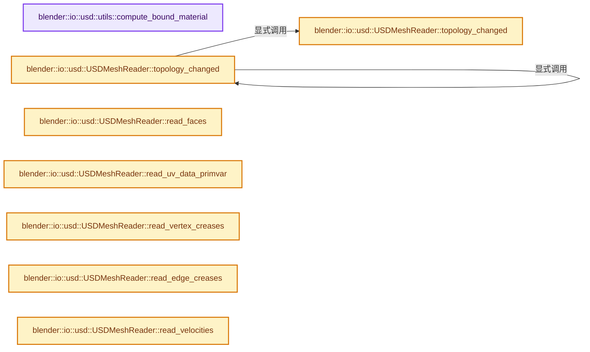

# 实现依赖专题：source/blender/io/usd/intern/usd_reader_mesh.cc

[方向导航](README.md) · [符号索引](../%E7%AC%A6%E5%8F%B7%E4%BE%9D%E8%B5%96%E4%B8%8E%E5%AE%9E%E7%8E%B0%E7%B4%A2%E5%BC%95.md)

本专题从正文实际调用进入，集中保存共享实现。函数有稳定锚点，可从调用处直接跳到对应完整函数；递归与互相调用通过回链组织。

## 本文件的实现关系




## 完整成员与函数实现

<a id="f-00c52d1d96b1f920"></a>

### `blender::io::usd::utils::compute_bound_material`

实现位置：[source/blender/io/usd/intern/usd_reader_mesh.cc](../../../../../source/blender/io/usd/intern/usd_reader_mesh.cc) · L69—L96。

接口参数：

- `const pxr::UsdPrim &prim`
- `MtlPurpose mtl_purpose`

**教学注释版**

<!-- annotated:d577d2fba84529 -->

```cpp
static pxr::UsdShadeMaterial compute_bound_material(const pxr::UsdPrim &prim,
                                                    MtlPurpose mtl_purpose)
{
  const pxr::UsdShadeMaterialBindingAPI api = pxr::UsdShadeMaterialBindingAPI(prim);

  /* See the following documentation for material resolution behavior:
   * https://openusd.org/release/api/class_usd_shade_material_binding_a_p_i.html#UsdShadeMaterialBindingAPI_MaterialResolution
   */

  pxr::UsdShadeMaterial mtl;
  switch (mtl_purpose) {
    case MtlPurpose::Full:
      mtl = api.ComputeBoundMaterial(pxr::UsdShadeTokens->full);
      if (!mtl) {
        /* Add an additional Blender-specific fallback to help with oddly authored USD files. */
        mtl = api.ComputeBoundMaterial(pxr::UsdShadeTokens->preview);
      }
      break;
    case MtlPurpose::Preview:
      mtl = api.ComputeBoundMaterial(pxr::UsdShadeTokens->preview);
      break;
    case MtlPurpose::All:
      mtl = api.ComputeBoundMaterial(pxr::UsdShadeTokens->allPurpose);
      break;
  }

  return mtl;
}
```

<details>
<summary>核对原始源码：source/blender/io/usd/intern/usd_reader_mesh.cc · L69—L96</summary>

<!-- original:d577d2fba84529:source/blender/io/usd/intern/usd_reader_mesh.cc:69:96 -->

```cpp
static pxr::UsdShadeMaterial compute_bound_material(const pxr::UsdPrim &prim,
                                                    MtlPurpose mtl_purpose)
{
  const pxr::UsdShadeMaterialBindingAPI api = pxr::UsdShadeMaterialBindingAPI(prim);

  /* See the following documentation for material resolution behavior:
   * https://openusd.org/release/api/class_usd_shade_material_binding_a_p_i.html#UsdShadeMaterialBindingAPI_MaterialResolution
   */

  pxr::UsdShadeMaterial mtl;
  switch (mtl_purpose) {
    case MtlPurpose::Full:
      mtl = api.ComputeBoundMaterial(pxr::UsdShadeTokens->full);
      if (!mtl) {
        /* Add an additional Blender-specific fallback to help with oddly authored USD files. */
        mtl = api.ComputeBoundMaterial(pxr::UsdShadeTokens->preview);
      }
      break;
    case MtlPurpose::Preview:
      mtl = api.ComputeBoundMaterial(pxr::UsdShadeTokens->preview);
      break;
    case MtlPurpose::All:
      mtl = api.ComputeBoundMaterial(pxr::UsdShadeTokens->allPurpose);
      break;
  }

  return mtl;
}
```

</details>

**沿实际写入检查状态**

- `mtl = api.ComputeBoundMaterial(pxr::UsdShadeTokens->full);`
- `mtl = api.ComputeBoundMaterial(pxr::UsdShadeTokens->preview);`
- `mtl = api.ComputeBoundMaterial(pxr::UsdShadeTokens->allPurpose);`

**结果出口**

- `return mtl;`

**继续追踪实现**

- `pxr::UsdShadeMaterialBindingAPI` → [外部契约](https://eel.is/c++draft/)：这个边界按实际表达式及所属类型核对参数、返回值、寿命与失败行为。这里提供接口入口，不声称已解释该第三方版本的内部实现。
- `api.ComputeBoundMaterial` → [调用协议](../%E6%A8%A1%E6%9D%BF%E5%AE%8F%E4%B8%8E%E5%8A%A8%E6%80%81%E5%88%86%E6%B4%BE%E5%8D%8F%E8%AE%AE.md)：由接收对象具体类型或运行时策略提供实现。调用位置L81。

<a id="f-67dc6a3434a45188"></a>

### `blender::io::usd::USDMeshReader::topology_changed`

实现位置：[source/blender/io/usd/intern/usd_reader_mesh.cc](../../../../../source/blender/io/usd/intern/usd_reader_mesh.cc) · L270—L274。

接口参数：

- `const Mesh *existing_mesh`
- `const pxr::UsdTimeCode time`

**教学注释版**

<!-- annotated:75d048abb3ba9c -->

```cpp
bool USDMeshReader::topology_changed(const Mesh *existing_mesh, const pxr::UsdTimeCode time)
{
  USDMeshReadData usd_data(mesh_prim_, time);
  return topology_changed(existing_mesh, usd_data);
}
```

<details>
<summary>核对原始源码：source/blender/io/usd/intern/usd_reader_mesh.cc · L270—L274</summary>

<!-- original:75d048abb3ba9c:source/blender/io/usd/intern/usd_reader_mesh.cc:270:274 -->

```cpp
bool USDMeshReader::topology_changed(const Mesh *existing_mesh, const pxr::UsdTimeCode time)
{
  USDMeshReadData usd_data(mesh_prim_, time);
  return topology_changed(existing_mesh, usd_data);
}
```

</details>

**结果出口**

- `return topology_changed(existing_mesh, usd_data);`

**继续追踪实现**

- `topology_changed` → [blender::io::usd::USDMeshReader::topology_changed · L270](%E4%BE%9D%E8%B5%96-usd_reader_mesh-77c109.md#f-67dc6a3434a45188)；[blender::io::usd::USDMeshReader::topology_changed · L276](%E4%BE%9D%E8%B5%96-usd_reader_mesh-77c109.md#f-303c0cd90468d7e2)。同名重载需按实参类型选择。

<a id="f-303c0cd90468d7e2"></a>

### `blender::io::usd::USDMeshReader::topology_changed`

实现位置：[source/blender/io/usd/intern/usd_reader_mesh.cc](../../../../../source/blender/io/usd/intern/usd_reader_mesh.cc) · L276—L282。

接口参数：

- `const Mesh *existing_mesh`
- `const USDMeshReadData &usd_data`

**教学注释版**

<!-- annotated:b913c5b835b07b -->

```cpp
bool USDMeshReader::topology_changed(const Mesh *existing_mesh,
                                     const USDMeshReadData &usd_data) const
{
  return usd_data.positions().size() != existing_mesh->verts_num ||
         usd_data.face_counts().size() != existing_mesh->faces_num ||
         usd_data.face_indices().size() != existing_mesh->corners_num;
}
```

<details>
<summary>核对原始源码：source/blender/io/usd/intern/usd_reader_mesh.cc · L276—L282</summary>

<!-- original:b913c5b835b07b:source/blender/io/usd/intern/usd_reader_mesh.cc:276:282 -->

```cpp
bool USDMeshReader::topology_changed(const Mesh *existing_mesh,
                                     const USDMeshReadData &usd_data) const
{
  return usd_data.positions().size() != existing_mesh->verts_num ||
         usd_data.face_counts().size() != existing_mesh->faces_num ||
         usd_data.face_indices().size() != existing_mesh->corners_num;
}
```

</details>

**结果出口**

- `return usd_data.positions().size() != existing_mesh->verts_num ||`

**继续追踪实现**

- `usd_data.positions().size` → [调用协议](../%E6%A8%A1%E6%9D%BF%E5%AE%8F%E4%B8%8E%E5%8A%A8%E6%80%81%E5%88%86%E6%B4%BE%E5%8D%8F%E8%AE%AE.md)：接收对象类型依赖auto、返回值或模板实例；不按同名猜测目标。调用位置L279。
- `usd_data.positions` → [blender::io::usd::USDMeshReadData::positions · L38](%E4%BE%9D%E8%B5%96-usd_reader_mesh-eddaab.md#f-0b3dae5a2bac2d4b)。
- `usd_data.face_counts().size` → [调用协议](../%E6%A8%A1%E6%9D%BF%E5%AE%8F%E4%B8%8E%E5%8A%A8%E6%80%81%E5%88%86%E6%B4%BE%E5%8D%8F%E8%AE%AE.md)：接收对象类型依赖auto、返回值或模板实例；不按同名猜测目标。调用位置L280。
- `usd_data.face_counts` → [blender::io::usd::USDMeshReadData::face_counts · L34](%E4%BE%9D%E8%B5%96-usd_reader_mesh-eddaab.md#f-84adf9a1b06676be)。
- `usd_data.face_indices().size` → [调用协议](../%E6%A8%A1%E6%9D%BF%E5%AE%8F%E4%B8%8E%E5%8A%A8%E6%80%81%E5%88%86%E6%B4%BE%E5%8D%8F%E8%AE%AE.md)：接收对象类型依赖auto、返回值或模板实例；不按同名猜测目标。调用位置L281。
- `usd_data.face_indices` → [blender::io::usd::USDMeshReadData::face_indices · L30](%E4%BE%9D%E8%B5%96-usd_reader_mesh-eddaab.md#f-9c22a3b76dd2ab9e)。

<a id="f-975332d61aafd09d"></a>

### `blender::io::usd::USDMeshReader::read_faces`

实现位置：[source/blender/io/usd/intern/usd_reader_mesh.cc](../../../../../source/blender/io/usd/intern/usd_reader_mesh.cc) · L283—L362。

接口参数：

- `Mesh *mesh`
- `const USDMeshReadData &usd_data`

**教学注释版**

<!-- annotated:32eb1b18bcf669 -->

```cpp
bool USDMeshReader::read_faces(Mesh *mesh, const USDMeshReadData &usd_data) const
{
  MutableSpan<int> face_offsets = mesh->face_offsets_for_write();
  MutableSpan<int> corner_verts = mesh->corner_verts_for_write();

  int64_t loop_index = 0;
  bool all_faces_ok = true;

  const Span<int> face_counts = usd_data.face_counts();
  const Span<int> face_indices = usd_data.face_indices();
  // [讲解] face_indices.size：查询视图长度或生成对应有效索引区间。
  const int64_t corners_num = face_indices.size();
  // [讲解] face_counts.index_range：查询视图长度或生成对应有效索引区间。
  for (const int64_t i : face_counts.index_range()) {
    int face_size = face_counts[i];

    face_offsets[i] = int(loop_index);

    if (face_size < 3 || face_size > corners_num - loop_index) {
      face_size = 0;
      all_faces_ok = false;
    }

    /* Polygons are always assumed to be smooth-shaded. If the mesh should be flat-shaded,
     * this is encoded in custom loop normals. */

    if (is_left_handed_) {
      int64_t loop_end_index = loop_index + (face_size - 1);
      for (int64_t f = 0; f < face_size; ++f, ++loop_index) {
        int vidx = face_indices[loop_end_index - f];
        if (!validate::index_in_range(vidx, mesh->verts_num)) {
          vidx = 0;
          all_faces_ok = false;
        }
        corner_verts[loop_index] = vidx;
      }
    }
    else {
      for (int64_t f = 0; f < face_size; ++f, ++loop_index) {
        int vidx = face_indices[loop_index];
        if (!validate::index_in_range(vidx, mesh->verts_num)) {
          vidx = 0;
          all_faces_ok = false;
        }
        corner_verts[loop_index] = vidx;
      }
    }
  }

  /* Check for faces with duplicate vertex indices. These will require a mesh validate to fix. */
  IndexMaskMemory memory;
  const IndexMask bad_faces = bke::mesh_find_faces_duplicate_verts(*mesh, memory);
  if (!bad_faces.is_empty()) {
    all_faces_ok = false;
  }

  /* If we detect bad faces it would be unsafe to continue beyond this point without first
   * performing a destructive validate. Any operation requiring mesh connectivity information can
   * assert or crash if the problem isn't addressed. Performing the check here, before most of the
   * data has been loaded, unfortunately means any remaining data will be lost. */
  if (!all_faces_ok) {
    if (is_initial_load_) {
      const char *message = N_(
          "Invalid face data detected for mesh '%s'. Automatic correction will be used, but some "
          "data will most likely be lost");
      const std::string prim_path = this->prim_path().GetAsString();
      BKE_reportf(this->reports(), RPT_WARNING, message, prim_path.c_str());
      CLOG_WARN(&LOG, message, prim_path.c_str());
    }
    bke::mesh_validate(*mesh, false);
  }

  bke::mesh_calc_edges(*mesh, false, false);

  /* It's possible that the number of faces, indices, and verts remain the same but the topology
   * itself is different. Until finer-grained topology detection can be implemented, always tag the
   * mesh as needing updated topology mappings. Without this, a time varying mesh could trigger
   * undefined behavior. */
  mesh->tag_topology_changed();

  return all_faces_ok;
}
```

<details>
<summary>核对原始源码：source/blender/io/usd/intern/usd_reader_mesh.cc · L283—L362</summary>

<!-- original:32eb1b18bcf669:source/blender/io/usd/intern/usd_reader_mesh.cc:283:362 -->

```cpp
bool USDMeshReader::read_faces(Mesh *mesh, const USDMeshReadData &usd_data) const
{
  MutableSpan<int> face_offsets = mesh->face_offsets_for_write();
  MutableSpan<int> corner_verts = mesh->corner_verts_for_write();

  int64_t loop_index = 0;
  bool all_faces_ok = true;

  const Span<int> face_counts = usd_data.face_counts();
  const Span<int> face_indices = usd_data.face_indices();
  const int64_t corners_num = face_indices.size();
  for (const int64_t i : face_counts.index_range()) {
    int face_size = face_counts[i];

    face_offsets[i] = int(loop_index);

    if (face_size < 3 || face_size > corners_num - loop_index) {
      face_size = 0;
      all_faces_ok = false;
    }

    /* Polygons are always assumed to be smooth-shaded. If the mesh should be flat-shaded,
     * this is encoded in custom loop normals. */

    if (is_left_handed_) {
      int64_t loop_end_index = loop_index + (face_size - 1);
      for (int64_t f = 0; f < face_size; ++f, ++loop_index) {
        int vidx = face_indices[loop_end_index - f];
        if (!validate::index_in_range(vidx, mesh->verts_num)) {
          vidx = 0;
          all_faces_ok = false;
        }
        corner_verts[loop_index] = vidx;
      }
    }
    else {
      for (int64_t f = 0; f < face_size; ++f, ++loop_index) {
        int vidx = face_indices[loop_index];
        if (!validate::index_in_range(vidx, mesh->verts_num)) {
          vidx = 0;
          all_faces_ok = false;
        }
        corner_verts[loop_index] = vidx;
      }
    }
  }

  /* Check for faces with duplicate vertex indices. These will require a mesh validate to fix. */
  IndexMaskMemory memory;
  const IndexMask bad_faces = bke::mesh_find_faces_duplicate_verts(*mesh, memory);
  if (!bad_faces.is_empty()) {
    all_faces_ok = false;
  }

  /* If we detect bad faces it would be unsafe to continue beyond this point without first
   * performing a destructive validate. Any operation requiring mesh connectivity information can
   * assert or crash if the problem isn't addressed. Performing the check here, before most of the
   * data has been loaded, unfortunately means any remaining data will be lost. */
  if (!all_faces_ok) {
    if (is_initial_load_) {
      const char *message = N_(
          "Invalid face data detected for mesh '%s'. Automatic correction will be used, but some "
          "data will most likely be lost");
      const std::string prim_path = this->prim_path().GetAsString();
      BKE_reportf(this->reports(), RPT_WARNING, message, prim_path.c_str());
      CLOG_WARN(&LOG, message, prim_path.c_str());
    }
    bke::mesh_validate(*mesh, false);
  }

  bke::mesh_calc_edges(*mesh, false, false);

  /* It's possible that the number of faces, indices, and verts remain the same but the topology
   * itself is different. Until finer-grained topology detection can be implemented, always tag the
   * mesh as needing updated topology mappings. Without this, a time varying mesh could trigger
   * undefined behavior. */
  mesh->tag_topology_changed();

  return all_faces_ok;
}
```

</details>

**沿实际写入检查状态**

- `face_offsets[i] = int(loop_index);`
- `face_size = 0;`
- `all_faces_ok = false;`
- `vidx = 0;`
- `corner_verts[loop_index] = vidx;`

**结果出口**

- `return all_faces_ok;`

**继续追踪实现**

- `mesh->face_offsets_for_write` → [Mesh::face_offsets_for_write · L1228](03-MPoly%E8%BF%81%E7%A7%BB%E4%B8%8E%E5%85%BC%E5%AE%B9.md#f-483f42747ab436a2)。
- `mesh->corner_verts_for_write` → [Mesh::corner_verts_for_write · L1246](03-MPoly%E8%BF%81%E7%A7%BB%E4%B8%8E%E5%85%BC%E5%AE%B9.md#f-6dfaf316a81ba215)。
- `usd_data.face_counts` → [blender::io::usd::USDMeshReadData::face_counts · L34](%E4%BE%9D%E8%B5%96-usd_reader_mesh-eddaab.md#f-84adf9a1b06676be)。
- `usd_data.face_indices` → [blender::io::usd::USDMeshReadData::face_indices · L30](%E4%BE%9D%E8%B5%96-usd_reader_mesh-eddaab.md#f-9c22a3b76dd2ab9e)。
- `face_indices.size` → [blender::Span::size · L256](../01-%E5%9F%BA%E7%A1%80%E5%AE%B9%E5%99%A8%E4%B8%8E%E7%8E%B0%E4%BB%A3CPP/05-Span%E5%8F%AA%E8%AF%BB%E8%BF%9E%E7%BB%AD%E8%A7%86%E5%9B%BE.md#f-5f80fa006089c998)。
- `face_counts.index_range` → [blender::Span::index_range · L405](../01-%E5%9F%BA%E7%A1%80%E5%AE%B9%E5%99%A8%E4%B8%8E%E7%8E%B0%E4%BB%A3CPP/05-Span%E5%8F%AA%E8%AF%BB%E8%BF%9E%E7%BB%AD%E8%A7%86%E5%9B%BE.md#f-caaa9b06e13e53e0)。
- `validate::index_in_range` → [blender::io::validate::index_in_range · L25](%E4%BE%9D%E8%B5%96-IO_validate-5ef738.md#f-9177e7130a929332)。
- `bke::mesh_find_faces_duplicate_verts` → [blender::bke::mesh_find_faces_duplicate_verts · L997](%E4%BE%9D%E8%B5%96-mesh_validate-569560.md#f-ab474437ff2edb2a)。
- `bad_faces.is_empty` → [blender::index_mask::IndexMask::is_empty · L748](../04-%E8%99%9A%E6%8B%9F%E6%95%B0%E7%BB%84%E4%B8%8E%E7%B4%A2%E5%BC%95%E9%80%89%E6%8B%A9/09-%E5%88%86%E6%AE%B5%E5%AD%98%E5%82%A8%E4%B8%8E%E9%81%8D%E5%8E%86.md#f-190ac996386064f4)。
- `N_` → [N_ · L65](%E4%BE%9D%E8%B5%96-versioning_userdef-fdee9b.md#m-7c11c8200907)；[N_ · L44](%E4%BE%9D%E8%B5%96-BLT_translation-c89e58.md#m-e686781e2b24)。宏定义由构建条件选择。
- `this->prim_path().GetAsString` → [调用协议](../%E6%A8%A1%E6%9D%BF%E5%AE%8F%E4%B8%8E%E5%8A%A8%E6%80%81%E5%88%86%E6%B4%BE%E5%8D%8F%E8%AE%AE.md)：接收对象类型依赖auto、返回值或模板实例；不按同名猜测目标。调用位置L346。
- `this->prim_path` → [blender::io::usd::USDPrimReader::prim_path · L131](%E4%BE%9D%E8%B5%96-usd_reader_prim-18670b.md#f-dec72036547b12b4)。
- `BKE_reportf` → [blender::BKE_reportf · L191](%E4%BE%9D%E8%B5%96-report-f916fd.md#f-e776fc632ffb42b3)。
- `this->reports` → [blender::io::usd::USDAbstractWriter::reports · L244](%E4%BE%9D%E8%B5%96-usd_writer_abstract-661ccb.md#f-70d51d55eac50d03)；[blender::io::usd::USDStageReader::reports · L232](%E4%BE%9D%E8%B5%96-usd_reader_stage-cab0a7.md#f-c1d34a50af380168)；[blender::io::usd::USDPrimReader::reports · L23](%E4%BE%9D%E8%B5%96-usd_reader_prim-f2253f.md#f-f5157cbeedd7b038)；[blender::io::usd::USDMaterialReader::reports · L442](%E4%BE%9D%E8%B5%96-usd_reader_material-76dff4.md#f-cfcea6896ee1da6e)。同名重载需按实参类型选择。
- `prim_path.c_str` → [外部契约](https://eel.is/c++draft/)：这个边界按实际表达式及所属类型核对参数、返回值、寿命与失败行为。这里提供接口入口，不声称已解释该第三方版本的内部实现。
- `CLOG_WARN` → [CLOG_WARN · L189](%E4%BE%9D%E8%B5%96-CLG_log-e9051b.md#m-9da21a06cdbe)。宏定义由构建条件选择。
- `bke::mesh_validate` → [blender::bke::mesh_validate · L979](%E4%BE%9D%E8%B5%96-mesh_validate-569560.md#f-7ef5ef79b703e44f)。
- `bke::mesh_calc_edges` → [blender::bke::mesh_calc_edges · L234](%E4%BE%9D%E8%B5%96-mesh_calc_edges-37447c.md#f-8dc1463382ec6743)；[blender::bke::mesh_calc_edges · L578](%E4%BE%9D%E8%B5%96-mesh_calc_edges-37447c.md#f-1312012cc732ca47)。同名重载需按实参类型选择。
- `mesh->tag_topology_changed` → [blender::Mesh::tag_topology_changed · L433](../06-%E9%9A%90%E5%BC%8F%E5%85%B1%E4%BA%AB%E4%B8%8E%E7%BC%93%E5%AD%98%E7%B3%BB%E7%BB%9F/10-%E5%B1%80%E9%83%A8%E6%9B%B4%E6%96%B0%E4%B8%8E%E5%A4%B1%E6%95%88%E4%BF%AE%E5%A4%8D.md#f-fab19a295d0a1a6b)。

<a id="f-305610b1147624fe"></a>

### `blender::io::usd::USDMeshReader::read_uv_data_primvar`

实现位置：[source/blender/io/usd/intern/usd_reader_mesh.cc](../../../../../source/blender/io/usd/intern/usd_reader_mesh.cc) · L364—L440。

接口参数：

- `Mesh *mesh`
- `const pxr::UsdGeomPrimvar &primvar`
- `const pxr::UsdTimeCode time`

**教学注释版**

<!-- annotated:7e68e3b7dada5f -->

```cpp
void USDMeshReader::read_uv_data_primvar(Mesh *mesh,
                                         const pxr::UsdGeomPrimvar &primvar,
                                         const pxr::UsdTimeCode time)
{
  const StringRef primvar_name(
      pxr::UsdGeomPrimvar::StripPrimvarsName(primvar.GetName()).GetString());

  const pxr::VtVec2fArray usd_uvs = get_primvar_array<pxr::GfVec2f>(primvar, time);
  if (usd_uvs.empty()) {
    return;
  }

  const pxr::TfToken varying_type = primvar.GetInterpolation();
  BLI_assert(ELEM(varying_type,
                  pxr::UsdGeomTokens->vertex,
                  pxr::UsdGeomTokens->faceVarying,
                  pxr::UsdGeomTokens->varying));

  if ((varying_type == pxr::UsdGeomTokens->faceVarying && usd_uvs.size() != mesh->corners_num) ||
      (varying_type == pxr::UsdGeomTokens->vertex && usd_uvs.size() != mesh->verts_num) ||
      (varying_type == pxr::UsdGeomTokens->varying && usd_uvs.size() != mesh->verts_num))
  {
    BKE_reportf(reports(),
                RPT_WARNING,
                "USD Import: UV attribute value '%s' count inconsistent with interpolation type",
                primvar.GetName().GetText());
    return;
  }

  bke::MutableAttributeAccessor attributes = mesh->attributes_for_write();
  bke::SpanAttributeWriter<float2> uv_data = attributes.lookup_or_add_for_write_only_span<float2>(
      primvar_name, bke::AttrDomain::Corner);

  if (!uv_data) {
    BKE_reportf(reports(),
                RPT_WARNING,
                "USD Import: couldn't add UV attribute '%s'",
                primvar.GetBaseName().GetText());
    return;
  }

  if (varying_type == pxr::UsdGeomTokens->faceVarying) {
    if (is_left_handed_) {
      /* Reverse the index order. */
      const OffsetIndices faces = mesh->faces();
      for (const int i : faces.index_range()) {
        const IndexRange face = faces[i];
        for (int j : face.index_range()) {
          // [讲解] face.last：读取范围两端的有效索引或值。
          const int rev_index = face.last(j);
          // [讲解] face.start：读取连续区间或分组的边界信息。
          uv_data.span[face.start() + j] = validate::index_in_range(rev_index, usd_uvs.size()) ?
                                               float2(usd_uvs[rev_index][0],
                                                      usd_uvs[rev_index][1]) :
                                               float2(0.0f);
        }
      }
    }
    else {
      for (const int64_t i : uv_data.span.index_range()) {
        uv_data.span[i] = float2(usd_uvs[i][0], usd_uvs[i][1]);
      }
    }
  }
  else {
    /* Handle vertex interpolation. */
    const Span<int> corner_verts = mesh->corner_verts();
    BLI_assert(mesh->verts_num == usd_uvs.size());
    for (int i = 0; i < uv_data.span.size(); ++i) {
      /* Get the vertex index for this corner. */
      const int vi = corner_verts[i];
      uv_data.span[i] = validate::index_in_range(vi, usd_uvs.size()) ?
                            float2(usd_uvs[vi][0], usd_uvs[vi][1]) :
                            float2(0.0f);
    }
  }

  uv_data.finish();
}
```

<details>
<summary>核对原始源码：source/blender/io/usd/intern/usd_reader_mesh.cc · L364—L440</summary>

<!-- original:7e68e3b7dada5f:source/blender/io/usd/intern/usd_reader_mesh.cc:364:440 -->

```cpp
void USDMeshReader::read_uv_data_primvar(Mesh *mesh,
                                         const pxr::UsdGeomPrimvar &primvar,
                                         const pxr::UsdTimeCode time)
{
  const StringRef primvar_name(
      pxr::UsdGeomPrimvar::StripPrimvarsName(primvar.GetName()).GetString());

  const pxr::VtVec2fArray usd_uvs = get_primvar_array<pxr::GfVec2f>(primvar, time);
  if (usd_uvs.empty()) {
    return;
  }

  const pxr::TfToken varying_type = primvar.GetInterpolation();
  BLI_assert(ELEM(varying_type,
                  pxr::UsdGeomTokens->vertex,
                  pxr::UsdGeomTokens->faceVarying,
                  pxr::UsdGeomTokens->varying));

  if ((varying_type == pxr::UsdGeomTokens->faceVarying && usd_uvs.size() != mesh->corners_num) ||
      (varying_type == pxr::UsdGeomTokens->vertex && usd_uvs.size() != mesh->verts_num) ||
      (varying_type == pxr::UsdGeomTokens->varying && usd_uvs.size() != mesh->verts_num))
  {
    BKE_reportf(reports(),
                RPT_WARNING,
                "USD Import: UV attribute value '%s' count inconsistent with interpolation type",
                primvar.GetName().GetText());
    return;
  }

  bke::MutableAttributeAccessor attributes = mesh->attributes_for_write();
  bke::SpanAttributeWriter<float2> uv_data = attributes.lookup_or_add_for_write_only_span<float2>(
      primvar_name, bke::AttrDomain::Corner);

  if (!uv_data) {
    BKE_reportf(reports(),
                RPT_WARNING,
                "USD Import: couldn't add UV attribute '%s'",
                primvar.GetBaseName().GetText());
    return;
  }

  if (varying_type == pxr::UsdGeomTokens->faceVarying) {
    if (is_left_handed_) {
      /* Reverse the index order. */
      const OffsetIndices faces = mesh->faces();
      for (const int i : faces.index_range()) {
        const IndexRange face = faces[i];
        for (int j : face.index_range()) {
          const int rev_index = face.last(j);
          uv_data.span[face.start() + j] = validate::index_in_range(rev_index, usd_uvs.size()) ?
                                               float2(usd_uvs[rev_index][0],
                                                      usd_uvs[rev_index][1]) :
                                               float2(0.0f);
        }
      }
    }
    else {
      for (const int64_t i : uv_data.span.index_range()) {
        uv_data.span[i] = float2(usd_uvs[i][0], usd_uvs[i][1]);
      }
    }
  }
  else {
    /* Handle vertex interpolation. */
    const Span<int> corner_verts = mesh->corner_verts();
    BLI_assert(mesh->verts_num == usd_uvs.size());
    for (int i = 0; i < uv_data.span.size(); ++i) {
      /* Get the vertex index for this corner. */
      const int vi = corner_verts[i];
      uv_data.span[i] = validate::index_in_range(vi, usd_uvs.size()) ?
                            float2(usd_uvs[vi][0], usd_uvs[vi][1]) :
                            float2(0.0f);
    }
  }

  uv_data.finish();
}
```

</details>

**沿实际写入检查状态**

- `uv_data.span[i] = float2(usd_uvs[i][0], usd_uvs[i][1]);`
- `uv_data.span[i] = validate::index_in_range(vi, usd_uvs.size()) ?`

**继续追踪实现**

- `pxr::UsdGeomPrimvar::StripPrimvarsName(primvar.GetName()).GetString` → [外部契约](https://eel.is/c++draft/)：这个边界按实际表达式及所属类型核对参数、返回值、寿命与失败行为。这里提供接口入口，不声称已解释该第三方版本的内部实现。
- `pxr::UsdGeomPrimvar::StripPrimvarsName` → [外部契约](https://eel.is/c++draft/)：这个边界按实际表达式及所属类型核对参数、返回值、寿命与失败行为。这里提供接口入口，不声称已解释该第三方版本的内部实现。
- `primvar.GetName` → [调用协议](../%E6%A8%A1%E6%9D%BF%E5%AE%8F%E4%B8%8E%E5%8A%A8%E6%80%81%E5%88%86%E6%B4%BE%E5%8D%8F%E8%AE%AE.md)：由接收对象具体类型或运行时策略提供实现。调用位置L369。
- `get_primvar_array<pxr::GfVec2f>` → [blender::io::usd::get_primvar_array · L234](%E4%BE%9D%E8%B5%96-usd_attribute_utils-8f80d9.md#f-d1928204ec3b665a)。
- `usd_uvs.empty` → [调用协议](../%E6%A8%A1%E6%9D%BF%E5%AE%8F%E4%B8%8E%E5%8A%A8%E6%80%81%E5%88%86%E6%B4%BE%E5%8D%8F%E8%AE%AE.md)：由接收对象具体类型或运行时策略提供实现。调用位置L372。
- `primvar.GetInterpolation` → [调用协议](../%E6%A8%A1%E6%9D%BF%E5%AE%8F%E4%B8%8E%E5%8A%A8%E6%80%81%E5%88%86%E6%B4%BE%E5%8D%8F%E8%AE%AE.md)：由接收对象具体类型或运行时策略提供实现。调用位置L376。
- `BLI_assert` → [BLI_assert · L48](../01-%E5%9F%BA%E7%A1%80%E5%AE%B9%E5%99%A8%E4%B8%8E%E7%8E%B0%E4%BB%A3CPP/%E4%BE%9D%E8%B5%96-BLI_assert-cc98e8.md#m-57a88495704d)；[BLI_assert · L63](../01-%E5%9F%BA%E7%A1%80%E5%AE%B9%E5%99%A8%E4%B8%8E%E7%8E%B0%E4%BB%A3CPP/%E4%BE%9D%E8%B5%96-BLI_assert-cc98e8.md#m-d07050020cb5)。宏定义由构建条件选择。
- `ELEM` → [ELEM · L88](%E4%BE%9D%E8%B5%96-GHOST_utildefines-34b996.md#m-d28724a15928)；[ELEM · L135](../01-%E5%9F%BA%E7%A1%80%E5%AE%B9%E5%99%A8%E4%B8%8E%E7%8E%B0%E4%BB%A3CPP/%E4%BE%9D%E8%B5%96-BLI_utildefines-293a0a.md#m-d6572de7cae0)。宏定义由构建条件选择。
- `usd_uvs.size` → [调用协议](../%E6%A8%A1%E6%9D%BF%E5%AE%8F%E4%B8%8E%E5%8A%A8%E6%80%81%E5%88%86%E6%B4%BE%E5%8D%8F%E8%AE%AE.md)：由接收对象具体类型或运行时策略提供实现。调用位置L382。
- `BKE_reportf` → [blender::BKE_reportf · L191](%E4%BE%9D%E8%B5%96-report-f916fd.md#f-e776fc632ffb42b3)。
- `reports` → [blender::io::usd::USDAbstractWriter::reports · L244](%E4%BE%9D%E8%B5%96-usd_writer_abstract-661ccb.md#f-70d51d55eac50d03)；[blender::io::usd::USDStageReader::reports · L232](%E4%BE%9D%E8%B5%96-usd_reader_stage-cab0a7.md#f-c1d34a50af380168)；[blender::io::usd::USDPrimReader::reports · L23](%E4%BE%9D%E8%B5%96-usd_reader_prim-f2253f.md#f-f5157cbeedd7b038)；[blender::io::usd::USDMaterialReader::reports · L442](%E4%BE%9D%E8%B5%96-usd_reader_material-76dff4.md#f-cfcea6896ee1da6e)。同名重载需按实参类型选择。
- `primvar.GetName().GetText` → [调用协议](../%E6%A8%A1%E6%9D%BF%E5%AE%8F%E4%B8%8E%E5%8A%A8%E6%80%81%E5%88%86%E6%B4%BE%E5%8D%8F%E8%AE%AE.md)：接收对象类型依赖auto、返回值或模板实例；不按同名猜测目标。调用位置L389。
- `mesh->attributes_for_write` → [Mesh::attributes_for_write · L1303](03-MPoly%E8%BF%81%E7%A7%BB%E4%B8%8E%E5%85%BC%E5%AE%B9.md#f-ca7af2f1a15f0bc4)。
- `attributes.lookup_or_add_for_write_only_span<float2>` → [blender::bke::MutableAttributeAccessor::lookup_or_add_for_write_only_span · L546](%E4%BE%9D%E8%B5%96-attribute_access-bceef3.md#f-97af899f7983a038)；[blender::bke::MutableAttributeAccessor::lookup_or_add_for_write_only_span · L891](08-AttributeAccessor%E6%8E%A5%E5%8F%A3.md#f-ee8d09f75408ac4f)。同名重载需按实参类型选择。
- `primvar.GetBaseName().GetText` → [调用协议](../%E6%A8%A1%E6%9D%BF%E5%AE%8F%E4%B8%8E%E5%8A%A8%E6%80%81%E5%88%86%E6%B4%BE%E5%8D%8F%E8%AE%AE.md)：接收对象类型依赖auto、返回值或模板实例；不按同名猜测目标。调用位置L401。
- `primvar.GetBaseName` → [调用协议](../%E6%A8%A1%E6%9D%BF%E5%AE%8F%E4%B8%8E%E5%8A%A8%E6%80%81%E5%88%86%E6%B4%BE%E5%8D%8F%E8%AE%AE.md)：由接收对象具体类型或运行时策略提供实现。调用位置L401。
- `mesh->faces` → [Mesh::faces · L1217](03-MPoly%E8%BF%81%E7%A7%BB%E4%B8%8E%E5%85%BC%E5%AE%B9.md#f-ea444760154e17b2)。
- `faces.index_range` → [blender::offset_indices::OffsetIndices::index_range · L77](02-OffsetIndices%E5%AE%8C%E6%95%B4%E6%8E%A5%E5%8F%A3.md#f-19b5ca1456de007d)。
- `face.index_range` → [blender::IndexRange::index_range · L161](../01-%E5%9F%BA%E7%A1%80%E5%AE%B9%E5%99%A8%E4%B8%8E%E7%8E%B0%E4%BB%A3CPP/04-IndexRange%E8%BF%9E%E7%BB%AD%E6%95%B4%E6%95%B0%E5%8C%BA%E9%97%B4.md#f-fd83072b4b81bce5)。
- `face.last` → [blender::IndexRange::last · L214](../01-%E5%9F%BA%E7%A1%80%E5%AE%B9%E5%99%A8%E4%B8%8E%E7%8E%B0%E4%BB%A3CPP/04-IndexRange%E8%BF%9E%E7%BB%AD%E6%95%B4%E6%95%B0%E5%8C%BA%E9%97%B4.md#f-66896c6351a40de1)；[blender::gpu::shader::parser::IndexRange::last · L62](%E4%BE%9D%E8%B5%96-utils-06433d.md#f-373501206569c3b3)。同名重载需按实参类型选择。
- `face.start` → [blender::IndexRange::start · L243](../01-%E5%9F%BA%E7%A1%80%E5%AE%B9%E5%99%A8%E4%B8%8E%E7%8E%B0%E4%BB%A3CPP/04-IndexRange%E8%BF%9E%E7%BB%AD%E6%95%B4%E6%95%B0%E5%8C%BA%E9%97%B4.md#f-99d2195bd9cfd1f0)。
- `validate::index_in_range` → [blender::io::validate::index_in_range · L25](%E4%BE%9D%E8%B5%96-IO_validate-5ef738.md#f-9177e7130a929332)。
- `float2` → [float2::float2 · L45](%E4%BE%9D%E8%B5%96-sky_math-8091a6.md#f-04c2783f21f996aa)；[float2::float2 · L47](%E4%BE%9D%E8%B5%96-sky_math-8091a6.md#f-dba79c4c10e5ea46)；[float2::float2 · L49](%E4%BE%9D%E8%B5%96-sky_math-8091a6.md#f-920ca90efa37bf0b)；[float2::float2 · L51](%E4%BE%9D%E8%B5%96-sky_math-8091a6.md#f-4b3fbf848d719a63)；[float2::float2 · L53](%E4%BE%9D%E8%B5%96-sky_math-8091a6.md#f-9b2acd8475cc2843)；[float2::float2 · L55](%E4%BE%9D%E8%B5%96-sky_math-8091a6.md#f-1e9233a9a231be51)。同名重载需按实参类型选择。
- `uv_data.span.index_range` → [调用协议](../%E6%A8%A1%E6%9D%BF%E5%AE%8F%E4%B8%8E%E5%8A%A8%E6%80%81%E5%88%86%E6%B4%BE%E5%8D%8F%E8%AE%AE.md)：接收对象类型依赖auto、返回值或模板实例；不按同名猜测目标。调用位置L421。
- `mesh->corner_verts` → [Mesh::corner_verts · L1238](03-MPoly%E8%BF%81%E7%A7%BB%E4%B8%8E%E5%85%BC%E5%AE%B9.md#f-a59c61f583b64bc4)。
- `uv_data.span.size` → [调用协议](../%E6%A8%A1%E6%9D%BF%E5%AE%8F%E4%B8%8E%E5%8A%A8%E6%80%81%E5%88%86%E6%B4%BE%E5%8D%8F%E8%AE%AE.md)：接收对象类型依赖auto、返回值或模板实例；不按同名猜测目标。调用位置L430。
- `uv_data.finish` → [blender::bke::SpanAttributeWriter::finish · L279](08-AttributeAccessor%E6%8E%A5%E5%8F%A3.md#f-585970a3b1bd4da4)。

<a id="f-ee8b4e8f44b7c191"></a>

### `blender::io::usd::USDMeshReader::read_vertex_creases`

实现位置：[source/blender/io/usd/intern/usd_reader_mesh.cc](../../../../../source/blender/io/usd/intern/usd_reader_mesh.cc) · L480—L531。

接口参数：

- `Mesh *mesh`
- `const pxr::UsdTimeCode time`

**教学注释版**

<!-- annotated:cb05160f04227f -->

```cpp
void USDMeshReader::read_vertex_creases(Mesh *mesh, const pxr::UsdTimeCode time)
{
  pxr::VtIntArray usd_corner_indices;
  if (!mesh_prim_.GetCornerIndicesAttr().Get(&usd_corner_indices, time)) {
    return;
  }

  pxr::VtFloatArray usd_corner_sharpnesses;
  if (!mesh_prim_.GetCornerSharpnessesAttr().Get(&usd_corner_sharpnesses, time)) {
    return;
  }

  /* Prevent the creation of the `crease_vert` attribute if we have no data. */
  if (usd_corner_indices.empty() || usd_corner_sharpnesses.empty()) {
    return;
  }

  /* It is fine to have fewer indices than vertices, but never the other way other. */
  if (usd_corner_indices.size() > mesh->verts_num) {
    CLOG_WARN(
        &LOG, "Too many vertex creases for mesh %s", this->prim_path().GetAsString().c_str());
    return;
  }

  if (usd_corner_indices.size() != usd_corner_sharpnesses.size()) {
    CLOG_WARN(&LOG,
              "Vertex crease and sharpness count mismatch for mesh %s",
              this->prim_path().GetAsString().c_str());
    return;
  }

  bke::MutableAttributeAccessor attributes = mesh->attributes_for_write();
  bke::SpanAttributeWriter creases = attributes.lookup_or_add_for_write_only_span<float>(
      "crease_vert", bke::AttrDomain::Point);
  creases.span.fill(0.0f);

  Span<int> corner_indices = Span(usd_corner_indices.cdata(), usd_corner_indices.size());
  Span<float> corner_sharpnesses = Span(usd_corner_sharpnesses.cdata(),
                                        usd_corner_sharpnesses.size());

  // [讲解] corner_indices.index_range：查询视图长度或生成对应有效索引区间。
  for (const int64_t i : corner_indices.index_range()) {
    const int idx = corner_indices[i];
    if (!validate::index_in_range(idx, mesh->verts_num)) {
      continue;
    }
    const float crease = settings_->blender_stage_version_prior_44 ?
                             corner_sharpnesses[i] :
                             bke::subdiv::sharpness_to_crease(corner_sharpnesses[i]);
    creases.span[idx] = std::clamp(crease, 0.0f, 1.0f);
  }
  creases.finish();
}
```

<details>
<summary>核对原始源码：source/blender/io/usd/intern/usd_reader_mesh.cc · L480—L531</summary>

<!-- original:cb05160f04227f:source/blender/io/usd/intern/usd_reader_mesh.cc:480:531 -->

```cpp
void USDMeshReader::read_vertex_creases(Mesh *mesh, const pxr::UsdTimeCode time)
{
  pxr::VtIntArray usd_corner_indices;
  if (!mesh_prim_.GetCornerIndicesAttr().Get(&usd_corner_indices, time)) {
    return;
  }

  pxr::VtFloatArray usd_corner_sharpnesses;
  if (!mesh_prim_.GetCornerSharpnessesAttr().Get(&usd_corner_sharpnesses, time)) {
    return;
  }

  /* Prevent the creation of the `crease_vert` attribute if we have no data. */
  if (usd_corner_indices.empty() || usd_corner_sharpnesses.empty()) {
    return;
  }

  /* It is fine to have fewer indices than vertices, but never the other way other. */
  if (usd_corner_indices.size() > mesh->verts_num) {
    CLOG_WARN(
        &LOG, "Too many vertex creases for mesh %s", this->prim_path().GetAsString().c_str());
    return;
  }

  if (usd_corner_indices.size() != usd_corner_sharpnesses.size()) {
    CLOG_WARN(&LOG,
              "Vertex crease and sharpness count mismatch for mesh %s",
              this->prim_path().GetAsString().c_str());
    return;
  }

  bke::MutableAttributeAccessor attributes = mesh->attributes_for_write();
  bke::SpanAttributeWriter creases = attributes.lookup_or_add_for_write_only_span<float>(
      "crease_vert", bke::AttrDomain::Point);
  creases.span.fill(0.0f);

  Span<int> corner_indices = Span(usd_corner_indices.cdata(), usd_corner_indices.size());
  Span<float> corner_sharpnesses = Span(usd_corner_sharpnesses.cdata(),
                                        usd_corner_sharpnesses.size());

  for (const int64_t i : corner_indices.index_range()) {
    const int idx = corner_indices[i];
    if (!validate::index_in_range(idx, mesh->verts_num)) {
      continue;
    }
    const float crease = settings_->blender_stage_version_prior_44 ?
                             corner_sharpnesses[i] :
                             bke::subdiv::sharpness_to_crease(corner_sharpnesses[i]);
    creases.span[idx] = std::clamp(crease, 0.0f, 1.0f);
  }
  creases.finish();
}
```

</details>

**沿实际写入检查状态**

- `creases.span[idx] = std::clamp(crease, 0.0f, 1.0f);`

**继续追踪实现**

- `mesh_prim_.GetCornerIndicesAttr().Get` → [调用协议](../%E6%A8%A1%E6%9D%BF%E5%AE%8F%E4%B8%8E%E5%8A%A8%E6%80%81%E5%88%86%E6%B4%BE%E5%8D%8F%E8%AE%AE.md)：接收对象类型依赖auto、返回值或模板实例；不按同名猜测目标。调用位置L483。
- `mesh_prim_.GetCornerIndicesAttr` → [调用协议](../%E6%A8%A1%E6%9D%BF%E5%AE%8F%E4%B8%8E%E5%8A%A8%E6%80%81%E5%88%86%E6%B4%BE%E5%8D%8F%E8%AE%AE.md)：接收对象类型依赖auto、返回值或模板实例；不按同名猜测目标。调用位置L483。
- `mesh_prim_.GetCornerSharpnessesAttr().Get` → [调用协议](../%E6%A8%A1%E6%9D%BF%E5%AE%8F%E4%B8%8E%E5%8A%A8%E6%80%81%E5%88%86%E6%B4%BE%E5%8D%8F%E8%AE%AE.md)：接收对象类型依赖auto、返回值或模板实例；不按同名猜测目标。调用位置L488。
- `mesh_prim_.GetCornerSharpnessesAttr` → [调用协议](../%E6%A8%A1%E6%9D%BF%E5%AE%8F%E4%B8%8E%E5%8A%A8%E6%80%81%E5%88%86%E6%B4%BE%E5%8D%8F%E8%AE%AE.md)：接收对象类型依赖auto、返回值或模板实例；不按同名猜测目标。调用位置L488。
- `usd_corner_indices.empty` → [调用协议](../%E6%A8%A1%E6%9D%BF%E5%AE%8F%E4%B8%8E%E5%8A%A8%E6%80%81%E5%88%86%E6%B4%BE%E5%8D%8F%E8%AE%AE.md)：由接收对象具体类型或运行时策略提供实现。调用位置L493。
- `usd_corner_sharpnesses.empty` → [调用协议](../%E6%A8%A1%E6%9D%BF%E5%AE%8F%E4%B8%8E%E5%8A%A8%E6%80%81%E5%88%86%E6%B4%BE%E5%8D%8F%E8%AE%AE.md)：由接收对象具体类型或运行时策略提供实现。调用位置L493。
- `usd_corner_indices.size` → [调用协议](../%E6%A8%A1%E6%9D%BF%E5%AE%8F%E4%B8%8E%E5%8A%A8%E6%80%81%E5%88%86%E6%B4%BE%E5%8D%8F%E8%AE%AE.md)：由接收对象具体类型或运行时策略提供实现。调用位置L498。
- `CLOG_WARN` → [CLOG_WARN · L189](%E4%BE%9D%E8%B5%96-CLG_log-e9051b.md#m-9da21a06cdbe)。宏定义由构建条件选择。
- `this->prim_path().GetAsString().c_str` → [调用协议](../%E6%A8%A1%E6%9D%BF%E5%AE%8F%E4%B8%8E%E5%8A%A8%E6%80%81%E5%88%86%E6%B4%BE%E5%8D%8F%E8%AE%AE.md)：接收对象类型依赖auto、返回值或模板实例；不按同名猜测目标。调用位置L500。
- `this->prim_path().GetAsString` → [调用协议](../%E6%A8%A1%E6%9D%BF%E5%AE%8F%E4%B8%8E%E5%8A%A8%E6%80%81%E5%88%86%E6%B4%BE%E5%8D%8F%E8%AE%AE.md)：接收对象类型依赖auto、返回值或模板实例；不按同名猜测目标。调用位置L500。
- `this->prim_path` → [blender::io::usd::USDPrimReader::prim_path · L131](%E4%BE%9D%E8%B5%96-usd_reader_prim-18670b.md#f-dec72036547b12b4)。
- `usd_corner_sharpnesses.size` → [调用协议](../%E6%A8%A1%E6%9D%BF%E5%AE%8F%E4%B8%8E%E5%8A%A8%E6%80%81%E5%88%86%E6%B4%BE%E5%8D%8F%E8%AE%AE.md)：由接收对象具体类型或运行时策略提供实现。调用位置L504。
- `mesh->attributes_for_write` → [Mesh::attributes_for_write · L1303](03-MPoly%E8%BF%81%E7%A7%BB%E4%B8%8E%E5%85%BC%E5%AE%B9.md#f-ca7af2f1a15f0bc4)。
- `attributes.lookup_or_add_for_write_only_span<float>` → [blender::bke::MutableAttributeAccessor::lookup_or_add_for_write_only_span · L546](%E4%BE%9D%E8%B5%96-attribute_access-bceef3.md#f-97af899f7983a038)；[blender::bke::MutableAttributeAccessor::lookup_or_add_for_write_only_span · L891](08-AttributeAccessor%E6%8E%A5%E5%8F%A3.md#f-ee8d09f75408ac4f)。同名重载需按实参类型选择。
- `creases.span.fill` → [调用协议](../%E6%A8%A1%E6%9D%BF%E5%AE%8F%E4%B8%8E%E5%8A%A8%E6%80%81%E5%88%86%E6%B4%BE%E5%8D%8F%E8%AE%AE.md)：接收对象类型依赖auto、返回值或模板实例；不按同名猜测目标。调用位置L514。
- `Span` → [blender::Span](../01-%E5%9F%BA%E7%A1%80%E5%AE%B9%E5%99%A8%E4%B8%8E%E7%8E%B0%E4%BB%A3CPP/%E4%BE%9D%E8%B5%96-BLI_span-6aa95f.md#t-8765a8e0c1d5)；[blender::Span](../01-%E5%9F%BA%E7%A1%80%E5%AE%B9%E5%99%A8%E4%B8%8E%E7%8E%B0%E4%BB%A3CPP/%E4%BE%9D%E8%B5%96-BLI_index_range-7d7cc5.md#t-86091874a1c0)；[blender::Span](%E4%BE%9D%E8%B5%96-DNA_pointcloud_types-cfb82c.md#t-112aa6ed842c)；[blender::Span](%E4%BE%9D%E8%B5%96-DNA_node_types-6708b9.md#t-49ec6fbb9b69)；[blender::Span](%E4%BE%9D%E8%B5%96-DNA_mesh_types-81f02e.md#t-184fd48fb638)；[blender::Span](%E4%BE%9D%E8%B5%96-DNA_anim_types-39c5d9.md#t-d841071994c2)；[blender::Span](%E4%BE%9D%E8%B5%96-RNA_path_fwd-79c989.md#t-4dbb08969e41)。
- `usd_corner_indices.cdata` → [调用协议](../%E6%A8%A1%E6%9D%BF%E5%AE%8F%E4%B8%8E%E5%8A%A8%E6%80%81%E5%88%86%E6%B4%BE%E5%8D%8F%E8%AE%AE.md)：由接收对象具体类型或运行时策略提供实现。调用位置L516。
- `usd_corner_sharpnesses.cdata` → [调用协议](../%E6%A8%A1%E6%9D%BF%E5%AE%8F%E4%B8%8E%E5%8A%A8%E6%80%81%E5%88%86%E6%B4%BE%E5%8D%8F%E8%AE%AE.md)：由接收对象具体类型或运行时策略提供实现。调用位置L517。
- `corner_indices.index_range` → [blender::Span::index_range · L405](../01-%E5%9F%BA%E7%A1%80%E5%AE%B9%E5%99%A8%E4%B8%8E%E7%8E%B0%E4%BB%A3CPP/05-Span%E5%8F%AA%E8%AF%BB%E8%BF%9E%E7%BB%AD%E8%A7%86%E5%9B%BE.md#f-caaa9b06e13e53e0)。
- `validate::index_in_range` → [blender::io::validate::index_in_range · L25](%E4%BE%9D%E8%B5%96-IO_validate-5ef738.md#f-9177e7130a929332)。
- `bke::subdiv::sharpness_to_crease` → [blender::bke::subdiv::sharpness_to_crease · L121](%E4%BE%9D%E8%B5%96-subdiv_inline-5c22ff.md#f-79c06ce190ca4cbe)。
- `std::clamp` → [外部契约](https://eel.is/c++draft/)：这个边界按实际表达式及所属类型核对参数、返回值、寿命与失败行为。这里提供接口入口，不声称已解释该第三方版本的内部实现。
- `creases.finish` → [blender::bke::SpanAttributeWriter::finish · L279](08-AttributeAccessor%E6%8E%A5%E5%8F%A3.md#f-585970a3b1bd4da4)。

<a id="f-e4253680ad451494"></a>

### `blender::io::usd::USDMeshReader::read_edge_creases`

实现位置：[source/blender/io/usd/intern/usd_reader_mesh.cc](../../../../../source/blender/io/usd/intern/usd_reader_mesh.cc) · L533—L619。

接口参数：

- `Mesh *mesh`
- `const pxr::UsdTimeCode time`

**教学注释版**

<!-- annotated:fa87ceee2df1f4 -->

```cpp
void USDMeshReader::read_edge_creases(Mesh *mesh, const pxr::UsdTimeCode time)
{
  pxr::VtArray<int> usd_crease_lengths;
  pxr::VtArray<int> usd_crease_indices;
  pxr::VtArray<float> usd_crease_sharpness;
  mesh_prim_.GetCreaseLengthsAttr().Get(&usd_crease_lengths, time);
  mesh_prim_.GetCreaseIndicesAttr().Get(&usd_crease_indices, time);
  mesh_prim_.GetCreaseSharpnessesAttr().Get(&usd_crease_sharpness, time);

  /* Prevent the creation of the `crease_edge` attribute if we have no data. */
  if (usd_crease_lengths.empty() || usd_crease_indices.empty() || usd_crease_sharpness.empty()) {
    return;
  }

  /* There should be as many sharpness values as lengths. */
  if (usd_crease_lengths.size() != usd_crease_sharpness.size()) {
    CLOG_WARN(&LOG,
              "Edge crease and sharpness count mismatch for mesh %s",
              this->prim_path().GetAsString().c_str());
    return;
  }

  /* Build mapping from vert pairs to edge index. */
  using EdgeMap = VectorSet<OrderedEdge,
                            16,
                            DefaultProbingStrategy,
                            DefaultHash<OrderedEdge>,
                            DefaultEquality<OrderedEdge>,
                            SimpleVectorSetSlot<OrderedEdge, int>,
                            GuardedAllocator>;
  Span<int2> edges = mesh->edges();
  EdgeMap edge_map;
  // [讲解] edges.size：查询视图长度或生成对应有效索引区间。
  edge_map.reserve(edges.size());

  // [讲解] edges.index_range：查询视图长度或生成对应有效索引区间。
  for (const int i : edges.index_range()) {
    edge_map.add(edges[i]);
  }

  bke::MutableAttributeAccessor attributes = mesh->attributes_for_write();
  bke::SpanAttributeWriter creases = attributes.lookup_or_add_for_write_only_span<float>(
      "crease_edge", bke::AttrDomain::Edge);
  creases.span.fill(0.0f);

  Span<int> crease_lengths = Span(usd_crease_lengths.cdata(), usd_crease_lengths.size());
  Span<int> crease_indices = Span(usd_crease_indices.cdata(), usd_crease_indices.size());
  Span<float> crease_sharpness = Span(usd_crease_sharpness.cdata(), usd_crease_sharpness.size());

  int64_t index_start = 0;
  for (const int64_t i : crease_lengths.index_range()) {
    const int length = crease_lengths[i];
    if (length < 2) {
      /* Since each crease must be at least one edge long, each element of this array must be at
       * least two. If this is not the case it would not be safe to continue. */
      CLOG_WARN(&LOG,
                "Edge crease length %d is invalid for mesh %s",
                length,
                this->prim_path().GetAsString().c_str());
      break;
    }

    if (index_start + length > crease_indices.size()) {
      CLOG_WARN(&LOG,
                "Edge crease lengths are out of bounds for mesh %s",
                this->prim_path().GetAsString().c_str());
      break;
    }

    float crease = settings_->blender_stage_version_prior_44 ?
                       crease_sharpness[i] :
                       bke::subdiv::sharpness_to_crease(crease_sharpness[i]);
    crease = std::clamp(crease, 0.0f, 1.0f);
    for (int64_t j = 0; j < length - 1; j++) {
      const int v1 = crease_indices[index_start + j];
      const int v2 = crease_indices[index_start + j + 1];
      const int edge_i = edge_map.index_of_try({v1, v2});
      if (edge_i < 0) {
        continue;
      }

      creases.span[edge_i] = crease;
    }

    index_start += length;
  }

  creases.finish();
}
```

<details>
<summary>核对原始源码：source/blender/io/usd/intern/usd_reader_mesh.cc · L533—L619</summary>

<!-- original:fa87ceee2df1f4:source/blender/io/usd/intern/usd_reader_mesh.cc:533:619 -->

```cpp
void USDMeshReader::read_edge_creases(Mesh *mesh, const pxr::UsdTimeCode time)
{
  pxr::VtArray<int> usd_crease_lengths;
  pxr::VtArray<int> usd_crease_indices;
  pxr::VtArray<float> usd_crease_sharpness;
  mesh_prim_.GetCreaseLengthsAttr().Get(&usd_crease_lengths, time);
  mesh_prim_.GetCreaseIndicesAttr().Get(&usd_crease_indices, time);
  mesh_prim_.GetCreaseSharpnessesAttr().Get(&usd_crease_sharpness, time);

  /* Prevent the creation of the `crease_edge` attribute if we have no data. */
  if (usd_crease_lengths.empty() || usd_crease_indices.empty() || usd_crease_sharpness.empty()) {
    return;
  }

  /* There should be as many sharpness values as lengths. */
  if (usd_crease_lengths.size() != usd_crease_sharpness.size()) {
    CLOG_WARN(&LOG,
              "Edge crease and sharpness count mismatch for mesh %s",
              this->prim_path().GetAsString().c_str());
    return;
  }

  /* Build mapping from vert pairs to edge index. */
  using EdgeMap = VectorSet<OrderedEdge,
                            16,
                            DefaultProbingStrategy,
                            DefaultHash<OrderedEdge>,
                            DefaultEquality<OrderedEdge>,
                            SimpleVectorSetSlot<OrderedEdge, int>,
                            GuardedAllocator>;
  Span<int2> edges = mesh->edges();
  EdgeMap edge_map;
  edge_map.reserve(edges.size());

  for (const int i : edges.index_range()) {
    edge_map.add(edges[i]);
  }

  bke::MutableAttributeAccessor attributes = mesh->attributes_for_write();
  bke::SpanAttributeWriter creases = attributes.lookup_or_add_for_write_only_span<float>(
      "crease_edge", bke::AttrDomain::Edge);
  creases.span.fill(0.0f);

  Span<int> crease_lengths = Span(usd_crease_lengths.cdata(), usd_crease_lengths.size());
  Span<int> crease_indices = Span(usd_crease_indices.cdata(), usd_crease_indices.size());
  Span<float> crease_sharpness = Span(usd_crease_sharpness.cdata(), usd_crease_sharpness.size());

  int64_t index_start = 0;
  for (const int64_t i : crease_lengths.index_range()) {
    const int length = crease_lengths[i];
    if (length < 2) {
      /* Since each crease must be at least one edge long, each element of this array must be at
       * least two. If this is not the case it would not be safe to continue. */
      CLOG_WARN(&LOG,
                "Edge crease length %d is invalid for mesh %s",
                length,
                this->prim_path().GetAsString().c_str());
      break;
    }

    if (index_start + length > crease_indices.size()) {
      CLOG_WARN(&LOG,
                "Edge crease lengths are out of bounds for mesh %s",
                this->prim_path().GetAsString().c_str());
      break;
    }

    float crease = settings_->blender_stage_version_prior_44 ?
                       crease_sharpness[i] :
                       bke::subdiv::sharpness_to_crease(crease_sharpness[i]);
    crease = std::clamp(crease, 0.0f, 1.0f);
    for (int64_t j = 0; j < length - 1; j++) {
      const int v1 = crease_indices[index_start + j];
      const int v2 = crease_indices[index_start + j + 1];
      const int edge_i = edge_map.index_of_try({v1, v2});
      if (edge_i < 0) {
        continue;
      }

      creases.span[edge_i] = crease;
    }

    index_start += length;
  }

  creases.finish();
}
```

</details>

**沿实际写入检查状态**

- `crease = std::clamp(crease, 0.0f, 1.0f);`
- `creases.span[edge_i] = crease;`
- `index_start += length;`

**继续追踪实现**

- `mesh_prim_.GetCreaseLengthsAttr().Get` → [调用协议](../%E6%A8%A1%E6%9D%BF%E5%AE%8F%E4%B8%8E%E5%8A%A8%E6%80%81%E5%88%86%E6%B4%BE%E5%8D%8F%E8%AE%AE.md)：接收对象类型依赖auto、返回值或模板实例；不按同名猜测目标。调用位置L538。
- `mesh_prim_.GetCreaseLengthsAttr` → [调用协议](../%E6%A8%A1%E6%9D%BF%E5%AE%8F%E4%B8%8E%E5%8A%A8%E6%80%81%E5%88%86%E6%B4%BE%E5%8D%8F%E8%AE%AE.md)：接收对象类型依赖auto、返回值或模板实例；不按同名猜测目标。调用位置L538。
- `mesh_prim_.GetCreaseIndicesAttr().Get` → [调用协议](../%E6%A8%A1%E6%9D%BF%E5%AE%8F%E4%B8%8E%E5%8A%A8%E6%80%81%E5%88%86%E6%B4%BE%E5%8D%8F%E8%AE%AE.md)：接收对象类型依赖auto、返回值或模板实例；不按同名猜测目标。调用位置L539。
- `mesh_prim_.GetCreaseIndicesAttr` → [调用协议](../%E6%A8%A1%E6%9D%BF%E5%AE%8F%E4%B8%8E%E5%8A%A8%E6%80%81%E5%88%86%E6%B4%BE%E5%8D%8F%E8%AE%AE.md)：接收对象类型依赖auto、返回值或模板实例；不按同名猜测目标。调用位置L539。
- `mesh_prim_.GetCreaseSharpnessesAttr().Get` → [调用协议](../%E6%A8%A1%E6%9D%BF%E5%AE%8F%E4%B8%8E%E5%8A%A8%E6%80%81%E5%88%86%E6%B4%BE%E5%8D%8F%E8%AE%AE.md)：接收对象类型依赖auto、返回值或模板实例；不按同名猜测目标。调用位置L540。
- `mesh_prim_.GetCreaseSharpnessesAttr` → [调用协议](../%E6%A8%A1%E6%9D%BF%E5%AE%8F%E4%B8%8E%E5%8A%A8%E6%80%81%E5%88%86%E6%B4%BE%E5%8D%8F%E8%AE%AE.md)：接收对象类型依赖auto、返回值或模板实例；不按同名猜测目标。调用位置L540。
- `usd_crease_lengths.empty` → [调用协议](../%E6%A8%A1%E6%9D%BF%E5%AE%8F%E4%B8%8E%E5%8A%A8%E6%80%81%E5%88%86%E6%B4%BE%E5%8D%8F%E8%AE%AE.md)：由接收对象具体类型或运行时策略提供实现。调用位置L543。
- `usd_crease_indices.empty` → [调用协议](../%E6%A8%A1%E6%9D%BF%E5%AE%8F%E4%B8%8E%E5%8A%A8%E6%80%81%E5%88%86%E6%B4%BE%E5%8D%8F%E8%AE%AE.md)：由接收对象具体类型或运行时策略提供实现。调用位置L543。
- `usd_crease_sharpness.empty` → [调用协议](../%E6%A8%A1%E6%9D%BF%E5%AE%8F%E4%B8%8E%E5%8A%A8%E6%80%81%E5%88%86%E6%B4%BE%E5%8D%8F%E8%AE%AE.md)：由接收对象具体类型或运行时策略提供实现。调用位置L543。
- `usd_crease_lengths.size` → [调用协议](../%E6%A8%A1%E6%9D%BF%E5%AE%8F%E4%B8%8E%E5%8A%A8%E6%80%81%E5%88%86%E6%B4%BE%E5%8D%8F%E8%AE%AE.md)：由接收对象具体类型或运行时策略提供实现。调用位置L548。
- `usd_crease_sharpness.size` → [调用协议](../%E6%A8%A1%E6%9D%BF%E5%AE%8F%E4%B8%8E%E5%8A%A8%E6%80%81%E5%88%86%E6%B4%BE%E5%8D%8F%E8%AE%AE.md)：由接收对象具体类型或运行时策略提供实现。调用位置L548。
- `CLOG_WARN` → [CLOG_WARN · L189](%E4%BE%9D%E8%B5%96-CLG_log-e9051b.md#m-9da21a06cdbe)。宏定义由构建条件选择。
- `this->prim_path().GetAsString().c_str` → [调用协议](../%E6%A8%A1%E6%9D%BF%E5%AE%8F%E4%B8%8E%E5%8A%A8%E6%80%81%E5%88%86%E6%B4%BE%E5%8D%8F%E8%AE%AE.md)：接收对象类型依赖auto、返回值或模板实例；不按同名猜测目标。调用位置L551。
- `this->prim_path().GetAsString` → [调用协议](../%E6%A8%A1%E6%9D%BF%E5%AE%8F%E4%B8%8E%E5%8A%A8%E6%80%81%E5%88%86%E6%B4%BE%E5%8D%8F%E8%AE%AE.md)：接收对象类型依赖auto、返回值或模板实例；不按同名猜测目标。调用位置L551。
- `this->prim_path` → [blender::io::usd::USDPrimReader::prim_path · L131](%E4%BE%9D%E8%B5%96-usd_reader_prim-18670b.md#f-dec72036547b12b4)。
- `mesh->edges` → [Mesh::edges · L1205](03-MPoly%E8%BF%81%E7%A7%BB%E4%B8%8E%E5%85%BC%E5%AE%B9.md#f-7232f6756b674d12)。
- `edge_map.reserve` → [调用协议](../%E6%A8%A1%E6%9D%BF%E5%AE%8F%E4%B8%8E%E5%8A%A8%E6%80%81%E5%88%86%E6%B4%BE%E5%8D%8F%E8%AE%AE.md)：由接收对象具体类型或运行时策略提供实现。调用位置L565。
- `edges.size` → [blender::Span::size · L256](../01-%E5%9F%BA%E7%A1%80%E5%AE%B9%E5%99%A8%E4%B8%8E%E7%8E%B0%E4%BB%A3CPP/05-Span%E5%8F%AA%E8%AF%BB%E8%BF%9E%E7%BB%AD%E8%A7%86%E5%9B%BE.md#f-5f80fa006089c998)。
- `edges.index_range` → [blender::Span::index_range · L405](../01-%E5%9F%BA%E7%A1%80%E5%AE%B9%E5%99%A8%E4%B8%8E%E7%8E%B0%E4%BB%A3CPP/05-Span%E5%8F%AA%E8%AF%BB%E8%BF%9E%E7%BB%AD%E8%A7%86%E5%9B%BE.md#f-caaa9b06e13e53e0)。
- `edge_map.add` → [调用协议](../%E6%A8%A1%E6%9D%BF%E5%AE%8F%E4%B8%8E%E5%8A%A8%E6%80%81%E5%88%86%E6%B4%BE%E5%8D%8F%E8%AE%AE.md)：由接收对象具体类型或运行时策略提供实现。调用位置L568。
- `mesh->attributes_for_write` → [Mesh::attributes_for_write · L1303](03-MPoly%E8%BF%81%E7%A7%BB%E4%B8%8E%E5%85%BC%E5%AE%B9.md#f-ca7af2f1a15f0bc4)。
- `attributes.lookup_or_add_for_write_only_span<float>` → [blender::bke::MutableAttributeAccessor::lookup_or_add_for_write_only_span · L546](%E4%BE%9D%E8%B5%96-attribute_access-bceef3.md#f-97af899f7983a038)；[blender::bke::MutableAttributeAccessor::lookup_or_add_for_write_only_span · L891](08-AttributeAccessor%E6%8E%A5%E5%8F%A3.md#f-ee8d09f75408ac4f)。同名重载需按实参类型选择。
- `creases.span.fill` → [调用协议](../%E6%A8%A1%E6%9D%BF%E5%AE%8F%E4%B8%8E%E5%8A%A8%E6%80%81%E5%88%86%E6%B4%BE%E5%8D%8F%E8%AE%AE.md)：接收对象类型依赖auto、返回值或模板实例；不按同名猜测目标。调用位置L574。
- `Span` → [blender::Span](../01-%E5%9F%BA%E7%A1%80%E5%AE%B9%E5%99%A8%E4%B8%8E%E7%8E%B0%E4%BB%A3CPP/%E4%BE%9D%E8%B5%96-BLI_span-6aa95f.md#t-8765a8e0c1d5)；[blender::Span](../01-%E5%9F%BA%E7%A1%80%E5%AE%B9%E5%99%A8%E4%B8%8E%E7%8E%B0%E4%BB%A3CPP/%E4%BE%9D%E8%B5%96-BLI_index_range-7d7cc5.md#t-86091874a1c0)；[blender::Span](%E4%BE%9D%E8%B5%96-DNA_pointcloud_types-cfb82c.md#t-112aa6ed842c)；[blender::Span](%E4%BE%9D%E8%B5%96-DNA_node_types-6708b9.md#t-49ec6fbb9b69)；[blender::Span](%E4%BE%9D%E8%B5%96-DNA_mesh_types-81f02e.md#t-184fd48fb638)；[blender::Span](%E4%BE%9D%E8%B5%96-DNA_anim_types-39c5d9.md#t-d841071994c2)；[blender::Span](%E4%BE%9D%E8%B5%96-RNA_path_fwd-79c989.md#t-4dbb08969e41)。
- `usd_crease_lengths.cdata` → [调用协议](../%E6%A8%A1%E6%9D%BF%E5%AE%8F%E4%B8%8E%E5%8A%A8%E6%80%81%E5%88%86%E6%B4%BE%E5%8D%8F%E8%AE%AE.md)：由接收对象具体类型或运行时策略提供实现。调用位置L576。
- `usd_crease_indices.cdata` → [调用协议](../%E6%A8%A1%E6%9D%BF%E5%AE%8F%E4%B8%8E%E5%8A%A8%E6%80%81%E5%88%86%E6%B4%BE%E5%8D%8F%E8%AE%AE.md)：由接收对象具体类型或运行时策略提供实现。调用位置L577。
- `usd_crease_indices.size` → [调用协议](../%E6%A8%A1%E6%9D%BF%E5%AE%8F%E4%B8%8E%E5%8A%A8%E6%80%81%E5%88%86%E6%B4%BE%E5%8D%8F%E8%AE%AE.md)：由接收对象具体类型或运行时策略提供实现。调用位置L577。
- `usd_crease_sharpness.cdata` → [调用协议](../%E6%A8%A1%E6%9D%BF%E5%AE%8F%E4%B8%8E%E5%8A%A8%E6%80%81%E5%88%86%E6%B4%BE%E5%8D%8F%E8%AE%AE.md)：由接收对象具体类型或运行时策略提供实现。调用位置L578。
- `crease_lengths.index_range` → [blender::Span::index_range · L405](../01-%E5%9F%BA%E7%A1%80%E5%AE%B9%E5%99%A8%E4%B8%8E%E7%8E%B0%E4%BB%A3CPP/05-Span%E5%8F%AA%E8%AF%BB%E8%BF%9E%E7%BB%AD%E8%A7%86%E5%9B%BE.md#f-caaa9b06e13e53e0)。
- `crease_indices.size` → [blender::Span::size · L256](../01-%E5%9F%BA%E7%A1%80%E5%AE%B9%E5%99%A8%E4%B8%8E%E7%8E%B0%E4%BB%A3CPP/05-Span%E5%8F%AA%E8%AF%BB%E8%BF%9E%E7%BB%AD%E8%A7%86%E5%9B%BE.md#f-5f80fa006089c998)。
- `bke::subdiv::sharpness_to_crease` → [blender::bke::subdiv::sharpness_to_crease · L121](%E4%BE%9D%E8%B5%96-subdiv_inline-5c22ff.md#f-79c06ce190ca4cbe)。
- `std::clamp` → [外部契约](https://eel.is/c++draft/)：这个边界按实际表达式及所属类型核对参数、返回值、寿命与失败行为。这里提供接口入口，不声称已解释该第三方版本的内部实现。
- `edge_map.index_of_try` → [blender::VectorSet::index_of_try · L492](../01-%E5%9F%BA%E7%A1%80%E5%AE%B9%E5%99%A8%E4%B8%8E%E7%8E%B0%E4%BB%A3CPP/14-VectorSet%E7%A8%B3%E5%AE%9A%E7%B4%A2%E5%BC%95%E4%B8%8E%E5%8E%BB%E9%87%8D.md#f-216c9238b6003f1a)。
- `creases.finish` → [blender::bke::SpanAttributeWriter::finish · L279](08-AttributeAccessor%E6%8E%A5%E5%8F%A3.md#f-585970a3b1bd4da4)。

<a id="f-184b54e04d3caf8a"></a>

### `blender::io::usd::USDMeshReader::read_velocities`

实现位置：[source/blender/io/usd/intern/usd_reader_mesh.cc](../../../../../source/blender/io/usd/intern/usd_reader_mesh.cc) · L621—L635。

接口参数：

- `Mesh *mesh`
- `const pxr::UsdTimeCode time`

**教学注释版**

<!-- annotated:b6e06c351995b8 -->

```cpp
void USDMeshReader::read_velocities(Mesh *mesh, const pxr::UsdTimeCode time)
{
  pxr::VtVec3fArray velocities;
  mesh_prim_.GetVelocitiesAttr().Get(&velocities, time);

  if (!velocities.empty()) {
    bke::MutableAttributeAccessor attributes = mesh->attributes_for_write();
    bke::SpanAttributeWriter<float3> velocity =
        attributes.lookup_or_add_for_write_only_span<float3>("velocity", bke::AttrDomain::Point);

    Span<pxr::GfVec3f> usd_data(velocities.cdata(), velocities.size());
    // [讲解] usd_data.cast<float3>：按类型与布局约束重新解释视图。
    velocity.span.copy_from(usd_data.cast<float3>());
    velocity.finish();
  }
}
```

<details>
<summary>核对原始源码：source/blender/io/usd/intern/usd_reader_mesh.cc · L621—L635</summary>

<!-- original:b6e06c351995b8:source/blender/io/usd/intern/usd_reader_mesh.cc:621:635 -->

```cpp
void USDMeshReader::read_velocities(Mesh *mesh, const pxr::UsdTimeCode time)
{
  pxr::VtVec3fArray velocities;
  mesh_prim_.GetVelocitiesAttr().Get(&velocities, time);

  if (!velocities.empty()) {
    bke::MutableAttributeAccessor attributes = mesh->attributes_for_write();
    bke::SpanAttributeWriter<float3> velocity =
        attributes.lookup_or_add_for_write_only_span<float3>("velocity", bke::AttrDomain::Point);

    Span<pxr::GfVec3f> usd_data(velocities.cdata(), velocities.size());
    velocity.span.copy_from(usd_data.cast<float3>());
    velocity.finish();
  }
}
```

</details>

**继续追踪实现**

- `mesh_prim_.GetVelocitiesAttr().Get` → [调用协议](../%E6%A8%A1%E6%9D%BF%E5%AE%8F%E4%B8%8E%E5%8A%A8%E6%80%81%E5%88%86%E6%B4%BE%E5%8D%8F%E8%AE%AE.md)：接收对象类型依赖auto、返回值或模板实例；不按同名猜测目标。调用位置L624。
- `mesh_prim_.GetVelocitiesAttr` → [调用协议](../%E6%A8%A1%E6%9D%BF%E5%AE%8F%E4%B8%8E%E5%8A%A8%E6%80%81%E5%88%86%E6%B4%BE%E5%8D%8F%E8%AE%AE.md)：接收对象类型依赖auto、返回值或模板实例；不按同名猜测目标。调用位置L624。
- `velocities.empty` → [调用协议](../%E6%A8%A1%E6%9D%BF%E5%AE%8F%E4%B8%8E%E5%8A%A8%E6%80%81%E5%88%86%E6%B4%BE%E5%8D%8F%E8%AE%AE.md)：由接收对象具体类型或运行时策略提供实现。调用位置L626。
- `mesh->attributes_for_write` → [Mesh::attributes_for_write · L1303](03-MPoly%E8%BF%81%E7%A7%BB%E4%B8%8E%E5%85%BC%E5%AE%B9.md#f-ca7af2f1a15f0bc4)。
- `attributes.lookup_or_add_for_write_only_span<float3>` → [blender::bke::MutableAttributeAccessor::lookup_or_add_for_write_only_span · L546](%E4%BE%9D%E8%B5%96-attribute_access-bceef3.md#f-97af899f7983a038)；[blender::bke::MutableAttributeAccessor::lookup_or_add_for_write_only_span · L891](08-AttributeAccessor%E6%8E%A5%E5%8F%A3.md#f-ee8d09f75408ac4f)。同名重载需按实参类型选择。
- `velocities.cdata` → [调用协议](../%E6%A8%A1%E6%9D%BF%E5%AE%8F%E4%B8%8E%E5%8A%A8%E6%80%81%E5%88%86%E6%B4%BE%E5%8D%8F%E8%AE%AE.md)：由接收对象具体类型或运行时策略提供实现。调用位置L631。
- `velocities.size` → [调用协议](../%E6%A8%A1%E6%9D%BF%E5%AE%8F%E4%B8%8E%E5%8A%A8%E6%80%81%E5%88%86%E6%B4%BE%E5%8D%8F%E8%AE%AE.md)：由接收对象具体类型或运行时策略提供实现。调用位置L631。
- `velocity.span.copy_from` → [调用协议](../%E6%A8%A1%E6%9D%BF%E5%AE%8F%E4%B8%8E%E5%8A%A8%E6%80%81%E5%88%86%E6%B4%BE%E5%8D%8F%E8%AE%AE.md)：接收对象类型依赖auto、返回值或模板实例；不按同名猜测目标。调用位置L632。
- `usd_data.cast<float3>` → [blender::Span::cast · L422](../01-%E5%9F%BA%E7%A1%80%E5%AE%B9%E5%99%A8%E4%B8%8E%E7%8E%B0%E4%BB%A3CPP/05-Span%E5%8F%AA%E8%AF%BB%E8%BF%9E%E7%BB%AD%E8%A7%86%E5%9B%BE.md#f-e082d823028af8f6)。
- `velocity.finish` → [blender::bke::SpanAttributeWriter::finish · L279](08-AttributeAccessor%E6%8E%A5%E5%8F%A3.md#f-585970a3b1bd4da4)。

<a id="f-a0046b402de6e744"></a>

### `blender::io::usd::USDMeshReader::process_normals_vertex_varying`

实现位置：[source/blender/io/usd/intern/usd_reader_mesh.cc](../../../../../source/blender/io/usd/intern/usd_reader_mesh.cc) · L637—L652。

接口参数：

- `Mesh *mesh`
- `const MutableSpan<float3> usd_normals`

**教学注释版**

<!-- annotated:8d360c7f5e228d -->

```cpp
void USDMeshReader::process_normals_vertex_varying(Mesh *mesh,
                                                   const MutableSpan<float3> usd_normals) const
{
  // [讲解] usd_normals.is_empty：查询视图长度或生成对应有效索引区间。
  if (usd_normals.is_empty()) {
    return;
  }

  // [讲解] usd_normals.size：查询视图长度或生成对应有效索引区间。
  if (usd_normals.size() != mesh->verts_num) {
    CLOG_WARN(&LOG,
              "Vertex varying normals count mismatch for mesh '%s'",
              this->prim_path().GetAsString().c_str());
    return;
  }

  bke::mesh_set_custom_normals_from_verts(*mesh, usd_normals);
}
```

<details>
<summary>核对原始源码：source/blender/io/usd/intern/usd_reader_mesh.cc · L637—L652</summary>

<!-- original:8d360c7f5e228d:source/blender/io/usd/intern/usd_reader_mesh.cc:637:652 -->

```cpp
void USDMeshReader::process_normals_vertex_varying(Mesh *mesh,
                                                   const MutableSpan<float3> usd_normals) const
{
  if (usd_normals.is_empty()) {
    return;
  }

  if (usd_normals.size() != mesh->verts_num) {
    CLOG_WARN(&LOG,
              "Vertex varying normals count mismatch for mesh '%s'",
              this->prim_path().GetAsString().c_str());
    return;
  }

  bke::mesh_set_custom_normals_from_verts(*mesh, usd_normals);
}
```

</details>

**继续追踪实现**

- `usd_normals.is_empty` → [blender::MutableSpan::is_empty · L515](../01-%E5%9F%BA%E7%A1%80%E5%AE%B9%E5%99%A8%E4%B8%8E%E7%8E%B0%E4%BB%A3CPP/06-MutableSpan%E5%8F%AF%E5%86%99%E8%A7%86%E5%9B%BE.md#f-be88df1422757437)。
- `usd_normals.size` → [blender::MutableSpan::size · L499](../01-%E5%9F%BA%E7%A1%80%E5%AE%B9%E5%99%A8%E4%B8%8E%E7%8E%B0%E4%BB%A3CPP/06-MutableSpan%E5%8F%AF%E5%86%99%E8%A7%86%E5%9B%BE.md#f-1de6a66839c304a8)；[blender::gpu::shader::parser::MutableSpan::size · L87](%E4%BE%9D%E8%B5%96-utils-06433d.md#f-5e684af6ee7990e9)。同名重载需按实参类型选择。
- `CLOG_WARN` → [CLOG_WARN · L189](%E4%BE%9D%E8%B5%96-CLG_log-e9051b.md#m-9da21a06cdbe)。宏定义由构建条件选择。
- `this->prim_path().GetAsString().c_str` → [调用协议](../%E6%A8%A1%E6%9D%BF%E5%AE%8F%E4%B8%8E%E5%8A%A8%E6%80%81%E5%88%86%E6%B4%BE%E5%8D%8F%E8%AE%AE.md)：接收对象类型依赖auto、返回值或模板实例；不按同名猜测目标。调用位置L647。
- `this->prim_path().GetAsString` → [调用协议](../%E6%A8%A1%E6%9D%BF%E5%AE%8F%E4%B8%8E%E5%8A%A8%E6%80%81%E5%88%86%E6%B4%BE%E5%8D%8F%E8%AE%AE.md)：接收对象类型依赖auto、返回值或模板实例；不按同名猜测目标。调用位置L647。
- `this->prim_path` → [blender::io::usd::USDPrimReader::prim_path · L131](%E4%BE%9D%E8%B5%96-usd_reader_prim-18670b.md#f-dec72036547b12b4)。
- `bke::mesh_set_custom_normals_from_verts` → [blender::bke::mesh_set_custom_normals_from_verts · L1705](../06-%E9%9A%90%E5%BC%8F%E5%85%B1%E4%BA%AB%E4%B8%8E%E7%BC%93%E5%AD%98%E7%B3%BB%E7%BB%9F/08-%E6%B3%95%E7%BA%BF%E7%BC%93%E5%AD%98%E7%9A%84%E7%9C%9F%E5%AE%9E%E4%BE%9D%E8%B5%96.md#f-fa22cf93862ba2ae)。

<a id="f-d95194251792f512"></a>

### `blender::io::usd::USDMeshReader::process_normals_face_varying`

实现位置：[source/blender/io/usd/intern/usd_reader_mesh.cc](../../../../../source/blender/io/usd/intern/usd_reader_mesh.cc) · L654—L688。

接口参数：

- `Mesh *mesh`
- `const Span<float3> usd_normals`

**教学注释版**

<!-- annotated:c4f70cd7a2bd4c -->

```cpp
void USDMeshReader::process_normals_face_varying(Mesh *mesh, const Span<float3> usd_normals) const
{
  // [讲解] usd_normals.is_empty：查询视图长度或生成对应有效索引区间。
  if (usd_normals.is_empty()) {
    return;
  }

  /* Check for normals count mismatches to prevent crashes. */
  // [讲解] usd_normals.size：查询视图长度或生成对应有效索引区间。
  if (usd_normals.size() != mesh->corners_num) {
    CLOG_WARN(
        &LOG, "Loop normal count mismatch for mesh '%s'", this->prim_path().GetAsString().c_str());
    return;
  }

  Array<float3> corner_normals(mesh->corners_num);

  const OffsetIndices faces = mesh->faces();
  for (const int i : faces.index_range()) {
    const IndexRange face = faces[i];
    for (int j : face.index_range()) {
      // [讲解] face.start：读取连续区间或分组的边界信息。
      const int corner = face.start() + j;

      int usd_index = face.start();
      if (is_left_handed_) {
        usd_index += face.size() - 1 - j;
      }
      else {
        usd_index += j;
      }

      corner_normals[corner] = usd_normals[usd_index];
    }
  }

  bke::mesh_set_custom_normals(*mesh, corner_normals);
}
```

<details>
<summary>核对原始源码：source/blender/io/usd/intern/usd_reader_mesh.cc · L654—L688</summary>

<!-- original:c4f70cd7a2bd4c:source/blender/io/usd/intern/usd_reader_mesh.cc:654:688 -->

```cpp
void USDMeshReader::process_normals_face_varying(Mesh *mesh, const Span<float3> usd_normals) const
{
  if (usd_normals.is_empty()) {
    return;
  }

  /* Check for normals count mismatches to prevent crashes. */
  if (usd_normals.size() != mesh->corners_num) {
    CLOG_WARN(
        &LOG, "Loop normal count mismatch for mesh '%s'", this->prim_path().GetAsString().c_str());
    return;
  }

  Array<float3> corner_normals(mesh->corners_num);

  const OffsetIndices faces = mesh->faces();
  for (const int i : faces.index_range()) {
    const IndexRange face = faces[i];
    for (int j : face.index_range()) {
      const int corner = face.start() + j;

      int usd_index = face.start();
      if (is_left_handed_) {
        usd_index += face.size() - 1 - j;
      }
      else {
        usd_index += j;
      }

      corner_normals[corner] = usd_normals[usd_index];
    }
  }

  bke::mesh_set_custom_normals(*mesh, corner_normals);
}
```

</details>

**沿实际写入检查状态**

- `usd_index += face.size() - 1 - j;`
- `usd_index += j;`
- `corner_normals[corner] = usd_normals[usd_index];`

**继续追踪实现**

- `usd_normals.is_empty` → [blender::Span::is_empty · L264](../01-%E5%9F%BA%E7%A1%80%E5%AE%B9%E5%99%A8%E4%B8%8E%E7%8E%B0%E4%BB%A3CPP/05-Span%E5%8F%AA%E8%AF%BB%E8%BF%9E%E7%BB%AD%E8%A7%86%E5%9B%BE.md#f-8cc1d7ba8feb50e6)。
- `usd_normals.size` → [blender::Span::size · L256](../01-%E5%9F%BA%E7%A1%80%E5%AE%B9%E5%99%A8%E4%B8%8E%E7%8E%B0%E4%BB%A3CPP/05-Span%E5%8F%AA%E8%AF%BB%E8%BF%9E%E7%BB%AD%E8%A7%86%E5%9B%BE.md#f-5f80fa006089c998)。
- `CLOG_WARN` → [CLOG_WARN · L189](%E4%BE%9D%E8%B5%96-CLG_log-e9051b.md#m-9da21a06cdbe)。宏定义由构建条件选择。
- `this->prim_path().GetAsString().c_str` → [调用协议](../%E6%A8%A1%E6%9D%BF%E5%AE%8F%E4%B8%8E%E5%8A%A8%E6%80%81%E5%88%86%E6%B4%BE%E5%8D%8F%E8%AE%AE.md)：接收对象类型依赖auto、返回值或模板实例；不按同名猜测目标。调用位置L663。
- `this->prim_path().GetAsString` → [调用协议](../%E6%A8%A1%E6%9D%BF%E5%AE%8F%E4%B8%8E%E5%8A%A8%E6%80%81%E5%88%86%E6%B4%BE%E5%8D%8F%E8%AE%AE.md)：接收对象类型依赖auto、返回值或模板实例；不按同名猜测目标。调用位置L663。
- `this->prim_path` → [blender::io::usd::USDPrimReader::prim_path · L131](%E4%BE%9D%E8%B5%96-usd_reader_prim-18670b.md#f-dec72036547b12b4)。
- `mesh->faces` → [Mesh::faces · L1217](03-MPoly%E8%BF%81%E7%A7%BB%E4%B8%8E%E5%85%BC%E5%AE%B9.md#f-ea444760154e17b2)。
- `faces.index_range` → [blender::offset_indices::OffsetIndices::index_range · L77](02-OffsetIndices%E5%AE%8C%E6%95%B4%E6%8E%A5%E5%8F%A3.md#f-19b5ca1456de007d)。
- `face.index_range` → [blender::IndexRange::index_range · L161](../01-%E5%9F%BA%E7%A1%80%E5%AE%B9%E5%99%A8%E4%B8%8E%E7%8E%B0%E4%BB%A3CPP/04-IndexRange%E8%BF%9E%E7%BB%AD%E6%95%B4%E6%95%B0%E5%8C%BA%E9%97%B4.md#f-fd83072b4b81bce5)。
- `face.start` → [blender::IndexRange::start · L243](../01-%E5%9F%BA%E7%A1%80%E5%AE%B9%E5%99%A8%E4%B8%8E%E7%8E%B0%E4%BB%A3CPP/04-IndexRange%E8%BF%9E%E7%BB%AD%E6%95%B4%E6%95%B0%E5%8C%BA%E9%97%B4.md#f-99d2195bd9cfd1f0)。
- `face.size` → [blender::IndexRange::size · L156](../01-%E5%9F%BA%E7%A1%80%E5%AE%B9%E5%99%A8%E4%B8%8E%E7%8E%B0%E4%BB%A3CPP/04-IndexRange%E8%BF%9E%E7%BB%AD%E6%95%B4%E6%95%B0%E5%8C%BA%E9%97%B4.md#f-05f66c3ebb2fdfec)。
- `bke::mesh_set_custom_normals` → [blender::bke::mesh_set_custom_normals · L1694](../06-%E9%9A%90%E5%BC%8F%E5%85%B1%E4%BA%AB%E4%B8%8E%E7%BC%93%E5%AD%98%E7%B3%BB%E7%BB%9F/08-%E6%B3%95%E7%BA%BF%E7%BC%93%E5%AD%98%E7%9A%84%E7%9C%9F%E5%AE%9E%E4%BE%9D%E8%B5%96.md#f-8d90e94d841c7dcf)。

<a id="f-3e25d012ba80e1e4"></a>

### `blender::io::usd::USDMeshReader::process_normals_uniform`

实现位置：[source/blender/io/usd/intern/usd_reader_mesh.cc](../../../../../source/blender/io/usd/intern/usd_reader_mesh.cc) · L690—L714。

接口参数：

- `Mesh *mesh`
- `const Span<float3> usd_normals`

**教学注释版**

<!-- annotated:ddac40847a67e1 -->

```cpp
void USDMeshReader::process_normals_uniform(Mesh *mesh, const Span<float3> usd_normals) const
{
  // [讲解] usd_normals.is_empty：查询视图长度或生成对应有效索引区间。
  if (usd_normals.is_empty()) {
    return;
  }

  /* Check for normals count mismatches to prevent crashes. */
  // [讲解] usd_normals.size：查询视图长度或生成对应有效索引区间。
  if (usd_normals.size() != mesh->faces_num) {
    CLOG_WARN(&LOG,
              "Uniform normal count mismatch for mesh '%s'",
              this->prim_path().GetAsString().c_str());
    return;
  }

  Array<float3> corner_normals(mesh->corners_num);

  const OffsetIndices faces = mesh->faces();
  for (const int i : faces.index_range()) {
    for (const int corner : faces[i]) {
      corner_normals[corner] = usd_normals[i];
    }
  }

  bke::mesh_set_custom_normals(*mesh, corner_normals);
}
```

<details>
<summary>核对原始源码：source/blender/io/usd/intern/usd_reader_mesh.cc · L690—L714</summary>

<!-- original:ddac40847a67e1:source/blender/io/usd/intern/usd_reader_mesh.cc:690:714 -->

```cpp
void USDMeshReader::process_normals_uniform(Mesh *mesh, const Span<float3> usd_normals) const
{
  if (usd_normals.is_empty()) {
    return;
  }

  /* Check for normals count mismatches to prevent crashes. */
  if (usd_normals.size() != mesh->faces_num) {
    CLOG_WARN(&LOG,
              "Uniform normal count mismatch for mesh '%s'",
              this->prim_path().GetAsString().c_str());
    return;
  }

  Array<float3> corner_normals(mesh->corners_num);

  const OffsetIndices faces = mesh->faces();
  for (const int i : faces.index_range()) {
    for (const int corner : faces[i]) {
      corner_normals[corner] = usd_normals[i];
    }
  }

  bke::mesh_set_custom_normals(*mesh, corner_normals);
}
```

</details>

**沿实际写入检查状态**

- `corner_normals[corner] = usd_normals[i];`

**继续追踪实现**

- `usd_normals.is_empty` → [blender::Span::is_empty · L264](../01-%E5%9F%BA%E7%A1%80%E5%AE%B9%E5%99%A8%E4%B8%8E%E7%8E%B0%E4%BB%A3CPP/05-Span%E5%8F%AA%E8%AF%BB%E8%BF%9E%E7%BB%AD%E8%A7%86%E5%9B%BE.md#f-8cc1d7ba8feb50e6)。
- `usd_normals.size` → [blender::Span::size · L256](../01-%E5%9F%BA%E7%A1%80%E5%AE%B9%E5%99%A8%E4%B8%8E%E7%8E%B0%E4%BB%A3CPP/05-Span%E5%8F%AA%E8%AF%BB%E8%BF%9E%E7%BB%AD%E8%A7%86%E5%9B%BE.md#f-5f80fa006089c998)。
- `CLOG_WARN` → [CLOG_WARN · L189](%E4%BE%9D%E8%B5%96-CLG_log-e9051b.md#m-9da21a06cdbe)。宏定义由构建条件选择。
- `this->prim_path().GetAsString().c_str` → [调用协议](../%E6%A8%A1%E6%9D%BF%E5%AE%8F%E4%B8%8E%E5%8A%A8%E6%80%81%E5%88%86%E6%B4%BE%E5%8D%8F%E8%AE%AE.md)：接收对象类型依赖auto、返回值或模板实例；不按同名猜测目标。调用位置L700。
- `this->prim_path().GetAsString` → [调用协议](../%E6%A8%A1%E6%9D%BF%E5%AE%8F%E4%B8%8E%E5%8A%A8%E6%80%81%E5%88%86%E6%B4%BE%E5%8D%8F%E8%AE%AE.md)：接收对象类型依赖auto、返回值或模板实例；不按同名猜测目标。调用位置L700。
- `this->prim_path` → [blender::io::usd::USDPrimReader::prim_path · L131](%E4%BE%9D%E8%B5%96-usd_reader_prim-18670b.md#f-dec72036547b12b4)。
- `mesh->faces` → [Mesh::faces · L1217](03-MPoly%E8%BF%81%E7%A7%BB%E4%B8%8E%E5%85%BC%E5%AE%B9.md#f-ea444760154e17b2)。
- `faces.index_range` → [blender::offset_indices::OffsetIndices::index_range · L77](02-OffsetIndices%E5%AE%8C%E6%95%B4%E6%8E%A5%E5%8F%A3.md#f-19b5ca1456de007d)。
- `bke::mesh_set_custom_normals` → [blender::bke::mesh_set_custom_normals · L1694](../06-%E9%9A%90%E5%BC%8F%E5%85%B1%E4%BA%AB%E4%B8%8E%E7%BC%93%E5%AD%98%E7%B3%BB%E7%BB%9F/08-%E6%B3%95%E7%BA%BF%E7%BC%93%E5%AD%98%E7%9A%84%E7%9C%9F%E5%AE%9E%E4%BE%9D%E8%B5%96.md#f-8d90e94d841c7dcf)。

<a id="f-db8e538ea07dd520"></a>

### `blender::io::usd::USDMeshReader::read_mesh_sample`

实现位置：[source/blender/io/usd/intern/usd_reader_mesh.cc](../../../../../source/blender/io/usd/intern/usd_reader_mesh.cc) · L716—L763。

接口参数：

- `ImportSettings *settings`
- `Mesh *mesh`
- `USDMeshReadData &usd_data`
- `const pxr::UsdTimeCode time`
- `const bool new_mesh`

**教学注释版**

<!-- annotated:d077f773a21d4e -->

```cpp
void USDMeshReader::read_mesh_sample(ImportSettings *settings,
                                     Mesh *mesh,
                                     USDMeshReadData &usd_data,
                                     const pxr::UsdTimeCode time,
                                     const bool new_mesh)
{
  /* Note that for new meshes we always want to read verts and faces,
   * regardless of the value of the read_flag, to avoid a crash downstream
   * in code that expect this data to be there. */

  if (new_mesh || (settings->read_flag & MOD_MESHSEQ_READ_VERT) != 0) {
    MutableSpan<float3> vert_positions = mesh->vert_positions_for_write();
    // [讲解] vert_positions.copy_from：修改已有目标元素，不改变底层容器长度。
    vert_positions.copy_from(usd_data.positions());
    mesh->tag_positions_changed();

    read_vertex_creases(mesh, time);
  }

  if (new_mesh || (settings->read_flag & MOD_MESHSEQ_READ_POLY) != 0) {
    if (!read_faces(mesh, usd_data)) {
      return;
    }
    read_edge_creases(mesh, time);

    if (usd_data.normal_interpolation == pxr::UsdGeomTokens->faceVarying) {
      process_normals_face_varying(mesh, usd_data.normals());
    }
    else if (usd_data.normal_interpolation == pxr::UsdGeomTokens->uniform) {
      process_normals_uniform(mesh, usd_data.normals());
    }
  }

  /* Process point normals after reading faces. */
  if ((settings->read_flag & MOD_MESHSEQ_READ_VERT) != 0 &&
      ELEM(usd_data.normal_interpolation, pxr::UsdGeomTokens->vertex, pxr::UsdGeomTokens->varying))
  {
    process_normals_vertex_varying(mesh, usd_data.normals_for_write());
  }

  /* Custom Data layers. */
  if ((settings->read_flag & MOD_MESHSEQ_READ_VERT) ||
      (settings->read_flag & MOD_MESHSEQ_READ_COLOR) ||
      (settings->read_flag & MOD_MESHSEQ_READ_ATTRIBUTES))
  {
    read_velocities(mesh, time);
    read_custom_data(settings, mesh, time, new_mesh);
  }
}
```

<details>
<summary>核对原始源码：source/blender/io/usd/intern/usd_reader_mesh.cc · L716—L763</summary>

<!-- original:d077f773a21d4e:source/blender/io/usd/intern/usd_reader_mesh.cc:716:763 -->

```cpp
void USDMeshReader::read_mesh_sample(ImportSettings *settings,
                                     Mesh *mesh,
                                     USDMeshReadData &usd_data,
                                     const pxr::UsdTimeCode time,
                                     const bool new_mesh)
{
  /* Note that for new meshes we always want to read verts and faces,
   * regardless of the value of the read_flag, to avoid a crash downstream
   * in code that expect this data to be there. */

  if (new_mesh || (settings->read_flag & MOD_MESHSEQ_READ_VERT) != 0) {
    MutableSpan<float3> vert_positions = mesh->vert_positions_for_write();
    vert_positions.copy_from(usd_data.positions());
    mesh->tag_positions_changed();

    read_vertex_creases(mesh, time);
  }

  if (new_mesh || (settings->read_flag & MOD_MESHSEQ_READ_POLY) != 0) {
    if (!read_faces(mesh, usd_data)) {
      return;
    }
    read_edge_creases(mesh, time);

    if (usd_data.normal_interpolation == pxr::UsdGeomTokens->faceVarying) {
      process_normals_face_varying(mesh, usd_data.normals());
    }
    else if (usd_data.normal_interpolation == pxr::UsdGeomTokens->uniform) {
      process_normals_uniform(mesh, usd_data.normals());
    }
  }

  /* Process point normals after reading faces. */
  if ((settings->read_flag & MOD_MESHSEQ_READ_VERT) != 0 &&
      ELEM(usd_data.normal_interpolation, pxr::UsdGeomTokens->vertex, pxr::UsdGeomTokens->varying))
  {
    process_normals_vertex_varying(mesh, usd_data.normals_for_write());
  }

  /* Custom Data layers. */
  if ((settings->read_flag & MOD_MESHSEQ_READ_VERT) ||
      (settings->read_flag & MOD_MESHSEQ_READ_COLOR) ||
      (settings->read_flag & MOD_MESHSEQ_READ_ATTRIBUTES))
  {
    read_velocities(mesh, time);
    read_custom_data(settings, mesh, time, new_mesh);
  }
}
```

</details>

**继续追踪实现**

- `mesh->vert_positions_for_write` → [Mesh::vert_positions_for_write · L1199](03-MPoly%E8%BF%81%E7%A7%BB%E4%B8%8E%E5%85%BC%E5%AE%B9.md#f-ae8d77205112d843)。
- `vert_positions.copy_from` → [blender::MutableSpan::copy_from · L745](../01-%E5%9F%BA%E7%A1%80%E5%AE%B9%E5%99%A8%E4%B8%8E%E7%8E%B0%E4%BB%A3CPP/06-MutableSpan%E5%8F%AF%E5%86%99%E8%A7%86%E5%9B%BE.md#f-e4f099b1497adddb)。
- `usd_data.positions` → [blender::io::usd::USDMeshReadData::positions · L38](%E4%BE%9D%E8%B5%96-usd_reader_mesh-eddaab.md#f-0b3dae5a2bac2d4b)。
- `mesh->tag_positions_changed` → [blender::Mesh::tag_positions_changed · L407](../06-%E9%9A%90%E5%BC%8F%E5%85%B1%E4%BA%AB%E4%B8%8E%E7%BC%93%E5%AD%98%E7%B3%BB%E7%BB%9F/10-%E5%B1%80%E9%83%A8%E6%9B%B4%E6%96%B0%E4%B8%8E%E5%A4%B1%E6%95%88%E4%BF%AE%E5%A4%8D.md#f-90e852663d44ad53)。
- `read_vertex_creases` → [blender::io::usd::USDMeshReader::read_vertex_creases · L480](%E4%BE%9D%E8%B5%96-usd_reader_mesh-77c109.md#f-ee8b4e8f44b7c191)。
- `read_faces` → [blender::io::usd::USDMeshReader::read_faces · L283](%E4%BE%9D%E8%B5%96-usd_reader_mesh-77c109.md#f-975332d61aafd09d)。
- `read_edge_creases` → [blender::io::usd::USDMeshReader::read_edge_creases · L533](%E4%BE%9D%E8%B5%96-usd_reader_mesh-77c109.md#f-e4253680ad451494)。
- `process_normals_face_varying` → [blender::io::usd::USDMeshReader::process_normals_face_varying · L654](%E4%BE%9D%E8%B5%96-usd_reader_mesh-77c109.md#f-d95194251792f512)。
- `usd_data.normals` → [blender::io::usd::USDMeshReadData::normals · L42](%E4%BE%9D%E8%B5%96-usd_reader_mesh-eddaab.md#f-bfc2116efce96a80)。
- `process_normals_uniform` → [blender::io::usd::USDMeshReader::process_normals_uniform · L690](%E4%BE%9D%E8%B5%96-usd_reader_mesh-77c109.md#f-3e25d012ba80e1e4)。
- `ELEM` → [ELEM · L88](%E4%BE%9D%E8%B5%96-GHOST_utildefines-34b996.md#m-d28724a15928)；[ELEM · L135](../01-%E5%9F%BA%E7%A1%80%E5%AE%B9%E5%99%A8%E4%B8%8E%E7%8E%B0%E4%BB%A3CPP/%E4%BE%9D%E8%B5%96-BLI_utildefines-293a0a.md#m-d6572de7cae0)。宏定义由构建条件选择。
- `process_normals_vertex_varying` → [blender::io::usd::USDMeshReader::process_normals_vertex_varying · L637](%E4%BE%9D%E8%B5%96-usd_reader_mesh-77c109.md#f-a0046b402de6e744)。
- `usd_data.normals_for_write` → [blender::io::usd::USDMeshReadData::normals_for_write · L46](%E4%BE%9D%E8%B5%96-usd_reader_mesh-eddaab.md#f-a177ed9eea325d7a)。
- `read_velocities` → [blender::io::usd::USDMeshReader::read_velocities · L621](%E4%BE%9D%E8%B5%96-usd_reader_mesh-77c109.md#f-184b54e04d3caf8a)。
- `read_custom_data` → [blender::io::usd::USDMeshReader::read_custom_data · L765](%E4%BE%9D%E8%B5%96-usd_reader_mesh-77c109.md#f-c2e4098de4b10462)。

<a id="f-c2e4098de4b10462"></a>

### `blender::io::usd::USDMeshReader::read_custom_data`

实现位置：[source/blender/io/usd/intern/usd_reader_mesh.cc](../../../../../source/blender/io/usd/intern/usd_reader_mesh.cc) · L765—L868。

接口参数：

- `const ImportSettings *settings`
- `Mesh *mesh`
- `const pxr::UsdTimeCode time`
- `const bool new_mesh`

**教学注释版**

<!-- annotated:ba55c7fe94a751 -->

```cpp
void USDMeshReader::read_custom_data(const ImportSettings *settings,
                                     Mesh *mesh,
                                     const pxr::UsdTimeCode time,
                                     const bool new_mesh)
{
  if (!(mesh && mesh->corners_num > 0)) {
    return;
  }

  pxr::UsdGeomPrimvarsAPI pv_api = pxr::UsdGeomPrimvarsAPI(mesh_prim_);
  std::vector<pxr::UsdGeomPrimvar> primvars = pv_api.GetPrimvarsWithValues();

  pxr::TfToken active_color_name;
  pxr::TfToken active_uv_set_name;

  /* Convert primvars to custom layer data. */
  for (const pxr::UsdGeomPrimvar &pv : primvars) {
    const pxr::SdfValueTypeName type = pv.GetTypeName();
    if (!type.IsArray()) {
      continue; /* Skip non-array primvar attributes. */
    }

    const pxr::TfToken varying_type = pv.GetInterpolation();
    const pxr::TfToken name = pxr::UsdGeomPrimvar::StripPrimvarsName(pv.GetPrimvarName());

    /* To avoid unnecessarily reloading static primvars during animation,
     * early out if not first load and this primvar isn't animated. */
    if (!new_mesh && primvar_varying_map_.contains(name) && !primvar_varying_map_.lookup(name)) {
      continue;
    }

    /* We handle certain primvars elsewhere. */
    if (ELEM(name, "velocity", "normals")) {
      continue;
    }

    if (ELEM(type,
             pxr::SdfValueTypeNames->StringArray,
             pxr::SdfValueTypeNames->QuatdArray,
             pxr::SdfValueTypeNames->QuathArray))
    {
      /* Skip creating known unsupported types, and avoid noisy error prints. */
      continue;
    }

    /* Read Color primvars. */
    if (convert_usd_type_to_blender(type) == bke::AttrType::ColorFloat) {
      if ((settings->read_flag & MOD_MESHSEQ_READ_COLOR) != 0) {
        /* Set the active color name to 'displayColor', if a color primvar
         * with this name exists.  Otherwise, use the name of the first
         * color primvar we find for the active color. */
        if (active_color_name.IsEmpty() || name == usdtokens::displayColor) {
          active_color_name = name;
        }

        read_generic_mesh_primvar(mesh, pv, time, is_left_handed_);
      }
    }

    /* Read UV primvars. */
    else if (ELEM(varying_type,
                  pxr::UsdGeomTokens->vertex,
                  pxr::UsdGeomTokens->faceVarying,
                  pxr::UsdGeomTokens->varying) &&
             convert_usd_type_to_blender(type) == bke::AttrType::Float2)
    {
      if ((settings->read_flag & MOD_MESHSEQ_READ_UV) != 0) {
        /* Set the active uv set name to 'st', if a uv set primvar
         * with this name exists.  Otherwise, use the name of the first
         * uv set primvar we find for the active uv set. */
        if (active_uv_set_name.IsEmpty() || name == usdtokens::st) {
          active_uv_set_name = name;
        }
        this->read_uv_data_primvar(mesh, pv, time);
      }
    }

    /* Read all other primvars. */
    else {
      if ((settings->read_flag & MOD_MESHSEQ_READ_ATTRIBUTES) != 0) {
        read_generic_mesh_primvar(mesh, pv, time, is_left_handed_);
      }
    }

    /* Record whether the primvar attribute might be time varying. */
    if (!primvar_varying_map_.contains(name)) {
      bool might_be_time_varying = pv.ValueMightBeTimeVarying();
      primvar_varying_map_.add(name, might_be_time_varying);
      if (might_be_time_varying) {
        is_time_varying_ = true;
      }
    }
  } /* End primvar attribute loop. */

  if (!active_color_name.IsEmpty()) {
    BKE_id_attributes_default_color_set(&mesh->id, active_color_name.GetText());
    BKE_id_attributes_active_color_set(&mesh->id, active_color_name.GetText());
  }

  if (!active_uv_set_name.IsEmpty()) {
    mesh->uv_maps_active_set(active_uv_set_name.GetText());
    mesh->uv_maps_default_set(active_uv_set_name.GetText());
  }
}
```

<details>
<summary>核对原始源码：source/blender/io/usd/intern/usd_reader_mesh.cc · L765—L868</summary>

<!-- original:ba55c7fe94a751:source/blender/io/usd/intern/usd_reader_mesh.cc:765:868 -->

```cpp
void USDMeshReader::read_custom_data(const ImportSettings *settings,
                                     Mesh *mesh,
                                     const pxr::UsdTimeCode time,
                                     const bool new_mesh)
{
  if (!(mesh && mesh->corners_num > 0)) {
    return;
  }

  pxr::UsdGeomPrimvarsAPI pv_api = pxr::UsdGeomPrimvarsAPI(mesh_prim_);
  std::vector<pxr::UsdGeomPrimvar> primvars = pv_api.GetPrimvarsWithValues();

  pxr::TfToken active_color_name;
  pxr::TfToken active_uv_set_name;

  /* Convert primvars to custom layer data. */
  for (const pxr::UsdGeomPrimvar &pv : primvars) {
    const pxr::SdfValueTypeName type = pv.GetTypeName();
    if (!type.IsArray()) {
      continue; /* Skip non-array primvar attributes. */
    }

    const pxr::TfToken varying_type = pv.GetInterpolation();
    const pxr::TfToken name = pxr::UsdGeomPrimvar::StripPrimvarsName(pv.GetPrimvarName());

    /* To avoid unnecessarily reloading static primvars during animation,
     * early out if not first load and this primvar isn't animated. */
    if (!new_mesh && primvar_varying_map_.contains(name) && !primvar_varying_map_.lookup(name)) {
      continue;
    }

    /* We handle certain primvars elsewhere. */
    if (ELEM(name, "velocity", "normals")) {
      continue;
    }

    if (ELEM(type,
             pxr::SdfValueTypeNames->StringArray,
             pxr::SdfValueTypeNames->QuatdArray,
             pxr::SdfValueTypeNames->QuathArray))
    {
      /* Skip creating known unsupported types, and avoid noisy error prints. */
      continue;
    }

    /* Read Color primvars. */
    if (convert_usd_type_to_blender(type) == bke::AttrType::ColorFloat) {
      if ((settings->read_flag & MOD_MESHSEQ_READ_COLOR) != 0) {
        /* Set the active color name to 'displayColor', if a color primvar
         * with this name exists.  Otherwise, use the name of the first
         * color primvar we find for the active color. */
        if (active_color_name.IsEmpty() || name == usdtokens::displayColor) {
          active_color_name = name;
        }

        read_generic_mesh_primvar(mesh, pv, time, is_left_handed_);
      }
    }

    /* Read UV primvars. */
    else if (ELEM(varying_type,
                  pxr::UsdGeomTokens->vertex,
                  pxr::UsdGeomTokens->faceVarying,
                  pxr::UsdGeomTokens->varying) &&
             convert_usd_type_to_blender(type) == bke::AttrType::Float2)
    {
      if ((settings->read_flag & MOD_MESHSEQ_READ_UV) != 0) {
        /* Set the active uv set name to 'st', if a uv set primvar
         * with this name exists.  Otherwise, use the name of the first
         * uv set primvar we find for the active uv set. */
        if (active_uv_set_name.IsEmpty() || name == usdtokens::st) {
          active_uv_set_name = name;
        }
        this->read_uv_data_primvar(mesh, pv, time);
      }
    }

    /* Read all other primvars. */
    else {
      if ((settings->read_flag & MOD_MESHSEQ_READ_ATTRIBUTES) != 0) {
        read_generic_mesh_primvar(mesh, pv, time, is_left_handed_);
      }
    }

    /* Record whether the primvar attribute might be time varying. */
    if (!primvar_varying_map_.contains(name)) {
      bool might_be_time_varying = pv.ValueMightBeTimeVarying();
      primvar_varying_map_.add(name, might_be_time_varying);
      if (might_be_time_varying) {
        is_time_varying_ = true;
      }
    }
  } /* End primvar attribute loop. */

  if (!active_color_name.IsEmpty()) {
    BKE_id_attributes_default_color_set(&mesh->id, active_color_name.GetText());
    BKE_id_attributes_active_color_set(&mesh->id, active_color_name.GetText());
  }

  if (!active_uv_set_name.IsEmpty()) {
    mesh->uv_maps_active_set(active_uv_set_name.GetText());
    mesh->uv_maps_default_set(active_uv_set_name.GetText());
  }
}
```

</details>

**沿实际写入检查状态**

- `active_color_name = name;`
- `active_uv_set_name = name;`
- `is_time_varying_ = true;`

**继续追踪实现**

- `pxr::UsdGeomPrimvarsAPI` → [外部契约](https://eel.is/c++draft/)：这个边界按实际表达式及所属类型核对参数、返回值、寿命与失败行为。这里提供接口入口，不声称已解释该第三方版本的内部实现。
- `pv_api.GetPrimvarsWithValues` → [调用协议](../%E6%A8%A1%E6%9D%BF%E5%AE%8F%E4%B8%8E%E5%8A%A8%E6%80%81%E5%88%86%E6%B4%BE%E5%8D%8F%E8%AE%AE.md)：由接收对象具体类型或运行时策略提供实现。调用位置L775。
- `pv.GetTypeName` → [调用协议](../%E6%A8%A1%E6%9D%BF%E5%AE%8F%E4%B8%8E%E5%8A%A8%E6%80%81%E5%88%86%E6%B4%BE%E5%8D%8F%E8%AE%AE.md)：接收对象类型依赖auto、返回值或模板实例；不按同名猜测目标。调用位置L782。
- `type.IsArray` → [调用协议](../%E6%A8%A1%E6%9D%BF%E5%AE%8F%E4%B8%8E%E5%8A%A8%E6%80%81%E5%88%86%E6%B4%BE%E5%8D%8F%E8%AE%AE.md)：由接收对象具体类型或运行时策略提供实现。调用位置L783。
- `pv.GetInterpolation` → [调用协议](../%E6%A8%A1%E6%9D%BF%E5%AE%8F%E4%B8%8E%E5%8A%A8%E6%80%81%E5%88%86%E6%B4%BE%E5%8D%8F%E8%AE%AE.md)：接收对象类型依赖auto、返回值或模板实例；不按同名猜测目标。调用位置L787。
- `pxr::UsdGeomPrimvar::StripPrimvarsName` → [外部契约](https://eel.is/c++draft/)：这个边界按实际表达式及所属类型核对参数、返回值、寿命与失败行为。这里提供接口入口，不声称已解释该第三方版本的内部实现。
- `pv.GetPrimvarName` → [调用协议](../%E6%A8%A1%E6%9D%BF%E5%AE%8F%E4%B8%8E%E5%8A%A8%E6%80%81%E5%88%86%E6%B4%BE%E5%8D%8F%E8%AE%AE.md)：接收对象类型依赖auto、返回值或模板实例；不按同名猜测目标。调用位置L788。
- `primvar_varying_map_.contains` → [调用协议](../%E6%A8%A1%E6%9D%BF%E5%AE%8F%E4%B8%8E%E5%8A%A8%E6%80%81%E5%88%86%E6%B4%BE%E5%8D%8F%E8%AE%AE.md)：接收对象类型依赖auto、返回值或模板实例；不按同名猜测目标。调用位置L792。
- `primvar_varying_map_.lookup` → [调用协议](../%E6%A8%A1%E6%9D%BF%E5%AE%8F%E4%B8%8E%E5%8A%A8%E6%80%81%E5%88%86%E6%B4%BE%E5%8D%8F%E8%AE%AE.md)：接收对象类型依赖auto、返回值或模板实例；不按同名猜测目标。调用位置L792。
- `ELEM` → [ELEM · L88](%E4%BE%9D%E8%B5%96-GHOST_utildefines-34b996.md#m-d28724a15928)；[ELEM · L135](../01-%E5%9F%BA%E7%A1%80%E5%AE%B9%E5%99%A8%E4%B8%8E%E7%8E%B0%E4%BB%A3CPP/%E4%BE%9D%E8%B5%96-BLI_utildefines-293a0a.md#m-d6572de7cae0)。宏定义由构建条件选择。
- `convert_usd_type_to_blender` → [blender::io::usd::convert_usd_type_to_blender · L51](%E4%BE%9D%E8%B5%96-usd_attribute_utils-fec74d.md#f-efdda91a1db0b399)。
- `active_color_name.IsEmpty` → [调用协议](../%E6%A8%A1%E6%9D%BF%E5%AE%8F%E4%B8%8E%E5%8A%A8%E6%80%81%E5%88%86%E6%B4%BE%E5%8D%8F%E8%AE%AE.md)：由接收对象具体类型或运行时策略提供实现。调用位置L816。
- `read_generic_mesh_primvar` → [blender::io::usd::read_generic_mesh_primvar · L98](%E4%BE%9D%E8%B5%96-usd_mesh_utils-640b25.md#f-b1d596651372f0eb)。
- `active_uv_set_name.IsEmpty` → [调用协议](../%E6%A8%A1%E6%9D%BF%E5%AE%8F%E4%B8%8E%E5%8A%A8%E6%80%81%E5%88%86%E6%B4%BE%E5%8D%8F%E8%AE%AE.md)：由接收对象具体类型或运行时策略提供实现。调用位置L835。
- `this->read_uv_data_primvar` → [blender::io::usd::USDMeshReader::read_uv_data_primvar · L364](%E4%BE%9D%E8%B5%96-usd_reader_mesh-77c109.md#f-305610b1147624fe)。
- `pv.ValueMightBeTimeVarying` → [调用协议](../%E6%A8%A1%E6%9D%BF%E5%AE%8F%E4%B8%8E%E5%8A%A8%E6%80%81%E5%88%86%E6%B4%BE%E5%8D%8F%E8%AE%AE.md)：接收对象类型依赖auto、返回值或模板实例；不按同名猜测目标。调用位置L851。
- `primvar_varying_map_.add` → [调用协议](../%E6%A8%A1%E6%9D%BF%E5%AE%8F%E4%B8%8E%E5%8A%A8%E6%80%81%E5%88%86%E6%B4%BE%E5%8D%8F%E8%AE%AE.md)：接收对象类型依赖auto、返回值或模板实例；不按同名猜测目标。调用位置L852。
- `BKE_id_attributes_default_color_set` → [blender::BKE_id_attributes_default_color_set · L979](%E4%BE%9D%E8%B5%96-attribute-2d9c29.md#f-99ea706f48f96326)。
- `active_color_name.GetText` → [调用协议](../%E6%A8%A1%E6%9D%BF%E5%AE%8F%E4%B8%8E%E5%8A%A8%E6%80%81%E5%88%86%E6%B4%BE%E5%8D%8F%E8%AE%AE.md)：由接收对象具体类型或运行时策略提供实现。调用位置L860。
- `BKE_id_attributes_active_color_set` → [blender::BKE_id_attributes_active_color_set · L950](%E4%BE%9D%E8%B5%96-attribute-2d9c29.md#f-bbcdbe451f12ced6)。
- `mesh->uv_maps_active_set` → [Mesh::uv_maps_active_set · L1346](03-MPoly%E8%BF%81%E7%A7%BB%E4%B8%8E%E5%85%BC%E5%AE%B9.md#f-bcaa0129e8e6bbb3)。
- `active_uv_set_name.GetText` → [调用协议](../%E6%A8%A1%E6%9D%BF%E5%AE%8F%E4%B8%8E%E5%8A%A8%E6%80%81%E5%88%86%E6%B4%BE%E5%8D%8F%E8%AE%AE.md)：由接收对象具体类型或运行时策略提供实现。调用位置L865。
- `mesh->uv_maps_default_set` → [Mesh::uv_maps_default_set · L1361](03-MPoly%E8%BF%81%E7%A7%BB%E4%B8%8E%E5%85%BC%E5%AE%B9.md#f-d754397489bfa6aa)。

<a id="f-377560660331d118"></a>

### `blender::io::usd::USDMeshReader::assign_facesets_to_material_indices`

实现位置：[source/blender/io/usd/intern/usd_reader_mesh.cc](../../../../../source/blender/io/usd/intern/usd_reader_mesh.cc) · L870—L945。

接口参数：

- `pxr::UsdTimeCode time`
- `MutableSpan<int> material_indices`
- `Map<pxr::SdfPath, int> *r_mat_map`

**教学注释版**

<!-- annotated:752d3433729ed3 -->

```cpp
void USDMeshReader::assign_facesets_to_material_indices(pxr::UsdTimeCode time,
                                                        MutableSpan<int> material_indices,
                                                        Map<pxr::SdfPath, int> *r_mat_map)
{
  if (r_mat_map == nullptr) {
    return;
  }

  /* Find the geom subsets that have bound materials.
   * We don't call #pxr::UsdShadeMaterialBindingAPI::GetMaterialBindSubsets()
   * because this function returns only those subsets that are in the 'materialBind'
   * family, but, in practice, applications (like Houdini) might export subsets
   * in different families that are bound to materials.
   * TODO(makowalski): Reassess if the above is the best approach. */
  const std::vector<pxr::UsdGeomSubset> subsets = pxr::UsdGeomSubset::GetAllGeomSubsets(
      mesh_prim_);

  int current_mat = 0;
  if (!subsets.empty()) {
    for (const pxr::UsdGeomSubset &subset : subsets) {
      pxr::UsdPrim subset_prim = subset.GetPrim();
      pxr::UsdShadeMaterial subset_mtl = utils::compute_bound_material(subset_prim,
                                                                       import_params_.mtl_purpose);
      if (!subset_mtl) {
        continue;
      }

      pxr::SdfPath subset_mtl_path = subset_mtl.GetPath();
      if (subset_mtl_path.IsEmpty()) {
        continue;
      }

      pxr::TfToken element_type;
      subset.GetElementTypeAttr().Get(&element_type, time);
      if (element_type != pxr::UsdGeomTokens->face) {
        CLOG_WARN(&LOG,
                  "UsdGeomSubset '%s' uses unsupported elementType: %s",
                  subset_prim.GetName().GetText(),
                  element_type.GetText());
        continue;
      }

      // [讲解] r_mat_map->lookup_or_add：把查找与缺失时创建合成一次操作。
      const int mat_idx = r_mat_map->lookup_or_add(subset_mtl_path, 1 + current_mat++);
      // [讲解] std::max：按比较关系选取较大值。本讲解中的增长公式同时满足最低请求和几何增长；若保存返回引用，还需注意实参寿命。
      const int max_element_idx = std::max(0, int(material_indices.size() - 1));

      pxr::VtIntArray indices;
      subset.GetIndicesAttr().Get(&indices, time);

      int bad_element_count = 0;
      for (const int element_idx : indices.AsConst()) {
        const int safe_element_idx = std::clamp(element_idx, 0, max_element_idx);
        bad_element_count += (safe_element_idx != element_idx) ? 1 : 0;
        material_indices[safe_element_idx] = mat_idx - 1;
      }

      if (bad_element_count > 0) {
        CLOG_WARN(&LOG,
                  "UsdGeomSubset '%s' contains invalid indices; material assignment may be "
                  "incorrect (%d were out of range)",
                  subset_prim.GetName().GetText(),
                  bad_element_count);
      }
    }
  }

  // [讲解] r_mat_map->is_empty：查询活项数量或键是否存在。
  if (r_mat_map->is_empty()) {
    pxr::UsdShadeMaterial mtl = utils::compute_bound_material(prim_, import_params_.mtl_purpose);
    if (mtl) {
      pxr::SdfPath mtl_path = mtl.GetPath();

      if (!mtl_path.IsEmpty()) {
        // [讲解] r_mat_map->add：按哈希与相等关系加入键或键值。
        r_mat_map->add(mtl.GetPath(), 1);
      }
    }
  }
}
```

<details>
<summary>核对原始源码：source/blender/io/usd/intern/usd_reader_mesh.cc · L870—L945</summary>

<!-- original:752d3433729ed3:source/blender/io/usd/intern/usd_reader_mesh.cc:870:945 -->

```cpp
void USDMeshReader::assign_facesets_to_material_indices(pxr::UsdTimeCode time,
                                                        MutableSpan<int> material_indices,
                                                        Map<pxr::SdfPath, int> *r_mat_map)
{
  if (r_mat_map == nullptr) {
    return;
  }

  /* Find the geom subsets that have bound materials.
   * We don't call #pxr::UsdShadeMaterialBindingAPI::GetMaterialBindSubsets()
   * because this function returns only those subsets that are in the 'materialBind'
   * family, but, in practice, applications (like Houdini) might export subsets
   * in different families that are bound to materials.
   * TODO(makowalski): Reassess if the above is the best approach. */
  const std::vector<pxr::UsdGeomSubset> subsets = pxr::UsdGeomSubset::GetAllGeomSubsets(
      mesh_prim_);

  int current_mat = 0;
  if (!subsets.empty()) {
    for (const pxr::UsdGeomSubset &subset : subsets) {
      pxr::UsdPrim subset_prim = subset.GetPrim();
      pxr::UsdShadeMaterial subset_mtl = utils::compute_bound_material(subset_prim,
                                                                       import_params_.mtl_purpose);
      if (!subset_mtl) {
        continue;
      }

      pxr::SdfPath subset_mtl_path = subset_mtl.GetPath();
      if (subset_mtl_path.IsEmpty()) {
        continue;
      }

      pxr::TfToken element_type;
      subset.GetElementTypeAttr().Get(&element_type, time);
      if (element_type != pxr::UsdGeomTokens->face) {
        CLOG_WARN(&LOG,
                  "UsdGeomSubset '%s' uses unsupported elementType: %s",
                  subset_prim.GetName().GetText(),
                  element_type.GetText());
        continue;
      }

      const int mat_idx = r_mat_map->lookup_or_add(subset_mtl_path, 1 + current_mat++);
      const int max_element_idx = std::max(0, int(material_indices.size() - 1));

      pxr::VtIntArray indices;
      subset.GetIndicesAttr().Get(&indices, time);

      int bad_element_count = 0;
      for (const int element_idx : indices.AsConst()) {
        const int safe_element_idx = std::clamp(element_idx, 0, max_element_idx);
        bad_element_count += (safe_element_idx != element_idx) ? 1 : 0;
        material_indices[safe_element_idx] = mat_idx - 1;
      }

      if (bad_element_count > 0) {
        CLOG_WARN(&LOG,
                  "UsdGeomSubset '%s' contains invalid indices; material assignment may be "
                  "incorrect (%d were out of range)",
                  subset_prim.GetName().GetText(),
                  bad_element_count);
      }
    }
  }

  if (r_mat_map->is_empty()) {
    pxr::UsdShadeMaterial mtl = utils::compute_bound_material(prim_, import_params_.mtl_purpose);
    if (mtl) {
      pxr::SdfPath mtl_path = mtl.GetPath();

      if (!mtl_path.IsEmpty()) {
        r_mat_map->add(mtl.GetPath(), 1);
      }
    }
  }
}
```

</details>

**沿实际写入检查状态**

- `bad_element_count += (safe_element_idx != element_idx) ? 1 : 0;`
- `material_indices[safe_element_idx] = mat_idx - 1;`

**继续追踪实现**

- `pxr::UsdGeomSubset::GetAllGeomSubsets` → [外部契约](https://eel.is/c++draft/)：这个边界按实际表达式及所属类型核对参数、返回值、寿命与失败行为。这里提供接口入口，不声称已解释该第三方版本的内部实现。
- `subsets.empty` → [外部契约](https://eel.is/c++draft/)：这个边界按实际表达式及所属类型核对参数、返回值、寿命与失败行为。这里提供接口入口，不声称已解释该第三方版本的内部实现。
- `subset.GetPrim` → [调用协议](../%E6%A8%A1%E6%9D%BF%E5%AE%8F%E4%B8%8E%E5%8A%A8%E6%80%81%E5%88%86%E6%B4%BE%E5%8D%8F%E8%AE%AE.md)：接收对象类型依赖auto、返回值或模板实例；不按同名猜测目标。调用位置L890。
- `utils::compute_bound_material` → [blender::io::usd::utils::compute_bound_material · L69](%E4%BE%9D%E8%B5%96-usd_reader_mesh-77c109.md#f-00c52d1d96b1f920)。
- `subset_mtl.GetPath` → [调用协议](../%E6%A8%A1%E6%9D%BF%E5%AE%8F%E4%B8%8E%E5%8A%A8%E6%80%81%E5%88%86%E6%B4%BE%E5%8D%8F%E8%AE%AE.md)：由接收对象具体类型或运行时策略提供实现。调用位置L897。
- `subset_mtl_path.IsEmpty` → [调用协议](../%E6%A8%A1%E6%9D%BF%E5%AE%8F%E4%B8%8E%E5%8A%A8%E6%80%81%E5%88%86%E6%B4%BE%E5%8D%8F%E8%AE%AE.md)：由接收对象具体类型或运行时策略提供实现。调用位置L898。
- `subset.GetElementTypeAttr().Get` → [调用协议](../%E6%A8%A1%E6%9D%BF%E5%AE%8F%E4%B8%8E%E5%8A%A8%E6%80%81%E5%88%86%E6%B4%BE%E5%8D%8F%E8%AE%AE.md)：接收对象类型依赖auto、返回值或模板实例；不按同名猜测目标。调用位置L903。
- `subset.GetElementTypeAttr` → [调用协议](../%E6%A8%A1%E6%9D%BF%E5%AE%8F%E4%B8%8E%E5%8A%A8%E6%80%81%E5%88%86%E6%B4%BE%E5%8D%8F%E8%AE%AE.md)：接收对象类型依赖auto、返回值或模板实例；不按同名猜测目标。调用位置L903。
- `CLOG_WARN` → [CLOG_WARN · L189](%E4%BE%9D%E8%B5%96-CLG_log-e9051b.md#m-9da21a06cdbe)。宏定义由构建条件选择。
- `subset_prim.GetName().GetText` → [调用协议](../%E6%A8%A1%E6%9D%BF%E5%AE%8F%E4%B8%8E%E5%8A%A8%E6%80%81%E5%88%86%E6%B4%BE%E5%8D%8F%E8%AE%AE.md)：接收对象类型依赖auto、返回值或模板实例；不按同名猜测目标。调用位置L907。
- `subset_prim.GetName` → [调用协议](../%E6%A8%A1%E6%9D%BF%E5%AE%8F%E4%B8%8E%E5%8A%A8%E6%80%81%E5%88%86%E6%B4%BE%E5%8D%8F%E8%AE%AE.md)：由接收对象具体类型或运行时策略提供实现。调用位置L907。
- `element_type.GetText` → [调用协议](../%E6%A8%A1%E6%9D%BF%E5%AE%8F%E4%B8%8E%E5%8A%A8%E6%80%81%E5%88%86%E6%B4%BE%E5%8D%8F%E8%AE%AE.md)：由接收对象具体类型或运行时策略提供实现。调用位置L908。
- `r_mat_map->lookup_or_add` → [blender::Map::lookup_or_add · L588](../02-%E5%93%88%E5%B8%8C%E8%A1%A8%E4%B8%8E%E5%85%B3%E8%81%94%E6%95%B0%E6%8D%AE%E7%BB%93%E6%9E%84/05-Map%E6%8F%92%E5%85%A5%E4%B8%8E%E5%9B%9E%E8%B0%83.md#f-c419897675e1c232)；[blender::Map::lookup_or_add · L592](../02-%E5%93%88%E5%B8%8C%E8%A1%A8%E4%B8%8E%E5%85%B3%E8%81%94%E6%95%B0%E6%8D%AE%E7%BB%93%E6%9E%84/05-Map%E6%8F%92%E5%85%A5%E4%B8%8E%E5%9B%9E%E8%B0%83.md#f-85b5fa3f7399794c)；[blender::Map::lookup_or_add · L596](../02-%E5%93%88%E5%B8%8C%E8%A1%A8%E4%B8%8E%E5%85%B3%E8%81%94%E6%95%B0%E6%8D%AE%E7%BB%93%E6%9E%84/05-Map%E6%8F%92%E5%85%A5%E4%B8%8E%E5%9B%9E%E8%B0%83.md#f-45a386e54e052059)；[blender::Map::lookup_or_add · L600](../02-%E5%93%88%E5%B8%8C%E8%A1%A8%E4%B8%8E%E5%85%B3%E8%81%94%E6%95%B0%E6%8D%AE%E7%BB%93%E6%9E%84/05-Map%E6%8F%92%E5%85%A5%E4%B8%8E%E5%9B%9E%E8%B0%83.md#f-fee760b21dfabceb)。同名重载需按实参类型选择。
- `std::max` → [外部契约](https://eel.is/c++draft/alg.min.max)：按比较关系选取较大值。本讲解中的增长公式同时满足最低请求和几何增长；若保存返回引用，还需注意实参寿命。
- `material_indices.size` → [blender::MutableSpan::size · L499](../01-%E5%9F%BA%E7%A1%80%E5%AE%B9%E5%99%A8%E4%B8%8E%E7%8E%B0%E4%BB%A3CPP/06-MutableSpan%E5%8F%AF%E5%86%99%E8%A7%86%E5%9B%BE.md#f-1de6a66839c304a8)；[blender::gpu::shader::parser::MutableSpan::size · L87](%E4%BE%9D%E8%B5%96-utils-06433d.md#f-5e684af6ee7990e9)。同名重载需按实参类型选择。
- `subset.GetIndicesAttr().Get` → [调用协议](../%E6%A8%A1%E6%9D%BF%E5%AE%8F%E4%B8%8E%E5%8A%A8%E6%80%81%E5%88%86%E6%B4%BE%E5%8D%8F%E8%AE%AE.md)：接收对象类型依赖auto、返回值或模板实例；不按同名猜测目标。调用位置L916。
- `subset.GetIndicesAttr` → [调用协议](../%E6%A8%A1%E6%9D%BF%E5%AE%8F%E4%B8%8E%E5%8A%A8%E6%80%81%E5%88%86%E6%B4%BE%E5%8D%8F%E8%AE%AE.md)：接收对象类型依赖auto、返回值或模板实例；不按同名猜测目标。调用位置L916。
- `indices.AsConst` → [调用协议](../%E6%A8%A1%E6%9D%BF%E5%AE%8F%E4%B8%8E%E5%8A%A8%E6%80%81%E5%88%86%E6%B4%BE%E5%8D%8F%E8%AE%AE.md)：由接收对象具体类型或运行时策略提供实现。调用位置L919。
- `std::clamp` → [外部契约](https://eel.is/c++draft/)：这个边界按实际表达式及所属类型核对参数、返回值、寿命与失败行为。这里提供接口入口，不声称已解释该第三方版本的内部实现。
- `r_mat_map->is_empty` → [blender::Map::is_empty · L986](../02-%E5%93%88%E5%B8%8C%E8%A1%A8%E4%B8%8E%E5%85%B3%E8%81%94%E6%95%B0%E6%8D%AE%E7%BB%93%E6%9E%84/06-%E5%88%A0%E9%99%A4%E5%A2%93%E7%A2%91%E4%B8%8E%E5%80%BC%E9%94%80%E6%AF%81.md#f-1f8d9e6725234656)。
- `mtl.GetPath` → [调用协议](../%E6%A8%A1%E6%9D%BF%E5%AE%8F%E4%B8%8E%E5%8A%A8%E6%80%81%E5%88%86%E6%B4%BE%E5%8D%8F%E8%AE%AE.md)：由接收对象具体类型或运行时策略提供实现。调用位置L938。
- `mtl_path.IsEmpty` → [调用协议](../%E6%A8%A1%E6%9D%BF%E5%AE%8F%E4%B8%8E%E5%8A%A8%E6%80%81%E5%88%86%E6%B4%BE%E5%8D%8F%E8%AE%AE.md)：由接收对象具体类型或运行时策略提供实现。调用位置L940。
- `r_mat_map->add` → [blender::Map::add · L295](../02-%E5%93%88%E5%B8%8C%E8%A1%A8%E4%B8%8E%E5%85%B3%E8%81%94%E6%95%B0%E6%8D%AE%E7%BB%93%E6%9E%84/04-Map%E6%9F%A5%E6%89%BE%E4%B8%8E%E9%94%AE%E8%AE%BF%E9%97%AE.md#f-8d38101abf162f88)；[blender::Map::add · L299](../02-%E5%93%88%E5%B8%8C%E8%A1%A8%E4%B8%8E%E5%85%B3%E8%81%94%E6%95%B0%E6%8D%AE%E7%BB%93%E6%9E%84/04-Map%E6%9F%A5%E6%89%BE%E4%B8%8E%E9%94%AE%E8%AE%BF%E9%97%AE.md#f-1f59510cdfbd9f87)；[blender::Map::add · L303](../02-%E5%93%88%E5%B8%8C%E8%A1%A8%E4%B8%8E%E5%85%B3%E8%81%94%E6%95%B0%E6%8D%AE%E7%BB%93%E6%9E%84/04-Map%E6%9F%A5%E6%89%BE%E4%B8%8E%E9%94%AE%E8%AE%BF%E9%97%AE.md#f-645e0522347aa018)；[blender::Map::add · L307](../02-%E5%93%88%E5%B8%8C%E8%A1%A8%E4%B8%8E%E5%85%B3%E8%81%94%E6%95%B0%E6%8D%AE%E7%BB%93%E6%9E%84/04-Map%E6%9F%A5%E6%89%BE%E4%B8%8E%E9%94%AE%E8%AE%BF%E9%97%AE.md#f-03405db0730cedc0)。同名重载需按实参类型选择。

<a id="f-306095bd02af3dc7"></a>

### `blender::io::usd::USDMeshReader::read_mesh`

实现位置：[source/blender/io/usd/intern/usd_reader_mesh.cc](../../../../../source/blender/io/usd/intern/usd_reader_mesh.cc) · L968—L1030。

接口参数：

- `Mesh *existing_mesh`
- `const USDMeshReadParams params`
- `const char **`

**教学注释版**

<!-- annotated:83f5a9dd50d173 -->

```cpp
Mesh *USDMeshReader::read_mesh(Mesh *existing_mesh,
                               const USDMeshReadParams params,
                               const char ** /*r_err_str*/)
{
  USDMeshReadData usd_data(mesh_prim_, params.motion_sample_time);
  if (usd_data.orientation == pxr::UsdGeomTokens->leftHanded) {
    is_left_handed_ = true;
  }

  if (!validate::size_fits_in_int(usd_data.positions().size()) ||
      !validate::size_fits_in_int(usd_data.face_counts().size()) ||
      !validate::size_fits_in_int(usd_data.face_indices().size()))
  {
    CLOG_WARN(&LOG,
              "Mesh '%s' too large to import, exceeds max int size",
              this->prim_path().GetAsString().c_str());
    return existing_mesh;
  }

  Mesh *active_mesh = existing_mesh;
  bool new_mesh = false;

  /* TODO(makowalski): implement the optimization of only updating the mesh points when
   * the topology is consistent, as in the Alembic importer. */

  ImportSettings settings;
  settings.read_flag |= params.read_flags;

  if (topology_changed(existing_mesh, usd_data)) {
    new_mesh = true;
    active_mesh = BKE_mesh_new_nomain_from_template(existing_mesh,
                                                    usd_data.positions().size(),
                                                    0,
                                                    usd_data.face_counts().size(),
                                                    usd_data.face_indices().size());
  }

  read_mesh_sample(
      &settings, active_mesh, usd_data, params.motion_sample_time, new_mesh || is_initial_load_);

  if (new_mesh) {
    /* Here we assume that the number of materials doesn't change, i.e. that
     * the material slots that were created when the object was loaded from
     * USD are still valid now. */
    if (active_mesh->faces_num != 0 && import_params_.import_materials) {
      Map<pxr::SdfPath, int> mat_map;
      bke::MutableAttributeAccessor attributes = active_mesh->attributes_for_write();
      bke::SpanAttributeWriter<int> material_indices =
          attributes.lookup_or_add_for_write_span<int>("material_index", bke::AttrDomain::Face);
      assign_facesets_to_material_indices(
          params.motion_sample_time, material_indices.span, &mat_map);
      material_indices.finish();
    }
  }

  if (import_params_.validate_meshes) {
    if (bke::mesh_validate(*active_mesh, false)) {
      BKE_reportf(reports(), RPT_INFO, "Fixed mesh for prim: %s", mesh_prim_.GetPath().GetText());
    }
  }

  return active_mesh;
}
```

<details>
<summary>核对原始源码：source/blender/io/usd/intern/usd_reader_mesh.cc · L968—L1030</summary>

<!-- original:83f5a9dd50d173:source/blender/io/usd/intern/usd_reader_mesh.cc:968:1030 -->

```cpp
Mesh *USDMeshReader::read_mesh(Mesh *existing_mesh,
                               const USDMeshReadParams params,
                               const char ** /*r_err_str*/)
{
  USDMeshReadData usd_data(mesh_prim_, params.motion_sample_time);
  if (usd_data.orientation == pxr::UsdGeomTokens->leftHanded) {
    is_left_handed_ = true;
  }

  if (!validate::size_fits_in_int(usd_data.positions().size()) ||
      !validate::size_fits_in_int(usd_data.face_counts().size()) ||
      !validate::size_fits_in_int(usd_data.face_indices().size()))
  {
    CLOG_WARN(&LOG,
              "Mesh '%s' too large to import, exceeds max int size",
              this->prim_path().GetAsString().c_str());
    return existing_mesh;
  }

  Mesh *active_mesh = existing_mesh;
  bool new_mesh = false;

  /* TODO(makowalski): implement the optimization of only updating the mesh points when
   * the topology is consistent, as in the Alembic importer. */

  ImportSettings settings;
  settings.read_flag |= params.read_flags;

  if (topology_changed(existing_mesh, usd_data)) {
    new_mesh = true;
    active_mesh = BKE_mesh_new_nomain_from_template(existing_mesh,
                                                    usd_data.positions().size(),
                                                    0,
                                                    usd_data.face_counts().size(),
                                                    usd_data.face_indices().size());
  }

  read_mesh_sample(
      &settings, active_mesh, usd_data, params.motion_sample_time, new_mesh || is_initial_load_);

  if (new_mesh) {
    /* Here we assume that the number of materials doesn't change, i.e. that
     * the material slots that were created when the object was loaded from
     * USD are still valid now. */
    if (active_mesh->faces_num != 0 && import_params_.import_materials) {
      Map<pxr::SdfPath, int> mat_map;
      bke::MutableAttributeAccessor attributes = active_mesh->attributes_for_write();
      bke::SpanAttributeWriter<int> material_indices =
          attributes.lookup_or_add_for_write_span<int>("material_index", bke::AttrDomain::Face);
      assign_facesets_to_material_indices(
          params.motion_sample_time, material_indices.span, &mat_map);
      material_indices.finish();
    }
  }

  if (import_params_.validate_meshes) {
    if (bke::mesh_validate(*active_mesh, false)) {
      BKE_reportf(reports(), RPT_INFO, "Fixed mesh for prim: %s", mesh_prim_.GetPath().GetText());
    }
  }

  return active_mesh;
}
```

</details>

**沿实际写入检查状态**

- `is_left_handed_ = true;`
- `settings.read_flag |= params.read_flags;`
- `new_mesh = true;`
- `active_mesh = BKE_mesh_new_nomain_from_template(existing_mesh,`

**结果出口**

- `return existing_mesh;`
- `return active_mesh;`

**继续追踪实现**

- `validate::size_fits_in_int` → [blender::io::validate::size_fits_in_int · L19](%E4%BE%9D%E8%B5%96-IO_validate-5ef738.md#f-e1bd738c7e807b20)。
- `usd_data.positions().size` → [调用协议](../%E6%A8%A1%E6%9D%BF%E5%AE%8F%E4%B8%8E%E5%8A%A8%E6%80%81%E5%88%86%E6%B4%BE%E5%8D%8F%E8%AE%AE.md)：接收对象类型依赖auto、返回值或模板实例；不按同名猜测目标。调用位置L977。
- `usd_data.positions` → [blender::io::usd::USDMeshReadData::positions · L38](%E4%BE%9D%E8%B5%96-usd_reader_mesh-eddaab.md#f-0b3dae5a2bac2d4b)。
- `usd_data.face_counts().size` → [调用协议](../%E6%A8%A1%E6%9D%BF%E5%AE%8F%E4%B8%8E%E5%8A%A8%E6%80%81%E5%88%86%E6%B4%BE%E5%8D%8F%E8%AE%AE.md)：接收对象类型依赖auto、返回值或模板实例；不按同名猜测目标。调用位置L978。
- `usd_data.face_counts` → [blender::io::usd::USDMeshReadData::face_counts · L34](%E4%BE%9D%E8%B5%96-usd_reader_mesh-eddaab.md#f-84adf9a1b06676be)。
- `usd_data.face_indices().size` → [调用协议](../%E6%A8%A1%E6%9D%BF%E5%AE%8F%E4%B8%8E%E5%8A%A8%E6%80%81%E5%88%86%E6%B4%BE%E5%8D%8F%E8%AE%AE.md)：接收对象类型依赖auto、返回值或模板实例；不按同名猜测目标。调用位置L979。
- `usd_data.face_indices` → [blender::io::usd::USDMeshReadData::face_indices · L30](%E4%BE%9D%E8%B5%96-usd_reader_mesh-eddaab.md#f-9c22a3b76dd2ab9e)。
- `CLOG_WARN` → [CLOG_WARN · L189](%E4%BE%9D%E8%B5%96-CLG_log-e9051b.md#m-9da21a06cdbe)。宏定义由构建条件选择。
- `this->prim_path().GetAsString().c_str` → [调用协议](../%E6%A8%A1%E6%9D%BF%E5%AE%8F%E4%B8%8E%E5%8A%A8%E6%80%81%E5%88%86%E6%B4%BE%E5%8D%8F%E8%AE%AE.md)：接收对象类型依赖auto、返回值或模板实例；不按同名猜测目标。调用位置L983。
- `this->prim_path().GetAsString` → [调用协议](../%E6%A8%A1%E6%9D%BF%E5%AE%8F%E4%B8%8E%E5%8A%A8%E6%80%81%E5%88%86%E6%B4%BE%E5%8D%8F%E8%AE%AE.md)：接收对象类型依赖auto、返回值或模板实例；不按同名猜测目标。调用位置L983。
- `this->prim_path` → [blender::io::usd::USDPrimReader::prim_path · L131](%E4%BE%9D%E8%B5%96-usd_reader_prim-18670b.md#f-dec72036547b12b4)。
- `topology_changed` → [blender::io::usd::USDMeshReader::topology_changed · L270](%E4%BE%9D%E8%B5%96-usd_reader_mesh-77c109.md#f-67dc6a3434a45188)；[blender::io::usd::USDMeshReader::topology_changed · L276](%E4%BE%9D%E8%B5%96-usd_reader_mesh-77c109.md#f-303c0cd90468d7e2)。同名重载需按实参类型选择。
- `BKE_mesh_new_nomain_from_template` → [BKE_mesh_new_nomain_from_template · L1567](03-MPoly%E8%BF%81%E7%A7%BB%E4%B8%8E%E5%85%BC%E5%AE%B9.md#f-ec9d18994432323b)。
- `read_mesh_sample` → [blender::io::usd::USDMeshReader::read_mesh_sample · L716](%E4%BE%9D%E8%B5%96-usd_reader_mesh-77c109.md#f-db8e538ea07dd520)。
- `active_mesh->attributes_for_write` → [Mesh::attributes_for_write · L1303](03-MPoly%E8%BF%81%E7%A7%BB%E4%B8%8E%E5%85%BC%E5%AE%B9.md#f-ca7af2f1a15f0bc4)。
- `attributes.lookup_or_add_for_write_span<int>` → [blender::bke::MutableAttributeAccessor::lookup_or_add_for_write_span · L533](%E4%BE%9D%E8%B5%96-attribute_access-bceef3.md#f-c533eff1b9a4973e)；[blender::bke::MutableAttributeAccessor::lookup_or_add_for_write_span · L861](08-AttributeAccessor%E6%8E%A5%E5%8F%A3.md#f-aa4c0d5a61437381)。同名重载需按实参类型选择。
- `assign_facesets_to_material_indices` → [blender::io::usd::USDMeshReader::assign_facesets_to_material_indices · L870](%E4%BE%9D%E8%B5%96-usd_reader_mesh-77c109.md#f-377560660331d118)。
- `material_indices.finish` → [blender::bke::SpanAttributeWriter::finish · L279](08-AttributeAccessor%E6%8E%A5%E5%8F%A3.md#f-585970a3b1bd4da4)。
- `bke::mesh_validate` → [blender::bke::mesh_validate · L979](%E4%BE%9D%E8%B5%96-mesh_validate-569560.md#f-7ef5ef79b703e44f)。
- `BKE_reportf` → [blender::BKE_reportf · L191](%E4%BE%9D%E8%B5%96-report-f916fd.md#f-e776fc632ffb42b3)。
- `reports` → [blender::io::usd::USDAbstractWriter::reports · L244](%E4%BE%9D%E8%B5%96-usd_writer_abstract-661ccb.md#f-70d51d55eac50d03)；[blender::io::usd::USDStageReader::reports · L232](%E4%BE%9D%E8%B5%96-usd_reader_stage-cab0a7.md#f-c1d34a50af380168)；[blender::io::usd::USDPrimReader::reports · L23](%E4%BE%9D%E8%B5%96-usd_reader_prim-f2253f.md#f-f5157cbeedd7b038)；[blender::io::usd::USDMaterialReader::reports · L442](%E4%BE%9D%E8%B5%96-usd_reader_material-76dff4.md#f-cfcea6896ee1da6e)。同名重载需按实参类型选择。
- `mesh_prim_.GetPath().GetText` → [调用协议](../%E6%A8%A1%E6%9D%BF%E5%AE%8F%E4%B8%8E%E5%8A%A8%E6%80%81%E5%88%86%E6%B4%BE%E5%8D%8F%E8%AE%AE.md)：接收对象类型依赖auto、返回值或模板实例；不按同名猜测目标。调用位置L1025。
- `mesh_prim_.GetPath` → [调用协议](../%E6%A8%A1%E6%9D%BF%E5%AE%8F%E4%B8%8E%E5%8A%A8%E6%80%81%E5%88%86%E6%B4%BE%E5%8D%8F%E8%AE%AE.md)：接收对象类型依赖auto、返回值或模板实例；不按同名猜测目标。调用位置L1025。

<a id="f-19f67b2f057cf36c"></a>

### `blender::io::usd::USDMeshReader::read_geometry`

实现位置：[source/blender/io/usd/intern/usd_reader_mesh.cc](../../../../../source/blender/io/usd/intern/usd_reader_mesh.cc) · L1032—L1042。

接口参数：

- `bke::GeometrySet &geometry_set`
- `const USDMeshReadParams params`
- `const char **r_err_str`

**教学注释版**

<!-- annotated:3140e097c9dbad -->

```cpp
void USDMeshReader::read_geometry(bke::GeometrySet &geometry_set,
                                  const USDMeshReadParams params,
                                  const char **r_err_str)
{
  Mesh *existing_mesh = geometry_set.get_mesh_for_write();
  Mesh *new_mesh = read_mesh(existing_mesh, params, r_err_str);

  if (new_mesh != existing_mesh) {
    geometry_set.replace_mesh(new_mesh);
  }
}
```

<details>
<summary>核对原始源码：source/blender/io/usd/intern/usd_reader_mesh.cc · L1032—L1042</summary>

<!-- original:3140e097c9dbad:source/blender/io/usd/intern/usd_reader_mesh.cc:1032:1042 -->

```cpp
void USDMeshReader::read_geometry(bke::GeometrySet &geometry_set,
                                  const USDMeshReadParams params,
                                  const char **r_err_str)
{
  Mesh *existing_mesh = geometry_set.get_mesh_for_write();
  Mesh *new_mesh = read_mesh(existing_mesh, params, r_err_str);

  if (new_mesh != existing_mesh) {
    geometry_set.replace_mesh(new_mesh);
  }
}
```

</details>

**继续追踪实现**

- `geometry_set.get_mesh_for_write` → [blender::bke::GeometrySet::get_mesh_for_write · L562](../06-%E9%9A%90%E5%BC%8F%E5%85%B1%E4%BA%AB%E4%B8%8E%E7%BC%93%E5%AD%98%E7%B3%BB%E7%BB%9F/05-GeometrySet%E8%AF%BB%E5%86%99%E4%B8%8E%E5%A4%8D%E5%88%B6.md#f-0988a6845ad4e207)。
- `read_mesh` → [blender::io::usd::USDMeshReader::read_mesh · L968](%E4%BE%9D%E8%B5%96-usd_reader_mesh-77c109.md#f-306095bd02af3dc7)。
- `geometry_set.replace_mesh` → [blender::bke::GeometrySet::replace_mesh · L477](../06-%E9%9A%90%E5%BC%8F%E5%85%B1%E4%BA%AB%E4%B8%8E%E7%BC%93%E5%AD%98%E7%B3%BB%E7%BB%9F/05-GeometrySet%E8%AF%BB%E5%86%99%E4%B8%8E%E5%A4%8D%E5%88%B6.md#f-bf82c30bb38f2007)。
