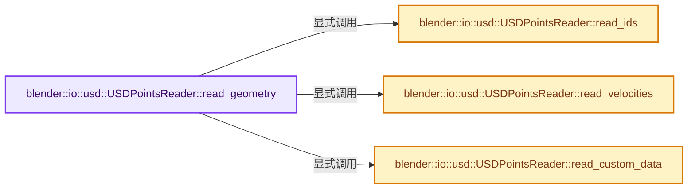

# 实现依赖专题：source/blender/io/usd/intern/usd_reader_points.cc

[方向导航](README.md) · [符号索引](../%E7%AC%A6%E5%8F%B7%E4%BE%9D%E8%B5%96%E4%B8%8E%E5%AE%9E%E7%8E%B0%E7%B4%A2%E5%BC%95.md)

本专题从正文实际调用进入，集中保存共享实现。函数有稳定锚点，可从调用处直接跳到对应完整函数；递归与互相调用通过回链组织。

## 本文件的实现关系




## 完整成员与函数实现

<a id="f-e1f3438d6c712657"></a>

### `blender::io::usd::USDPointsReader::read_geometry`

实现位置：[source/blender/io/usd/intern/usd_reader_points.cc](../../../../../source/blender/io/usd/intern/usd_reader_points.cc) · L58—L109。

接口参数：

- `bke::GeometrySet &geometry_set`
- `USDMeshReadParams params`
- `const char **`

**教学注释版**

<!-- annotated:4883587b191c9e -->

```cpp
void USDPointsReader::read_geometry(bke::GeometrySet &geometry_set,
                                    USDMeshReadParams params,
                                    const char ** /*r_err_str*/)
{
  PointCloud *pointcloud = geometry_set.get_pointcloud_for_write();

  /* Get the existing point cloud data. */
  pxr::VtVec3fArray usd_positions;
  points_prim_.GetPointsAttr().Get(&usd_positions, params.motion_sample_time);

  if (pointcloud->totpoint != usd_positions.size()) {
    /* Size changed so we must reallocate. */
    pointcloud = BKE_pointcloud_new_nomain(PointCloudType::Points, usd_positions.size());
  }

  /* Update point positions and radii */
  static_assert(sizeof(pxr::GfVec3f) == sizeof(float3));
  MutableSpan<float3> positions = pointcloud->positions_for_write();
  // [讲解] positions.copy_from：修改已有目标元素，不改变底层容器长度。
  positions.copy_from(Span(usd_positions.cdata(), usd_positions.size()).cast<float3>());

  pxr::VtFloatArray usd_widths;
  points_prim_.GetWidthsAttr().Get(&usd_widths, params.motion_sample_time);

  if (!usd_widths.empty()) {
    Span<float> widths = Span(usd_widths.cdata(), usd_widths.size());

    const pxr::TfToken widths_interp = points_prim_.GetWidthsInterpolation();
    if (widths_interp == pxr::UsdGeomTokens->constant) {
      set_single_value(pointcloud->attributes_for_write(),
                       "radius",
                       bke::AttrDomain::Point,
                       bke::AttrType::Float,
                       bke::AttributeInitValue(widths[0] / 2.0f));
    }
    else {
      MutableSpan<float> radii = pointcloud->radius_for_write();
      // [讲解] std::min：按比较关系选取较小值；截断范围时还需先满足非负和可表示范围，min本身不会证明边界安全。
      for (const int i_point : IndexRange(std::min(radii.size(), widths.size()))) {
        radii[i_point] = widths[i_point] / 2.0f;
      }
    }
  }

  /* TODO: Once Blender supports custom normals for points, we can consider reading in normals.
   * See UsdGeomPointBased::GetNormalsAttr */

  /* Read in IDs, velocity, and generic data. */
  this->read_ids(pointcloud, params.motion_sample_time);
  this->read_velocities(pointcloud, params.motion_sample_time);
  this->read_custom_data(pointcloud, params.motion_sample_time);

  geometry_set.replace_pointcloud(pointcloud);
}
```

<details>
<summary>核对原始源码：source/blender/io/usd/intern/usd_reader_points.cc · L58—L109</summary>

<!-- original:4883587b191c9e:source/blender/io/usd/intern/usd_reader_points.cc:58:109 -->

```cpp
void USDPointsReader::read_geometry(bke::GeometrySet &geometry_set,
                                    USDMeshReadParams params,
                                    const char ** /*r_err_str*/)
{
  PointCloud *pointcloud = geometry_set.get_pointcloud_for_write();

  /* Get the existing point cloud data. */
  pxr::VtVec3fArray usd_positions;
  points_prim_.GetPointsAttr().Get(&usd_positions, params.motion_sample_time);

  if (pointcloud->totpoint != usd_positions.size()) {
    /* Size changed so we must reallocate. */
    pointcloud = BKE_pointcloud_new_nomain(PointCloudType::Points, usd_positions.size());
  }

  /* Update point positions and radii */
  static_assert(sizeof(pxr::GfVec3f) == sizeof(float3));
  MutableSpan<float3> positions = pointcloud->positions_for_write();
  positions.copy_from(Span(usd_positions.cdata(), usd_positions.size()).cast<float3>());

  pxr::VtFloatArray usd_widths;
  points_prim_.GetWidthsAttr().Get(&usd_widths, params.motion_sample_time);

  if (!usd_widths.empty()) {
    Span<float> widths = Span(usd_widths.cdata(), usd_widths.size());

    const pxr::TfToken widths_interp = points_prim_.GetWidthsInterpolation();
    if (widths_interp == pxr::UsdGeomTokens->constant) {
      set_single_value(pointcloud->attributes_for_write(),
                       "radius",
                       bke::AttrDomain::Point,
                       bke::AttrType::Float,
                       bke::AttributeInitValue(widths[0] / 2.0f));
    }
    else {
      MutableSpan<float> radii = pointcloud->radius_for_write();
      for (const int i_point : IndexRange(std::min(radii.size(), widths.size()))) {
        radii[i_point] = widths[i_point] / 2.0f;
      }
    }
  }

  /* TODO: Once Blender supports custom normals for points, we can consider reading in normals.
   * See UsdGeomPointBased::GetNormalsAttr */

  /* Read in IDs, velocity, and generic data. */
  this->read_ids(pointcloud, params.motion_sample_time);
  this->read_velocities(pointcloud, params.motion_sample_time);
  this->read_custom_data(pointcloud, params.motion_sample_time);

  geometry_set.replace_pointcloud(pointcloud);
}
```

</details>

**沿实际写入检查状态**

- `pointcloud = BKE_pointcloud_new_nomain(PointCloudType::Points, usd_positions.size());`
- `radii[i_point] = widths[i_point] / 2.0f;`

**继续追踪实现**

- `geometry_set.get_pointcloud_for_write` → [blender::bke::GeometrySet::get_pointcloud_for_write · L568](../06-%E9%9A%90%E5%BC%8F%E5%85%B1%E4%BA%AB%E4%B8%8E%E7%BC%93%E5%AD%98%E7%B3%BB%E7%BB%9F/05-GeometrySet%E8%AF%BB%E5%86%99%E4%B8%8E%E5%A4%8D%E5%88%B6.md#f-eae41fb2ed3be0d5)。
- `points_prim_.GetPointsAttr().Get` → [调用协议](../%E6%A8%A1%E6%9D%BF%E5%AE%8F%E4%B8%8E%E5%8A%A8%E6%80%81%E5%88%86%E6%B4%BE%E5%8D%8F%E8%AE%AE.md)：接收对象类型依赖auto、返回值或模板实例；不按同名猜测目标。调用位置L66。
- `points_prim_.GetPointsAttr` → [调用协议](../%E6%A8%A1%E6%9D%BF%E5%AE%8F%E4%B8%8E%E5%8A%A8%E6%80%81%E5%88%86%E6%B4%BE%E5%8D%8F%E8%AE%AE.md)：接收对象类型依赖auto、返回值或模板实例；不按同名猜测目标。调用位置L66。
- `usd_positions.size` → [调用协议](../%E6%A8%A1%E6%9D%BF%E5%AE%8F%E4%B8%8E%E5%8A%A8%E6%80%81%E5%88%86%E6%B4%BE%E5%8D%8F%E8%AE%AE.md)：由接收对象具体类型或运行时策略提供实现。调用位置L68。
- `BKE_pointcloud_new_nomain` → [blender::BKE_pointcloud_new_nomain · L228](%E4%BE%9D%E8%B5%96-pointcloud-49a366.md#f-8ee0d698049c08aa)。
- `pointcloud->positions_for_write` → [blender::PointCloud::positions_for_write · L204](%E4%BE%9D%E8%B5%96-pointcloud-49a366.md#f-638cb4413ae404ef)。
- `positions.copy_from` → [blender::MutableSpan::copy_from · L745](../01-%E5%9F%BA%E7%A1%80%E5%AE%B9%E5%99%A8%E4%B8%8E%E7%8E%B0%E4%BB%A3CPP/06-MutableSpan%E5%8F%AF%E5%86%99%E8%A7%86%E5%9B%BE.md#f-e4f099b1497adddb)。
- `Span(usd_positions.cdata(), usd_positions.size()).cast<float3>` → [调用协议](../%E6%A8%A1%E6%9D%BF%E5%AE%8F%E4%B8%8E%E5%8A%A8%E6%80%81%E5%88%86%E6%B4%BE%E5%8D%8F%E8%AE%AE.md)：接收对象类型依赖auto、返回值或模板实例；不按同名猜测目标。调用位置L76。
- `Span` → [blender::Span](../01-%E5%9F%BA%E7%A1%80%E5%AE%B9%E5%99%A8%E4%B8%8E%E7%8E%B0%E4%BB%A3CPP/%E4%BE%9D%E8%B5%96-BLI_span-6aa95f.md#t-8765a8e0c1d5)；[blender::Span](../01-%E5%9F%BA%E7%A1%80%E5%AE%B9%E5%99%A8%E4%B8%8E%E7%8E%B0%E4%BB%A3CPP/%E4%BE%9D%E8%B5%96-BLI_index_range-7d7cc5.md#t-86091874a1c0)；[blender::Span](%E4%BE%9D%E8%B5%96-DNA_pointcloud_types-cfb82c.md#t-112aa6ed842c)；[blender::Span](%E4%BE%9D%E8%B5%96-DNA_node_types-6708b9.md#t-49ec6fbb9b69)；[blender::Span](%E4%BE%9D%E8%B5%96-DNA_mesh_types-81f02e.md#t-184fd48fb638)；[blender::Span](%E4%BE%9D%E8%B5%96-DNA_anim_types-39c5d9.md#t-d841071994c2)；[blender::Span](%E4%BE%9D%E8%B5%96-RNA_path_fwd-79c989.md#t-4dbb08969e41)。
- `usd_positions.cdata` → [调用协议](../%E6%A8%A1%E6%9D%BF%E5%AE%8F%E4%B8%8E%E5%8A%A8%E6%80%81%E5%88%86%E6%B4%BE%E5%8D%8F%E8%AE%AE.md)：由接收对象具体类型或运行时策略提供实现。调用位置L76。
- `points_prim_.GetWidthsAttr().Get` → [调用协议](../%E6%A8%A1%E6%9D%BF%E5%AE%8F%E4%B8%8E%E5%8A%A8%E6%80%81%E5%88%86%E6%B4%BE%E5%8D%8F%E8%AE%AE.md)：接收对象类型依赖auto、返回值或模板实例；不按同名猜测目标。调用位置L79。
- `points_prim_.GetWidthsAttr` → [调用协议](../%E6%A8%A1%E6%9D%BF%E5%AE%8F%E4%B8%8E%E5%8A%A8%E6%80%81%E5%88%86%E6%B4%BE%E5%8D%8F%E8%AE%AE.md)：接收对象类型依赖auto、返回值或模板实例；不按同名猜测目标。调用位置L79。
- `usd_widths.empty` → [调用协议](../%E6%A8%A1%E6%9D%BF%E5%AE%8F%E4%B8%8E%E5%8A%A8%E6%80%81%E5%88%86%E6%B4%BE%E5%8D%8F%E8%AE%AE.md)：由接收对象具体类型或运行时策略提供实现。调用位置L81。
- `usd_widths.cdata` → [调用协议](../%E6%A8%A1%E6%9D%BF%E5%AE%8F%E4%B8%8E%E5%8A%A8%E6%80%81%E5%88%86%E6%B4%BE%E5%8D%8F%E8%AE%AE.md)：由接收对象具体类型或运行时策略提供实现。调用位置L82。
- `usd_widths.size` → [调用协议](../%E6%A8%A1%E6%9D%BF%E5%AE%8F%E4%B8%8E%E5%8A%A8%E6%80%81%E5%88%86%E6%B4%BE%E5%8D%8F%E8%AE%AE.md)：由接收对象具体类型或运行时策略提供实现。调用位置L82。
- `points_prim_.GetWidthsInterpolation` → [调用协议](../%E6%A8%A1%E6%9D%BF%E5%AE%8F%E4%B8%8E%E5%8A%A8%E6%80%81%E5%88%86%E6%B4%BE%E5%8D%8F%E8%AE%AE.md)：接收对象类型依赖auto、返回值或模板实例；不按同名猜测目标。调用位置L84。
- `set_single_value` → [blender::io::usd::set_single_value · L249](%E4%BE%9D%E8%B5%96-usd_attribute_utils-8f80d9.md#f-1a08adb49f879d3a)。
- `pointcloud->attributes_for_write` → [blender::PointCloud::attributes_for_write · L312](%E4%BE%9D%E8%B5%96-pointcloud-49a366.md#f-308c3c12507fb7fb)。
- `bke::AttributeInitValue` → [blender::bke::AttributeInitValue::AttributeInitValue · L100](08-AttributeAccessor%E6%8E%A5%E5%8F%A3.md#f-cd502d5742ad6d0f)；[blender::bke::AttributeInitValue::AttributeInitValue · L104](08-AttributeAccessor%E6%8E%A5%E5%8F%A3.md#f-54b1dad08bff7914)。同名重载需按实参类型选择。
- `pointcloud->radius_for_write` → [blender::PointCloud::radius_for_write · L215](%E4%BE%9D%E8%B5%96-pointcloud-49a366.md#f-5a598b96f030a5ab)。
- `IndexRange` → [blender::IndexRange](../01-%E5%9F%BA%E7%A1%80%E5%AE%B9%E5%99%A8%E4%B8%8E%E7%8E%B0%E4%BB%A3CPP/%E4%BE%9D%E8%B5%96-BLI_index_range-7d7cc5.md#t-caa3466d6776)；[blender::gpu::shader::parser::IndexRange](%E4%BE%9D%E8%B5%96-utils-06433d.md#t-82d2bd4ea71c)；[blender::IndexRange](%E4%BE%9D%E8%B5%96-DNA_node_types-6708b9.md#t-0448cc889d39)。
- `std::min` → [外部契约](https://eel.is/c++draft/alg.min.max)：按比较关系选取较小值；截断范围时还需先满足非负和可表示范围，min本身不会证明边界安全。
- `radii.size` → [blender::MutableSpan::size · L499](../01-%E5%9F%BA%E7%A1%80%E5%AE%B9%E5%99%A8%E4%B8%8E%E7%8E%B0%E4%BB%A3CPP/06-MutableSpan%E5%8F%AF%E5%86%99%E8%A7%86%E5%9B%BE.md#f-1de6a66839c304a8)；[blender::gpu::shader::parser::MutableSpan::size · L87](%E4%BE%9D%E8%B5%96-utils-06433d.md#f-5e684af6ee7990e9)。同名重载需按实参类型选择。
- `widths.size` → [blender::Span::size · L256](../01-%E5%9F%BA%E7%A1%80%E5%AE%B9%E5%99%A8%E4%B8%8E%E7%8E%B0%E4%BB%A3CPP/05-Span%E5%8F%AA%E8%AF%BB%E8%BF%9E%E7%BB%AD%E8%A7%86%E5%9B%BE.md#f-5f80fa006089c998)。
- `this->read_ids` → [blender::io::usd::USDPointsReader::read_ids · L111](%E4%BE%9D%E8%B5%96-usd_reader_points-9db6c0.md#f-529558076b695702)。
- `this->read_velocities` → [blender::io::usd::USDPointsReader::read_velocities · L131](%E4%BE%9D%E8%B5%96-usd_reader_points-9db6c0.md#f-d13d9d593add1024)。
- `this->read_custom_data` → [blender::io::usd::USDPointsReader::read_custom_data · L147](%E4%BE%9D%E8%B5%96-usd_reader_points-9db6c0.md#f-bb25e5907fbe093b)。
- `geometry_set.replace_pointcloud` → [blender::bke::GeometrySet::replace_pointcloud · L519](../06-%E9%9A%90%E5%BC%8F%E5%85%B1%E4%BA%AB%E4%B8%8E%E7%BC%93%E5%AD%98%E7%B3%BB%E7%BB%9F/05-GeometrySet%E8%AF%BB%E5%86%99%E4%B8%8E%E5%A4%8D%E5%88%B6.md#f-02414356dff40c94)。

<a id="f-529558076b695702"></a>

### `blender::io::usd::USDPointsReader::read_ids`

实现位置：[source/blender/io/usd/intern/usd_reader_points.cc](../../../../../source/blender/io/usd/intern/usd_reader_points.cc) · L111—L129。

接口参数：

- `PointCloud *pointcloud`
- `const pxr::UsdTimeCode time`

**教学注释版**

<!-- annotated:423934d350b561 -->

```cpp
void USDPointsReader::read_ids(PointCloud *pointcloud, const pxr::UsdTimeCode time) const
{
  pxr::VtInt64Array usd_ids;
  points_prim_.GetIdsAttr().Get(&usd_ids, time);

  if (!usd_ids.empty()) {
    bke::MutableAttributeAccessor attributes = pointcloud->attributes_for_write();
    bke::SpanAttributeWriter<int> ids = attributes.lookup_or_add_for_write_only_span<int>(
        "id", bke::AttrDomain::Point);

    const Span<int64_t> usd_data(usd_ids.cdata(), usd_ids.size());
    // [讲解] std::min：按比较关系选取较小值；截断范围时还需先满足非负和可表示范围，min本身不会证明边界安全。
    for (const int i_point : IndexRange(std::min(ids.span.size(), usd_data.size()))) {
      /* Blender only supports int ID attributes so we have to narrow the value. */
      ids.span[i_point] = int(usd_ids[i_point]);
    }

    ids.finish();
  }
}
```

<details>
<summary>核对原始源码：source/blender/io/usd/intern/usd_reader_points.cc · L111—L129</summary>

<!-- original:423934d350b561:source/blender/io/usd/intern/usd_reader_points.cc:111:129 -->

```cpp
void USDPointsReader::read_ids(PointCloud *pointcloud, const pxr::UsdTimeCode time) const
{
  pxr::VtInt64Array usd_ids;
  points_prim_.GetIdsAttr().Get(&usd_ids, time);

  if (!usd_ids.empty()) {
    bke::MutableAttributeAccessor attributes = pointcloud->attributes_for_write();
    bke::SpanAttributeWriter<int> ids = attributes.lookup_or_add_for_write_only_span<int>(
        "id", bke::AttrDomain::Point);

    const Span<int64_t> usd_data(usd_ids.cdata(), usd_ids.size());
    for (const int i_point : IndexRange(std::min(ids.span.size(), usd_data.size()))) {
      /* Blender only supports int ID attributes so we have to narrow the value. */
      ids.span[i_point] = int(usd_ids[i_point]);
    }

    ids.finish();
  }
}
```

</details>

**沿实际写入检查状态**

- `ids.span[i_point] = int(usd_ids[i_point]);`

**继续追踪实现**

- `points_prim_.GetIdsAttr().Get` → [调用协议](../%E6%A8%A1%E6%9D%BF%E5%AE%8F%E4%B8%8E%E5%8A%A8%E6%80%81%E5%88%86%E6%B4%BE%E5%8D%8F%E8%AE%AE.md)：接收对象类型依赖auto、返回值或模板实例；不按同名猜测目标。调用位置L114。
- `points_prim_.GetIdsAttr` → [调用协议](../%E6%A8%A1%E6%9D%BF%E5%AE%8F%E4%B8%8E%E5%8A%A8%E6%80%81%E5%88%86%E6%B4%BE%E5%8D%8F%E8%AE%AE.md)：接收对象类型依赖auto、返回值或模板实例；不按同名猜测目标。调用位置L114。
- `usd_ids.empty` → [调用协议](../%E6%A8%A1%E6%9D%BF%E5%AE%8F%E4%B8%8E%E5%8A%A8%E6%80%81%E5%88%86%E6%B4%BE%E5%8D%8F%E8%AE%AE.md)：由接收对象具体类型或运行时策略提供实现。调用位置L116。
- `pointcloud->attributes_for_write` → [blender::PointCloud::attributes_for_write · L312](%E4%BE%9D%E8%B5%96-pointcloud-49a366.md#f-308c3c12507fb7fb)。
- `attributes.lookup_or_add_for_write_only_span<int>` → [blender::bke::MutableAttributeAccessor::lookup_or_add_for_write_only_span · L546](%E4%BE%9D%E8%B5%96-attribute_access-bceef3.md#f-97af899f7983a038)；[blender::bke::MutableAttributeAccessor::lookup_or_add_for_write_only_span · L891](08-AttributeAccessor%E6%8E%A5%E5%8F%A3.md#f-ee8d09f75408ac4f)。同名重载需按实参类型选择。
- `usd_ids.cdata` → [调用协议](../%E6%A8%A1%E6%9D%BF%E5%AE%8F%E4%B8%8E%E5%8A%A8%E6%80%81%E5%88%86%E6%B4%BE%E5%8D%8F%E8%AE%AE.md)：由接收对象具体类型或运行时策略提供实现。调用位置L121。
- `usd_ids.size` → [调用协议](../%E6%A8%A1%E6%9D%BF%E5%AE%8F%E4%B8%8E%E5%8A%A8%E6%80%81%E5%88%86%E6%B4%BE%E5%8D%8F%E8%AE%AE.md)：由接收对象具体类型或运行时策略提供实现。调用位置L121。
- `IndexRange` → [blender::IndexRange](../01-%E5%9F%BA%E7%A1%80%E5%AE%B9%E5%99%A8%E4%B8%8E%E7%8E%B0%E4%BB%A3CPP/%E4%BE%9D%E8%B5%96-BLI_index_range-7d7cc5.md#t-caa3466d6776)；[blender::gpu::shader::parser::IndexRange](%E4%BE%9D%E8%B5%96-utils-06433d.md#t-82d2bd4ea71c)；[blender::IndexRange](%E4%BE%9D%E8%B5%96-DNA_node_types-6708b9.md#t-0448cc889d39)。
- `std::min` → [外部契约](https://eel.is/c++draft/alg.min.max)：按比较关系选取较小值；截断范围时还需先满足非负和可表示范围，min本身不会证明边界安全。
- `ids.span.size` → [调用协议](../%E6%A8%A1%E6%9D%BF%E5%AE%8F%E4%B8%8E%E5%8A%A8%E6%80%81%E5%88%86%E6%B4%BE%E5%8D%8F%E8%AE%AE.md)：接收对象类型依赖auto、返回值或模板实例；不按同名猜测目标。调用位置L122。
- `usd_data.size` → [blender::Span::size · L256](../01-%E5%9F%BA%E7%A1%80%E5%AE%B9%E5%99%A8%E4%B8%8E%E7%8E%B0%E4%BB%A3CPP/05-Span%E5%8F%AA%E8%AF%BB%E8%BF%9E%E7%BB%AD%E8%A7%86%E5%9B%BE.md#f-5f80fa006089c998)。
- `ids.finish` → [blender::bke::SpanAttributeWriter::finish · L279](08-AttributeAccessor%E6%8E%A5%E5%8F%A3.md#f-585970a3b1bd4da4)。

<a id="f-d13d9d593add1024"></a>

### `blender::io::usd::USDPointsReader::read_velocities`

实现位置：[source/blender/io/usd/intern/usd_reader_points.cc](../../../../../source/blender/io/usd/intern/usd_reader_points.cc) · L131—L145。

接口参数：

- `PointCloud *pointcloud`
- `const pxr::UsdTimeCode time`

**教学注释版**

<!-- annotated:d7f0ff5a26cdc2 -->

```cpp
void USDPointsReader::read_velocities(PointCloud *pointcloud, const pxr::UsdTimeCode time) const
{
  pxr::VtVec3fArray velocities;
  points_prim_.GetVelocitiesAttr().Get(&velocities, time);

  if (!velocities.empty()) {
    bke::MutableAttributeAccessor attributes = pointcloud->attributes_for_write();
    bke::SpanAttributeWriter<float3> velocity =
        attributes.lookup_or_add_for_write_only_span<float3>("velocity", bke::AttrDomain::Point);

    Span<pxr::GfVec3f> usd_data(velocities.cdata(), velocities.size());
    // [讲解] usd_data.cast<float3>：按类型与布局约束重新解释视图。
    velocity.span.copy_from(usd_data.cast<float3>());
    velocity.finish();
  }
}
```

<details>
<summary>核对原始源码：source/blender/io/usd/intern/usd_reader_points.cc · L131—L145</summary>

<!-- original:d7f0ff5a26cdc2:source/blender/io/usd/intern/usd_reader_points.cc:131:145 -->

```cpp
void USDPointsReader::read_velocities(PointCloud *pointcloud, const pxr::UsdTimeCode time) const
{
  pxr::VtVec3fArray velocities;
  points_prim_.GetVelocitiesAttr().Get(&velocities, time);

  if (!velocities.empty()) {
    bke::MutableAttributeAccessor attributes = pointcloud->attributes_for_write();
    bke::SpanAttributeWriter<float3> velocity =
        attributes.lookup_or_add_for_write_only_span<float3>("velocity", bke::AttrDomain::Point);

    Span<pxr::GfVec3f> usd_data(velocities.cdata(), velocities.size());
    velocity.span.copy_from(usd_data.cast<float3>());
    velocity.finish();
  }
}
```

</details>

**继续追踪实现**

- `points_prim_.GetVelocitiesAttr().Get` → [调用协议](../%E6%A8%A1%E6%9D%BF%E5%AE%8F%E4%B8%8E%E5%8A%A8%E6%80%81%E5%88%86%E6%B4%BE%E5%8D%8F%E8%AE%AE.md)：接收对象类型依赖auto、返回值或模板实例；不按同名猜测目标。调用位置L134。
- `points_prim_.GetVelocitiesAttr` → [调用协议](../%E6%A8%A1%E6%9D%BF%E5%AE%8F%E4%B8%8E%E5%8A%A8%E6%80%81%E5%88%86%E6%B4%BE%E5%8D%8F%E8%AE%AE.md)：接收对象类型依赖auto、返回值或模板实例；不按同名猜测目标。调用位置L134。
- `velocities.empty` → [调用协议](../%E6%A8%A1%E6%9D%BF%E5%AE%8F%E4%B8%8E%E5%8A%A8%E6%80%81%E5%88%86%E6%B4%BE%E5%8D%8F%E8%AE%AE.md)：由接收对象具体类型或运行时策略提供实现。调用位置L136。
- `pointcloud->attributes_for_write` → [blender::PointCloud::attributes_for_write · L312](%E4%BE%9D%E8%B5%96-pointcloud-49a366.md#f-308c3c12507fb7fb)。
- `attributes.lookup_or_add_for_write_only_span<float3>` → [blender::bke::MutableAttributeAccessor::lookup_or_add_for_write_only_span · L546](%E4%BE%9D%E8%B5%96-attribute_access-bceef3.md#f-97af899f7983a038)；[blender::bke::MutableAttributeAccessor::lookup_or_add_for_write_only_span · L891](08-AttributeAccessor%E6%8E%A5%E5%8F%A3.md#f-ee8d09f75408ac4f)。同名重载需按实参类型选择。
- `velocities.cdata` → [调用协议](../%E6%A8%A1%E6%9D%BF%E5%AE%8F%E4%B8%8E%E5%8A%A8%E6%80%81%E5%88%86%E6%B4%BE%E5%8D%8F%E8%AE%AE.md)：由接收对象具体类型或运行时策略提供实现。调用位置L141。
- `velocities.size` → [调用协议](../%E6%A8%A1%E6%9D%BF%E5%AE%8F%E4%B8%8E%E5%8A%A8%E6%80%81%E5%88%86%E6%B4%BE%E5%8D%8F%E8%AE%AE.md)：由接收对象具体类型或运行时策略提供实现。调用位置L141。
- `velocity.span.copy_from` → [调用协议](../%E6%A8%A1%E6%9D%BF%E5%AE%8F%E4%B8%8E%E5%8A%A8%E6%80%81%E5%88%86%E6%B4%BE%E5%8D%8F%E8%AE%AE.md)：接收对象类型依赖auto、返回值或模板实例；不按同名猜测目标。调用位置L142。
- `usd_data.cast<float3>` → [blender::Span::cast · L422](../01-%E5%9F%BA%E7%A1%80%E5%AE%B9%E5%99%A8%E4%B8%8E%E7%8E%B0%E4%BB%A3CPP/05-Span%E5%8F%AA%E8%AF%BB%E8%BF%9E%E7%BB%AD%E8%A7%86%E5%9B%BE.md#f-e082d823028af8f6)。
- `velocity.finish` → [blender::bke::SpanAttributeWriter::finish · L279](08-AttributeAccessor%E6%8E%A5%E5%8F%A3.md#f-585970a3b1bd4da4)。

<a id="f-bb25e5907fbe093b"></a>

### `blender::io::usd::USDPointsReader::read_custom_data`

实现位置：[source/blender/io/usd/intern/usd_reader_points.cc](../../../../../source/blender/io/usd/intern/usd_reader_points.cc) · L147—L167。

接口参数：

- `PointCloud *pointcloud`
- `const pxr::UsdTimeCode time`

**教学注释版**

<!-- annotated:896364d0b58fb0 -->

```cpp
void USDPointsReader::read_custom_data(PointCloud *pointcloud, const pxr::UsdTimeCode time) const
{
  pxr::UsdGeomPrimvarsAPI pv_api(points_prim_);

  std::vector<pxr::UsdGeomPrimvar> primvars = pv_api.GetPrimvarsWithValues();
  for (const pxr::UsdGeomPrimvar &pv : primvars) {
    const pxr::SdfValueTypeName pv_type = pv.GetTypeName();
    if (!pv_type.IsArray()) {
      continue; /* Skip non-array primvar attributes. */
    }

    const bke::AttrDomain domain = bke::AttrDomain::Point;
    const std::optional<bke::AttrType> type = convert_usd_type_to_blender(pv_type);
    if (!type.has_value()) {
      return;
    }

    bke::MutableAttributeAccessor attributes = pointcloud->attributes_for_write();
    copy_primvar_to_blender_attribute(pv, time, *type, domain, {}, attributes);
  }
}
```

<details>
<summary>核对原始源码：source/blender/io/usd/intern/usd_reader_points.cc · L147—L167</summary>

<!-- original:896364d0b58fb0:source/blender/io/usd/intern/usd_reader_points.cc:147:167 -->

```cpp
void USDPointsReader::read_custom_data(PointCloud *pointcloud, const pxr::UsdTimeCode time) const
{
  pxr::UsdGeomPrimvarsAPI pv_api(points_prim_);

  std::vector<pxr::UsdGeomPrimvar> primvars = pv_api.GetPrimvarsWithValues();
  for (const pxr::UsdGeomPrimvar &pv : primvars) {
    const pxr::SdfValueTypeName pv_type = pv.GetTypeName();
    if (!pv_type.IsArray()) {
      continue; /* Skip non-array primvar attributes. */
    }

    const bke::AttrDomain domain = bke::AttrDomain::Point;
    const std::optional<bke::AttrType> type = convert_usd_type_to_blender(pv_type);
    if (!type.has_value()) {
      return;
    }

    bke::MutableAttributeAccessor attributes = pointcloud->attributes_for_write();
    copy_primvar_to_blender_attribute(pv, time, *type, domain, {}, attributes);
  }
}
```

</details>

**继续追踪实现**

- `pv_api.GetPrimvarsWithValues` → [调用协议](../%E6%A8%A1%E6%9D%BF%E5%AE%8F%E4%B8%8E%E5%8A%A8%E6%80%81%E5%88%86%E6%B4%BE%E5%8D%8F%E8%AE%AE.md)：由接收对象具体类型或运行时策略提供实现。调用位置L151。
- `pv.GetTypeName` → [调用协议](../%E6%A8%A1%E6%9D%BF%E5%AE%8F%E4%B8%8E%E5%8A%A8%E6%80%81%E5%88%86%E6%B4%BE%E5%8D%8F%E8%AE%AE.md)：接收对象类型依赖auto、返回值或模板实例；不按同名猜测目标。调用位置L153。
- `pv_type.IsArray` → [调用协议](../%E6%A8%A1%E6%9D%BF%E5%AE%8F%E4%B8%8E%E5%8A%A8%E6%80%81%E5%88%86%E6%B4%BE%E5%8D%8F%E8%AE%AE.md)：由接收对象具体类型或运行时策略提供实现。调用位置L154。
- `convert_usd_type_to_blender` → [blender::io::usd::convert_usd_type_to_blender · L51](%E4%BE%9D%E8%B5%96-usd_attribute_utils-fec74d.md#f-efdda91a1db0b399)。
- `type.has_value` → [外部契约](https://eel.is/c++draft/)：这个边界按实际表达式及所属类型核对参数、返回值、寿命与失败行为。这里提供接口入口，不声称已解释该第三方版本的内部实现。
- `pointcloud->attributes_for_write` → [blender::PointCloud::attributes_for_write · L312](%E4%BE%9D%E8%B5%96-pointcloud-49a366.md#f-308c3c12507fb7fb)。
- `copy_primvar_to_blender_attribute` → [blender::io::usd::copy_primvar_to_blender_attribute · L98](%E4%BE%9D%E8%B5%96-usd_attribute_utils-fec74d.md#f-17c12e082c15637d)。
