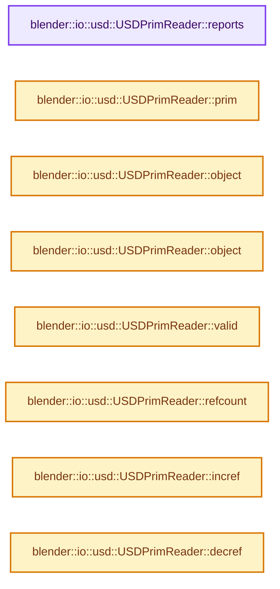

# 实现依赖专题：source/blender/io/usd/intern/usd_reader_prim.cc

[方向导航](README.md) · [符号索引](../%E7%AC%A6%E5%8F%B7%E4%BE%9D%E8%B5%96%E4%B8%8E%E5%AE%9E%E7%8E%B0%E7%B4%A2%E5%BC%95.md)

本专题从正文实际调用进入，集中保存共享实现。函数有稳定锚点，可从调用处直接跳到对应完整函数；递归与互相调用通过回链组织。

## 本文件的实现关系




## 完整成员与函数实现

<a id="f-f5157cbeedd7b038"></a>

### `blender::io::usd::USDPrimReader::reports`

实现位置：[source/blender/io/usd/intern/usd_reader_prim.cc](../../../../../source/blender/io/usd/intern/usd_reader_prim.cc) · L23—L26。

**教学注释版**

<!-- annotated:21d69e56ec6795 -->

```cpp
ReportList *USDPrimReader::reports() const
{
  return import_params_.worker_status ? import_params_.worker_status->reports : nullptr;
}
```

<details>
<summary>核对原始源码：source/blender/io/usd/intern/usd_reader_prim.cc · L23—L26</summary>

<!-- original:21d69e56ec6795:source/blender/io/usd/intern/usd_reader_prim.cc:23:26 -->

```cpp
ReportList *USDPrimReader::reports() const
{
  return import_params_.worker_status ? import_params_.worker_status->reports : nullptr;
}
```

</details>

**结果出口**

- `return import_params_.worker_status ? import_params_.worker_status->reports : nullptr;`

**继续追踪实现**

本实现没有需要继续展开的显式调用；检查返回表达式、对象转换和调用者前置条件。

<a id="f-0362f73858a39a3d"></a>

### `blender::io::usd::USDPrimReader::prim`

实现位置：[source/blender/io/usd/intern/usd_reader_prim.cc](../../../../../source/blender/io/usd/intern/usd_reader_prim.cc) · L76—L79。

**教学注释版**

<!-- annotated:fe88ffa24b77ee -->

```cpp
const pxr::UsdPrim &USDPrimReader::prim() const
{
  return prim_;
}
```

<details>
<summary>核对原始源码：source/blender/io/usd/intern/usd_reader_prim.cc · L76—L79</summary>

<!-- original:fe88ffa24b77ee:source/blender/io/usd/intern/usd_reader_prim.cc:76:79 -->

```cpp
const pxr::UsdPrim &USDPrimReader::prim() const
{
  return prim_;
}
```

</details>

**结果出口**

- `return prim_;`

**继续追踪实现**

本实现没有需要继续展开的显式调用；检查返回表达式、对象转换和调用者前置条件。

<a id="f-abd1c9a1bc5cc83e"></a>

### `blender::io::usd::USDPrimReader::object`

实现位置：[source/blender/io/usd/intern/usd_reader_prim.cc](../../../../../source/blender/io/usd/intern/usd_reader_prim.cc) · L81—L84。

**教学注释版**

<!-- annotated:4b615d46295848 -->

```cpp
Object *USDPrimReader::object() const
{
  return object_;
}
```

<details>
<summary>核对原始源码：source/blender/io/usd/intern/usd_reader_prim.cc · L81—L84</summary>

<!-- original:4b615d46295848:source/blender/io/usd/intern/usd_reader_prim.cc:81:84 -->

```cpp
Object *USDPrimReader::object() const
{
  return object_;
}
```

</details>

**结果出口**

- `return object_;`

**继续追踪实现**

本实现没有需要继续展开的显式调用；检查返回表达式、对象转换和调用者前置条件。

<a id="f-3161c1724c5f6303"></a>

### `blender::io::usd::USDPrimReader::object`

实现位置：[source/blender/io/usd/intern/usd_reader_prim.cc](../../../../../source/blender/io/usd/intern/usd_reader_prim.cc) · L86—L89。

接口参数：

- `Object *ob`

**教学注释版**

<!-- annotated:2ea881fe4325e2 -->

```cpp
void USDPrimReader::object(Object *ob)
{
  object_ = ob;
}
```

<details>
<summary>核对原始源码：source/blender/io/usd/intern/usd_reader_prim.cc · L86—L89</summary>

<!-- original:2ea881fe4325e2:source/blender/io/usd/intern/usd_reader_prim.cc:86:89 -->

```cpp
void USDPrimReader::object(Object *ob)
{
  object_ = ob;
}
```

</details>

**沿实际写入检查状态**

- `object_ = ob;`

**继续追踪实现**

本实现没有需要继续展开的显式调用；检查返回表达式、对象转换和调用者前置条件。

<a id="f-82e93216887667d4"></a>

### `blender::io::usd::USDPrimReader::valid`

实现位置：[source/blender/io/usd/intern/usd_reader_prim.cc](../../../../../source/blender/io/usd/intern/usd_reader_prim.cc) · L91—L94。

**教学注释版**

<!-- annotated:62fb20eca7245e -->

```cpp
bool USDPrimReader::valid() const
{
  return prim_.IsValid();
}
```

<details>
<summary>核对原始源码：source/blender/io/usd/intern/usd_reader_prim.cc · L91—L94</summary>

<!-- original:62fb20eca7245e:source/blender/io/usd/intern/usd_reader_prim.cc:91:94 -->

```cpp
bool USDPrimReader::valid() const
{
  return prim_.IsValid();
}
```

</details>

**结果出口**

- `return prim_.IsValid();`

**继续追踪实现**

- `prim_.IsValid` → [调用协议](../%E6%A8%A1%E6%9D%BF%E5%AE%8F%E4%B8%8E%E5%8A%A8%E6%80%81%E5%88%86%E6%B4%BE%E5%8D%8F%E8%AE%AE.md)：接收对象类型依赖auto、返回值或模板实例；不按同名猜测目标。调用位置L93。

<a id="f-a02d5e255d0a478b"></a>

### `blender::io::usd::USDPrimReader::refcount`

实现位置：[source/blender/io/usd/intern/usd_reader_prim.cc](../../../../../source/blender/io/usd/intern/usd_reader_prim.cc) · L96—L99。

**教学注释版**

<!-- annotated:04afbe6264ec11 -->

```cpp
int USDPrimReader::refcount() const
{
  return refcount_;
}
```

<details>
<summary>核对原始源码：source/blender/io/usd/intern/usd_reader_prim.cc · L96—L99</summary>

<!-- original:04afbe6264ec11:source/blender/io/usd/intern/usd_reader_prim.cc:96:99 -->

```cpp
int USDPrimReader::refcount() const
{
  return refcount_;
}
```

</details>

**结果出口**

- `return refcount_;`

**继续追踪实现**

本实现没有需要继续展开的显式调用；检查返回表达式、对象转换和调用者前置条件。

<a id="f-56f4312101ec254b"></a>

### `blender::io::usd::USDPrimReader::incref`

实现位置：[source/blender/io/usd/intern/usd_reader_prim.cc](../../../../../source/blender/io/usd/intern/usd_reader_prim.cc) · L101—L104。

**教学注释版**

<!-- annotated:2b5347de9ac27a -->

```cpp
void USDPrimReader::incref()
{
  refcount_++;
}
```

<details>
<summary>核对原始源码：source/blender/io/usd/intern/usd_reader_prim.cc · L101—L104</summary>

<!-- original:2b5347de9ac27a:source/blender/io/usd/intern/usd_reader_prim.cc:101:104 -->

```cpp
void USDPrimReader::incref()
{
  refcount_++;
}
```

</details>

**继续追踪实现**

本实现没有需要继续展开的显式调用；检查返回表达式、对象转换和调用者前置条件。

<a id="f-6f218f7013741a29"></a>

### `blender::io::usd::USDPrimReader::decref`

实现位置：[source/blender/io/usd/intern/usd_reader_prim.cc](../../../../../source/blender/io/usd/intern/usd_reader_prim.cc) · L106—L110。

**教学注释版**

<!-- annotated:c80a5319c793b0 -->

```cpp
void USDPrimReader::decref()
{
  refcount_--;
  BLI_assert(refcount_ >= 0);
}
```

<details>
<summary>核对原始源码：source/blender/io/usd/intern/usd_reader_prim.cc · L106—L110</summary>

<!-- original:c80a5319c793b0:source/blender/io/usd/intern/usd_reader_prim.cc:106:110 -->

```cpp
void USDPrimReader::decref()
{
  refcount_--;
  BLI_assert(refcount_ >= 0);
}
```

</details>

**继续追踪实现**

- `BLI_assert` → [BLI_assert · L48](../01-%E5%9F%BA%E7%A1%80%E5%AE%B9%E5%99%A8%E4%B8%8E%E7%8E%B0%E4%BB%A3CPP/%E4%BE%9D%E8%B5%96-BLI_assert-cc98e8.md#m-57a88495704d)；[BLI_assert · L63](../01-%E5%9F%BA%E7%A1%80%E5%AE%B9%E5%99%A8%E4%B8%8E%E7%8E%B0%E4%BB%A3CPP/%E4%BE%9D%E8%B5%96-BLI_assert-cc98e8.md#m-d07050020cb5)。宏定义由构建条件选择。
