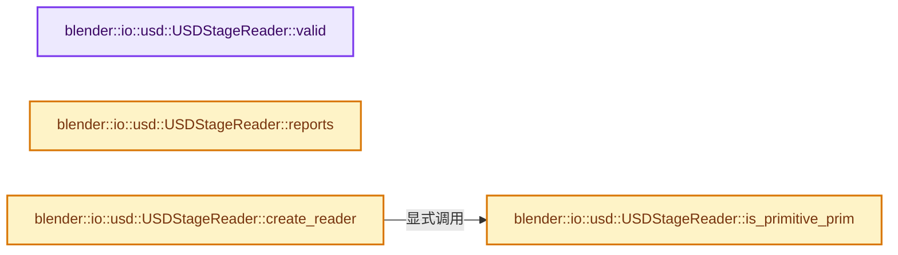

# 实现依赖专题：source/blender/io/usd/intern/usd_reader_stage.cc

[方向导航](README.md) · [符号索引](../%E7%AC%A6%E5%8F%B7%E4%BE%9D%E8%B5%96%E4%B8%8E%E5%AE%9E%E7%8E%B0%E7%B4%A2%E5%BC%95.md)

本专题从正文实际调用进入，集中保存共享实现。函数有稳定锚点，可从调用处直接跳到对应完整函数；递归与互相调用通过回链组织。

## 本文件的实现关系




## 完整成员与函数实现

<a id="f-e7dd60b8e865e523"></a>

### `blender::io::usd::USDStageReader::valid`

实现位置：[source/blender/io/usd/intern/usd_reader_stage.cc](../../../../../source/blender/io/usd/intern/usd_reader_stage.cc) · L219—L222。

**教学注释版**

<!-- annotated:2055babe6b1291 -->

```cpp
bool USDStageReader::valid() const
{
  return stage_;
}
```

<details>
<summary>核对原始源码：source/blender/io/usd/intern/usd_reader_stage.cc · L219—L222</summary>

<!-- original:2055babe6b1291:source/blender/io/usd/intern/usd_reader_stage.cc:219:222 -->

```cpp
bool USDStageReader::valid() const
{
  return stage_;
}
```

</details>

**结果出口**

- `return stage_;`

**继续追踪实现**

本实现没有需要继续展开的显式调用；检查返回表达式、对象转换和调用者前置条件。

<a id="f-e0d5b23d28bd823e"></a>

### `blender::io::usd::USDStageReader::is_primitive_prim`

实现位置：[source/blender/io/usd/intern/usd_reader_stage.cc](../../../../../source/blender/io/usd/intern/usd_reader_stage.cc) · L224—L230。

接口参数：

- `const pxr::UsdPrim &prim`

**教学注释版**

<!-- annotated:34b7c560823cdd -->

```cpp
bool USDStageReader::is_primitive_prim(const pxr::UsdPrim &prim) const
{
  return (prim.IsA<pxr::UsdGeomCapsule>() || prim.IsA<pxr::UsdGeomCapsule_1>() ||
          prim.IsA<pxr::UsdGeomCylinder>() || prim.IsA<pxr::UsdGeomCylinder_1>() ||
          prim.IsA<pxr::UsdGeomCone>() || prim.IsA<pxr::UsdGeomCube>() ||
          prim.IsA<pxr::UsdGeomSphere>() || prim.IsA<pxr::UsdGeomPlane>());
}
```

<details>
<summary>核对原始源码：source/blender/io/usd/intern/usd_reader_stage.cc · L224—L230</summary>

<!-- original:34b7c560823cdd:source/blender/io/usd/intern/usd_reader_stage.cc:224:230 -->

```cpp
bool USDStageReader::is_primitive_prim(const pxr::UsdPrim &prim) const
{
  return (prim.IsA<pxr::UsdGeomCapsule>() || prim.IsA<pxr::UsdGeomCapsule_1>() ||
          prim.IsA<pxr::UsdGeomCylinder>() || prim.IsA<pxr::UsdGeomCylinder_1>() ||
          prim.IsA<pxr::UsdGeomCone>() || prim.IsA<pxr::UsdGeomCube>() ||
          prim.IsA<pxr::UsdGeomSphere>() || prim.IsA<pxr::UsdGeomPlane>());
}
```

</details>

**结果出口**

- `return (prim.IsA<pxr::UsdGeomCapsule>() || prim.IsA<pxr::UsdGeomCapsule_1>() ||`

**继续追踪实现**

- `prim.IsA<pxr::UsdGeomCapsule>` → [调用协议](../%E6%A8%A1%E6%9D%BF%E5%AE%8F%E4%B8%8E%E5%8A%A8%E6%80%81%E5%88%86%E6%B4%BE%E5%8D%8F%E8%AE%AE.md)：由接收对象具体类型或运行时策略提供实现。调用位置L226。
- `prim.IsA<pxr::UsdGeomCapsule_1>` → [调用协议](../%E6%A8%A1%E6%9D%BF%E5%AE%8F%E4%B8%8E%E5%8A%A8%E6%80%81%E5%88%86%E6%B4%BE%E5%8D%8F%E8%AE%AE.md)：由接收对象具体类型或运行时策略提供实现。调用位置L226。
- `prim.IsA<pxr::UsdGeomCylinder>` → [调用协议](../%E6%A8%A1%E6%9D%BF%E5%AE%8F%E4%B8%8E%E5%8A%A8%E6%80%81%E5%88%86%E6%B4%BE%E5%8D%8F%E8%AE%AE.md)：由接收对象具体类型或运行时策略提供实现。调用位置L227。
- `prim.IsA<pxr::UsdGeomCylinder_1>` → [调用协议](../%E6%A8%A1%E6%9D%BF%E5%AE%8F%E4%B8%8E%E5%8A%A8%E6%80%81%E5%88%86%E6%B4%BE%E5%8D%8F%E8%AE%AE.md)：由接收对象具体类型或运行时策略提供实现。调用位置L227。
- `prim.IsA<pxr::UsdGeomCone>` → [调用协议](../%E6%A8%A1%E6%9D%BF%E5%AE%8F%E4%B8%8E%E5%8A%A8%E6%80%81%E5%88%86%E6%B4%BE%E5%8D%8F%E8%AE%AE.md)：由接收对象具体类型或运行时策略提供实现。调用位置L228。
- `prim.IsA<pxr::UsdGeomCube>` → [调用协议](../%E6%A8%A1%E6%9D%BF%E5%AE%8F%E4%B8%8E%E5%8A%A8%E6%80%81%E5%88%86%E6%B4%BE%E5%8D%8F%E8%AE%AE.md)：由接收对象具体类型或运行时策略提供实现。调用位置L228。
- `prim.IsA<pxr::UsdGeomSphere>` → [调用协议](../%E6%A8%A1%E6%9D%BF%E5%AE%8F%E4%B8%8E%E5%8A%A8%E6%80%81%E5%88%86%E6%B4%BE%E5%8D%8F%E8%AE%AE.md)：由接收对象具体类型或运行时策略提供实现。调用位置L229。
- `prim.IsA<pxr::UsdGeomPlane>` → [调用协议](../%E6%A8%A1%E6%9D%BF%E5%AE%8F%E4%B8%8E%E5%8A%A8%E6%80%81%E5%88%86%E6%B4%BE%E5%8D%8F%E8%AE%AE.md)：由接收对象具体类型或运行时策略提供实现。调用位置L229。

<a id="f-c1d34a50af380168"></a>

### `blender::io::usd::USDStageReader::reports`

实现位置：[source/blender/io/usd/intern/usd_reader_stage.cc](../../../../../source/blender/io/usd/intern/usd_reader_stage.cc) · L232—L235。

**教学注释版**

<!-- annotated:c6658a3da7ab15 -->

```cpp
ReportList *USDStageReader::reports() const
{
  return params_.worker_status ? params_.worker_status->reports : nullptr;
}
```

<details>
<summary>核对原始源码：source/blender/io/usd/intern/usd_reader_stage.cc · L232—L235</summary>

<!-- original:c6658a3da7ab15:source/blender/io/usd/intern/usd_reader_stage.cc:232:235 -->

```cpp
ReportList *USDStageReader::reports() const
{
  return params_.worker_status ? params_.worker_status->reports : nullptr;
}
```

</details>

**结果出口**

- `return params_.worker_status ? params_.worker_status->reports : nullptr;`

**继续追踪实现**

本实现没有需要继续展开的显式调用；检查返回表达式、对象转换和调用者前置条件。

<a id="f-f05d229c41503202"></a>

### `blender::io::usd::USDStageReader::create_reader`

实现位置：[source/blender/io/usd/intern/usd_reader_stage.cc](../../../../../source/blender/io/usd/intern/usd_reader_stage.cc) · L290—L336。

接口参数：

- `const pxr::UsdPrim &prim`

**教学注释版**

<!-- annotated:142a5c380cd203 -->

```cpp
USDPrimReader *USDStageReader::create_reader(const pxr::UsdPrim &prim)
{
  if (params_.support_scene_instancing && prim.IsInstance()) {
    return new USDInstanceReader(prim, params_, settings_);
  }
  if (is_primitive_prim(prim)) {
    return new USDShapeReader(prim, params_, settings_);
  }
  if (prim.IsA<pxr::UsdGeomCamera>()) {
    return new USDCameraReader(prim, params_, settings_);
  }
  if (prim.IsA<pxr::UsdGeomBasisCurves>()) {
    return new USDBasisCurvesReader(prim, params_, settings_);
  }
  if (prim.IsA<pxr::UsdGeomNurbsCurves>()) {
    return new USDNurbsReader(prim, params_, settings_);
  }
  if (prim.IsA<pxr::UsdGeomMesh>()) {
    return new USDMeshReader(prim, params_, settings_);
  }
  if (prim.IsA<pxr::UsdLuxDomeLight>() || prim.IsA<pxr::UsdLuxDomeLight_1>()) {
    /* We don't handle dome lights. */
    return nullptr;
  }
  if (prim.IsA<pxr::UsdLuxBoundableLightBase>() || prim.IsA<pxr::UsdLuxNonboundableLightBase>()) {
    return new USDLightReader(prim, params_, settings_);
  }
  if (prim.IsA<pxr::UsdVolVolume>()) {
    return new USDVolumeReader(prim, params_, settings_);
  }
  if (prim.IsA<pxr::UsdVolParticleField3DGaussianSplat>()) {
    return new USDParticleFieldReader(prim, params_, settings_);
  }
  if (prim.IsA<pxr::UsdSkelSkeleton>()) {
    return new USDSkeletonReader(prim, params_, settings_);
  }
  if (prim.IsA<pxr::UsdGeomPoints>()) {
    return new USDPointsReader(prim, params_, settings_);
  }
  if (prim.IsA<pxr::UsdGeomPointInstancer>()) {
    return new USDPointInstancerReader(prim, params_, settings_);
  }
  if (prim.IsA<pxr::UsdGeomImageable>()) {
    return new USDXformReader(prim, params_, settings_);
  }
  return nullptr;
}
```

<details>
<summary>核对原始源码：source/blender/io/usd/intern/usd_reader_stage.cc · L290—L336</summary>

<!-- original:142a5c380cd203:source/blender/io/usd/intern/usd_reader_stage.cc:290:336 -->

```cpp
USDPrimReader *USDStageReader::create_reader(const pxr::UsdPrim &prim)
{
  if (params_.support_scene_instancing && prim.IsInstance()) {
    return new USDInstanceReader(prim, params_, settings_);
  }
  if (is_primitive_prim(prim)) {
    return new USDShapeReader(prim, params_, settings_);
  }
  if (prim.IsA<pxr::UsdGeomCamera>()) {
    return new USDCameraReader(prim, params_, settings_);
  }
  if (prim.IsA<pxr::UsdGeomBasisCurves>()) {
    return new USDBasisCurvesReader(prim, params_, settings_);
  }
  if (prim.IsA<pxr::UsdGeomNurbsCurves>()) {
    return new USDNurbsReader(prim, params_, settings_);
  }
  if (prim.IsA<pxr::UsdGeomMesh>()) {
    return new USDMeshReader(prim, params_, settings_);
  }
  if (prim.IsA<pxr::UsdLuxDomeLight>() || prim.IsA<pxr::UsdLuxDomeLight_1>()) {
    /* We don't handle dome lights. */
    return nullptr;
  }
  if (prim.IsA<pxr::UsdLuxBoundableLightBase>() || prim.IsA<pxr::UsdLuxNonboundableLightBase>()) {
    return new USDLightReader(prim, params_, settings_);
  }
  if (prim.IsA<pxr::UsdVolVolume>()) {
    return new USDVolumeReader(prim, params_, settings_);
  }
  if (prim.IsA<pxr::UsdVolParticleField3DGaussianSplat>()) {
    return new USDParticleFieldReader(prim, params_, settings_);
  }
  if (prim.IsA<pxr::UsdSkelSkeleton>()) {
    return new USDSkeletonReader(prim, params_, settings_);
  }
  if (prim.IsA<pxr::UsdGeomPoints>()) {
    return new USDPointsReader(prim, params_, settings_);
  }
  if (prim.IsA<pxr::UsdGeomPointInstancer>()) {
    return new USDPointInstancerReader(prim, params_, settings_);
  }
  if (prim.IsA<pxr::UsdGeomImageable>()) {
    return new USDXformReader(prim, params_, settings_);
  }
  return nullptr;
}
```

</details>

**结果出口**

- `return new USDInstanceReader(prim, params_, settings_);`
- `return new USDShapeReader(prim, params_, settings_);`
- `return new USDCameraReader(prim, params_, settings_);`
- `return new USDBasisCurvesReader(prim, params_, settings_);`
- `return new USDNurbsReader(prim, params_, settings_);`
- `return new USDMeshReader(prim, params_, settings_);`
- `return nullptr;`
- `return new USDLightReader(prim, params_, settings_);`
- `return new USDVolumeReader(prim, params_, settings_);`
- `return new USDParticleFieldReader(prim, params_, settings_);`
- `return new USDSkeletonReader(prim, params_, settings_);`
- `return new USDPointsReader(prim, params_, settings_);`
- `return new USDPointInstancerReader(prim, params_, settings_);`
- `return new USDXformReader(prim, params_, settings_);`

**继续追踪实现**

- `prim.IsInstance` → [调用协议](../%E6%A8%A1%E6%9D%BF%E5%AE%8F%E4%B8%8E%E5%8A%A8%E6%80%81%E5%88%86%E6%B4%BE%E5%8D%8F%E8%AE%AE.md)：由接收对象具体类型或运行时策略提供实现。调用位置L292。
- `is_primitive_prim` → [blender::io::usd::USDStageReader::is_primitive_prim · L224](%E4%BE%9D%E8%B5%96-usd_reader_stage-cab0a7.md#f-e0d5b23d28bd823e)。
- `prim.IsA<pxr::UsdGeomCamera>` → [调用协议](../%E6%A8%A1%E6%9D%BF%E5%AE%8F%E4%B8%8E%E5%8A%A8%E6%80%81%E5%88%86%E6%B4%BE%E5%8D%8F%E8%AE%AE.md)：由接收对象具体类型或运行时策略提供实现。调用位置L298。
- `prim.IsA<pxr::UsdGeomBasisCurves>` → [调用协议](../%E6%A8%A1%E6%9D%BF%E5%AE%8F%E4%B8%8E%E5%8A%A8%E6%80%81%E5%88%86%E6%B4%BE%E5%8D%8F%E8%AE%AE.md)：由接收对象具体类型或运行时策略提供实现。调用位置L301。
- `prim.IsA<pxr::UsdGeomNurbsCurves>` → [调用协议](../%E6%A8%A1%E6%9D%BF%E5%AE%8F%E4%B8%8E%E5%8A%A8%E6%80%81%E5%88%86%E6%B4%BE%E5%8D%8F%E8%AE%AE.md)：由接收对象具体类型或运行时策略提供实现。调用位置L304。
- `prim.IsA<pxr::UsdGeomMesh>` → [调用协议](../%E6%A8%A1%E6%9D%BF%E5%AE%8F%E4%B8%8E%E5%8A%A8%E6%80%81%E5%88%86%E6%B4%BE%E5%8D%8F%E8%AE%AE.md)：由接收对象具体类型或运行时策略提供实现。调用位置L307。
- `prim.IsA<pxr::UsdLuxDomeLight>` → [调用协议](../%E6%A8%A1%E6%9D%BF%E5%AE%8F%E4%B8%8E%E5%8A%A8%E6%80%81%E5%88%86%E6%B4%BE%E5%8D%8F%E8%AE%AE.md)：由接收对象具体类型或运行时策略提供实现。调用位置L310。
- `prim.IsA<pxr::UsdLuxDomeLight_1>` → [调用协议](../%E6%A8%A1%E6%9D%BF%E5%AE%8F%E4%B8%8E%E5%8A%A8%E6%80%81%E5%88%86%E6%B4%BE%E5%8D%8F%E8%AE%AE.md)：由接收对象具体类型或运行时策略提供实现。调用位置L310。
- `prim.IsA<pxr::UsdLuxBoundableLightBase>` → [调用协议](../%E6%A8%A1%E6%9D%BF%E5%AE%8F%E4%B8%8E%E5%8A%A8%E6%80%81%E5%88%86%E6%B4%BE%E5%8D%8F%E8%AE%AE.md)：由接收对象具体类型或运行时策略提供实现。调用位置L314。
- `prim.IsA<pxr::UsdLuxNonboundableLightBase>` → [调用协议](../%E6%A8%A1%E6%9D%BF%E5%AE%8F%E4%B8%8E%E5%8A%A8%E6%80%81%E5%88%86%E6%B4%BE%E5%8D%8F%E8%AE%AE.md)：由接收对象具体类型或运行时策略提供实现。调用位置L314。
- `prim.IsA<pxr::UsdVolVolume>` → [调用协议](../%E6%A8%A1%E6%9D%BF%E5%AE%8F%E4%B8%8E%E5%8A%A8%E6%80%81%E5%88%86%E6%B4%BE%E5%8D%8F%E8%AE%AE.md)：由接收对象具体类型或运行时策略提供实现。调用位置L317。
- `prim.IsA<pxr::UsdVolParticleField3DGaussianSplat>` → [调用协议](../%E6%A8%A1%E6%9D%BF%E5%AE%8F%E4%B8%8E%E5%8A%A8%E6%80%81%E5%88%86%E6%B4%BE%E5%8D%8F%E8%AE%AE.md)：由接收对象具体类型或运行时策略提供实现。调用位置L320。
- `prim.IsA<pxr::UsdSkelSkeleton>` → [调用协议](../%E6%A8%A1%E6%9D%BF%E5%AE%8F%E4%B8%8E%E5%8A%A8%E6%80%81%E5%88%86%E6%B4%BE%E5%8D%8F%E8%AE%AE.md)：由接收对象具体类型或运行时策略提供实现。调用位置L323。
- `prim.IsA<pxr::UsdGeomPoints>` → [调用协议](../%E6%A8%A1%E6%9D%BF%E5%AE%8F%E4%B8%8E%E5%8A%A8%E6%80%81%E5%88%86%E6%B4%BE%E5%8D%8F%E8%AE%AE.md)：由接收对象具体类型或运行时策略提供实现。调用位置L326。
- `prim.IsA<pxr::UsdGeomPointInstancer>` → [调用协议](../%E6%A8%A1%E6%9D%BF%E5%AE%8F%E4%B8%8E%E5%8A%A8%E6%80%81%E5%88%86%E6%B4%BE%E5%8D%8F%E8%AE%AE.md)：由接收对象具体类型或运行时策略提供实现。调用位置L329。
- `prim.IsA<pxr::UsdGeomImageable>` → [调用协议](../%E6%A8%A1%E6%9D%BF%E5%AE%8F%E4%B8%8E%E5%8A%A8%E6%80%81%E5%88%86%E6%B4%BE%E5%8D%8F%E8%AE%AE.md)：由接收对象具体类型或运行时策略提供实现。调用位置L332。
