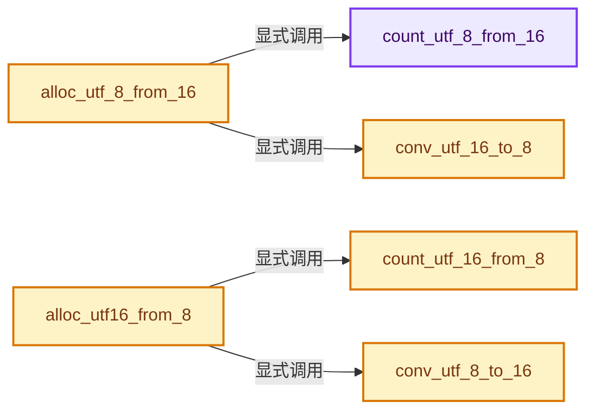
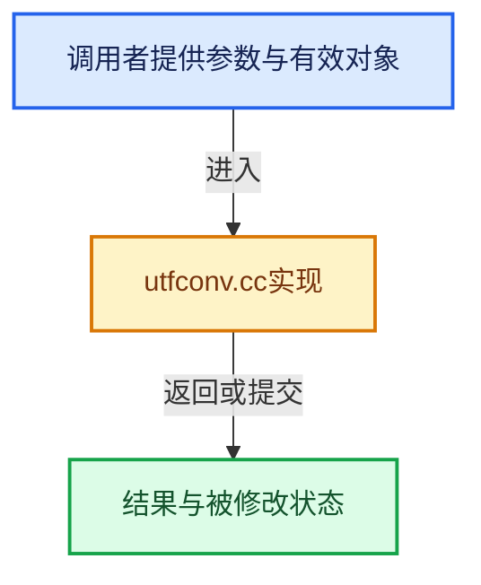

# 实现依赖专题：intern/utfconv/utfconv.cc

[方向导航](README.md) · [符号索引](../%E7%AC%A6%E5%8F%B7%E4%BE%9D%E8%B5%96%E4%B8%8E%E5%AE%9E%E7%8E%B0%E7%B4%A2%E5%BC%95.md)

本专题从正文实际调用进入，集中保存共享实现。函数有稳定锚点，可从调用处直接跳到对应完整函数；递归与互相调用通过回链组织。

## 本文件的实现关系






## 完整成员与函数实现

<a id="f-b558572f058113ae"></a>

### `count_utf_8_from_16`

实现位置：[intern/utfconv/utfconv.cc](../../../../../intern/utfconv/utfconv.cc) · L11—L56。

接口参数：

- `const wchar_t *string16`

**教学注释版**

<!-- annotated:ad2d9b6c6d321a -->

```cpp
size_t count_utf_8_from_16(const wchar_t *string16)
{
  int i;
  size_t count = 0;
  wchar_t u = 0;
  if (!string16) {
    return 0;
  }

  for (i = 0; (u = string16[i]); i++) {
    if (u < 0x0080) {
      count += 1;
    }
    else {
      if (u < 0x0800) {
        count += 2;
      }
      else {
        if (u < 0xD800) {
          count += 3;
        }
        else {
          if (u < 0xDC00) {
            i++;
            if ((u = string16[i]) == 0) {
              break;
            }
            if (u >= 0xDC00 && u < 0xE000) {
              count += 4;
            }
          }
          else {
            if (u < 0xE000) {
              /* Illegal. */
            }
            else {
              count += 3;
            }
          }
        }
      }
    }
  }

  return ++count;
}
```

<details>
<summary>核对原始源码：intern/utfconv/utfconv.cc · L11—L56</summary>

<!-- original:ad2d9b6c6d321a:intern/utfconv/utfconv.cc:11:56 -->

```cpp
size_t count_utf_8_from_16(const wchar_t *string16)
{
  int i;
  size_t count = 0;
  wchar_t u = 0;
  if (!string16) {
    return 0;
  }

  for (i = 0; (u = string16[i]); i++) {
    if (u < 0x0080) {
      count += 1;
    }
    else {
      if (u < 0x0800) {
        count += 2;
      }
      else {
        if (u < 0xD800) {
          count += 3;
        }
        else {
          if (u < 0xDC00) {
            i++;
            if ((u = string16[i]) == 0) {
              break;
            }
            if (u >= 0xDC00 && u < 0xE000) {
              count += 4;
            }
          }
          else {
            if (u < 0xE000) {
              /* Illegal. */
            }
            else {
              count += 3;
            }
          }
        }
      }
    }
  }

  return ++count;
}
```

</details>

**沿实际写入检查状态**

- `count += 1;`
- `count += 2;`
- `count += 3;`
- `count += 4;`

**结果出口**

- `return 0;`
- `return ++count;`

**继续追踪实现**

本实现没有需要继续展开的显式调用；检查返回表达式、对象转换和调用者前置条件。

<a id="f-3dbe1413de751fde"></a>

### `count_utf_16_from_8`

实现位置：[intern/utfconv/utfconv.cc](../../../../../intern/utfconv/utfconv.cc) · L58—L114。

接口参数：

- `const char *string8`

**教学注释版**

<!-- annotated:eba8e140329482 -->

```cpp
size_t count_utf_16_from_8(const char *string8)
{
  size_t count = 0;
  char u;
  char type = 0;
  unsigned int u32 = 0;

  if (!string8) {
    return 0;
  }

  for (; (u = *string8); string8++) {
    if (type == 0) {
      if ((u & 0x01 << 7) == 0) {
        count++;
        u32 = 0;
        continue;
      }  // 1 utf-8 char
      if ((u & 0x07 << 5) == 0xC0) {
        type = 1;
        u32 = u & 0x1F;
        continue;
      }  // 2 utf-8 char
      if ((u & 0x0F << 4) == 0xE0) {
        type = 2;
        u32 = u & 0x0F;
        continue;
      }  // 3 utf-8 char
      if ((u & 0x1F << 3) == 0xF0) {
        type = 3;
        u32 = u & 0x07;
        continue;
      }  // 4 utf-8 char
      continue;
    }
    if ((u & 0xC0) == 0x80) {
      u32 = (u32 << 6) | (u & 0x3F);
      type--;
    }
    else {
      u32 = 0;
      type = 0;
    }

    if (type == 0) {
      if ((0 < u32 && u32 < 0xD800) || (0xE000 <= u32 && u32 < 0x10000)) {
        count++;
      }
      else if (0x10000 <= u32 && u32 < 0x110000) {
        count += 2;
      }
      u32 = 0;
    }
  }

  return ++count;
}
```

<details>
<summary>核对原始源码：intern/utfconv/utfconv.cc · L58—L114</summary>

<!-- original:eba8e140329482:intern/utfconv/utfconv.cc:58:114 -->

```cpp
size_t count_utf_16_from_8(const char *string8)
{
  size_t count = 0;
  char u;
  char type = 0;
  unsigned int u32 = 0;

  if (!string8) {
    return 0;
  }

  for (; (u = *string8); string8++) {
    if (type == 0) {
      if ((u & 0x01 << 7) == 0) {
        count++;
        u32 = 0;
        continue;
      }  // 1 utf-8 char
      if ((u & 0x07 << 5) == 0xC0) {
        type = 1;
        u32 = u & 0x1F;
        continue;
      }  // 2 utf-8 char
      if ((u & 0x0F << 4) == 0xE0) {
        type = 2;
        u32 = u & 0x0F;
        continue;
      }  // 3 utf-8 char
      if ((u & 0x1F << 3) == 0xF0) {
        type = 3;
        u32 = u & 0x07;
        continue;
      }  // 4 utf-8 char
      continue;
    }
    if ((u & 0xC0) == 0x80) {
      u32 = (u32 << 6) | (u & 0x3F);
      type--;
    }
    else {
      u32 = 0;
      type = 0;
    }

    if (type == 0) {
      if ((0 < u32 && u32 < 0xD800) || (0xE000 <= u32 && u32 < 0x10000)) {
        count++;
      }
      else if (0x10000 <= u32 && u32 < 0x110000) {
        count += 2;
      }
      u32 = 0;
    }
  }

  return ++count;
}
```

</details>

**沿实际写入检查状态**

- `u32 = 0;`
- `type = 1;`
- `u32 = u & 0x1F;`
- `type = 2;`
- `u32 = u & 0x0F;`
- `type = 3;`
- `u32 = u & 0x07;`
- `u32 = (u32 << 6) | (u & 0x3F);`
- `type = 0;`
- `count += 2;`

**结果出口**

- `return 0;`
- `return ++count;`

**继续追踪实现**

本实现没有需要继续展开的显式调用；检查返回表达式、对象转换和调用者前置条件。

<a id="f-a9a82cceffb55796"></a>

### `conv_utf_16_to_8`

实现位置：[intern/utfconv/utfconv.cc](../../../../../intern/utfconv/utfconv.cc) · L116—L180。

接口参数：

- `const wchar_t *in16`
- `char *out8`
- `size_t size8`

**教学注释版**

<!-- annotated:b089c5efe11028 -->

```cpp
int conv_utf_16_to_8(const wchar_t *in16, char *out8, size_t size8)
{
  char *out8end = out8 + size8;
  wchar_t u = 0;
  int err = 0;
  if (!size8 || !in16 || !out8) {
    return UTF_ERROR_NULL_IN;
  }
  out8end--;

  for (; out8 < out8end && (u = *in16); in16++, out8++) {
    if (u < 0x0080) {
      *out8 = u;
    }
    else if (u < 0x0800) {
      if (out8 + 1 >= out8end) {
        break;
      }
      *out8++ = (0x3 << 6) | (0x1F & (u >> 6));
      *out8 = (0x1 << 7) | (0x3F & (u));
    }
    else if (u < 0xD800 || u >= 0xE000) {
      if (out8 + 2 >= out8end) {
        break;
      }
      *out8++ = (0x7 << 5) | (0xF & (u >> 12));
      *out8++ = (0x1 << 7) | (0x3F & (u >> 6));
      *out8 = (0x1 << 7) | (0x3F & (u));
    }
    else if (u < 0xDC00) {
      wchar_t u2 = *++in16;

      if (!u2) {
        break;
      }
      if (u2 >= 0xDC00 && u2 < 0xE000) {
        if (out8 + 3 >= out8end) {
          break;
        }
        unsigned int uc = 0x10000 + (u2 - 0xDC00) + ((u - 0xD800) << 10);

        *out8++ = (0xF << 4) | (0x7 & (uc >> 18));
        *out8++ = (0x1 << 7) | (0x3F & (uc >> 12));
        *out8++ = (0x1 << 7) | (0x3F & (uc >> 6));
        *out8 = (0x1 << 7) | (0x3F & (uc));
      }
      else {
        out8--;
        err |= UTF_ERROR_ILLCHAR;
      }
    }
    else if (u < 0xE000) {
      out8--;
      err |= UTF_ERROR_ILLCHAR;
    }
  }

  *out8 = *out8end = 0;

  if (*in16) {
    err |= UTF_ERROR_SMALL;
  }

  return err;
}
```

<details>
<summary>核对原始源码：intern/utfconv/utfconv.cc · L116—L180</summary>

<!-- original:b089c5efe11028:intern/utfconv/utfconv.cc:116:180 -->

```cpp
int conv_utf_16_to_8(const wchar_t *in16, char *out8, size_t size8)
{
  char *out8end = out8 + size8;
  wchar_t u = 0;
  int err = 0;
  if (!size8 || !in16 || !out8) {
    return UTF_ERROR_NULL_IN;
  }
  out8end--;

  for (; out8 < out8end && (u = *in16); in16++, out8++) {
    if (u < 0x0080) {
      *out8 = u;
    }
    else if (u < 0x0800) {
      if (out8 + 1 >= out8end) {
        break;
      }
      *out8++ = (0x3 << 6) | (0x1F & (u >> 6));
      *out8 = (0x1 << 7) | (0x3F & (u));
    }
    else if (u < 0xD800 || u >= 0xE000) {
      if (out8 + 2 >= out8end) {
        break;
      }
      *out8++ = (0x7 << 5) | (0xF & (u >> 12));
      *out8++ = (0x1 << 7) | (0x3F & (u >> 6));
      *out8 = (0x1 << 7) | (0x3F & (u));
    }
    else if (u < 0xDC00) {
      wchar_t u2 = *++in16;

      if (!u2) {
        break;
      }
      if (u2 >= 0xDC00 && u2 < 0xE000) {
        if (out8 + 3 >= out8end) {
          break;
        }
        unsigned int uc = 0x10000 + (u2 - 0xDC00) + ((u - 0xD800) << 10);

        *out8++ = (0xF << 4) | (0x7 & (uc >> 18));
        *out8++ = (0x1 << 7) | (0x3F & (uc >> 12));
        *out8++ = (0x1 << 7) | (0x3F & (uc >> 6));
        *out8 = (0x1 << 7) | (0x3F & (uc));
      }
      else {
        out8--;
        err |= UTF_ERROR_ILLCHAR;
      }
    }
    else if (u < 0xE000) {
      out8--;
      err |= UTF_ERROR_ILLCHAR;
    }
  }

  *out8 = *out8end = 0;

  if (*in16) {
    err |= UTF_ERROR_SMALL;
  }

  return err;
}
```

</details>

**沿实际写入检查状态**

- `err |= UTF_ERROR_ILLCHAR;`
- `err |= UTF_ERROR_SMALL;`

**结果出口**

- `return UTF_ERROR_NULL_IN;`
- `return err;`

**继续追踪实现**

本实现没有需要继续展开的显式调用；检查返回表达式、对象转换和调用者前置条件。

<a id="f-b75f8d137a0839e4"></a>

### `conv_utf_8_to_16`

实现位置：[intern/utfconv/utfconv.cc](../../../../../intern/utfconv/utfconv.cc) · L182—L256。

接口参数：

- `const char *in8`
- `wchar_t *out16`
- `size_t size16`

**教学注释版**

<!-- annotated:876c3f4a39e386 -->

```cpp
int conv_utf_8_to_16(const char *in8, wchar_t *out16, size_t size16)
{
  char u;
  char type = 0;
  unsigned int u32 = 0;
  wchar_t *out16end = out16 + size16;
  int err = 0;
  if (!size16 || !in8 || !out16) {
    return UTF_ERROR_NULL_IN;
  }
  out16end--;

  for (; out16 < out16end && (u = *in8); in8++) {
    if (type == 0) {
      if ((u & 0x01 << 7) == 0) {
        *out16 = u;
        out16++;
        u32 = 0;
        continue;
      }  // 1 utf-8 char
      if ((u & 0x07 << 5) == 0xC0) {
        type = 1;
        u32 = u & 0x1F;
        continue;
      }  // 2 utf-8 char
      if ((u & 0x0F << 4) == 0xE0) {
        type = 2;
        u32 = u & 0x0F;
        continue;
      }  // 3 utf-8 char
      if ((u & 0x1F << 3) == 0xF0) {
        type = 3;
        u32 = u & 0x07;
        continue;
      }  // 4 utf-8 char
      err |= UTF_ERROR_ILLCHAR;
      continue;
    }
    if ((u & 0xC0) == 0x80) {
      u32 = (u32 << 6) | (u & 0x3F);
      type--;
    }
    else {
      u32 = 0;
      type = 0;
      err |= UTF_ERROR_ILLSEQ;
    }

    if (type == 0) {
      if ((0 < u32 && u32 < 0xD800) || (0xE000 <= u32 && u32 < 0x10000)) {
        *out16 = u32;
        out16++;
      }
      else if (0x10000 <= u32 && u32 < 0x110000) {
        if (out16 + 1 >= out16end) {
          break;
        }
        u32 -= 0x10000;
        *out16 = 0xD800 + (u32 >> 10);
        out16++;
        *out16 = 0xDC00 + (u32 & 0x3FF);
        out16++;
      }
      u32 = 0;
    }
  }

  *out16 = *out16end = 0;

  if (*in8) {
    err |= UTF_ERROR_SMALL;
  }

  return err;
}
```

<details>
<summary>核对原始源码：intern/utfconv/utfconv.cc · L182—L256</summary>

<!-- original:876c3f4a39e386:intern/utfconv/utfconv.cc:182:256 -->

```cpp
int conv_utf_8_to_16(const char *in8, wchar_t *out16, size_t size16)
{
  char u;
  char type = 0;
  unsigned int u32 = 0;
  wchar_t *out16end = out16 + size16;
  int err = 0;
  if (!size16 || !in8 || !out16) {
    return UTF_ERROR_NULL_IN;
  }
  out16end--;

  for (; out16 < out16end && (u = *in8); in8++) {
    if (type == 0) {
      if ((u & 0x01 << 7) == 0) {
        *out16 = u;
        out16++;
        u32 = 0;
        continue;
      }  // 1 utf-8 char
      if ((u & 0x07 << 5) == 0xC0) {
        type = 1;
        u32 = u & 0x1F;
        continue;
      }  // 2 utf-8 char
      if ((u & 0x0F << 4) == 0xE0) {
        type = 2;
        u32 = u & 0x0F;
        continue;
      }  // 3 utf-8 char
      if ((u & 0x1F << 3) == 0xF0) {
        type = 3;
        u32 = u & 0x07;
        continue;
      }  // 4 utf-8 char
      err |= UTF_ERROR_ILLCHAR;
      continue;
    }
    if ((u & 0xC0) == 0x80) {
      u32 = (u32 << 6) | (u & 0x3F);
      type--;
    }
    else {
      u32 = 0;
      type = 0;
      err |= UTF_ERROR_ILLSEQ;
    }

    if (type == 0) {
      if ((0 < u32 && u32 < 0xD800) || (0xE000 <= u32 && u32 < 0x10000)) {
        *out16 = u32;
        out16++;
      }
      else if (0x10000 <= u32 && u32 < 0x110000) {
        if (out16 + 1 >= out16end) {
          break;
        }
        u32 -= 0x10000;
        *out16 = 0xD800 + (u32 >> 10);
        out16++;
        *out16 = 0xDC00 + (u32 & 0x3FF);
        out16++;
      }
      u32 = 0;
    }
  }

  *out16 = *out16end = 0;

  if (*in8) {
    err |= UTF_ERROR_SMALL;
  }

  return err;
}
```

</details>

**沿实际写入检查状态**

- `u32 = 0;`
- `type = 1;`
- `u32 = u & 0x1F;`
- `type = 2;`
- `u32 = u & 0x0F;`
- `type = 3;`
- `u32 = u & 0x07;`
- `err |= UTF_ERROR_ILLCHAR;`
- `u32 = (u32 << 6) | (u & 0x3F);`
- `type = 0;`
- `err |= UTF_ERROR_ILLSEQ;`
- `u32 -= 0x10000;`
- `err |= UTF_ERROR_SMALL;`

**结果出口**

- `return UTF_ERROR_NULL_IN;`
- `return err;`

**继续追踪实现**

本实现没有需要继续展开的显式调用；检查返回表达式、对象转换和调用者前置条件。

<a id="f-50ee804238d344ea"></a>

### `alloc_utf_8_from_16`

实现位置：[intern/utfconv/utfconv.cc](../../../../../intern/utfconv/utfconv.cc) · L282—L292。

接口参数：

- `const wchar_t *in16`
- `size_t add`

**教学注释版**

<!-- annotated:56d9df0c2dbee7 -->

```cpp
char *alloc_utf_8_from_16(const wchar_t *in16, size_t add)
{
  size_t bsize = count_utf_8_from_16(in16);
  char *out8 = nullptr;
  if (!bsize) {
    return nullptr;
  }
  // [讲解] malloc：取得原始存储，失败可返回空指针；不构造C++对象。必须与匹配释放接口及对象寿命管理结合。
  out8 = (char *)malloc(sizeof(char) * (bsize + add));
  conv_utf_16_to_8(in16, out8, bsize);
  return out8;
}
```

<details>
<summary>核对原始源码：intern/utfconv/utfconv.cc · L282—L292</summary>

<!-- original:56d9df0c2dbee7:intern/utfconv/utfconv.cc:282:292 -->

```cpp
char *alloc_utf_8_from_16(const wchar_t *in16, size_t add)
{
  size_t bsize = count_utf_8_from_16(in16);
  char *out8 = nullptr;
  if (!bsize) {
    return nullptr;
  }
  out8 = (char *)malloc(sizeof(char) * (bsize + add));
  conv_utf_16_to_8(in16, out8, bsize);
  return out8;
}
```

</details>

**沿实际写入检查状态**

- `out8 = (char *)malloc(sizeof(char) * (bsize + add));`

**结果出口**

- `return nullptr;`
- `return out8;`

**继续追踪实现**

- `count_utf_8_from_16` → [count_utf_8_from_16 · L11](%E4%BE%9D%E8%B5%96-utfconv-434070.md#f-b558572f058113ae)。
- `malloc` → [外部契约](https://eel.is/c++draft/c.malloc)：取得原始存储，失败可返回空指针；不构造C++对象。必须与匹配释放接口及对象寿命管理结合。
- `conv_utf_16_to_8` → [conv_utf_16_to_8 · L116](%E4%BE%9D%E8%B5%96-utfconv-434070.md#f-a9a82cceffb55796)。

<a id="f-78e5de8a178cdc83"></a>

### `alloc_utf16_from_8`

实现位置：[intern/utfconv/utfconv.cc](../../../../../intern/utfconv/utfconv.cc) · L294—L304。

接口参数：

- `const char *in8`
- `size_t add`

**教学注释版**

<!-- annotated:c1d9dc7f27f60b -->

```cpp
wchar_t *alloc_utf16_from_8(const char *in8, size_t add)
{
  size_t bsize = count_utf_16_from_8(in8);
  wchar_t *out16 = nullptr;
  if (!bsize) {
    return nullptr;
  }
  // [讲解] malloc：取得原始存储，失败可返回空指针；不构造C++对象。必须与匹配释放接口及对象寿命管理结合。
  out16 = (wchar_t *)malloc(sizeof(wchar_t) * (bsize + add));
  conv_utf_8_to_16(in8, out16, bsize);
  return out16;
}
```

<details>
<summary>核对原始源码：intern/utfconv/utfconv.cc · L294—L304</summary>

<!-- original:c1d9dc7f27f60b:intern/utfconv/utfconv.cc:294:304 -->

```cpp
wchar_t *alloc_utf16_from_8(const char *in8, size_t add)
{
  size_t bsize = count_utf_16_from_8(in8);
  wchar_t *out16 = nullptr;
  if (!bsize) {
    return nullptr;
  }
  out16 = (wchar_t *)malloc(sizeof(wchar_t) * (bsize + add));
  conv_utf_8_to_16(in8, out16, bsize);
  return out16;
}
```

</details>

**沿实际写入检查状态**

- `out16 = (wchar_t *)malloc(sizeof(wchar_t) * (bsize + add));`

**结果出口**

- `return nullptr;`
- `return out16;`

**继续追踪实现**

- `count_utf_16_from_8` → [count_utf_16_from_8 · L58](%E4%BE%9D%E8%B5%96-utfconv-434070.md#f-3dbe1413de751fde)。
- `malloc` → [外部契约](https://eel.is/c++draft/c.malloc)：取得原始存储，失败可返回空指针；不构造C++对象。必须与匹配释放接口及对象寿命管理结合。
- `conv_utf_8_to_16` → [conv_utf_8_to_16 · L182](%E4%BE%9D%E8%B5%96-utfconv-434070.md#f-b75f8d137a0839e4)。
